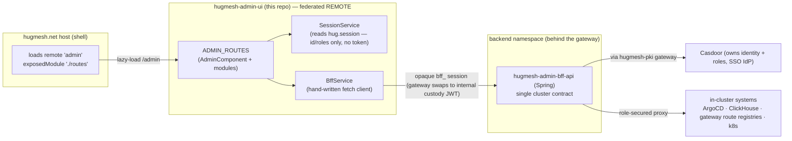
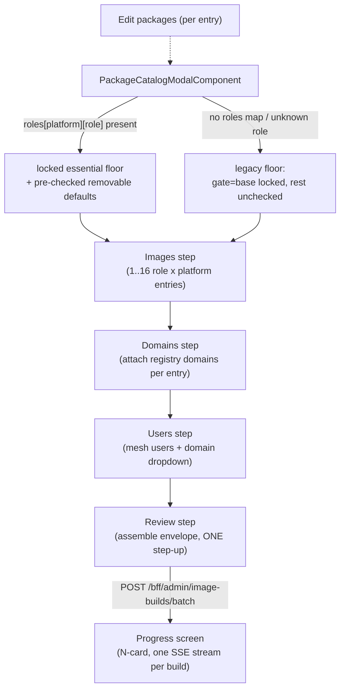
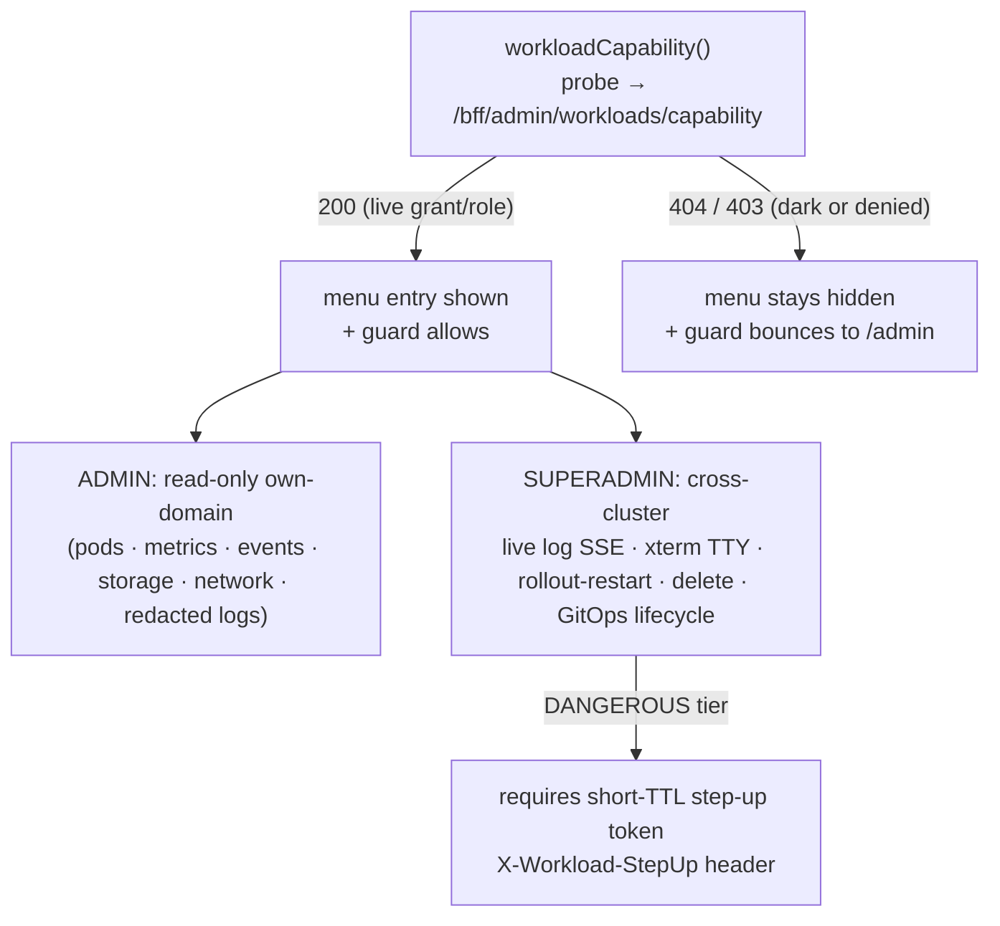
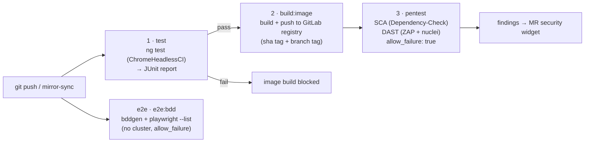

Admin console for the HugMesh platform. This repo is an **Angular 22
native-federation REMOTE** (remote name `admin`) that was split out of
hugmesh-social-ui. At runtime the **hugmesh.net host** loads this
remote's single exposed module (`./routes`) and mounts its `ADMIN_ROUTES`
at **/admin**.

## Where it sits in the architecture

| Concern        | This repo                                                              |
| -------------- | --------------------------------------------------------------------- |
| Tier           | Frontend / micro-frontend (a federated **remote**, not a host)        |
| Namespace      | `hugmesh-frontend` — runs as its own nginx pod                         |
| Fronted by     | the **fe-gateway** at `/admin`                                         |
| Backed by      | **hugmesh-admin-bff-api** (Spring), in the backend namespace, behind the gateway |
| Auth model     | Casdoor **admin role** for most routes; **superadmin role** for the superadmin-only routes; the host route-guards `/admin` |
| Federation host| **hugmesh.net** (loads `remoteName: 'admin', exposedModule: './routes'`) |



> The diagram shows the **shipped** wiring. Roles are **owned by Casdoor**; this UI
> never mints or evaluates authority on its own — it only reflects the
> `hug.session` roles and lets the BFF/gateway enforce. See the **Roadmap** section
> for surfaces that are designed/in-flight but not yet shipped here.

This is the admin surface of the multi-brand / multi-tenant platform. It is a
*presentation layer only*: every privileged action is brokered by the admin BFF,
which is the single cluster contract. The BFF reaches **Casdoor through the
hugmesh-pki gateway** for identity and role operations, and proxies in-cluster
systems (ArgoCD, ClickHouse, the gateway route registries) so their URLs and
tokens never leave the cluster.

> **Multi-tenancy note:** The platform's per-domain CA + per-brand
> gateway/BFF/UI model with its least-privilege cascade (SUPERADMIN→ADMIN→MOD→USER)
> means this console is the **per-brand ADMIN surface**. As shipped (✅), the base
> gate is a Casdoor `admin` role (`roles.includes('admin')`); a handful of routes
> additionally require `superadmin` (enforced by `superadminGuard`); one route
> uses the games-services derived roles; and one route (`/admin/my-fleet`) uses the
> fleet-owner capability role (`fleetAdminGuard`). **Domain scoping is enforced upstream at the
> gateway and BFF** (the BFF stamps every call to the caller's domain) — the
> client-side role flags are presentation-only, and the BFF/gateway is the authority.

> State convention used below: **✅ shipped** = merged to `main`;
> **🚧 in-flight** = code on an open branch/PR; **🔭 planned** = design-complete, no
> code in this repo. Unless marked otherwise, everything documented here is ✅ shipped.

## Current State

The whole route surface, role gate, and BFF contract documented in this README are
**✅ shipped on `main`** (Angular 22 native-federation remote, exposed `./routes`).
No auth-relevant work is sitting unmerged on a side branch — every prior
auth/route/oidc/delegation branch has landed (or was a superseded draft fully
absorbed into `main`).

The one place this UI is **deliberately tracking a moving backend** is the auth /
session bridge, recently unified across the platform:

- **Login is native, not a Casdoor redirect.** The old OIDC authorization-code
  (PKCE) browser-redirect flow has been superseded platform-wide: each service's
  own login-ui remote posts credentials to a login-style endpoint on that
  service's own BFF, and **`hugmesh-user-bff` holds per-session JWT
  custody/refresh server-side.** **Casdoor is internal-only and never redirects
  the browser.** The browser holds only the opaque, HttpOnly **`bff_` cookie**
  (never readable by JS) plus the identity/roles `hug.session` localStorage
  payload. **The user never sees their own Casdoor JWT.**
- **The gateway is a pure Casdoor-JWT OAuth2 resource server.** A pre-security
  exchange filter swaps the opaque `bff_` session → the internal custody JWT, so
  the gateway's JWT validation + role gate run unchanged. Authorization is
  data-driven by the `gateway_route_access` Postgres table (source of truth) via
  `GatewayRouteAccessFilter`; ADMIN/GAME-MASTER bypass within their own domain,
  SUPERADMIN cross-domain. The SCG-5 route-namespace move
  (`spring.cloud.gateway.routes` → `spring.cloud.gateway.server.webflux.routes`)
  is already applied across the gateways + generator route templates. Cloudflare
  fronts prod.
- **Login / session / account logic is being RELOCATED from admin-bff to
  user-bff**, with the shared account/session/MFA/Casdoor-admin infra extracted
  into the new **`hugmesh-auth-core`** Maven artifact (2.3.0, consumed by
  user-bff + admin-bff only). **Account / session DATA still lives in
  admin-bff-db**; user-bff reaches it via admin-bff `/bff/internal` over
  mTLS + `X-Internal-Token`.
- Backend baseline (recently unified): **Spring Boot 4.0.7 / Spring Cloud
  2025.1.2 / Java 25 LTS**, on `hugmesh-parent` (metapom 2.7.0) +
  `hugmesh-commons` (2.7.0).

> Implication for this UI: the opaque **`bff_` session lives in an HttpOnly
> cookie**, not a field on `hug.session` — the gateway performs the `bff_`→JWT
> swap server-side. `BffService` continues to send it automatically via
> `credentials: 'include'` on every call; the registration / login /
> service-token broker flow lives in the **login remote** (now backed by user-bff),
> not here.

## Routes (mounted by the host at `/admin`)

The remote exposes `ADMIN_ROUTES` (`src/app/admin.routes.ts`). The host mounts
them at `/admin`, so they resolve to the paths below. The **Guard** column is the
route-level `canActivate` (none = host/admin-guarded only); the **Menu** column is
whether `AdminComponent`'s nav surfaces the route as a `routerLink`. All of these
are ✅ shipped on `main`.

| Host path                 | View                                                | Component                   | Guard            | Menu |
| ------------------------- | --------------------------------------------------- | --------------------------- | ---------------- | ---- |
| `/admin`                  | Registration allowlist + admin menu                 | `AdminComponent`            | —                | (landing) |
| `/admin/usage`            | ClickHouse usage dashboard                          | `UsageComponent`            | —                | yes  |
| `/admin/namespaces`       | Namespace access grants                             | `NamespaceAccessComponent`  | —                | yes  |
| `/admin/delegation`       | Access-role suspend/ban + lift, domain-lock add/remove | `DelegationComponent`    | —                | yes  |
| `/admin/route-access`     | Per-gateway role→URL access rules                   | `RouteAccessComponent`      | —                | yes  |
| `/admin/routes`           | Gateway route definitions                           | `RouteDefinitionsComponent` | —                | yes  |
| `/admin/isos`             | CI ISO download links                               | `IsoDownloadsComponent`     | —                | yes  |
| `/admin/argocd`           | ArgoCD applications dashboard                        | `ArgocdDashboardComponent`  | —                | yes  |
| `/admin/tasks`            | Guided admin-task wizard                             | `AdminTaskWizardComponent`  | —                | yes  |
| `/admin/backup`           | Start a cloud/USB backup                            | `BackupComponent`           | —                | yes  |
| `/admin/recovery`         | Restore a backup                                    | `RecoveryComponent`         | —                | yes  |
| `/admin/backups`          | Backup + restore history                            | `BackupHistoryComponent`    | —                | yes  |
| `/admin/cloud-backups`    | Cloud backups (per-domain + superadmin TOTAL, versioned, step-up restore) | `CloudBackupsComponent` | —          | yes  |
| `/admin/backing-services` | Managed backing-services console — self-hosted (default) vs managed-cloud mode per closed-catalog infra service | `BackingServicesComponent` | `superadminGuard` | no (route-only) |
| `/admin/announcements`    | Announcements (create + schedule + target)          | `AnnouncementListComponent` | —                | yes  |
| `/admin/test-reports`     | Test-architecture run history + on-demand run + download | `TestReportsComponent` | —                | yes  |
| `/admin/image-gen`        | Image-generation console: worklist BATCH wizard (up to 16 images/step-up, role-aware package tiers) + build history/detail + SSE progress + download, capability-gated | `ImageGenComponent` | —          | yes  |
| `/admin/forum`            | Forum (phpBB ACP) admin proxy                       | `ForumAdminComponent`       | —                | yes  |
| `/admin/appeals`          | Appeals-Decide console — CONTENT-moderation appeals (decide-proxy, domain-scoped) | `AppealsComponent`         | —                | yes  |
| `/admin/account-appeals`  | Account-ban appeal inbox — a curtailed user's own appeal against their `access_suspension` PROFILE ban; approve actually restores access (distinct from `/admin/appeals` above, which decides content-moderation rows) | `AccountAppealsComponent` | —          | yes  |
| `/admin/security`         | Self-service Security console: enroll/list/remove your OWN MFA factors (TOTP + WebAuthn passkey), regenerate recovery codes; also the inline `MfaStepUpDialogComponent` any privileged action reuses for the "requires step-up" 403 | `MfaSecurityComponent` | — | yes |
| `/admin/device-licenses`  | Device-ownership / SSH-operate-license registry      | `DeviceLicensesComponent`   | `superadminGuard` | superadmin-only |
| `/admin/device-pending`   | Pending headscale-node pick-list (assign into registry) | `DevicePendingComponent` | `superadminGuard` | superadmin-only |
| `/admin/phone-fleet`      | Sovereign MDM phone fleet registry — device management (managed/BYOD) + lock/unlock, device-reported Headwind or Azure Intune provider | `PhoneFleetComponent` | `superadminGuard` | superadmin-only |
| `/admin/my-fleet`         | Fleet-owner view over the caller's own phones only (lock/unlock, no mark-managed/owner-assignment) — the tenancy-walled twin of Phone fleet | `MyFleetComponent` | `fleetAdminGuard` | fleet-owner only |
| `/admin/fleet-entitlements` | Grant/update/revoke a subject's FLEET_ADMIN subscription (required to reach My fleet) | `FleetEntitlementsComponent` | `superadminGuard` | superadmin-only |
| `/admin/node-storage`     | Attach + register additional node-pinned storage     | `StoragePoolsComponent`     | —                | yes  |
| `/admin/device-radios`    | Attach a Meshtastic LoRa radio (USB serial, LoRa-WiFi TCP, or MQTT-broker WAN mesh) to a mesh node for the mesh↔Matrix bridge | `DeviceRadiosComponent` | — | yes  |
| `/admin/domain-capabilities` | Per-domain capability gate (first capability: `user-mesh-devices`) — superadmin grant + domain-admin enable, plus a platform-wide kill switch | `DomainCapabilitiesComponent` | — | yes  |
| `/admin/desktop`          | Desktop governance (Discover curation, sudo toggle, install inbox, remote-install + SSH terminal) | `DesktopGovernanceComponent` | —    | yes  |
| `/admin/egress-vpn`       | Import provider WireGuard/OpenVPN egress configs     | `EgressVpnComponent`        | `superadminGuard` | superadmin-only |
| `/admin/superadmin/domains` | Domain-registry (brand list) console + per-row provisioning-state chip | `SuperadminDomainsComponent`| `superadminGuard` | superadmin-only |
| `/admin/oidc-providers`   | Per-OIDC-provider default-role mappings              | `OidcProviderRolesComponent`| —                | no (route-only) |
| `/admin/games-services`   | Games app-store operator console                     | `GamesServicesComponent`    | `gamesServicesGuard` | no (route-only) |
| `/admin/superadmin/anubis`| Anubis PoW sidecar status + metrics (read-only)      | `AnubisAdminComponent`      | `superadminGuard` | no (route-only) |
| `/admin/workloads`        | Workload Console (HIDDEN tier — pod mgmt)            | `WorkloadConsoleComponent`  | `workloadConsoleGuard` | hidden (capability-probe) |
| `/admin/workloads/logs`   | Workload live-log view (SUPERADMIN)                  | `WorkloadLogsComponent`     | `workloadConsoleGuard` | hidden |
| `/admin/workloads/terminal` | Workload pod TTY (SUPERADMIN, xterm.js)            | `WorkloadTerminalComponent` | `workloadConsoleGuard` | hidden |

`AdminComponent` is both the landing view (registration allowlist) and the admin
**menu**. The menu does **not** auto-surface every route:

- **Superadmin-only items** appear only when the session carries the `superadmin`
  role. The route guard (`superadminGuard`) provides a second layer of enforcement.
- The **My fleet** item appears only when the session carries the fleet capability
  (`fleet_admin` role, or the broader `admin`/`superadmin` roles — see
  `SessionService.isFleetAdmin()`). The route guard (`fleetAdminGuard`) provides a
  second layer of enforcement.
- The **Workload Console** is a **HIDDEN tier** entry that appears only after a
  server-confirmed capability probe succeeds (`/bff/admin/workloads/capability`;
  `200` = live grant/role, `404` = dark or denied).
- A few routes (`/admin/backing-services`, `/admin/oidc-providers`,
  `/admin/games-services`, `/admin/superadmin/anubis`) have no top-level menu entry
  and are reached only by direct navigation or cross-links from other views.

## Role gate & session

The host route-guards `/admin` behind the Casdoor **admin role**. This repo also
ships five `CanActivateFn` guards for finer-grained in-remote routing (though one,
`adminGuard`, is not currently attached to any route — see the note below the
table). All client-side role checks are **presentation-only** — the BFF and
gateway are the authority:

| Guard                  | File                          | Allows when                                                                 | Guards |
| ---------------------- | ----------------------------- | --------------------------------------------------------------------------- | ------ |
| `adminGuard`           | `src/app/admin.guard.ts`      | `isAdmin()` (`roles` includes `admin`), else `/login`                        | **none today** — defined + unit-tested (`admin.guard.spec.ts`) but not wired into any `canActivate` in `ADMIN_ROUTES` |
| `superadminGuard`      | `src/app/superadmin.guard.ts` | `isSuperadmin()` (`roles` includes `superadmin`), else `/login`              | device-licenses, device-pending, phone-fleet, fleet-entitlements, egress-vpn, superadmin/domains, superadmin/anubis, backing-services |
| `fleetAdminGuard`      | `src/app/fleet.guard.ts`      | `isFleetAdmin()` (`roles` includes `fleet_admin`, or `admin`/`superadmin`), else `/login` | my-fleet |
| `gamesServicesGuard`   | `src/app/games-services.guard.ts` | `isGamesServicesAdmin()` **or** `isGamesServicesRunner()`, else `/login`  | games-services |
| `workloadConsoleGuard` | `src/app/workload-console.guard.ts` | admin/superadmin **and** a live server-confirmed `workloadCapability()` probe (200); else bounced to `/admin` | workloads + workloads/logs + workloads/terminal |

> `adminGuard` predates most of the routes above and has never been attached to a
> `canActivate`; today the equivalent gate for un-superadmin-guarded routes (e.g.
> `/admin/node-storage`) is purely the host shell's own admin-role check before this
> remote is even loaded (federation exposes only `./routes`, so the host cannot import
> this exact function). See the `TODO` on `adminGuard` itself for the wire-in-or-remove
> decision.

`SessionService` (`src/app/session.service.ts`) reads the shared **`hug.session`**
localStorage key written by the **login remote**. The key carries identity
(`id`, `label`, `provider`), `roles`, and `registrationComplete`. It **no longer
carries a bearer token or provider credentials** — the browser holds only the
opaque, HttpOnly `bff_` cookie (never readable by JS); every `/bff/*` call rides
that cookie (`credentials: 'include'`) and the gateway's `BffCookieToBearerWebFilter`
swaps it for the internal custody JWT server-side. The login/registration flow
that writes this key is owned by the login remote (now backed by
`hugmesh-user-bff`, which holds the per-session JWT custody).

The service exposes role state as **computed signals**:

- `isAdmin` / `isSuperadmin` — derived from the `roles` array.
- `isFleetAdmin` — the fleet-owner capability gating the My-fleet menu item + route:
  a dedicated `fleet_admin` role, or the broader `admin`/`superadmin` roles.
- `isGamesServicesAdmin` / `isGamesServicesRunner` — games-services derived roles,
  materialised in Casdoor and surfaced in `session.roles` with the `ROLE_` prefix
  stripped and lowercased.
- `fullyRegistered` — the registration-complete gate.

The host shell and every remote each hold their own `SessionService` instance over
the same localStorage key. All instances re-read on a same-document broadcast
(`hug-session-change`) and on cross-tab `storage` events, so a session change —
for example, registration completing inside the login remote — propagates
immediately without a page reload.

## BFF contract

`BffService` (`src/app/bff.service.ts`) is the hand-written typed client against
**hugmesh-admin-bff-api**. Every call sends `credentials: 'include'` so the
opaque, HttpOnly `bff_` cookie rides the request (the browser never holds a
bearer token); the gateway's `BffCookieToBearerWebFilter` swaps it for the
internal Casdoor custody JWT server-side. Calls target the admin-scoped (and a
few superadmin-scoped) endpoints — the registration/login/Matrix-Mastodon
service-token broker flow lives in the login remote (backed by user-bff).

The BFF base URL and the Uptrace URL are read from runtime globals
(`__HUG_BFF_URL__`, `__HUG_UPTRACE_URL__`).

SSE streams (backup/restore progress, test-run progress, live workload logs) are
read with a `fetch({ credentials: 'include' })` + `ReadableStream` reader rather
than raw `EventSource`, so every streamed endpoint shares the same cookie-auth +
error-handling path as the rest of `BffService`.

| Module                  | Endpoint(s)                                                | Notes |
| ----------------------- | ---------------------------------------------------------- | ----- |
| Registration allowlist  | `GET/POST /bff/admin/allowlist`                            | Invite by Gmail address or Discord username; the BFF invites the identity in Casdoor via the pki gateway. |
| Usage analytics         | `GET /bff/admin/usage` (+ Uptrace link)                    | Aggregated by the BFF from ClickHouse (events arrive via Kafka in prod). |
| Namespace access        | `GET/POST/DELETE /bff/admin/namespace-access`, `GET /bff/me/namespaces` | Grant users access to cluster namespaces (maps to Casdoor groups + k8s RBAC server-side); scopes what each user sees in observability. |
| Route **access**        | `GET/POST/DELETE /bff/admin/route-access`                 | Per-gateway role→URL allow/deny rules. Persisted in Postgres (`gateway_route_access`, the gateway's source of truth via `GatewayRouteAccessFilter`); each gateway caches them and denies external access unless the caller's Casdoor roles match. Role-based locking of known services only — no arbitrary URLs. |
| Route **definitions**   | `GET/POST /bff/admin/routes`, `DELETE /bff/admin/routes/{pathPrefix}` | Admin-editable `url_registry` rows the gateway turns into live Spring Cloud Gateway routes (`path_prefix` → `downstream_uri`, under the SCG-5 `spring.cloud.gateway.server.webflux.routes` namespace). Distinct from route-access. |
| ISO downloads           | `GET /bff/admin/isos`                                      | Latest ISO artifacts from the GitLab/ArgoCD CI pipeline. Signed gateway-internal URLs; **KEYS material is never in these images**, so nothing secret is exposed. |
| ArgoCD dashboard        | `GET /bff/admin/argocd/applications[/{name}]`, `POST .../sync` | Role-secured proxy in the BFF (ArgoCD's own URL/token never leave the cluster). Live state; the sync mutation requires a typed `{confirm: name}` token. When ArgoCD is not wired the BFF returns `503` → an honest "ArgoCD not connected" notice. |
| Guided tasks            | `GET /bff/admin/tasks`, `POST .../steps/{stepId}/{validate\|preview\|apply}` | Data-driven step/task wizard over cluster-admin ops (gateway-route, RBAC/route-access, Casdoor user); a new server-side task appears with no UI change. Reuses the BFF's ReservedNames validation. |
| Backup & Recovery       | `POST /bff/admin/backups`, `POST /bff/admin/restores`, `GET /bff/admin/backups`, `GET /bff/admin/usb-devices`, SSE `GET /bff/admin/backups/{id}/events` | Cloud/USB targets with optional AES-256 encryption. The BFF orchestrates a k8s backup/restore worker Job and streams progress over SSE (read via `fetch`, not `EventSource`, so the bearer token can be sent). The plaintext password is sent ONCE and never stored client-side; only the BFF stores a PBKDF2 verifier and the worker derives the key. |
| Announcements           | `GET/POST/PUT/DELETE /bff/admin/announcements`             | See below. |
| Delegation / access-roles | `GET/POST/DELETE /bff/admin/access-roles/{role}/{user}`, `GET/POST/DELETE /bff/admin/domain-lock/{role}/{user}` | The narrow, AdminController-verified delegation surface: access-role suspend/ban (+ TTL or permanent) + lift, and domain-lock add/remove (force local-only, keeps the base role). Closed role vocabularies (`ROLE_MATRIX`/`ROLE_MASTODON`/`PROFILE`; `*_DOMAINLOCKED`). No general role grant/revoke exists. |
| Appeals (decide-proxy)  | `POST /bff/admin/moderation/{id}/decide?approve=<bool>`    | Approve/deny a referred moderation request — **CONTENT**-moderation (posts/profiles). The admin-bff does NOT own the table — it **proxies** to hugmesh-federation-api, forwarding the caller's JWT so federation-api applies its own `@PreAuthorize(ADMIN\|SUPERADMIN)` + **per-domain scope** (a row in another brand is invisible/404). No list endpoint yet — the console drives the decide action by known id. |
| Account appeals         | `GET /bff/admin/account-appeals`, `POST .../{id}/decide?status=APPROVED\|DENIED` | The **ACCOUNT**-ban appeal inbox — distinct from Appeals above. Decides `account_appeal` rows a curtailed user files (via login-ui's `/login/appeal` → `POST /bff/me/appeal`) against their own `access_suspension` PROFILE ban. An `APPROVED` decide **clears the underlying suspension server-side first** (`SuspensionService.clear`) — the call fails outright if that restore fails, so a failed approve is surfaced as an error, never a false success. MOD is deliberately not gated in (MOD cannot ban/unban an account, so it cannot approve an appeal against one). |
| Forum admin             | `GET/POST/DELETE /bff/admin/forum/**`                      | Proxies the phpBB ACP capability (stats/usage/users/categories/moderation-queue/audit + ban/groups/categories/moderation approve-reject/styles/extensions). Every response is the `ForumOutcome` envelope with a `result` marker (`ok` / `stubbed` / `degraded:<reason>`). |
| Test reports            | `GET /bff/admin/test-reports[/{id}]`, `GET .../{id}/download`, `POST .../run`, SSE `GET .../{id}/events` | Durable test-architecture run history + on-demand trigger + bearer-gated `tar.gz` download + live SSE progress. |
| Image generation        | `GET /bff/admin/image-builds`, `GET .../{id}`, `POST .../batch` (up to 16 entries, one step-up), SSE `GET .../{id}/events`, `GET .../{id}/image`, `GET .../{id}/keys` (`X-ImageGen-StepUp`), `GET .../catalog` | See *Image generation* below. |
| MFA (self-service + step-up) | `POST /bff/mfa/enroll/totp[/verify]`, `POST /bff/mfa/enroll/webauthn/options`, `POST /bff/mfa/enroll/webauthn/verify`, `POST /bff/mfa/assert/webauthn/options`, `GET /bff/mfa/factors`, `DELETE /bff/mfa/factors/{id}`, `POST /bff/mfa/recovery/regenerate`, `POST /bff/mfa/challenge` | Own hand-written client (`MfaService`, `src/app/mfa/mfa.service.ts` — NOT part of `BffService`, mirroring login-ui's `MfaService` against the same shared `hugmesh-auth-core` `MfaEnrollmentController`/`MfaChallengeController`). `/admin/security` (`MfaSecurityComponent`) is enroll/list/remove/regenerate; `MfaStepUpDialogComponent` is the reusable inline step-up challenge any privileged action shows on the platform's "requires step-up" 403 (see `isStepUpRequiredError`). Ships dark: every call 503s while `app.casdoor.mfa.enabled=false`. |
| Device licenses         | `GET /bff/admin/device-licenses`, `POST .../{id}/grant`, `POST .../domains/{domain}/grant`, `DELETE .../licenses/{id}` | **Superadmin**: the source of truth for device ownership / domain-residency / SSH operate-licenses. List is admin-readable (own-domain, BFF-scoped); every mutation is `hasRole('SUPERADMIN')`. Grants pin SSH key fingerprints; revoke is a CAS flip (never a delete). |
| SSH key issuance        | `GET /bff/admin/ssh-issue/devices/{deviceId}/issued-keys`, `POST /bff/admin/ssh-issue/issue?deviceId=` (`X-SshKeyIssue-StepUp`), `GET .../issued/{id}/private-key`, `DELETE .../issued/{id}` | **Superadmin**, folded into the Device Licenses console (per-device "Issued SSH keys" panel) — distinct from a license grant above: this MINTS a brand-new Ed25519 keypair (rather than pinning an operator-supplied fingerprint), registers it into the same license registry, and streams the private key back ONCE. List is admin-readable; issue/download/revoke require `hasRole('SUPERADMIN')` + a fresh step-up (`X-SshKeyIssue-StepUp` OR a fresh Casdoor-MFA stamp — the A5 unified step-up). A "requires step-up" 403 opens the shared `MfaStepUpDialogComponent` and blindly retries. Ships dark (`app.ssh-issue.enabled=false`): the list response's `enabled` field gates the Issue control and shows a notice rather than surfacing a raw 503. |
| Device pending pick-list| `GET /bff/admin/device-licenses/pending`, `POST .../register` | **Superadmin**: assign a headscale-enrolled node into the registry. `machineKeyFp` is an **opaque** token from headscale — never typed/edited; the BFF re-validates it against headscale at register. |
| Phone fleet (superadmin)| `GET /bff/superadmin/phone-devices[/{deviceId}]`, `PUT .../management`, `POST .../lock`, `POST .../unlock`, `PUT .../owner` (`X-PhoneLock-StepUp`) | **Superadmin**: the sovereign MDM phone registry — every Android phone that has self-reported (ingested) its provisioning snapshot. `management`/`lock`/`unlock` are step-up-gated, operator-set mutations (never device-claimed — `managementMode` is authoritative, distinct from the device-reported `mdmEnrolled` advisory hint); the device-reported `mdmProvider` field distinguishes the sovereign Headwind DPC from the co-equal Azure Intune (Graph) leg. `owner` assigns the fleet-tenancy wall (`physicalOwner` + `ownerDomain`) a fleet-owner needs to reach the surface below. |
| My fleet (fleet-owner)  | `GET /bff/admin/phone-fleet[/{deviceId}]`, `POST .../lock`, `POST .../unlock` (`X-PhoneLock-StepUp`) | The **PUBLIC**, tenancy-walled twin of Phone fleet above — a non-superadmin FLEET_ADMIN/ADMIN sees + locks/unlocks ONLY their own owned-and-managed devices (`physical_owner = caller AND owner_domain = caller-domain`, BFF-scoped); reads are fail-soft (a denied/un-entitled read shows an honest empty fleet). No mark-managed or owner-assignment here — those stay SUPERADMIN-only above. |
| Fleet entitlements      | `GET /bff/superadmin/fleet-entitlements`, `PUT/DELETE .../{subject}` (`X-PhoneLock-StepUp`) | **Superadmin**: grant/update/revoke the per-subject FLEET_ADMIN subscription (active flag + advisory seats + optional expiry) a non-superadmin needs to reach the "My fleet" owner surface above. |
| Node storage            | `GET /bff/admin/device-storage-pools`, `POST .../{deviceId}/pools`, `DELETE .../pools/{poolId}`, `POST .../pools/{poolId}/assignments`, `DELETE .../assignments/{id}` | **Admin-capable** (deliberate divergence from device-licenses) but **ownership-gated** downstream: an admin acts only on own-domain admin-owned nodes (403 on deny); superadmin-owned nodes are superadmin-only. Attach node-pinned storage + assign services (capacity-aware; over-subscription → 422). |
| Device radios            | `GET /bff/admin/device-radios`, `POST .../{deviceId}/radios`, `DELETE .../radios/{radioId}` | Attach a Meshtastic LoRa radio (USB serial, LoRa-WiFi TCP, or an MQTT-broker WAN mesh) to a mesh node so the meshbridge optional service can reach the LoRa mesh. **Admin-capable** like Node storage — ownership-gated downstream (own-domain admin-owned nodes only; superadmin unrestricted); each radio shows a propagation chip (pending/applied/failed/degraded). |
| Domain capabilities      | `GET /bff/admin/domain-capabilities`, `PUT .../{domain}/{capability}`, `PUT .../{domain}/{capability}/enabled` | Per-domain capability gate — first (and so far only) capability `user-mesh-devices`. Two independent keys (SUPERADMIN grants a domain, that domain's ADMIN enables it) plus a platform-wide kill switch; one route, server-scoped by the list endpoint into a superadmin cross-domain table vs. an admin own-domain toggle. |
| Egress VPN              | `GET /bff/admin/egress-vpn`, `POST .../configs`, `DELETE .../configs/{id}`, `POST .../configs/{id}/assign/{node\|domain}/{id}`, `DELETE .../assignments/{id}` | **Superadmin** mutations: import provider WireGuard/OpenVPN configs that nodes use for **outgoing** public egress. The `.conf` text is sent for parse-validation only — the BFF stores a `secret_ref` + metadata, never the private key (secrets off-DB / off-git). |
| Backing services         | `GET /bff/superadmin/backing-services`, `PUT .../{id}/mode` (`X-BackingServices-StepUp`) | **Superadmin**: the managed-vs-self-hosted axis (cloud-deploy Lane M3) over a closed catalog of infra services (object storage, SMTP, Kafka, analytics, Postgres, Cassandra, registry, secrets, PKI). Self-hosted is the byte-identical default; recording a managed mode (hosted endpoint + a creds *reference*, never key bytes) is **intent only** — the generator/effector leg converges it. Tier-3 (docs-only) services render read-only. |
| Domains (registry)      | `GET /bff/admin/domains[/{clusterDomain}]`, `POST /bff/admin/domains`, `PUT /bff/admin/domains/{clusterDomain}` | **Superadmin** (every endpoint): the runtime brand/domain registry (multi-tenancy PR9), the managed twin of the build-time `domains.conf`. No hard delete — soft-disable via `PUT enabled:false`; duplicate `cluster_domain` → 409. `caRef` is a CA *reference*, never key bytes. Each list row carries three `DomainResponse` provisioning-status fields (`caProvisioned` / `appsetRegistered` / `lastReconciledGeneration`, admin-bff #118) the console renders as a per-row chip: `isProvisioned()` = `caProvisioned && appsetRegistered` ⇒ a subtle "Provisioned" state, else a greyed/degraded "Registered — not yet provisioned" chip + helptext. The fields ship dark (default false until the generator domain-reconcile effector flips them), so at rest every freshly-registered domain reads not-yet-provisioned — the honest current state. Pure presentational (no new BFF call); colour is never the only signal (visible text + `.sr` prefix + `aria-label` + `aria-describedby`, `aria-disabled` on the degraded variant). |
| OIDC provider roles     | `GET /bff/admin/oidc-providers/roles`, `PUT/DELETE /bff/admin/oidc-providers/{provider}/roles` | Configure which roles new users auto-receive when first registering via a given OIDC identity provider. Domain-scoped for admins, all-domains for superadmin (BFF-enforced). |
| Games app-store         | `GET /bff/games-services/catalog`, `GET/POST /bff/games-services/instances`, `POST .../instances/{id}/{suspend\|resume\|terminate}` | Games-services control plane: browse the offered+enabled catalog and create/run/stop dockerized FOSS game-server instances. Authz is the games-services derived roles + domain scope at the BFF; the console greys out create for a runner. |
| Anubis (read-only)      | `GET /bff/admin/anubis/status`, `GET /bff/admin/anubis/metrics`            | **Superadmin** read-only: Anubis PoW challenge-sidecar status + configured settings + proxied Prometheus metrics. Settings are from the BFF's own config (changing them needs an ArgoCD deployment update), not from the Anubis runtime. |
| Workload Console        | `GET /bff/admin/workloads/capability`, `GET /bff/admin/workloads/**` (read, admin own-domain), `GET/POST/DELETE/PUT /bff/superadmin/workloads/**` (superadmin) | HIDDEN-tier. The whole surface 404s when dark (generator gate off / DB master flag off / no active grant). Admins get read-only own-domain (grant-gated); superadmin gets cross-cluster view + log stream + TTY + rollout-restart / delete / GitOps lifecycle intents (DANGEROUS tier requires a short-TTL step-up token in `X-Workload-StepUp`) + grant/config control plane. See below. |

## Announcements

`/admin/announcements` creates, schedules, and targets announcements via the admin
BFF (`/bff/admin/announcements`, ROLE_ADMIN). Each announcement carries:

- `body_html` — WYSIWYG HTML body shown to end users.
- `state` — `draft` | `published` | `archived`.
- `starts_at` / `ends_at` / `timezone` — optional display schedule.
- `priority` and `dismissible` flag.
- **Four per-surface target flags** — a single announcement can appear on any
  combination of the logged-in **Home** top banner, the public **Login** page
  (including anonymous visitors), **Mastodon/akkoma** (as a local-only admin
  announcement, propagated by the BFF on publish), and the **Forum** main page.

The per-surface read endpoints (`/bff/announcements/home`,
`/bff/public/announcements/login`, `/bff/announcements/forum`) are owned by the BFF
and apply the authoritative ACTIVE rule. The UI computes an "active now" badge
client-side for display only.

**HTML safety:** `body_html` is shown to end users including anonymous visitors,
so it is **sanitised server-side by the BFF** (the authority) and the editor
**never uses raw `innerHTML`**: the live preview renders the sanitised body inside
a **sandboxed null-origin `srcdoc` iframe** (`sandbox=""` — no `allow-scripts`, no
`allow-same-origin`), mirroring the hugmesh-user-ui card-builder two-wall model.

`AnnouncementsStore` is the signal-backed typed client. Note (✅):
`ng-openapi-gen` **is** wired AND the generated client **is committed** to
`src/app/api/` (see *OpenAPI client generation* below). `AnnouncementsStore` is
the **first module migrated onto the generated client** — it calls the generated
`AnnouncementAdminControllerService` and reuses the generated `Announcement` /
`AnnouncementRequest` models. The remaining catch-all client (`BffService`) is
still hand-written against the shared API contract pending its own migration.

## Image generation ✅

`/admin/image-gen` (`ImageGenComponent`, ADMIN/SUPERADMIN) is a device-image build
console over the admin-bff `ImageBuildController` (`/bff/admin/image-builds`). The
trigger surface is the **worklist BATCH wizard**
(`ImageGenWorklistWizardComponent`): up to **16** role×platform image entries
authorised by **one** step-up, built in four steps — **Images** (per-entry
branding / tailnet-SSO / Home encryption sub-forms, gated on the catalog's
desktop-vs-node image class) → **Domains** (attach registry domains per entry) →
**Users** (mesh users with a registry-domain dropdown) → **Review** (assemble the
frozen worklist v1 envelope and submit). The envelope carries only per-image
content axes — it never carries a brand/org/superdomain or a per-build domain;
those are always server-derived, and the own-domain wall is re-enforced
server-side. Cross-tenant affordances (tailnet/SSO on branded desktops,
cross-brand composition) are additionally SUPERADMIN-gated in the wizard as a UX
affordance only — the BFF is authoritative.

After submit, `ImageGenStore` fans out **one SSE reader per build** in the batch
(a `Map<buildId, BuildStream>`, each with its own `AbortController`), so the
progress screen renders one live card per image and a single stream breaking
never disturbs its siblings.

**Package selection (role-aware tiers, ✅ shipped PR #77):** each entry's
"Edit packages" opens `PackageCatalogModalComponent`, which renders the BFF's
gate-grouped package catalog as a tree. When the catalog carries a
`roles[platform][role]` tier map (generator-emitted), the modal locks that role's
`essential` atoms as a checked+disabled floor, pre-checks `removable` atoms as
the toggleable default set, and folds any enabled adhoc add-on's atoms into the
locked floor too — a role's real package baseline drives the tree instead of a
flat gate list. **Legacy fallback:** a catalog without `roles` maps (or an
unknown/uncovered role) falls back to the older behaviour — the gate-`base`
atoms are the locked essential floor and every other atom starts unchecked, with
byte-identical wire emission to the pre-tiers behaviour.

**Capability-gate / ships dark:** the whole console needs an x86 build node, so
it is gated on the `buildNode` platform capability (`CapabilityGateComponent`) —
when absent, the wizard and history table are suppressed in favour of an honest
notice, never a broken console. The backend also ships dark
(`imagegen.launch.enabled=false`), surfacing a stub notice.

**Keys download** (`GET /bff/admin/image-builds/{id}/keys`) is step-up gated —
a "requires step-up" 403 opens the inline `MfaStepUpDialogComponent` and retries
the same download once the dialog reports success. A private key is never
displayed or persisted client-side; the bundle streamed is backend-guaranteed
non-secret.



## Workload Console (HIDDEN tier) ✅

`/admin/workloads` is a podman/OpenShift-equivalent pod-management module. It is
**registered but never auto-surfaced**: both the menu entry and the
`workloadConsoleGuard` gate on a single server-confirmed truth — the
`workloadCapability()` probe. The probe returns `200` with a capability body when
the caller has a live grant/role, and `404` on deny (no existence leak — a `403`
would reveal the feature's presence). When the feature is dark (generator gate off,
DB master flag off, or no active grant), the entire surface responds with `404`.



Tiering mirrors the BFF:

- **Admins** call `/bff/admin/workloads/**` — read-only, own-domain, grant-gated.
- **Superadmins** call `/bff/superadmin/workloads/**` — mutating and dangerous
  surfaces (rollout-restart, delete, GitOps lifecycle). Dangerous-tier mutations
  require a short-TTL step-up token in the `X-Workload-StepUp` header.

The live log stream uses SSE via a cookie-authenticated `fetch`; the pod TTY uses
`@xterm/xterm`.

## OpenAPI client generation ✅ (wired + committed)

`ng-openapi-gen` is a devDependency and **is wired**: `npm run gen:spec` copies the
admin BFF's committed OpenAPI spec to `openapi.json`, and `npm run gen`
regenerates a typed client into `src/app/api/` (config in
`ng-openapi-gen.json`). The generated output **is committed** to `src/app/api/`
(per-controller services + models). The first consumer migrated onto it is
`AnnouncementsStore` (`AnnouncementAdminControllerService` + generated
models); the catch-all `BffService` remains hand-written against the shared
API contract pending its own migration onto the generated client.

The `gen:spec` script defaults to the committed spec of the sibling checkout,
`../hugmesh-admin-bff-api/src/main/resources/openapi/openapi.json`; set
`ADMIN_BFF_SPEC` to point elsewhere.

## Accessibility

Every module follows the platform a11y baseline:

- Inline validation errors surfaced in `role=alert` live regions.
- Async progress announced via `role=status` / `aria-live`.
- Status conveyed with text, not colour alone.
- `<label for>` on every field.
- Confirm-before-destructive guards (e.g. the ArgoCD sync confirm is a
  focus-managed `role=dialog aria-modal`).
- All controls are keyboard-operable.

The standalone dev shell also provides a skip link and a `<main id="main">` landmark.

## Federation

`federation.config.js` (composed via `federation-base.js`, the shared HugMesh
federation base) exposes one module:

```
./routes  →  src/app/admin.routes.ts  (exports ADMIN_ROUTES)
```

The remote name `admin` and the exposed module key `./routes` **must stay
unchanged** — the host references them by these exact strings, and renaming either
breaks the admin console in production.

The build emits `dist/admin/browser/remoteEntry.json`. The `exposes` entry in that
manifest is what the host fetches to lazy-load the routes at runtime.

## Develop

```bash
npm install
npm start            # ng serve admin → http://localhost:4204 (standalone dev shell)
```

The standalone dev shell (`AppComponent`, selector `hug-admin-root`) mounts
`ADMIN_ROUTES` at `/`, making the remote browsable in isolation. In production the
host loads the `./routes` module directly and the dev shell is not used.

## Build

```bash
npm run build        # ng build admin
```

The Angular application builder nests output under **`dist/admin/browser/`**
(incl. `remoteEntry.json`).

## Test

```bash
npm test             # ng test admin --watch=false --browsers=ChromeHeadlessCI
```

In CI this runs as the `test` stage (a `node:24-alpine` + Chromium container,
emitting JUnit via `karma-junit-reporter`) and **gates** the image build — see
*Deploy*.

## Deploy

`Dockerfile` builds the remote and serves `dist/admin/browser` via nginx with
`Access-Control-Allow-Origin "*"` (so the host can fetch `remoteEntry.json` and
chunks cross-origin) and an SPA fallback to `/index.html`; `GET /healthz` returns
`200`. The nginx config also emits the baseline security-header set on every
response (`always`): `X-Content-Type-Options: nosniff`, `X-Frame-Options: DENY`,
`Referrer-Policy: strict-origin-when-cross-origin`, and `Strict-Transport-Security`
(HSTS, 1y + `includeSubDomains`) — plus a **strong nonce-based
`Content-Security-Policy`** (no `unsafe-inline`/`unsafe-hashes` in `script-src`;
per-request `$request_id` nonce, `sub_filter`-injected into every `<script>` tag of
`index.html`; see `nginx.conf` for the full policy + rationale). COEP/CORP and
Permissions-Policy remain deferred pending per-UI tuning + live-cluster browser
validation.

> ✅ **CSP smoke-verified (2026-07, container from this Dockerfile).** `docker build`
> + `docker run` of this image, then `curl`: the CSP header is emitted on `/` **and**
> on SPA-fallback deep links, the header nonce exactly matches the `nonce="…"`
> injected into all three `index.html` `<script>` tags on the same response, the
> nonce is fresh per request (two `GET /` = two different nonces), JS bundles are
> served byte-untouched (`sub_filter` rewrites HTML only; `Content-Type:
> application/javascript`, zero nonce strings injected into JS), and `/healthz`
> still returns `200` with the security-header set. What this smoke does NOT cover:
> real-browser execution of the native-federation module graph under the nonce-CSP
> (es-module-shims nonce propagation) — that remains on the live-cluster browser
> validation list.

The resulting container runs as its own pod in the **hugmesh-frontend**
namespace, fronted by the **fe-gateway** at `/admin`. The canonical namespaces
and gateway names are `hugmesh-frontend`/`hugmesh-backend` and
`hugmesh-pki-gateway`/`hugmesh-be-gateway`/`hugmesh-fe-gateway`, as hardcoded
in `Dockerfile` and the workload-console / route-access components.

CI (`.gitlab-ci.yml`) runs **four stages** on every push and mirror-sync (CI is
**GitLab** across the platform — there are no GitHub Actions):

1. **`test`** — `ng test` in a `node:24-alpine` + Chromium container, emitting JUnit
   reports via `karma-junit-reporter`.
2. **`e2e`** — `e2e:bdd` (`needs: []`, runs in parallel with `test`): installs the
   `e2e/` Playwright + playwright-bdd harness in a `node:24` container and proves the
   Gherkin features compile (`bddgen`) and all scenarios are discoverable
   (`playwright test --list`) with **no live cluster**. Ships dark — see
   `e2e/README.md`. `allow_failure: true`, so it does **not** gate the image build.
3. **`build`** — `build:image` (`needs: [test]`) builds and pushes the Docker image to
   the in-cluster GitLab registry, tagged with the release tag / git SHA plus a
   moving branch tag. The image build only starts after `test` passes (`e2e:bdd` is
   not in its `needs`, so it cannot block the build).
4. **`pentest`** — includes the centralised OWASP harness from `hugmesh-generator`:
   `pentest:sca` runs Dependency-Check (SCA) and `pentest:dast` runs an authenticated
   ZAP baseline scan plus custom probes and nuclei templates. Both jobs use
   `allow_failure: true`, so findings appear in the MR security widget without
   blocking the build.

The repo's `Makefile` mirrors the `pentest` stage for local use: `make pentest-sca`
(`npm audit` + optional dockerized OWASP Dependency-Check) runs with no setup;
`make pentest-dast DAST_TARGET_URL=https://host` delegates to the same
generator `run-pentest.sh` harness CI uses (ZAP + nuclei), shallow-cloning the
generator's `tests/pentest` harness if it isn't already checked out as a sibling
repo.



**Images carry no KEYS material** — keys are supplied from the USB at first boot.

## Roadmap (not shipped in this repo)

These items are design-complete or in-flight elsewhere in the platform and are
expected to add new surfaces to this remote. **None is shipped here today.** Do not
read the Routes or BFF contract tables above as covering any of them.

- **🚧 Desktop app governance maturity** — UI shipped (above); fleet-side backend effectors (Discover curation sync, remote-install via device-ssh-license, admin-bff effector wiring) continue alongside the generator.
- **🚧 Notifications EXTERNAL channels** (in-flight). Matrix DM / Akkoma feed / phpBB /
  email adapters atop the shipped in-app notifications MVP. Any admin-side channel /
  preferences configuration UI will land as a future surface.
- **🚧 Workload Console maturity.** The console is ✅ shipped (above); the
  superadmin grant-issuance / master-config control plane (`/bff/superadmin/workloads/grants`,
  `.../config`) continues to harden alongside the admin-bff 110-band changelog.
- **🔭 Encrypted versioned backups (platform-wide).** Velero + kopia/restic AES
  repos behind the already-shipped Backup/Recovery console.
- **🔭 Per-node attached storage / egress VPN / device-license registry maturity** —
  the consoles are shipped; the fleet-side effectors continue alongside the generator.
- **🔭 Managed backing-services effector maturity.** The console (above) is ✅ shipped
  and records intent; the generator/effector leg that actually converges a service to
  its managed-cloud target continues alongside the platform's cloud-deploy work.

The **Superadmin Service Catalog** UI is **not** part of this remote — it lives in its own
federated remote (`hugmesh-superadmin-service-catalog-ui`); its data layer is on the
admin-bff `main` and its infra legs (AddService effector, ArgoCD create/delete,
✅ Kaniko in-cluster builder (KanikoBuildLauncher — admin-bff PR #152), tailnet superadmin-gateway + federation registration) — all except Kaniko are 🚧 in-flight.
Readers should not expect those screens here.
