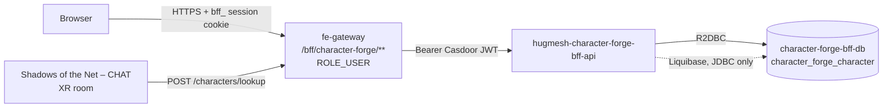

The **3D character forge** for the [HugMesh](https://github.com/hugmesh) platform.
It lets a user take an existing SVG visual-novel character (from the menagerie /
anime / base-anthro / D&D-SRD card packs), map it onto a parameterized **3D
character** (`Char3DConfig` v1), edit the result in a Godot-powered maker, and mark
one character *active* — the avatar that the "Shadows of the Net – CHAT" XR room
dresses them with when they join.

This repository is deliberately **three products in one**, shipped together
because they share the `Char3DConfig` contract:

```
/                          Spring WebFlux BFF (this README's main subject): pom.xml,
                           src/, Dockerfile, settings.xml, mvnw, CI, deploy/,
                           hugmesh-deploy.yaml
/godot/character-forge/    Godot 4 project — the 3D character maker game (see below)
/frontend/                 Angular native-federation remote `character-forge` (see below)
```

**BFF stack:** Spring WebFlux (`Mono`/`Flux`, no `.block()` on the event loop) with
R2DBC for runtime access and JDBC used *only* for Liquibase migrations. Casdoor
JWT OAuth2 resource server, springdoc-openapi (WebFlux), Spring-Native-ready,
Java 25, Spring Boot 4.0.7. The service is copy-adapted from
[`hugmesh-forum-bff-api`](https://github.com/hugmesh/hugmesh-forum-bff-api),
the platform's canonical small-BFF scaffold.

Maven artifact: `character-forge-bff` version `0.1.0` (package
`net.hugmesh.characterforgebff`). The `-api` suffix appears only in the
repo/service/image name, matching the `forum-bff` / `user-bff` naming convention —
it is not part of the artifact ID.

## Where it sits in the platform

- **Tier:** a per-surface BFF in the platform's gateway → BFF chain. It has **no
  outbound upstream at all** — it is a pure CRUD + pure-function-mapping resource
  server (hence no resilience4j dependency in the POM).
- **Route:** ClusterIP-only, reachable solely through the front-end gateway's
  same-origin `/bff/character-forge/**` route (`ROLE_USER` floor set in the
  route-access table; the route is declared *before* the `/bff/**` admin-bff
  catch-all).
- **Runtime datastore:** one Postgres database (`characterforgebff` on
  `character-forge-bff-db.hugmesh-backend`) holding a single table,
  `character_forge_character` (see [Schema](#schema-liquibase-r2dbc-at-runtime)).
- **Identity:** Casdoor JWT OAuth2 resource server; `issuer-uri` defaults to
  `https://id.hugmesh.net` (override with `CASDOOR_ISSUER_URI`). Multi-brand
  (multi-issuer) tenancy is opt-in via `APP_TENANCY_ISSUERS` — the same wiring
  used by `hugmesh-forum-bff-api` via the shared `hugmesh-commons` classes.



## Related HugMesh repositories

This service is one piece of a larger platform. Repositories referenced
throughout this README:

- [`hugmesh-forum-bff-api`](https://github.com/hugmesh/hugmesh-forum-bff-api) —
  the canonical small-BFF scaffold this repo was copy-adapted from.
- [`hugmesh-gateway`](https://github.com/hugmesh/hugmesh-gateway) — the
  front-end gateway that routes `/bff/character-forge/**` here, and the origin of
  the multi-issuer security-slice test pattern reused in
  [`docs/testing/MULTI-ISSUER-SLICE.md`](docs/testing/MULTI-ISSUER-SLICE.md).
- [`hugmesh-generator`](https://github.com/hugmesh/hugmesh-generator) — the
  platform's cluster/manifest generator; owns the authoritative deploy manifests
  for this service's optional-services slug (see [Deploy](#deploy)) and the
  shared pen-test harness `make pentest` delegates to.
- `hugmesh-character-studio-ui` — the frontend federation template this repo's
  `frontend/` remote is based on.
- `hugmesh-commons` / `hugmesh-parent` — the shared library and parent POM
  described below.

## Shared commons library

Parent POM `net.hugmesh:hugmesh-parent:2.8.0` (a child of
`spring-boot-starter-parent:4.0.7` that supplies the whole reactive-BFF dependency
and plugin baseline) and `net.hugmesh:hugmesh-commons` (managed at 2.1.0)
provide `CasdoorAuthorities`, `DomainRegistry`, `DomainScope`,
`TenancyResourceServerConfig`, `ApiException`, plus the `hugmesh-commons:2.1.0:tests`
test-jar's `PostgresTestSupport` (a singleton Testcontainers Postgres instance with
a per-class logical database and R2DBC/Liquibase wiring).

A few classes are kept per-repo rather than pulled from commons, the same split
`forum-bff` uses: `security.{Roles,PrincipalDomain}` (the subset of the API this
service actually uses), `config.SecurityConfig`, and `config.CommonsSecurityConfig`
(which `@Import`s the commons beans — component-scan does not reach
`net.hugmesh.commons.*`).

Resolving the private artifacts: local development installs parent + commons into
`~/.m2` (`mvn install` in their respective repos); CI and Docker builds resolve
them from the committed [`settings.xml`](settings.xml) Maven registry using
`CI_JOB_TOKEN` (passed to the [`Dockerfile`](Dockerfile) as a BuildKit secret,
never baked into an image layer). No secrets are committed in either path.

## Role gates — route table

| Path prefix | Filter-chain gate | Method gate (`@PreAuthorize`) | Controller |
|---|---|---|---|
| `/bff/character-forge/characters/**` | `.authenticated()` | `hasRole('USER')` | `CharacterForgeController` |
| `/bff/character-forge/map` | `.authenticated()` (inherits the floor) | `hasRole('USER')` | `CharacterMapController` |
| `/v3/api-docs/**`, `/swagger-ui/**` | dev/test: `permitAll()` · prod: `hasAnyRole('ADMIN','SUPERADMIN')` | — | springdoc |
| `/actuator/health`, `/actuator/info` | `permitAll()` (probes) | — | actuator |

There is deliberately **no admin or moderation endpoint** on this service. That
design rests on everything `/lookup` hands to another member being bounded,
server-validated data — both the `definition` (see
[Char3DConfig validation](#char3dconfig-v1--server-side-validation)) **and the row
`name`**, which passes the same `Char3DConfigValidator.displayName` gate: ≤120
characters, non-blank, and free of control / bidirectional-override / invisible
formatting code points (`Cc`/`Cf`/`Zl`/`Zp` → 400), so one member's character name
cannot visually spoof a neighbour's handle in a shared XR roster. The name is
still user-authored text, though — word-level abuse is a *platform* moderation
concern against the account behind the JWT subject, not something this service
polices; it ships no takedown verb of its own.

The JWT converter floors every authenticated principal to `ROLE_USER`; the
platform's minimal role hierarchy (`SUPERADMIN > ADMIN/MOD/USER`, with no
`ADMIN > MOD` edge) lets `SUPERADMIN` pass the method gates too. **Ownership is
not a role:** every id-addressed verb keys on `owner_subject == JWT sub` and
returns a foreign id as **404, never 403** (no existence oracle) — unweakened even
for `SUPERADMIN`.

## Key endpoints

All routes are under `/bff/character-forge`, require authentication plus
`hasRole('USER')`, always resolve "owner" as the caller's JWT `sub`, and return a
foreign id as `404`.

| Method + path | Purpose |
|---|---|
| `GET /characters` | list the caller's characters (oldest first; bounded by a 32-per-owner cap) |
| `POST /characters` | create `{name, definition:Char3DConfig}` → **201** (definition fully validated and stored in canonical form; a 33rd character → **409**; never active on create) |
| `GET /characters/{id}` | fetch one of the caller's characters (owner-only; foreign/unknown id → **404**) |
| `PUT /characters/{id}` | replace name + definition (re-validated; `active` is **not** settable here) |
| `DELETE /characters/{id}` | delete → **204** |
| `PUT /characters/{id}/active` | mark this the caller's active character (one active per owner+brand; the previous active is cleared; a partial unique index backstops races) |
| `GET /characters/active` | the caller's active character (**404** when none is set) |
| `POST /characters/lookup` | `{subjects:[1..50]}` → `{configs:{subject:{name,definition}}}` — batch-resolves ACTIVE configs so the XR room can dress every participant in one call; subjects with no active character are simply absent from the response (subjects are deduped server-side; an empty or oversized list → 400) |
| `POST /map` | takes a `VnCharacter` JSON payload and returns a `Char3DConfig` (a **pure function** — nothing is stored; implements the mapping rules also mirrored client-side in the Godot maker) |

## Char3DConfig v1 — server-side validation

`Char3DConfigValidator` is the *only* path to the stored `definition` column
(create, update, and `/map` output all pass through it), which is why the
cross-user `/lookup` surface needs no separate moderation pass:

- **unknown keys → 400** at every level (root/source/body/head/parts/materials);
- **numeric fields clamp** into range (`build` 0..1, `height` 0.5..1.5,
  `body.curve` 0..1, `body.top` 0..1, `snoutLength` 0..1; a wrong type still
  rejects). `curve` (hip-to-waist ratio) and `top` (chest volume) are the shape
  axes, orthogonal to `build`: **both default to 0.5, and 0.5 is defined to
  reproduce the pre-axis silhouette exactly**, which is what lets them exist
  with no migration — every definition stored before they were added validates
  with the defaults and must keep rendering byte-identically;
- **hex colours** must match `^#[0-9a-fA-F]{3,8}$`; **ids** must match
  `^[A-Za-z0-9_-]{1,64}$`;
- **families / archetypes / styles / pack ids / expressions are enum-checked**
  against locked vocabularies (29 head families, `anime|toon|classic`, and the 10
  canonical expression labels shared with the sticker-expression system);
- the **whole definition is capped at 16 KB** (UTF-8, serialized); every display
  name (`definition.name` *and* the row `name`) is ≤120 characters, non-blank, and
  free of `Cc`/`Cf`/`Zl`/`Zp` code points (controls, right-to-left overrides,
  zero-width characters, line/paragraph separators);
- `head.variant` / `earStyle` / `hornStyle` must match
  `^[A-Za-z0-9 _-]{1,40}$`, and an **empty/blank value means UNSET** (all three
  client mirrors encode "no variant" as `""`) — never a 400.

The stored output is always the *canonical* form (fixed key order, all seven
`parts` and seven canonical `materials` keys present, defaults applied);
re-validating an already-canonical value is idempotent. Four **extended
coat-block regions** (`innerMuzzle`, `socks`, `innerEar`, `tailTip` — the colour
masks documented for the kemono style lane) are accepted as *optional* keys and
stored only when supplied: an absent value means "let the maker derive it"
(`innerMuzzle` ← lightened fur, `socks` ← accent, `innerEar` ← skin, `tailTip` ←
accent); emitting nulls instead would freeze that derivation into every
character forever. The `/map` endpoint applies the platform's character-mapping
rules: head-slot `partId` → pack-manifest `headArchetype` → `head.family`
(kemonomimi maps to `humanoid` plus ear/tail parts), palette regions map to
materials 1:1, and pack maps to style (`anime-v1` → anime, `srd-taxonomy` →
classic, otherwise toon). The four VN pack manifests are vendored under
`src/main/resources/vn/packs/` with their own provenance file (`PROVENANCE.md`).

## Multi-tenancy & domain scoping

Rows are scoped per brand: `domain` is stamped **server-side** from the owner's
validated-issuer brand (`PrincipalDomain.forScope(jwt)`; an unresolvable
non-`SUPERADMIN` issuer gets a fail-closed `__deny__` sentinel; `SUPERADMIN` is
unscoped and concretized to `default` on writes) — it is **never** taken from a
request field. This mirrors `hugmesh-forum-bff-api`'s multi-tenancy design; see
[`docs/testing/MULTI-ISSUER-SLICE.md`](docs/testing/MULTI-ISSUER-SLICE.md) for the
reusable multi-issuer test pattern.

## Schema (Liquibase, R2DBC at runtime)

`db/changelog/001-character-forge-character.xml` defines the table
`character_forge_character` (UUID primary key `DEFAULT gen_random_uuid()`,
`owner_subject`, `domain`, `name`, `active`, a **jsonb** `definition` column,
`created_at`, `updated_at`), an owner+domain index, and a **partial unique index**
`ux_character_forge_one_active ON (owner_subject, domain) WHERE active` — the
fail-closed backstop under the service's clear-then-set activation swap. Tests
require a real Postgres (jsonb, the partial index, and `gen_random_uuid()` all
need it), hence the Testcontainers-backed `PostgresTestSupport` /
`PostgresSliceTestConfig` pair.

## godot/character-forge — the 3D maker (Godot 4)

The Godot project is developed independently of the BFF; the two share only the
`Char3DConfig` contract. `character_assembler.gd` is the **canonical** procedural
rig assembler — other consumers (such as the XR chat room) vendor a
provenance-headed copy rather than reimplementing it. A `JavaScriptBridge`
singleton, `CharForge`, exposes `setConfig` / `setExpression` / `setOpenness` /
`randomize` / `snapshot` / `listPacks` / `setPack` / `importModel` to the host
page. `register/` carries the manifest and SQL used to publish the maker into
`hugmesh.games` as a standard WASM game (`game_slug='character-forge'`). See
[`godot/character-forge/README.md`](godot/character-forge/README.md) and the
Makefile's `export-web` target (which skips with a clear message when Godot's
export templates aren't installed).

### Character styles — procedural first, 42 vendored models on top

Every one of the 29 head families renders **procedurally** with no external asset
at all; that is the default and the only style guaranteed to be available. On top
of it sit 42 vendored CC0/CC-BY models across five style lanes:

| Lane | What's in it | Recolourable? |
| --- | --- | --- |
| Anime | 2 VRoid CC0 VRM bases + the CC-BY Godette mascot | yes (VRoid), the atlas ones no |
| JRPG | Quaternius Universal Base Characters, 4 modular outfit sets (peasant/ranger × m/f, assembled from 4–5 garment GLBs onto one skeleton at load time) and 5 KayKit adventurers | Quaternius yes, KayKit no |
| Kemono / Furry | **procedural primary**, plus a CC0 mesh body under a procedural beast head and 3 Ultimate-Monsters chibi bipeds | yes |
| Monsters | 11 Quaternius Ultimate Monsters + 4 KayKit undead | Quaternius yes, KayKit no |
| Import | the 100Avatars VRM corpus + the "bring your own" import slot | no (not ours to repaint) |

The kemono lane is procedural-first for a concrete reason: no production-grade
CC0 rigged-and-animated anthro biped exists anywhere publicly, so the parametric
assembler (driven by numeric style rules) is the primary path, and the mesh
options are a hybrid — a CC0 humanoid body with our procedural head grafted onto
its head bone at runtime.

Licence discipline is enforced in code, not by convention: a mesh basis is
**refused** unless it carries `licenseSpdx` (from a CC0/CC-BY/MIT allow-list),
`attribution`, `sourceUrl`, and an ISO `retrievedAt` — otherwise the family
silently stays procedural. See [`THIRD_PARTY_ASSETS.md`](THIRD_PARTY_ASSETS.md)
for the full manifest.

### Bring your own avatar

The Import tab accepts a `.vrm`/`.glb` file the user picks locally. The file is
read **in the browser**, handed to the engine as bytes, and parsed in WASM
memory: it is never uploaded to this BFF, never written to disk, and never
stored with the character (only the parametric definition is persisted, and it
contains no geometry). For a VRM file, the importer shows the model's **own**
in-file licence terms — author, licence, redistribution, credit — because those
are the author's terms, not this project's. Free bases we're not licensed to
redistribute are linked to, never bundled.

## frontend/ — the `character-forge` federation remote (Angular)

The Angular native-federation remote mounted at `/character-forge/**` (remote
name `character-forge`, exposing `./routes`; built from the
`hugmesh-character-studio-ui` template). The forge studio page embeds the Godot
canvas from same-origin assets (`frontend/src/assets/game/` — a placeholder
README until the export is baked in; the page still boots and shows an "engine
bundle not present" panel when the export is absent), parameter editor panels,
import-from-VN (paste or `localStorage`, mapped through `/map`), save/load via
this BFF (using the `HttpOnly` `bff_` cookie), and a randomizer. See
[`frontend/README.md`](frontend/README.md) for frontend-specific setup.

## Configuration

The BFF is configured entirely through environment variables layered over
[`application.yml`](src/main/resources/application.yml); every one has a safe
local-dev default.

| Variable | Default | Purpose |
|---|---|---|
| `CASDOOR_ISSUER_URI` | `https://id.hugmesh.net` | Casdoor OIDC issuer used for JWT validation (single-issuer mode) |
| `APP_TENANCY_ISSUERS` | *(empty)* | Comma-separated `issuerUri=domainName` pairs; non-empty enables multi-issuer (multi-brand) mode, and any issuer outside this list is rejected with 401 |
| `SPRING_R2DBC_URL` / `SPRING_R2DBC_USERNAME` / `SPRING_R2DBC_PASSWORD` | in-cluster Postgres service | Runtime R2DBC connection |
| `SPRING_LIQUIBASE_URL` / `SPRING_LIQUIBASE_USER` / `SPRING_LIQUIBASE_PASSWORD` | in-cluster Postgres service | JDBC connection used only for Liquibase migrations at startup |
| `SSL_ENABLED` | `false` | Enables server-side TLS / mTLS enforcement for API-to-API calls |
| `SSL_CLIENT_AUTH` | `none` | Set to `need` in-cluster to require a client certificate that chains to the cluster CA |
| `SSL_KEY_STORE`, `SSL_KEY_STORE_TYPE`, `SSL_KEY_STORE_PASSWORD` | `/stores/keystore.p12`, `PKCS12`, *(empty)* | Server TLS identity (Vault-PKI issued in-cluster) |
| `SSL_TRUST_STORE`, `SSL_TRUST_STORE_TYPE`, `SSL_TRUST_STORE_PASSWORD` | `/stores/truststore.p12`, `PKCS12`, *(empty)* | Cluster CA trust store for client-cert validation |
| `SSL_ENABLED_PROTOCOLS` | `TLSv1.3` | TLS protocol floor when TLS is enabled |

Locally, none of the TLS variables need to be set — the service runs in plain
HTTP with `client-auth=none` by default, and the test suite never touches the
trust/key stores.

## Build / test

```bash
./mvnw -B test                    # full suite (needs Docker for Testcontainers Postgres)
./mvnw -B verify                  # + SpotBugs (repo-local exclude filter, see spotbugs/)
./mvnw -Pnative native:compile     # GraalVM native image (config managed by the parent POM)
```

- The suite mirrors `forum-bff`'s: security slices (multi-issuer, path-gate,
  headers, converter injection), a full-context **401 fail-closed** boot test
  (foreign issuer / tampered signature / wrong kid), controller/service/
  validator/map unit and slice tests, a `@DataR2dbcTest` repository slice run
  against the real Liquibase schema, and a **role-matrix + ownership +
  brand-wall HTTP test** driven by real RS256 tokens (`TestIssuer`).
- `OpenApiSpecDumpTest` writes the committed, deterministic
  [`src/main/resources/openapi/openapi.json`](src/main/resources/openapi/openapi.json)
  (sorted keys; `openapi_3_0` with `default-produces-media-type: application/json`
  pinned in `application.yml` for `ng-openapi-gen` compatibility).
  `-Dopenapi.spec.check=true` turns it into a CI drift guard.
- `make pentest` mirrors the CI SCA/DAST pen-test stage locally (non-enforcing);
  see the [Makefile](Makefile) for the knobs (`SCA_FAIL_CVSS`, `USE_DOCKER`,
  `DAST_TARGET_URL`).

### CI

GitLab CI (`.gitlab-ci.yml`: test → build image → pentest, the same shape as
`forum-bff`; uses `CI_JOB_TOKEN` for registry access) is the enforcing pipeline.
GitHub Actions (`.github/workflows/ci.yml`) mirrors it as a merge gate on this
mirror. The Docker build is a multi-stage `eclipse-temurin:25` build with the
registry token supplied as a BuildKit secret, never written into an image layer.

## Deploy

[`deploy/`](deploy) holds the Kustomize manifests (deployment + service + HPA),
and [`hugmesh-deploy.yaml`](hugmesh-deploy.yaml) is the per-repo catalog
descriptor. The authoritative production manifests live in
[`hugmesh-generator`](https://github.com/hugmesh/hugmesh-generator)'s
`character-forge` optional-services slug (disabled by default; enabled with
`--with-character-forge`). The service deploys into the `hugmesh-backend`
namespace on port 8080, with mTLS keystore support available via the
`SSL_ENABLED` family of settings above (off by default — see
[`application.yml`](src/main/resources/application.yml)).

## Contributing

Issues and pull requests are welcome. Before opening a PR:

1. Run `./mvnw -B verify` locally (Docker is required for the Testcontainers
   Postgres tests).
2. Keep new endpoints and config fields consistent with the ownership/domain
   scoping rules described above — this service intentionally has no
   admin/moderation surface, and PRs that add one without discussion will need
   a design conversation first.
3. If you touch `Char3DConfig`, update both the validator and its mirrors in
   `frontend/` and `godot/character-forge/` so the three stay in lock-step.

For platform-wide contribution norms, see the [HugMesh](https://github.com/hugmesh)
organization profile and the `hugmesh-forum-bff-api` repository this service was
scaffolded from.

## License

Released under the [MIT License](LICENSE). Third-party vendored assets carry
their own licences — see [`THIRD_PARTY_ASSETS.md`](THIRD_PARTY_ASSETS.md) for the
full per-asset manifest and enforcement details.
