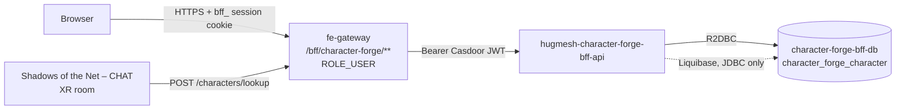

The **3D character forge** for the [HugMesh](https://github.com/hugmesh) platform.
A user takes an existing SVG visual-novel character (from the menagerie /
anime / base-anthro / D&D-SRD card packs), maps it onto a parameterized **3D
character** (`Char3DConfig` v1), edits it in a Godot-powered maker, and marks
one character *active*. The "Shadows of the Net – CHAT" XR room dresses the user
in that avatar on joining.

This repository holds **three products**. They ship together because they share
the `Char3DConfig` contract:

```
/                          Spring WebFlux BFF (this README's main subject): pom.xml,
                           src/, Dockerfile, settings.xml, mvnw, CI, deploy/,
                           hugmesh-deploy.yaml
/godot/                    A pointer: the Godot 4 maker moved to hugmesh-games/games/character-forge
/frontend/                 Angular native-federation remote `character-forge` (see below)
```

**BFF stack:** Spring WebFlux (`Mono`/`Flux`, no `.block()` on the event loop) with
R2DBC at runtime and JDBC *only* for Liquibase migrations. Casdoor JWT OAuth2
resource server, springdoc-openapi (WebFlux), Spring-Native-ready, Java 25,
Spring Boot 4.0.7. It is copy-adapted from
[`hugmesh-forum-bff-api`](https://github.com/hugmesh/hugmesh-forum-bff-api),
the platform's canonical small-BFF scaffold.

Maven artifact: `character-forge-bff` version `0.1.0` (package
`net.hugmesh.characterforgebff`). The `-api` suffix is only in the
repo/service/image name, as with `forum-bff` and `user-bff`. It is not part of the
artifact ID.

## Where it sits in the platform

- **Tier:** a per-surface BFF in the platform's gateway → BFF chain. It has **no
  outbound upstream**. It is a CRUD and pure-function-mapping resource server, so
  the POM has no resilience4j dependency.
- **Route:** ClusterIP-only. The only way in is the front-end gateway's
  same-origin `/bff/character-forge/**` route, with a `ROLE_USER` floor set in the
  route-access table. The route is declared *before* the `/bff/**` admin-bff
  catch-all.
- **Runtime datastore:** one Postgres database (`characterforgebff` on
  `character-forge-bff-db.hugmesh-backend`) with a single table,
  `character_forge_character` (see [Schema](#schema-liquibase-r2dbc-at-runtime)).
- **Identity:** Casdoor JWT OAuth2 resource server. `issuer-uri` defaults to
  `https://id.hugmesh.net` (override with `CASDOOR_ISSUER_URI`). Signing keys come
  from an explicit JWKS URL (`CASDOOR_JWKS_URI`, default
  `<issuer>/.well-known/jwks`), so the service never does OIDC discovery. `iss` is
  still checked against `issuer-uri`. Multi-brand (multi-issuer) tenancy is opt-in
  through `APP_TENANCY_ISSUERS`, using the same shared `hugmesh-commons` wiring as
  `hugmesh-forum-bff-api`.



## Related HugMesh repositories

Repositories this README refers to:

- [`hugmesh-forum-bff-api`](https://github.com/hugmesh/hugmesh-forum-bff-api) —
  the small-BFF scaffold this repo was copy-adapted from.
- [`hugmesh-gateway`](https://github.com/hugmesh/hugmesh-gateway) — the
  front-end gateway that routes `/bff/character-forge/**` here. It is also the
  origin of the multi-issuer security-slice test pattern reused in
  [`docs/testing/MULTI-ISSUER-SLICE.md`](docs/testing/MULTI-ISSUER-SLICE.md).
- [`hugmesh-generator`](https://github.com/hugmesh/hugmesh-generator) — the
  platform's cluster/manifest generator. It owns the authoritative deploy manifests
  for this service's optional-services slug (see [Deploy](#deploy)) and the
  shared pen-test harness that `make pentest` delegates to.
- `hugmesh-character-studio-ui` — the frontend federation template that
  `frontend/` is based on.
- `hugmesh-commons` / `hugmesh-parent` — the shared library and parent POM
  described below.

## Shared commons library

Parent POM `net.hugmesh:hugmesh-parent:2.8.0` (a child of
`spring-boot-starter-parent:4.0.7` that supplies the reactive-BFF dependency
and plugin baseline) and `net.hugmesh:hugmesh-commons` (managed at 2.1.0)
provide `CasdoorAuthorities`, `DomainRegistry`, `DomainScope`,
`TenancyResourceServerConfig` and `ApiException`. The `hugmesh-commons:2.1.0:tests`
test-jar adds `PostgresTestSupport`: a singleton Testcontainers Postgres instance
with a per-class logical database and R2DBC/Liquibase wiring.

A few classes stay in this repo instead of coming from commons, the same split
`forum-bff` uses: `security.{Roles,PrincipalDomain}` (the subset of the API this
service uses), `config.SecurityConfig`, and `config.CommonsSecurityConfig`
(which `@Import`s the commons beans, because component-scan does not reach
`net.hugmesh.commons.*`).

Resolving the private artifacts: local development installs parent and commons into
`~/.m2` (`mvn install` in their repos). CI and Docker builds have two routes. The
GitLab and local-compose lane resolves them from the GitLab group Maven registry
named in the committed [`settings.xml`](settings.xml), using `CI_JOB_TOKEN`. The
GitHub release build mounts a `packages_read_token` secret and uses
[`.github/maven-ci-settings.xml`](.github/maven-ci-settings.xml) against GitHub
Packages. Both tokens reach the [`Dockerfile`](Dockerfile) as BuildKit secrets,
never as an `ARG`, `ENV` or image layer, and `ReleaseImageGuardTest` pins both
routes. No secret is committed in any path.

## Role gates — route table

| Path prefix | Filter-chain gate | Method gate (`@PreAuthorize`) | Controller |
|---|---|---|---|
| `/bff/character-forge/characters/**` | `.authenticated()` | `hasRole('USER')` | `CharacterForgeController` |
| `/bff/character-forge/map` | `.authenticated()` (inherits the floor) | `hasRole('USER')` | `CharacterMapController` |
| `/v3/api-docs/**`, `/swagger-ui/**`, `/swagger-ui.html`, `/webjars/swagger-ui/**` | dev/test: `permitAll()` · prod: `hasAnyRole('ADMIN','SUPERADMIN')` | — | springdoc |
| `/actuator/health`, `/actuator/health/**`, `/actuator/info` | `permitAll()` (probes) | — | actuator |

This service has **no admin or moderation endpoint**, on purpose. That is safe
only because everything `/lookup` hands to another member is bounded,
server-validated data. That covers the `definition` (see
[Char3DConfig validation](#char3dconfig-v1--server-side-validation)) **and the row
`name`**. The name passes the same `Char3DConfigValidator.displayName` gate: ≤120
characters, non-blank, and free of control / bidirectional-override / invisible
formatting code points (`Cc`/`Cf`/`Zl`/`Zp` → 400). One member's character name
therefore cannot visually spoof a neighbour's handle in a shared XR roster. The
name is still user-written text. Abuse of words is a *platform* moderation matter,
handled against the account behind the JWT subject. This service has no takedown
verb.

The JWT converter floors every authenticated principal to `ROLE_USER`. The
platform's minimal role hierarchy (`SUPERADMIN > ADMIN/MOD/USER`, with no
`ADMIN > MOD` edge) lets `SUPERADMIN` pass the method gates too. **Ownership is
not a role.** Every id-addressed verb keys on `owner_subject == JWT sub` and
returns a foreign id as **404, never 403**, so there is no existence oracle. That
holds for `SUPERADMIN` as well.

## Key endpoints

All routes are under `/bff/character-forge`. They require authentication plus
`hasRole('USER')`, always take the "owner" from the caller's JWT `sub`, and return a
foreign id as `404`.

| Method + path | Purpose |
|---|---|
| `GET /characters` | list the caller's characters (oldest first; bounded by a 32-per-owner cap) |
| `POST /characters` | create `{name, definition:Char3DConfig}` → **201** (definition fully validated and stored in canonical form; a 33rd character → **409**; never active on create) |
| `GET /characters/{id}` | fetch one of the caller's characters (owner-only; foreign/unknown id → **404**) |
| `PUT /characters/{id}` | replace name + definition (re-validated; `active` is **not** settable here) |
| `DELETE /characters/{id}` | delete → **204** |
| `PUT /characters/{id}/active` | mark this the caller's active character (one active per owner+brand; the previous active is cleared; a partial unique index backstops races) |
| `GET /characters/active` | the caller's active character (**404** when none is set) |
| `POST /characters/lookup` | `{subjects:[1..50]}` → `{configs:{subject:{name,definition}}}` — batch-resolves ACTIVE configs so the XR room can dress every participant in one call; subjects with no active character are simply absent from the response (subjects are deduped server-side; an empty or oversized list → 400) |
| `POST /map` | takes a `VnCharacter` JSON payload and returns a `Char3DConfig` (a **pure function** — nothing is stored; implements the mapping rules also mirrored client-side in the Godot maker) |

## Char3DConfig v1 — server-side validation

`Char3DConfigValidator` is the *only* path to the stored `definition` column
(create, update and `/map` output all pass through it). That is why the
cross-user `/lookup` surface needs no separate moderation pass:

- **unknown keys → 400** at every level (root/source/body/head/parts/materials/rig);
- **numeric fields clamp** into range (`build` 0..1, `height` 0.5..1.5,
  `body.curve`, `body.top`, `body.legs`, `body.arms`, `body.limb` and
  `snoutLength` each 0..1; a wrong type still rejects). `curve` (hip-to-waist
  ratio) and `top` (chest volume) are shape axes orthogonal to `build`; `legs`
  and `arms` set limb length and `limb` sets limb girth. **All of them default to
  0.5, and 0.5 is defined to reproduce the pre-axis silhouette exactly.** That is
  why they need no migration: every definition stored before they existed
  validates with the defaults and must keep rendering byte-identically;
- the optional, **sparse `rig`** holds per-joint adjustments for `head`, `jaw`,
  `eye_l`, `eye_r`, `brow_l`, `brow_r`, `ear_l` and `ear_r`. `offset` is a
  3-number array clamped to ±0.12 m, `scale` a 3-number array clamped to
  0.5..1.8. Identity values are dropped. An unknown joint or entry key, or a
  non-numeric triple, is a 400;
- **hex colours** must match `^#[0-9a-fA-F]{3,8}$`; **ids** must match
  `^[A-Za-z0-9_-]{1,64}$`;
- **families / archetypes / styles / pack ids / expressions are enum-checked**
  against locked vocabularies (29 head families, `anime|toon|classic`, and the 10
  canonical expression labels shared with the sticker-expression system);
- the **whole definition is capped at 16 KB** (UTF-8, serialized). Every display
  name (`definition.name` *and* the row `name`) is ≤120 characters, non-blank, and
  free of `Cc`/`Cf`/`Zl`/`Zp` code points (controls, right-to-left overrides,
  zero-width characters, line/paragraph separators);
- `head.variant` / `earStyle` / `hornStyle` must match
  `^[A-Za-z0-9 _-]{1,40}$`. An **empty or blank value means UNSET** (all three
  client mirrors encode "no variant" as `""`) and is never a 400.

The stored output is always the *canonical* form: fixed key order, all seven
`parts` and seven canonical `materials` keys present, defaults applied.
Re-validating a canonical value changes nothing. Four **extended coat-block
regions** (`innerMuzzle`, `socks`, `innerEar`, `tailTip` — the colour masks
documented for the kemono style lane) are accepted as *optional* keys and stored
only when supplied. An absent value means "let the maker derive it"
(`innerMuzzle` ← lightened fur, `socks` ← accent, `innerEar` ← skin, `tailTip` ←
accent). Storing nulls instead would freeze that derivation into every character
forever.

The `/map` endpoint applies the platform's character-mapping rules. The head-slot
`partId` maps to the pack manifest's `headArchetype`, and that becomes
`head.family` (kemonomimi maps to `humanoid` plus ear/tail parts). Palette regions
map to materials 1:1; a region the palette leaves out gets the canonical default
colour. The pack maps to style (`anime-v1` → anime, `srd-taxonomy` → classic,
otherwise toon). The four VN pack manifests are vendored under
`src/main/resources/vn/packs/` with their own provenance file (`PROVENANCE.md`).

## Multi-tenancy & domain scoping

Rows are scoped per brand. `domain` is stamped **server-side** from the owner's
validated-issuer brand (`PrincipalDomain.forScope(jwt)`). An unresolvable
non-`SUPERADMIN` issuer gets a fail-closed `__deny__` sentinel. `SUPERADMIN` is
unscoped and concretized to `default` on writes. The domain is **never** taken
from a request field. This mirrors `hugmesh-forum-bff-api`'s multi-tenancy design;
see [`docs/testing/MULTI-ISSUER-SLICE.md`](docs/testing/MULTI-ISSUER-SLICE.md) for
the reusable multi-issuer test pattern.

## Schema (Liquibase, R2DBC at runtime)

`db/changelog/001-character-forge-character.xml` defines the table
`character_forge_character`: UUID primary key `DEFAULT gen_random_uuid()`,
`owner_subject`, `domain`, `name`, `active`, a **jsonb** `definition` column,
`created_at` and `updated_at`. It adds an owner+domain index and a **partial unique
index** `ux_character_forge_one_active ON (owner_subject, domain) WHERE active`.
That index is the fail-closed backstop under the service's clear-then-set
activation swap. Tests need a real Postgres, because jsonb, the partial index and
`gen_random_uuid()` all depend on it. Hence the Testcontainers-backed
`PostgresSliceTestConfig` / `PostgresTestSupport` pair.

## The 3D maker (Godot 4) — now in hugmesh-games

The Godot project lives in **hugmesh-games** as `games/character-forge/`, an
ordinary game of that repo: edit it in the Godot editor, export it with `make
build-godot`, publish it through the standard upload lane. The two repos share
only the `Char3DConfig` contract (v1, now with an optional, sparse `rig` object of
per-joint offset/scale adjustments; see `Char3DConfigValidator`).
`character_assembler.gd` there is the **canonical** procedural rig assembler.

The engine only renders. It has **no in-canvas UI**. The `CharForge`
`JavaScriptBridge` singleton exposes `setConfig` / `setExpression` /
`setOpenness` / `setRig` / `autoAdjustRig` / `setAutoRotate` / `randomize` /
`snapshot` / `listPacks` / `setPack` / `importModel` to the host page, and the
Angular remote under `frontend/` owns every control: parts, proportions,
materials, the per-joint rigging panel with its auto-fit, expression and mouth
preview, turntable spin. `games/character-forge/register/` holds the manifest
and SQL that publish the maker into `hugmesh.games` (`game_slug='character-forge'`).

### Character styles — procedural first, 48 catalogue entries on top

Every one of the 29 head families renders **procedurally** with no external asset.
That is the default, and the only style guaranteed to be available. On top of it
sit 48 catalogue entries across five style lanes, built from 10 vendored
CC0/CC-BY packs (75 model files, 38.8 MB):

| Lane | What's in it | Recolourable? |
| --- | --- | --- |
| Anime | 2 VRoid CC0 VRM bases + the CC-BY Godette mascot | yes |
| JRPG | 2 Quaternius Universal Base Characters, 4 modular outfit sets (peasant and ranger, each on both bodies, assembled from 4–5 garment GLBs onto one skeleton at load time) and 5 KayKit adventurers | yes (Quaternius by material slot, KayKit through the atlas) |
| Kemono / Furry | **procedural primary**, plus 2 CC0 mesh bodies under a procedural beast head, 6 real animal heads (wolf, fox, husky, shiba inu, deer, horse) grafted onto a mesh body, and 3 Ultimate-Monsters chibi bipeds | yes |
| Monsters | 11 Quaternius Ultimate Monsters + 4 KayKit undead | yes (Quaternius by material slot, KayKit through the atlas) |
| Import | 8 models of the 100Avatars VRM corpus + the "bring your own" import slot | yes for the 8 corpus models (by hue cluster); a file you import is not ours to repaint |

The kemono lane starts procedural for a plain reason: no production-grade CC0
rigged-and-animated anthro biped exists anywhere public. The parametric assembler,
driven by numeric style rules, is the primary path. The mesh options are hybrids.
One puts our procedural head on a CC0 humanoid body, grafted onto its head bone at
runtime. The other splits a real animal head out of a Quaternius quadruped by bone
weight (`mesh_surgery.gd`) and grafts that onto the same body.

Licence discipline is enforced in code, not by convention. A mesh basis is
**refused** unless it carries `licenseSpdx` (from the allow-list `CC0-1.0`,
`CC-BY-3.0`, `CC-BY-4.0`, `MIT`), `attribution`, `sourceUrl`, and an ISO
`retrievedAt`. Otherwise the family silently stays procedural. See
[`THIRD_PARTY_ASSETS.md`](THIRD_PARTY_ASSETS.md) for the full manifest.

### Bring your own avatar

The Import tab accepts a `.vrm`/`.glb` file the user picks locally. The browser
reads the file and hands it to the engine as bytes, and the engine parses it in
WASM memory. The file is never uploaded to this BFF, never written to disk, and
never stored with the character. Only the parametric definition is persisted, and
it holds no geometry. For a VRM file, the importer shows the model's **own**
in-file licence terms (author, licence, redistribution, credit), because those are
the author's terms, not this project's. Free bases we may not redistribute are
linked to, never bundled.

## frontend/ — the `character-forge` federation remote (Angular)

The Angular native-federation remote mounted at `/character-forge/**` (remote
name `character-forge`, exposing `./routes`; built from the
`hugmesh-character-studio-ui` template). The forge studio page embeds the Godot
canvas from same-origin assets. `frontend/src/assets/game/` holds the committed
Web export (`index.js`, `index.pck`, `index.wasm` and two audio worklets) beside a
README. If the export is absent, the page still boots and shows an "engine
bundle not present" panel. The page also has a style selector, parameter editor
and rigging panels, a credits view, import-from-VN (paste or `localStorage`,
mapped through `/map`), save/load through this BFF (using the `HttpOnly` `bff_`
cookie), and a randomizer. See [`frontend/README.md`](frontend/README.md) for
frontend setup.

## Configuration

The BFF is configured entirely through environment variables layered over
[`application.yml`](src/main/resources/application.yml). Every one has a safe
local-dev default.

| Variable | Default | Purpose |
|---|---|---|
| `CASDOOR_ISSUER_URI` | `https://id.hugmesh.net` | Casdoor OIDC issuer used for JWT validation (single-issuer mode) |
| `CASDOOR_JWKS_URI` | `${CASDOOR_ISSUER_URI}/.well-known/jwks` | Explicit JWKS URL, so the resource server skips OIDC discovery (inside a container the published issuer URL can be unreachable) |
| `APP_TENANCY_ISSUERS` | *(empty)* | Comma-separated `issuerUri=domainName` pairs; non-empty enables multi-issuer (multi-brand) mode, and any issuer outside this list is rejected with 401 |
| `SPRING_R2DBC_URL` / `SPRING_R2DBC_USERNAME` / `SPRING_R2DBC_PASSWORD` | in-cluster Postgres service | Runtime R2DBC connection |
| `SPRING_LIQUIBASE_URL` / `SPRING_LIQUIBASE_USER` / `SPRING_LIQUIBASE_PASSWORD` | in-cluster Postgres service | JDBC connection used only for Liquibase migrations at startup |
| `SSL_ENABLED` | `false` | Enables server-side TLS / mTLS enforcement for API-to-API calls |
| `SSL_CLIENT_AUTH` | `none` | Set to `need` in-cluster to require a client certificate that chains to the cluster CA |
| `SSL_KEY_STORE`, `SSL_KEY_STORE_TYPE`, `SSL_KEY_STORE_PASSWORD` | `/stores/keystore.p12`, `PKCS12`, *(empty)* | Server TLS identity (Vault-PKI issued in-cluster) |
| `SSL_TRUST_STORE`, `SSL_TRUST_STORE_TYPE`, `SSL_TRUST_STORE_PASSWORD` | `/stores/truststore.p12`, `PKCS12`, *(empty)* | Cluster CA trust store for client-cert validation |
| `SSL_ENABLED_PROTOCOLS` | `TLSv1.3` | TLS protocol floor when TLS is enabled |
| `app.mfa.enabled`, `app.mfa.freshness-window` | `false`, `600000` (ms) | Spring properties read by `SecurityConfig`; not set in `application.yml`. When enabled, the shared Casdoor authority converter derives the `MFA_SATISFIED` marker; when off (the default) it is never produced |

Locally you set none of the TLS variables. The service runs in plain HTTP with
`client-auth=none`, and the test suite never touches the trust/key stores.

## Build / test

```bash
./mvnw -B test                    # full suite (needs Docker for Testcontainers Postgres)
./mvnw -B verify                  # + SpotBugs (repo-local exclude filter, see spotbugs/)
./mvnw -Pnative native:compile     # GraalVM native image (config managed by the parent POM)
```

- The suite mirrors `forum-bff`'s: security slices (multi-issuer, path-gate,
  headers, converter injection), a full-context **401 fail-closed** boot test
  (foreign issuer / tampered signature / wrong kid), unit and slice tests for
  controller, service, validator and map, a `@DataR2dbcTest` repository slice run
  against the real Liquibase schema, and a **role-matrix + ownership +
  brand-wall HTTP test** driven by real RS256 tokens (`TestIssuer`).
  `ClientContractFixturesTest` is the server half of the contract fixture that the
  frontend and the Godot suite also read. `ReleaseImageGuardTest` pins the
  Dockerfile's two Maven-registry routes.
- `OpenApiSpecDumpTest` compares the committed, deterministic
  [`src/main/resources/openapi/openapi.json`](src/main/resources/openapi/openapi.json)
  (sorted keys; `openapi_3_0` with `default-produces-media-type: application/json`
  pinned in `application.yml` for `ng-openapi-gen`) with the live API and fails on
  drift. After an API change, refresh the file with
  `./mvnw -Dtest=OpenApiSpecDumpTest -Dopenapi.spec.write=true test` and commit it.
- `make pentest` mirrors the CI SCA/DAST pen-test stage locally (non-enforcing);
  see the [Makefile](Makefile) for the knobs (`SCA_FAIL_CVSS`, `USE_DOCKER`,
  `DAST_TARGET_URL`).

### CI

GitLab CI (`.gitlab-ci.yml`: jobs `test`, `build:image`, `pentest:sca` and
`pentest:dast`, the same shape as `forum-bff`; uses `CI_JOB_TOKEN` for registry
access) is the enforcing pipeline. GitHub Actions (`.github/workflows/ci.yml`)
is the merge gate on this mirror. Pull requests always run on GitHub-hosted
`ubuntu-latest`; only a push to `main` may use the runner named by the `RUNS_ON`
repository variable (default `ubuntu-latest`), so code from a pull request never
runs on a self-hosted runner. The `workflow-guard` job
([`tools/ci/check-pr-runners.py`](tools/ci/check-pr-runners.py), with its self-test)
fails if a workflow that anything other than a push, a manual run or a schedule can
trigger (a pull request, an issue, a comment, a trigger it does not know) could reach a
self-hosted runner, or if any workflow uses `pull_request_target`. That guard covers this repository's own
files; against a fork's pull request the real protection is the org settings (the
runner group refuses public repositories, and fork pull requests need approval).
`build (Spring BFF)` runs
`./mvnw -B -s settings.xml clean verify`; on a GitHub-hosted runner it cannot reach the
GitLab registry that `settings.xml` names. `frontend` runs `npm ci`, `npm test` and
`npm run build`. The catalogue parity step (`build-lanes.mjs --check`) was removed
because the engine files it reads moved to hugmesh-games (known gap 9 in
[`tools/asset-pipeline/README.md`](tools/asset-pipeline/README.md)). The Godot job
left with the project. A manual `Release` workflow (`.github/workflows/release.yml`)
builds the image and pushes it to GHCR, resolving the private libraries from GitHub
Packages. The Docker build is a multi-stage
`eclipse-temurin:25` build; the registry token arrives as a BuildKit secret and
never lands in an image layer.

## Deploy

[`deploy/`](deploy) holds the Kustomize manifests (deployment + service + HPA),
and [`hugmesh-deploy.yaml`](hugmesh-deploy.yaml) is the per-repo catalog
descriptor. The authoritative production manifests live in
[`hugmesh-generator`](https://github.com/hugmesh/hugmesh-generator)'s
`character-forge` optional-services slug (disabled by default; enabled with
`--with-character-forge`). The service deploys into the `hugmesh-backend`
namespace on port 8080 behind a ClusterIP service. mTLS is off by default in
[`application.yml`](src/main/resources/application.yml) and on in
[`deploy/deployment.yaml`](deploy/deployment.yaml) (`SSL_ENABLED=true`,
`SSL_CLIENT_AUTH=need`, PKCS12 stores under `/stores`).

## Contributing

Issues and pull requests are welcome. Before opening a PR:

1. Run `./mvnw -B verify` locally (Docker is required for the Testcontainers
   Postgres tests).
2. Keep new endpoints and config fields consistent with the ownership and domain
   scoping rules above. This service has no admin or moderation surface on
   purpose; a PR that adds one needs a design conversation first.
3. If you touch `Char3DConfig`, update the validator and its mirrors in
   `frontend/` and in hugmesh-games' `games/character-forge/`, so the three stay in
   lock-step.

For platform-wide contribution norms, see the [HugMesh](https://github.com/hugmesh)
organization profile and the `hugmesh-forum-bff-api` repository this service was
scaffolded from.

## License

Released under the [MIT License](LICENSE). Vendored third-party assets carry
their own licences; [`THIRD_PARTY_ASSETS.md`](THIRD_PARTY_ASSETS.md) is the
per-asset manifest with the enforcement details.
