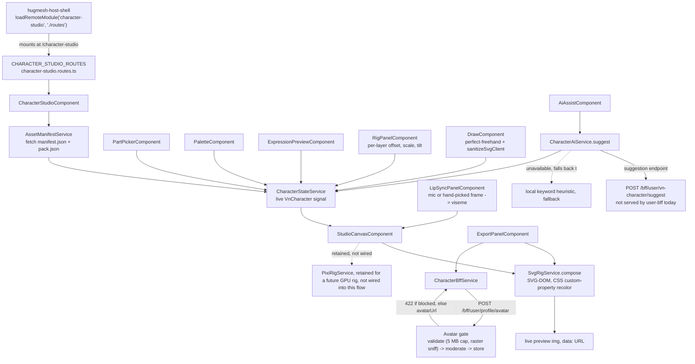

A browser-based, layered-2D avatar creator for the HugMesh platform. Pick a
species and class, recolor each region, add an expression, draw extra flair
by hand, and export a finished avatar. Think Picrew or a Gaia Online dress-up
doll, but self-hosted. The composition runs entirely client-side (SVG-DOM), so
previewing a look needs no server round trip.

It ships as a native-federation **remote** (`character-studio`) that the
[`hugmesh-host-shell`](https://github.com/hugmesh/hugmesh-host-shell)
mounts at `/character-studio`. This is the platform's avatar-authoring
surface: the Matrix/Akkoma chat clients and the forum both consume the
characters it produces, via the
[`hugmesh-user-bff-api`](https://github.com/hugmesh/hugmesh-user-bff-api)
`/bff/user/**` avatar route, keyed to the signed-in user's Casdoor subject. The
client also calls character-definition and AI-suggest routes. That BFF does
not serve them yet (see [Known limitations](#known-limitations)).

## Quick start

```bash
npm ci                            # install (Angular 22 + native-federation; npm only, no other lockfiles)
npm start                         # standalone dev server, http://localhost:4209
npm run build:character-studio    # production federation build -> dist/character-studio (+ remoteEntry.json)
```

## How it fits into the platform

This repo is a native-federation **remote only**. It has no host shell and no
backend of its own: it calls `hugmeshRemote(...)` and never `hugmeshHost(...)`
(see `federation.config.js`).

- [`hugmesh-host-shell`](https://github.com/hugmesh/hugmesh-host-shell)
  loads this remote's exposed `./routes` module and mounts it at
  `/character-studio` (federation surface: `./routes` →
  `CHARACTER_STUDIO_ROUTES`, declared in `federation.config.js`).
- Anything that needs a backend goes through the `/bff/user/**` surface
  (`CharacterBffService`, `CharacterAiService`). The shared HttpOnly `bff_`
  session cookie authenticates each call; the browser holds no bearer token.
  [`hugmesh-user-bff-api`](https://github.com/hugmesh/hugmesh-user-bff-api)
  serves only part of that surface. `POST /bff/user/profile/avatar` exists.
  `PUT /bff/user/vn-character`, `GET /bff/user/vn-character/active` and
  `POST /bff/user/vn-character/suggest` do not: no service on `main` maps them.
- `federation-base.js` has the same code as the copy in
  [`hugmesh-games`](https://github.com/hugmesh/hugmesh-games)
  (`frontend/federation-base.js`) and the other HugMesh native-federation
  remotes. Only the header comments differ. The match keeps the
  shared-dependency/skip-list contract from drifting between the host shell
  and any remote.
- This remote has no role gates. It is a self-service tool, the same for
  every signed-in user, so the role×feature test matrices used elsewhere on
  the platform do not apply (see `e2e/features/avatar.feature`).

## Architecture



The flow: the asset library loads a pack (`AssetManifestService`).
`CharacterStateService` holds the live character and drives a **live SVG-DOM
preview** (`StudioCanvasComponent` + `SvgRigService`). Each region recolors
on its own through CSS custom properties; PixiJS is not involved. Around the
preview sit:

- a part picker, a palette, and a freehand draw tool;
- an expression preview, with one toggle per expression preset the active pack ships;
- a "Talk" panel, where the microphone or a hand-picked frame drives the mouth;
- a "Rig" panel (offset, size and tilt per layer, plus "Fit the face");
- an optional "describe your character" AI-assist panel, which calls a
  suggestion endpoint and falls back to a local keyword heuristic when that
  endpoint is unavailable;
- an export panel, which renders the character to PNG and uploads it through
  the BFF's moderated avatar endpoint (a validation and moderation gate before
  storage; a blocked image comes back as HTTP 422).

`PixiRigService` (`src/app/character-studio/services/pixi-rig.service.ts`)
stays in the codebase but is off the render path. It is reserved for a future
GPU live-render milestone. Lip-sync already runs on the SVG path.

## Asset packs

Four packs ship in `src/assets/vn/packs/`. `src/assets/vn/manifest.json` lists
all four as enabled, and the counts below match the part files on disk:

| Pack | Slots | Part SVGs | Notes |
|---|---|---|---|
| `base-anthro-v1` | 5 | 14 | Original generic-anthro content, not SRD-derived. |
| `srd-taxonomy-v1` | 11 | 180 | "SRD Chibi — All Species": full D&D SRD 5.1 (CC-BY-4.0) catalog coverage in original chibi/kemono art (92 species heads, 10 expression presets, 5-step viseme mouths, 12 class outfit sets, token backdrops) — see [`docs/CATALOG-DND-SRD.md`](docs/CATALOG-DND-SRD.md), [`docs/ART-STYLE-CHIBI.md`](docs/ART-STYLE-CHIBI.md) and [`ATTRIBUTION.txt`](ATTRIBUTION.txt). The art is original; only the naming/category taxonomy is SRD-sourced. (`manifest.json` still labels it "Taxonomy + SRD Placeholders v1"; `pack.json` says "SRD Chibi — All Species".) |
| `menagerie-v1` | 12 | 189 | An "all creatures" pack: 54 heads including dragons, kobolds, dinosaurs, insects, amphibians, slimes, and robots, plus universal hybrid overlays (goo/metallic/stone/crystal). |
| `anime-v1` | 12 | 51 | A kemonomimi/anime pack (catgirl-style ears/tails, nine-tailed kitsune, etc). |

All four share one geometry canon. Only `srd-taxonomy-v1` has the full chibi
art pass (style guide: [`docs/ART-STYLE-CHIBI.md`](docs/ART-STYLE-CHIBI.md)). It
uses the same numeric face proportions as the platform's companion 3D avatar
project, so a character's 2D token and its 3D model match. The other three
packs are earlier flat vector art, and candidates for the same treatment.

## Build & test

- `npm ci` — install (Angular 22 / native-federation; npm only).
- `npm run build:character-studio` — production federation build.
- `npm start` — standalone dev server on `:4209`.
- `npm test` — Karma/Jasmine unit tests (`ng test character-studio --watch=false
  --browsers=ChromeHeadlessCI`); 114 specs in 18 spec files, covering the
  services, panels (pack picker, part picker, export, lip-sync, rig), the
  compositor and the randomizer.
- `npm run validate:assets` / `npm run compose:sweep` — asset-library CI
  gates (see below).
- `e2e/` — a separate Playwright + playwright-bdd (Gherkin) package
  (`cd e2e && npm ci && npm run bdd:gen && npm test`). The pure-UI scenarios
  (part picker, palette, draw/undo/clear, export→download, expression preview,
  canvas render, responsive layout, credits/attribution, combination
  coverage) run fully offline against `ng serve character-studio`, with no
  backend and no mocks. Sixteen `.feature` files ship. Five touch the
  off-stack `character-bff`/`character-ai` ("set as avatar" and its cross-user
  isolation, the edge-AI suggest seam and its fallback). Their `@cluster`
  scenarios are skipped unless `E2E_LIVE=1`.

### Asset-library CI gates

- `npm run validate:assets` schema-validates every pack. It confirms that every
  part SVG a manifest names exists, and that each `tintRegion.svgClass` appears
  in its part SVG (so recolor will bind). It also enforces the asset caps: part
  SVG ≤ 8192 bytes, ≤ 100 parts/slot, ≤ 24 slots/pack, part id ≤ 64 chars,
  displayName ≤ 48 chars, ≤ 6 tintRegions/part, ≤ 16 expressions/pack.
- `npm run compose:sweep` (run right after `validate:assets`) re-composes, in
  node and for every enabled pack: every part in every slot; a seeded
  300-character random sweep (half hybrid cross-archetype); every expression
  preset × every eyes/brows/mouth part; and first/last/none boundary combos.
  Each composition must be well-formed SVG with sane canvas bounds. This is
  the exhaustive "every combination" check that the browser e2e cannot afford
  (see `tools/compose-sweep.mjs`).
- `tools/render-proof-sheet.mjs` renders flattened, literal-color proof sheets
  for a pack's heads. Use it to eyeball a whole species roster outside the browser.

## Container image

nginx-unprivileged serves the production build as a static bundle:

```bash
docker build -t hugmesh-character-studio-ui .
docker run -p 8080:8080 hugmesh-character-studio-ui
```

The `Dockerfile` builds with `node:24-alpine` and serves from
`nginxinc/nginx-unprivileged:1.27-alpine` on port 8080. `nginx.conf` caches
hashed bundle files for a year but always revalidates `remoteEntry.json`, the
manifest the host shell fetches to resolve this remote's exposed modules. The
image matters only when the optional `character-studio` mesh feature is on in
a HugMesh deployment.

### Versions and publishing

The version lives in `package.json` (and the root entries of
`package-lock.json`, which must match). It is a beta, `0.2.0-beta.1`: built and
tested, not yet proven live. Fixes during the beta raise the last number
(`-beta.2`, `-beta.3`, ...).

The publish workflow (`.github/workflows/release.yml`) pushes to
`ghcr.io/hugmesh/hugmesh-character-studio-ui`:

| Trigger | Image tags | GitHub Release |
|---|---|---|
| push to `main` (or a manual run on `main`) | `main`, `sha-<12 hex>` | none |
| push of tag `v<version>` (or a manual run on that tag) | `<version>`, `beta`, `sha-<12 hex>` | prerelease, never marked latest |

The workflow refuses a tag that does not match `package.json`, a tag on a
commit that is not on `main`, any other branch, and a version that is already
published. It never pushes `latest`. Jobs run on the runner named by the
`RUNS_ON_PUBLISH` Actions variable (a JSON array such as
`["self-hosted","Linux","X64"]`) for pushes and manual runs on `main` or a
`v*` tag, and on hosted `ubuntu-latest` otherwise or when the variable is
unset. The workflow has no pull-request trigger.

To cut a beta: raise the version in `package.json` and `package-lock.json`,
merge to `main`, then push an annotated tag on that commit
(`git tag -a v0.2.0-beta.1 -m v0.2.0-beta.1 && git push origin v0.2.0-beta.1`).

## Documentation

- [`docs/CATALOG-DND-SRD.md`](docs/CATALOG-DND-SRD.md) — the SRD 5.1
  (CC-BY-4.0) design-label catalog: which class, race and monster names are safe
  to ship as parts, the closed Product Identity exclusion list, and how a catalog
  entry becomes a `pack.json` part.
- [`docs/ART-STYLE-CHIBI.md`](docs/ART-STYLE-CHIBI.md) — the house style guide
  for real (non-placeholder) part art: proportions, color and region
  conventions, the SVG part template, and the parity contract with the
  platform's 3D avatar pipeline.
- [`ATTRIBUTION.txt`](ATTRIBUTION.txt) — the verbatim SRD 5.1 attribution
  string every SRD-sourced pack must carry.

## Status

### Implemented

- The native-federation remote, exposing `./routes` at `/character-studio`.
- Asset library loading (`AssetManifestService`) across the four enabled
  packs (see the table above).
- A live SVG-DOM compositor (`SvgRigService`) with independent per-region CSS
  custom-property recolor; a part picker; a palette; a freehand draw tool
  (client-sanitized via DOMPurify); a seedable "surprise me" randomizer; a pack
  picker; and a hybrid-mode toggle in the part picker (bypasses
  `compatibleHeads`).
- Expression preview, a preview-only slot-override swap. See the
  `expressionSlots` parameter of `SvgRigService.compose`. `srd-taxonomy-v1`
  ships 10 presets; the other three packs ship 4 (neutral, happy, sad, angry).
- A "Talk" panel: the mouth cycles closed / half / open, driven by the
  microphone (only on an explicit user action) or a hand-picked frame
  (`lipsync/`, `MicOpennessService`). No shipped pack declares its own talking
  frames (no part in a `pack.json` sets the `viseme` / `visemeOf` fields), so a transform opens
  the chosen mouth about its measured bounds.
- A "Rig" panel: per-layer offset, size and tilt (`VnCharacter.slotTransforms`,
  clamped), and a "Fit the face" button that centres each feature on the head.
- A "Body type blend" control in the part picker: a crossfade between two
  parts of the body slot (`VnCharacter.slotBlend`). It blends opacity; it does
  not morph geometry.
- An AI-assist "describe your character" panel. It calls a suggestion endpoint
  (`POST /bff/user/vn-character/suggest`) and falls back to a local keyword
  heuristic when that endpoint is unavailable. No service on `main`
  answers that route, so the local heuristic is the only path today.
- PNG export, and a moderated avatar upload (`POST /bff/user/profile/avatar`,
  button "Set as my mesh avatar"). A blocked image comes back as HTTP 422.
- "Use everywhere": applies the same 512 px PNG to this mesh's profile, to
  Matrix, and to Mastodon/Akkoma (through the `/bff/user/matrix` and
  `/bff/user/mastodon` proxies). Each platform reports on its own. A platform
  the account has no role for shows as skipped, not failed. Wiki, tube and
  Owncast are left out: they have no per-user avatar.
- A "Go live as an avatar" link to the Owncast remote's avatar cam.
- Character persistence, client side (issue #1). The studio opens on the pack
  default, then `CharacterBffService.loadActive` restores the saved
  `vn-character` definition over it, reopening the pack it belongs to. Rendering
  never waits on the user-bff: no save, an unreachable bff, *or one that
  stalls* (the GET is capped by `BFF_LOAD_TIMEOUT_MS`, 10 s) leaves you editing
  the pack default, not stuck on "Loading character assets…". Edits made while
  a slow restore is in flight win over it. Each edit autosaves after a debounce
  (`CharacterBffService.saveDefinition`); a pending save flushes on navigation
  away. An aria-live indicator (`cs-autosave`) reports "Saved." or an honest
  local-only failure. The studio saves exactly ONE character, so browsing
  another pack (the only way to *look* at another art set) must not destroy
  it. While the open pack is not the one holding the save, autosave is
  suspended and a header notice says so. Switching back restores the character
  you left. Moving the save to the browsed pack takes an explicit "Keep this
  one instead".
- A Playwright-bdd e2e harness (16 `.feature` files, offline-first, with
  `@cluster`-tagged scenarios for cases that need a live backend), a
  Karma/Jasmine unit suite (114 specs, `npm test`), and two
  asset-integrity CLI gates (`validate:assets`, `compose:sweep`).

### Known limitations
- **The character-definition and AI-suggest routes have no server.** The
  client calls `PUT /bff/user/vn-character`, `GET /bff/user/vn-character/active`
  and `POST /bff/user/vn-character/suggest`. On `main`, the
  character and avatar routes of `hugmesh-user-bff-api` are
  `/bff/user/character/{avatar,parts,stickers}` and `/bff/user/profile/avatar`. Until a service maps those routes, a
  saved character is never restored, and autosave reports "Autosave failed —
  your latest edits are only on this device."
- **`PixiRigService.setExpression`/`.setViseme` are stubs** (see the docblocks
  in `pixi-rig.service.ts`). The GPU rig is off the render path until a future
  milestone, so this is expected, not a regression.
- The studio shows a "Credits & attribution" section whenever the active
  pack carries an `attribution` string (`character-studio.component.html`,
  `data-testid` `cs-credits`). That covers all three required attribution
  surfaces: `pack.json`, `ATTRIBUTION.txt`, and the app.
- **Art quality varies by pack.** `srd-taxonomy-v1` has the full chibi pass (see
  `docs/ART-STYLE-CHIBI.md`). `base-anthro-v1`, `menagerie-v1` and `anime-v1`
  are earlier flat vector art. Bringing them to the chibi guide is content
  work, not a code gap.
- User-drawn parts (the freehand tool) are client-sanitized and live only in
  the session. The studio does not call the BFF's `/bff/user/character/parts`
  route, so a drawn part is not saved. `svg-sanitize.client.ts` is documented
  as preview-only, not the security boundary.

## Contributing

Issues and pull requests are welcome. Pointers for this repo:

- Run `npm run validate:assets` and `npm run compose:sweep` before you open a
  PR that touches `src/assets/vn/`. They are hard CI gates, and they catch
  most asset-shape mistakes before CI does.
- Follow [`docs/ART-STYLE-CHIBI.md`](docs/ART-STYLE-CHIBI.md) for new part art.
- New SRD-labeled parts (D&D race, class and monster names) must follow the
  scope and exclusion rules in [`docs/CATALOG-DND-SRD.md`](docs/CATALOG-DND-SRD.md)
  and carry the attribution in [`ATTRIBUTION.txt`](ATTRIBUTION.txt).
- `npm test` and the e2e suite (`cd e2e && npm ci && npm run bdd:gen && npm test`)
  should pass before you submit.

The other repositories under the [hugmesh](https://github.com/hugmesh) GitHub
organization hold the rest of the platform, including the host shell and the
backend-for-frontend services this remote talks to.

## License

MIT — see [LICENSE](LICENSE).
