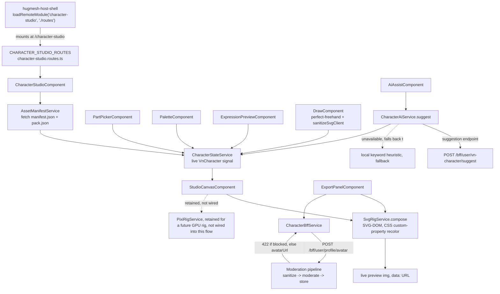

A browser-based, layered-2D avatar creator for the HugMesh platform — pick a
species/class combination, recolor per region, add an expression, freehand-draw
extra flair, and export a finished avatar. Think Picrew or a Gaia Online
dress-up doll, but self-hosted and running the composition entirely
client-side (SVG-DOM, no server round-trip needed just to preview a look).

It's delivered as a native-federation **remote** (`character-studio`) that the
[`hugmesh-host-shell`](https://github.com/hugmesh-net/hugmesh-host-shell)
mounts at `/character-studio`. This is the platform's avatar-authoring
surface: the Matrix/Akkoma chat clients and the forum both consume the
characters it produces, via the
[`hugmesh-user-bff-api`](https://github.com/hugmesh-net/hugmesh-user-bff-api)
`/bff/user/**` character/avatar routes, keyed to the signed-in user's Casdoor
subject.

## Quick start

```bash
npm ci                            # install (Angular 22 + native-federation; npm only, no other lockfiles)
npm start                         # standalone dev server, http://localhost:4209
npm run build:character-studio    # production federation build -> dist/character-studio (+ remoteEntry.json)
```

## How it fits into the platform

This repo is a native-federation **remote only** — it has no host shell and no
dedicated backend of its own (only `hugmeshRemote(...)` is used; there's no
`hugmeshHost(...)` call anywhere in this repo — see `federation.config.js`).

- [`hugmesh-host-shell`](https://github.com/hugmesh-net/hugmesh-host-shell)
  loads this remote's exposed `./routes` module and mounts it at
  `/character-studio` (federation surface: `./routes` →
  `CHARACTER_STUDIO_ROUTES`, declared in `federation.config.js`).
- Reads/writes that need a backend go through the existing
  [`hugmesh-user-bff-api`](https://github.com/hugmesh-net/hugmesh-user-bff-api)
  `/bff/user/**` surface (`CharacterBffService`, `CharacterAiService`),
  authenticated via the shared HttpOnly `bff_` session cookie — there is no
  browser-held bearer token.
- `federation-base.js` is kept byte-for-byte identical to the copy in
  [`hugmesh-games`](https://github.com/hugmesh-net/hugmesh-games)
  (`frontend/federation-base.js`) and every other HugMesh native-federation
  remote, so the shared-dependency/skip-list contract can't drift between the
  host shell and any remote.
- This remote has no role gates — it's a self-service tool, identical for
  every signed-in user — so the role×feature test matrices used elsewhere on
  the platform are deliberately not applicable here (see
  `e2e/features/avatar.feature`).

## Architecture



The core creator flow: the asset library loads a pack
(`AssetManifestService`), `CharacterStateService` holds the live character and
drives a **live SVG-DOM preview** (`StudioCanvasComponent` + `SvgRigService` —
independent per-region recolor via CSS custom properties, not the PixiJS
path), with a part picker, a palette, a freehand draw/paint-in tool, an
expression preview (neutral/happy/sad/angry toggles), an optional "describe
your character" AI-assist panel (calls a suggestion endpoint, falling back to
a local keyword heuristic when that endpoint is unavailable), and an export
panel that renders the composed character to PNG and uploads it through the
BFF's moderated avatar-export endpoint (a sanitize → moderate → store
pipeline; a blocked image surfaces as an HTTP 422).

`PixiRigService` (`src/app/character-studio/services/pixi-rig.service.ts`) is
retained in the codebase but not on the active render path. It's reserved for
a future GPU-accelerated live-render / expression-viseme milestone, not the
current SVG-driven creator.

## Asset packs

Four packs ship in `src/assets/vn/packs/`, all listed enabled in
`src/assets/vn/manifest.json` (and confirmed against the actual part files on
disk):

| Pack | Slots | Part SVGs | Notes |
|---|---|---|---|
| `base-anthro-v1` | 5 | 14 | Original generic-anthro content, not SRD-derived. |
| `srd-taxonomy-v1` | 11 | 180 | "SRD Chibi — All Species": full D&D SRD 5.1 (CC-BY-4.0) catalog coverage in original chibi/kemono art (92 species heads, 10 expression presets, 5-step viseme mouths, 12 class outfit sets, token backdrops) — see [`docs/CATALOG-DND-SRD.md`](docs/CATALOG-DND-SRD.md), [`docs/ART-STYLE-CHIBI.md`](docs/ART-STYLE-CHIBI.md) and [`ATTRIBUTION.txt`](ATTRIBUTION.txt). The art is original; only the naming/category taxonomy is SRD-sourced. |
| `menagerie-v1` | 12 | 189 | An "all creatures" pack: ~40 species including dragons, kobolds, dinosaurs, insects, amphibians, slimes, and robots, plus universal hybrid overlays (goo/metallic/stone/crystal). |
| `anime-v1` | 12 | 48 | A kemonomimi/anime pack (catgirl-style ears/tails, nine-tailed kitsune, etc). |

All four share one geometry canon. `srd-taxonomy-v1` carries a full chibi art
pass (style guide: [`docs/ART-STYLE-CHIBI.md`](docs/ART-STYLE-CHIBI.md),
authored to the same numeric face proportions as the platform's companion 3D
avatar project, for visual parity between a character's 2D token and its 3D
model); the other three packs remain earlier-generation flat vector art and
are candidates for the same treatment.

## Build & test

- `npm ci` — install (Angular 22 / native-federation; npm only).
- `npm run build:character-studio` — production federation build.
- `npm start` — standalone dev server on `:4209`.
- `npm test` — Karma/Jasmine unit tests (`ng test character-studio --watch=false
  --browsers=ChromeHeadlessCI`); 33 specs across the pack picker, part picker,
  `AssetManifestService`, `SvgRigService`, the randomizer, and the export
  panel.
- `npm run validate:assets` / `npm run compose:sweep` — asset-library CI
  gates (see below).
- `e2e/` — a separate Playwright + playwright-bdd (Gherkin) package
  (`cd e2e && npm ci && npm run bdd:gen && npm test`). Pure-UI scenarios (part
  picker, palette, draw/undo/clear, export→download, expression preview,
  canvas render, responsive layout, credits/attribution, combination
  coverage) run fully offline against `ng serve character-studio` — no
  backend, no mocks. Sixteen `.feature` files ship in total; the five that
  touch the off-stack `character-bff`/`character-ai` (the "set as avatar"
  cross-surface write and its cross-user isolation, the edge-AI suggest seam
  and its fallback path) carry `@cluster`-tagged scenarios and are skipped
  unless `E2E_LIVE=1`.

### Asset-library CI gates

- `npm run validate:assets` schema-validates every pack, confirms every part
  SVG referenced in a manifest actually exists, asserts each
  `tintRegion.svgClass` actually appears in its part SVG (so recolor will
  bind), and enforces the asset size/shape caps (part SVG ≤ 8192 bytes, ≤ 100
  parts/slot, ≤ 24 slots/pack, part id ≤ 64 chars, displayName ≤ 48 chars,
  ≤ 6 tintRegions/part, ≤ 16 expressions/pack).
- `npm run compose:sweep` (run right after `validate:assets`) node-side
  re-composes, for every enabled pack, every part in every slot, a seeded
  300-character random sweep (half hybrid cross-archetype), every expression
  preset × every eyes/brows/mouth part, and first/last/none boundary combos —
  asserting each composition is well-formed SVG with sane canvas bounds. This
  is the exhaustive "every combination" check that clicking through the
  browser e2e can't afford to cover (see `tools/compose-sweep.mjs`).
- `tools/render-proof-sheet.mjs` renders flattened, literal-color proof sheets
  for a pack's heads, useful for eyeballing a whole species roster at once
  outside the browser.

## Container image

The production build is served as a static bundle behind
`nginx-unprivileged`:

```bash
docker build -t hugmesh-character-studio-ui .
docker run -p 8080:8080 hugmesh-character-studio-ui
```

The `Dockerfile` builds with `node:24-alpine` and serves from
`nginxinc/nginx-unprivileged:1.27-alpine` on port 8080; `nginx.conf`
long-caches hashed bundle files but always revalidates `remoteEntry.json`
(the manifest the host shell fetches to resolve this remote's exposed
modules). This image is only meaningful when the optional `character-studio`
mesh feature is enabled on a HugMesh deployment. The publish workflow
(`.github/workflows/release.yml`) is manual-only (`workflow_dispatch`) and
pushes to `ghcr.io/hugmesh-net/hugmesh-character-studio-ui`.

## Documentation

- [`docs/CATALOG-DND-SRD.md`](docs/CATALOG-DND-SRD.md) — the SRD 5.1
  (CC-BY-4.0) design-label catalog: which class/race/monster names are safe to
  ship as parts, the closed-Product-Identity exclusion list, and how a catalog
  entry folds into a `pack.json` part.
- [`docs/ART-STYLE-CHIBI.md`](docs/ART-STYLE-CHIBI.md) — the house art style
  guide for real (non-placeholder) part art: proportions, color/region
  conventions, the SVG part template, and the cross-medium parity contract
  with the platform's 3D avatar pipeline.
- [`ATTRIBUTION.txt`](ATTRIBUTION.txt) — the verbatim SRD 5.1 attribution
  string every SRD-sourced pack must carry.

## Status

### Implemented

- Native-federation remote scaffold, exposing `./routes` at `/character-studio`.
- Asset library loading (`AssetManifestService`) across the four enabled
  packs (see table above).
- A live SVG-DOM compositor (`SvgRigService`) with independent per-region CSS
  custom-property recolor, a part picker, a palette, a freehand draw/paint
  tool (client-sanitized via DOMPurify), a seedable "surprise me" randomizer,
  and a pack picker with a hybrid-mode toggle (bypasses `compatibleHeads`).
- Expression preview (neutral/happy/sad/angry) wired end-to-end as a
  preview-only slot-override swap — see `SvgRigService.compose`'s
  `expressionSlots` parameter.
- An AI-assist "describe your character" panel: calls a suggestion endpoint
  (`POST /bff/user/vn-character/suggest`) and falls back to a local keyword
  heuristic when that endpoint is unavailable — AI features on this platform
  are self-hosted/opt-in by default, so the fallback path is the common case.
- PNG export plus a moderated avatar upload (`POST /bff/user/profile/avatar`),
  which goes through the platform's sanitize → moderate → store pipeline; a
  blocked image surfaces as an HTTP 422.
- A Playwright-bdd e2e harness (16 `.feature` files, offline-first, with
  `@cluster`-tagged scenarios for cases that need a live backend), a
  Karma/Jasmine unit suite (33 specs across 6 suites), and two
  asset-integrity CLI gates (`validate:assets`, `compose:sweep`).

### Known limitations

- **Character persistence is defined but unused.** `CharacterBffService.saveDefinition`
  and `.loadActive` (`src/app/character-studio/services/character-bff.service.ts:23`
  and `:36`) implement PUT/GET of the `vn-character` definition, but nothing in
  the app calls either — `CharacterStudioComponent.ngOnInit`
  (`src/app/character-studio/character-studio.component.ts:69`) always seeds via
  `this.state.init(pack, undefined, expressions)`
  (`src/app/character-studio/character-studio.component.ts:75`), passing `undefined` for
  the saved definition, never from `loadActive()`. No in-progress edit is
  persisted until (if) the user exports it as their avatar — navigating away
  loses the in-progress character.
- **`PixiRigService.setExpression`/`.setViseme` are stubs** (see the docblocks
  in `pixi-rig.service.ts`) — expected, since that GPU rig isn't on the active
  render path yet (reserved for a future milestone), not a regression.
- The studio renders a "Credits &amp; attribution" section whenever the
  active pack carries an `attribution` string (`character-studio.component.html`,
  `data-testid` `cs-credits`), covering all three required attribution
  surfaces: `pack.json`, `ATTRIBUTION.txt`, and in-app.
- **Art quality varies by pack**: `srd-taxonomy-v1` has the full chibi art
  pass (see `docs/ART-STYLE-CHIBI.md`); `base-anthro-v1`, `menagerie-v1` and
  `anime-v1` remain earlier-generation flat vector art — bringing them to the
  chibi style guide is content work, not a code gap.
- User-drawn parts (the freehand draw tool) are client-sanitized and
  session-local only; there is no server-side persistence path for a drawn
  part yet (by design — `svg-sanitize.client.ts` is explicitly documented as
  preview-only, not the security boundary).

## Contributing

Issues and pull requests are welcome. A few pointers specific to this repo:

- Run `npm run validate:assets` and `npm run compose:sweep` before opening a
  PR that touches `src/assets/vn/` — these are hard CI gates and will catch
  most asset-shape mistakes locally, before CI does.
- New part art should follow [`docs/ART-STYLE-CHIBI.md`](docs/ART-STYLE-CHIBI.md).
- New SRD-labeled parts (D&D race/class/monster names) should follow the
  scope and exclusion rules in [`docs/CATALOG-DND-SRD.md`](docs/CATALOG-DND-SRD.md)
  and must carry the attribution in [`ATTRIBUTION.txt`](ATTRIBUTION.txt).
- `npm test` and the e2e suite (`cd e2e && npm ci && npm run bdd:gen && npm test`)
  should pass before submitting.

See the other repositories under the
[hugmesh-net](https://github.com/hugmesh-net) GitHub organization for the
rest of the platform, including the host shell and the backend-for-frontend
services this remote talks to.

## License

MIT — see [LICENSE](LICENSE).
