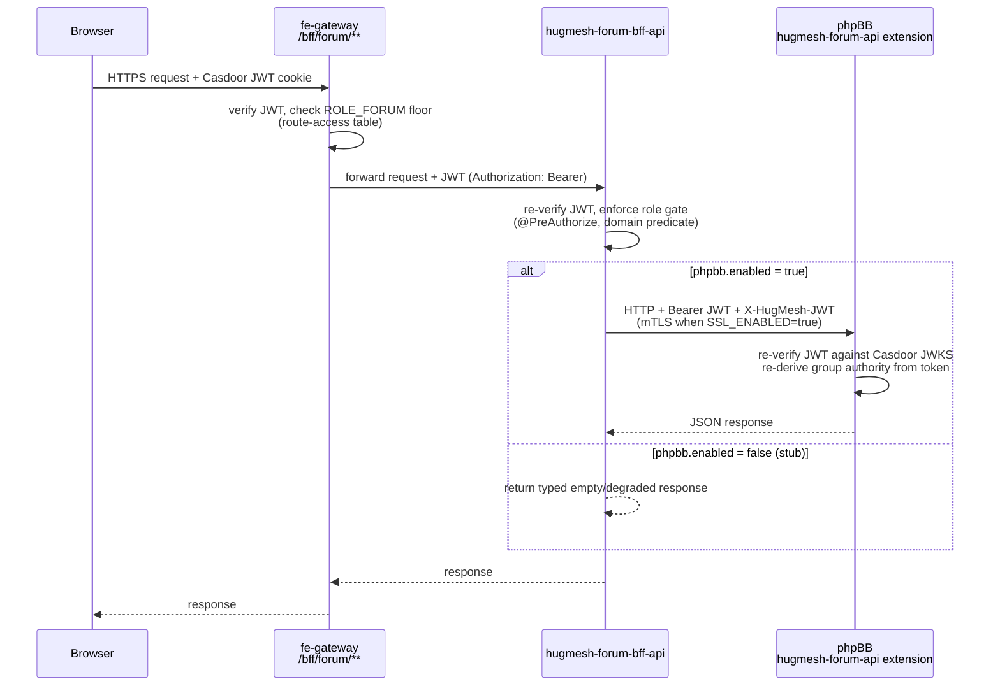
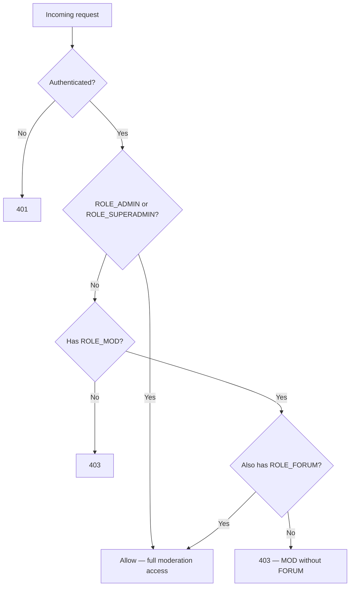

The Forum Backend-for-Frontend (BFF) for the [HugMesh](https://github.com/hugmesh-net)
platform. It wraps a **headless phpBB** install and is the **only** path by which any
client reaches phpBB — there is no direct browser route, no gateway route into phpBB,
and no other service that calls it. It is paired 1:1 with
[`hugmesh-forum-ui`](https://github.com/hugmesh-net/hugmesh-forum-ui), the Angular
native-federation remote served at the apex path `/social/forum`.

**Stack:** Spring WebFlux + reactive `WebClient` (Mono/Flux; no blocking calls on the
event loop) + R2DBC for runtime data access. JDBC is used **only** for Liquibase
migrations. Casdoor JWT OAuth2 resource server, springdoc-openapi (webflux-ui),
resilience4j circuit breakers, Spring-Native-ready, Java 25, Spring Boot 4.0.7.

Maven artifact: `forum-bff` version `0.2.0` (package `net.hugmesh.forumbff`). The
`-api` suffix appears only in the repo/service/image name, not the artifact ID.

> **Status legend used throughout this README:** ✅ shipped on `main` · 🚧 in-flight
> (open branch/PR, not yet merged) · 🔭 planned (design only) · ⛓ owned by another
> repo in the platform.

## Contents

- [Where it fits in HugMesh](#where-it-fits-in-hugmesh)
- [Architecture](#architecture)
- [The single browser → phpBB path](#the-single-browser--phpbb-path)
- [Authorization model](#authorization-model)
- [API surface](#api-surface)
- [Headless phpBB integration](#headless-phpbb-integration)
- [Casdoor → phpBB group mapping](#casdoor--phpbb-group-mapping)
- [Ban synchronisation and audit trail](#ban-synchronisation-and-audit-trail)
- [Multi-tenancy and domain scoping](#multi-tenancy-and-domain-scoping)
- [Shared platform libraries](#shared-platform-libraries)
- [Database schema](#database-schema)
- [Building and testing](#building-and-testing)
- [Configuration reference](#configuration-reference)
- [CI/CD](#cicd)
- [Roadmap](#roadmap)
- [Known gaps](#known-gaps)
- [Contributing](#contributing)
- [License](#license)

## Where it fits in HugMesh

HugMesh is a multi-service platform built around a gateway → BFF → upstream request
chain, where each BFF owns exactly one product surface. This repo is the BFF for
**forums**:

- **Tier:** a per-surface BFF sitting behind
  [`hugmesh-gateway`](https://github.com/hugmesh-net/hugmesh-gateway). It is the
  **only** caller of the headless phpBB extension; no other service and no browser
  talks to phpBB directly.
- **Runtime datastore:** a small Postgres database (three tables — a forum/role
  binding cache, an audit trail, and a VN presentation-profile table; see
  [Database schema](#database-schema)). All runtime access goes through R2DBC;
  Liquibase (over a JDBC datasource) owns the schema.
- **Upstream:** the phpBB install and the
  [`hugmesh-forum-api`](https://github.com/hugmesh-net/hugmesh-forum-api) extension
  run in their own dedicated, default-deny Kubernetes namespace, isolated from this
  BFF's own database namespace. phpBB has no gateway route of its own; this BFF is
  its sole upstream caller.
- **Identity:** a Casdoor JWT OAuth2 resource server. `issuer-uri` defaults to
  `https://id.hugmesh.net` (overridable via `CASDOOR_ISSUER_URI`).
- **Sibling repos:** paired UI in
  [`hugmesh-forum-ui`](https://github.com/hugmesh-net/hugmesh-forum-ui); administered
  through [`hugmesh-admin-bff-api`](https://github.com/hugmesh-net/hugmesh-admin-bff-api);
  shares its moderation-seam shape with
  [`hugmesh-mod-bff-api`](https://github.com/hugmesh-net/hugmesh-mod-bff-api); forked
  originally from [`hugmesh-user-bff-api`](https://github.com/hugmesh-net/hugmesh-user-bff-api)
  (the `casdoorAuthoritiesConverter` pattern and the mTLS keystore setup are shared
  across the BFF family); cluster wiring lives in
  [`hugmesh-generator`](https://github.com/hugmesh-net/hugmesh-generator).

**Platform authentication, in brief.** Casdoor is the platform's SSO identity
provider. [`hugmesh-login-ui`](https://github.com/hugmesh-net/hugmesh-login-ui) runs
the Casdoor OIDC (PKCE) redirect, and
[`hugmesh-user-bff-api`](https://github.com/hugmesh-net/hugmesh-user-bff-api) performs
the server-side code→token exchange and holds per-session JWT custody — the browser
only ever sees an opaque, `bff_`-prefixed session cookie and never the Casdoor JWT
itself. At the edge, the gateway is a pure Casdoor-JWT OAuth2 resource server: a
pre-security filter swaps the opaque session cookie for the internal JWT, so by the
time a request reaches this BFF it already carries a validated Casdoor `Bearer` JWT,
exactly as `casdoorAuthoritiesConverter` (below) expects. This BFF's contract is
unaffected by how that session was established — it only ever validates the inbound
JWT and applies its own role/domain gates.

## Architecture


The gateway and the admin BFF are the only two callers of this service; this service
is the only caller of the phpBB extension, which is the only caller of phpBB itself —
a strict single-path chain at every hop.

## The single browser → phpBB path

Every forum request flows through one chain. The browser never contacts phpBB
directly — its administration panel, native login, and all internal routes are
unreachable from outside the cluster. There is no `forum.<domain>` subdomain (the
`*.hugmesh.net` wildcard would swallow it); the forum UI is served at the apex
path `/social/forum`.

```
browser → fe-gateway /bff/forum/** → hugmesh-forum-bff-api → phpBB (hugmesh-forum-api extension)
```



## Authorization model

`SecurityConfig` gates every path as a second enforcement layer on top of the
gateway's own `ROLE_FORUM` route-access floor. Each controller method then
re-asserts the required role and ownership independently. The whole `/bff/forum/**`
surface requires `.authenticated()` at the filter chain (every authenticated
principal receives at least `ROLE_USER`, so this proves authentication); the real
access decision is made at the method level via `@PreAuthorize`:

| Path prefix | Filter-chain gate | Method gate (`@PreAuthorize`) | Controller |
|---|---|---|---|
| `/bff/forum/**` | `.authenticated()` | `hasRole('FORUM') or hasRole('ADMIN')` | `ForumController` |
| `/bff/forum/moderation/**` | `.authenticated()` (inherits the floor) | `hasRole('ADMIN') or (hasRole('MOD') and hasRole('FORUM'))` | `ModerationController` |
| `/bff/forum/admin/**` | `hasAnyRole('ADMIN','SUPERADMIN')` | `hasRole('ADMIN')` per method | `ForumAdminController` |

- **ROLE_FORUM** — read everything, create topics/replies, and edit/delete your
  **own** posts. Ownership is enforced by `ForumService.isOwnerOrAdmin`:
  `post.authorSubject == jwt.sub || ROLE_ADMIN`.
- **ROLE_MOD *and* ROLE_FORUM** — additionally hide/lock/delete any post and view
  the moderation queue. This is a strict AND of both roles: `ROLE_MOD` alone yields
  403. The gateway expresses the AND via a derived composite `ROLE_FORUM_MOD`; this
  BFF re-enforces it independently at the method level (and again in
  `ForumService.assertModerator`) because a plain allow-list can't express an AND on
  its own.
- **ROLE_ADMIN** — full access to every surface, including the admin console, with
  no forum role required.
- **ROLE_SUPERADMIN** — reaches every ADMIN-gated surface via the
  `ROLE_SUPERADMIN > ROLE_ADMIN` hierarchy edge. The hierarchy is deliberately
  minimal: there is **no `ADMIN > MOD` edge**, so a plain ADMIN cannot satisfy the
  MOD-AND-FORUM moderation gate through the hierarchy. SUPERADMIN is additionally
  **unscoped** across domains (see [Multi-tenancy](#multi-tenancy-and-domain-scoping)).
- **No forum role, not an admin** — 403, checked at both the gateway and here.

Decision tree for `/bff/forum/moderation/**`:



Domain scoping (see [Multi-tenancy](#multi-tenancy-and-domain-scoping)) applies only
to the `forum_user_role` cache and the `forum_action` audit trail — it is not part of
this authorization decision, so no domain check gates moderation access.

### Casdoor → Spring authorities

`SecurityConfig.casdoorAuthoritiesConverter` translates a Casdoor JWT into Spring
Security authorities (the same conversion logic is shared with the user BFF, admin
BFF, and the gateway):

- Every authenticated principal receives a `ROLE_USER` floor.
- Each entry in the JWT `roles` claim (either a plain string or a `{name}` object)
  becomes `ROLE_<UPPER>`.
- Each entry in the `permissions` claim becomes a verbatim authority.
- `isAdmin == true` adds `ROLE_ADMIN`.

Reserved-prefix claims (`ROLE_*`, `DOMAIN_*`) inside the `permissions` array are
stripped, so a crafted `permissions: ["ROLE_SUPERADMIN"]` cannot forge a super-role.
The converter also derives exactly one `DOMAIN_<x>` authority from the validated
issuer URI (see [Multi-tenancy](#multi-tenancy-and-domain-scoping)).

## API surface

`ForumController` — `/bff/forum` (ROLE_FORUM or ROLE_ADMIN):

| Method + path | Purpose |
|---|---|
| `GET /categories` | list forum categories |
| `GET /topics?categoryId=` | list topics in a category |
| `POST /topics` | create a topic (acts as the caller's phpBB user) |
| `GET /topics/{id}` | get a topic + its replies |
| `POST /topics/{id}/replies` | reply (acts as the caller) |
| `PUT /posts/{id}` | edit a post (owner or ADMIN) |
| `DELETE /posts/{id}` | delete a post |

`VnProfileController` — `/bff/forum/vn-profiles` (**authenticated only, no
ROLE_FORUM floor** — the "VN" reading mode renders other users' posts to any
logged-in reader, who may not hold the forum-author role):

| Method + path | Purpose |
|---|---|
| `GET /me` | the caller's own visual-novel-style reading presentation profile. **Never 404s**: an absent row synthesizes `{stickerSlug:null, characterImgRef:null, voiceboxStyle:"classic", voiceboxAccent:null, voiceStyle:null}`. |
| `PUT /me` | upsert the caller's profile → 200 with the saved profile. Subject is always taken from the JWT `sub` — a smuggled subject field in the body is silently dropped. Server-enforced validation: `voiceboxStyle` ∈ `classic\|glass\|retro\|neon\|paper`; `voiceboxAccent` `^#[0-9a-f]{6}$`; `stickerSlug` `^[a-z0-9_-]{1,64}$`; `voiceStyle` ∈ `warm\|bright\|deep\|soft\|robot` or null; `characterImgRef` a strict same-origin `/bff/user/...` path allowlist ≤256 chars (it's rendered as an ``, so it's re-checked defensively at the service layer too). |
| `POST /lookup` | batch-resolve `{subjects:[...]}` (1–50, deduplicated server-side; empty or oversized → 400) → `{profiles:{"<subject>":{…}}}`. Subjects with no row are simply absent keys — never null, never a 404. |

Rows live in `forum_vn_profile` and are domain-scoped the same way as
`forum_user_role` (brand stamped server-side from the validated issuer; SUPERADMIN is
unscoped and it's never a request field). This is the contract that the paired
`hugmesh-forum-ui` VN reading mode (sprites, voicebox skins, read-aloud) consumes.

`ModerationController` — `/bff/forum/moderation` (ADMIN, or MOD+FORUM):

| Method + path | Purpose |
|---|---|
| `GET /queue` | moderation queue depth |
| `POST /topics/{id}` | moderate a topic (hide/lock/delete — any post, not just your own) |

`ForumAdminController` — `/bff/forum/admin` (ADMIN end-to-end; this is the surface
`hugmesh-admin-bff-api`'s `ForumAdminClient` calls):

| Method + path | Purpose |
|---|---|
| `GET /stats` | live forum content stats from the extension |
| `GET /users` | list forum users (read-through phpBB; empty while the extension seam is disabled) |
| `GET /users/{subject}` | read one forum user by Casdoor subject (204 while the extension seam is disabled) |
| `POST /users/{subject}/ban` | ban a user. Makes a real phpBB call when `external.forum.enabled=true` (→ 200 `applied`); otherwise stubbed (→ 202 pending). Always audited. Accepts a `{reason}` JSON body or a legacy `?reason=` query param. |
| `DELETE /users/{subject}/ban` | lift a ban (same gating and audit behaviour as above; fully reversible) |
| `POST /users/{subject}/groups` | assign a user to a named phpBB group `{group}` (ADMIN only; group name validated against `ForumGroup` — unknown → 400; audited) |
| `PUT /users/{subject}/groups` | sync phpBB group membership for a user from their current Casdoor roles (ADMIN only; computes the full target group set via `ForumService.syncGroups`, audited). Called by the admin BFF after a role change. |
| `GET /categories` | list forum categories (read-through phpBB; empty while the seam is disabled) |
| `POST /categories` | create a forum category `{name, description?, parentId?}` (ADMIN only; audited; 202 pending-reconcile while the seam is disabled) |
| `GET /moderation-queue` | list the moderation queue (pending/flagged posts) |
| `POST /moderation/{id}/approve` | approve a queued post (ADMIN only; audited) |
| `POST /moderation/{id}/reject` | reject a queued post (ADMIN only; audited) |
| `POST /styles` | install a phpBB style (ADMIN only) |
| `POST /extensions` | install a phpBB extension (ADMIN only) |
| `GET /audit` | read the `forum_action` audit trail |

The phpBB HTTP leg itself stays behind this BFF's own `phpbb.enabled` flag until the
`hugmesh-forum-api` extension is deployed and validated on the target cluster — so
the BFF-to-BFF seam above is real and tested even while no phpBB call is made yet
(see [Headless phpBB integration](#headless-phpbb-integration)).

Writes against a disabled extension seam return **`202 {state: pending}`**; admin
ban/unban return **202 pending-reconcile** for any non-applied outcome and never a
`200` for a ban that didn't actually take effect. `GET /actuator/health` (plus
`/health/**` and `/info`) is public for container/orchestrator health probes. The
OpenAPI spec at `/v3/api-docs` (with Swagger UI) is the source the paired
`hugmesh-forum-ui`'s typed client and docs pipeline consume; it's open under the
`dev`/`test` profile and `ADMIN`/`SUPERADMIN`-gated in production.

## Headless phpBB integration

phpBB has no native REST API, so the integration mechanism is a thin **custom phpBB
extension**, served at `/api/v1/hugmesh/**`. phpBB 3.1+ runs on Symfony HttpKernel,
so the extension registers routes in `config/routing.yml`, returns Symfony
`JsonResponse`, and calls phpBB's **own** services through its DI container — reads
and writes go through phpBB's native consistency and permission logic, with no
raw-database coupling.

The extension lives in its own repo,
[`hugmesh-forum-api`](https://github.com/hugmesh-net/hugmesh-forum-api), targeting
phpBB 3.3.

> **Naming note.** The extension's git repo is `hugmesh-forum-api`, but the
> Composer/extension identifier and install directory are `hugmesh/forumapi` (no
> hyphen; PHP namespace `hugmesh\forumapi`, installed at `ext/hugmesh/forumapi/`) —
> phpBB validates extension names against `^[A-Za-z0-9_]{2,}/[A-Za-z0-9_]{2,}$`, and
> a hyphenated identifier is silently un-enableable. The HTTP path stays
> `/api/v1/hugmesh/**` either way.

**Status:** the extension is proven to install, enable, migrate, and register its
routes on phpBB 3.3.11 (controllers, service layer, an initial-schema migration, and
a JWT/JWKS auth test suite all ship). End-to-end HTTP posting through a live,
running phpBB instance is not yet proven in CI — the `docker compose` smoke test
that exercises this BFF against a live phpBB is currently a manual step.

**Alternatives considered:**

| Option | Why it was rejected |
|---|---|
| Unofficial community REST extension | Alpha quality; uses cookie auth rather than the platform's JWT model; test coverage unverified |
| phpBB's internal PHP APIs directly (`phpbbcli.php`, etc.) | Used indirectly by the extension via DI; not HTTP-addressable on their own |
| Direct R2DBC access to the phpBB schema | Bypasses phpBB's own permission and ban checks even on reads |

### Feature flags (`phpbb.enabled` / `external.forum.enabled`)

Both integration seams are flag-gated and fail-soft — the service boots and serves
traffic cleanly whether or not phpBB is reachable:

- **`PhpbbApiClient`** (the read/write seam, gated by `phpbb.enabled`, default
  `false`): when off, reads return typed empty/degraded responses and writes are
  no-ops — never a hard failure. When on, each method makes the real HTTP call to
  the `hugmesh-forum-api` extension at `/api/v1/hugmesh/**`, wrapped in a
  `@CircuitBreaker(name="phpbb")` with a typed fallback.
- The caller's Casdoor JWT is forwarded as both `Authorization: Bearer <jwt>` and
  `X-HugMesh-JWT`; the extension validates it against the Casdoor JWKS and
  re-derives group authority from the verified token — caller-supplied group data is
  never trusted. The phpBB user is bound by the immutable Casdoor `sub` (not the
  localpart, since two identity providers could yield the same localpart), so
  mapping is collision-safe.
- **mTLS, both directions** (default off for local/dev/CI): server-side enforcement
  (`server.ssl.*`; set `SSL_ENABLED=true` and `SSL_CLIENT_AUTH=need` in-cluster so
  the handshake requires a client certificate that chains to the cluster CA) and
  client-side certificate presentation to phpBB
  (`hugmesh.mtls.client.enabled`/`PhpbbHttpClientSsl`). A single mounted `/stores`
  PKCS12 layout (`keystore.p12` for this service's own identity, `truststore.p12`
  for the cluster CA) serves both legs. TLS 1.3 is the floor.
- **`PhpbbAdminClient`** (the ban-congruence seam, gated by
  `external.forum.enabled`, default `false`): mirrors the moderation seam shape used
  in [`hugmesh-mod-bff-api`](https://github.com/hugmesh-net/hugmesh-mod-bff-api).
  `doSuspend()` makes the real `POST`/`DELETE`
  `/api/v1/hugmesh/admin/users/{sub}/ban` call when the flag is on; otherwise it
  returns a stubbed, non-applied result. Every call is breaker-guarded
  (`@CircuitBreaker(name="phpbb-admin")`).

Turning on either flag is a config-only change — no code change is required in this
BFF. What remains before flipping them in a real deployment is cluster-side: build
and roll out an official phpBB image with the extension installed (owned by
[`hugmesh-generator`](https://github.com/hugmesh-net/hugmesh-generator)), bootstrap
it in its namespace, then set `PHPBB_ENABLED=true` here and
`external.forum.enabled=true` in the admin BFF pointing at the in-cluster phpBB
service.

## Casdoor → phpBB group mapping

| Casdoor roles | phpBB group |
|---|---|
| ROLE_SUPERADMIN or ROLE_ADMIN | **ADMINISTRATORS** — always, even without ROLE_FORUM |
| ROLE_MOD and ROLE_FORUM | GLOBAL_MODERATORS |
| ROLE_FORUM alone | REGISTERED USERS |
| none of the above | no access |

`ForumGroup.forRoles` checks `ROLE_SUPERADMIN` explicitly alongside `ROLE_ADMIN`
(both map to ADMINISTRATORS) because the `ROLE_SUPERADMIN > ROLE_ADMIN` hierarchy
expansion only applies inside `@PreAuthorize` checks, not when reading
`authentication.getAuthorities()` directly — without the explicit check, a
SUPERADMIN-without-ADMIN token would otherwise fall through to the wrong group.

Group sync is declarative: `ForumService.syncGroups` computes the full target group
set from the caller's *current* roles, and the extension's `setUserGroups` converges
membership to exactly that set (so a demoted moderator loses GLOBAL_MODERATORS on
the next sync). Installing styles or extensions is admin-only
(`/bff/forum/admin/**`, re-checked for `ROLE_ADMIN` in the extension).

## Ban synchronisation and audit trail

Removing a user's forum role makes the gateway deny the forum surface on its next
route-access refresh. That change is carried into phpBB itself by
`PhpbbAdminClient` (`suspendUser`/`unsuspendUser`) — the same seam shape used by the
`hugmesh-mod-bff-api` moderation client. It's stubbed by default
(`external.forum.enabled=false`, no HTTP call), and makes the real
`POST`/`DELETE` `/api/v1/hugmesh/admin/users/{sub}/ban` call once the flag is
enabled. Breaker-guarded, it returns **200 "applied"** only on a genuine success and
**202 pending-reconcile** for any non-applied outcome — never a 200 for a ban that
didn't actually land. The 202 signals that the action is recorded and will be
reconciled once the seam is live.

Every admin or synchronisation action is written to this service's own
`forum_action` table regardless of whether the phpBB call itself succeeded, so a
stubbed ban is still fully auditable. `forum_action` is intentionally separate from
`hugmesh-mod-bff-api`'s own `mod_action` table and does not share its constraints.

## Multi-tenancy and domain scoping ✅

The platform is multi-brand and multi-tenant: each brand runs its own Casdoor
instance, so the token's cryptographically-validated `iss` claim is the
authoritative tenant discriminator. This BFF implements the **data-plane** half of
tenant isolation — queries are scoped to the caller's brand. The gateway/Casdoor/PKI
half of multi-tenancy lives in the gateway and the generator (see
[Roadmap](#roadmap)).

**Canonical converter (`security.CasdoorAuthorities`).** The JWT-to-authority
mapping uses one shared converter (the same logic used by the gateway) so the
single-issuer and multi-issuer paths emit identical authorities. The converter
derives exactly one `DOMAIN_<x>` authority from the **validated** issuer via
`DomainRegistry`, and strips any `ROLE_*`/`DOMAIN_*` entries from the JWT
`permissions` array so a crafted `permissions: ["DOMAIN_brandy"]` can't forge a
tenant scope. `DOMAIN_<x>` is a non-role authority and never satisfies a
`hasRole()` check on its own.

**`DomainRegistry`** maps each validated issuer URI to a brand name. A single-issuer
deployment seeds one entry (`{that issuer → "default"}`), so every token receives
`DOMAIN_default` and nothing else changes. In multi-brand mode the registry is
fail-closed: an issuer it doesn't recognise resolves to `null`, and the request is
rejected with a 401.

**Opt-in multi-issuer mode (`TenancyResourceServerConfig`).** The multi-issuer path
only activates when `app.tenancy.issuers` lists real `issuer=domain` pairs and
`DomainRegistry.isMultiIssuer()` returns true. Otherwise the resource server stays
on the standard single-issuer path. When active, each trusted per-brand Casdoor
instance validates its own tokens (unknown `iss` → 401), and each per-issuer manager
uses the same canonical converter so `DOMAIN_<x>` is emitted consistently.

**Per-query domain predicate (`security.DomainScope` + `PrincipalDomain`).** The two
runtime tables that carry tenant data — `forum_user_role` and `forum_action` — each
have a `domain` column (`NOT NULL DEFAULT 'default'`). For each request, the service
resolves the caller's domain server-side from the validated issuer via
`PrincipalDomain.forScope`, then appends `AND domain = :domain` to every repository
query. A forum admin or moderator for brand X therefore only ever reads and writes
brand X's rows. A non-SUPERADMIN whose issuer the registry can't resolve fails
closed: `PrincipalDomain` returns a sentinel that matches no row.

**SUPERADMIN is unscoped.** The cross-domain super-role is exempt from the domain
predicate — `PrincipalDomain` returns `null` (no predicate appended), so SUPERADMIN
can read and mutate every brand's bindings and audit trail. The role hierarchy
(`ROLE_SUPERADMIN > ROLE_ADMIN / ROLE_MOD / ROLE_USER`) lets SUPERADMIN reach all
ADMIN-gated surfaces, but still has **no `ADMIN > MOD` edge** and doesn't include
the `ROLE_FORUM_MOD` composite, so a plain ADMIN still can't satisfy the
MOD-AND-FORUM moderation gate through the hierarchy.

The domain predicate is always an *additional* constraint alongside owner/actor
keying — the `owner == JWT subject` invariant enforced by
`ForumService.isOwnerOrAdmin` is unaffected, and the ROLE_FORUM / ROLE_FORUM_MOD
gates are unchanged. A single-tenant deployment resolves `DOMAIN_default` for every
caller and behaves exactly as it would without any of this.

Regression coverage for the fail-closed multi-issuer security slice (unknown issuer
→ 401, no cross-brand token reuse, the path-vs-method-gate boundary around the
missing `ADMIN>MOD` edge) is documented separately in
[`docs/testing/MULTI-ISSUER-SLICE.md`](docs/testing/MULTI-ISSUER-SLICE.md).

## Shared platform libraries

This service builds on the org's shared Maven artifacts, which eliminate duplicated
security/tenancy code that used to exist separately across each BFF:

1. **Parent POM** — `net.hugmesh:hugmesh-parent:2.8.0`, itself a child of
   `spring-boot-starter-parent:4.0.7`, so the full Spring Boot dependency- and
   plugin-management tree is inherited transitively, along with the Testcontainers
   BOM, H2/R2DBC-H2 pins, and the Liquibase starter. The parent also consolidates
   the common reactive-BFF dependencies (WebFlux, Actuator, Security, OAuth2
   resource server, validation, R2DBC, Liquibase, JDBC, springdoc, the test stack)
   and manages the versions of `hugmesh-commons`, the AWS SDK BOM, resilience4j, and
   springdoc. Only two repo-specific dependencies remain unmanaged in this POM (the
   resilience4j artifacts).

2. **Shared security/tenancy/web** — `net.hugmesh:hugmesh-commons:2.1.0`. This
   service consumes the following commons classes in place of local copies:

   | Local usage | Commons class |
   |---|---|
   | Casdoor authority conversion | `commons.security.CasdoorAuthorities` (`MfaConfig` is a public record) |
   | Issuer → brand lookup | `commons.security.DomainRegistry` |
   | Domain-scope predicate | `commons.tenancy.DomainScope` |
   | Multi-issuer resource-server wiring | `commons.config.TenancyResourceServerConfig` |
   | BFF exception shape | `commons.web.ApiException` (`{"error": msg}`) |

   **Kept as repo-specific code (not in commons):**
   - `security.Roles` — retains the `isSuperadmin(Authentication)` convenience
     overload used by `ForumService.isAdmin`, which the commons `Roles` doesn't
     expose.
   - `security.PrincipalDomain` — a forum-specific component that resolves a
     request's effective scope domain via `forScope(jwt)`. Distinct from the
     commons value-object of the same name.
   - `config.SecurityConfig` (route matchers, CSRF/cookie/header policy, role
     hierarchy) and the test helper `config.SecuritySliceSupport` are always kept
     per-repo.

   `config.CommonsSecurityConfig` uses `@Import` to bring in the commons
   `DomainRegistry` and `TenancyResourceServerConfig` beans, since this service's
   `@SpringBootApplication` component scan covers `net.hugmesh.forumbff` but not
   `net.hugmesh.commons.*`.

3. **This BFF does not consume `hugmesh-auth-core`.**
   [`hugmesh-auth-core`](https://github.com/hugmesh-net/hugmesh-auth-core) (shared
   account/session/MFA/Casdoor-admin infrastructure) is consumed only by
   `hugmesh-user-bff-api` and `hugmesh-admin-bff-api` — the SSO/login/session tier.
   This forum BFF is a pure Casdoor-JWT resource server with no login,
   session-exchange, or account custody of its own, so auth-core is intentionally
   absent from its dependency tree.

### Resolving the private `hugmesh-commons` artifact

`hugmesh-commons` is not published to Maven Central — it lives in the
organization's private GitLab Maven Package Registry. No credentials are ever
committed to git in either resolution path below:

- **Local development:** install `hugmesh-parent` and `hugmesh-commons` into your
  local `~/.m2` repository with `mvn install`. After that, `./mvnw test` resolves
  both artifacts from the local cache.
- **CI / Docker:** the committed [`settings.xml`](settings.xml) declares the
  `gitlab-maven` group registry. Authentication uses a GitLab `CI_JOB_TOKEN`
  (injected by the CI runner, never committed). The [`Dockerfile`](Dockerfile)
  multi-stage build runs `./mvnw -s settings.xml package` with the token mounted as
  a BuildKit secret (`--mount=type=secret`), so it's never baked into an image
  layer.

## Database schema

Schema is managed by Liquibase (over JDBC) and accessed at runtime via R2DBC. The
changelogs registered in `db.changelog-master`:

| Changelog | Table / change |
|---|---|
| `001-forum-user-role-cache.xml` | `forum_user_role(casdoor_subject PK/UNIQUE, phpbb_user_id, group_membership, last_synced)`. The uniqueness key is the immutable Casdoor `sub`, never the localpart. |
| `002-forum-audit.xml` | `forum_action(id, actor_subject, action, target, outcome, detail, created_at)` |
| `003-domain-scoping.xml` ✅ | Adds `domain NOT NULL DEFAULT 'default'` to both tables above, an index on `forum_action(domain, created_at)`, and backfills existing rows. |
| `004-db-generated-uuid-pks.xml` ✅ | Installs the `pgcrypto` extension and generates `forum_action.id` via a column default (`(gen_random_uuid())::text`), matching the previous application-generated UUID format byte-for-byte. `forum_user_role` keeps its natural `casdoor_subject` primary key. |
| `005-vn-profile.xml` ✅ | `forum_vn_profile(casdoor_subject PK/UNIQUE, domain, sticker_slug, character_img_ref, voicebox_style NOT NULL DEFAULT 'classic', voicebox_accent, voice_style, updated_at)` — the VN reading-mode presentation profile behind `/bff/forum/vn-profiles/**` (see [API surface](#api-surface)). |

## Building and testing

Requires a JDK 25 toolchain (the Maven wrapper will otherwise fail to compile) and,
for local builds, access to `hugmesh-parent`/`hugmesh-commons` in your local `~/.m2`
cache (see [above](#resolving-the-private-hugmesh-commons-artifact)).

```sh
./mvnw test                     # unit + slice + full-context tests. Full-context and
                                 # R2DBC repository slices run against a Testcontainers
                                 # Postgres (via the shared commons Postgres test
                                 # support base) with real Liquibase migrations; the
                                 # lighter security/HTTP slices use H2 in PG-compat mode.
./mvnw -B package                # build the jar
./mvnw -Pnative native:compile   # GraalVM native image (best-effort, needs a GraalVM host)
```

The [`Dockerfile`](Dockerfile) is a two-stage Temurin 25 build
(`package -DskipTests` → JRE runtime), exposing port 8080.

## Configuration reference

All configuration is environment-variable driven with sensible local/dev defaults;
see [`application.yml`](src/main/resources/application.yml) for the full set.

| Variable | Default | Purpose |
|---|---|---|
| `CASDOOR_ISSUER_URI` | `https://id.hugmesh.net` | Casdoor OIDC issuer used for JWT validation |
| `SPRING_R2DBC_URL` / `_USERNAME` / `_PASSWORD` | in-cluster Postgres DNS | runtime R2DBC datastore |
| `SPRING_LIQUIBASE_URL` / `_USER` / `_PASSWORD` | same database, JDBC | Liquibase migration connection |
| `PHPBB_ENABLED` | `false` | enables the real phpBB read/write HTTP seam (`PhpbbApiClient`) |
| `PHPBB_API_BASE_URL` | in-cluster phpBB Service DNS | base URL for the phpBB extension |
| `EXTERNAL_FORUM_ENABLED` | `false` | enables the real ban-congruence HTTP seam (`PhpbbAdminClient`) |
| `SSL_ENABLED` / `SSL_CLIENT_AUTH` | `false` / `none` | server-side mTLS enforcement (inbound) |
| `HUGMESH_MTLS_CLIENT_ENABLED` | `false` | client-side mTLS presentation to phpBB (outbound) |
| `SSL_KEY_STORE` / `SSL_TRUST_STORE` (+ `_TYPE`/`_PASSWORD`) | `/stores/keystore.p12` / `/stores/truststore.p12` | shared PKCS12 stores for both mTLS directions |
| `APP_TENANCY_ISSUERS` | empty (single-issuer) | comma-separated `issuerUri=domainName` pairs enabling multi-issuer mode |
| `app.mfa.enabled` / `app.mfa.freshness-window` | `false` / `600000` | MFA-marker derivation config (see [Roadmap](#roadmap)) |

Notes on a few of these:

- **Circuit breakers** (`resilience4j.circuitbreaker.instances.phpbb` and
  `.phpbb-admin`) use a 10-call sliding window, 50% failure-rate threshold, and a
  30s open-state wait — tune these in `application.yml` if your phpBB deployment
  has different latency/availability characteristics.
- **springdoc** pins `default-produces-media-type: application/json` and dumps
  OpenAPI 3.0.1 (rather than springdoc's 3.x default of 3.1.0), because the typed
  client generator used by `hugmesh-forum-ui` doesn't yet support OpenAPI 3.1's
  `type` array syntax.
- `/actuator/health`, `/health/**`, and `/info` are always public, for
  container/orchestrator probes.

## CI/CD

CI runs on both GitLab (the enforcing pipeline) and GitHub Actions (a merge-gate
mirror), since GitHub is where pull requests are reviewed and merged while GitLab's
CI runs on a mirrored copy after the merge.

`.gitlab-ci.yml` defines stages `[test, security, build, pentest]`:

| Stage / job | What it does | Gate |
|---|---|---|
| `test` | `./mvnw verify -B` in a Temurin 25 container; publishes JUnit reports | blocks `build:image` |
| `build:image` | two-stage Temurin 25 image build, tagged with the release tag/git SHA and a moving branch tag, pushed to the registry | runs only after `test` passes |
| `pentest:sca` | OWASP Dependency-Check SCA over this repo, via a shared job template from `hugmesh-generator` | advisory (`allow_failure`) |
| `pentest:dast` | authenticated OWASP ZAP baseline DAST plus custom probes, via a shared job template from `hugmesh-generator` | advisory (`allow_failure`) |

The pen-test jobs extend a centralized template included from
[`hugmesh-generator`](https://github.com/hugmesh-net/hugmesh-generator)
(`tests/pentest/ci/pentest-stage.gitlab-ci.yml`), so SCA/DAST configuration has one
source of truth across the platform's repos. `make pentest` (`pentest-sca` /
`pentest-dast`) mirrors these jobs locally as a dev-only convenience — CI remains
the actual enforcing path.

**GitHub Actions** (`.github/workflows/ci.yml`) runs a `build` job
(`./mvnw -B -s settings.xml clean verify`) on pull requests and pushes to `main`,
as a required, merge-blocking status check. It exists because merges happen on
GitHub while GitLab's CI only runs post-merge on the mirror — without a GitHub-side
check, a broken `main` could merge before GitLab's pipeline ever ran against it.
GitLab CI remains the fuller enforcing pipeline (it runs the
`security`/`build`/`pentest` stages that GitHub Actions does not).

## Roadmap

Status legend: ✅ shipped on `main` · 🚧 in-flight (open branch/PR) · 🔭 planned
(design only) · ⛓ owned by another repo. Nothing below is implemented in this BFF
unless explicitly marked ✅.

**Config-only flips (work already done in code, deployment pending):**

- 🔭 **phpBB seam enable.** The phpBB read/write seam (`PhpbbApiClient`,
  `phpbb.enabled`) and the ban-congruence seam (`PhpbbAdminClient`,
  `external.forum.enabled`) are both feature-complete and gated purely by
  configuration. The [`hugmesh-forum-api`](https://github.com/hugmesh-net/hugmesh-forum-api)
  extension itself is built and proven to install/enable/migrate/route on phpBB
  3.3. What remains is cluster-side: building the phpBB image with the extension
  baked in, namespace bootstrap, and on-cluster validation (owned by
  `hugmesh-generator`, see below) — then flipping the two flags.

**Owned by other repos in the platform:**

- ⛓ **Cluster wiring** ([`hugmesh-generator`](https://github.com/hugmesh-net/hugmesh-generator)).
  The dedicated phpBB namespace, its default-deny network policy, the phpBB image
  (official phpBB 3.3 + the `hugmesh-forum-api` extension, enabled on first boot),
  its database, and a reconciliation job all live in the generator, not here.
- ⛓ **Forum roles in Casdoor.** `ROLE_FORUM` and the derived `ROLE_FORUM_MOD`
  composite are provisioned in Casdoor by the generator; this BFF only consumes
  them.
- ⛓🔭 **Gateway/PKI half of multi-tenancy.** The data-plane domain predicate is ✅
  here (see [Multi-tenancy](#multi-tenancy-and-domain-scoping)); the authoritative
  cross-domain boundary — per-domain namespace and mTLS isolation, and the
  automation that provisions a new brand's namespace/CA/Casdoor org/gateway/BFF/UI
  — is planned in the gateway and generator, not this repo.

**Platform features that will eventually reach this BFF:**

- 🚧 **Platform-wide SSO.** The Casdoor OIDC login → opaque session → gateway
  token-exchange flow (owned by `hugmesh-login-ui` / `hugmesh-user-bff-api` /
  `hugmesh-gateway`) is being finished end-to-end with cross-service tests. This is
  invisible to the forum BFF — its contract ("validate the inbound Casdoor Bearer
  JWT") is unchanged, and no code change is expected here beyond participating in
  the shared security test suite.
- 🔭 **Casdoor MFA / step-up auth.** Platform-wide WebAuthn/TOTP with fail-closed
  step-up gating is designed but not yet wired end-to-end. This repo already
  carries the marker-derivation plumbing (`security.Roles.MFA_SATISFIED`, and
  `SecurityConfig`'s `app.mfa.enabled`/`app.mfa.freshness-window` config threaded
  into the shared `CasdoorAuthorities.MfaConfig`), so the authority converter is
  ready to emit an `MFA_SATISFIED` marker the moment the platform turns it on — but
  `app.mfa.enabled` defaults to `false` (identical legacy behaviour when off), and
  no `@PreAuthorize`/path gate in this repo checks it yet. `/bff/forum/admin/**` and
  `/bff/forum/moderation/**` are the expected step-up candidates once the platform
  enables it.
- 🚧 **External notification channels.** A phpBB forum adapter is one of the
  planned external delivery channels (alongside chat DM/feed channels and email)
  for an in-app notifications feature. Because this BFF is the sole caller of
  phpBB, a future "post a system notification to the forum" endpoint may land
  here — no such endpoint exists yet.

## Known gaps

The code has no `FIXME`s or unimplemented-method stubs; the gaps below are
configuration-gated seams and proof-coverage gaps, not incomplete implementations.

- **`phpbb.enabled` and `external.forum.enabled` both default to `false`.** Until
  they're flipped, `PhpbbApiClient` reads return typed empty/degraded responses,
  writes are no-ops, and `PhpbbAdminClient.doSuspend()` stays stubbed (`202
  pending-reconcile`, no real HTTP call). See
  [Headless phpBB integration](#headless-phpbb-integration).
- **End-to-end HTTP posting through a live phpBB is not yet proven in CI.** The
  `hugmesh-forum-api` extension is proven to install/enable/migrate/route on phpBB
  3.3.11, but the `docker compose` smoke test that exercises this BFF against a
  running phpBB instance is currently a manual step.
- **GitHub Actions only runs `mvnw verify`.** It doesn't run the
  `security`/`build`/`pentest` stages that `.gitlab-ci.yml` runs post-merge, so a
  pull request can pass its required GitHub check while GitLab's SCA/DAST/image
  stages could still fail after merge.
- **The `characterImgRef` VN-profile field has no resolvable target yet for the
  one value the paired UI actually writes.** This BFF only validates the *shape* of
  the path it's given (`^/bff/user/(?!.*\.\.)[A-Za-z0-9._/-]{1,246}$`, see
  [`VnProfileDto`](src/main/java/net/hugmesh/forumbff/forum/VnProfileDto.java))
  — it never dereferences it. `hugmesh-forum-ui`'s VN profile editor currently
  writes exactly one value (`/bff/user/character/avatar`), but
  `hugmesh-user-bff-api` has no route at that path today (avatars there are Matrix
  `mxc://` URLs, never served back over an HTTP path), so a VN profile with the
  avatar option enabled renders a broken image link. The same gap exists for
  sticker rendering. Fixing this needs a design decision in
  `hugmesh-user-bff-api`/`hugmesh-forum-ui` (add a real serving route, or switch the
  UI to a resolvable identifier) — this BFF is intentionally agnostic to whether
  the path it stores actually resolves.

## Contributing

Issues and pull requests are welcome. A few notes to make review faster:

- Run `./mvnw test` locally before opening a PR — the GitHub Actions check
  (`clean verify`) is a required, merge-blocking status.
- Keep the security-slice tests (`SecuritySliceSupport`,
  `MultiIssuerSecuritySliceTest`, etc. — see
  [`docs/testing/MULTI-ISSUER-SLICE.md`](docs/testing/MULTI-ISSUER-SLICE.md)) green
  when touching anything under `config.SecurityConfig` or the Casdoor authority
  converter; these are the platform's load-bearing fail-closed guarantees.
- If a change affects the `/bff/forum/**` API surface, keep the OpenAPI spec and
  this README's [API surface](#api-surface) table in sync.
- For anything that touches shared behaviour (the Casdoor authority converter, the
  mTLS keystore pattern, the moderation-seam shape), check whether the equivalent
  code in `hugmesh-user-bff-api`, `hugmesh-admin-bff-api`, or
  `hugmesh-mod-bff-api` needs the same fix.

## License

[MIT](LICENSE)
