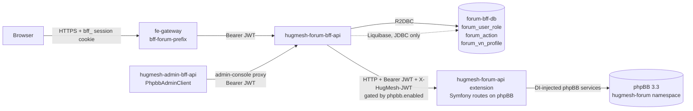
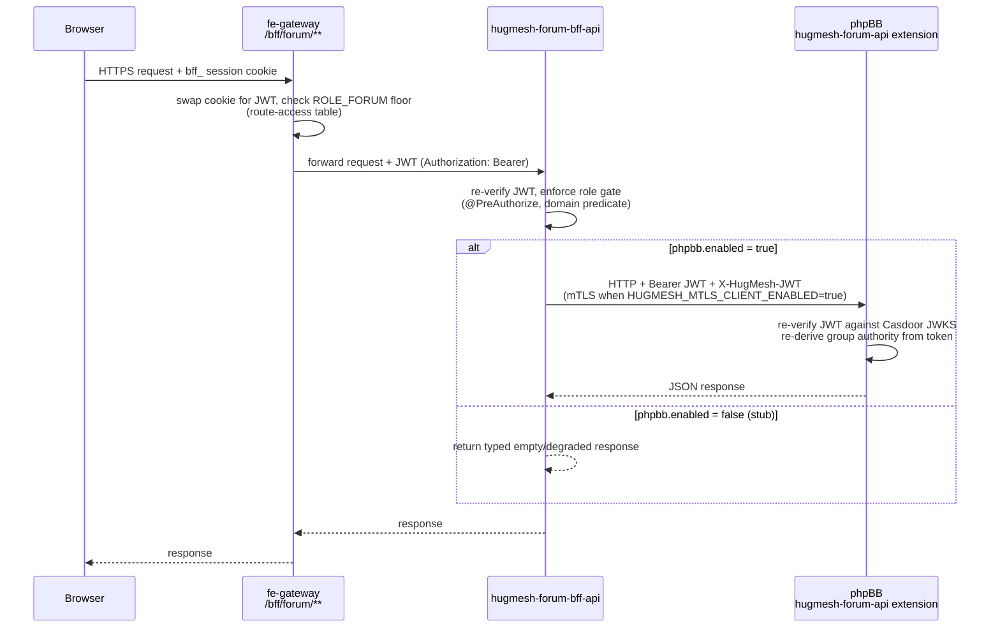
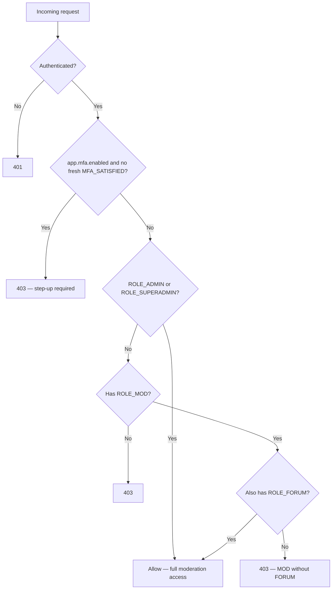

The Forum Backend-for-Frontend (BFF) for the [HugMesh](https://github.com/hugmesh)
platform. It wraps a **headless phpBB** install and is the **only** path any client
has to phpBB. There is no direct browser route and no gateway route into phpBB. No
other service calls it in code, though the cluster's network policy also admits the
admin BFF and a sync Job (see [Where it fits](#where-it-fits-in-hugmesh)). phpBB sees
no browser. It sees this service. The BFF is
paired 1:1 with [`hugmesh-forum-ui`](https://github.com/hugmesh/hugmesh-forum-ui),
the Angular native-federation remote served at the apex path `/social/forum`.

**Stack:** Spring WebFlux + reactive `WebClient` (Mono/Flux; no blocking calls on the
event loop) + R2DBC for runtime data access. JDBC is used **only** for Liquibase
migrations. Casdoor JWT OAuth2 resource server, springdoc-openapi (webflux-ui),
resilience4j circuit breakers, Spring-Native-ready, Java 25, Spring Boot 4.0.7.

Maven artifact: `forum-bff` version `0.2.0-beta.1` (package `net.hugmesh.forumbff`). The
`-api` suffix appears only in the repo, service and image name, not the artifact ID.

> **Status legend used throughout this README:** ✅ shipped on `main` · 🚧 in-flight
> (open branch/PR, not yet merged) · 🔭 planned (design only) · ⛓ owned by another
> repo in the platform.

## Contents

- [Where it fits in HugMesh](#where-it-fits-in-hugmesh)
- [Architecture](#architecture)
- [The single browser → phpBB path](#the-single-browser--phpbb-path)
- [Authorization model](#authorization-model)
- [API surface](#api-surface)
- [Headless phpBB integration](#headless-phpbb-integration)
- [Casdoor → phpBB group mapping](#casdoor--phpbb-group-mapping)
- [Ban synchronisation and audit trail](#ban-synchronisation-and-audit-trail)
- [Multi-tenancy and domain scoping](#multi-tenancy-and-domain-scoping)
- [Shared platform libraries](#shared-platform-libraries)
- [Database schema](#database-schema)
- [Building and testing](#building-and-testing)
- [Configuration reference](#configuration-reference)
- [CI/CD](#cicd)
- [Roadmap](#roadmap)
- [Known gaps](#known-gaps)
- [Contributing](#contributing)
- [License](#license)

## Where it fits in HugMesh

HugMesh is a multi-service platform built on a gateway → BFF → upstream request
chain. Each BFF owns one product surface. This repo is the BFF for **forums**:

- **Tier:** a per-surface BFF behind
  [`hugmesh-gateway`](https://github.com/hugmesh/hugmesh-gateway). It is the
  **only** code path to the headless phpBB extension. No browser talks to phpBB
  directly, and admin actions go through this BFF.
- **Runtime datastore:** a small Postgres database with three tables: a forum/role
  binding cache, an audit trail, and a VN presentation-profile table (see
  [Database schema](#database-schema)). All runtime access goes through R2DBC.
  Liquibase, over a JDBC datasource, owns the schema.
- **Upstream:** the phpBB install and the
  [`hugmesh-forum-api`](https://github.com/hugmesh/hugmesh-forum-api) extension
  run in their own default-deny Kubernetes namespace, apart from this BFF's database
  namespace. phpBB has no gateway route. This BFF is its only caller in code. The
  generator's default-deny network policy admits ingress to phpBB from three pods:
  this BFF, `hugmesh-admin-bff-api` (allowed so a future direct admin path stays
  inside the boundary; admin actions traverse this BFF today) and the
  `forum-admin-sync` Job (`specs/cluster/manifests/forum/network-policy.yaml`).
- **Identity:** a Casdoor JWT OAuth2 resource server. `issuer-uri` defaults to
  `https://id.hugmesh.net` (override with `CASDOOR_ISSUER_URI`).
- **Sibling repos:** the paired UI is
  [`hugmesh-forum-ui`](https://github.com/hugmesh/hugmesh-forum-ui). The BFF is
  administered through [`hugmesh-admin-bff-api`](https://github.com/hugmesh/hugmesh-admin-bff-api)
  and shares its moderation-seam shape with
  [`hugmesh-mod-bff-api`](https://github.com/hugmesh/hugmesh-mod-bff-api). It was
  forked from [`hugmesh-user-bff-api`](https://github.com/hugmesh/hugmesh-user-bff-api);
  the `casdoorAuthoritiesConverter` pattern and the mTLS keystore setup are shared
  across the BFF family. Cluster wiring lives in
  [`hugmesh-generator`](https://github.com/hugmesh/hugmesh-generator).

**Platform authentication, in brief.** Casdoor is the platform's SSO identity
provider. The browser is never sent to Casdoor. The sign-in form in
[`hugmesh-login-ui`](https://github.com/hugmesh/hugmesh-login-ui) posts to
`POST /bff/login` on [`hugmesh-user-bff-api`](https://github.com/hugmesh/hugmesh-user-bff-api).
That service drives Casdoor's internal login and the PKCE code exchange server-side
and sets an opaque, `bff_`-prefixed session cookie. The browser holds only that
cookie and never sees a Casdoor JWT. At the edge, the gateway swaps the cookie for an
internal custody JWT through an exchange call to `hugmesh-admin-bff-api`
(`HUGMESH_GATEWAY_BFF_EXCHANGE_ENABLED` is `true` in the generator's
`specs/cluster/apps/20-gateway-fe.yaml`). A request that reaches this BFF carries a
Casdoor `Bearer` JWT, as `casdoorAuthoritiesConverter` (below) expects. This BFF does
not depend on how the session was made. It validates the inbound JWT and applies its
own role and domain gates.

## Architecture



Two callers reach this service: the gateway and the admin BFF. In code, only this
service calls the phpBB extension, and only the extension calls phpBB. The chain has
one path at every hop.

## The single browser → phpBB path

Every forum request takes one chain. The browser never contacts phpBB. Its
administration panel, native login and internal routes are unreachable from outside
the cluster. There is no `forum.<domain>` subdomain (the `*.hugmesh.net` wildcard
would swallow it). The forum UI is served at the apex path `/social/forum`.

```
browser → fe-gateway /bff/forum/** → hugmesh-forum-bff-api → phpBB (hugmesh-forum-api extension)
```



## Authorization model

`SecurityConfig` gates every path, as a second layer behind the gateway's own
`ROLE_FORUM` route-access floor. Each controller method then checks the required role
and ownership again. The filter chain requires only `.authenticated()` on the whole
`/bff/forum/**` surface (every authenticated principal gets at least `ROLE_USER`, so
this proves authentication). The real access decision is made at the method level with
`@PreAuthorize`:

| Path prefix | Filter-chain gate | Method gate (`@PreAuthorize`) | Controller |
|---|---|---|---|
| `/bff/forum/**` | `.authenticated()` | `hasRole('FORUM') or hasRole('ADMIN')` | `ForumController` |
| `/bff/forum/moderation/**` | `.authenticated()` **+ MFA step-up** | `hasRole('ADMIN') or (hasRole('MOD') and hasRole('FORUM'))` | `ModerationController` |
| `/bff/forum/admin/**` | `hasAnyRole('ADMIN','SUPERADMIN')` **+ MFA step-up** | `hasRole('ADMIN')` per method | `ForumAdminController` |

- **ROLE_FORUM** reads everything, creates topics and replies, and edits or deletes
  its **own** posts. `ForumService.isOwnerOrAdmin` enforces ownership:
  `post.authorSubject == jwt.sub || ROLE_ADMIN`.
- **ROLE_MOD *and* ROLE_FORUM** can also hide, lock or delete any post and view the
  moderation queue. Both roles are required: `ROLE_MOD` alone gets 403. The gateway
  expresses the AND with a derived composite, `ROLE_FORUM_MOD`. This BFF checks it
  again at the method level, and once more in `ForumService.assertModerator`, because
  a plain allow-list cannot express an AND.
- **ROLE_ADMIN** has full access to every surface, including the admin console, with
  no forum role.
- **ROLE_SUPERADMIN** reaches every ADMIN-gated surface through the
  `ROLE_SUPERADMIN > ROLE_ADMIN` hierarchy edge. The hierarchy holds three edges
  (`SUPERADMIN > ADMIN`, `SUPERADMIN > MOD`, `SUPERADMIN > USER`) and no more. There
  is **no `ADMIN > MOD` edge**, so a plain ADMIN cannot satisfy the MOD-AND-FORUM
  moderation gate through the hierarchy. SUPERADMIN is also **unscoped** across
  domains (see [Multi-tenancy](#multi-tenancy-and-domain-scoping)).
- **No forum role and not an admin:** 403, checked at the gateway and here.

Decision tree for `/bff/forum/moderation/**`:



Domain scoping (see [Multi-tenancy](#multi-tenancy-and-domain-scoping)) applies only
to the `forum_user_role` cache, the `forum_action` audit trail and the
`forum_vn_profile` table. It is not part of the authorization decision, so no domain
check gates moderation access.

### MFA step-up on the privileged paths

When the platform-wide `app.mfa.enabled` flag is on, the two privileged path groups,
`/bff/forum/admin/**` and `/bff/forum/moderation/**`, also require a **fresh second
factor**. `SecurityConfig.stepUp` wraps those two filter-chain rules so they demand
the non-role `MFA_SATISFIED` authority. `CasdoorAuthorities` derives that authority
**only** from the BFF-written, freshness-checked `mfa_satisfied_at` JWT claim.
`MFA_SATISFIED` is a reserved converter prefix, so a crafted
`permissions: ["MFA_SATISFIED"]` cannot forge it.

`app.mfa.enabled` defaults to `false` org-wide. While it is off the wrapper is a
**no-op**: the marker is never derived, so an unconditional check would lock out every
admin. One flag both derives the marker and enforces it. Step-up starts working when
the platform flips the flag, with no follow-up change here. The ordinary
`/bff/forum/**` floor is deliberately *not* step-up gated: reading and posting in the
forum is not a privileged action.

#### What a step-up refusal looks like on the wire

A step-up denial and an ordinary role denial used to be the same bare `403`, with no
body and no header. A client could not tell "you are not an admin" (an MFA challenge
is a dead end) from "you are an admin who has not stepped up" (the challenge is the
whole fix). `SecurityConfig.stepUp` now records which condition denied, and
`ForumStepUpAccessDeniedHandler` renders that one case in the platform's shared shape,
the same contract hugmesh-admin-bff-api defines and hugmesh-mod-bff-api speaks:

| | |
| --- | --- |
| **Status** | `403`, unchanged. Deliberately **not** 428 — every existing client branches on 403, and a status change is not rolling-deployable. |
| **Header** | `X-Step-Up-Required: X-Forum-StepUp` |
| **Body** | `{"error":"<verb> requires step-up re-authentication (present X-Forum-StepUp)"}`, where `<verb>` is `forum administration` or `forum moderation`. The literal phrase `requires step-up` is the legacy leg for a client with no structured detection, and it is composed **by the constructor**, so no reword can strip it. |

`X-Forum-StepUp` is a **flavour name, not a request header this service reads**. The
gate has no token leg. It consumes the `MFA_SATISFIED` marker and nothing else, so the
client follow-up is *complete a challenge, then retry the same request unchanged*. The
flavour is advertised so it is observable, and so a future token leg needs no client
change.

**Which denials carry the signal, and which must not.** The header appears if and only
if `stepUp`'s base rule had already **granted** and the `MFA_SATISFIED` leg refused:

| Denial | Signal? |
| --- | --- |
| Admin path, `ROLE_ADMIN` but no / stale stamp | ✅ |
| Moderation path, authenticated but no / stale stamp | ✅ |
| Admin path, caller is not an admin (even fully stepped up) | ❌ — a challenge could not let them through |
| `ModerationController`'s method-level MOD∧FORUM refusal | ❌ — the path gate granted; nothing recorded |
| No token at all (`401`) | ❌ — never reaches the handler; the authentication entry point answers |
| Anything at all while `app.mfa.enabled=false` | ❌ — `stepUp` returns the base rule unwrapped, so nothing can record |

**Every other 403 is byte-identical to before.** An explicit `accessDeniedHandler`
makes `ServerHttpSecurity` discard its default handlers wholesale. So the
pass-through delegates to `BearerTokenServerAccessDeniedHandler`, which is what Spring
installs on a chain with `oauth2ResourceServer`, and both of ours have one. Measured:
a real (authenticated) non-step-up 403 still carries the full RFC 6750
`WWW-Authenticate: Bearer error="insufficient_scope", …` challenge and an empty body.
Delegating to `HttpStatusServerAccessDeniedHandler` would have destroyed that
challenge and invented a `text/plain` `Access Denied` body on every refusal this
service sends. `StepUpAccessDeniedWiringTest` compares our handler against Spring's
own at runtime (status, every header, body), on both the authenticated and
unauthenticated shapes. It also asserts that both profile chains dispatch through ours.

> The OpenAPI spec is deliberately **not** annotated with this header. The gate is a
> filter-chain rule over two path prefixes, not a per-operation annotation, so it
> applies to every operation under them. Documenting it would take an `@ApiResponse`
> on every method of `ForumAdminController` and `ModerationController`, for a response
> the chain produces before any of them runs.

### Casdoor → Spring authorities

`SecurityConfig.casdoorAuthoritiesConverter` translates a Casdoor JWT into Spring
Security authorities. The user BFF, the admin BFF and the gateway share the same
conversion logic:

- Every authenticated principal receives a `ROLE_USER` floor.
- Each entry in the JWT `roles` claim (a plain string or a `{name}` object) becomes
  `ROLE_<UPPER>`.
- Each entry in the `permissions` claim becomes a verbatim authority.
- `isAdmin == true` adds `ROLE_ADMIN`.

Reserved-prefix entries (`ROLE_*`, `DOMAIN_*`, `MFA_SATISFIED`) in the `permissions`
array are stripped. A crafted `permissions: ["ROLE_SUPERADMIN"]` cannot forge a
super-role, and a crafted `permissions: ["MFA_SATISFIED"]` cannot forge a second
factor. The converter also derives exactly one `DOMAIN_<x>` authority from the
validated issuer URI (see [Multi-tenancy](#multi-tenancy-and-domain-scoping)).

## API surface

`ForumController` — `/bff/forum` (ROLE_FORUM or ROLE_ADMIN):

| Method + path | Purpose |
|---|---|
| `GET /categories` | list forum categories |
| `GET /topics?categoryId=` | list topics in a category |
| `POST /topics` | create a topic (acts as the caller's phpBB user) |
| `GET /topics/{id}` | get a topic + its replies |
| `POST /topics/{id}/replies` | reply (acts as the caller) |
| `PUT /posts/{id}` | edit a post (owner or ADMIN) |
| `DELETE /posts/{id}` | delete a post (owner or ADMIN) |

`VnProfileController` — `/bff/forum/vn-profiles` (**authenticated only, no
ROLE_FORUM floor**: the "VN" reading mode shows other users' posts to any logged-in
reader, who may not hold the forum-author role):

| Method + path | Purpose |
|---|---|
| `GET /me` | the caller's own visual-novel-style reading presentation profile. **Never 404s**: an absent row synthesizes `{subject:<the caller's sub>, stickerSlug:null, characterImgRef:null, voiceboxStyle:"classic", voiceboxAccent:null, voiceStyle:null}`. |
| `PUT /me` | upsert the caller's profile → 200 with the saved profile. Subject is always taken from the JWT `sub` — a smuggled subject field in the body is silently dropped. Server-enforced validation: `voiceboxStyle` is required and ∈ `classic\|glass\|retro\|neon\|paper`; `voiceboxAccent` `^#[0-9a-f]{6}$`; `stickerSlug` `^[a-z0-9_-]{1,64}$`; `voiceStyle` ∈ `warm\|bright\|deep\|soft\|robot` or null; `characterImgRef` a strict same-origin `/bff/user/...` path allowlist ≤256 chars (it's rendered as an ``, so it's re-checked defensively at the service layer too). The allowlist also refuses every spelling a URL parser would **rewrite** — `.`/`..` dot-segments and empty (`//`) segments — so a stored ref means exactly one wire path. On top of the shape, the owner-scoped self-avatar serve `/bff/user/profile/avatar/body` (`VnProfileDto.UNSTORABLE_IMG_REFS`) is **cleared to null**, not rejected. The legacy character-avatar handle path `/bff/user/character/avatar` is deliberately **kept** — see the owner-blind note below. |
| `POST /lookup` | batch-resolve `{subjects:[...]}` (1–50 entries of at most 255 characters each, deduplicated server-side; empty, oversized or blank → 400) → `{profiles:{"<subject>":{…}}}`. Subjects with no row are simply absent keys — never null, never a 404. This is the READER-facing projection — and the only one — so a stored owner-blind `characterImgRef` is suppressed here (the author's `stickerSlug` is left intact, so the reader falls back to their sticker). Suppression compares the **canonical** path, so a legacy row spelled `/bff/user/profile/avatar/./body` is caught too. |

Rows live in `forum_vn_profile`. They are domain-scoped like `forum_user_role`: the
brand is stamped server-side from the validated issuer, SUPERADMIN is unscoped, and
the domain is never a request field. The paired `hugmesh-forum-ui` VN reading mode
(sprites, voicebox skins, read-aloud) consumes this contract.

`ModerationController` — `/bff/forum/moderation` (ADMIN, or MOD+FORUM):

| Method + path | Purpose |
|---|---|
| `GET /queue` | moderation queue depth |
| `POST /topics/{id}` | moderate a topic (hide/lock/delete — any post, not just your own) |

`ForumAdminController` — `/bff/forum/admin` (ADMIN end-to-end; this is the surface
that `hugmesh-admin-bff-api`'s `PhpbbAdminClient` (package `adminbff.forum`) calls):

| Method + path | Purpose |
|---|---|
| `GET /stats` | live forum content stats from the extension |
| `GET /users` | list forum users (read-through phpBB; empty while the extension seam is disabled) |
| `GET /users/{subject}` | read one forum user by Casdoor subject (204 while the extension seam is disabled) |
| `POST /users/{subject}/ban` | ban a user. Makes a real phpBB call when `external.forum.enabled=true` (→ 200 `applied`); otherwise stubbed (→ 202 pending). Always audited. Accepts a `{reason}` JSON body or a legacy `?reason=` query param. |
| `DELETE /users/{subject}/ban` | lift a ban (same gating and audit behaviour as above; fully reversible) |
| `POST /users/{subject}/groups` | assign a user to a named phpBB group `{group}` (ADMIN only; group name validated against `ForumGroup` — unknown → 400; audited) |
| `PUT /users/{subject}/groups` | sync phpBB group membership for a user (ADMIN only). The target group is read from the user's cached `forum_user_role.group_membership` row, or `NONE` if no row exists; `ForumService.syncGroups(auth, subject)` pushes it to the extension and audits it. Called by the admin BFF after a role change. |
| `GET /categories` | list forum categories (read-through phpBB; empty while the seam is disabled) |
| `POST /categories` | create a forum category `{name, description?, parentId?}` (ADMIN only; audited; 202 pending-reconcile while the seam is disabled) |
| `GET /moderation-queue` | list the moderation queue (pending/flagged posts) |
| `POST /moderation/{id}/approve` | approve a queued post (ADMIN only; audited) |
| `POST /moderation/{id}/reject` | reject a queued post (ADMIN only; audited) |
| `POST /styles` | install a phpBB style (ADMIN only; `{name}` JSON body or `?name=`, missing → 400) |
| `POST /extensions` | install a phpBB extension (ADMIN only; same `{name}` body or `?name=`) |
| `GET /audit` | read the `forum_action` audit trail, newest first. Optional `?limit=`, clamped server-side to 1–1000 (default 200). Scoped to the caller's brand; SUPERADMIN sees all brands. |

The phpBB HTTP leg stays behind this BFF's own `phpbb.enabled` flag. The BFF-to-BFF
seam above is real and tested even while no phpBB call is made (see
[Headless phpBB integration](#headless-phpbb-integration)).

With the extension seam disabled, topic, reply, edit and delete writes in
`ForumController` return **`202 {state: pending}`**. Category create returns
**`202 {state: pending-reconcile}`**, and admin ban/unban return **202
pending-reconcile** for any non-applied outcome, never a `200` for a ban that didn't
take effect. Style install, extension install, queued-post approve/reject and group
assign/sync still return `200` and write an `ok` audit row when the seam is
disabled, because the disabled client call completes empty. `GET /actuator/health`
(plus `/actuator/health/**` and `/actuator/info`) is public for container and
orchestrator health probes. The OpenAPI spec at `/v3/api-docs` (with Swagger UI) is
the source for the paired `hugmesh-forum-ui`'s typed client and docs pipeline. It is
open under the `dev`/`test` profile and `ADMIN`/`SUPERADMIN`-gated in production.

## Headless phpBB integration

phpBB has no native REST API, so the integration is a thin **custom phpBB extension**
served at `/api/v1/hugmesh/**`. phpBB 3.1+ runs on Symfony HttpKernel. The extension
registers routes in `config/routing.yml`, returns Symfony `JsonResponse`, and calls
phpBB's **own** services through its DI container. Reads and writes go through phpBB's
native consistency and permission logic, with no raw-database coupling.

The extension lives in its own repo,
[`hugmesh-forum-api`](https://github.com/hugmesh/hugmesh-forum-api), and targets
phpBB 3.3.

> **Naming note.** The extension's git repo is `hugmesh-forum-api`. Its
> Composer/extension identifier and install directory are `hugmesh/forumapi` (no
> hyphen; PHP namespace `hugmesh\forumapi`, installed at `ext/hugmesh/forumapi/`).
> phpBB validates extension names against `^[A-Za-z0-9_]{2,}/[A-Za-z0-9_]{2,}$`, and
> a hyphenated identifier is silently un-enableable. The HTTP path stays
> `/api/v1/hugmesh/**` either way.

**Status:** the extension is proven to install, enable, migrate, and register its
routes on phpBB 3.3.11. Controllers, a service layer, an initial-schema migration and
a JWT/JWKS auth test suite all ship. Per the `hugmesh-forum-api` README ("Go-live
status"), the full authenticated round-trip passed a `docker compose` smoke (30/30)
on its earlier MySQL harness. On the cluster-shaped Postgres harness only the shallow
checks (`/health` 200, `/stats` 401, board lockdown 403, restart-idempotent schema
detection) have been re-confirmed. No test or CI job in this repo runs this BFF
against a live phpBB.

**Alternatives considered:**

| Option | Why it was rejected |
|---|---|
| Unofficial community REST extension | Alpha quality; uses cookie auth rather than the platform's JWT model; test coverage unverified |
| phpBB's internal PHP APIs directly (`phpbbcli.php`, etc.) | Used indirectly by the extension via DI; not HTTP-addressable on their own |
| Direct R2DBC access to the phpBB schema | Bypasses phpBB's own permission and ban checks even on reads |

### Feature flags (`phpbb.enabled` / `external.forum.enabled`)

Both integration seams are flag-gated and fail soft. The service boots and serves
traffic whether or not phpBB is reachable:

- **`PhpbbApiClient`** (the read/write seam, gated by `phpbb.enabled`, default
  `false`): when off, reads return typed empty/degraded responses and writes are
  no-ops, never a hard failure. When on, each method makes the real HTTP call to the
  `hugmesh-forum-api` extension at `/api/v1/hugmesh/**`, wrapped in a
  `@CircuitBreaker(name="phpbb")` with a typed fallback.
- The caller's Casdoor JWT is forwarded as both `Authorization: Bearer <jwt>` and
  `X-HugMesh-JWT`. The extension validates it against the Casdoor JWKS and re-derives
  group authority from the verified token. It never trusts caller-supplied group data.
  The phpBB user is bound by the immutable Casdoor `sub`, not the localpart (two
  identity providers could yield the same localpart), so the mapping is
  collision-safe.
- **mTLS, both directions** (default off for local/dev/CI): server-side enforcement
  (`server.ssl.*`; set `SSL_ENABLED=true` and `SSL_CLIENT_AUTH=need` in-cluster so
  the handshake requires a client certificate that chains to the cluster CA) and
  client-side certificate presentation to phpBB
  (`hugmesh.mtls.client.enabled`/`PhpbbHttpClientSsl`). One mounted `/stores` PKCS12
  layout (`keystore.p12` for this service's identity, `truststore.p12` for the cluster
  CA) serves both legs. TLS 1.3 is the floor.
- **`PhpbbAdminClient`** (the ban-congruence seam, gated by `external.forum.enabled`,
  default `false`): mirrors the moderation seam shape in
  [`hugmesh-mod-bff-api`](https://github.com/hugmesh/hugmesh-mod-bff-api).
  `doSuspend()` makes the real `POST`/`DELETE`
  `/api/v1/hugmesh/admin/users/{sub}/ban` call when the flag is on. Otherwise it
  returns a stubbed, non-applied result. Every call is breaker-guarded
  (`@CircuitBreaker(name="phpbb-admin")`).

Turning on either flag is a config-only change. This BFF needs no code change. Both
default to `false` in `application.yml`, but the generator's cluster manifest
(`specs/cluster/manifests/forum-bff-api/deployment.yaml`) sets
`PHPBB_ENABLED`, `EXTERNAL_FORUM_ENABLED` and `HUGMESH_MTLS_CLIENT_ENABLED` to `true`,
and the admin BFF's manifest sets its own `EXTERNAL_FORUM_ENABLED=true`
(`specs/cluster/manifests/admin-bff-api/deployment.yaml`). The phpBB side (namespace
`hugmesh-forum`, default-deny network policy, the custom image
`registry.hugmesh.net/hugmesh/hugmesh-phpbb:main`, and the `forum-admin-sync` Job) is
owned by [`hugmesh-generator`](https://github.com/hugmesh/hugmesh-generator).

## Casdoor → phpBB group mapping

| Casdoor roles | phpBB group |
|---|---|
| ROLE_SUPERADMIN or ROLE_ADMIN | **ADMINISTRATORS** — always, even without ROLE_FORUM |
| ROLE_MOD and ROLE_FORUM | GLOBAL_MODERATORS |
| ROLE_FORUM alone | REGISTERED |
| none of the above | no access |

`ForumGroup.forRoles` checks `ROLE_SUPERADMIN` explicitly next to `ROLE_ADMIN` (both
map to ADMINISTRATORS). The `ROLE_SUPERADMIN > ROLE_ADMIN` hierarchy expansion applies
only inside `@PreAuthorize` checks, not when code reads `authentication.getAuthorities()`
directly. Without the explicit check, a SUPERADMIN-without-ADMIN token would fall
through to the wrong group.

Group sync is declarative. `ForumService.syncGroups` computes the full target group
set from the caller's *current* roles, and the extension's `setUserGroups` converges
membership to exactly that set, so a demoted moderator loses GLOBAL_MODERATORS on the
next sync. Installing styles or extensions is admin-only (`/bff/forum/admin/**`, and
the extension checks `ROLE_ADMIN` again).

## Ban synchronisation and audit trail

When a user's forum role is removed, the gateway denies the forum surface on its next
route-access refresh. `PhpbbAdminClient` (`suspendUser`/`unsuspendUser`) carries that
change into phpBB itself, using the same seam shape as the `hugmesh-mod-bff-api`
moderation client. It is stubbed by default (`external.forum.enabled=false`, no HTTP
call). Once the flag is on, it makes the real `POST`/`DELETE`
`/api/v1/hugmesh/admin/users/{sub}/ban` call. Breaker-guarded, it returns **200
"applied"** only on a genuine success and **202 pending-reconcile** for any non-applied
outcome, never a 200 for a ban that didn't land. The 202 means the action is recorded
and will be reconciled once the seam is live.

Every admin or synchronisation action is written to this service's own `forum_action`
table, whether or not the phpBB call succeeded, so a stubbed ban is still fully
auditable. `forum_action` is separate from `hugmesh-mod-bff-api`'s `mod_action` table
and does not share its constraints.

## Multi-tenancy and domain scoping ✅

The platform is multi-brand and multi-tenant. Each brand runs its own Casdoor
instance, so the token's cryptographically validated `iss` claim identifies the
tenant. This BFF implements the **data-plane** half of tenant isolation: queries are
scoped to the caller's brand. The gateway, Casdoor and PKI half lives in the gateway
and the generator (see [Roadmap](#roadmap)).

**Canonical converter (`commons.security.CasdoorAuthorities`).** One shared converter
(the same logic as the gateway) maps the JWT to authorities, so the single-issuer and
multi-issuer paths emit identical authorities. It derives exactly one `DOMAIN_<x>`
authority from the **validated** issuer via `DomainRegistry`. It strips any
`ROLE_*`/`DOMAIN_*` entries from the JWT `permissions` array, so a crafted
`permissions: ["DOMAIN_brandy"]` cannot forge a tenant scope. `DOMAIN_<x>` is a
non-role authority and never satisfies a `hasRole()` check on its own.

**`DomainRegistry`** maps each validated issuer URI to a brand name. A single-issuer
deployment seeds one entry (`{that issuer → "default"}`), so every token receives
`DOMAIN_default` and nothing else changes. In multi-brand mode the registry fails
closed: an issuer it doesn't recognise resolves to `null`, and the request gets a 401.

**Opt-in multi-issuer mode (`commons.config.TenancyResourceServerConfig`).** The
multi-issuer path activates only when `app.tenancy.issuers` lists real
`issuer=domain` pairs (the bean is conditional on the value containing `=`) and
`DomainRegistry.isMultiIssuer()` returns true (more than one registered issuer).
Otherwise the resource server stays on the standard single-issuer path. When active,
each trusted per-brand Casdoor instance validates its own tokens (unknown `iss` →
401), and each per-issuer manager uses the same canonical converter, so `DOMAIN_<x>`
is emitted consistently.

**Per-query domain predicate (`commons.tenancy.DomainScope` + `security.PrincipalDomain`).**
The three runtime tables, `forum_user_role`, `forum_action` and `forum_vn_profile`,
each have a `domain` column (`NOT NULL DEFAULT 'default'`). For each request the
service resolves the caller's domain server-side from the validated issuer via
`PrincipalDomain.forScope`, then appends `AND domain = :domain` to every repository
query. A forum admin or moderator for brand X reads and writes only brand X's rows. A
non-SUPERADMIN whose issuer the registry can't resolve fails closed: `PrincipalDomain`
returns a sentinel that matches no row.

**SUPERADMIN is unscoped.** The cross-domain super-role is exempt from the domain
predicate. `PrincipalDomain` returns `null` (no predicate appended), so SUPERADMIN can
read and change every brand's bindings and audit trail. The role hierarchy
(`ROLE_SUPERADMIN > ROLE_ADMIN / ROLE_MOD / ROLE_USER`) lets SUPERADMIN reach all
ADMIN-gated surfaces. It still has **no `ADMIN > MOD` edge** and does not include the
`ROLE_FORUM_MOD` composite, so a plain ADMIN still cannot satisfy the MOD-AND-FORUM
moderation gate through the hierarchy.

The domain predicate is always an *additional* constraint beside owner/actor keying.
The `owner == JWT subject` invariant enforced by `ForumService.isOwnerOrAdmin` is
unaffected, and the ROLE_FORUM / ROLE_FORUM_MOD gates are unchanged. A single-tenant
deployment resolves `DOMAIN_default` for every caller and behaves as it would without
any of this.

Regression coverage for the fail-closed multi-issuer security slice (unknown issuer →
401, no cross-brand token reuse, the path-vs-method-gate boundary around the missing
`ADMIN>MOD` edge) is documented in
[`docs/testing/MULTI-ISSUER-SLICE.md`](docs/testing/MULTI-ISSUER-SLICE.md).

## Shared platform libraries

This service builds on the org's shared Maven artifacts. They replace security and
tenancy code that each BFF used to carry its own copy of:

1. **Parent POM** — `net.hugmesh:hugmesh-parent:2.9.0-beta.1`, itself a child of
   `spring-boot-starter-parent:4.0.7`. The full Spring Boot dependency and plugin
   management tree is inherited transitively, along with the Testcontainers BOM,
   H2/R2DBC-H2 pins and the Liquibase starter. The parent also provides the common
   reactive-BFF dependencies (WebFlux, Actuator, Security, OAuth2 resource server,
   validation, R2DBC, Liquibase, JDBC, springdoc, the test stack) and manages the
   versions of `hugmesh-commons`, the AWS SDK BOM, resilience4j, and springdoc. This
   POM itself declares only `hugmesh-commons` (plus its `tests` classifier jar, whose
   version stays explicit at `2.2.0-beta.1`) and the two resilience4j artifacts
   (`resilience4j-spring-boot4`, `resilience4j-reactor`); the resilience4j versions
   come from the parent.

2. **Shared security/tenancy/web** — `net.hugmesh:hugmesh-commons:2.2.0-beta.1`. This
   service uses these commons classes in place of local copies:

   | Local usage | Commons class |
   |---|---|
   | Casdoor authority conversion | `commons.security.CasdoorAuthorities` (`MfaConfig` is a public record) |
   | Issuer → brand lookup | `commons.security.DomainRegistry` |
   | Domain-scope predicate | `commons.tenancy.DomainScope` |
   | Multi-issuer resource-server wiring | `commons.config.TenancyResourceServerConfig` |
   | BFF exception shape | `commons.web.ApiException` (`{"error": msg}`) |

   **Kept as repo-specific code (not in commons):**
   - `security.Roles` keeps the `isSuperadmin(Authentication)` overload that
     `ForumService.isAdmin` uses. The commons `Roles` doesn't expose it.
   - `security.PrincipalDomain` resolves a request's effective scope domain via
     `forScope(jwt)`. It is distinct from the commons value-object of the same name.
   - `config.SecurityConfig` (route matchers, CSRF/cookie/header policy, role
     hierarchy) and the test helper `config.SecuritySliceSupport` stay per-repo.

   `config.CommonsSecurityConfig` uses `@Import` to bring in the commons
   `DomainRegistry` and `TenancyResourceServerConfig` beans. This service's
   `@SpringBootApplication` component scan covers `net.hugmesh.forumbff` but not
   `net.hugmesh.commons.*`.

3. **This BFF does not consume `hugmesh-auth-core`.**
   [`hugmesh-auth-core`](https://github.com/hugmesh/hugmesh-auth-core) (shared
   account, session, MFA and Casdoor-admin infrastructure) is consumed only by
   `hugmesh-user-bff-api` and `hugmesh-admin-bff-api`, the SSO/login/session tier.
   This forum BFF is a pure Casdoor-JWT resource server. It has no login,
   session-exchange or account custody, so auth-core is absent from its dependency
   tree.

### Resolving the private `hugmesh-commons` artifact

`hugmesh-parent` and `hugmesh-commons` are not on Maven Central. No credentials are
ever committed to git in any resolution path below:

- **Local development:** install `hugmesh-parent` and `hugmesh-commons` into your
  local `~/.m2` repository with `mvn install`. After that, `./mvnw test` resolves
  both artifacts from the local cache.
- **GitLab CI / Docker with the repo-root settings:** the committed
  [`settings.xml`](settings.xml) declares the `gitlab-maven` group registry.
  Authentication uses a GitLab `CI_JOB_TOKEN` (injected by the CI runner, never
  committed). The [`Dockerfile`](Dockerfile) build runs `./mvnw -s settings.xml
  package` with the token mounted as a BuildKit secret (`--mount=type=secret`), so it
  is never baked into an image layer.
- **GitHub release image:** `.github/workflows/release.yml` mounts the secret
  `packages_read_token` (repository secret `PACKAGES_READ_TOKEN`, a classic PAT with
  `read:packages`). The `Dockerfile` then builds with
  [`.github/maven-ci-settings.xml`](.github/maven-ci-settings.xml), which resolves
  `hugmesh-build-config`, `hugmesh-parent` and `hugmesh-commons` from GitHub
  Packages. That file calls the GitLab group registry in `settings.xml` "retired".

## Database schema

Liquibase manages the schema (over JDBC). The service reads and writes it at runtime
through R2DBC. The changelogs registered in `db.changelog-master`:

| Changelog | Table / change |
|---|---|
| `001-forum-user-role-cache.xml` | `forum_user_role(casdoor_subject PK/UNIQUE, phpbb_user_id, group_membership, last_synced)`. The uniqueness key is the immutable Casdoor `sub`, never the localpart. |
| `002-forum-audit.xml` | `forum_action(id, actor_subject, action, target, outcome, detail, created_at)` |
| `003-domain-scoping.xml` ✅ | Adds `domain NOT NULL DEFAULT 'default'` to both tables above, an index on `forum_action(domain, created_at)`, and backfills existing rows. |
| `004-db-generated-uuid-pks.xml` ✅ | Installs the `pgcrypto` extension and generates `forum_action.id` via a column default (`(gen_random_uuid())::text`), matching the previous application-generated UUID format byte-for-byte. `forum_user_role` keeps its natural `casdoor_subject` primary key. |
| `005-vn-profile.xml` ✅ | `forum_vn_profile(casdoor_subject PK/UNIQUE, domain, sticker_slug, character_img_ref, voicebox_style NOT NULL DEFAULT 'classic', voicebox_accent, voice_style, updated_at)` — the VN reading-mode presentation profile behind `/bff/forum/vn-profiles/**` (see [API surface](#api-surface)). |

## Building and testing

You need a JDK 25 toolchain (the Maven wrapper fails to compile without it). Local
builds also need `hugmesh-parent` and `hugmesh-commons` in your local `~/.m2` cache
(see [above](#resolving-the-private-hugmesh-commons-artifact)).

```sh
./mvnw test                     # unit + slice + full-context tests. Full-context and
                                 # R2DBC repository slices run against a Testcontainers
                                 # Postgres (via the shared commons Postgres test
                                 # support base) with real Liquibase migrations; the
                                 # lighter security/HTTP slices use H2 in PG-compat mode.
./mvnw -B package                # build the jar
./mvnw -Pnative native:compile   # GraalVM native image (best-effort, needs a GraalVM host)
make ci-parity                   # text-only check that the CI constants agree (scripts/ci-parity-guard.sh)
```

The full-context and repository tests start a Testcontainers Postgres, so Docker must
be running.

The [`Dockerfile`](Dockerfile) is a two-stage Temurin 25 build
(`package -DskipTests` → JRE runtime). It exposes port 8080.

## Configuration reference

All configuration comes from environment variables, with local/dev defaults. See
[`application.yml`](src/main/resources/application.yml) for the full set.

| Variable | Default | Purpose |
|---|---|---|
| `CASDOOR_ISSUER_URI` | `https://id.hugmesh.net` | Casdoor OIDC issuer used for JWT validation |
| `CASDOOR_JWKS_URI` | `${CASDOOR_ISSUER_URI}/.well-known/jwks` | explicit JWKS URL, so the resource server does no OIDC discovery against the issuer (`iss` is still checked against `CASDOOR_ISSUER_URI`) |
| `SPRING_R2DBC_URL` / `_USERNAME` / `_PASSWORD` | in-cluster Postgres DNS | runtime R2DBC datastore |
| `SPRING_LIQUIBASE_URL` / `_USER` / `_PASSWORD` | same database, JDBC | Liquibase migration connection |
| `PHPBB_ENABLED` | `false` | enables the real phpBB read/write HTTP seam (`PhpbbApiClient`) |
| `PHPBB_API_BASE_URL` | in-cluster phpBB Service DNS | base URL for the phpBB extension |
| `EXTERNAL_FORUM_ENABLED` | `false` | enables the real ban-congruence HTTP seam (`PhpbbAdminClient`) |
| `SSL_ENABLED` / `SSL_CLIENT_AUTH` | `false` / `none` | server-side mTLS enforcement (inbound) |
| `HUGMESH_MTLS_CLIENT_ENABLED` | `false` | client-side mTLS presentation to phpBB (outbound) |
| `SSL_KEY_STORE` / `SSL_TRUST_STORE` (+ `_TYPE`/`_PASSWORD`) | `/stores/keystore.p12` / `/stores/truststore.p12` | shared PKCS12 stores for both mTLS directions |
| `APP_TENANCY_ISSUERS` | empty (single-issuer) | comma-separated `issuerUri=domainName` pairs enabling multi-issuer mode |
| `APP_MFA_ENABLED` | `false` | derives the `MFA_SATISFIED` marker **and** enforces step-up on `/bff/forum/admin/**` + `/bff/forum/moderation/**` (see [MFA step-up](#mfa-step-up-on-the-privileged-paths)) |
| `APP_MFA_FRESHNESS_WINDOW` | `600000` (10m) | how long an `mfa_satisfied_at` stamp keeps satisfying step-up, in millis |

Notes:

- **Circuit breakers** (`resilience4j.circuitbreaker.instances.phpbb` and
  `.phpbb-admin`) use a 10-call sliding window, a 50% failure-rate threshold and a
  30s open-state wait. Tune them in `application.yml` if your phpBB deployment has
  different latency or availability.
- **springdoc** pins `default-produces-media-type: application/json` and dumps
  OpenAPI 3.0.1, not springdoc's 3.x default of 3.1.0. The typed client generator
  used by `hugmesh-forum-ui` doesn't yet support OpenAPI 3.1's `type` array syntax.
- `/actuator/health`, `/actuator/health/**` and `/actuator/info` are always public,
  for container and orchestrator probes.

## CI/CD

The repo carries two CI definitions, `.gitlab-ci.yml` and `.github/workflows/`.
Pull requests are reviewed and merged on GitHub; GitLab's CI runs on a mirrored copy
after the merge.

`.gitlab-ci.yml` defines stages `[test, security, build, pentest]` (the `security`
stage has no job):

| Stage / job | What it does | Gate |
|---|---|---|
| `test` | runs `scripts/ci-parity-guard.sh`, then `./mvnw verify -B -s settings.xml` in a Temurin 25 container (runner tags `hugmesh-x86`, `privileged`), then fails if the build rewrote a committed file (`git diff --exit-code`); publishes JUnit reports | blocks `build:image` |
| `build:image` | Docker build with BuildKit, tagged with the release tag or short git SHA plus a moving branch-slug tag, pushed to the GitLab registry; default branch and tags only | runs only after `test` passes |
| `pentest:sca` | OWASP Dependency-Check SCA over this repo, via a shared job template from `hugmesh-generator` | advisory (`allow_failure`) |
| `pentest:dast` | authenticated OWASP ZAP baseline DAST plus custom probes, via a shared job template from `hugmesh-generator` | advisory (`allow_failure`) |

The pen-test jobs extend a template included from
[`hugmesh-generator`](https://github.com/hugmesh/hugmesh-generator)
(`tests/pentest/ci/pentest-stage.gitlab-ci.yml`), so SCA and DAST configuration has
one source across the platform's repos. `make pentest` (`pentest-sca` /
`pentest-dast`) mirrors these jobs locally, for developers only. `make ci-parity`
checks that the constants shared by `Makefile`, `.gitlab-ci.yml` and
`.github/workflows/ci.yml` still agree. CI remains the enforcing path.

**GitHub Actions.** `.github/workflows/ci.yml` runs on pull requests and pushes to
`main`, on GitHub-hosted `ubuntu-latest` (never a self-hosted runner: these jobs run
on pull requests, and a fork's pull request runs the fork's copy of the file):

- `build`: JDK 25, `scripts/ci-parity-guard.sh`, `scripts/test-release-version.sh`,
  then `./mvnw -B clean verify` with `.github/maven-ci-settings.xml` (GitHub Packages)
  when the `PACKAGES_READ_TOKEN` secret reaches the run, otherwise with the GitLab
  `settings.xml`, which a hosted runner cannot reach.
- `sca`: OWASP Dependency-Check in the `owasp/dependency-check` image (fails at CVSS
  7), non-blocking (`continue-on-error: true`).

It is **not a merge gate today.** Until 2026-10-21 it asked for a `hugmesh-x86`
self-hosted runner that was never registered, so every run sat queued until GitHub
cancelled it after 24 hours. Hosted runners failed on billing while the repository was
private. Branch protection returns HTTP 403 ("Upgrade to GitHub Pro or make this
repository public"), so no check can be made required on the current plan. GitLab CI
is the fuller pipeline: it also builds the image on merge and runs DAST, which GitHub
Actions does not.

`.github/workflows/release.yml` publishes `ghcr.io/hugmesh/hugmesh-forum-bff-api`. Its
first job, `scripts/release-version.sh`, reads the version from `pom.xml` and decides
what may be pushed:

| Trigger | Image tags | GitHub Release |
|---|---|---|
| push to `main`, or a manual run on `main` | `main`, `sha-<12>` | none |
| push of tag `v<version>`, or a manual run on that tag | `<version>`, `beta` (for a `-beta.N`), `sha-<12>` | prerelease, not latest |
| anything else | refused | none |

The tag must equal `v` + the `pom.xml` version, a `-SNAPSHOT` is refused, and a
version that already exists in GHCR is never overwritten. `latest` moves only for a
final (non-prerelease) version, and none exists yet. Each job runs on the runner list
in the repository variable `RUNS_ON_PUBLISH` (for example the local self-hosted runner)
only for `main` and `v*` tags; otherwise, or when that variable is unset, it runs on
`ubuntu-latest`. Before building, it checks that `PACKAGES_READ_TOKEN` can read
`hugmesh-build-config`, `hugmesh-parent` and `hugmesh-commons` on GitHub Packages.

**Versions.** The package is in beta: `pom.xml` is `0.2.0-beta.1`. Each new published
beta of the same base raises the `-beta.N` number. To publish one, merge the version
change, then push an annotated tag `v<version>` on that `main` commit. The pinned
`hugmesh-parent 2.9.0-beta.1` and `hugmesh-commons 2.2.0-beta.1` must be published
first.

## Roadmap

Status legend: ✅ shipped on `main` · 🚧 in-flight (open branch/PR) · 🔭 planned
(design only) · ⛓ owned by another repo. Nothing below is implemented in this BFF
unless marked ✅.

**Config-only flips (work already done in code):**

- ✅⛓ **phpBB seam enable.** The phpBB read/write seam (`PhpbbApiClient`,
  `phpbb.enabled`) and the ban-congruence seam (`PhpbbAdminClient`,
  `external.forum.enabled`) are feature-complete and gated purely by configuration.
  The [`hugmesh-forum-api`](https://github.com/hugmesh/hugmesh-forum-api) extension
  is built and proven to install, enable, migrate and route on phpBB 3.3. The
  generator's manifest already sets both flags to `true` (see
  [Feature flags](#feature-flags-phpbbenabled--externalforumenabled)). Not proven: the
  full authenticated round-trip on a cluster-shaped Postgres harness and on a live
  cluster.

**Owned by other repos in the platform:**

- ⛓ **Cluster wiring** ([`hugmesh-generator`](https://github.com/hugmesh/hugmesh-generator)).
  The dedicated phpBB namespace, its default-deny network policy, the phpBB image
  (official phpBB 3.3 + the `hugmesh-forum-api` extension, enabled on first boot), its
  database and a reconciliation job all live in the generator, not here.
- ⛓ **Forum roles in Casdoor.** The generator provisions `ROLE_FORUM` and the derived
  `ROLE_FORUM_MOD` composite in Casdoor. This BFF only consumes them.
- ⛓🔭 **Gateway/PKI half of multi-tenancy.** The data-plane domain predicate is ✅
  here (see [Multi-tenancy](#multi-tenancy-and-domain-scoping)). The authoritative
  cross-domain boundary is planned in the gateway and generator, not this repo: it
  covers per-domain namespace and mTLS isolation, and the automation that provisions a
  new brand's namespace, CA, Casdoor org, gateway, BFF and UI.

**Platform features that will eventually reach this BFF:**

- 🚧 **Platform-wide SSO.** The Casdoor login → opaque session → gateway
  token-exchange flow (owned by `hugmesh-login-ui` / `hugmesh-user-bff-api` /
  `hugmesh-admin-bff-api` / `hugmesh-gateway`) is being finished end-to-end with
  cross-service tests. The forum BFF does not see it. Its contract ("validate the
  inbound Casdoor Bearer JWT") is unchanged, and no code change is expected here
  beyond joining the shared security test suite.
- ✅⛓ **Casdoor MFA / step-up auth.** Platform-wide WebAuthn/TOTP is designed but not
  yet wired end-to-end, and `app.mfa.enabled` still defaults to `false` org-wide.
  **This BFF's side is done.** The marker-derivation plumbing
  (`security.Roles.MFA_SATISFIED`, and `SecurityConfig`'s
  `app.mfa.enabled`/`app.mfa.freshness-window` config passed into the shared
  `CasdoorAuthorities.MfaConfig`) now has its enforcement half:
  `SecurityConfig.stepUp` gates `/bff/forum/admin/**` and `/bff/forum/moderation/**`
  on the `MFA_SATISFIED` marker. It is a no-op while the flag is off and fails closed
  the moment it flips (see [MFA step-up](#mfa-step-up-on-the-privileged-paths)). Still
  owned elsewhere is the *issuance* leg: something must stamp `mfa_satisfied_at` on
  the token after a real WebAuthn/TOTP ceremony before the flag can be turned on.
- 🚧 **External notification channels.** A phpBB forum adapter is one of the planned
  external delivery channels (alongside chat DM/feed channels and email) for an in-app
  notifications feature. This BFF is phpBB's only code-level caller, so a future "post a
  system notification to the forum" endpoint may land here. No such endpoint exists
  yet.

## Known gaps

The code has no `FIXME`s or unimplemented-method stubs. The gaps below are
configuration-gated seams and proof-coverage gaps, not unfinished code.

- **`phpbb.enabled` and `external.forum.enabled` both default to `false`.** With the
  defaults, `PhpbbApiClient` reads return typed empty/degraded responses, writes are
  no-ops, and `PhpbbAdminClient.doSuspend()` stays stubbed (`202 pending-reconcile`,
  no real HTTP call). The generator's cluster manifest overrides both to `true`. See
  [Headless phpBB integration](#headless-phpbb-integration).
- **Nothing in this repo proves end-to-end HTTP posting through a live phpBB.** The
  `hugmesh-forum-api` extension is proven to install, enable, migrate and route on
  phpBB 3.3.11, but no test or CI job here runs this BFF against a running phpBB
  instance.
- **The GitHub CI workflow has never run green.** Until 2026-10-21 `ci.yml` targeted a
  `hugmesh-x86` runner that was never registered; it now runs on hosted runners, which
  failed on billing while the repository was private. Branch protection cannot be set
  on the current plan (see [CI/CD](#cicd)). Nothing blocks a merge automatically.
- **Disabled-seam writes that still answer `200`.** With the seam off, style and
  extension install, queued-post approve/reject and group assign/sync return `200`
  and write an `ok` audit row although nothing reached phpBB (see
  [API surface](#api-surface)).
- ✅ **The `characterImgRef` VN-profile field's resolvable target (issue #3) — all
  three halves are on `main`.** This BFF validates only the *shape* of the path it is
  given and never dereferences it. The shape is a strict same-origin `/bff/user/...`
  charset that also refuses every spelling a URL parser rewrites (see
  [`VnProfileDto`](src/main/java/net/hugmesh/forumbff/forum/VnProfileDto.java)). That
  is deliberate and does not change.
  - ⛓ ✅ `hugmesh-user-bff-api` **PR #12 (merged, `8976640`)** added
    `CharacterAvatarController`. It serves a VN character avatar at
    `GET /bff/user/character/avatar/{ref}/body`, where `{ref}` is an opaque, stable
    per-owner handle that its owner reads from `GET /bff/user/character/avatar`. It is
    not owner-scoped, on purpose: like an ACTIVE sticker it has to render inside other
    users' posts. The access rule is owner-or-same-brand, and every miss is one
    uniform 404. `image/svg+xml` is refused on the read side as well as at upload.
  - ⛓ ✅ The sibling sticker serve `GET /bff/user/character/stickers/{slug}/body` *is*
    on `hugmesh-user-bff-api` `main` today. Other users in the same brand can read it
    **only once the sticker is ACTIVE**. `PENDING` serves to its owner alone and
    `REJECTED` to nobody (`StickerService.servesTo`).
  - ⛓ ✅ `hugmesh-forum-ui` **PR #14 (merged, `ebe86c3`)** stores that resolved body
    URL instead of the bare path `/bff/user/character/avatar`, which named no owner
    and served nothing. It also ignores the legacy value on the read side instead of
    emitting a broken ``.
  - ✅ **The leftover rows are handled here, without a migration.** Profiles saved
    while the gap was open still hold the literal `/bff/user/character/avatar` in
    `forum_vn_profile.character_img_ref`. `VnProfileService.renderableImgRef`
    suppresses every *owner-blind* ref (`VnProfileDto.OWNER_BLIND_IMG_REFS`) on the
    reader-facing `POST /lookup`, so no reader is served a ref that can only resolve
    against *their own* identity. `GET /me` still echoes the stored value on purpose.
    That value is the signal `hugmesh-forum-ui`'s editor uses to re-tick "use my
    avatar" and rewrite a resolvable URL on the owner's next save. A migration that
    NULLed those rows would destroy the repair instead of completing it. The second
    owner-blind spelling, `/bff/user/profile/avatar/body`, falls under the same render
    rule. It resolves from `jwt.getSubject()`, so a post storing it would show each
    *reader's own* picture beside the author's name.
  - ✅ **The write gate is narrower than the render gate, on purpose.**
    `VnProfileService.storableImgRef` clears only `/bff/user/profile/avatar/body`
    (`VnProfileDto.UNSTORABLE_IMG_REFS`), the spelling no client writes and nobody
    wants back. It does **not** clear the legacy handle path. Clearing it would erase
    the same signal that rules out the migration, one row at a time: a
    pre-`hugmesh-forum-ui#14` bundle sends that literal on every save, so the owner's
    "use my avatar" tick would flip off on the next load and could never be turned back
    on. A test pins `UNSTORABLE_IMG_REFS ⊂ OWNER_BLIND_IMG_REFS`.
  - ✅ **Spelling equivalence is part of the rule.** A set-membership test compares
    strings. A browser compares *parsed* paths. `/bff/user/profile/avatar/./body` is
    charset-legal and equals no owner-blind literal, yet Chromium still puts
    `/bff/user/profile/avatar/body` on the wire (measured: it even de-duplicates that
    `` against one spelled with the plain path). Both halves are closed. The
    charset refuses dot-segments and empty segments on the way in, and
    `VnProfileService.wirePath` canonicalises the *stored* value before the
    comparison, so rows written before the rule existed are caught on the way out. A
    `.` **inside** a segment (`portrait.v2.png`, `.hidden`) is untouched.
  - 🔭 **Only the subject-implicit refs are covered, not the whole unresolvable
    family.** `hugmesh-user-bff-api` also has owner-**enforced** siblings
    (`/bff/user/character/parts/{id}/svg`, `/bff/user/cards/{slug}/body`) that 404 for
    a reader who does not own the row. Those are the broken-image class, not the
    misattributed-face class, and nothing writes them into a VN profile. If anything
    ever does, they belong in `OWNER_BLIND_IMG_REFS` too.
  - **Consequence for this repo:** do not narrow the allowlist past the spellings that
    `VnProfileDto.CANONICAL_AVATAR_REF_SHAPE` / `CANONICAL_STICKER_REF_SHAPE` /
    `STICKER_SLUG` declare. `VnProfileControllerTest` pins the whole declared *shape*
    of each, not one sample apiece, so narrowing the charset (dropping `/`, `_` or `.`)
    fails the build instead of silently breaking every sprite again. `A-Z` is admitted
    by the charset but left unpinned: no `/bff/user/**` route in this contract
    produces an uppercase segment, so narrowing it is a decision to take openly.

## Contributing

Issues and pull requests are welcome. To speed review:

- Run `./mvnw test` locally before opening a PR. No CI check blocks a merge (see
  [CI/CD](#cicd)).
- Keep the security-slice tests (`SecuritySliceSupport`,
  `MultiIssuerSecuritySliceTest`, etc.; see
  [`docs/testing/MULTI-ISSUER-SLICE.md`](docs/testing/MULTI-ISSUER-SLICE.md)) green
  when you touch `config.SecurityConfig` or the Casdoor authority converter. They are
  the platform's load-bearing fail-closed guarantees.
- If a change affects the `/bff/forum/**` API surface, keep the OpenAPI spec and this
  README's [API surface](#api-surface) table in sync.
- If a change touches shared behaviour (the Casdoor authority converter, the mTLS
  keystore pattern, the moderation-seam shape), check whether the equivalent code in
  `hugmesh-user-bff-api`, `hugmesh-admin-bff-api` or `hugmesh-mod-bff-api` needs the
  same fix.

## License

[MIT](LICENSE)
