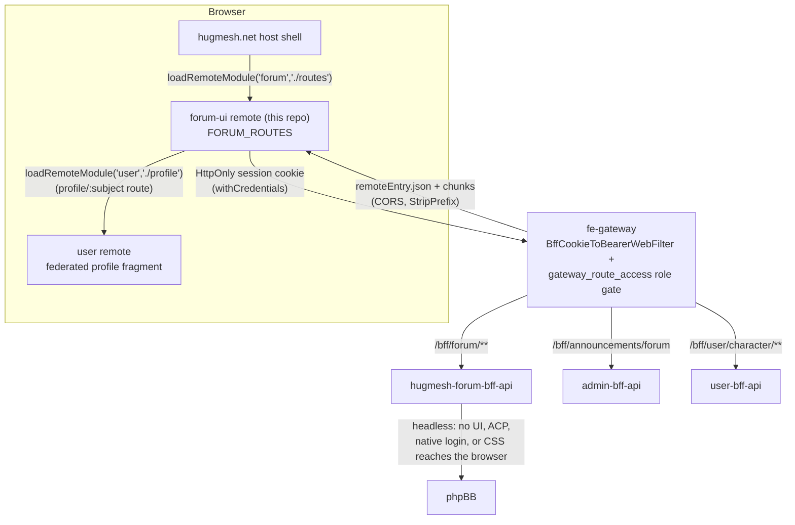

The **Forum** Angular micro-frontend for the [HugMesh](https://github.com/hugmesh)
platform — a native-federation **remote** named **`forum`**, loaded at runtime by the
[hugmesh-host-shell](https://github.com/hugmesh/hugmesh-host-shell).

It provides the entire user-facing forum experience on top of a **headless phpBB**
backend. phpBB itself stays entirely server-side, reached only through
[hugmesh-forum-bff-api](https://github.com/hugmesh/hugmesh-forum-bff-api):
no phpBB board front-end, admin control panel, native login page, or CSS ever
reaches the browser. This remote is the single source of truth for what forum
users see — the browser never talks to phpBB directly.

It is structurally similar to its sibling remote
[hugmesh-mastodon-ui](https://github.com/hugmesh/hugmesh-mastodon-ui)
(the same `federation-base.js`, the same native-federation application builder,
the same Dockerfile/nginx/accessibility baseline), and shares its `SessionService`
implementation with [hugmesh-mod-ui](https://github.com/hugmesh/hugmesh-mod-ui)
so role signals stay consistent across the platform. Other social surfaces ship
as their own remotes — matrix, mastodon, login, admin, mod, user — each in its
own repository under the [hugmesh](https://github.com/hugmesh) organization.

## Contents

- [Features](#features)
- [Architecture](#architecture)
- [Exposed routes](#exposed-routes-forum_routes)
- [Role-based access](#role-based-access)
- [Forum profile](#forum-profile-the-platforms-user-page-embedded)
- [Announcements banner](#main-page-announcements-banner)
- [Auth & token model](#auth--token-model-no-login-ui)
- [Sanitization](#sanitization)
- [Accessibility](#accessibility-conventions)
- [Branding](#branding)
- [Typed API client](#typed-api-client)
- [Multi-tenancy](#multi-tenancy)
- [VN reading mode](#vn-reading-mode-stickers--voicebox-profiles)
- [Known limitations & roadmap](#known-limitations--roadmap)
- [Getting started](#getting-started)
- [Deployment](#deployment)
- [Related HugMesh repositories](#related-hugmesh-repositories)
- [Contributing](#contributing)
- [License](#license)

## Features

- The `forum` native-federation remote exposes the full `FORUM_ROUTES` surface —
  index/categories/topics/create-topic/search/profile — with an affordance-level
  role gate, an embedded federated user-profile fragment, a sandboxed
  announcements banner, server-sanitized post bodies with a DOMPurify preview,
  `--hug-*`/`--forum-*` brand tokens, and a standards-based accessibility
  baseline.
- A committed **ng-openapi-gen** client lives under `src/app/api/`; `ForumService`
  is a thin wrapper that delegates the spec-covered reads/writes to it (see
  [Typed API client](#typed-api-client)).
- **Authentication is cookie-based; the browser never holds a bearer token.**
  `HugSession` carries no `bffToken` or homeserver token of any kind. Every
  `/bff/forum/**` call is sent with credentials included so the HttpOnly
  session cookie rides along, and the gateway exchanges it for a server-side
  bearer token. See [Auth & token model](#auth--token-model-no-login-ui).
- nginx emits a full response header set, including a real
  **Content-Security-Policy** (`default-src`/`script-src 'self'`, `object-src
  'none'`, `frame-ancestors 'none'`, …) as a backstop to the DOMPurify pass,
  alongside `X-Content-Type-Options`, `X-Frame-Options`, `Referrer-Policy`, and
  HSTS. See [Deployment](#deployment).
- CI runs a four-stage GitLab pipeline (`test` → `e2e` → `build:image` →
  `pentest`); there are no GitHub Actions in this repository — the GitHub
  mirror is pull-mirrored into an internal GitLab instance. See
  [Deployment](#deployment).
- A Playwright + Gherkin (BDD) end-to-end harness lives under `e2e/`, alongside
  the Karma/JUnit unit-test reporter used in CI. The Karma suite (170+ specs)
  passes with `npm test`, and `ng build forum` builds clean. A 1-in-3 flake in
  the VN specs in `topic-detail.component.spec.ts` was diagnosed and fixed on
  2026-08-14 — `topic-detail.component.ts` now calls `markForCheck()` on the
  async VN/topic state writes; see the `render()` helper's comment for the
  full timeline.
- **VN reading mode** — an optional visual-novel-style presentation for posts
  (per-author character sprite, a "voicebox" dialogue skin, inline stickers,
  browser read-aloud) is fully implemented. See [VN reading
  mode](#vn-reading-mode-stickers--voicebox-profiles).
- The sticker `` URL is wired to a real backend route
  (`stickerBodyUrl()` in `src/app/stickers.ts` builds
  `/bff/user/character/stickers/{slug}/body`, served by
  `hugmesh-user-bff-api`'s `StickerController.serveBody`). Active stickers
  serve to any reader in the sticker's domain; a pending sticker serves only
  to its owner. The contract is pinned by a regression test in
  `stickers.spec.ts`, and the picker/editor thumbnails and post sprites hide
  on any image error rather than show a broken-image glyph.
- `ForumService.canModerate` is wired into the topic view: a forum moderator
  (`mod` + `forum`) or admin gets per-post edit/delete controls on any post
  (`canEdit = ownsPost OR canModerate`) plus a topic lock/unlock moderation
  control (`POST /bff/forum/moderation/topics/{id}`). See
  [Role-based access](#role-based-access).
- The `@cluster`-tagged e2e suite exercises the real HttpOnly session-cookie
  flow: `e2e/tests/helpers/roles.ts`'s `login()` waits for the current
  `hug.session` shape (`roles`), and the cross-user/cross-domain DENY steps
  fire cookie-based (`credentials: 'include'`) same-origin fetches rather than
  a synthetic bearer token. Seeded-session scenarios still cover pure
  client-side gating; scenarios that exercise real writes/DENY behavior use an
  actual Casdoor login and require a live cluster (hence `@cluster`).

Login, session, and account handling live outside this remote entirely: they
are owned by the platform's shared auth stack
([hugmesh-auth-core](https://github.com/hugmesh/hugmesh-auth-core) plus
the `user-bff`/`admin-bff` services), and this UI only consumes the resulting
shared session. The forum-targeted announcements endpoint
(`/bff/announcements/forum`) is served by the admin BFF and is unrelated to
auth.

## Architecture

### Federation contract — the `forum` remote

`federation.config.js` declares the remote via the shared `hugmeshRemote()`
helper in `federation-base.js`:

```js
module.exports = hugmeshRemote({
  name: 'forum',
  exposes: { './routes': './src/app/forum.routes.ts' },
});
```

- **remote name:** `forum`
- **exposed module:** `./routes` → **`FORUM_ROUTES`** (the only exposed surface)

The host loads it at runtime with `loadRemoteModule('forum', './routes')` and
mounts the routes at the `/social/forum` path (see the host's
`app.routes.ts`). `federation-base.js` centralizes the `shareAll` singletons
(`strictVersion`, `requiredVersion: 'auto'`) and the RxJS skip list so this
remote's federation surface cannot drift from the host. The remote name and
exposed key are the stable contract — keep them stable.

### Serving model — a PATH remote at `/social/forum`

forum-ui is served at the path **`/social/forum/**`** on the platform's
front-end gateway (alongside `/social/mastodon/**` and `/social/matrix/**`),
consuming same-origin **`/bff/forum/**`** (the BFF that wraps headless
phpBB). It is deliberately **not** a `forum.<domain>` subdomain — the
platform's vanity-domain wildcard would swallow that and resolve it to a
profile-404, and a host route pointed directly at phpBB would re-expose the
otherwise-blocked board.

### Request flow



The browser never talks to phpBB directly and never holds a bearer token — see
[Auth & token model](#auth--token-model-no-login-ui). `ForumBFF` maps the phpBB
user to the caller's identity for `profile/:subject`; `UserBFF` backs both the
embedded profile fragment and the VN character/sticker endpoints.

## Exposed routes (`FORUM_ROUTES`)

| route | component | purpose |
| --- | --- | --- |
| `''` | `ForumIndexComponent` | the announcements banner + category list + "New topic" / "Search" links |
| `categories/:id` | `TopicsListComponent` | paginated topics in a category (sort: latest / oldest / replies; prev/next pager) |
| `topics/:id` | `TopicDetailComponent` | the topic + ordered posts + inline reply form + owner/admin edit-delete |
| `create-topic` | `CreateTopicComponent` | new topic (category + Markdown title/body + live preview) |
| `search` | `ForumSearchComponent` | topic/post search |
| `profile/:subject` | `ForumProfileComponent` | embeds the platform's federated user-profile fragment for the poster |

`src/app/app.routes.ts` is a thin dev-only shell that mounts `FORUM_ROUTES` at
the root so the remote is browsable standalone (`ng serve`); the host ignores
it and federates `./routes` directly.

## Role-based access

There is no Angular route guard here — access is gated at the
**affordance level**, driven by roles read from the shared session:

- **`ForumService.canPost`** — true when the caller holds the `forum` role or
  the `admin` role. Gates the "New topic" link, the create-topic form
  (otherwise a "you need the forum role" notice), and the reply form
  (otherwise a "posting is hidden" notice).
- **`ForumService.ownsPost(post)`** — true when the caller's session `id`
  equals the post's `authorSubject`, or the caller is an `admin`. Gates the
  per-post edit/delete controls (`TopicDetailComponent.canEdit`).
- **`ForumService.canModerate`** — true for an admin, or for a `mod` who also
  holds the `forum` role (the BFF's `ROLE_FORUM_MOD` is an AND of mod+forum;
  a bare `mod` is not a forum moderator on its own).

All of these are **UI convenience / defense-in-depth only**.
`hugmesh-forum-bff-api` and the phpBB extension are the real, server-side
gates; every write re-checks the role and ownership server-side.

## Forum profile: the platform's user page, embedded

`profile/:subject` does **not** render a phpBB profile/memberlist page (those
stay blocked, since phpBB is headless). `ForumProfileComponent` instead embeds
the platform's own federated **user-profile fragment** — the `user` remote's
`./profile`, the same profile shown everywhere on the platform — via
`loadRemoteModule('user', './profile')` + `NgComponentOutlet` (the loader is
indirected through `forumProfileRemoteLoader` so tests can stub it). The BFF
maps the phpBB user to the caller's platform identity so the `:subject` route
param resolves the right profile. There is one unified profile across the
whole platform; a hidden/banned profile (profile-ban / self-silence) renders
the same way here as everywhere else, because the fragment itself owns that
behavior.

## Main-page announcements banner

`ForumIndexComponent` renders `<hug-forum-announcements>` at the top of the
index. `ForumAnnouncementsService` fetches **`GET /bff/announcements/forum`**
(the admin-bff endpoint for forum-targeted announcements) with credentials
included so the HttpOnly session cookie rides along, re-sorts by priority
defensively, drops any announcement whose start/end window has closed, and
filters out locally-dismissed ids. Each announcement's server-sanitized HTML
is rendered inside a **sandboxed, null-origin `srcdoc` iframe**
(`sandbox=""` — neither `allow-scripts` nor `allow-same-origin`), mirroring
the host's own home banner. Dismissal of a dismissible announcement persists
per id to `localStorage` (`hug.forum.announcements.dismissed`).

## Auth & token model (no login UI)

Login and registration are delegated entirely to the platform's SSO identity
provider through the **login** remote: it runs an OIDC authorization-code
(PKCE) redirect, and `user-bff` performs the server-side code-to-token
exchange and holds the per-session identity-token custody and refresh.

**The browser holds no bearer token at all.** Authentication rides an
**HttpOnly session cookie** — JS-unreadable, so this module (and every other
remote) never sees it. Every outgoing `/bff/forum/**` request is sent with
credentials included (`authInterceptor`, `src/app/auth.interceptor.ts`, or
`credentials: 'include'` for the hand-rolled `fetch` calls in
`forum-announcements.service.ts` / `sticker.service.ts`), so the cookie rides
along; the gateway's cookie-to-bearer filter swaps it for the real identity
bearer token server-side before the gateway's OAuth2 resource-server
validation and role-gate checks run. The browser never transports the
identity token itself, and requests made while signed out simply carry no
cookie and the BFF returns 401.

Separately, `SessionService` holds a **UI-display** session — `id`, `label`,
`provider`, `roles`, `registrationComplete` (see `HugSession`; no token field
of any kind) — as a signal in the shared `hug.session` `localStorage` key,
re-read on a same-document broadcast event and on cross-tab `storage` events
so every remote and the host stay in sync. This is what drives `canPost` /
`canModerate` / `ownsPost` and the nav; it carries no credential the gateway
would accept, so a tampered copy grants no server-side access. The BFF base
URL is a runtime global, **`__HUG_FORUM_URL__`** (default `''` = same origin →
`/bff/forum`).

## Sanitization

Post bodies are **server-sanitized** by the phpBB extension's parser; the BFF
returns ready `bodyHtml`, rendered via `DomSanitizer.bypassSecurityTrustHtml`
(trusted only because the server already sanitized it). The client-side
composer/reply **preview** is a minimal Markdown subset (`src/app/markdown.ts`)
run through **DOMPurify** with a conservative allow-list (no scripts, only
`http(s)` links) — convenience only; the server owns the canonical,
re-sanitized body.

## Accessibility conventions

Accessibility is built on plain, standards-based markup (no custom
`screenReaderName`/`accessibleName` helper is used in this remote):

- screen-reader-only labels use the shared `.sr` visually-hidden class
  (declared in `styles.scss`).
- landmark structure: one `h1` per route; `role="region"` with
  `aria-labelledby`/`aria-label`; a `role="search"` form; nav landmarks with
  `aria-label`.
- status/error: `role="status"` for loading, `role="alert"` for errors, and
  `aria-live` (`polite` for counts/outcomes, `assertive` for submit errors).
- forms: `aria-invalid` + `aria-describedby` on the create-topic fields with a
  live `role="alert"` error.
- the announcement dismiss control is a real `<button>` with an
  announcement-specific `aria-label`; its `×` glyph is `aria-hidden`.
- buttons disable with the native `disabled` attribute (busy / end-of-pager /
  empty-input), e.g. `[disabled]="busy()"`, `[disabled]="!hasPrev()"`.

## Branding

phpBB is unbranded by design (no phpBB CSS reaches the browser). Forum
chrome and color come entirely from `--hug-*` / `--forum-*` SCSS tokens, with
a WCAG-AA default palette. `ForumBrandService` reads `globalThis.__HUG_BRAND__`
(a runtime multi-brand contract — display name plus token overrides, applied
as `--forum-*` custom properties) with safe static fallbacks; under the
simpler single-brand-per-build model (recommended — static tokens rebranded
per-brand at build time, one image per brand), the global is simply never
injected and the service is a no-op.

## Typed API client

`ForumService` is the typed service against the BFF contract (typed
`ForumCategory` / `ForumTopic` / `ForumPost` / `Page<T>` / … interfaces
mirror the BFF DTOs). The spec-covered forum reads/writes delegate to a
committed **ng-openapi-gen** client under `src/app/api/`, with `ForumService`
as a thin wrapper — the standard HugMesh pattern for typed BFF clients. The
generated `src/app/api/` directory is committed on `main`; `ForumService`
injects the generated client and delegates `listCategories` / `createTopic` /
`createReply` / `editPost` / `deletePost` straight to it. To regenerate the
client against an updated contract, run `npm run gen:spec` once
`hugmesh-forum-bff-api`'s OpenAPI spec is available. Either way, the public
method signatures exposed here are the stable contract for consumers.

## Multi-tenancy

Per-brand / per-domain scoping is enforced at the front-end gateway and the
BFFs, not in this remote. forum-ui carries no tenant-resolution logic of its
own: it talks same-origin to `/bff/forum/**`, the gateway routes the request
to the right tenant's BFF, and branding is either a build-time rebrand (one
image per brand) or the runtime `__HUG_BRAND__` contract described above. Role
signals come from the shared session.

## VN reading mode (stickers + voicebox profiles)

Forum posts can optionally render as a lightweight visual novel: a per-author
character sprite, a styled dialogue box ("voicebox"), inline stickers, and
read-aloud. This is entirely **fail-soft** — an author with no profile (or any
lookup error) renders exactly as a plain post.

- **Per-author VN profile** — `VnProfileService`
  (`src/app/vn-profile.service.ts`) is a hand-rolled fetch wrapper over the
  same BFF contract (the generated client also covers these endpoints, but the
  coalescing/caching below needs the custom layer):
  - `GET /bff/forum/vn-profiles/me` — the caller's profile; never 404s (the
    server synthesizes classic defaults when no row exists).
  - `PUT /bff/forum/vn-profiles/me` — save; the subject never travels in the
    body (the BFF takes it from the identity token). Client-side validation
    mirrors the server's allow-lists so bad values fail fast.
  - `POST /bff/forum/vn-profiles/lookup` — `{subjects:[…]}` (1–50) →
    `{profiles:{subject:{…}}}`; subjects with no row are absent from the
    response. Lookups are microtask-coalesced (one POST per page, 50-subject
    chunks) with a per-session cache (misses cached as `null`; errors are not
    cached).
- **Editor** — `<hug-forum-vn-profile-editor>`, opened from the forum-index
  "VN profile" toggle (logged-in only): character sticker (or none), the
  platform character avatar (`/bff/user/character/avatar`) as the sprite, a
  voicebox skin (`classic|glass|retro|neon|paper`), an accent color, and a
  read-aloud voice style (`warm|bright|deep|soft|robot`).
- **Rendering** — topic-detail applies the author's skin via `applyVoicebox`:
  `data-vnskin` (allow-listed values only) plus the `--forum-vnbox-accent`
  custom property (strict `#rrggbb` re-validation before `setProperty`). The
  sprite `` is client-guarded by `isSafeCharacterImgRef` (same-origin
  `/bff/user/` prefix, bounded, no traversal — the server enforces the same
  allow-list; the client never trusts the wire alone). Skins live in
  `src/styles/_voicebox.scss` (`classic` has zero rules, so the default is
  today's plain look).
- **Stickers** — authors insert `:snap-sticker:<slug>:` tokens from
  `<hug-forum-sticker-picker>`, fed by a fail-soft
  `GET /bff/user/character/stickers` probe; the picker hides entirely when the
  endpoint is unavailable. The token charset is inert, so it survives both the
  server parser and the DOMPurify pass as plain text;
  `transformStickerTokens` (`src/app/stickers.ts`) then replaces tokens in the
  live DOM with DOM-created `` elements — never via
  `innerHTML` — with the slug charset validated by construction, same-origin
  constructed URLs only, and a cap of 8 per post (idempotent across
  change-detection passes).
- **Read aloud** — browser `speechSynthesis` only (no network TTS), with
  pitch/rate mapped from the author's voice style (`VOICE_TUNING`);
  feature-detected and hidden when unavailable.

## Known limitations & roadmap

- `ForumService.canModerate` is defined and wired for parity with the BFF
  gate, but no dedicated moderation UI consumes it yet beyond the per-post
  edit/delete controls and the topic lock/unlock control. A more complete
  forum-moderation surface (queue view, bulk actions) is planned.
- Platform-wide SSO end-to-end verification is in progress. This remote's own
  half is complete: it renders no login form, holds no bearer token, and
  authenticates purely via the HttpOnly session cookie (see [Auth & token
  model](#auth--token-model-no-login-ui)). What remains is platform-side and
  outside this repository — the login remote's OIDC (PKCE) redirect,
  `user-bff`'s custody-token exchange, and platform-level end-to-end proof
  that SSO login works start to finish.
- External notification channels for the forum (in addition to the in-app
  notification MVP already shipped at the platform level) are in flight.
  Matrix DM, an Akkoma feed, a phpBB forum channel, and email are the planned
  channels; the forum channel specifically is the natural surface for
  forum-targeted notifications and is roadmap for this repository.
- Step-up multi-factor authentication (WebAuthn + TOTP + recovery codes) on
  sensitive write/moderation affordances is planned at the platform level.
  Once shipped, forum write/moderate actions are intended to sit behind that
  step-up; today the gate here is affordance-level only, and the BFF/phpBB
  remains the real server-side gate.
- Migrating the shared session out of `localStorage` is a known cross-repo
  backlog item. Even with the current HttpOnly session cookie, the
  platform-wide direction is to move the shared UI-display session (see [Auth
  & token model](#auth--token-model-no-login-ui)) to something other than
  `localStorage`.

## Getting started

Requires Node.js (see `Dockerfile` for the pinned major version) and npm.

```bash
npm install
npm start                 # ng serve forum — the standalone dev shell
npm run build             # build the remote → dist/forum/browser
npm run build:forum       # same (explicit alias)
npm test                  # ng test forum (ChromeHeadlessCI, single run)
```

The native-federation application builder nests output under
`dist/forum/browser/`, including `remoteEntry.json` (the federation manifest
that exposes `./routes`).

### Regenerating the API client

Once `hugmesh-forum-bff-api`'s OpenAPI spec is available locally (see that
repo for how to produce it), run:

```bash
npm run gen:spec   # copies the spec to ./openapi.json and regenerates src/app/api/
```

### End-to-end tests

The Playwright + Gherkin harness lives under `e2e/`, is entirely independent
of the Angular/Karma build, and can be run without a live cluster (it filters
out cluster-dependent scenarios by default). See `e2e/README.md` for the full
guide.

## Deployment

`Dockerfile` builds the Forum remote (Node 24 / Angular CLI 22) and serves
`dist/forum/browser` via nginx with CORS enabled (the host fetches
`remoteEntry.json` cross-origin) and a defense-in-depth **HTTP security
header** set emitted on every response: `X-Content-Type-Options: nosniff`,
`X-Frame-Options: DENY`, `Referrer-Policy: strict-origin-when-cross-origin`,
HSTS, and a real **Content-Security-Policy** (`default-src`/`script-src
'self'`, `style-src 'self' 'unsafe-inline'`, `img-src`/`font-src 'self' data:`,
`connect-src 'self'`, `object-src 'none'`, `base-uri 'self'`, `frame-ancestors
'none'` — a backstop to the client-side DOMPurify pass, since this UI renders
untrusted forum-post HTML). COEP/CORP/Permissions-Policy are deferred to a
later cluster-tuning pass. `/healthz` returns `200`.

CI runs on **GitLab** (`.gitlab-ci.yml`); the GitHub repository is
pull-mirrored into an internal GitLab instance for the pipeline to run
against. There are no GitHub Actions in this repository.

The pipeline has **four stages** (`stages: [test, e2e, build, pentest]`):

- **`test`** — runs `npm test` (`ng test forum`, ChromeHeadlessCI) in a
  `node:24-alpine` + Chromium container, on the default branch, merge
  requests, and tags. It publishes a JUnit report
  (`karma-junit-reporter` → `test-results/results.xml`) and keeps `reports/`
  as artifacts.
- **`e2e:bdd`** — the Playwright + playwright-bdd Gherkin harness under
  `e2e/` (ships dark, meaning it runs but every cluster-dependent scenario is
  filtered out by default). Runs on the default branch and merge requests in
  a `node:24` container; it installs the harness, compiles the `.feature`
  files (`bddgen`), and lists every scenario via a no-filter override config —
  proving the suite parses and is discoverable without a live cluster. It is
  `allow_failure: true` (non-blocking) while live-cluster wiring for this job
  lands in a later iteration. See `e2e/README.md`.
- **`build:image`** — depends on `test` passing, then builds and pushes the
  image (an immutable SHA/tag plus a moving branch tag) on the default branch
  and tags.
- **`pentest`** — a centralized OWASP pen-test stage shared across HugMesh
  services, pulled in via `include:` from the platform's shared CI
  configuration. `pentest:sca` runs dependency-vulnerability scanning
  (Dependency-Check) and `pentest:dast` runs a DAST baseline (probes + nuclei
  + ZAP). Both run on the default branch and merge requests and are
  `allow_failure: true` (additive/non-blocking) so the pipeline stays green
  while findings are triaged.

The built image is deployed to the `hugmesh-frontend` namespace and fronted by
the front-end gateway at `/social/forum`; see `deploy/` for the Kubernetes
manifests (`Deployment`, `HorizontalPodAutoscaler`, Kustomize base).

## Related HugMesh repositories

This remote is one piece of the larger HugMesh platform. Repositories you'll
likely want alongside this one:

- [hugmesh-host-shell](https://github.com/hugmesh/hugmesh-host-shell) —
  the host application that federates this and every other remote.
- [hugmesh-forum-bff-api](https://github.com/hugmesh/hugmesh-forum-bff-api) —
  the backend-for-frontend that fronts headless phpBB for this UI.
- [hugmesh-mastodon-ui](https://github.com/hugmesh/hugmesh-mastodon-ui) and
  [hugmesh-mod-ui](https://github.com/hugmesh/hugmesh-mod-ui) — sibling
  remotes this repo is structurally derived from.
- [hugmesh-auth-core](https://github.com/hugmesh/hugmesh-auth-core) — the
  shared login/session/account logic consumed (not owned) by this remote.
- The full set of remotes and services lives under the
  [hugmesh](https://github.com/hugmesh) GitHub organization.

## Contributing

Issues and pull requests are welcome. A few things that help changes land
smoothly:

- Run `npm test` and `ng build forum` locally before opening a PR — CI runs
  the same Karma suite and expects a clean build.
- If a change touches the BFF contract, regenerate the API client
  (`npm run gen:spec`) rather than hand-editing files under `src/app/api/`.
- New user-facing behavior should come with a Karma spec and, where it
  crosses a role/auth boundary, an e2e feature under `e2e/features/` (see
  `e2e/README.md`).
- Keep accessibility conventions (see [Accessibility](#accessibility-conventions))
  consistent with the rest of the remote — landmark roles, `aria-live`
  regions, and native `disabled` handling rather than custom equivalents.

## License

MIT — see [`LICENSE`](./LICENSE).
