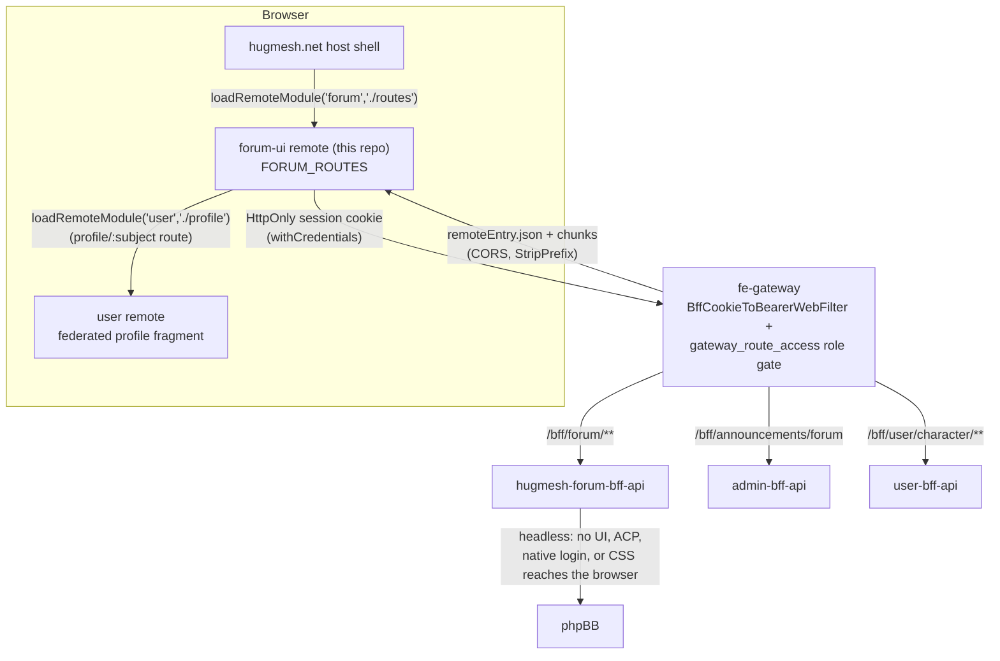

The **Forum** Angular micro-frontend for the [HugMesh](https://github.com/hugmesh)
platform. It is a native-federation **remote** named **`forum`**, loaded at runtime
by the [hugmesh-host-shell](https://github.com/hugmesh/hugmesh-host-shell).

It provides the whole user-facing forum on top of a **headless phpBB** backend.
phpBB does the storing and never meets a browser. It stays server-side behind
[hugmesh-forum-bff-api](https://github.com/hugmesh/hugmesh-forum-bff-api): no phpBB
board front-end, admin control panel, native login page, or CSS reaches the browser.
This remote is the only source of what forum users see.

It is structurally similar to its sibling remote
[hugmesh-mastodon-ui](https://github.com/hugmesh/hugmesh-mastodon-ui): the same
`federation-base.js`, the same native-federation application builder, the same
Dockerfile/nginx/accessibility baseline. Its `SessionService` started as a copy of
[hugmesh-mod-ui](https://github.com/hugmesh/hugmesh-mod-ui)'s and has since diverged:
this one also reads `GET /bff/session`; mod-ui's reads only the `hug.session` mirror.
Other social surfaces ship as their own remotes (matrix, mastodon, login, admin, mod,
user), each in its own repository under the [hugmesh](https://github.com/hugmesh)
organization.

## Contents

- [Features](#features)
- [Architecture](#architecture)
- [Exposed routes](#exposed-routes-forum_routes)
- [Role-based access](#role-based-access)
- [Forum profile](#forum-profile-the-platforms-user-page-embedded)
- [Announcements banner](#main-page-announcements-banner)
- [Auth & token model](#auth--token-model-no-login-ui)
- [Sanitization](#sanitization)
- [Accessibility](#accessibility-conventions)
- [Branding](#branding)
- [Typed API client](#typed-api-client)
- [Multi-tenancy](#multi-tenancy)
- [VN reading mode](#vn-reading-mode-stickers--voicebox-profiles)
- [Known limitations & roadmap](#known-limitations--roadmap)
- [Getting started](#getting-started)
- [Deployment](#deployment)
- [Related HugMesh repositories](#related-hugmesh-repositories)
- [Contributing](#contributing)
- [License](#license)

## Features

- The `forum` remote exposes the full `FORUM_ROUTES` surface: index, categories,
  topics, create-topic, search, moderation, profile. It has an affordance-level role
  gate, an embedded federated user-profile fragment, a sandboxed announcements
  banner, server-sanitized post bodies with a DOMPurify preview, `--hug-*`/`--forum-*`
  brand tokens, and a standards-based accessibility baseline.
- A committed **ng-openapi-gen** client lives under `src/app/api/`. `ForumService`
  is a thin wrapper that hands the spec-covered reads and writes to it (see
  [Typed API client](#typed-api-client)).
- **Authentication is cookie-based. The browser never holds a bearer token.**
  `HugSession` carries no `bffToken` or homeserver token. Every `/bff/forum/**`
  call is sent with credentials included, so the HttpOnly session cookie rides
  along, and the gateway swaps it for a server-side bearer token. See
  [Auth & token model](#auth--token-model-no-login-ui).
- nginx sends a full response header set, including a real, nonce-based
  **Content-Security-Policy** (`script-src 'self' 'nonce-…' blob:`, `object-src
  'none'`, `frame-ancestors 'none'`, …) as a backstop to the DOMPurify pass, plus
  `X-Content-Type-Options`, `X-Frame-Options`, `Referrer-Policy`, and HSTS. See
  [Deployment](#deployment).
- CI runs a four-stage GitLab pipeline (`test` → `e2e` → `build` → `pentest`). The
  GitHub repository is pull-mirrored into an internal GitLab instance. The only
  GitHub Actions workflow is `release.yml`. It runs the unit tests and pushes the
  image to GHCR on every push to `main` and on each `v<version>` tag. See
  [Deployment](#deployment).
- A Playwright + Gherkin (BDD) end-to-end harness lives under `e2e/`, next to the
  Karma/JUnit unit-test reporter used in CI. The Karma suite (273 specs, counted
  2026-10-15) passes with `npm test`, and `ng build forum` builds clean.
  A 1-in-3 flake in the VN specs in `topic-detail.component.spec.ts` was diagnosed
  and fixed on 2026-08-14: `topic-detail.component.ts` now calls `markForCheck()` on
  the async VN/topic state writes. The `render()` helper's comment has the timeline.
- **VN reading mode** is an optional visual-novel look for posts: a per-author
  character sprite, a "voicebox" dialogue skin, inline stickers, and browser
  read-aloud. It is fully implemented. See [VN reading
  mode](#vn-reading-mode-stickers--voicebox-profiles).
- The sticker `` URL points at a real backend route. `stickerBodyUrl()` in
  `src/app/stickers.ts` builds `/bff/user/character/stickers/{slug}/body`, served by
  `hugmesh-user-bff-api`'s `StickerController.serveBody`. An active sticker serves to
  any reader in the sticker's domain; a pending sticker serves only to its owner.
  A regression test in `stickers.spec.ts` pins the contract. The picker/editor
  thumbnails and post sprites hide on any image error instead of showing a
  broken-image glyph.
- `ForumService.canModerate` is wired into the topic view. A forum moderator
  (`mod` + `forum`) or admin gets edit/delete controls on any post (`canEdit =
  ownsPost OR canModerate`) and a topic lock/unlock control (`POST
  /bff/forum/moderation/topics/{id}`). It also shows the forum index's "Moderation
  queue" link to the `moderation` page. See [Role-based access](#role-based-access).
- The `@cluster`-tagged e2e suite exercises the real HttpOnly session-cookie flow.
  `login()` in `e2e/tests/helpers/roles.ts` waits for the current `hug.session`
  shape (`roles`), and the cross-user and cross-domain DENY steps send
  cookie-based (`credentials: 'include'`) same-origin fetches, not a synthetic
  bearer token. Seeded-session scenarios cover pure client-side gating. Scenarios
  that test real writes or DENY behavior use an actual Casdoor login and need a
  live cluster (hence `@cluster`).

Login, session, and account handling live outside this remote. The platform's shared
auth stack owns them
([hugmesh-auth-core](https://github.com/hugmesh/hugmesh-auth-core) plus the
`user-bff`/`admin-bff` services), and this UI only consumes the resulting shared
session. The forum announcements endpoint (`/bff/announcements/forum`) comes from the
admin BFF and has nothing to do with auth.

## Architecture

### Federation contract — the `forum` remote

`federation.config.js` declares the remote through the shared `hugmeshRemote()`
helper in `federation-base.js`:

```js
module.exports = hugmeshRemote({
  name: 'forum',
  exposes: { './routes': './src/app/forum.routes.ts' },
});
```

- **remote name:** `forum`
- **exposed module:** `./routes` → **`FORUM_ROUTES`** (the only exposed surface)

The host mounts the routes at `/social/forum` (see the host's `app.routes.ts`) and
loads them at runtime from the `forum` remote's `./routes`. `federation-base.js` keeps
the `shareAll` singletons (`strictVersion`, `requiredVersion: 'auto'`) and the RxJS
skip list in one file, so this remote's federation surface cannot drift from the
host. The remote name and the exposed key are the stable contract. Keep them.

### Serving model — a PATH remote at `/social/forum`

forum-ui is served at **`/social/forum/**`** on the platform's front-end gateway,
beside `/social/mastodon/**` and `/social/matrix/**`. It calls same-origin
**`/bff/forum/**`**, the BFF that wraps headless phpBB. It is **not** a
`forum.<domain>` subdomain: the platform's vanity-domain wildcard would swallow that
name and resolve it to a profile-404, and a host route pointed straight at phpBB
would re-expose the blocked board.

### Request flow



The browser never talks to phpBB and never holds a bearer token. See [Auth & token
model](#auth--token-model-no-login-ui). `ForumBFF` maps the phpBB user to the
caller's identity for `profile/:subject`. `UserBFF` backs the embedded profile
fragment and the VN character and sticker endpoints.

## Exposed routes (`FORUM_ROUTES`)

| route | component | purpose |
| --- | --- | --- |
| `''` | `ForumIndexComponent` | the announcements banner + category list + "New topic" / "Search" links |
| `categories/:id` | `TopicsListComponent` | paginated topics in a category (sort: latest / oldest / replies; prev/next pager) |
| `topics/:id` | `TopicDetailComponent` | the topic + ordered posts + inline reply form; edit/delete for the post's owner or a moderator; lock/unlock for a moderator |
| `create-topic` | `CreateTopicComponent` | new topic (category + Markdown title/body + live preview) |
| `search` | `ForumSearchComponent` | topic/post search (the BFF maps no `/search` yet, so it resolves empty) |
| `moderation` | `ModerationQueueComponent` | moderation queue depth for moderators (a count, not the queued posts) |
| `profile/:subject` | `ForumProfileComponent` | embeds the platform's federated user-profile fragment for the poster |

`src/app/app.routes.ts` is a thin dev-only shell. It mounts `FORUM_ROUTES` at the root
so you can browse the remote alone (`ng serve`). The host ignores it and federates
`./routes` directly.

## Role-based access

There is no Angular route guard here. Access is gated at the **affordance level**,
from roles read off the shared session:

- **`ForumService.canPost`** is true when the caller holds the `forum` role or the
  `admin` role. It gates the "New topic" link, the create-topic form (otherwise a
  "you need the forum role" notice), and the reply form (otherwise a "posting is
  hidden" notice).
- **`ForumService.ownsPost(post)`** is true when the caller's session `id` equals the
  post's `authorSubject`, or the caller is an `admin`. It gates the per-post
  edit/delete controls (`TopicDetailComponent.canEdit`).
- **`ForumService.canModerate`** is true for an admin, or for a `mod` who also holds
  the `forum` role. The BFF's `ROLE_FORUM_MOD` is mod AND forum; a bare `mod` is not
  a forum moderator.

All of these are **UI convenience and defense in depth only**.
`hugmesh-forum-bff-api` and the phpBB extension are the real gates. Every write
re-checks role and ownership server-side.

### Step-up (MFA) on moderation

`hugmesh-forum-bff-api` wraps two privileged path groups in an MFA step-up gate
(`SecurityConfig.stepUp`, PR #11): `/bff/forum/moderation/**` (the topic lock/unlock
this remote calls) and `/bff/forum/admin/**`. While the flag `app.mfa.enabled` is off
(its default in the BFF) the gate does nothing. Once it is on, those paths also
require a **fresh second factor**: the `MFA_SATISFIED` authority, derived from the
`mfa_satisfied_at` claim that the platform's MFA challenge (`POST /bff/mfa/challenge`)
stamps on the caller's own session. The forum gate has no token leg. A plain retry of
the same call succeeds once the session is stamped.

This remote's half of the contract is in `src/app/step-up.ts`:

- **Detection.** `ForumService.moderateTopic` rejects with a typed
  `StepUpRequiredError` when the BFF answers with the platform's step-up contract: a
  `403` carrying `X-Step-Up-Required: X-<flavour>-StepUp` (the forum BFF's flavour is
  `X-Forum-StepUp`), or the legacy `"requires step-up"` phrase in the body. The rule
  is the same as `hugmesh-admin-ui`'s `mfa/step-up-error.ts`: same header name, same
  phrase pattern, 403 only. This one reads Angular's `HttpErrorResponse`; admin-ui
  reads its own `BffHttpError`. An ordinary 403 (a `mod` without the `forum` role,
  the gateway's `X-Route-Denied`) matches neither and surfaces as before. A routine
  denial must never offer an MFA prompt.
- **Offer.** `TopicDetailComponent` answers a `StepUpRequiredError` with an inline
  notice and a link to the platform's challenge screen,
  `/login/mfa/challenge?returnTo=<this topic>` (hugmesh-login-ui, mounted by the host
  at `/login`). It performs nothing. After verifying, login-ui navigates back and the
  moderator repeats the action. The route is an absolute host route, so the
  standalone dev shell (`ng serve forum`), which mounts no login remote, cannot
  follow it.

**The BFF half has shipped.** `hugmesh-forum-bff-api` PR #17 (closing its
issue #15) makes the BFF answer an MFA denial with a `403` carrying
`X-Step-Up-Required: X-Forum-StepUp` (`ForumStepUpAccessDeniedHandler`, pinned by
its `StepUpSignalContractTest` and `MfaStepUpPathGateSliceTest`). The header is
stamped only when the MFA step-up leg of the gate refused. A role denial stays a
bare `403` with no signal, so the detector never offers a challenge to someone the
BFF could not let through. While `app.mfa.enabled` is off the gate does nothing
and the signal never appears.

## Forum profile: the platform's user page, embedded

`profile/:subject` does **not** render a phpBB profile or memberlist page. Those stay
blocked, because phpBB is headless. `ForumProfileComponent` embeds the platform's own
federated **user-profile fragment** instead: the `user` remote's `./profile`, the same
profile shown everywhere on the platform. It loads it with `loadRemoteModule('user',
'./profile')` and `NgComponentOutlet`. The loader goes through
`forumProfileRemoteLoader` so tests can stub it. The BFF maps the phpBB user to the
caller's platform identity, so the `:subject` route param resolves the right profile.
There is one profile across the platform. A hidden or banned profile (profile-ban,
self-silence) looks here as it does everywhere, because the fragment owns that
behavior.

## Main-page announcements banner

`ForumIndexComponent` renders `<hug-forum-announcements>` at the top of the index.
`ForumAnnouncementsService` fetches **`GET /bff/announcements/forum`** (the admin-bff
endpoint for forum announcements) with credentials included, so the HttpOnly session
cookie rides along. It re-sorts by priority, drops any announcement whose start/end
window has closed, and filters out ids the user dismissed locally. Each
announcement's server-sanitized HTML renders inside a **sandboxed, null-origin
`srcdoc` iframe** (`sandbox=""`: neither `allow-scripts` nor `allow-same-origin`),
like the host's own home banner. Dismissing a dismissible announcement persists its
id to `localStorage` (`hug.forum.announcements.dismissed`).

## Auth & token model (no login UI)

Login and registration are delegated entirely to the platform through the **login**
remote. Its form posts a username and password to `POST /bff/login`; `user-bff` runs
the PKCE and state handshake with the internal Casdoor, does the code-to-token
exchange server-side, and stamps the encrypted tokens onto the session row that
`admin-bff` stores. The browser is never redirected to Casdoor.

**The browser holds no bearer token at all.** Authentication rides an **HttpOnly
session cookie**. JavaScript cannot read it, so this module and every other remote
never sees it. Every outgoing `/bff/**` request is sent with credentials included
(`authInterceptor` in `src/app/auth.interceptor.ts` for the generated client, or
`credentials: 'include'` on the hand-rolled `fetch` calls in `forum.service.ts`,
`vn-profile.service.ts`, `session.service.ts`, `forum-announcements.service.ts`,
`sticker.service.ts` and `character-avatar.service.ts`). The gateway's cookie-to-bearer filter swaps the cookie for the
real identity bearer token server-side, before the gateway's OAuth2 resource-server
validation and role-gate checks run. The browser never carries the identity token. A
request made while signed out has no cookie, and the BFF returns 401.

`SessionService` separately holds a **UI-display** session as a signal: `id`,
`label`, `provider`, `roles`, `registrationComplete` (see `HugSession`; no token
field of any kind). Two sources feed it:

- **The authoritative cookie session**, `GET /bff/session` (`SESSION_ENDPOINT`,
  same-origin; the front door routes it to user-bff's `SsoAuthController.session`,
  body `{id, provider, handle, registrationComplete, roles}`).
  `SessionService.hydrate()` reads it on construction and on every same-document
  sign-in or role-change broadcast, so a role granted or revoked mid-session shows
  without a re-login. `roles` must be present: an absent field is a malformed body,
  and an empty array is a revocation. Identity fields fall back to the last-known
  values. `hydrate()` never writes `localStorage` and never broadcasts.
- **The `hug.session` `localStorage` mirror**, the fleet-wide legacy session source.
  `hugmesh-login-ui` is its **sole writer**; this remote only **reads** it. It seeds
  the signal synchronously (no anonymous flash) and is the fallback whenever the probe
  fails: offline, a mock stack with no BFF, an e2e-seeded session, an expired cookie,
  or user-bff's dark `503`. Cross-tab `storage` events re-read it.

A same-document broadcast whose mirror is now **empty** is a sign-out. The service
adopts it at once and does *not* re-hydrate, because `/bff/session` could still see a
live cookie at that instant and put the session straight back (the host-shell PR #14
defect). For the same reason `SessionService.clear()` awaits `POST /bff/sessionOut`
*before* it drops local state. This remote's own UI does not call `clear()`; the host
owns sign-out.

This session drives `canPost`, `canModerate`, `ownsPost` and the nav. It carries no
credential the gateway would accept, so a tampered copy grants no server-side access.
The BFF base URL is a runtime global, **`__HUG_FORUM_URL__`** (default `''`, meaning
same origin → `/bff/forum`).

## Sanitization

The phpBB extension's parser sanitizes post bodies **server-side**. The BFF returns
ready `bodyHtml`, which renders through `DomSanitizer.bypassSecurityTrustHtml`. That is
safe only because the server already sanitized it. The composer and reply **preview**
is a minimal Markdown subset (`src/app/markdown.ts`) run through **DOMPurify** with a
conservative allow-list (no scripts, only `http(s)` links). It is a convenience; the
server owns the canonical, re-sanitized body.

## Accessibility conventions

The markup is plain and standards-based. This remote uses no custom
`screenReaderName`/`accessibleName` helper.

- Screen-reader-only labels use the shared `.sr` visually-hidden class (declared in
  `styles.scss`).
- Landmarks: one `h1` per route; `role="region"` with `aria-labelledby` or
  `aria-label`; a `role="search"` form; nav landmarks with `aria-label`.
- Status and errors: `role="status"` for loading, `role="alert"` for errors, and
  `aria-live` (`polite` for counts and outcomes, `assertive` for submit errors).
- Forms: `aria-invalid` + `aria-describedby` on the create-topic fields, with a live
  `role="alert"` error.
- The announcement dismiss control is a real `<button>` with an announcement-specific
  `aria-label`; its `×` glyph is `aria-hidden`.
- Buttons use the native `disabled` attribute (busy, end of pager, empty input), for
  example `[disabled]="busy()"` and `[disabled]="!hasPrev()"`.

## Branding

phpBB is unbranded by design; none of its CSS reaches the browser. Forum chrome and
color come from `--hug-*` / `--forum-*` SCSS tokens, with a WCAG-AA default palette.
`ForumBrandService` reads `globalThis.__HUG_BRAND__`, a runtime multi-brand contract
(display name plus token overrides, applied as `--forum-*` custom properties), and
falls back to static values. The recommended model is one brand per build: static
tokens rebranded at build time, one image per brand. Then the global is never
injected and the service does nothing.

The image can also be re-themed without a rebuild. At container start,
`docker-entrypoint.d/50-hug-theme.sh` writes the token text from the `HUG_THEME_CSS`
environment variable (the older `SNAP_THEME_CSS` is still read) to
`/tmp/hug-theme.css`. nginx serves it at `/hug-theme.css` and `index.html` links it.
Unset or empty means an empty stylesheet and the shipped brand. To rebrand, change
the variable and restart the pod.

## Typed API client

`ForumService` is the typed service for the BFF contract. Its `ForumCategory`,
`ForumTopic`, `ForumPost`, `Page<T>` and related interfaces mirror the BFF DTOs. The
spec-covered reads and writes go to a committed **ng-openapi-gen** client under
`src/app/api/`, with `ForumService` as a thin wrapper. This is the standard HugMesh
pattern for typed BFF clients. `ForumService` injects the generated client and hands
`listCategories` / `createTopic` / `createReply` / `editPost` / `deletePost` /
`moderateTopic` / `getModerationQueueDepth` straight to it. `listTopics`, `getTopic`
and `search` stay on hand-written `fetch` calls, because the BFF spec does not yet
declare their parameters or operations. `getCategory` makes no call of its own: it
resolves the category from `listCategories`. To regenerate the client against an updated contract, run
`npm run gen:spec` (see [Regenerating the API
client](#regenerating-the-api-client)). Either way, the public method signatures
here are the stable contract for consumers.

### Wire envelopes

`forum-bff-api` wraps what it returns: `GET /bff/forum/categories` answers
`{"categories":[...]}`, `GET /bff/forum/topics?categoryId=` answers
`{"topics":[...]}` (the whole category; it reads no `page`/`pageSize`/`sort`),
`GET /bff/forum/topics/{id}` answers `{"topic":{...},"replies":[...]}`, and the
writes answer `{"topic"}` / `{"reply"}` / `{"post"}`. `ForumService` unwraps
these (the helpers above the class) into the public DTOs, pages and sorts
topics client-side, and resolves `getCategory` from the category list. The BFF
has no `/search` mapping, so `search()` still resolves empty. The spec fixtures
use the BFF's real response bodies.

## Multi-tenancy

The front-end gateway and the BFFs enforce per-brand and per-domain scoping. This
remote does not. forum-ui carries no tenant-resolution logic: it calls same-origin
`/bff/forum/**`, the gateway routes the request to the right tenant's BFF, and
branding is a build-time rebrand (one image per brand) or the runtime `__HUG_BRAND__`
contract described above. Role signals come from the shared session.

## VN reading mode (stickers + voicebox profiles)

Forum posts can render as a light visual novel: a per-author character sprite, a
styled dialogue box ("voicebox"), inline stickers, and read-aloud. It is **fail-soft**.
An author with no profile, or any lookup error, renders as a plain post.

- **Per-author VN profile.** `VnProfileService` (`src/app/vn-profile.service.ts`) is a
  hand-rolled fetch wrapper over the same BFF contract. The generated client also
  covers these endpoints, but the coalescing and caching below need the custom layer.
  - `GET /bff/forum/vn-profiles/me` returns the caller's profile. It never 404s: the
    server synthesizes classic defaults when no row exists.
  - `PUT /bff/forum/vn-profiles/me` saves. The subject never travels in the body; the
    BFF takes it from the identity token. Client-side validation mirrors the server's
    allow-lists, so bad values fail fast.
  - `POST /bff/forum/vn-profiles/lookup` takes `{subjects:[…]}` (1–50) and returns
    `{profiles:{subject:{…}}}`. Subjects with no row are absent from the response.
    Lookups coalesce per microtask (one POST per page, 50-subject chunks) with a
    per-session cache. Misses cache as `null`; errors do not cache.
- **Editor.** `<hug-forum-vn-profile-editor>` opens from the forum-index "VN profile"
  toggle (logged-in users only). It sets a character sticker (or none), the platform
  character avatar as the sprite, a voicebox skin (`classic|glass|retro|neon|paper`),
  an accent color, and a read-aloud voice style (`warm|bright|deep|soft|robot`).
- **Character avatar as a sprite.** `src/app/character-avatar.ts` and
  `CharacterAvatarService` own this contract. A sprite is the POST AUTHOR's avatar
  drawn in a READER's browser, so the stored `characterImgRef` must name *whose*
  avatar it is. The editor probes `GET /bff/user/character/avatar` (fail-soft,
  memoized; a 404 or a missing route hides the option) for the caller's opaque handle,
  and stores the constructed body URL `/bff/user/character/avatar/{ref}/body`.
  `hugmesh-user-bff-api` serves that URL to any reader in the same brand. The client
  always rebuilds the URL from the validated handle and never copies it from the
  response. The old editor stored the bare path `/bff/user/character/avatar`, which
  named no owner and had no route behind it, so every avatar sprite rendered broken
  (hugmesh-forum-bff-api issue #3). Topic-detail now ignores that legacy value and
  falls back to the sticker instead of emitting a broken ``.
- **Owner-blind refs never render.** `isOwnerBlindImgRef` is the client mirror of
  `hugmesh-forum-bff-api`'s `VnProfileDto.OWNER_BLIND_IMG_REFS`. It rejects the two
  `/bff/user/**` paths that resolve their owner from whoever *fetches* them, so
  neither can name the post's author: the legacy handle path above, and the
  owner-scoped self-avatar serve `/bff/user/profile/avatar/body`. The second is the
  quiet one. It returns a real `200` image, the **reader's own** picture, so it would
  put the wrong face on an author instead of showing a broken image, and no `(error)`
  handler would fire. Both paths are same-origin, which is why this is a separate
  predicate from the origin allowlist.
- **The comparison is on the canonical path, not the raw string** (`wirePath`). A
  membership test compares strings; a browser compares *parsed* paths. So
  `/bff/user/profile/avatar/./body` is a different string and the same endpoint.
  Measured in Chromium against a wire-logging server: that `` requests
  `/bff/user/profile/avatar/body` and is de-duplicated against an `` spelled
  with the plain path. `wirePath` therefore removes `.`/`..` dot-segments, collapses
  empty (`//`) segments, drops a query or fragment, and trims trailing slashes before
  either predicate decides. `isSafeCharacterImgRef` also refuses those spellings
  outright (`VN_CHARACTER_IMG_REF_RE`, the mirror of the server charset), so a
  compromised upstream cannot hand one to the DOM. A `.` **inside** a segment
  (`portrait.v2.png`, `.hidden`) is an ordinary character and still renders.
- **Rendering.** Topic-detail applies the author's skin through `applyVoicebox`: the
  `data-vnskin` attribute (allow-listed values only) plus the `--forum-vnbox-accent`
  custom property (strict `#rrggbb` re-validation before `setProperty`). The sprite
  `` must pass `isSafeCharacterImgRef`: same-origin `/bff/user/` prefix,
  bounded length, no traversal. The server enforces the same allow-list, and the
  client never trusts the wire alone. Skins live in `src/styles/_voicebox.scss`;
  `classic` has zero rules, so the default is the plain look.
- **Stickers.** Authors insert `:snap-sticker:<slug>:` tokens from
  `<hug-forum-sticker-picker>`, fed by a fail-soft `GET /bff/user/character/stickers`
  probe. The picker hides when the endpoint is unavailable. The token charset is
  inert, so it survives both the server parser and the DOMPurify pass as plain text.
  `transformStickerTokens` (`src/app/stickers.ts`) then replaces tokens in the live
  DOM with DOM-created `` elements, never via `innerHTML`.
  The slug charset is validated by construction, only same-origin constructed URLs
  are used, and a post gets at most 8 stickers. The transform is idempotent across
  change-detection passes.
- **Read aloud.** Browser `speechSynthesis` only (no network TTS), with pitch and rate
  mapped from the author's voice style (`VOICE_TUNING`). It is feature-detected and
  hidden when unavailable.

## Known limitations & roadmap

- `ForumService.canModerate` drives the per-post edit/delete controls, the topic
  lock/unlock control, and the `moderation` page (linked from the forum index for
  moderators), which shows how many posts are waiting for review. That page is a
  count only: the moderator-reachable endpoint (`GET /bff/forum/moderation/queue`)
  returns `{queueDepth, source}`, and the page reports a degraded source as
  "unavailable" rather than as zero. Still planned: the per-post queue list and
  bulk approve/reject. Both need a moderator-readable list and approve/reject on
  the forum BFF first; today those are ADMIN-only there.
- Platform-wide SSO end-to-end verification is in progress. This remote's half is
  done: it renders no login form, holds no bearer token, and authenticates only
  through the HttpOnly session cookie (see [Auth & token
  model](#auth--token-model-no-login-ui)). What remains is platform-side and outside
  this repository: the login remote's native login, `user-bff`'s custody-token
  exchange, and platform-level end-to-end proof that SSO login works start to finish.
- External notification channels for the forum are in flight, in addition to the
  in-app notification MVP already shipped at the platform level. The planned channels
  are Matrix DM, an Akkoma feed, a phpBB forum channel, and email. The forum channel
  is the natural surface for forum-targeted notifications and is roadmap for this
  repository.
- Step-up multi-factor authentication on moderation: the BFF gate is merged (forum-bff
  PR #11, live once `app.mfa.enabled` flips), the BFF emits the `X-Step-Up-Required`
  signal on an MFA denial (forum-bff PR #17), and this remote detects it and offers
  the challenge (see [Step-up (MFA) on moderation](#step-up-mfa-on-moderation)).
  Still open, tracked on issue #3 of this repository: loading login-ui's challenge in
  place instead of the navigate-away link. The e2e scenario for it in
  `e2e/features/forum/moderation-step-up.feature` is tagged `@fixme` and asserts the
  in-place behavior, so it stays red until that lands.
- Moving the shared session out of `localStorage`: this remote now hydrates from the
  authoritative `GET /bff/session` and reads the `hug.session` mirror only as seed
  and fallback (see [Auth & token model](#auth--token-model-no-login-ui)). Dropping
  the mirror is fleet-wide (login-ui is its sole writer, nine remotes read it). It
  waits on the platform's cookie-mode flip and on an e2e harness that seeds a real
  cookie instead of the mirror. Tracked on issue #3.

## Getting started

Requires Node.js (the `Dockerfile` pins the major version) and npm.

```bash
npm install
npm start                 # ng serve forum — the standalone dev shell
npm run build             # build the remote → dist/forum/browser
npm run build:forum       # same (explicit alias)
npm test                  # ng test forum (ChromeHeadlessCI, single run)
```

The native-federation application builder nests output under `dist/forum/browser/`,
including `remoteEntry.json`, the federation manifest that exposes `./routes`.

### Regenerating the API client

`gen:spec` reads the spec from
`../hugmesh-forum-bff-api/src/main/resources/openapi/openapi.json` (a sibling
checkout), or from the path in `FORUM_BFF_SPEC`. If the file is missing, run
`./mvnw -Dtest=OpenApiSpecDumpTest test` in `hugmesh-forum-bff-api` first.

```bash
npm run gen:spec   # copies the spec to ./openapi.json and regenerates src/app/api/
```

### End-to-end tests

The Playwright + Gherkin harness lives under `e2e/`. It is independent of the
Angular/Karma build and runs without a live cluster, because by default it filters
out the cluster-dependent scenarios. See `e2e/README.md` for the full guide.

## Deployment

The `Dockerfile` builds the Forum remote (Node 24 / Angular CLI 22, with
`--base-href=/social/forum/`) and serves `dist/forum/browser` through nginx 1.27. CORS
is on, because the host fetches `remoteEntry.json` cross-origin. nginx sends a
defense-in-depth **HTTP security header** set on every response:
`X-Content-Type-Options: nosniff`, `X-Frame-Options: DENY`,
`Referrer-Policy: strict-origin-when-cross-origin`, HSTS, and a real, nonce-based
**Content-Security-Policy** (`default-src 'self'`, `script-src 'self' 'nonce-…' blob:`,
`style-src 'self' 'unsafe-inline' blob:`, `img-src 'self' data: https:`, `font-src
'self' data:`, `connect-src 'self' blob:`, `base-uri 'self'`, `object-src 'none'`,
`frame-ancestors 'none'`). The CSP is a backstop to the client-side DOMPurify pass,
since this UI renders untrusted forum-post HTML. nginx stamps a per-request nonce on
every `<script>` tag of `index.html`. `nginx.conf` sets no COEP, CORP or
Permissions-Policy header. `/healthz` returns `200`.

CI runs on **GitLab** (`.gitlab-ci.yml`). The GitHub repository is pull-mirrored into
an internal GitLab instance, and the pipeline runs there. The one GitHub Actions
workflow, `.github/workflows/release.yml`, publishes `ghcr.io/hugmesh/hugmesh-forum-ui`.
It first runs the same Karma unit tests as the GitLab `test` job, then:

- On a push to `main`, it pushes the tags `main` and `sha-<first 12 hex of the commit>`.
- On a `v<version>` tag, it pushes `<version>`, `beta` (for beta versions) and
  `sha-<12 hex>`, and creates a GitHub release marked as a prerelease and not latest.
  The tag must equal `v` plus the `version` in `package.json` (and
  `package-lock.json`), and it must point at a commit on `main`. A version tag that
  is already in the registry is never overwritten.
- A manual run (`workflow_dispatch`) on `main` or on a `v*` tag does the same as the
  matching push. Any other branch or tag is refused.
- It never pushes `latest`, and it has no pull-request trigger.

Its jobs run on the self-hosted runner only when the repository variable
`RUNS_ON_PUBLISH` holds a runner label list (for example
`["self-hosted","Linux","X64"]`) and the run is for `main` or a `v*` tag. Otherwise
they run on GitHub's hosted `ubuntu-latest`.

The pipeline has **four stages** (`stages: [test, e2e, build, pentest]`):

- **`test`** runs `npm test` (`ng test forum`, ChromeHeadlessCI) in a
  `node:24-alpine` + Chromium container, on the default branch, merge requests, and
  tags. It publishes a JUnit report (`karma-junit-reporter` →
  `test-results/results.xml`) and keeps `reports/` as artifacts.
- **`e2e:bdd`** runs the Playwright + playwright-bdd Gherkin harness under `e2e/`. It
  ships dark: it runs, but every cluster-dependent scenario is filtered out by
  default. It runs on the default branch and merge requests in a `node:24` container.
  It installs the harness, compiles the `.feature` files (`bddgen`), and lists every
  scenario through a no-filter override config. That proves the suite parses and is
  discoverable without a live cluster. It is `allow_failure: true` (non-blocking)
  until live-cluster wiring for this job lands. See `e2e/README.md`.
- **`build:image`** needs `test` to pass, then builds and pushes the image (an
  immutable SHA or tag, plus a moving branch tag) on the default branch and tags.
- **`pentest`** is a central OWASP pen-test stage shared across HugMesh services,
  pulled in with `include:` from the platform's shared CI configuration.
  `pentest:sca` runs dependency-vulnerability scanning (Dependency-Check).
  `pentest:dast` runs a DAST baseline (probes + nuclei + ZAP). Both run on the
  default branch and merge requests, and both are `allow_failure: true`, so the
  pipeline stays green while findings are triaged.

The built image deploys to the `hugmesh-frontend` namespace, behind the front-end
gateway at `/social/forum`. See `deploy/` for the Kubernetes manifests (`Deployment`,
`Service`, `HorizontalPodAutoscaler`, Kustomize base).

### Versions

The version in `package.json` is the image version. It uses
`MAJOR.MINOR.PATCH-beta.N`; the current version is `0.2.0-beta.1` (built and tested,
not yet proven on a live mesh). To publish a beta, set the new version in
`package.json` and `package-lock.json` (for example
`npm version 0.2.0-beta.2 --no-git-tag-version`), merge that to `main`, then push an
annotated tag `v0.2.0-beta.2` on that commit. A fix during a beta raises `N`.

## Related HugMesh repositories

This remote is one piece of the HugMesh platform. You will likely want these beside it:

- [hugmesh-host-shell](https://github.com/hugmesh/hugmesh-host-shell) — the host
  application that federates this and every other remote.
- [hugmesh-forum-bff-api](https://github.com/hugmesh/hugmesh-forum-bff-api) — the
  backend-for-frontend that fronts headless phpBB for this UI.
- [hugmesh-mastodon-ui](https://github.com/hugmesh/hugmesh-mastodon-ui) and
  [hugmesh-mod-ui](https://github.com/hugmesh/hugmesh-mod-ui) — sibling remotes this
  repo is structurally derived from.
- [hugmesh-auth-core](https://github.com/hugmesh/hugmesh-auth-core) — the shared
  login/session/account logic this remote consumes but does not own.
- The full set of remotes and services lives under the
  [hugmesh](https://github.com/hugmesh) GitHub organization.

## Contributing

Issues and pull requests are welcome. These help a change land:

- Run `npm test` and `ng build forum` before you open a PR. CI runs the same Karma
  suite and expects a clean build.
- If a change touches the BFF contract, regenerate the API client (`npm run
  gen:spec`). Do not hand-edit files under `src/app/api/`.
- New user-facing behavior needs a Karma spec. Where it crosses a role or auth
  boundary, add an e2e feature under `e2e/features/` too (see `e2e/README.md`).
- Follow the [accessibility conventions](#accessibility-conventions): landmark roles,
  `aria-live` regions, and native `disabled` handling, not custom equivalents.

## License

MIT — see [`LICENSE`](./LICENSE).
