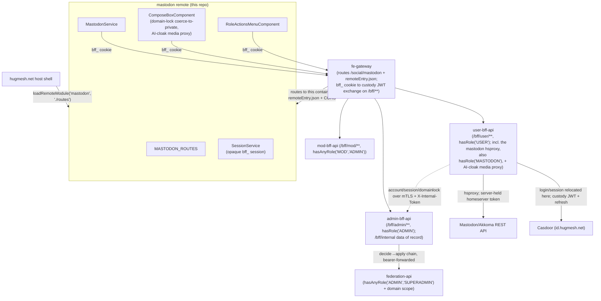
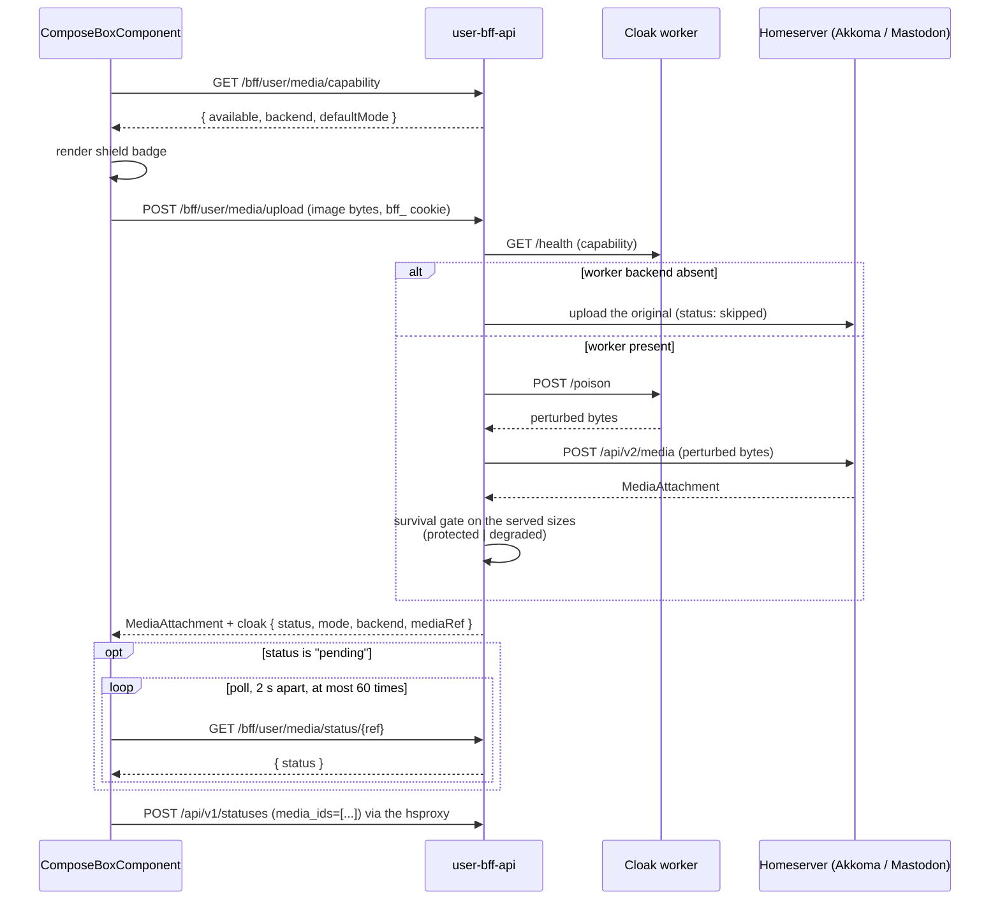

This repo is the **Mastodon UI**, an Angular micro-frontend
([native-federation](https://www.npmjs.com/package/@angular-architects/native-federation)
**remote**) for the
[hugmesh.net](https://github.com/hugmesh/hugmesh-host-shell)
host shell. The host fetches and mounts it at runtime. The
`hugmesh-fe-gateway` (Spring Cloud Gateway) routes `/social/mastodon/**` to this
container. The route is rendered by hugmesh-generator
(`specs/cluster/apps/20-gateway-fe.yaml`, id `mastodon-ui`, `StripPrefix=2`).

**Mastodon or Akkoma?** This remote speaks the Mastodon client API, so either
server works. The cluster manifests deploy **Akkoma**
(`specs/cluster/apps/30-akkoma.yaml` in hugmesh-generator: "replaces Mastodon").
The local compose stack runs real **Mastodon v4.3.1** with `SOCIAL=1`
(`tests/stack/compose.real.yaml`) and adds **Akkoma v3.20.0** beside it with
`AKKOMA=1` (`Makefile`, `STACK_ALT_PROFILE`). The repo says Mastodon. The cluster
runs Akkoma. Names outlive decisions.

Part of the HugMesh RPi 5 / x86_64 cluster built by
[hugmesh-generator](https://github.com/hugmesh/hugmesh-generator).
The sibling remotes live in their own repos:
[matrix/social](https://github.com/hugmesh/hugmesh-matrix-ui) ·
[login](https://github.com/hugmesh/hugmesh-login-ui) ·
[user](https://github.com/hugmesh/hugmesh-user-ui) ·
[mod](https://github.com/hugmesh/hugmesh-mod-ui) ·
[admin](https://github.com/hugmesh/hugmesh-admin-ui).

## What this remote is

An Angular 22 + `@angular-architects/native-federation` single-project workspace.
Angular project `mastodon`, root `.`, sourceRoot `src`, component prefix
`hug-mastodon`.

- **Remote name:** `mastodon`
- **Exposed federation module:** `./routes` → **`MASTODON_ROUTES`**
  (`src/app/mastodon.routes.ts`)

The host loads the remote with `loadRemoteModule('mastodon', './routes')` and
mounts the routes under `/social/mastodon`. The remote name (`mastodon`) and the
exposed key (`./routes`) are the public contract `loadRemoteModule()` depends on.
Never rename them without a matching host change.

`federation-base.js` (`hugmeshRemote()`) declares the shared federation surface
once: singleton libraries, `strictVersion` flags, the RxJS skip list. It is a
verbatim copy of the host shell's file, which keeps every remote in sync with the
host. `federation.config.js` only declares the remote name and `exposes`:

```js
// federation.config.js — the only repo-specific federation concerns
const { hugmeshRemote } = require('./federation-base');

module.exports = hugmeshRemote({
  name: 'mastodon',          // stable — matches the host's loadRemoteModule() call
  exposes: {
    './routes': './src/app/mastodon.routes.ts',  // stable — the federation contract
  },
});
```

`src/app/app.component.ts` (`hug-mastodon-root`) is a minimal standalone dev
shell for running the remote alone (`ng serve mastodon`). In production the host
federates `./routes` directly and the shell is never loaded.

### Architecture & data flow

The host federates `./routes`. The fe-gateway routes `/social/mastodon/**` to
this container and proxies every same-origin `/bff/**` call to a BFF:
`/bff/mod/**` to mod-bff-api, `/bff/user/**` to user-bff-api, and the paths this
remote also uses, `/bff/admin/**` and `/bff/mastodon/**`, to admin-bff-api. On the way it swaps the browser's opaque `bff_` session cookie for
the internal Casdoor custody JWT (see
[Auth, session & role-gate](#auth-session--role-gate)).

Since the **D6 BFF-proxy cutover** (now the default), `MastodonService` does not
call the homeserver. It calls the hsproxy in user-bff-api
(`MastodonProxyController`, `/bff/user/mastodon/...`). The hsproxy holds the
upstream homeserver token server-side and forwards the native `/api/...` path
verbatim to the `akkoma-proxy:4443` mTLS sidecar. It needs `hasRole('MASTODON')`
on top of the `ROLE_USER` floor:



The browser holds only the **opaque `bff_` session cookie**. The remote never
sees a raw Casdoor token or a per-service token.

## Routes / key components

Every route is a child of `MASTODON_ROUTES`, mounted by the host at
`/social/mastodon/...`:

| Path | Component | Notes |
| --- | --- | --- |
| `''`, `home` | `MastodonTimelineComponent` | home timeline + top composer |
| `local` | `MastodonTimelineComponent` | `data.source: community` (local public) |
| `public` | `MastodonTimelineComponent` | federated public |
| `tags/:tag` | `MastodonTimelineComponent` | hashtag timeline |
| `favourites`, `bookmarks` | `MastodonTimelineComponent` | Link-header paginated |
| `lists/:id` | `MastodonTimelineComponent` | list timeline |
| `status/:id` | `StatusDetailComponent` | single status + ancestor/descendant context |
| `account/:acct` | `AccountProfileComponent` | profile + that account's statuses |
| `notifications` | `NotificationsColumnComponent` | |
| `search` | `SearchComponent` | accounts / statuses / hashtags |
| `explore` | `ExploreComponent` | trending statuses / tags / links |
| `direct` | `ConversationsColumnComponent` | DM conversations |
| `lists` | `ListsIndexComponent` | the caller's lists |

`MastodonTimelineComponent` serves seven views: home, local, public, hashtag,
list, favourites and bookmarks. The route's `data.source` field, plus the `:tag`
and `:id` path params, tells it which timeline to fetch.

Key supporting components:

- `TootCardComponent` — one status, with reply / boost / favourite / bookmark
  actions, content-warning expand, media, and an embedded `PollComponent`.
- `ComposeBoxComponent` — the post composer, also used inline for replies.
- `RoleActionsMenuComponent` — the role-tiered moderation menu (see [Role-tiered action surface](#role-tiered-action-surface)).
- `AppearancePanelComponent` — per-user appearance settings (see [Appearance / style preferences](#appearance--style-preferences)).

Remote HTML (toot content via `safeContent()`, profile bio and fields via
`safe()`) is first run through a DOMPurify allow-list
(`sanitizeContentHtml()` in `src/app/html-sanitize.ts`): no script, iframe or svg
tags, no `on*` attributes, http(s)-only URLs, and `rel="noopener noreferrer"`
forced on `target` links. The result is then bound through Angular's
`[innerHTML]` **with the built-in sanitizer left on** as a second gate. Nothing
calls `bypassSecurityTrustHtml`. Injected `<script>`, `on*` handlers and
`javascript:` URLs are stripped; safe formatting stays (stored/DOM XSS, A03 /
CWE-79). ✅ shipped.

`MastodonService` (`src/app/mastodon.service.ts`) is a thin typed wrapper over
the Mastodon REST API. It covers timelines, statuses and context, post /
favourite / reblog / bookmark, polls, media, notifications, accounts and
relationships, search, favourites, bookmarks, lists, conversations, and trends.

By default every request goes same-origin to the user-bff hsproxy at
`${__HUG_BFF_URL__}/bff/user/mastodon` (`MASTODON_PROXY_MODE`, default `true`;
the runtime global `__HUG_MASTODON_PROXY_MODE__` overrides it). The runtime
global `__HUG_MASTODON_URL__` (default `https://mastodon.hugmesh.net`) is read
only when proxy mode is off. That legacy path calls the homeserver directly with
no `Authorization` header. It serves public, read-only diagnostics and nothing
else.

## Auth, session & role-gate

Login and registration happen in the **login** remote's own native form. It POSTs
the credentials to its BFF's login endpoint. Casdoor (`id.hugmesh.net`) is
**internal-only** and never redirects the browser: no OAuth2/OIDC
authorization-code *browser* redirect appears in this flow (user-bff runs the
code exchange itself, server-side). **`hugmesh-user-bff-api`**
checks the credentials against Casdoor server-side and holds the per-session
Casdoor JWT and its refresh. The browser, and so this remote, holds only an
**opaque `bff_`-prefixed session**. The user never sees a Casdoor JWT, and no
per-service Mastodon token reaches the browser. This remote renders no login form.

- `MastodonService` and the BFF services send the `bff_` session as a
  same-origin cookie (`withCredentials`/`credentials: 'include'`), never as an
  `Authorization` header. The cookie is named `bff_session`; its value starts
  with `bff_`.
- Two filters in the shared `hugmesh-gateway` image (which the fe-gateway
  reuses) do the swap. Both sit behind `hugmesh.gateway.bff-exchange.enabled`,
  which the cluster manifest sets. `BffCookieToBearerWebFilter` copies the cookie
  into `Authorization: Bearer bff_…`. `BffJwtExchangeWebFilter` swaps that bearer
  for the custody JWT by asking admin-bff over mTLS plus an internal token. A
  failed swap is a 401; the raw `bff_` value is never forwarded. Each BFF
  (`user-bff-api`, `mod-bff-api`, `admin-bff-api`) then enforces its own
  `hasRole`/`hasAnyRole` gate. Each BFF can also resolve a raw `bff_` session
  itself (user-bff `BffSessionAuthenticationWebFilter`; mod-bff and, via
  `hugmesh-auth-core`, admin-bff each have a `BffCookieAuthenticationWebFilter`),
  so none of them is a pure JWT resource server.
- The host injects nothing service-specific. `MastodonService.setAccessToken()`
  stays as a no-op for standalone dev and host back-compat.

> Auth-core extraction is complete. user-bff checks native-login credentials
> against Casdoor server-side (no browser redirect) and holds the per-session
> custody JWT and refresh. The account/session **data of record** lives in
> `admin-bff-db`; user-bff reaches it through `admin-bff` `/bff/internal` over
> mTLS + `X-Internal-Token`. The shared `hugmesh-auth-core` Maven artifact carries
> the common session/MFA/Casdoor-admin code. This remote talks only to the
> fe-gateway and does not care where the BFF logic lives.

`SessionService` (`src/app/session.service.ts`) is the canonical HugMesh session
store. It holds the `HugSession` and derives the role tiers as signals: `isUser`
(any signed-in user), `isMod` (`mod` **or** `admin`), `isAdmin` (`admin` only),
plus `fullyRegistered`. The host and each remote hold their own `SessionService`
over the same shared session. Each re-reads on a same-document broadcast or a
cross-tab `storage` event, so finishing registration in the login remote unlocks
the host shell's social nav.

These role signals are **defence-in-depth**. The bff-apis enforce
`ROLE_USER`/`MOD`/`ADMIN` server-side, and the gateway runs the data-driven
`gateway_route_access` gate (ADMIN/GAME-MASTER bypass within own domain,
SUPERADMIN cross-domain). The UI just never shows an option the role cannot use.
The tiers are additive: a MOD never sees the ADMIN tier, and a USER never sees
the MOD or ADMIN tier.

### Role-tiered action surface

`RoleActionsMenuComponent` (element `hug-mastodon-role-actions`, mounted from
both `TootCardComponent` and `AccountProfileComponent`) is one reusable menu. It
renders additive tiers from the session role signals:

| Tier | Signal | Actions | BFF |
| --- | --- | --- | --- |
| USER | `isUser` | self-block an account (`POST/DELETE /bff/user/blocks`); recommend instance block to mods (`POST /bff/user/recommend-instance-block`) | `UserBffService` |
| MOD | `isMod` | server-wide block of a user or instance (`POST /bff/mod/block`); triage moderation queue (`GET /bff/mod/moderation`); refer case to admin (`POST /bff/mod/moderation/{id}/refer`) | `ModBffService` |
| ADMIN | `isAdmin` | approve / deny a referred moderation request (`POST /bff/admin/moderation/{id}/decide?approve=<bool>`) — wired to `admin-bff-api`'s decide→apply chain, which bearer-forwards to `federation-api`'s own `hasAnyRole('ADMIN','SUPERADMIN')` + per-domain scope check; an approved `user-removal` auto-applies a kill-switch override, a denied re-decision rearms it. A failed decide surfaces an alert and is NEVER treated as applied. The full Mastodon admin console still lives in `hugmesh-admin-ui` by design — this menu only covers the decide step of the USER→MOD→ADMIN referral chain. | `AdminBffService` |

A MOD sees the USER and MOD tiers. An ADMIN sees all three, including the
decide action.

### SOCIAL local-only / domain-lock ✅ shipped

When an admin or mod domain-locks an account, the homeserver's **force-local MRF
enforces it**. The UI is defence-in-depth on top, never the source of truth.

`SessionService.mastodonDomainLocked` is a computed signal off a
`MASTODON_DOMAINLOCKED` role marker that the BFF tier forwards. The
account/domainlock data of record lives in `admin-bff-db` and reaches the session
through the user-bff/gateway path. The marker is normalised before it is read:
`ROLE_MASTODON_DOMAINLOCKED` and mixed-case variants are lowercased to
`mastodon_domainlocked` (the same reserved-prefix-aware folding the other session
roles get), so the lock survives prefix and case differences across BFFs.

In `ComposeBoxComponent`, a domain-locked user (`domainLocked()` true):

- gets the **federated-reach visibilities** (`public`, `unlisted`) disabled, with
  helptext, in the visibility picker. The local-only indicator shows as enforced
  (`aria-disabled`, not native `disabled`, so it stays focusable);
- has the visibility **coerced down to `private`** whenever the chosen value is
  federated (a `defaultVisibility` Input, or a cross-tab lock that lands after the
  composer opened). The rendered `visibility` is a `computed` signal over the raw
  choice, so the picker updates without a check-loop pass. `submit()` applies the
  same `localSafe()` rule **again**, in case the bound value was set past the
  disabled UI.

For an account that is not locked, the per-post local-only toggle is *not* wired
yet: the standard Mastodon visibility enum has no per-post local-only flag, and
no BFF endpoint accepts one. The control shows "not available yet" and does
nothing.

## BFFs & multi-tenancy

The remote talks to three same-origin BFF APIs through the fe-gateway. The base
URL defaults to the same origin; `__HUG_BFF_URL__` overrides it:

- `UserBffService` → `/bff/user/**` (hugmesh-user-bff-api, `hasRole('USER')`):
  self-blocks and instance-block recommendations. user-bff-api pins `owner` to the
  JWT subject on every query, so a user reads and changes only their own rows;
  the UI needs no server-side enforcement of its own. The same service hosts the
  `mastodon` hsproxy (`MastodonService`'s default transport) and the AI-cloak
  media proxy.
- `ModBffService` → `/bff/mod/**` (hugmesh-mod-bff-api): the moderation queue and
  server-wide blocks, gated server-side by `hasAnyRole('MOD','ADMIN')`.
- `AdminBffService` → `/bff/admin/**` (hugmesh-admin-bff-api,
  `hasRole('ADMIN')`): approve or deny a referred moderation request. It
  bearer-forwards the caller's identity to `federation-api`'s own
  `hasAnyRole('ADMIN','SUPERADMIN')` + domain-scope check. This remote relays a
  decision and never authorises one.

All three follow the HugMesh datastore pattern (RxJS `BehaviorSubject`-backed,
one source of truth where a collection is cached) and send the `bff_` session as
a cookie. The gateway derives the bearer, so the browser never holds one. The
gateway picks the BFF per request, and the BFFs key every row to the
authenticated JWT subject (issuer-keyed domain scoping). So one federated bundle
serves every brand/tenant, and the remote carries no per-tenant config.

### AI-cloak media (poison-before-ingest)

When the composer uploads an **image** with the per-user AI-cloak preference ON,
it sends the file through the BFF media proxy (`POST /bff/user/media/upload`,
authed with the `bff_` session). The bytes are Glaze/Nightshade-style perturbed
**before** the homeserver ingests, re-encodes or federates them. A direct
`/api/v2/media` upload would let the clean original federate first. The BFF
returns the homeserver `MediaAttachment` exactly as a direct upload would
(downstream `submit()` / `media_ids` is untouched) plus a server-owned `cloak`
decision.



The composer checks `GET /bff/user/media/capability` when it opens, so the shield
state shows before any file is chosen. The BFF, not the worker, uploads the
perturbed bytes, and the upload response already carries the final status. The
per-attachment badge polls `GET /bff/user/media/status/{ref}` only while that
status is `pending`. The user can press "post without protection" to stop
waiting; the badge then reads `skipped`.

The UI copy stays honest. It never shows "protected" for a `degraded`,
`skipped`, `unavailable` or `failed` outcome. When the heavy worker tier is
absent (for example on a Pi5-only cluster, where the worker pod stays `Pending`),
a warning appears before the user posts, so they can choose to continue without
protection.

## Appearance / style preferences

Every signed-in user (user / mod / admin) can change **their own** look from the
gear icon in the timeline header (`AppearancePanelComponent`). The options follow
the spirit of TangerineUI for Mastodon; no CSS is copied. They are: colour theme
and accent, light / dark / auto mode, single or multi column, density, media
corner style, font family (including a dyslexia-friendly one), text size,
high-contrast mode, and a reduced-motion toggle.

`PreferencesService` is the single source of truth. Every change goes through one
`set()` → `persist()`/`pushUserPref()` chokepoint:

- It applies **immediately and locally**, never blocked on the network. The value
  is saved to a versioned localStorage key (`hug.mastodon.prefs.v1`) and applied
  as `data-*` attributes and CSS custom properties **scoped to this remote's own
  root** (`.hug-mastodon` / `hug-mastodon-root`), so nothing leaks onto the host
  shell or sibling remotes.
- It also syncs **durably** to the caller's account in the background, through
  `PUT /bff/user/preferences`. A failed durable write is never silent: it
  surfaces on `PreferencesService.syncError()`, so the panel can say the change
  may not follow the user to another device.

On load the order is: built-in default, then the org/admin default
(`GET /bff/mastodon/appearance-default`; the shipped
`assets/mastodon-appearance-default.json` asset is the fallback only when no
admin-bff default exists yet or the fetch fails), then the caller's own saved
prefs (`GET /bff/user/preferences`; the server value wins over the localStorage
cache). The OS `prefers-reduced-motion` and `prefers-contrast` settings are read
on first load and serve as defaults until the user chooses.

An ADMIN-only control ("set as the default for everyone",
`PreferencesService.setOrgDefault()`) applies and caches the new default locally
at once. The admin sees it take effect, and it survives an offline reload. It
then pushes the default through `PUT /bff/admin/mastodon/appearance-default`
(`admin-bff-api`, `hasRole('ADMIN')` server-side) in the background, with the same
`syncError()` reporting on failure. `setOrgDefault()` strips the chat-theme group:
chat styling is personal-only (see [Chat theming](#chat-theming)) and can never
become the org default.

## Voice & video messages, VN chat mode & chat theming

### Voice & video messages

`ComposeBoxComponent` records a voice (mic) or video (camera + mic, capped at
720p) message in place through `MediaRecorderService`
(`src/app/media-recorder.service.ts`), a `getUserMedia` + `MediaRecorder`
wrapper. It is **component-provided on purpose**: every composer, including each
inline DM reply composer, owns its own instance, so one recording never bleeds
into another and Angular releases the mic and camera with the component.

A recording stops at five minutes. At 300 s the take is **finalised** as if the
user pressed Stop, never discarded. The take previews locally (an object URL,
revoked on attach, discard and destroy). Attach sends the recorded `File` down
the **same** ingest path a picked file uses, `MastodonService.uploadMedia`
(`POST /api/v2/media`, through the hsproxy); the AI-cloak route is image-only and
never sees it. A take over 64 MiB is refused in the browser before upload.

`TootCardComponent` already renders `<audio>` and `<video>` attachments, so
playback needed no new code. Failure is soft: a browser without
`MediaRecorder`/`getUserMedia` hides the record buttons, and a permission refusal
or device failure shows a status line while the composer stays usable.

### VN chat mode

Each conversation on the `direct` route can switch **in place** to a
visual-novel view and back, with its "VN mode" toggle
(`ConversationsColumnComponent` → `hug-mastodon-vn-chat`, `src/app/vn/`). The
view has:

- a flat-vector scene background and an on-stage prop layer;
- participant "sprites" (framed avatars with name plates; the current sender lit,
  the others dimmed);
- a classic dialogue box that walks the thread one message at a time
  (Prev / Next / Latest, opening on the newest).

The thread comes from the conversation's `last_status` plus
`GET /api/v1/statuses/{id}/context`. Replies use the same direct-visibility
`hug-mastodon-compose-box`, voice and video messages included. Scenes and props
are **shipped local assets only** (`SceneService` over the schema-versioned
`assets/vn/scenes/scenes.json` manifest), so no federated bytes reach the stage.
Message bodies pass through the same DOMPurify + Angular-sanitizer gate
`toot-card` uses, so VN mode adds no federated-HTML surface. The typewriter
reveal is skipped under reduced motion. The scene/prop picker persists per user
through `PreferencesService` (keys below).

### Chat theming

The appearance panel has a **Chat** section, personal-only by design:
`setOrgDefault` strips the whole group, so a user's or admin's chat styling can
never become the org default. The options are bubble shape, your and their
bubble accent colours (strict `#rrggbb`, validated before any CSS-var write),
chat font, chat density, background pattern, and the VN dialogue-box skin. A live
bubble preview and a chat-only reset come with them. Each choice goes through the
same `PreferencesService` chokepoint as the rest of the appearance group. It is
applied as `data-mastodon-chat-*` attributes and `--mastodon-chat-*` CSS custom
properties scoped to this remote's root, persisted to `hug.mastodon.prefs.v1`,
and synced best-effort through `GET`/`PUT /bff/user/preferences` under these
durable keys:

| Field | Durable key | Values |
| --- | --- | --- |
| `chatBubbleShape` | `mastodon.appearance.chat.bubbleShape` | `rounded` (default) / `square` / `sharp` |
| `chatAccentMine` | `mastodon.appearance.chat.accentMine` | `#rrggbb`, or `''` = unset (default) |
| `chatAccentTheirs` | `mastodon.appearance.chat.accentTheirs` | `#rrggbb`, or `''` = unset (default) |
| `chatFont` | `mastodon.appearance.chat.font` | `system` (default) / `serif` / `rounded` / `mono` |
| `chatDensity` | `mastodon.appearance.chat.density` | `cozy` (default) / `compact` |
| `chatBackground` | `mastodon.appearance.chat.background` | `none` (default) / `dots` / `lined` / `stars` |
| `vnDialogSkin` | `mastodon.appearance.chat.vnDialogSkin` | `classic` (default) / `glass` / `retro` |
| `chatVnScene` | `mastodon.appearance.chat.vnScene` | a scene id from `assets/vn/scenes/scenes.json` (default `vn_scene_bedroom`) |
| `chatVnProps` | `mastodon.appearance.chat.vnProps` | comma-joined prop ids, `''` = none (default) |

The `.vn-dialog` class (with `.chat-surface`, `.chat-bubble`,
`.chat-bubble--mine`, `.chat-bubble--theirs`) is the **only** selector contract
between the VN view and chat surfaces and the preference SCSS in
`src/styles.scss`. High-contrast mode beats the decorative skins and accents.
With the built-in defaults, the look is the pre-theming one.

E2E coverage (Gherkin plus real step definitions): the live two-user scenarios
are `@cluster`-gated
(`e2e/features/social/voice-video-messages.feature`,
`e2e/features/social/vn-chat-mode.feature`) pending verification against a live
stack. Headless `@offline` twins with stubbed backends run without a cluster
(`voice-video-offline.feature`, `vn-chat-offline.feature`,
`chat-theme-sweep.feature`).

## Accessibility conventions

This remote follows the cross-repo HugMesh a11y standard. The baseline rules live
in `src/styles.scss`, so the remote is accessible both standalone and federated
into the host:

- The `.sr` screen-reader-only helper puts text labels beside icon-only controls.
  Decorative emoji and icons are `aria-hidden="true"`.
- Async results announce through live regions: `role="status"`/`aria-live`
  (`polite`) for normal updates, `role="alert"`/`assertive` for errors. The
  appearance panel and role-actions menu announce each applied change.
- Toggles expose state through `aria-pressed` / `aria-expanded`. Pop-over panels
  trap focus on open, return it to the trigger on close, and close on `Escape`.
- Composer fields use unique `<label for>` bindings (per-instance id prefixes keep
  inline reply composers unique) and a live character counter.
- WCAG-AA/AAA `--hug-*` colour tokens, a touch-target minimum and a
  reduced-motion media query are in the baseline styles.
- Full **keyboard operability** ✅ shipped. Buttons, inputs and selects are
  native. The account-profile tabs are a WAI-ARIA `tablist` with a roving
  `tabindex` driven by `ArrowLeft` / `ArrowRight` / `Home` / `End`
  (`onTabKeydown`). The compose "Attach media" file input is visually hidden but
  stays **in the tab order** (`.sr`, not `hidden`). The dev shell has a skip link
  to a focusable `<main>` landmark, and a global `:focus-visible` ring backs it all.

## Known Gaps / TODO

The unfinished or deliberately stubbed pieces, checked against the current code:

- **Server-wide block's external homeserver-admin call is STUBBED server-side.**
  `ModBffService.block()` (`POST /bff/mod/block`) always writes the local audit
  row, but `external` in the response can be `'stubbed'` or `'degraded:…'`
  instead of `'ok'` (the BFF then answers `202` pending-reconcile). The UI shows
  what the BFF reports and does not assume success (`ModBlockResult` and
  `block()` in `src/app/mod-bff.service.ts`).
- **The server-wide block has a step-up (MFA) gate this remote does not handle.**
  mod-bff-api guards `POST /bff/mod/block` with `ModStepUpGate`; a refusal is a
  `403` with an `X-Mod-StepUp` header. The gate ships dark
  (`app.mfa.enforce-sensitive-writes`, default `false`). Nothing in `src/app`
  reads the header or starts a step-up challenge, so once the gate is armed the
  menu shows its generic failure message.
- **User self-block's external push can also be `'stubbed'` or `'n/a'`.**
  `UserBffService`'s `BlockAck.external` is a free-form status string
  (`'live' | 'stubbed' | 'n/a'`), not always `'live'`
  (`BlockAck` in `src/app/user-bff.service.ts`).
- **Preference syncs are best-effort, not transactional.** This covers the
  caller's own prefs and the ADMIN org default. `set()` and `setOrgDefault()`
  apply and cache locally at once, then push to `PUT /bff/user/preferences` /
  `PUT /bff/admin/mastodon/appearance-default` in the background
  (`pushUserPref`/`pushOrgDefault` in `src/app/preferences.service.ts`). A failed
  write surfaces on `PreferencesService.syncError()`, but nothing blocks or
  retries it, so a value can drift per browser or device until the next
  successful write.
- **Notification refresh is a 30 s POLL, not a live push.**
  `NotificationsColumnComponent` refreshes on a timer (see Current State), so a
  mention that lands while the column is open shows within 30 seconds. The homeserver's native streaming API would be
  real-time (see Roadmap). The poll is incremental (`min_id`, prepend-only, so
  "Load more" pages survive), which has two consequences. The column only looks
  UPWARD, so a notification dismissed in another session stays until something
  triggers a full `reload()`. And a burst of more than one page between ticks is
  caught up over the next ticks, not at once.
- **The AI-cloak status key differs between server and UI (read, not run).**
  user-bff-api names the key `mediaRef` (`MediaPoisonDecision`, and the `cloak`
  block `MediaPoisonController` adds to the upload response). This remote's
  `CloakResult` reads `ref`. The upload already returns the final status, so the
  badge does not need the poll today, but a `pending` upload could not be polled.
- **Per-post local-only posting is unavailable for accounts that are not
  domain-locked.** `ComposeBoxComponent`'s local-only toggle stays
  `aria-disabled` outside the domain-locked (forced) case. The standard Mastodon
  visibility enum has no per-post local-only flag and no BFF endpoint accepts
  one, so the control says "not available yet" and does nothing (the
  `local-only-toggle` button in `src/app/compose-box.component.html`).

## Current State

- **Stack:** Angular 22 + `@angular-architects/native-federation` 22; native-federation
  **remote** `mastodon` exposing `./routes` → `MASTODON_ROUTES`, federated by the
  host shell at `/social/mastodon`. Requires Node `^22.22.3 || ^24.15.0 || >=26.0.0` (Angular CLI 22 engine constraint).
- **Optional service:** this remote is the UI for the **Akkoma/Mastodon**
  optional service. The cluster deploys Akkoma and the compose stack runs
  Mastodon (see the top of this file). It degrades gracefully, with greyed-out
  controls and honest "not available" copy, when the homeserver, the worker tier
  or a backing BFF endpoint is absent.
- **Auth:** native login in the login remote; the browser holds only the
  **opaque `bff_` session cookie**, the fe-gateway swaps it for the custody JWT,
  and each BFF enforces its own role gate. This remote renders no login form. See
  [Auth, session & role-gate](#auth-session--role-gate).
- **Shipped:**
  - the native-federation remote and UI standard adoption;
  - the full route surface over a typed `MastodonService` (through the user-bff-api
    hsproxy by default);
  - DOMPurify + Angular-sanitizer XSS hardening (no `bypassSecurityTrustHtml`);
  - live home-timeline posts over the streaming SSE (`MastodonStreamService`,
    home source only), and a client-connect banner that shows an instance URL
    for the user's own Mastodon client, only after the instance answers a real
    `/api/v1/instance` request for a holder of `ROLE_MASTODON_EXTERNAL_CLIENT`;
  - the USER/MOD/ADMIN role-tiered action surface, including the ADMIN
    approve/deny decide wired to `admin-bff-api`;
  - SOCIAL local-only / domain-lock coerce-to-private in the composer;
  - the AI-cloak poison-before-ingest media proxy;
  - per-user appearance/style preferences, durably synced through
    `/bff/user/preferences`, and an ADMIN org default synced through
    `/bff/admin/mastodon/appearance-default` (both real admin-bff-api endpoints,
    with a localStorage cache and a shipped asset as the offline/unconfigured
    fallback);
  - the cross-repo a11y baseline and full keyboard operability;
  - voice/video DM messages, a per-conversation VN chat mode, and chat appearance
    theming;
  - baseline nginx HTTP security headers, including a strict per-response
    nonce-based CSP with no `script-src unsafe-inline` (see "Deploy" below);
  - the Playwright + BDD/Gherkin e2e harness (ships dark);
  - GitLab CI build+push and an OWASP pentest stage (SCA + authenticated
    ZAP/nuclei baseline);
  - `NotificationsColumnComponent` loads on mount and on filter-switch /
    load-more / dismiss / clear-all, **plus a 30 s background refresh**. The
    refresh asks only for what is newer than the top item (`min_id`) and prepends
    it, so loaded pages and scroll depth survive. It never sets `loading`, skips
    ticks while the tab is hidden (and fires once on return), and registers its
    interval outside the Angular zone so `ApplicationRef.isStable` is unaffected
    (see [Known Gaps](#known-gaps--todo)).
- **CI/CD:** GitLab is the pipeline (the GitHub repo is pull-mirrored into
  in-cluster GitLab). `.gitlab-ci.yml` builds and pushes the nginx image to the
  in-cluster registry and `include`s the centralized generator pentest templates.
  The image runs in `hugmesh-frontend` behind the fe-gateway, deployed by ArgoCD
  GitOps. GitHub has one workflow, `.github/workflows/release.yml` ("Release"):
  manual only (`workflow_dispatch`, optional `tag` input, default the short commit
  SHA). It builds the image and pushes `ghcr.io/hugmesh/hugmesh-mastodon-ui:<tag>`
  and `:latest`. No push or tag trigger runs it.

## Roadmap

UI-touching items from the platform roadmap that land in this remote when the
backing work ships. The remote stays a thin BFF/gateway client; most of these wait
on a new BFF endpoint or homeserver capability, not on this repo:

- **SSO end-to-end live + e2e:** flip the e2e harness green against a live
  Casdoor→user-bff→gateway path once the opaque-`bff_` session is wired through
  the gateway for the social routes.
- **MFA (WebAuthn + TOTP + recovery):** surface step-up challenges where a
  privileged Mastodon action requires one. Per-role defaults are enforced
  upstream (login remote / user-bff), not here. The first case is the
  server-wide block: mod-bff-api already has the (dark) `ModStepUpGate` on it,
  see [Known Gaps](#known-gaps--todo).
- ✅ **Durable preferences + org default — SHIPPED.** Both sync to real
  `admin-bff-api` endpoints; the versioned localStorage key is now an
  apply-immediately cache and offline fallback under them, not the only store.
  See [Appearance / style preferences](#appearance--style-preferences).
- ✅ **ADMIN moderation approve/deny — SHIPPED.** The decide action calls
  `POST /bff/admin/moderation/{id}/decide` (`AdminBffService`). The full Mastodon
  admin console stays in `admin-ui` by design. See
  [Role-tiered action surface](#role-tiered-action-surface).
- ✅ **Notification auto-refresh (polling) — SHIPPED** (see Current State).
  **Still open:** a real push. `MastodonStreamService` already speaks the native streaming API
  (`/api/v1/streaming/user`), and that stream does carry `notification` frames,
  but the service dispatches only `update` and `delete`. Surfacing notifications
  from it also needs a refcounted `start()`/`stop()` lifecycle on that root
  singleton: today `MastodonTimelineComponent` is its sole owner, and a second
  consumer would stop the stream under the feed on a route change.
- **Per-post local-only toggle:** wire the non-locked composer toggle once the
  homeserver advertises a per-post local-only flag (Mastodon's standard
  visibility enum has none; whether Akkoma offers one was not checked).
- **Live A/V is not built here.** This remote has no real-time audio or video
  code (no WebRTC in `src/app`). Voice and video messages are recorded files sent
  through the normal media upload path. A live-call feature would need TURN/SFU.
  The generator ships coturn as an optional service
  (`specs/cluster/manifests/coturn/`); nothing in this repo uses it.
- ✅ **SSE real-time PLATFORM notifications — already covered by the host shell
  (no code needed in this remote).** `GET /bff/user/notifications/events`
  (user-bff-api `main`, PR #72) and the host-shell `NotificationToastService`
  toast (`hugmesh.net` `main`, PR #104) are both merged. This remote is a
  **routed, chrome-less native-federation remote**. The host's persistent
  `AppComponent` holds the `RouterOutlet` and `NotificationToastComponent` at its
  app root, around every route including `/social/mastodon/**`, so the host's
  toast already fires while the user browses here. A second overlay in this repo
  would double-fire every event. **No action needed in this repo.**

  This is a DIFFERENT notification domain from `NotificationsColumnComponent`.
  The platform stream carries the four `user_notifications` categories
  (`account-restriction`, `role-change`, `infra-impacting`,
  `feature-availability`), never Mastodon-native mentions, boosts, favourites or
  follows. Those stay on `NotificationsColumnComponent`'s homeserver-backed feed
  (load-on-mount, explicit refresh, a 30 s poll; see Known Gaps). The native
  streaming API (`/api/v1/streaming`), a real-time push for the *social* feed,
  remains a SEPARATE item. The poll is the floor under it, not a replacement.

## Develop

```bash
npm install
npm start                 # ng serve mastodon — the dev shell on :4202
npm run build             # build the remote → dist/mastodon/browser
npm run build:mastodon    # same (explicit alias)
npm test                  # ng test mastodon (ChromeHeadlessCI, single run)
```

The application builder nests output under `dist/mastodon/browser/`, including
`remoteEntry.json`, the federation manifest that exposes `./routes`. Angular CLI
22 requires Node `^22.22.3 || ^24.15.0 || >=26.0.0` (from the `@angular/cli`
engines field).

## Deploy

The `Dockerfile` builds the remote and serves `dist/mastodon/browser` through
nginx **with CORS** (the host fetches `remoteEntry.json` cross-origin) and a
baseline set of **HTTP security headers** (see below). `/healthz` returns `200`.
`.gitlab-ci.yml` builds and pushes the image to the in-cluster GitLab registry
(the GitHub repo is pull-mirrored into in-cluster GitLab); the manual GitHub
`Release` workflow pushes it to GHCR instead (see
[Current State](#current-state)). The image runs in the `hugmesh-frontend`
namespace behind the fe-gateway at `/social/mastodon`.

The `Dockerfile` builds with `--base-href=/social/mastodon/`. Without it Angular
emits root-relative asset URLs. A direct load of `/social/mastodon/` then fetches
them from the gateway root, gets the shell's HTML back, and the remote renders
blank. `.dockerignore` keeps the host's `node_modules` out of the build context,
so the image is built from the lockfile.

At container start `docker-entrypoint.d/50-hug-theme.sh` writes the runtime theme
CSS from `$HUG_THEME_CSS` (or the legacy `$SNAP_THEME_CSS`) to
`/tmp/hug-theme.css` and its twin `/tmp/snap-theme.css`. nginx serves them at
`/hug-theme.css` (canonical) and `/snap-theme.css` (legacy, kept for old cached
documents), both with `Cache-Control: no-store`.

### nginx security headers ✅ shipped

`nginx.conf` emits defence-in-depth HTTP security headers (`always`, so error
responses get them too), tuned to be inspection-safe for an Angular SPA and
module-federation remotes:

- `X-Content-Type-Options: nosniff` — stop MIME-type sniffing.
- `X-Frame-Options: DENY` — clickjacking protection (the SPA is never framed;
  module federation loads remotes through `<script>`, not iframes).
- `Referrer-Policy: strict-origin-when-cross-origin` — don't leak full URLs
  cross-origin.
- `Strict-Transport-Security: max-age=31536000; includeSubDomains` — pin HTTPS
  for a year, subdomains included (it affects HTTPS responses only).
- `Content-Security-Policy` on the SPA `location /` — a **strong, nonce-based**
  XSS backstop with **no `unsafe-inline`/`unsafe-hashes` in `script-src`**:
  `default-src 'self'; script-src 'self' 'nonce-$cspnonce' blob:; style-src
  'self' 'unsafe-inline' blob:; img-src 'self' data: blob: https:; font-src
  'self' data:; connect-src 'self' blob: https: wss:; worker-src 'self' blob:;
  base-uri 'self'; object-src 'none'; frame-ancestors 'none'`. A fresh,
  unpredictable per-request nonce (derived from nginx's `$request_id`) goes into
  the header and into every inline `<script>` tag of `index.html` through
  `sub_filter`. `es-module-shims` passes that nonce to the module scripts it
  injects, so the whole bootstrap chain stays nonce-clean. The CSP adds to the
  sanitizer-on rendering; it does not replace it.

nginx `add_header` does **not** merge across blocks, so each `location` that sets
its own header repeats the server-scope ones. `/` and `/healthz` repeat all four;
the two theme-CSS locations (`/hug-theme.css`, `/snap-theme.css`) repeat the
first three and omit HSTS.

Stricter policies (COEP/CORP, `Permissions-Policy`) are deliberately deferred.
They need per-UI tuning and browser validation in the live-cluster pass.

### OWASP pen-test stage ✅ shipped

`.gitlab-ci.yml` declares three stages, `e2e`, `build` and `pentest`, and
`include`s the centralized OWASP pen-test templates from the generator
(`hugmesh/hugmesh-generator @ main`,
`/tests/pentest/ci/pentest-stage.gitlab-ci.yml`). This repo uses that one source
of truth and carries no scanner config of its own:

- `pentest:sca` extends `.pentest-sca` — Dependency-Check SCA over this repo's
  checkout.
- `pentest:dast` extends `.pentest-dast-baseline` — an authenticated ZAP baseline
  (spider + passive + probes + nuclei) through the shared harness, against a
  spun-up env-test-build.

Both run on merge requests and the default branch, and both are
`allow_failure: true`, so a finding is reported without breaking the image build.
`make pentest` (`pentest-sca` + `pentest-dast`) runs the same self-scan locally,
mirroring the CI stage: SCA through `npm audit` locally (Dependency-Check in CI),
and DAST through the shared harness when `DAST_TARGET_URL` is set.
