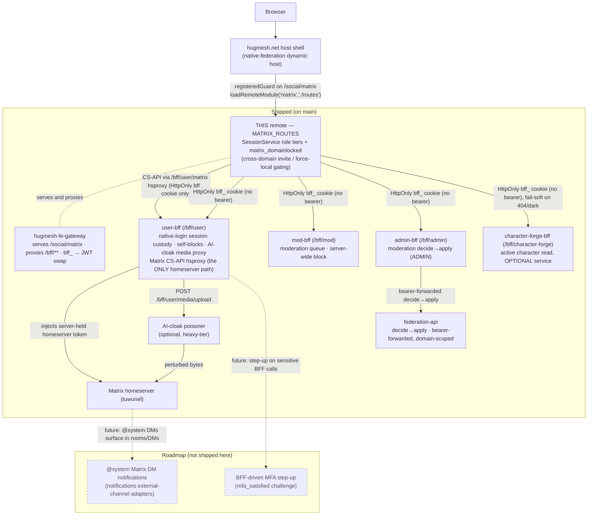

The **Matrix** Angular micro-frontend (native-federation **remote** `matrix`) for
the [hugmesh.net](https://github.com/hugmesh/hugmesh-host-shell) host shell, plus
a small demo host for local dev and e2e. The host loads the remote at runtime.
The `hugmesh-fe-gateway` (Spring Cloud Gateway) serves it at `/social/matrix` on
the frontend nodes.

Part of the HugMesh RPi 5 / x86_64 cluster built by
[catalyst-scripts](https://github.com/hugmesh/catalyst-scripts).
Sibling remotes live in their own repos:
[mastodon](https://github.com/hugmesh/hugmesh-mastodon-ui) ·
[login](https://github.com/hugmesh/hugmesh-login-ui) ·
[admin](https://github.com/hugmesh/hugmesh-admin-ui) ·
[mod](https://github.com/hugmesh/hugmesh-mod-ui) ·
[user](https://github.com/hugmesh/hugmesh-user-ui) ·
[apidocs](https://github.com/hugmesh/hugmesh-api-docs).

## What this is

An Angular 22 + `@angular-architects/native-federation` workspace with two
projects:

| Project | Type | Federation surface | Deployed? |
|---|---|---|---|
| `projects/matrix` | federation **remote** (`matrix`) | exposes `./routes` → `MATRIX_ROUTES`; mounted by the host at `/social/matrix` | **yes** — this repo's image |
| `projects/host` | **dynamic-host** demo shell | loads `login`/`matrix`/`mastodon`/`admin`/`mod`/`user`/`apidocs` remotes from `federation.manifest.json` | no — local dev/E2E only |

The federation contract (`projects/matrix/federation.config.js`) is the remote
**name** `matrix` and the one exposed key `./routes`. The host calls
`loadRemoteModule('matrix', './routes')` and mounts `MATRIX_ROUTES` at
`/social/matrix` behind its `registeredGuard`. The shared-dependency settings
(`shareAll` singletons, `strictVersion`, the RxJS skip list) live in the
repo-root `federation-base.js`. Host and remote share that one file, so they
cannot drift into a `shared is not a function` failure. The hugmesh.net host
shell does the same.

## Role-gate

This remote does not gate **mounting**. The host's `registeredGuard` already
limits `/social/matrix` to a logged-in, fully registered session. The remote
gates the **moderation surface**, through its own `SessionService`: one instance
per host and remote over the shared `hug.session` localStorage key, kept in sync
by a same-document broadcast and the cross-tab `storage` event. Tier flags come
from the lowercase Casdoor roles in `session.roles[]` and are **additive**:

- `isUser` — every authenticated user.
- `isMod` — `mod` **or** `admin`.
- `isAdmin` — `admin` only.

`RoleActionsComponent` renders three additive tiers from those flags. A USER
never sees MOD or ADMIN controls; a MOD never sees the ADMIN control. This is
**defence in depth only**. The BFFs enforce the matching `@PreAuthorize`
server-side, and the UI must never *show* a tier the role cannot use.

### Domain lock — SOCIAL LOCAL-ONLY ✅ shipped

Besides the three role tiers, a session can carry a **restriction marker**. The
platform folds a `ROLE_MATRIX_DOMAINLOCKED` authority from the validated JWT into
the session `roles[]` as the lowercase string `matrix_domainlocked`. It surfaces
as `SessionService.isMatrixDomainLocked()`. The marker is **per service**:
`mastodon_domainlocked` is a different marker and does **not** lock Matrix. (The
domain-lock pass-through is part of the account/session core being moved from
admin-bff into user-bff and the shared `hugmesh-auth-core` artifact — see
[Auth & token model](#auth--token-model-no-login-ui-here). The authority still
rides on the validated JWT, so this UI's read does not change.)

A locked caller is forced to **SOCIAL LOCAL-ONLY**. Cross-domain (federation)
targets are blocked; same-homeserver activity stays usable:

- `RoomSettingsComponent` disables the **invite** control only when the caller is
  domain-locked **and** the typed invitee lives on a *different* homeserver
  (`inviteIsRemote()` compares the invitee's `:server` with the caller's own
  `@user:server`). A locked caller may still invite users on their own
  homeserver. The control always carries help-text that says why.
- `ComposerComponent` pins its per-post **local-only** state ON for a locked
  caller (non-interactive, with help-text). Send and attach stay enabled; only the
  cross-domain reach is removed.

As with the role tiers, this is **defence in depth only**. The homeserver and BFF
still enforce force-local server-side.

## Routes & key components

`MATRIX_ROUTES` (in `projects/matrix/src/app/matrix.routes.ts`) is the full
Element-like web client:

| Path | Component | What it is |
|---|---|---|
| `` (root) | `MatrixChatComponent` | 3-pane chat shell: `<hug-room-list>` + `<hug-room-view>`, driven by a `sync()` long-poll loop; follows `?room=` |
| `rooms` | `RoomListComponent` | joined rooms split into Rooms vs People (DMs via `m.direct`); pending **Invites** with Accept/Decline (`sync()` `rooms.invite`); create-room / start-DM / join-by-alias |
| `rooms/:roomId` | `RoomViewComponent` | room header + `<hug-timeline>` + `<hug-composer>` + typing indicator; read receipts / read markers |
| `rooms/:roomId/members` | `MemberListComponent` | members with power-level label + presence + invite/kick, each row carrying `<hug-role-actions>` |
| `rooms/:roomId/settings` | `RoomSettingsComponent` | edit name/topic/avatar, invite, power levels, leave |
| `rooms/:roomId/thread/:eventId` | `ThreadPanelComponent` | thread root + `m.thread` replies + threaded composer |
| `settings` | `UserSettingsComponent` | own display name / avatar / presence / status + the per-user **Chat appearance** theming section |
| `search` | `SearchComponent` | full-text search (all rooms or one), context snippets, `next_batch` paging |
| `moderation` | `ModerationPanelComponent` | full-page role-aware safety surface (`RoleActionsComponent` inline), `?target=` / `?instance=` deep-link |
| `call` | `MatrixCallComponent` | 1:1 WebRTC call; signalling over `m.call.invite/answer/candidate`; `?mode=vn-voice` renders the audio-only **VN voice chat** stage instead of the video tiles |
| `rooms/:roomId/chat3d` | `Chat3dJoinComponent` → `Chat3dHostComponent` | the **Shadows of the Net** 3D chat room: join menu (character source / mic / camera) → embedded Godot room iframe + full-mesh A/V (see the 3D chat room section) |

Supporting components: `TimelineComponent` (messages, day separators,
back-pagination, hover react/reply/thread/edit/delete, reaction pills, edited and
redacted markers, thread chips), `ComposerComponent` (send/reply/edit/thread and
attachments), `ReactionPickerComponent` (roving-tabindex emoji menu),
`ClientConnectBannerComponent` (on the chat shell: for a user holding
`ROLE_MATRIX_EXTERNAL_CLIENT`, shows the homeserver URL to paste into their own
Matrix client, but only after a probe saw `/_matrix/client/versions` answer with
a JSON version list; otherwise it says why the URL is unavailable).

`MatrixService` is a thin wrapper over the Matrix Client-Server API (v3, plus v1
for relations, threads and media). It reaches the homeserver through the
be-gateway and covers sync, rooms/state, timeline send/edit/redact/react/reply/
thread, membership, typing/receipts, media up/download, profile/account-data,
search and call signalling.

> **A/V.** `MatrixCallComponent` is 1:1 WebRTC over Matrix call signalling. It
> fetches the homeserver's ICE/TURN credentials once through
> `MatrixService.turnServer()` (`GET /_matrix/client/v3/voip/turnServer`) and
> passes them to the `RTCPeerConnection`. While none are advertised it shows a
> "host/LAN-only until a TURN relay is configured" note. No TURN relay or SFU is
> deployed (coturn ships dark; it is a platform roadmap item), so `turnServer()`
> resolves to `[]` and calls work on the local network or same homeserver only,
> exactly as before the wiring. Cross-NAT and federated A/V wait for the
> server-side relay.
>
> **Group calls above the peer-to-peer cap — MatrixRTC, slice 1 (dark).** The
> platform chose Matrix-native group calls (MatrixRTC with a LiveKit SFU, Element
> Call's model; decision 102a) and scheduled them for launch (102b). Tracking:
> hugmesh-admin-bff-api#98. This repo carries the **client half only**, behind
> `__HUG_MATRIX_RTC__` (default **off**; off means nothing below makes a request
> and every call path is unchanged). `rtc/` holds `MatrixRtcService`. It:
>
> 1. reads the LiveKit focus from the client well-known
>    (`org.matrix.msc4143.rtc_foci`, `https:` only; same-origin
>    `/.well-known/matrix/client` by default, `__HUG_MATRIX_RTC_WELLKNOWN_URL__`
>    to override);
> 2. gets an OpenID token through the hsproxy and trades it at that
>    lk-jwt-service's `POST /sfu/get` for a LiveKit JWT (cookies omitted, because
>    it is another origin);
> 3. connects with `livekit-client` (lazy-loaded; its shared federation bundle is
>    fetched only on this path);
> 4. publishes and clears an `org.matrix.msc3401.call.member` state event under a
>    synthetic device id that is reused across joins: a stable per-browser base in
>    localStorage plus a slot claimed with a Web Lock, at most 4 per browser
>    profile. Each distinct id leaves a permanent state key in the room, and every
>    chat3d client re-reads those keys at 1Hz, so a fresh id per join would grow
>    them without bound.
>
> Only the chat3d voice mesh routes to it, and only when the 3D roster exceeds the
> room's cap (next section). The 1:1 `m.call.*` call screen is untouched.
>
> **The server half is not built.** It is the generator's deferred gen-livekit
> lane: a LiveKit SFU and lk-jwt-service as a default-off optional service, their
> key and secret in the ESO/Vault pattern, and tuwunel advertising the focus via
> `[[global.well_known.rtc_transports]]`. So on every mesh today discovery finds
> no focus, and group voice stays peer-to-peer with a note that says so. Two known
> gaps ride with it:
>
> - Rooms give `state_default: 50`, so ordinary members cannot publish the
>   call-membership event until room setup grants `org.matrix.msc3401.call.member`
>   a lower power level. The call still works; a note says other Matrix call apps
>   will not list you.
> - lk-jwt-service's legacy endpoint does not check room membership, so the SFU
>   room admits any identity it minted a token for. This client renders
>   audio/motion only from members of the room's 3D roster, but it cannot stop a
>   stranger listening. The application-service mode (MSC4195, `rooms:is_joined`)
>   is the server lane's fix.

## VN character render, stickers & character voice

Independent of any call, `RoomViewComponent` can show a live VN character beside
the timeline (`<hug-character-panel>`, "Path A"). The newest `m.room.message`'s
sender becomes the shown character, and its content picks the expression
(`expressionForEvent()`): an explicit `vn.expression` field, else rule-based
sentiment on the body, else `neutral`. The frame resolves two ways. Primary: the
sender's own registered MSC2545 `im.ponies.user_emotes` sticker pack
(`CharacterPackService`), using the image for the current expression. Fallback: a
composed, client-sanitized SVG (`SvgRigService` plus a drawable part-manifest)
when no pack is set. Both render as a plain ``, never through
`[innerHTML]`/`bypassSecurityTrustHtml`, so a hostile or composed SVG cannot run
script. No pack and no drawable means the panel renders nothing.

The composer's sticker picker (`<hug-sticker-picker>`) is the **send** half.
Matrix-ui has no native MSC2545 picker of its own, so this one resolves the
current user's active pack and sends `m.sticker` from it. `TimelineComponent` is
the **render** half. A sticker is its own top-level event type, not an
`m.room.message` msgtype, so `rows()` keeps `m.sticker` alongside
`m.room.message` and loads its `content.url` into an authenticated blob thumbnail.
That renders as an `` whose accessible name carries the sticker body and
sender. There is no duplicate text row, and a redacted sticker shows only the
redacted placeholder.

**Character voice (Piper TTS synth) — dark by default.** The character panel also
offers a "Speak" control. It synthesizes typed text through a gateway synth seam
(`VoiceSynthService`, `POST {BFF_BASE_URL}/v1/synthesize`), plays it back, and
drives the same amplitude-mouth math as the VN voice-chat stage below
(`AmplitudeMouthService`, `openness.ts`). A sibling `CharacterCaptureService` can
also record the animating portrait and the synthesized audio into a `video/webm`
clip and post it as `m.video`. Both sit behind the `VOICE_TTS_ENABLED` token
(default `false`; override with the runtime global `__HUG_VOICE_TTS__`). While it
is off, both do **nothing and make no HTTP call**. The Piper backend is not
deployed anywhere on the platform yet (see [Known gaps](#known-gaps--roadmap)),
so both ship dark. Every failure — flag off, blank text, network or decode error,
a tainted cross-origin image source — ends as "nothing plays, nothing sent". None
throws.

## VN voice chat (scenes, props, the stage)

The same 1:1 WebRTC call in **visual-novel mode**: `/call?mode=vn-voice`. Any
other or absent `mode` gives the original video call, unchanged. `getUserMedia`
asks for the **mic only**; the camera permission is never requested. The media
surface is `<hug-vn-stage>` instead of video tiles. Both participants appear as
VN characters (MSC2545 `im.ponies.user_emotes` sticker frame, then Matrix avatar,
then neutral silhouette). Their mouths follow each audio stream through the
existing amplitude code (`AmplitudeMouthService`, `openness.ts`, and a
threshold/hangover `SpeakingDetector`) — **amplitude only, no visemes**, by
product decision. The newest `m.room.message` is typewriter-revealed in the
stage's classic VN dialogue box. Signalling, ICE handling and the TURN capability
note are the video call's, unchanged.

The **shared scene** is the room state event **`net.hugmesh.vn.scene`**. Its
content is `{"sceneId": string|null, "props": [{"propId","x","y","scale"}]}`, with
x/y normalized 0..1. Because it is room state, every member sees the same stage,
and anyone the power levels allow can redecorate it live, mid-call, through the
in-call scene & props editor (`<hug-vn-scene-controls>`: optimistic local apply,
then the PUT; remote changes arrive on the same 1Hz poll as the `m.call` events).
Scene backgrounds and props are static, pack-authored SVGs listed in
`assets/vn/scenes/scenes.json` (`SceneService`). Unknown ids, a missing manifest
and malformed or hostile state content all **fail soft**: coordinates are
clamped, the prop count is capped, and the stage falls back to plain dark. None
crashes.

**Moderated against a hostile member.** The receive path
(`VnSceneStateService.getModeratedSceneState()`) reads the room's full state,
because a single-event GET exposes neither the scene event's sender nor
`m.room.power_levels`. It ignores a scene change from a sender below the room's
required-to-send power level for that event. That level is floored at a
configurable moderator PL (default 50), so even a lax room cannot let just anyone
drive the stage. A below-power-level member's flip is dropped and the last good
scene is kept. A `SceneRateLimiter` (default 3 changes per 5s) coalesces bursts,
so even an *authorized* driver cannot seize the stage with rapid flips. The 1Hz
call poll and the scene-controls picker reload both use the moderated read. This
is client-side defence in depth — it never trusts that the write was gated by the
homeserver — the same stance as the role tiers above.

**Embedded entry:** the room header offers both modes side by side, 🎭 *Voice chat
(VN)* and 📹 *Video call*, as links to the existing `/call` route with
`?room=<roomId>&mode=vn-voice|video`.

## Shadows of the Net — 3D chat room (chat3d)

> **Not reachable in any deployment today.** The client side is shipped, but the
> games origin it iframes (`__HUG_GAMES_URL__`, default
> `https://games.hugmesh.net`) serves **404**. See
> [Known gaps](#known-gaps--roadmap) and hugmesh-generator #470.

A GitS-style 3D chamber per Matrix room (`rooms/:roomId/chat3d`), offered by a
🥽 room-view button once a moderator enables it in room settings. The scene is
the hugmesh.games `shadows-of-the-net` Godot WASM bundle, embedded as a
cross-origin `<iframe>` in `mode=matrix`. The game does **no** Matrix I/O of its
own. `Chat3dHostComponent` is its only window onto the room. It speaks a
versioned `{v:1,t,...}` postMessage protocol, checks an origin allow-list and the
contentWindow source on every inbound message, and pins the targetOrigin on every
outbound one.

**Room state events** (all fail-soft parsed, clamped, hardened against untrusted
input):

- `net.hugmesh.chat3d` — enable, style, `maxParticipants` (2..16), `allowMedia`,
  `stageModOnly`.
- `net.hugmesh.chat3d.scene` — media placements on `table-1..6`, `screen-1..4` and
  `stage`; moderated receive path.
- `net.hugmesh.chat3d.avatar` — state_key is the owner mxid; a Char3DConfig
  snapshot of at most 8KB: the character-forge active character, a VN sticker
  billboard, or a seeded guest.

**A/V mesh (`MeshCallService`)** is a small full mesh of voice and data on the
legacy `m.call.*` v1 signalling (party_id + invitee), one RTCPeerConnection per
pair.

- The lexicographically **lower mxid offers**. This is deterministic, so a glare
  invite that breaks the rule is dropped identically on both sides.
- Call ids carry the `c3d-` prefix, so the mesh never collides with the 1:1 call
  component. Leaving sends a real `m.call.hangup`.
- When the roster exceeds the room cap, every client computes the **same**
  admitted set (the first `maxParticipants` sorted mxids). A member who is not
  admitted watches, with a room-full note.
- Each pair carries audio and the **`chat3d` RTCDataChannel** (unordered, no
  retransmits). Audio is one shared mic capture; if the mic is refused the client
  listens only and says so. The channel carries binary pose frames at 10Hz,
  quantized 52-byte blendshape vectors at 15Hz, and a speaking flag on change.
  `av-channel.ts` is the clamping wire format.
- Each remote stream gets a hidden audio sink, its own `AmplitudeMouthService`
  drive and a `SpeakingDetector`, so every mouth moves even with no camera
  anywhere. A peer's fresh blendshape `jawOpen` outranks amplitude.
- The host/LAN-only TURN note and the warning for 8 or more participants use the
  same capability-note pattern as the calls.

**Above the cap (MatrixRTC flag on only).** When `__HUG_MATRIX_RTC__` is on and
the 3D roster exceeds the room's `maxParticipants` (the peer-to-peer cap, 2..16,
default 8), the mesh asks for a LiveKit focus.

- With a focus advertised, it hangs up its pairs, joins the room's MatrixRTC call,
  and carries voice (the already-captured mic track) and the same av-channel frames
  (one lossy `publishData` per tick) over the SFU. Everyone is admitted, there is
  no strain warning and no TURN note (the media server owns ICE), and a note says
  why.
- With **no focus**, it keeps the peer-to-peer cap and admission unchanged. The
  note says the homeserver advertises no group-call media server, so only the
  first *cap* participants get voice.
- The route is a pure function of the shared roster (roster > cap means SFU), in
  both directions, so a newcomer lands on the same transport as everyone else.
  Leaving the SFU waits for 3 consecutive roster polls at or under the cap
  (`SFU_FALLBACK_TICKS`), so a one-poll dip cannot flap the room. It then restarts
  the `m.call.*` pump and re-forms the pairs.
- The kill switch and leaving the view disconnect the SFU and clear the membership
  event through the same `leave()`.
- SFU identities outside the room's 3D roster (or my own other tab) are ignored.
  Remote audio that arrives before its sender is on the roster is kept and attached
  when they appear.
- Every client of one deployment shares the flag, so they route alike. A client whose
  SFU join fails stays peer-to-peer, with the failing step in its note. The note adds
  that the others have most likely moved, so it may hear no one until it re-enters.

**Desktop-first face tracking (`FaceTrackService`)** is opt-in, camera only (a
join-menu toggle). MediaPipe FaceLandmarker runs in a Web Worker
(`face-track.worker.ts`, VIDEO mode, about 20Hz, GPU delegate with CPU fallback).
It is **fully self-hosted**: the wasm runtime is copied from the pinned
`@mediapipe/tasks-vision` npm package, and the `face_landmarker.task` model is
vendored under `assets/mediapipe/`. There is no CDN. Camera frames never leave the
device: only the 52-float blendshape vector leaves the worker, and only its
quantized bytes leave the machine. The vector drives eyes, brows and jaw — blinks,
gaze and lip-sync — on your own avatar locally and on peers' through the data
channel.

- Camera refused, tracker failed or tracking turned off: the amplitude mouth takes
  over, with a note saying why.
- A *persistent* per-frame detection failure (for example no WebGL at all;
  tasks-vision needs GL to ingest frames even on the CPU delegate) does the same
  **and releases the camera**, rather than leaving a lit webcam on a dead tracker.
- The worker carries `ensureModuleFactoryBridge()`. Without it the emscripten wasm
  loader (UMD-only, dynamically imported in module workers) never sets
  `self.ModuleFactory`, and face tracking is dead on arrival in the production
  bundle.

A **real-vector e2e** (`npm run e2e:face`, karma-independent) proves the pipeline.
Headless Chromium plays a committed synthetic-face `.y4m` clip through
`--use-fake-device-for-media-stream` into the real service, worker, wasm and model, and asserts the emitted 52-float stream: the face
must be detected, and `jawOpen`, `eyeBlink*` and `eyeLook*` must move by calibrated
minimum ranges, under GPU-delegate, CPU-delegate and no-WebGL (honest teardown)
scenarios. See [`e2e/face-track/README.md`](e2e/face-track/README.md).

**Channel media (`RoomMediaPanelComponent`)** lists the room's recent media
messages (back-paginated, 200-event scan cap), thread roots (`getThreads`) and
pinned events (`m.room.pinned_events`, via `MatrixService.getPinnedEvents`).
Placing an item writes the shared scene state, one item per surface.

- The host poll pushes placements into the game **with real texture bytes**
  (authenticated `fetchMediaBytes`, then a transferred ArrayBuffer) for images and
  a poster-frame thumbnail for video. Video v1 is **poster in the scene, play in
  the panel**. Live video as a WebGL texture needs a DOM-overlay bridge and is a
  documented follow-up.
- `allowMedia` off greys the whole surface, with help-text that says why.
- `stageModOnly` gates the stage spotlight at moderator PL 50: offered, never
  hidden.
- Clicking a dressed surface in the scene (`mediaActivate`) opens the panel on
  that item.

**Enter VR** posts the game's XR-session request strictly from the button's user
gesture, once the bridge is `ready`. A queued `enterVR` would lose its gesture and
the browser would refuse it. CSP notes: `wasm-unsafe-eval` is for the MediaPipe
wasm in our own page, `frame-src` is the parameterized games origin, and
`media-src blob:` covers the panel's object-URL playback.

## Per-user chat theming

`settings` → **Chat appearance**: pick one of five presets (`element-dark`,
`pastel`, `neon`, `paper`, `midnight-vn`), then fine-tune accent and bubble
colors, bubble shape (rounded / square / minimal), font, density and a chat
background pattern, with a live mini-preview. The config persists to Matrix
**account data** under **`net.hugmesh.chat_theme`**. That is per user, follows the
account across devices, and is visible to no one else. A localStorage copy lets
chat boot themed before the fetch resolves. Account data wins once it lands, and
reset writes `{}` as the cross-device "no theme" marker.

Application is scoped on purpose. `ChatThemeService` stamps `data-matrix-*`
attributes and `--hugm-chat-*` custom properties onto the remote's **own routed
shell hosts only** (through `ChatThemeRootDirective`), never `<body>`, so nothing
leaks into the federation host or other remotes. The preset palettes are SCSS maps
in `projects/matrix/src/styles/_chat-themes.scss`, included `:host(...)`-scoped by
those shells. The timeline and composer read the variables with fallbacks that
reproduce the stock look **byte for byte** when no theme is set. Untrusted config
(account data, localStorage) is sanitized field by field: only `#rrggbb` colors and
known enum values reach a style.

## Meshtastic LoRa-mesh bridge (rooms, timeline, my devices)

Three independent surfaces wire this remote to the platform's Meshtastic LoRa-mesh
↔ Matrix bridge track. This side is a room-state contract. The bridge appservice
and its own service are separate cross-repo infra, tracked below.

- **Room settings → Mesh bridge (LoRa).** A per-room toggle, bridge device id and
  Meshtastic channel slot (0–7), stored as the room STATE event
  **`net.hugmesh.mesh.bridge`** (`MeshBridgeStateService`; a tolerant, fail-soft
  parse, so a malformed or unset event renders as "off"). The controls are gated by
  power level through the same generic `senderMayDriveScene()` guard the VN shared
  scene uses. Below the room's moderator floor they are greyed out with help-text
  that says why, never a bare disabled control; the homeserver still enforces the
  level on the PUT. Enabling also invites the bridge bot
  **`@meshbridge:<caller's own homeserver>`**; the server comes from `whoami()`,
  never hardcoded. A rejected invite (already joined or invited) counts as a normal
  save. Disabling only writes the state; the bridge leaves the room on its own.
- **Timeline → "via LoRa mesh" badge.** A message counts as mesh-bridged when its
  sender is in the bridge appservice's exclusive `@mesh-*` user namespace, or when
  the event content carries a valid **`com.hugmesh.mesh`** provenance fragment
  (`{node, device, channel, registered, rssi?, snr?}`, tolerant-parsed; a missing
  or non-canonical node id voids the whole fragment). The badge title carries the
  node id, the registration state and RSSI/SNR when the bridge reported them, plus
  a caution: **LoRa node ids are a radio's self-reported identity, never
  cryptographically authenticated.** The same caution and provenance are appended
  to the accessible sender name, so screen-reader users are told as much as the
  visible badge shows.
- **User settings → My Mesh Devices.** Claim a Meshtastic node id (typed input is
  normalized client-side to the canonical `!` + 8 lowercase hex form, never
  guessed), give it a label, set its visibility (`private` / `friends` /
  `channels`), or release it. These call the `hugmesh-user-bff-api`
  `/bff/user/mesh-devices` endpoints (see [BFFs it talks to](#bffs-it-talks-to)).
  Every status line (last-seen, battery — `101` is the API's "on external power"
  marker — SNR, hop count, relaying bridge device) is radio-reported telemetry, so
  it is tolerant-parsed and shown as best effort, never authenticated. A revoked
  device stays listed, flagged with the server's reason when given, with visibility
  frozen and release still offered. A visibility change applies optimistically and
  rolls back (the signal and the native `<select>` itself) on a rejected PUT, with a
  non-blocking status note.

All three surfaces use transport already in the
[platform diagram](#how-it-fits-the-platform): room-state reads, writes and the
invite go through the existing hsproxy edge to the homeserver, and the
device-registry calls go through the existing user-bff edge. No new backend edge
was added. See [Known Gaps & Roadmap](#known-gaps--roadmap) for what this repo
alone can and cannot prove.

## AI-cloak media path

Image attachments go through the **user-bff** media proxy
(`MatrixService.uploadMediaProtected` → `POST /bff/user/media/upload`) instead of
straight to `/_matrix/media/v3/upload`. The optional, heavy-tier poisoner can then
perturb the bytes **before** the homeserver ingests, thumbnails and federates them.
The per-attachment shield in the composer defaults **on** (`mode:'cloak'`) and can
be turned off (`mode:'none'`; the server records an honest `skipped`). The composer
asks `/bff/user/media/capability` up front whether the heavy tier is available, so
it can show `Unavailable` rather than fail after upload.

Upload is separate from send. The file is held as a pending attachment with a
`Protecting your image…` progress state, a poll of the server-owned decision
(`/bff/user/media/status/...`) and a "post now without protection" escape hatch.
The badge is **honest** — `AI-cloak applied`, `Protection degraded`, `Not cloaked`
or `Cloak failed` — and never a guarantee.

## Auth & token model (no login UI here)

Login and registration belong to the **login** remote. Its native form POSTs
credentials straight to its own BFF's login endpoint: the platform's
**native-login** model. **Casdoor** (`id.hugmesh.net`) is reached only internally,
server to server, from that BFF. It never redirects the browser, and the browser
never sees a Casdoor page. The **user-bff** holds the per-session JWT custody and
refresh. The browser never holds its own Casdoor JWT, and — since the
httpOnly-cookie cutover below — no `bff_` bearer of any kind either. The only
credential on each authenticated call is the **HttpOnly `bff_` session cookie**.
The gateway's `BffCookieToBearerWebFilter` mints the internal custody JWT from that
cookie server-side, so the gateway's JWT validation and the data-driven role gate
(`gateway_route_access`) run unchanged.

This remote ships **no** global HTTP interceptor. Each service attaches
`credentials`/`withCredentials` itself:

- `UserBffService` and `ModBffService` use the Angular `HttpClient` with
  `withCredentials: true` on every `/bff/user/**` and `/bff/mod/**` request. No
  `Authorization` header is ever attached; the browser holds no bearer at all.
- `MatrixService` talks to the Matrix Client-Server API **only through the user-bff
  hsproxy** at `${__HUG_BFF_URL__}/bff/user/matrix` (PR #27). There is no
  direct-to-homeserver transport and no `MATRIX_PROXY_MODE` flag. Every CS-API call
  (and the AI-cloak media proxy) goes through the single `hsFetch` chokepoint or a
  `credentials: 'include'` `fetch`, and sends only the HttpOnly `bff_` cookie. The
  proxy **injects the upstream homeserver token and strips any inbound
  bearer/cookie**, so no homeserver token is ever held or attached client-side.
  Matrix rides the platform's user-bff token custody, so the remote never renders a
  Matrix login form.

> ✅ **Security posture: cookie-only auth, no bearer in `localStorage`.**
> `bffToken` — a JS-readable, opaque `bff_` session bearer that every BFF call used
> to send as `Authorization` — is gone. `UserBffService`, `ModBffService` and
> `MatrixService` authenticate only through the HttpOnly `bff_` session cookie
> (`credentials`/`withCredentials`), as the other UIs do under the platform-wide
> httpOnly-cookie default (hugmesh-tube-ui, hugmesh-wiki-ui, hugmesh-mod-ui). What
> stays in `localStorage` (`hug.session`) is non-secret identity metadata
> (`id`/`label`/`provider`/`roles`/`registrationComplete`) used for client-side
> role-tier gating. Server-side `@PreAuthorize` and guards stay authoritative. The
> homeserver token was already out of the browser before this change.

Backend URLs are runtime globals, so one image serves every brand:
`__HUG_MATRIX_URL__` and `__HUG_BFF_URL__` (same-origin `''` by default; the
fe-gateway proxies `/bff/**`).

## BFFs it talks to

- **homeserver** (`matrix.hugmesh.net`, reached only through the user-bff hsproxy
  at `/bff/user/matrix`) — the Matrix Client-Server API for all chat and calls.
- **user-bff** (`/bff/user/**`, `hugmesh-user-bff-api`,
  `@PreAuthorize hasRole('USER')`) — `UserBffService`: my self-blocks
  (`list`/`block`/`unblock`) and `recommend-instance-block` (which starts the
  USER→MOD→ADMIN chain); the AI-cloak media proxy
  (`/media/upload|capability|status`); the Matrix CS-API proxy
  (`/bff/user/matrix`); and my claimed Meshtastic mesh devices — `GET
  /mesh-devices` (list), `POST /mesh-devices` (claim; `409` = node id already
  claimed), `PUT /mesh-devices/{id}/visibility` (`400` invalid, `404` not mine,
  `409`/`422` revoked), `DELETE /mesh-devices/{id}` (release). The server always
  forces the owner to the JWT subject. The user-bff is also the new home of the
  login/session/account logic moved out of admin-bff (shared core in
  `hugmesh-auth-core`).
- **mod-bff** (`/bff/mod/**`, `hugmesh-mod-bff-api`, `hasAnyRole('MOD','ADMIN')`)
  — `ModBffService`: the moderation queue (`loadModeration`/`refer`) and
  server-wide `block`. Both BFF services are RxJS `BehaviorSubject`-backed
  (`blocks$`, `moderation$`), so a mutation refreshes the cache without each view
  re-fetching.
- **admin-bff** (`/bff/admin/**`, `hugmesh-admin-bff-api`,
  `@PreAuthorize hasRole('ADMIN')`) — `AdminBffService`: `decide(id, approve)` posts
  `/bff/admin/moderation/{id}/decide?approve=<bool>`, which proxies to
  `hugmesh-federation-api`'s `POST /api/federation/moderation/{id}/decide`. The
  bearer is forwarded, so federation-api authorises and domain-scopes the decision
  against the original admin's JWT.
- **character-forge-bff** (`/bff/character-forge/**`,
  `hugmesh-character-forge-bff-api`, ROLE_USER floor, owner always the JWT subject)
  — `CharacterForgeBffService`: a thin, read-only client for the one thing the
  chat3d avatar join-menu needs, `GET /bff/character-forge/characters/active` →
  `{name, definition}` or `404`. Full character CRUD belongs to the character-forge
  remote. This service is **optional**: a 404, a denied call or a dark BFF all
  resolve to `null`, and the join-menu option is greyed out with help-text instead
  of failing.

The ADMIN approve/deny control in `RoleActionsComponent` is **wired, not stubbed**.
It calls `AdminBffService.decide()` above. An approved `user-removal` auto-applies
downstream as an active kill-switch override, a denied re-decision rearms it, and a
failed decide surfaces as an error and is never shown as applied.
`hugmesh-admin-ui` remains a separate, fuller admin console (allowlist, usage,
namespaces), but it is no longer the only place an ADMIN can approve or deny a
referred moderation request.

## Accessibility conventions

What the components actually do:

- **Accessible names** on icon and glyph controls through `aria-label` /
  `[attr.aria-label]` (reaction pills name the emoji, not the bare glyph — WCAG
  4.1.2). Decorative glyphs carry `aria-hidden`.
- **Live regions** for async outcomes: `role="status"` + `aria-live` for progress
  and results (the cloak progress, role-action `statusMsg`), `role="alert"` for
  errors. Screen readers announce them without a focus move.
- **State exposed to AT:** `[attr.aria-expanded]` on disclosure triggers,
  `[attr.aria-pressed]` on toggles, `[attr.aria-current]` on the active room,
  `[attr.aria-checked]`/`role="menuitemcheckbox"` on reactions.
- **Keyboard** (WCAG 2.1.1 / 2.1.2): the reaction picker is a `role="menu"` with a
  **roving tabindex** (one Tab stop in, then Left/Right/Home/End move, Enter/Space
  toggles). Opening the menu moves focus **into** the active emoji (APG "opening a
  menu focuses an item"). Escape closes it and **returns focus to the React
  trigger**; picking a reaction does the same. The role-actions disclosure menu
  also closes on Escape and returns focus to its trigger button.
- **Landmarks and focus indicator:** a screen-reader **skip link**
  (`<a class="sr-skip" href="#main-content">`) jumps to the focusable
  `<main id="main-content" tabindex="-1">` landmark. Every keyboard-reachable
  control gets a high-contrast visible `:focus-visible` ring (WCAG 2.4.7).
- **Honest validation:** error text shows only after an attempt, not on first
  render (WCAG 3.3.1).

Note: most interactive controls here use the native `[disabled]` attribute (for
example the composer Send and attachment buttons), not the `aria-disabled` +
help-text pattern some sibling remotes use. The exception is the composer's
local-only toggle, which uses `aria-disabled="true"` plus help-text.

## How it fits the platform

Solid edges are **✅ shipped** on `main`. The dashed `Roadmap` subgraph is
**🔭 planned**: no code in this repo yet (see
[Known Gaps & Roadmap](#known-gaps--roadmap)).



**Multi-tenancy.** The image is brand-agnostic; nothing domain-specific is baked
in. Per-brand wiring is all runtime: the backend URL globals, the per-domain
`federation.manifest.json` (the cluster replaces the local `localhost:420{1..7}`
manifest with the per-nginx remote URLs, e.g.
`https://<brand>/social/matrix/remoteEntry.json`), the issuer-keyed `hug.session`
the login remote writes, and the fe-gateway's domain scoping. The gateway and BFFs
enforce roles; this UI only mirrors the tiers as defence in depth.

## Current State

Code claims below were checked against `main` on 2026-10-07. Claims about other
repos and live deployments are as last recorded.

- **Rebrand to HugMesh shipped (PR #51).** Selector prefixes, runtime globals
  (`__HUG_*__`), localStorage keys (`hug.session`, `hug.matrix.chattheme.v1`), the
  `HugSession` interface, CSS tokens and the package name (`@hugmesh/matrix`) all
  moved to `hug`/`hugmesh`. The Matrix event-type and account-data strings are a
  wire contract with the homeserver, BFF and bridge, so they follow a separate
  policy (2026-08-12). The canonical prefix is **`net.hugmesh.*`** (it follows the
  `.net` domain move). Every WRITE mints only the canonical name. Every READ walks
  a chain — `net.hugmesh.<x>` → `systems.hugmesh.<x>` (post-squash builds) → the
  original pre-HugMesh brand's `systems.<brand>.<x>` — and the newest generation
  present wins. Rooms and accounts written by any earlier build keep working with
  no migration. All legacy names are built in one file,
  `projects/matrix/src/app/legacy-read.ts`; each service re-exports its `LEGACY_*`
  constants beside the canonical one. The original brand is private to the
  deployments that ran it, so this repo never spells it: a deployment whose rooms
  still carry those names sets the runtime global
  `__HUG_LEGACY_EVENT_BRANDS__` (a list of brand stems, newest first, for example
  `['exampleorg']`) in the host page before this remote loads, like every other
  `__HUG_*__` hook. Unset, only the `net.hugmesh` and `systems.hugmesh`
  generations are read, and rooms that only have the original brand's events
  show none of that state. The `com.hugmesh.mesh` CONTENT field keeps its
  spelling (read-fallback to `com.<brand>.mesh` for each injected brand,
  `LEGACY_MESH_EVENT_CONTENT_FIELDS`). The meshbridge appservice honors the same
  chain (hugmesh-generator `bridge.py`).
- **Shipped on `main`.** The Angular 22 remote is built and deployed as this repo's
  image: the full Element-like CS-API client (`MATRIX_ROUTES`), additive role tiers,
  `matrix_domainlocked` SOCIAL LOCAL-ONLY, the honest AI-cloak media path, the a11y
  baseline, co-located unit specs (exceptions under [Tests](#tests)) and a
  Playwright+BDD E2E harness.
- **Read receipts.** The "seen by" indicator (per-member chips on the exact event
  each reader last read) and the send-on-view effect that advertises our own read
  position are shipped. An offline render-mapping e2e scenario and an `@cluster`
  cross-user delivery scenario cover them.
- **VN suite.** Live VN character beside the timeline, MSC2545 sticker picker,
  VN voice-chat call mode (`?mode=vn-voice`) with a power-level- and
  rate-limit-moderated scene and props stage, and per-user chat theming (5 presets).
  Character voice (Piper TTS and clip capture) is built but ships **dark**; see
  [Known Gaps & Roadmap](#known-gaps--roadmap).
- **Meshtastic LoRa-mesh bridge.** The room-settings toggle, the "via LoRa mesh"
  badge and My Mesh Devices are shipped (see
  [Meshtastic LoRa-mesh bridge](#meshtastic-lora-mesh-bridge-rooms-timeline-my-devices)).
  The unit suite (`ChromeHeadlessCI`, offline) has about 1,080 `it(` blocks, counted
  statically on 2026-10-07; the earlier "613/613 passing" figure is out of date. E2E
  covers the badge and My Mesh Devices (`e2e/features/rooms/mesh-bridge.feature`);
  the room-settings toggle and a real radio round-trip are still uncovered by E2E.
- **Auth is native-login with cookie-only sessions.** The browser carries only the
  HttpOnly `bff_` cookie, and `MatrixService` reaches the homeserver only through the
  user-bff hsproxy (PR #27). Details: [Auth & token model](#auth--token-model-no-login-ui-here).
  Moving login/session/account logic from admin-bff to user-bff (`hugmesh-auth-core`)
  is a backend change this UI does not see.
- **CI is GitLab.** The GitHub repo is pull-mirrored into the in-cluster GitLab.
  `.gitlab-ci.yml` builds and pushes the image and runs the OWASP pen-test stage
  (SCA + ZAP DAST, non-blocking). The only GitHub Actions workflow,
  `.github/workflows/release.yml`, publishes the image to GHCR on a push to `main`
  or a `v*` tag (see [Releasing](#releasing)). It is not in the deploy/security path.
- **A/V is LAN/local-only.** Client ICE wiring is shipped, but no TURN relay or SFU
  is deployed; see the A/V note under [Routes & key components](#routes--key-components).
- **nginx security headers and a nonce-based CSP shipped**; details and the
  location-by-location exceptions are under [Deploy](#deploy).

## Develop

```bash
npm install
npm start                 # ng serve host — the demo shell on :4200
npm run build:matrix      # build the Matrix remote → dist/matrix/browser
npm run build             # build host + matrix
npm test                  # ng test matrix (ChromeHeadlessCI, single run)
```

To try federation locally, serve the remote (`ng serve matrix`, :4201) and the host
(`npm start`, :4200). The host's `projects/host/src/assets/federation.manifest.json`
points the `login`/`matrix`/`mastodon`/`admin`/`mod`/`user`/`apidocs` remotes at
`localhost:4203`, `4201`, `4202`, `4204`, `4205`, `4206`, `4207` respectively. In
the cluster that manifest is replaced with the per-nginx remote URLs.

**Known break (checked 2026-10-07 on `main`):** `npm start`, `ng serve host` and
`ng serve matrix` all exit 127 before compiling, with `Configuration 'development'
for target 'serve-original' in project '<project>' is not set in the workspace`.
The cause and the fix are in issue #19 and PR #20 (not merged). `ng build` and
`ng test` are not affected.

### Tests

Almost every component, service and route has a co-located `*.spec.ts`
Jasmine/Karma unit spec under `projects/matrix/src/app`. Twelve source files have
none of their own:

- `ClientConnectBannerComponent` and `MouthOverlayComponent` have no spec at all.
- `VoicePlaybackService` and `ChatThemeRootDirective` are exercised only from other
  specs (`hug-character-panel`, `user-settings`).
- `face-track.worker.ts` is covered by `npm run e2e:face`.
- The rest are small modules: `mount-route.ts`, `shell-events.ts`,
  `wide-viewport.ts`, `vn/models/*` and `vn/util/svg-sanitize.client.ts`.

Run the specs with `npm test` (`ng test matrix`, `ChromeHeadlessCI`, single run /
`--watch=false`). `npm test` first runs `npm run check:neutrality`
(`scripts/check-neutrality.mjs`), which fails if any file in the repo names a
deployment-private brand or domain; use placeholders such as `mesh.example` and
`exampleorg` instead. `projects/matrix/src/test.ts` sets
`__HUG_LEGACY_EVENT_BRANDS__` to `['exampleorg']` so the specs walk the full
legacy read chain. They assert what this UI is responsible for: additive role-tier
gating, the `matrix_domainlocked` SOCIAL LOCAL-ONLY behaviour, the **honest**
AI-cloak badge states, and the keyboard and a11y contract (roving tabindex, focus
restore, skip-link). Use `npm run test:watch` for the interactive watcher. The
Playwright+BDD (Gherkin) E2E harness in [`e2e/`](e2e/README.md) covers the
federated flows. Its README has the full scenario inventory, the `@cluster` tagging
convention and the known coverage gaps.

## Deploy

The `Dockerfile` builds the Matrix remote (Node 24 / Angular CLI 22) and serves
`dist/matrix/browser` through nginx **with CORS** (`Access-Control-Allow-Origin: *`),
so the host can fetch `remoteEntry.json` cross-origin. `GET /healthz` returns `ok`.

`nginx.conf` emits baseline **HTTP security headers** on every response
(`always`): `X-Content-Type-Options: nosniff`, `X-Frame-Options: DENY`,
`Referrer-Policy: strict-origin-when-cross-origin`, and HSTS
(`max-age=31536000; includeSubDomains`). They are re-declared per `location`,
because nginx `add_header` inheritance is not cumulative (the two theme-stylesheet
locations re-declare all but HSTS).

A **strong nonce-based Content-Security-Policy** is also shipped. A fresh
per-request nonce (`$request_id`) goes into both the `script-src` directive and
every `<script>` tag in `index.html`, so `script-src` carries no
`unsafe-inline`/`unsafe-hashes`. Only `location /` sends it. COEP-CORP /
Permissions-Policy are still deliberately deferred (per-UI tuning and live-cluster
validation).

At container start, `docker-entrypoint.d/50-hug-theme.sh` writes the brand
stylesheet from the theme environment. nginx serves it `no-store` at
`/hug-theme.css` (and the legacy `/snap-theme.css`).

`.gitlab-ci.yml` builds and pushes the image to the in-cluster GitLab registry on
default-branch and tag pushes (the GitHub repo is pull-mirrored into GitLab). There
is no automatic GitHub Actions deploy path; `release.yml` publishes to GHCR (see
[Releasing](#releasing)) but deploys nothing. The image carries **no** keys: KEYS
material is supplied from the USB at first boot. ArgoCD deploys it to the
`hugmesh-frontend` namespace, fronted by the fe-gateway at `/social/matrix`.
`projects/host` is **not** deployed.

**CI security stage — jobs defined, first pipeline run pending.** `.gitlab-ci.yml`
`include:`s `hugmesh-generator:/tests/pentest/ci/pentest-stage.gitlab-ci.yml` (the
single source of truth for SCA and DAST) and defines a `pentest` stage with
`pentest:sca` (OWASP Dependency-Check) and `pentest:dast` (ZAP DAST baseline). Both
are `allow_failure: true` (additive, non-blocking) and gated to the default branch
and merge requests. `pentest:sca` is self-contained: Dependency-Check scans this
repo's checkout directly.

**Caveat — DAST and load need the shared harness.** `pentest:dast` (ZAP plus the
nuclei boundary templates via `run-pentest.sh --nuclei`) and the opt-in
`pentest:load` k6 leg (gated on `PENTEST_LOAD == "1"` through a GitLab Schedule or
manual trigger, never a plain MR) run `${PENTEST_HARNESS_DIR}/run-pentest.sh`. This
repo does **not** vendor that script (the default dir is `tests/pentest`). Until the
harness is vendored or fetched here, or `PENTEST_HARNESS_DIR` points at a fetched
copy, those jobs fail fast at the harness lookup. They are non-blocking, but not
scanning yet. No executed pipeline run of this stage has been observed from this
repo.

**Running it locally.** The repo-root `Makefile` mirrors this stage:
`make pentest` (= `make pentest-sca pentest-dast`).

- `pentest-sca` runs `npm audit --audit-level=high`, plus OWASP Dependency-Check
  when its CLI is on `PATH`. Otherwise it prints the equivalent
  `docker run owasp/dependency-check` command CI uses.
- `pentest-dast` does nothing unless `DAST_TARGET_URL=<running app url>` is set.
  Then it clones the same shared harness (`GENERATOR_REPO`, default
  `hugmesh-generator`) into `.pentest-harness` if absent and runs `run-pentest.sh`
  against that URL.
- Both are non-fatal locally, like the CI jobs' `allow_failure: true`.

## Releasing

The version lives in `package.json` (and `package-lock.json`, which must match). Today
it is a beta, `MAJOR.MINOR.PATCH-beta.N`. `.github/workflows/release.yml` publishes
`ghcr.io/hugmesh/hugmesh-matrix-ui`:

- A push to `main` pushes `:main` and `:sha-<12 hex>`.
- Pushing the tag `v<version>` (for example `v0.3.0-beta.1`, on a commit on `main`)
  pushes `:<version>`, `:beta` and `:sha-<12 hex>`, and creates a GitHub Release
  marked prerelease. A version tag that already exists in the registry is never
  overwritten: raise `N` instead.
- `:latest` is never pushed.
- Jobs run on the self-hosted runner only when the repo variable `RUNS_ON_PUBLISH`
  is set and the run is for `main` or a `v*` tag; otherwise they use hosted
  `ubuntu-latest`. The workflow has no pull-request trigger.

`scripts/release-version.sh` is the guard: it refuses a tag that does not match the
version, a lock file that disagrees, a SNAPSHOT, a pre-release other than `-beta.N`,
and any pull-request run. `npm run test:release-version` tests it.

## Known Gaps & Roadmap

State convention: **✅ shipped** = merged to `main` · **🚧 in-flight** = code on an
open branch or PR, not yet merged · **🔭 planned** = design-complete, no code.
Unless marked otherwise, nothing below has code in *this* repo today. It is listed
so readers do not mistake planned platform work for shipped UI.

- ✅ **Matrix under user-bff token custody (hsproxy cutover, PR #27)** and ✅
  **bearers off `localStorage`** (`bffToken` is gone from `HugSession`; the
  HttpOnly `bff_` cookie is the only credential). See
  [Auth & token model](#auth--token-model-no-login-ui-here).
- 🚧 **A/V via TURN (coturn) / SFU.** The **client ICE wiring is ✅ shipped** (see
  the A/V note under [Routes & key components](#routes--key-components)); with no
  relay advertised it falls back to host-only `iceServers: []`. What
  remains is the platform-side **TURN relay deployment** (coturn optional service,
  plus tuwunel `turn_uris`/`turn_secret`) and eventually an SFU. Until then, 1:1
  calls stay LAN/local-only.
- 🚧 **External-channel notifications (Matrix DM).** The notifications subsystem is
  adding external-channel adapters (Matrix DM, Akkoma, phpBB and email) on top of its
  in-app MVP. Once the Matrix DM adapter lands, the per-domain `@system` infra
  account's DM notifications will appear in this client's existing rooms/DM surface.
  No Matrix-UI change is shipped for it today.
- 🔭 **Casdoor MFA step-up.** Design-complete (WebAuthn/TOTP/recovery, per-role
  defaults, BFF-driven challenge stamping `mfa_satisfied` into the opaque
  `bff_session`). When built, sensitive BFF calls this remote makes could trigger a
  step-up challenge. There is **no** MFA UI in this repo today.
- 🚧 **OWASP CI — nuclei + k6.** The jobs are defined, but the DAST and load legs
  need the shared harness at `PENTEST_HARNESS_DIR` and no pipeline run has been
  verified. See [Deploy](#deploy).
- 🚧 **The games origin serves nothing: chat3d is unreachable in every real
  deployment, and `/games` has no remote to mount.** Two surfaces, one missing
  dependency. Neither should read as shipped.
  - **Shadows of the Net (this repo's deployed remote).** The client is ✅
    shipped: `projects/matrix/src/app/chat3d/**`, the `rooms/:roomId/chat3d` route,
    and the moderator enable toggle in `room-settings.component`. But
    `Chat3dHostComponent` iframes
    `${__HUG_GAMES_URL__}/_remotes/wasm-fragment/shadows-of-the-net/index.html`, and
    nothing in the mesh serves that origin. No deployment injects
    `__HUG_GAMES_URL__` (only the generator's mock lane does), so the bridge falls
    back to the default in `chat3d-bridge.ts`, `https://games.hugmesh.net` — the
    right host, with nothing behind it. Measured at the live front door on
    2026-09-17 (hugmesh-generator #470): `Host: games.hugmesh.net /` → **404**, the
    bundle path → **401**, and no games pods running although the `hugmesh-games`
    ArgoCD Application is declared. So the 3D room **404s at the iframe**, and the
    user sits at "Loading the 3D room…". Nothing in this repo can fix that; #470
    tracks it, along with two more blockers outside this UI: a `.uidist` build that
    predates the `systems.hugmesh.chat3d*` → `net.hugmesh.chat3d*` rename, and the
    fact that no seed, bootstrap or fixture ever turns the room flag on. The
    moderator control exists here, but somebody still has to click it.
  - **`/games` and `/games/admin` (demo host only, issue #2).** Both are
    manifest-driven `loadChildren` mounts (`games-remote.routes.ts`). Register a
    `games` or `games-admin` entry in `federation.manifest.json` and the remote's
    exposed `./routes` mounts with no code change. **No such remote exists anywhere
    on the platform** (no `hugmesh-games-ui` repo, no entry in any manifest), so
    what renders is the TODO placeholder, by design, until one ships. This surface
    is `projects/host`, the local dev/E2E shell (see the table at the top), so it is
    not in the deployed image. The production shell (`hugmesh-host-shell`) carries
    its own copy of the same placeholders.

- 🚧 **Piper TTS synth seam for character voice.** The **client side is ✅
  shipped**: `VoiceSynthService`, `VoicePlaybackService` and
  `CharacterCaptureService` (see
  [VN character render, stickers & character voice](#vn-character-render-stickers--character-voice))
  match the real `/v1/synthesize` request/response contract and are unit-tested
  against mocks. They stay dark behind `VOICE_TTS_ENABLED` (default `false`)
  because the backend exists nowhere on the platform yet: no `edge-ai-tts` image
  has been built or pushed, no generator k8s manifests (deployment, service,
  configmap, network-policy) exist for it, and no gateway `/v1/synthesize`
  route-access row is seeded. That is cross-repo infra, not frontend code. Once it
  lands, flipping this remote's `__HUG_VOICE_TTS__` runtime global is a deploy-time
  config change with no code here.
- 🚧 **Meshtastic LoRa-mesh bridge appservice/service.** The **client side is ✅
  shipped** (see
  [Meshtastic LoRa-mesh bridge](#meshtastic-lora-mesh-bridge-rooms-timeline-my-devices)):
  the room-settings bridge toggle, the timeline provenance badge and the My Mesh
  Devices section match the documented `net.hugmesh.mesh.bridge` state-event and
  `com.hugmesh.mesh` content-fragment contracts, and are unit-tested with mocks
  only. The bridge appservice that watches the state event and relays radio
  traffic, and the mesh-device-registry backend behind `/bff/user/mesh-devices`,
  are cross-repo infra tracked outside this UI. This repo cannot prove a real radio
  round-trip.
- **Known e2e gap (narrowed).** The mesh bridge now has offline Playwright/Gherkin
  coverage of the timeline provenance badge and the My Mesh Devices
  list/claim/visibility/release flow (`e2e/features/rooms/mesh-bridge.feature`). Two
  pieces are uncovered. One is a real radio round-trip: no bridge appservice is
  deployed to script one against. The other is the **room-settings bridge toggle**.
  It used to be blocked on a change-detection defect: `room-settings.component`
  held the loaded fields in plain properties assigned after `await`ing
  `MatrixService`'s raw `fetch`, so the page stayed at its defaults, falsely
  power-locked, until an unrelated interaction. The loaded fields are now signals,
  and `room-settings.load-render.spec.ts` proves the page renders them with no
  manual change detection. The allow/deny power-level scenario in
  `mesh-bridge.feature` is still to be written.
- **Known e2e gap (closed).** The shared VN-scene moderation trust boundary
  (`vn-scene-moderation.ts`'s power-level gate and `SceneRateLimiter`; see
  [VN voice chat](#vn-voice-chat-scenes-props-the-stage)) is now driven end to end
  by `e2e/features/calls/vn-scene-moderation.feature`. A below-power-level sender's
  scene event is ignored (last good scene kept), and a per-poll flip burst is
  coalesced to the limiter's 3-per-5s budget. Both run OFFLINE off route-fulfilled
  room state, the only honest way to reach the case: a homeserver that enforces the
  power level would refuse the hostile write in the first place.

## Contributing

Issues and pull requests are welcome. Pointers for working in this repo:

- Run `npm test` (unit specs, from the repo root) and `npm run bdd` (offline e2e,
  from `e2e/`) before opening a PR. See [Tests](#tests) and
  [`e2e/README.md`](e2e/README.md) for what each covers and how to run the
  `@cluster` (live-stack) scenarios.
- Give new components and services a co-located `*.spec.ts` unit spec, as in
  [Tests](#tests).
- If a change touches the federation contract (`projects/matrix/federation.config.js`)
  or the shared-deps surface (`federation-base.js`), say so in the PR description.
  Those files must stay in sync with the
  [host shell](https://github.com/hugmesh/hugmesh-host-shell) and the sibling
  remotes linked at the top of this README.
- For anything security-relevant (auth, token custody, the AI-cloak media path,
  CSP/security headers), open an issue first so it can be discussed before a PR
  lands. A vulnerability is different: report it privately, as
  [Security](#security) explains.

## Security

Please report vulnerabilities privately, not in a public issue. See
[`SECURITY.md`](SECURITY.md) for how.

## License

[MIT](LICENSE).
