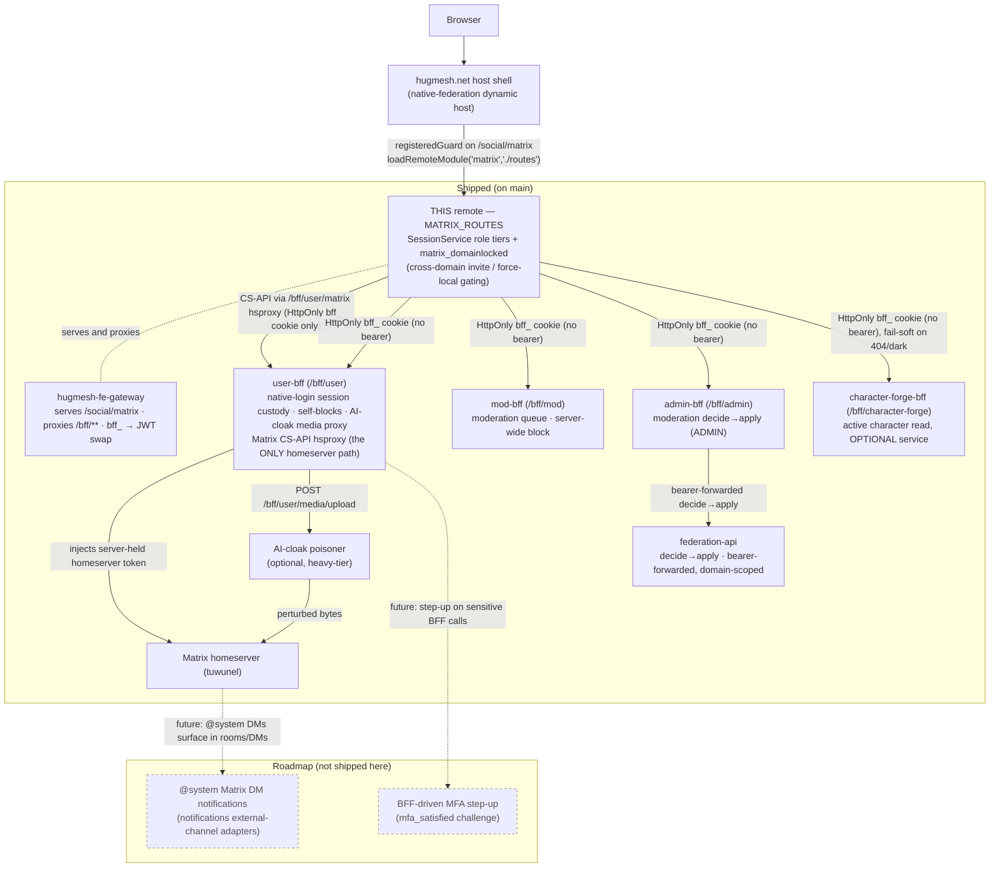

The **Matrix** Angular micro-frontend (native-federation **remote** named
`matrix`) for the
[hugmesh.net](https://github.com/hugmesh/hugmesh-host-shell)
host shell, plus a small demo host for local dev/E2E. The remote is federated
into the host at runtime and served at `/social/matrix` by the
`hugmesh-fe-gateway` (Spring Cloud Gateway) on the frontend nodes.

Part of the HugMesh RPi 5 / x86_64 cluster built by
[catalyst-scripts](https://github.com/hugmesh/catalyst-scripts).
Sibling remotes live in their own repos:
[mastodon](https://github.com/hugmesh/hugmesh-mastodon-ui) ·
[login](https://github.com/hugmesh/hugmesh-login-ui) ·
[admin](https://github.com/hugmesh/hugmesh-admin-ui) ·
[mod](https://github.com/hugmesh/hugmesh-mod-ui) ·
[user](https://github.com/hugmesh/hugmesh-user-ui) ·
[apidocs](https://github.com/hugmesh/hugmesh-api-docs).

## What this is

An Angular 22 + `@angular-architects/native-federation` workspace with two
projects:

| Project | Type | Federation surface | Deployed? |
|---|---|---|---|
| `projects/matrix` | federation **remote** (`matrix`) | exposes `./routes` → `MATRIX_ROUTES`; mounted by the host at `/social/matrix` | **yes** — this repo's image |
| `projects/host` | **dynamic-host** demo shell | loads `login`/`matrix`/`mastodon`/`admin`/`mod`/`user`/`apidocs` remotes from `federation.manifest.json` | no — local dev/E2E only |

The federation contract (`projects/matrix/federation.config.js`) is the remote
**name** `matrix` and the single exposed key `./routes`. The host consumes it
via `loadRemoteModule('matrix', './routes')` and mounts `MATRIX_ROUTES` at
`/social/matrix` behind its `registeredGuard`. The shared-deps surface
(`shareAll` singletons + `strictVersion` + the RxJS skip list) is centralised in
the repo-root `federation-base.js` so the host and this remote can't drift into
a `shared is not a function` runtime failure — mirrors the hugmesh.net
host shell.

## Role-gate

This remote does not gate **mounting** itself — the host's `registeredGuard`
already restricts `/social/matrix` to a logged-in, fully-registered session.
What the remote does gate is the **moderation surface**, via its own
`SessionService` (one instance per host/remote over the shared `hug.session`
localStorage key, kept in sync by a same-document broadcast + cross-tab
`storage` event). Tier flags are derived from the lowercase Casdoor roles in
`session.roles[]` and are **additive**:

- `isUser` — every authenticated user.
- `isMod` — `mod` **or** `admin`.
- `isAdmin` — `admin` only.

`RoleActionsComponent` renders three additive tiers off those flags, so a USER
never sees MOD/ADMIN controls and a MOD never sees the ADMIN control. This
client gating is **defence-in-depth only** — the BFFs enforce the matching
`@PreAuthorize` server-side; the UI must never *show* a tier the role can't use.

### Domain lock — SOCIAL LOCAL-ONLY ✅ shipped

Beyond the three role tiers, the session can also carry a **restriction
marker**. The platform folds a `ROLE_MATRIX_DOMAINLOCKED` authority off the
validated JWT into the session `roles[]` as the lowercase string
`matrix_domainlocked`, which surfaces as `SessionService.isMatrixDomainLocked()`.
The marker is **per-service** — `mastodon_domainlocked` is distinct and does
**not** lock Matrix. (The domainlock pass-through is part of the account/session
core that is being relocated from admin-bff into user-bff + the shared
`hugmesh-auth-core` artifact — see [Auth & token model](#auth--token-model-no-login-ui-here);
the authority itself still rides on the validated JWT, so this UI's read is
unchanged.)

When set, the remote forces a domain-locked caller to **SOCIAL LOCAL-ONLY**, so
cross-domain (federation) targets are blocked while same-homeserver activity
stays usable:

- `RoomSettingsComponent` disables the **invite** control only when the caller
  is domain-locked **and** the typed invitee lives on a *different* homeserver
  (`inviteIsRemote()` compares the invitee's `:server` against the caller's own
  `@user:server`). A locked caller may still invite users on their own
  homeserver; the (sometimes-disabled) control always carries WHY help-text.
- `ComposerComponent` pins its per-post **local-only** state ON (non-interactive,
  with WHY help-text) for a locked caller, never disabling Send/attach — only
  the cross-domain reach is removed.

As with the role tiers this is **defence-in-depth only** — the homeserver/BFF
still enforce force-local server-side.

## Routes & key components

`MATRIX_ROUTES` (in `projects/matrix/src/app/matrix.routes.ts`) is the full
Element-like web client:

| Path | Component | What it is |
|---|---|---|
| `` (root) | `MatrixChatComponent` | 3-pane chat shell: `<hug-room-list>` + `<hug-room-view>`, driven by a `sync()` long-poll loop; follows `?room=` |
| `rooms` | `RoomListComponent` | joined rooms split into Rooms vs People (DMs via `m.direct`); pending **Invites** with Accept/Decline (`sync()` `rooms.invite`); create-room / start-DM / join-by-alias |
| `rooms/:roomId` | `RoomViewComponent` | room header + `<hug-timeline>` + `<hug-composer>` + typing indicator; read receipts / read markers |
| `rooms/:roomId/members` | `MemberListComponent` | members with power-level label + presence + invite/kick, each row carrying `<hug-role-actions>` |
| `rooms/:roomId/settings` | `RoomSettingsComponent` | edit name/topic/avatar, invite, power levels, leave |
| `rooms/:roomId/thread/:eventId` | `ThreadPanelComponent` | thread root + `m.thread` replies + threaded composer |
| `settings` | `UserSettingsComponent` | own display name / avatar / presence / status + the per-user **Chat appearance** theming section |
| `search` | `SearchComponent` | full-text search (all rooms or one), context snippets, `next_batch` paging |
| `moderation` | `ModerationPanelComponent` | full-page role-aware safety surface (`RoleActionsComponent` inline), `?target=` / `?instance=` deep-link |
| `call` | `MatrixCallComponent` | 1:1 WebRTC call; signalling over `m.call.invite/answer/candidate`; `?mode=vn-voice` renders the audio-only **VN voice chat** stage instead of the video tiles |
| `rooms/:roomId/chat3d` | `Chat3dJoinComponent` → `Chat3dHostComponent` | the **Shadows of the Net** 3D chat room: join menu (character source / mic / camera) → embedded Godot room iframe + full-mesh A/V (see the 3D chat room section) |

Supporting components: `TimelineComponent` (messages, day separators,
back-pagination, hover react/reply/thread/edit/delete, reaction pills, edited/
redacted markers, thread chips), `ComposerComponent` (send/reply/edit/thread +
attachments), `ReactionPickerComponent` (roving-tabindex emoji menu).

`MatrixService` is a thin Matrix Client-Server API wrapper (v3 + v1 for
relations/threads/media) targeting the homeserver via the be-gateway: sync,
rooms/state, timeline send/edit/redact/react/reply/thread, membership,
typing/receipts, media up/download, profile/account-data, search and call
signalling.

> **Note on A/V.** `MatrixCallComponent` is 1:1 WebRTC over Matrix call
> signalling. The **client ICE wiring is shipped**: it fetches the homeserver's
> ICE/TURN credentials once via `MatrixService.turnServer()`
> (`GET /_matrix/client/v3/voip/turnServer`) and feeds them to the
> `RTCPeerConnection`, with an honest "host/LAN-only until a TURN relay is
> configured" capability note shown while none is advertised. But because **no
> TURN relay or SFU is deployed yet** (coturn ships dark — a platform roadmap
> item), `turnServer()` resolves to `[]` and calls are effectively
> **LAN/local-only**, byte-identical to the prior host-only behaviour. Calls work
> on the local network / same homeserver; cross-NAT and federated A/V await the
> server-side relay.

## VN character render, stickers & character voice

Independent of any call, `RoomViewComponent` can show a live VN character
beside the timeline (`<hug-character-panel>`, "Path A"): the newest
`m.room.message`'s sender becomes the shown character and its content drives
the expression (an explicit `vn.expression` field > rule-based sentiment on
the body > `neutral` — `expressionForEvent()`). The frame resolves two ways —
primary: the sender's own registered MSC2545 `im.ponies.user_emotes` sticker
pack (`CharacterPackService`), picking the image for the current expression;
fallback: a composed, client-sanitized SVG (`SvgRigService` + a drawable
part-manifest) when no pack is set. Both render as a plain `` — never
`[innerHTML]`/`bypassSecurityTrustHtml` — so a hostile/composed SVG is
script-inert; no pack and no drawable ⇒ the panel renders nothing.

The composer's sticker picker (`<hug-sticker-picker>`) is the SEND half:
matrix-ui has no native MSC2545 picker of its own (a stock Matrix client would
already surface one), so this one resolves the current user's own active pack
and sends `m.sticker` from it. `TimelineComponent` is the RENDER half: a
sticker is its OWN top-level event type (not an `m.room.message` msgtype), so
`rows()` keeps `m.sticker` alongside `m.room.message` and hydrates its
`content.url` into an authenticated blob thumbnail rendered as an `` whose
accessible name carries the sticker body + sender — no duplicate text row, and
a redacted sticker shows only the redacted placeholder.

**Character voice (Piper TTS synth) — dark by default.** The character panel
also offers a "Speak" control that synthesizes typed text through a gateway
synth seam (`VoiceSynthService`, `POST {BFF_BASE_URL}/v1/synthesize`) and
plays it back, driving the same amplitude-mouth math the VN voice-chat stage
uses below (`AmplitudeMouthService`/`openness.ts`). A sibling
`CharacterCaptureService` can additionally record the animating portrait +
synthesized audio into a `video/webm` clip and post it as `m.video`. Both are
gated on the same `VOICE_TTS_ENABLED` token (default `false`, override via the
runtime global `__HUG_VOICE_TTS__`) and are a **total no-op with no HTTP
call** while it's off — the Piper backend seam is not deployed anywhere on the
platform yet (see [Known gaps](#known-gaps--roadmap)), so in practice both
ship dark today. Every failure mode (flag off, blank text, network/decode
error, a tainted/cross-origin image source) fails soft to "nothing plays /
nothing sent", never a throw.

## VN voice chat (scenes, props, the stage)

The same 1:1 WebRTC call in **visual-novel mode**: `/call?mode=vn-voice` (any
other/absent `mode` ⇒ the original video call, byte-identical). `getUserMedia`
asks for the **mic only** — the camera permission is never requested — and the
media surface is `<hug-vn-stage>` instead of video tiles: both participants
rendered as VN characters (MSC2545 `im.ponies.user_emotes` sticker frame →
Matrix avatar → neutral silhouette), their mouths driven live from each audio
stream through the existing amplitude machinery (`AmplitudeMouthService` +
`openness.ts` + a threshold/hangover `SpeakingDetector` — **amplitude-only, no
visemes**, by product decision). The newest `m.room.message` is
typewriter-revealed in the stage's classic VN dialogue box. Signalling, ICE
handling and the TURN capability note are the video call's, unchanged.

The **shared scene** is the room state event **`net.hugmesh.vn.scene`**
(content `{"sceneId": string|null, "props": [{"propId","x","y","scale"}]}`,
x/y normalized 0..1) — room state, so every member sees the same stage and
anyone the power levels allow can redecorate, live, mid-call via the in-call
scene & props editor (`<hug-vn-scene-controls>`; optimistic local apply, then
the PUT; remote changes arrive on the same 1Hz poll as the `m.call` events).
Scene backgrounds and props are static pack-authored SVGs listed in
`assets/vn/scenes/scenes.json` (`SceneService`); unknown ids, a missing
manifest, or malformed/hostile state content all **fail soft** (clamped coords,
capped prop count, plain dark stage) — never a crash.

**Moderated against a hostile member.** The RECEIVE path (`VnSceneStateService
.getModeratedSceneState()`) reads the room's full state — which carries the
scene event's sender *and* `m.room.power_levels`, neither exposed by a
single-event GET — and ignores a scene change from a sender below the room's
own required-to-send power level for that event (floored at a configurable
moderator PL, default 50, so even a mis-configured lax room can't let anyone
drive the stage), so a below-power-level member's flip is dropped and the last
good scene is kept. A `SceneRateLimiter` (default 3 changes / 5s) coalesces
bursts so even an *authorized* driver can't seizure the stage with rapid
flips. Both the 1Hz call poll and the scene-controls picker reload consume the
moderated read; this is client-side defence-in-depth (never trusts the write
was homeserver-gated), same posture as the role tiers above.

**Embedded entry:** the room header offers both modes side by side — 🎭 *Voice
chat (VN)* and 📹 *Video call* — as links to the existing `/call` route
carrying `?room=<roomId>&mode=vn-voice|video`.

## Shadows of the Net — 3D chat room (chat3d)

A GitS-style 3D chamber per Matrix room (`rooms/:roomId/chat3d`, offered by a
🥽 room-view button once a moderator enables it in room settings). The scene
itself is the hugmesh.games `shadows-of-the-net` Godot WASM bundle embedded
as a cross-origin `<iframe>` in `mode=matrix`: the game does **no** Matrix I/O
of its own — `Chat3dHostComponent` is its only window onto the room, speaking a
versioned `{v:1,t,...}` postMessage protocol with an origin allow-list +
contentWindow source check on every inbound message and a pinned targetOrigin
on every outbound one.

**Room state events** (all fail-soft parsed, clamped, untrusted-input-hardened):
`net.hugmesh.chat3d` (enable/style/`maxParticipants` 2..16/`allowMedia`/
`stageModOnly`), `net.hugmesh.chat3d.scene` (media placements on
`table-1..6`/`screen-1..4`/`stage`, moderated receive path), and
`net.hugmesh.chat3d.avatar` (state_key = owner mxid; Char3DConfig
snapshot ≤8KB — character-forge active character, VN sticker billboard, or a
seeded guest).

**A/V mesh (`MeshCallService`)** — small full-mesh voice + data built on the
proven legacy `m.call.*` v1 signalling (party_id + invitee), one
RTCPeerConnection per pair: the lexicographically **lower mxid offers**
(deterministic — rule-violating glare invites are dropped identically on both
sides), call ids are `c3d-`-prefixed so the mesh never collides with the 1:1
call component, real `m.call.hangup` on leave, and when the roster exceeds the
room cap every client computes the **same** admitted set (first
`maxParticipants` sorted mxids) — a non-admitted member watches with an honest
room-full note. Each pair carries audio (one shared mic capture; refusal ⇒
listen-only, said so) plus the **`chat3d` RTCDataChannel** (unordered/no
retransmits): binary pose frames @10Hz, quantized 52-byte blendshape vectors
@15Hz, speaking flag on change (`av-channel.ts` is the clamping wire format).
Remote streams each get a hidden audio sink + their own `AmplitudeMouthService`
drive + `SpeakingDetector`, so every mouth animates even with no camera
anywhere; a peer's fresh blendshapes `jawOpen` outranks amplitude. The
host/LAN-only TURN honesty note and the ≥8-participant mesh-strain warning ride
the same capability-note pattern as the calls.

**Desktop-first face tracking (`FaceTrackService`)** — opt-in camera only
(join-menu toggle), MediaPipe FaceLandmarker running in a Web Worker
(`face-track.worker.ts`, VIDEO mode ~20Hz, GPU delegate with CPU fallback),
**fully self-hosted**: the wasm runtime is copied from the pinned
`@mediapipe/tasks-vision` npm package and the `face_landmarker.task` model is
vendored under `assets/mediapipe/` — no CDN, and camera frames never leave the
device (only the 52-float blendshape vector comes out of the worker; only its
quantized bytes leave the machine). The vector drives eyes, brows and jaw:
blinks, gaze and lip-sync on your own avatar locally and on peers' via the
data channel. Camera refused / tracker failed / turned off ⇒ the amplitude
mouth fallback, with a WHY note; a *persistent* per-frame detection failure
(e.g. an environment with no WebGL at all — tasks-vision needs GL to ingest
frames even on the CPU delegate) escalates the same way **and releases the
camera** rather than leaving a lit webcam on a dead tracker. The worker also
carries `ensureModuleFactoryBridge()` — without it the emscripten wasm loader
(UMD-only, dynamically imported in module workers) can never set
`self.ModuleFactory` and face tracking is dead on arrival in the production
bundle.

The whole pipeline is proven by a **real-vector e2e** (`npm run e2e:face`,
karma-independent): headless Chromium plays a committed synthetic-face
`.y4m` clip through `--use-fake-device-for-media-stream` into the real
service + real worker + real self-hosted wasm/model, and asserts the emitted
52-float stream — MediaPipe must actually DETECT the face, and
`jawOpen`/`eyeBlink*`/`eyeLook*` must move over the clip's jaw cycles, gaze
holds and blink by calibrated minimum ranges, across GPU-delegate,
CPU-delegate and honest-teardown (no-WebGL) scenarios. See
[`e2e/face-track/README.md`](e2e/face-track/README.md).

**Channel media (`RoomMediaPanelComponent`)** — lists the room's recent media
messages (back-paginated, 200-event scan cap), thread roots (`getThreads`) and
pinned events (`m.room.pinned_events` via `MatrixService.getPinnedEvents`);
placing writes the shared scene state (one item per surface). The host poll
pushes placements into the game **with real texture bytes** (authenticated
`fetchMediaBytes` → transferred ArrayBuffer) for images and a poster-frame
thumbnail for video — **video v1 is poster-in-scene + play-in-panel**; live
video-as-WebGL-texture needs a DOM-overlay bridge and is a documented
follow-up. `allowMedia` off greys the whole surface with WHY-helptext;
`stageModOnly` gates the stage spotlight at moderator PL 50 — offered, never
hidden. Clicking a dressed surface in-scene (`mediaActivate`) opens the panel
on that item.

**Enter VR** posts the game's XR-session request strictly from the button's
user gesture once the bridge is `ready` (a queued `enterVR` would lose its
gesture and be refused by the browser). CSP notes: `wasm-unsafe-eval` is for
MediaPipe wasm in OUR page, `frame-src` is the parameterized games origin, and
`media-src blob:` covers the panel's object-URL playback.

## Per-user chat theming

`settings` → **Chat appearance**: pick one of five presets (`element-dark`,
`pastel`, `neon`, `paper`, `midnight-vn`), then fine-tune accent + bubble
colors, bubble shape (rounded / square / minimal), font, density and a chat
background pattern, with a live mini-preview. The config persists to Matrix
**account data** under **`net.hugmesh.chat_theme`** (per user — follows
the account across devices, visible to no one else) with a localStorage
fast-boot copy so chat is themed before the fetch resolves; account data wins
once it lands, and reset writes `{}` as the cross-device "no theme" marker.

Application is deliberately scoped: `ChatThemeService` stamps `data-matrix-*`
attributes + `--hugm-chat-*` custom properties onto the remote's **own routed
shell hosts only** (via `ChatThemeRootDirective` — never `<body>`, so nothing
leaks into the federation host or other remotes). The preset palettes live as
SCSS maps in `projects/matrix/src/styles/_chat-themes.scss`, included
`:host(...)`-scoped by those shells; the timeline/composer consume the vars
with fallbacks that reproduce the stock look **byte-for-byte** when no theme is
set. Untrusted config (account data / localStorage) is sanitized field-wise —
only `#rrggbb` colors and known enum values ever reach a style.

## Meshtastic LoRa-mesh bridge (rooms, timeline, my devices)

Three independent surfaces wire this remote to the platform's Meshtastic
LoRa-mesh ↔ Matrix bridge track (a room-state contract on this side; the
bridge appservice and its own service are separate cross-repo infra, tracked
below):

- **Room settings → Mesh bridge (LoRa)**: a per-room toggle, bridge device id
  and Meshtastic channel slot (0–7), stored as the room STATE event
  **`net.hugmesh.mesh.bridge`** (`MeshBridgeStateService`, tolerant/
  fail-soft parse — a malformed or unset event renders as "off"). The controls
  are power-level-gated by the same generic `senderMayDriveScene()` guard the
  VN shared scene uses (greyed out with WHY-helptext below the room's
  moderator floor, never a bare disabled control — the homeserver still
  enforces the level on the PUT). Enabling additionally invites the bridge bot
  **`@meshbridge:<caller's own homeserver>`** (the server is derived from
  `whoami()`, never hardcoded); a rejected invite (already joined/invited) is
  tolerated as a normal save. Disabling only writes the state — the bridge
  leaves the room on its own.
- **Timeline → "via LoRa mesh" badge**: a message is recognized as
  mesh-bridged when its sender falls in the bridge appservice's EXCLUSIVE
  `@mesh-*` user namespace, or the event content carries a valid
  **`com.hugmesh.mesh`** provenance fragment (`{node, device, channel,
  registered, rssi?, snr?}`, tolerant-parsed — a missing/non-canonical node id
  voids the whole fragment). The badge's title carries the node id,
  registration state and RSSI/SNR when the bridge reported them, plus an
  explicit caution — **LoRa node ids are a radio's self-reported identity,
  never cryptographically authenticated** — and the same caution/provenance is
  appended to the accessible sender name so screen-reader users aren't told
  less than the visible badge shows.
- **User settings → My Mesh Devices**: claim a Meshtastic node id (typed input
  normalized to the canonical `!`+8-lowercase-hex form client-side, never
  guessed at), give it a label, set its visibility (`private` / `friends` /
  `channels`), or release it — against the `hugmesh-user-bff-api`
  `/bff/user/mesh-devices` endpoints (see [BFFs it talks to](#bffs-it-talks-to)).
  Every row's status line (last-seen, battery — `101` is the API's "on
  external power" marker, SNR, hop count, relaying bridge device) is
  RADIO-REPORTED telemetry, so it is tolerant-parsed and rendered as
  best-effort, never authenticated. A revoked device stays listed (flagged,
  with the server's reason when given) with visibility frozen but release
  still offered. A visibility change applies optimistically and rolls back
  (both the signal AND the native `<select>` element itself) on a rejected
  PUT, with a non-blocking status note.

All three surfaces ride the SAME transport already in the
[platform diagram](#how-it-fits-the-platform) below — room-state reads/writes
and the invite go through the existing hsproxy edge to the homeserver, and the
device-registry calls go through the existing user-bff edge — no new backend
edge was added for this feature. The bridge appservice/service itself is
cross-repo infra outside this UI; see
[Known Gaps & Roadmap](#known-gaps--roadmap) for what is and isn't provable
from this repo alone.

## AI-cloak media path

Image attachments are routed through the **user-bff** media proxy
(`MatrixService.uploadMediaProtected` → `POST /bff/user/media/upload`) instead
of straight to `/_matrix/media/v3/upload`, so the (optional, heavy-tier)
poisoner can perturb the bytes **before** the homeserver ingests/thumbnails/
federates them. The per-attachment shield in the composer defaults **on**
(`mode:'cloak'`), can be turned off (`mode:'none'` — server records an honest
`skipped`), and discovers heavy-tier availability up front
(`/bff/user/media/capability`) so it can render `Unavailable` rather than
failing after upload. Upload is decoupled from send: the file is held as a
pending attachment with a `Protecting your image…` progress state, a poll of the
server-owned decision (`/bff/user/media/status/...`), a "post now without
protection" escape hatch, and an **honest** badge — `AI-cloak applied` /
`Protection degraded` / `Not cloaked` / `Cloak failed`, never a guarantee.

## Auth & token model (no login UI here)

Login/registration are delegated entirely to the **login** remote's own native
form, which POSTs credentials directly to its own BFF's login endpoint — the
platform's **native-login** model. **Casdoor** (`id.hugmesh.net`) is
reached ONLY internally, server-to-server, from that BFF; it never redirects
the browser and the browser never sees a Casdoor-hosted page. Per-session JWT
custody/refresh live in the **user-bff** — the browser never holds (and the user
never sees) their own Casdoor JWT, and — as of the httpOnly-cookie-default
cutover below — never holds a `bff_` bearer of any kind either. The ONLY thing
that crosses the wire on every authenticated call is the **HttpOnly `bff_`
session cookie**; the gateway's `BffCookieToBearerWebFilter` mints the internal
custody JWT server-side from that cookie so the gateway's JWT validation +
data-driven role gate (`gateway_route_access`) run unchanged.

This remote ships **no** global HTTP interceptor — each service attaches
`credentials`/`withCredentials` explicitly:

- `UserBffService` and `ModBffService` call the Angular `HttpClient` with
  `withCredentials: true` on every `/bff/user/**` / `/bff/mod/**` request. No
  `Authorization` header is ever attached — the browser holds no bearer at all.
- `MatrixService` talks to the Matrix Client-Server API **exclusively through
  the user-bff hsproxy** at `${__HUG_BFF_URL__}/bff/user/matrix` (PR #27 —
  there is no direct-to-homeserver transport and no `MATRIX_PROXY_MODE` flag).
  Every CS-API call (plus the AI-cloak media proxy) goes through the single
  `hsFetch` chokepoint / a `credentials: 'include'` `fetch`, sending ONLY the
  HttpOnly `bff_` cookie. The proxy **owns/injects the upstream homeserver
  token and strips any inbound bearer/cookie**, so no homeserver access token
  is ever held or attached client-side — Matrix rides the platform's user-bff
  token-custody model, so the remote never renders a Matrix login form (auth
  flows entirely through that broker, not a homeserver-side login screen).

> ✅ **Security posture: cookie-only auth, no bearer in `localStorage`.**
> `bffToken` — a JS-readable, opaque `bff_` session bearer that used to be
> attached as `Authorization` by every BFF call — has been removed entirely.
> `UserBffService`/`ModBffService`/`MatrixService` now authenticate solely via
> the HttpOnly `bff_` session cookie (`credentials`/`withCredentials`),
> matching the platform-wide httpOnly-cookie-default pattern (hugmesh-tube-ui /
> hugmesh-wiki-ui / hugmesh-mod-ui). What remains in `localStorage`
> (`hug.session`) is non-secret identity metadata (`id`/`label`/`provider`/
> `roles`/`registrationComplete`) used for client-side role-tier gating;
> server-side `@PreAuthorize` + guards stay authoritative. The homeserver
> access token was already out of the browser entirely (see above) before this
> change.

Backend URLs are runtime globals so one image serves every brand:
`__HUG_MATRIX_URL__`, `__HUG_BFF_URL__` (same-origin `''` by default — the
fe-gateway proxies `/bff/**`).

## BFFs it talks to

- **homeserver** (`matrix.hugmesh.net`, reached ONLY via the user-bff
  hsproxy at `/bff/user/matrix`) — the Matrix Client-Server API for everything
  chat/call.
- **user-bff** (`/bff/user/**`, `hugmesh-user-bff-api`,
  `@PreAuthorize hasRole('USER')`) — `UserBffService`: my self-blocks
  (`list`/`block`/`unblock`) and `recommend-instance-block` (starts the
  USER→MOD→ADMIN chain); the AI-cloak media proxy
  (`/media/upload|capability|status`); the Matrix CS-API proxy
  (`/bff/user/matrix`); and my claimed Meshtastic mesh devices — `GET
  /mesh-devices` (list), `POST /mesh-devices` (claim, `409` = node id already
  claimed), `PUT /mesh-devices/{id}/visibility` (`400` invalid / `404` not
  mine / `409`/`422` revoked), `DELETE /mesh-devices/{id}` (release), owner
  always forced to the JWT subject server-side. The user-bff is now also the
  home of the relocated login/session/account logic (shared core extracted to
  `hugmesh-auth-core`).
- **mod-bff** (`/bff/mod/**`, `hugmesh-mod-bff-api`,
  `hasAnyRole('MOD','ADMIN')`) — `ModBffService`: the moderation queue
  (`loadModeration`/`refer`) and server-wide `block`. Both BFF services are
  RxJS `BehaviorSubject`-backed (`blocks$`, `moderation$`) so a mutation
  refreshes the cache without each view re-fetching.
- **admin-bff** (`/bff/admin/**`, `hugmesh-admin-bff-api`,
  `@PreAuthorize hasRole('ADMIN')`) — `AdminBffService`: `decide(id, approve)`
  posts `/bff/admin/moderation/{id}/decide?approve=<bool>`, which itself
  proxies to `hugmesh-federation-api`'s `POST
  /api/federation/moderation/{id}/decide` (bearer-forwarded, so federation-api
  authorises + domain-scopes the decision against the original admin's JWT).
- **character-forge-bff** (`/bff/character-forge/**`,
  `hugmesh-character-forge-bff-api`, ROLE_USER floor, owner ALWAYS the JWT
  subject) — `CharacterForgeBffService`: a THIN read-only client for the
  chat3d avatar join-menu's one need, `GET
  /bff/character-forge/characters/active` → `{name, definition}` | `404`. The
  full character CRUD surface belongs to the character-forge remote; this is
  an **optional** service — a 404, a denied call, or a dark BFF all resolve to
  `null` and the join-menu option is greyed with WHY-helptext rather than
  failing.

The ADMIN approve/deny control in `RoleActionsComponent` is **wired, not
stubbed** — it calls `AdminBffService.decide()` above; an approved
`user-removal` auto-applies downstream as an active kill-switch override, a
denied re-decision rearms it, and a failed decide surfaces as an error and is
never rendered as applied. `hugmesh-admin-ui` remains a separate, fuller
admin console (allowlist / usage / namespaces) but is no longer the only place
an ADMIN can approve/deny a referred moderation request.

## Accessibility conventions

Conventions the components actually follow:

- **Accessible names** on icon/glyph controls via `aria-label` /
  `[attr.aria-label]` (e.g. reaction pills name the emoji rather than the bare
  glyph — WCAG 4.1.2); decorative glyphs carry `aria-hidden`.
- **Live regions** for async outcomes: `role="status"` + `aria-live` for
  progress/results (the cloak progress, role-action `statusMsg`) and
  `role="alert"` for errors, so screen readers announce without a focus move.
- **State exposed to AT**: `[attr.aria-expanded]` on disclosure triggers,
  `[attr.aria-pressed]` on toggles, `[attr.aria-current]` on the active room,
  `[attr.aria-checked]`/`role="menuitemcheckbox"` on reactions.
- **Keyboard** (WCAG 2.1.1 / 2.1.2): the reaction picker is a `role="menu"`
  with a **roving tabindex** (one Tab stop in, then Left/Right/Home/End move,
  Enter/Space toggles). Opening the menu moves focus **into** the active emoji
  (APG "opening a menu focuses an item"), and Escape closes it while **restoring
  focus to the React trigger** — the same focus-restore runs after picking a
  reaction. The role-actions disclosure menu likewise closes on Escape and
  returns focus to its trigger button.
- **Landmarks & focus indicator**: a screen-reader **skip link**
  (`<a class="sr-skip" href="#main-content">`) jumps to the focusable
  `<main id="main-content" tabindex="-1">` landmark, and every keyboard-reachable
  control gets a high-contrast visible `:focus-visible` ring (WCAG 2.4.7).
- **Honest validation**: error text is shown only after an attempt, not on
  first render (WCAG 3.3.1).

Note: interactive controls here use the native `[disabled]` attribute (e.g. the
composer Send / attachment buttons), not the `aria-disabled`+help-text pattern
used by some sibling remotes.

## How it fits the platform

Solid edges are **✅ shipped** on `main`; the dashed `Roadmap` subgraph is
**🔭 planned** (no code in this repo yet — see
[Known Gaps & Roadmap](#known-gaps--roadmap)).



**Multi-tenancy:** the image is brand-agnostic — there is nothing domain-specific
baked in. Per-brand wiring is entirely runtime: the backend URL globals, the
per-domain `federation.manifest.json` (the cluster replaces the local
`localhost:420{1..7}` manifest with the per-nginx remote URLs, e.g.
`https://<brand>/social/matrix/remoteEntry.json`), the issuer-keyed
`hug.session` the login remote writes, and the fe-gateway's domain scoping.
Role enforcement is delegated to the gateway + BFFs; this UI only mirrors the
role tiers for defence-in-depth.

## Current State

As of July 2026:

- **Repo-wide code rebrand to HugMesh shipped (PR #51)** — component selector
  prefixes, runtime globals (`__HUG_*__`), localStorage keys (`hug.session`,
  `hug.matrix.chattheme.v1`), the shared `HugSession` interface, CSS
  custom-property tokens, and the package coordinate (`@hugmesh/matrix`) were
  all renamed from their earlier internal prefixes to the current
  `hug`/`hugmesh` naming. The Matrix wire-protocol event-type/account-data
  strings are a live wire contract with the homeserver/BFF/bridge, handled
  with a coordinated policy (2026-08-12): the CANONICAL prefix is
  **`net.hugmesh.*`** (it follows the `.net` domain move, like the Java
  package rename), every WRITE mints only the canonical name, and every READ
  walks a three-generation fallback chain — `net.hugmesh.<x>` →
  `systems.hugmesh.<x>` (post-squash builds) → the pre-rebrand original —
  newest present generation winning, so rooms and accounts written by any
  earlier build keep working without a data migration. Every pre-rebrand
  spelling lives ONLY in the consolidated legacy-read list
  (`projects/matrix/src/app/legacy-read.ts`); each service re-exports its
  `LEGACY_*` constants beside the canonical one. The `com.hugmesh.mesh`
  CONTENT field keeps its spelling (read-fallback to the pre-rebrand field
  name, `LEGACY_MESH_EVENT_CONTENT_FIELD`). The meshbridge appservice honors
  the same chain on its side (hugmesh-generator `bridge.py`).
- **Shipped on `main`** — the Angular 22 + native-federation `matrix` remote is
  built and deployed as this repo's image: the full Element-like CS-API client
  (`MATRIX_ROUTES`), additive role tiers, the `matrix_domainlocked` SOCIAL
  LOCAL-ONLY behaviour, the honest AI-cloak media path through the user-bff, the
  a11y baseline, and a co-located unit spec per file plus a Playwright+BDD E2E
  harness.
- **Read receipts render** — the "seen by" indicator on the timeline
  (per-member chips anchored on the exact event each reader last read) and the
  send-on-view effect that advertises our own read position are both shipped;
  covered by an offline render-mapping e2e scenario plus an `@cluster`
  cross-user delivery scenario.
- **VN feature suite shipped** — live VN character render beside the timeline
  (sticker-pack frame or composed-SVG fallback), an MSC2545 sticker picker in
  the composer, a VN voice-chat call mode (`?mode=vn-voice`) with a shared,
  power-level- and rate-limit-moderated scene + props stage, and per-user chat
  theming (5 presets, account-data persisted). Character VOICE (Piper TTS
  synth + recorded voice-clip capture) is also fully built but ships **dark**
  pending a platform-side TTS backend — see
  [Known Gaps & Roadmap](#known-gaps--roadmap).
- **Meshtastic LoRa-mesh bridge shipped** — the per-room bridge toggle in room
  settings, the timeline's "via LoRa mesh" provenance badge, and the "My Mesh
  Devices" claim/visibility/release section in user settings (see
  [Meshtastic LoRa-mesh bridge](#meshtastic-lora-mesh-bridge-rooms-timeline-my-devices)).
  Covered by the full unit-test suite (`ChromeHeadlessCI`, offline, 613/613
  passing), including the mesh-device visibility rollback behaviour (a
  rejected visibility change reverts both the signal and the native
  `<select>` element). End-to-end coverage now exists for the timeline provenance badge and the My
  Mesh Devices list/claim/visibility/release flow
  (`e2e/features/rooms/mesh-bridge.feature`); the room-settings bridge toggle
  and a real radio round-trip are still uncovered — see
  [Known Gaps & Roadmap](#known-gaps--roadmap).
- **Auth aligned to the platform's native-login model** — login/registration is
  a native form POST to the login remote's own BFF; Casdoor is reached only
  internally (server-to-server) and never redirects the browser. The
  **user-bff** holds per-session JWT custody and the browser only ever carries
  the **HttpOnly `bff_` session cookie** — no bearer of any kind. The gateway
  mints the internal custody JWT server-side from that cookie and runs the
  data-driven `gateway_route_access` role gate.
  The relocation of login/session/account logic from admin-bff to user-bff
  (shared core in the new `hugmesh-auth-core` artifact) is a backend change;
  this UI only ever sees the cookie session and is unaffected. The hsproxy
  cutover (below) is what brought the Matrix homeserver token under that same
  custody.
- **hsproxy is the ONLY homeserver path (PR #27)** — every CS-API call routes
  through the user-bff Matrix CS-API reverse proxy (`/bff/user/matrix`,
  HttpOnly `bff_` cookie via `credentials: 'include'` only, server-injected
  upstream token) via the single `hsFetch` chokepoint. The old DIRECT transport
  and its `MATRIX_PROXY_MODE` flag are **removed**: the browser never holds a
  homeserver access token.
- **CI is GitLab** — the GitHub repo is pull-mirrored into the in-cluster
  GitLab; `.gitlab-ci.yml` builds + pushes the image and runs the centralized
  OWASP pen-test stage (SCA + ZAP DAST, both non-blocking). There are **no**
  GitHub Actions in the deploy/security path.
- **A/V client ICE wiring shipped, but effectively LAN/local-only** — the call
  component fetches the homeserver's ICE/TURN credentials
  (`MatrixService.turnServer()`) and feeds them to the `RTCPeerConnection`; since
  no TURN relay or SFU is deployed yet it degrades to host-only candidates, so
  1:1 WebRTC calls work same-network/same-homeserver only.
- **nginx baseline security headers + a strong nonce-based CSP shipped** — the
  served SPA emits `X-Content-Type-Options: nosniff`, `X-Frame-Options: DENY`,
  `Referrer-Policy`, HSTS, and a per-request nonce'd `Content-Security-Policy`
  (no `unsafe-inline`/`unsafe-hashes` in `script-src`) on every response;
  COEP-CORP / Permissions-Policy are still deferred for per-UI tuning in the
  live-cluster pass (see [Deploy](#deploy)).

## Develop

```bash
npm install
npm start                 # ng serve host — the demo shell on :4200
npm run build:matrix      # build the Matrix remote → dist/matrix/browser
npm run build             # build host + matrix
npm test                  # ng test matrix (ChromeHeadlessCI, single run)
```

To exercise federation locally, serve the remote (`ng serve matrix`, :4201) and
the host (`npm start`, :4200); the host's
`projects/host/src/assets/federation.manifest.json` points the `login`/`matrix`/
`mastodon`/`admin`/`mod`/`user`/`apidocs` remotes at `localhost:4203`, `4201`,
`4202`, `4204`, `4205`, `4206`, `4207` respectively. In the cluster that
manifest is replaced with the per-nginx remote URLs.

### Tests

Aligned to the HugMesh test standard, **every component, service and route
has a co-located `*.spec.ts`** Jasmine/Karma unit spec (one per file across
`projects/matrix/src/app`), run via `npm test` (`ng test matrix`,
`ChromeHeadlessCI`, single run / `--watch=false`). The specs assert the things
this UI is responsible for: the additive role-tier gating, the
`matrix_domainlocked` SOCIAL LOCAL-ONLY behaviour, the **honest** AI-cloak badge
states, and the keyboard / a11y contract (roving tabindex, focus restore,
skip-link). Use `npm run test:watch` for the interactive watcher. A
Playwright+BDD (Gherkin) E2E harness in [`e2e/`](e2e/README.md) covers the
federated flows — see that README for the full scenario inventory, the
`@cluster` tagging convention, and known e2e-coverage gaps.

## Deploy

`Dockerfile` builds the Matrix remote (Node 24 / Angular CLI 22) and serves
`dist/matrix/browser` via nginx **with CORS** (`Access-Control-Allow-Origin: *`)
so the host can fetch `remoteEntry.json` cross-origin; `GET /healthz` returns
`ok`. `nginx.conf` also emits baseline **HTTP security headers** on every
response (`always`): `X-Content-Type-Options: nosniff`, `X-Frame-Options: DENY`,
`Referrer-Policy: strict-origin-when-cross-origin`, and HSTS
(`max-age=31536000; includeSubDomains`) — re-declared per `location` because
nginx `add_header` inheritance is not cumulative. A **strong nonce-based
Content-Security-Policy** is also shipped: a fresh per-request nonce
(`$request_id`) is injected into both the `script-src` directive and every
`<script>` tag in `index.html`, so `script-src` carries no
`unsafe-inline`/`unsafe-hashes`. COEP-CORP / Permissions-Policy are still
deliberately deferred (per-UI tuning + live-cluster validation).
`.gitlab-ci.yml` builds + pushes the image to the in-cluster GitLab
registry on default-branch / tag pushes (the GitHub repo is pull-mirrored into
GitLab — there is **no** GitHub Actions deploy path). The image carries **no**
keys — KEYS material is supplied from the USB at first boot. ArgoCD deploys it to
the `hugmesh-frontend` namespace, fronted by the fe-gateway at
`/social/matrix`. `projects/host` is **not** deployed.

**CI security stage — jobs defined, first pipeline run pending:** the pipeline
wires the centralized OWASP pen-test stage — `.gitlab-ci.yml` `include:`s
`hugmesh-generator:/tests/pentest/ci/pentest-stage.gitlab-ci.yml` (the single
source of truth for SCA + DAST) and defines a `pentest` stage with
`pentest:sca` (OWASP Dependency-Check) and `pentest:dast` (ZAP DAST baseline).
Both are `allow_failure: true` (additive, non-blocking) and gated to the default
branch + merge requests. `pentest:sca` is self-contained (Dependency-Check scans
this repo's checkout directly). **Caveat — DAST/load need the shared harness:**
`pentest:dast` (ZAP + the nuclei boundary templates via `run-pentest.sh
--nuclei`) and the opt-in `pentest:load` k6 leg (gated on `PENTEST_LOAD == "1"`
via a GitLab Schedule or manual trigger — never a plain MR) execute
`${PENTEST_HARNESS_DIR}/run-pentest.sh`, which this repo does **not** vendor
(default `tests/pentest`); until the harness is vendored/fetched here (or
`PENTEST_HARNESS_DIR` points at a fetched copy), those jobs fail fast at the
harness lookup — non-blocking, but not yet scanning. No executed pipeline run of
this stage has been observed from this repo yet.

**Running it locally:** the repo-root `Makefile` mirrors this CI stage for
local use — `make pentest` (= `make pentest-sca pentest-dast`). `pentest-sca`
runs `npm audit --audit-level=high` plus OWASP Dependency-Check when its CLI
is on `PATH` (falls back to printing the equivalent `docker run
owasp/dependency-check` invocation CI uses). `pentest-dast` is a no-op unless
`DAST_TARGET_URL=<running app url>` is set, in which case it clones the same
shared harness (`GENERATOR_REPO`, default `hugmesh-generator`) into
`.pentest-harness` if not already present and runs `run-pentest.sh` against
that URL. Both targets are non-fatal locally, matching the CI jobs'
`allow_failure: true`.

## Known Gaps & Roadmap

State convention: **✅ shipped** = merged to `main` · **🚧 in-flight** = code on
an open branch/PR, not yet merged · **🔭 planned** = design-complete, no code.
Unless marked otherwise, nothing below has code in *this* repo today — it is
recorded so readers don't mistake planned platform work for shipped UI.

- ✅ **Matrix under user-bff token custody (hsproxy cutover, PR #27)** — the
  user-bff Matrix CS-API reverse proxy is the ONLY transport; the browser never
  carries a homeserver token and the `MATRIX_PROXY_MODE` flag is gone (see
  [Auth & token model](#auth--token-model-no-login-ui-here)).
- ✅ **Bearers off `localStorage` (httpOnly-cookie session default)** — closes
  the platform-wide UI-standard security backlog item here: `bffToken` is gone
  from `HugSession`, and `UserBffService`/`ModBffService`/`MatrixService` all
  authenticate solely via the HttpOnly `bff_` session cookie
  (`credentials`/`withCredentials`), matching the pattern shipped in
  hugmesh-tube-ui / hugmesh-wiki-ui / hugmesh-mod-ui (see
  [Auth & token model](#auth--token-model-no-login-ui-here)).
- 🚧 **A/V via TURN (coturn) / SFU** — the **client ICE wiring is ✅ shipped**:
  `MatrixCallComponent` fetches ICE servers once via
  `MatrixService.turnServer()` (`GET /_matrix/client/v3/voip/turnServer`, via
  the hsproxy) and feeds them to the `RTCPeerConnection`, degrading to the
  byte-identical host-only `iceServers: []` when no relay is advertised. The
  remaining work is the platform-side **TURN relay deployment** (coturn optional
  service + tuwunel `turn_uris`/`turn_secret`) — and eventually an SFU — for
  cross-NAT/federated audio-video; until that relay exists 1:1 calls stay
  LAN/local-only.
- 🚧 **External-channel notifications (Matrix DM)** — the notifications
  subsystem is adding external-channel adapters (Matrix DM + Akkoma + phpBB +
  email) on top of its in-app MVP. Once the Matrix DM adapter lands, the
  per-domain `@system` infra account's DM notifications will simply appear in
  this client's existing rooms/DM surface; no Matrix-UI change is shipped for it
  today.
- 🔭 **Casdoor MFA step-up** — design-complete (WebAuthn/TOTP/recovery, per-role
  defaults, BFF-driven challenge stamping `mfa_satisfied` into the opaque
  `bff_session`). When built, sensitive BFF calls this remote makes could trigger
  a step-up challenge. There is **no** MFA UI in this repo today.
- 🚧 **OWASP CI — nuclei + k6** — the `pentest` stage jobs are defined in
  `.gitlab-ci.yml` (SCA + ZAP DAST baseline with `--nuclei`, plus the opt-in
  `pentest:load` k6 leg on a `PENTEST_LOAD == "1"` schedule/manual gate). SCA is
  self-contained; the DAST/load legs still need the shared harness
  vendored/fetched at `PENTEST_HARNESS_DIR`, and no pipeline execution has been
  verified yet. See [Deploy](#deploy).
- 🚧 **Piper TTS synth seam for character voice** — the **client side is ✅
  shipped**: `VoiceSynthService`/`VoicePlaybackService`/`CharacterCaptureService`
  (see [VN character render, stickers & character voice](#vn-character-render-stickers--character-voice))
  already match the real `/v1/synthesize` request/response contract and are
  fully unit-tested against mocks. Gated dark by `VOICE_TTS_ENABLED` (default
  `false`) because the backend doesn't exist yet anywhere on the platform: no
  `edge-ai-tts` image has been built/pushed, no generator k8s manifests
  (deployment/service/configmap/network-policy) exist for it, and no gateway
  `/v1/synthesize` route-access row is seeded — all cross-repo infra work, not
  frontend code. Once that lands, flipping this remote's `__HUG_VOICE_TTS__`
  runtime global is a pure deploy-time config change, no code here.
- 🚧 **Meshtastic LoRa-mesh bridge appservice/service** — the **client side is
  ✅ shipped** (see
  [Meshtastic LoRa-mesh bridge](#meshtastic-lora-mesh-bridge-rooms-timeline-my-devices)):
  the room-settings bridge toggle, the timeline provenance badge, and the My
  Mesh Devices claim/visibility/release section all match the documented
  `net.hugmesh.mesh.bridge` state-event and `com.hugmesh.mesh`
  content-fragment contracts and are fully unit-tested (mocks only). The
  bridge appservice that actually watches the state event and relays radio
  traffic, and the mesh-device-registry backend behind `/bff/user/mesh-devices`,
  are cross-repo infra tracked outside this UI — this repo cannot itself prove
  a real radio round-trip.
- **Known e2e gap (narrowed):** the mesh bridge (above) now has offline
  Playwright/Gherkin coverage of the timeline provenance badge and the My Mesh
  Devices list/claim/visibility/release flow
  (`e2e/features/rooms/mesh-bridge.feature`). Two pieces are still uncovered:
  a real radio round-trip (no bridge appservice is deployed anywhere to script
  one against), and the **room-settings bridge toggle**, which is blocked on a
  change-detection defect rather than on the harness — `room-settings.component`
  renders `name`/`topic`/`meshEnabled`/`meshDevice`/`meshChannel` from plain
  fields assigned after `await`ing `MatrixService`'s raw `fetch`, and zone.js
  0.16 does not patch `fetch`, so no change-detection tick follows the load and
  the section stays at its defaults (and falsely power-locked, `summary` being
  still `null`) until an unrelated interaction ticks change detection.
- **Known e2e gap (closed):** the shared VN-scene moderation trust boundary
  (`vn-scene-moderation.ts`'s power-level gate + `SceneRateLimiter`, see
  [VN voice chat](#vn-voice-chat-scenes-props-the-stage)) is now driven
  end-to-end by `e2e/features/calls/vn-scene-moderation.feature`: a
  below-power-level sender's scene event is ignored (last good scene kept) and
  a per-poll flip burst is coalesced to the limiter's 3-per-5s budget. Both run
  OFFLINE off route-fulfilled room state — which is the only honest way to
  reach the case, since a homeserver that enforces the power level would refuse
  the hostile write in the first place.

## Contributing

Issues and pull requests are welcome. A few pointers for working in this repo:

- Run `npm test` (unit specs, from the repo root) and `npm run bdd` (offline
  e2e, from `e2e/`) before opening a PR — see [Tests](#tests) and
  [`e2e/README.md`](e2e/README.md) for what each covers and how to run the
  `@cluster` (live-stack) scenarios.
- Keep new components/services co-located with a `*.spec.ts` unit spec, in
  line with the existing test convention described in [Tests](#tests).
- If a change touches the federation contract
  (`projects/matrix/federation.config.js`) or the shared-deps surface
  (`federation-base.js`), please call that out in the PR description — those
  files also have to stay in sync with the
  [host shell](https://github.com/hugmesh/hugmesh-host-shell) and the
  sibling remotes linked at the top of this README.
- For anything security-relevant (auth, token custody, the AI-cloak media
  path, CSP/security headers), please open an issue first so it can be
  discussed before a PR lands.

## License

[MIT](LICENSE).
