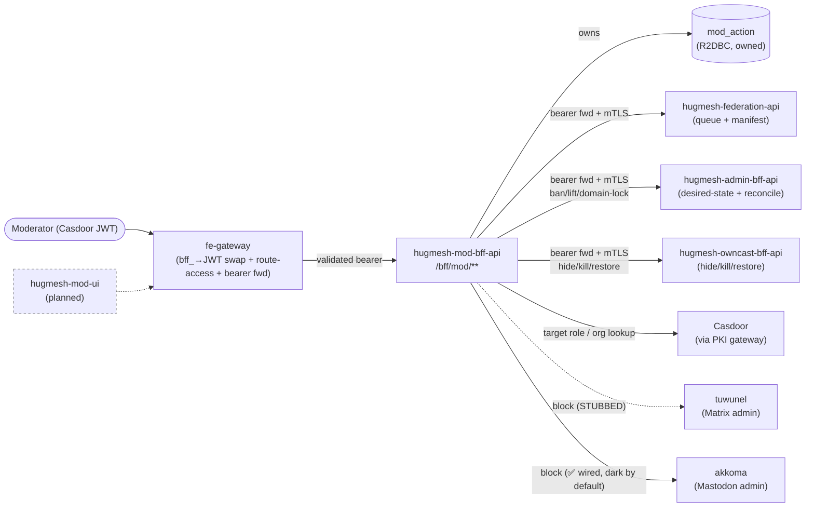
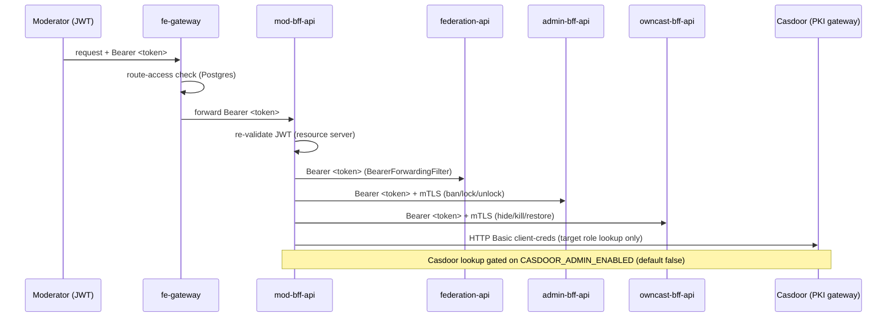
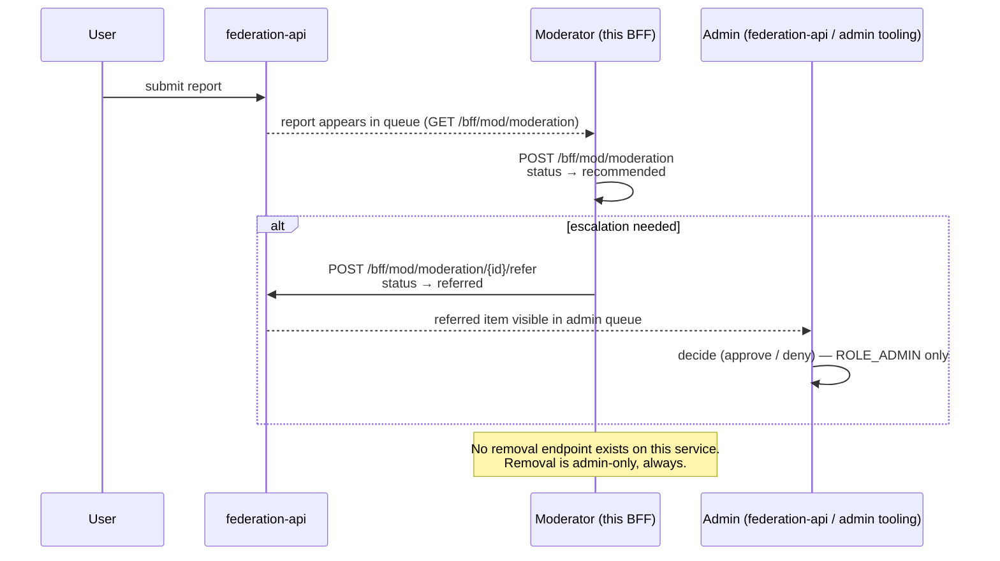

Moderator Backend-For-Frontend (BFF) for the HugMesh platform. It is the
**MODERATOR-scoped** (Casdoor `ROLE_MOD` or `ROLE_ADMIN`) sibling of the future
`hugmesh-mod-ui`, and the role analog of `hugmesh-admin-bff-api` — but with a
deliberately **narrow** surface. A moderator triages reports, records recommendations,
escalates to admins, issues server-wide blocks, writes access-role bans, and
domain-locks users (forcing traffic local-only). This service owns **no infrastructure
or server-admin** surface and **cannot remove a user directly** — removal always
escalates to an admin.

Reactive throughout: Spring WebFlux + reactive `WebClient` (Mono/Flux, no
`.block()` / `Thread.sleep` on the event loop) + R2DBC for the one runtime table,
with JDBC used **only** for Liquibase migrations. Casdoor JWT OAuth2 resource
server, springdoc-openapi (webflux-ui), Spring Native-ready, Java 25 LTS, **Spring Boot
4.0.7 / Spring Cloud 2025.1.2**. Built on the org's shared Maven baseline
(`hugmesh-parent` metapom 2.8.0 + `hugmesh-commons` 2.1.0 for the shared
security/tenancy code); conventions copied verbatim from `hugmesh-admin-bff-api`.

> **Auth-core note.** The platform's `hugmesh-auth-core` artifact (shared
> account / session / MFA / Casdoor-admin infra) is consumed **only** by `user-bff`
> and `admin-bff`. This mod-BFF is post-login — it depends on `hugmesh-commons`
> (the shared security/tenancy converter + multi-issuer wiring) but **not** on
> `hugmesh-auth-core`, and it owns no login/session/account logic itself: a
> native-login `bff_` session is resolved by calling OUT to admin-bff-api's
> introspect/exchange endpoints (see *Native-login (`bff_` session) support*
> below), never by a local accounts/session database.

## Where it sits

- **Tier:** a per-role **BFF** — the backend the moderator UI talks to. It is NOT a
  domain microservice: it owns exactly one runtime table (its audit log) and is a
  reactive `WebClient` **client** of `hugmesh-federation-api` (the moderation
  queue + federation manifest), `hugmesh-admin-bff-api` (the desired-state
  writer + reconcile loop), the homeservers (tuwunel/akkoma), and Casdoor (a target
  role lookup) — never their datastore.
- **Namespace:** in-cluster `hugmesh-backend` (its downstreams resolve at
  `*.hugmesh-backend.svc.cluster.local`; the Casdoor role lookup reaches the
  `hugmesh-pki` namespace via the PKI gateway). `spring.application.name` =
  `hugmesh-mod-bff-api`, served on port `8080`.
- **Request path:** the platform **fe-gateway** (hugmesh-fe-gateway) fronts this BFF.
  On the SSO/OIDC path the gateway is a pure Casdoor-JWT OAuth2 resource server: a
  pre-security exchange filter swaps the browser's opaque `bff_`-prefixed session for
  the internal custody JWT, then the gateway applies its data-driven Postgres
  `gateway_route_access` rules (source of truth, via `GatewayRouteAccessFilter`) to
  `/bff/mod/**` and forwards the validated Casdoor bearer, which this resource server
  re-validates. The bearer is then forwarded verbatim again on every downstream call
  (see *Who calls what*), so each downstream authorises the **original moderator**,
  not a service identity. (On this path the browser never holds a Casdoor JWT —
  login-ui does a Casdoor OIDC/PKCE redirect and `user-bff` performs the server-side
  code→token exchange and holds per-session JWT custody; this BFF only ever sees the
  gateway-validated bearer.)

  **On the native-login path** (the platform's default login model) the gateway's
  `BffSessionAuthFilter` authenticates the `bff_` session for its OWN route-access
  decision only and forwards the request — cookie/header included — through to this
  BFF **unswapped**, so this BFF resolves the session itself. See *Native-login
  (`bff_` session) support* below.

Topology (solid = ✅ shipped call path; dashed = STUBBED Matrix call / 🔭 planned
component; the akkoma block leg is ✅ wired-but-dark — real HTTP when enabled):



### Part of the HugMesh platform

HugMesh is a self-hostable, federated social platform (Matrix chat, ActivityPub-compatible
microblogging via Akkoma, live streaming, a wiki, and more) built around Casdoor for
identity. This BFF is the moderation service in that platform. Repositories it talks to
directly, or that it's the sibling of:

- [`hugmesh-federation-api`](https://github.com/hugmesh/hugmesh-federation-api) —
  the moderation queue, federation manifest, and automated system-finding queue this
  BFF reads from and writes recommendations/referrals to.
- [`hugmesh-admin-bff-api`](https://github.com/hugmesh/hugmesh-admin-bff-api) —
  the admin-scoped BFF this service is the role analog of; owns the access-role and
  domain-lock desired-state plus the reconcile loop that applies them.
- [`hugmesh-owncast-bff-api`](https://github.com/hugmesh/hugmesh-owncast-bff-api) —
  the live-streaming moderation surface (hide/kill/restore) this BFF drives.
- [`hugmesh-wiki-bff-api`](https://github.com/hugmesh/hugmesh-wiki-bff-api) — owns
  the wiki access overlay whose grant/timeout/ban/restore events show up in this BFF's
  moderation audit trail.
- [`hugmesh-fe-gateway`](https://github.com/hugmesh/hugmesh-fe-gateway) — the
  platform's edge gateway; fronts this BFF, applies route-access rules, and bridges the
  native-login session.
- [`hugmesh-commons`](https://github.com/hugmesh/hugmesh-commons) — the shared
  security/tenancy library (Casdoor JWT converter, domain registry) this service
  consumes rather than reimplementing.
- [`hugmesh-generator`](https://github.com/hugmesh/hugmesh-generator) — cluster
  manifests, deployment tooling, and the shared pen-test CI stage this repo's pipeline
  extends.
- `hugmesh-mod-ui` — the moderator-facing Angular front end for this BFF. Planned; not
  yet published.

## What it does

The whole surface lives under `/bff/mod/**` and is gated `hasAnyRole('MOD','ADMIN')`
three ways (defence in depth): the fe-gateway route-access rules, the
resource-server filter chain path rule, and `@PreAuthorize` on every method.

| Endpoint | Method | Purpose | Talks to |
|---|---|---|---|
| `/bff/mod/moderation` | GET | List the federation moderation queue (`?status=`) | **federation-api** |
| `/bff/mod/moderation` | POST | Record a recommendation (user→mod chain middle step) | **federation-api** + audit |
| `/bff/mod/moderation/{id}/refer` | POST | **Refer / escalate** a request UP to an admin | **federation-api** + audit |
| `/bff/mod/block` | POST | Server-wide block a user/instance on Matrix/Mastodon | **external** (Matrix STUBBED · akkoma ✅ wired, dark) + audit |
| `/bff/mod/ban` | POST | **Ban** a user from a platform-access role (writes desired-state) | **admin-bff** + audit |
| `/bff/mod/ban` | DELETE | **Lift** a previously written ban | **admin-bff** + audit |
| `/bff/mod/domain-lock/{role}/{user}` | POST | **Domain-lock** a user (force local-only / no-federation) | **admin-bff** + audit |
| `/bff/mod/domain-lock/{role}/{user}` | DELETE | **Domain-unlock** a previously locked user | **admin-bff** + audit |
| `/bff/mod/owncast/streams/{owner}/hide` | POST | **Hide** a target owner's owncast stream (force internal) | **owncast-bff** + audit |
| `/bff/mod/owncast/streams/{owner}/kill` | POST | **Kill** a stream (owncast broadcast ban + hide) | **owncast-bff** + audit |
| `/bff/mod/owncast/streams/{owner}/restore` | POST | **Restore** a killed owner (lift the broadcast ban) | **owncast-bff** + audit |
| `/bff/mod/modules` | GET | Deliver the MOD-accessible federation modules manifest | **federation-api** |
| `/bff/mod/findings` | GET | List the automated edge-AI system-finding queue (`?status=held\|dismissed\|actioned`) | **federation-api** |
| `/bff/mod/findings/{id}/resolve` | POST | Resolve a held system finding (`?actioned=true` actions it, `false` dismisses it) | **federation-api** + audit |
| `/bff/mod/audit` | GET | Read the local moderator-action audit trail (`?mine=`, domain-scoped) | **own audit table** |
| `/bff/mod/status` | GET | Caller's own moderator status (roles + domain) — UI polling for role-change detection | own JWT (no downstream) |

**Ban vs. block.** `block` drives the homeserver admin call directly (the
Matrix/tuwunel leg is STUBBED; the akkoma/Mastodon leg is ✅ wired-but-dark — real
HTTP once enabled, see *Honest deferrals*); `ban` does NOT touch Casdoor or the
homeserver itself — it writes the
`access_suspension` **desired-state** in `hugmesh-admin-bff-api` (which owns the
route-access DB + the single-writer reconcile loop) and the loop converges Casdoor
membership + the homeserver suspend state. Both return **`202 {state:'pending-reconcile'}`**
for any non-applied outcome (STUBBED / `degraded` / breaker-open) — **never** a
synchronous `200 "blocked"`, because the effect is asynchronous. A ban is guarded
**three** ways (all re-checked in `ModService`): a MOD may **not** ban themselves,
nor a `ROLE_ADMIN`/`ROLE_MOD` target, nor a target **outside the caller's own
tenant** — the same-tenant guard (`guardSameTenant`) runs fail-closed (`403`)
before any privileged read or write, resolving the target's brand off the caller's
per-domain Casdoor org (`SUPERADMIN` and the single-tenant `default` domain bypass;
see *Multi-tenancy / domain-scoping*). The matrix/mastodon `block` path additionally requires the platform role
(`ROLE_MATRIX` / `ROLE_MASTODON`, or `ROLE_ADMIN`) — enforced at the method AND the
service layer. Bans are **idempotent**: a deterministic `dedup_key` (a unique
index + `INSERT ... ON CONFLICT DO NOTHING`) absorbs at-least-once redelivery so a
retry neither double-records nor re-issues the desired-state write.

**Domain-lock (force local-only) — ADD-semantics, NOT a ban.** `domain-lock` forces a
user's traffic **local-only / no-federation**. It is an **ADDITIVE marker** (`role` ∈
`ROLE_MATRIX_DOMAINLOCKED` | `ROLE_MASTODON_DOMAINLOCKED`): the locked user **keeps**
their `ROLE_MATRIX`/`ROLE_MASTODON` access (the fe-gateway routes are **untouched**) —
the marker merely flags the homeserver/egress reconcile to force their deliveries
local. Because that is the *opposite* of the REMOVE-semantics suspension, it is a
**separate** `domain_lock` table in admin-bff (never overloading `access_suspension`),
written via `POST/DELETE /bff/admin/domain-lock/{platform}/{user}` through a dedicated
`AdminDomainLockClient` (same mTLS + bearer-forwarding + `@CircuitBreaker` as the
suspension client). Same delegation guards as a ban — a MOD may **not** domain-lock
themselves, nor a `ROLE_ADMIN`/`ROLE_MOD` target, nor a target outside the caller's
own tenant (all `403`, enforced at the method AND the service layer via the same
self-ban / privileged-target / same-tenant guards) — same idempotent `dedup_key`, and the same
`202 {state:'pending-reconcile'}` contract (the single-writer reconcile loop applies
the marker + the homeserver/egress force-local enforcement asynchronously). The
homeserver/egress **enforcement** ships **dark** (gated default-off via
`homeserver.domainlock.*` in admin-bff/generator, never hard-fail) until the akkoma MRF
image + egress policy land; the table + service + delegation are the deliverable here.

### Who calls what

The diagram below shows how the moderator's bearer token flows through the full call
chain **for a real Casdoor JWT caller**. Every downstream service sees the original
moderator's JWT — never a service-to-service token — so `@PreAuthorize` rules on
downstream services enforce the moderator's own role, not an elevated service
identity. A native-login (`bff_` session) caller is bridged into the same
`BearerForwardingFilter` via a best-effort custody-JWT exchange instead — see
*Native-login (`bff_` session) support* below for that variant.



- **federation-api** (`hugmesh-federation-api`) — this BFF is a reactive
  `WebClient` **client** of it. In-cluster default:
  `http://hugmesh-federation-api.hugmesh-backend.svc.cluster.local:8080`
  (override `FEDERATION_API_BASE_URL`). The caller's Casdoor JWT is forwarded
  verbatim on every call by a token-injecting `ExchangeFilterFunction`
  (`BearerForwardingFilter`, reading the validated `JwtAuthenticationToken` off the
  reactive `SecurityContext`). This means federation-api's own
  `@PreAuthorize('hasAnyRole MOD,ADMIN')` and manifest visibility-filter authorise the
  **original moderator**, not a service identity. Endpoints used (matched
  field-for-field to federation-api controllers/DTOs): `GET/POST
  /api/federation/moderation`, `POST /api/federation/moderation/{id}/refer`, `GET
  /api/federation/manifest`, `GET /api/federation/findings[?status=]`, `POST
  /api/federation/findings/{id}/resolve?actioned=`.
- **external Matrix(tuwunel) / Mastodon(akkoma)** — reactive `WebClient` admin
  clients for the server-wide block. Base URLs default to the in-cluster homeserver
  services grounded in `hugmesh-generator` manifests:
  `http://tuwunel.hugmesh-backend.svc.cluster.local:8008` (`MATRIX_BASE_URL`) and
  `http://akkoma.hugmesh-backend.svc.cluster.local:4000` (`MASTODON_BASE_URL`).
  **The Matrix(tuwunel) admin HTTP call is STUBBED**; **the Mastodon(akkoma) admin
  HTTP call is ✅ wired but dark by default** — it issues real pleroma-admin HTTP only
  when `external.mastodon.enabled=true` AND a Vault/ESO admin token is present, and is
  inert otherwise (see *Honest deferrals*).
- **admin-bff** (`hugmesh-admin-bff-api`) — the ban/lift surface writes the
  `access_suspension` desired-state via `POST/DELETE /bff/admin/access-roles/{role}/{user}`,
  and the domain-lock surface writes the SEPARATE `domain_lock` desired-state via
  `POST/DELETE /bff/admin/domain-lock/{platform}/{user}` (the `AdminDomainLockClient`,
  sibling of `AdminSuspensionClient`) (in-cluster default
  `http://hugmesh-admin-bff-api.hugmesh-backend.svc.cluster.local:8080`,
  override `ADMIN_BFF_BASE_URL`). Both reuse the same mTLS client-presentation
  (`hugmesh.mtls.client.*`) + caller's-bearer forwarding as the federation
  client; wrapped in `@CircuitBreaker(name="admin-bff")` so a degraded admin-bff
  falls back to a `degraded` outcome (→ 202 pending, never 200).
- **owncast-bff** (`hugmesh-owncast-bff-api`) — the owncast moderation surface
  drives owncast-bff's effector endpoints
  (`POST /bff/owncast/mod/streams/{owner}/hide|ban|restore` — the `OwncastModClient`;
  in-cluster default
  `http://hugmesh-owncast-bff-api.hugmesh-backend.svc.cluster.local:8080`,
  override `owncast-bff.base-url`) and records `owncast.hide`/`owncast.kill`/
  `owncast.restore` ledger rows. Same mTLS client-presentation + caller's-bearer
  forwarding as the federation/admin-bff clients (owncast-bff re-derives the
  moderator identity + brand from the SAME validated token and re-checks its own
  gates). UNLIKE the admin-bff desired-state writers the owncast effect is
  SYNCHRONOUS: an OK is a real `200 {state:'applied'}`; a degraded owncast-bff
  (`@CircuitBreaker(name="owncast-bff")`) is `202 {state:'not-applied'}` with an
  explicit no-reconcile-loop retry note — never a fake success — and a 404
  (no stream in the brand) surfaces as a real 404 with NO ledger row.
- **Casdoor** (read-only, via the hugmesh-pki gateway) — for the non-privileged
  target guard only: resolve whether a ban/domain-lock target holds `ROLE_ADMIN`/`ROLE_MOD`
  (the `CasdoorRoleClient`, HTTP Basic client-credentials against
  `PKI_GATEWAY_BASE`). GATED behind `CASDOOR_ADMIN_ENABLED` (default false); a
  Casdoor-less dev/CI run boots clean (the guard then resolves to "not privileged";
  the always-on self-ban + method/gateway gates still apply).
- **own audit table** — the only runtime datastore this BFF owns: the `mod_action`
  R2DBC table (Liquibase `db/changelog/001-mod-action.xml`, ban columns in `003`,
  `domain.lock`/`domain.unlock` verbs + the `domain-lock` platform widened into the
  CHECKs in `004`, the multi-tenant `domain` column in `005`, the composite
  `(dedup_key, domain)` uniqueness in `006`, the `wiki.*` verbs + `wiki` platform in
  `007`, the `@system` notification-directive columns in `008`, the
  DB-generated UUID PK — pgcrypto + a `gen_random_uuid()` DEFAULT on `id`, so inserts
  OMIT the id rather than minting `UUID.randomUUID()` — in `009`, and the `owncast.*`
  verbs + `owncast` platform (plus the `federation.finding-resolve` API↔DB CHECK
  parity fix) in `010`). Every action a
  mod takes is recorded here with the external outcome (`stubbed` / `ok` /
  `degraded:<reason>` for blocks and owncast moderation; `pending` propagation_state
  for bans and domain-locks), so even a stubbed block / pending ban / degraded
  owncast call is
  fully auditable. The action verbs are a fixed set (`ModActionType`):
  `matrix.block-{user,instance}`, `mastodon.block-{user,instance}`,
  `federation.recommend`, `federation.refer`, `federation.finding-resolve`,
  `access.suspend`, `access.restore`,
  `domain.lock`, `domain.unlock`, the **wiki access-overlay** verbs
  `wiki.grant` / `wiki.timeout` / `wiki.ban` / `wiki.restore` (`wiki` platform), and
  the **owncast live-stream moderation** verbs `owncast.hide` / `owncast.kill` /
  `owncast.restore` (`owncast` platform). The
  wiki grant/timeout/ban/restore overlay's *desired-state* is owned by the SEPARATE
  `hugmesh-wiki-bff-api` (its `wiki_access` table); these verbs make those events
  **first-class** in this BFF's moderation audit/queue surface alongside the
  matrix/mastodon/access/domain-lock actions (domain-scoped like the rest). The
  owncast kill/hide/restore *effect* is likewise owned by the SEPARATE
  `hugmesh-owncast-bff-api` (its `owncast_grant`/`owncast_stream` tables + local
  `owncast_moderation_audit` journal); driving the action through
  `/bff/mod/owncast/**` lands it in BOTH records — the central ledger row here and
  the service-local journal there. A resolved system finding (see *The
  system-finding queue* below) is recorded under the `federation.finding-resolve`
  verb.

### `@system` notification directive (✅ shipped, ships dark)

> **"Ships dark"** means the code is merged and the database columns exist, but no
> downstream component consumes the data yet. The feature activates without a code
> change once admin-bff's outbox subsystem lands.

A moderator can attach a **service-scoped notification directive** to a ban, lift, or
domain-lock action so the platform notifies the affected user via the per-domain
neutral `@system` sender (never exposing the individual moderator's identity). The
`POST/DELETE /bff/mod/ban` and lock request bodies accept `notifyChannels` (a list of
channels) and `emailOnly`. `NotifyDirective.resolve(...)` scopes the request against
the action's platform before the directive is stored:

- `in-app` and `email` are always allowed.
- A platform-bound channel (`matrix` / `mastodon`) is honoured **only** when the
  action's own platform matches it — an off-scope channel is silently dropped. A
  `matrix` ban, for example, can never trigger a `mastodon` DM.
- `emailOnly=true` overrides the channel list and forces the directive to exactly
  `email` + `in-app` (the conservative low-noise option).

Example ban request body with a notification directive:

```json
{
  "role": "ROLE_MATRIX",
  "targetUser": "user@example.com",
  "reason": "repeated harassment",
  "notifyChannels": ["in-app", "matrix"],
  "emailOnly": false
}
```

The resolved directive is recorded on the `mod_action` row (`notify_channels` CSV +
`notify_email_only`, changelog `008`) and forwarded to admin-bff's notification
subsystem.

**Identity rule (load-bearing):** the directive describes the requested fan-out only
— it carries **no** actor identity. Neither this BFF nor the `@system` outbox-builder
ever copies `mod_action.actor` into the notification, so a notified user can never
determine who moderated them. This matches the posture of the public appeal-contact
resolver. Nothing currently consumes the stored columns beyond the audit row and the
forwarded directive — admin-bff's outbox subsystem is the consumer. External delivery
adapters (Matrix DM / Akkoma feed / phpBB / email) land in admin-bff; see *Roadmap*.

### The user → mod → admin escalation chain

A user submits a report; the mod records a recommendation and, when warranted,
escalates to an admin. The `decide` (approve/deny) step is `ROLE_ADMIN`-only and
lives in federation-api / admin tooling — not here. There is no removal endpoint on
this service; only the refer. This is enforced structurally, not just by convention.



### The system-finding queue (automated edge-AI moderation)

Alongside the human-submitted moderation queue above, `/bff/mod/findings` proxies a
**companion, automated** queue: edge-AI avatar/image moderation findings filed by
`user-bff`'s pre-publish avatar vision check into federation-api. `GET
/bff/mod/findings` lists them (`?status=held|dismissed|actioned`, domain-scoped from
the forwarded JWT issuer so a per-brand mod sees only their own brand's findings; a
SUPERADMIN spans all brands), and `POST /bff/mod/findings/{id}/resolve` lets a
moderator mark one `actioned` (the mod took action) or dismiss it — federation-api
records the reviewer from the forwarded JWT subject and 404s a cross-domain id
server-side. A resolve also writes a domain-stamped local `mod_action` audit row
(`federation.finding-resolve`) mirroring recommend/refer, so it is first-class in
this brand's moderation trail.

## Casdoor role model

The JWT→authority converter is the shared `CasdoorAuthorities` from
`hugmesh-commons`, replacing the per-repo copies that previously lived in
`hugmesh-gateway` / `hugmesh-admin-bff-api` / `hugmesh-actions`:

- every authenticated principal gets a `ROLE_USER` floor;
- each `roles` claim entry (string or `{name}`) becomes `ROLE_<UPPER>` (so Casdoor
  `mod` → `ROLE_MOD`, `admin` → `ROLE_ADMIN`);
- each `permissions` entry becomes a verbatim authority;
- `isAdmin == true` adds `ROLE_ADMIN`.

Profile split (matches admin-bff): the OpenAPI spec + Swagger UI are **public**
under `dev`/`test` (so `gen:fetch` / the docs pipeline can curl `/v3/api-docs`
without a token) and **`ROLE_ADMIN`-gated** in prod. There is no `/login` /
`/register` plumbing here — login/session is owned by `user-bff` (the server-side
Casdoor code↔token exchange + per-session JWT custody) and account/registration
DATA lives in `admin-bff-db`; this BFF is **post-login** and never holds any
login/session/account logic itself (a native-login `bff_` session is bridged by
calling OUT to admin-bff-api — see below, not stored locally). The
`/actuator/health` + `/actuator/info` probes are public so k8s/Docker healthchecks
need no token.

### Step-up MFA on sensitive write-effects (✅ shipped, ships dark)

> **Status: ✅ enforcement shipped, inert by default.** The upstream Casdoor MFA
> CHALLENGE (WebAuthn/TOTP/recovery, per-role defaults) is **not** this repo's — mod-bff
> can only ever CONSUME the proof, never mint it.

The five mod endpoints with a platform-wide / user-visible, hard-to-reverse effect
carry an extra conjunct on their `@PreAuthorize`, on top of the `MOD`/`ADMIN` role:

| Endpoint | Effect | Step-up |
| --- | --- | --- |
| `POST /bff/mod/block` | server-wide Matrix/Mastodon block | ✅ required |
| `POST /bff/mod/ban` | access-role ban (desired-state write) | ✅ required |
| `DELETE /bff/mod/ban` | lift a ban | ✅ required |
| `POST /bff/mod/domain-lock/{role}/{user}` | force local-only | ✅ required |
| `DELETE /bff/mod/domain-lock/{role}/{user}` | domain-unlock | ✅ required |

Everything else on the mod surface — the queue reads, `POST /moderation`,
`/moderation/{id}/refer`, the findings surface, `/modules`, `/audit` — keeps the plain
role gate. The **owncast** `hide`/`kill`/`restore` actions are deliberately **not** in
the first enforced set: they are in-brand stream-visibility effects with a restore
path, and widening the enforced surface to them is a separate call, not a silent
side effect of this change.

The proof consumed is the `MFA_SATISFIED` marker authority — never a raw claim — so
**both** auth carriers land on one rule: a Casdoor JWT gets it from
`CasdoorAuthorities`' freshness-validated `mfa_satisfied_at` derivation, and an opaque
`bff_` session gets it from admin-bff's introspect `mfaSatisfied` field (see
*Native-login (`bff_` session) support*). The converter's reserved-prefix guard drops a
forged `permissions:["MFA_SATISFIED"]`, so the marker cannot be self-asserted. A denied
call is a clean 403 raised **before** `ModService` runs — no external effect, no audit
row.

Two independent flags, both `false` by default (`ModStepUpGate` / `SecurityConfig`):

| Property | Env | Governs |
| --- | --- | --- |
| `app.mfa.enabled` | `APP_MFA_ENABLED` | **derivation** — whether a JWT's `mfa_satisfied_at` becomes `MFA_SATISFIED` |
| `app.mfa.freshness-window` | `APP_MFA_FRESHNESS_WINDOW_MS` | the `0 <= now - stamp <= window` window (default 10m) |
| `app.mfa.enforce-sensitive-writes` | `APP_MFA_ENFORCE_SENSITIVE_WRITES` | **enforcement** — whether the five endpoints above require the marker |

Keeping enforcement on its own sub-flag mirrors the gateway's
`app.mfa.enforce-privileged-floor` split, so turning derivation on can never silently
start denying moderators. ⚠ On a JWT-carrier deployment the two must be flipped
**together**: `enforce-sensitive-writes` without `enabled` means the marker is never
derived and every gated call 403s. Once armed the gate is fail-closed — a missing or
unprovable second factor is a denial, never a pass.

## Native-login (`bff_` session) support

> **Status: ✅ shipped.**

Most of the sections above describe the SSO/OIDC path, where the browser never
holds a Casdoor JWT and the gateway swaps the opaque `bff_` session for the
internal custody JWT before forwarding. The platform's **native-login** model
(the platform default login flow, which supersedes the SSO-redirect model) works
differently: the gateway's own `BffSessionAuthFilter` authenticates a `bff_`
session **for its own route-access decision only** and forwards the original
request — including the `bff_session` cookie / `Authorization: Bearer bff_...`
header — through to this BFF **unchanged**. Without a bridge for that, a fully
registered `ROLE_MOD` native-login session would 401 at this BFF's own security
chain even though the gateway had already granted the request through, because
`SecurityConfig`'s `oauth2ResourceServer().jwt(...)` gate is (correctly) inert to
a non-JWT `bff_` token.

`BffCookieAuthenticationWebFilter` (`auth/`, `@Order(HIGHEST_PRECEDENCE + 10)`,
runs before the resource-server chain) closes that gap: it extracts a `bff_`
token from either carrier, resolves it against **admin-bff-api's**
`GET /bff/internal/session/introspect` (the same endpoint the gateway itself
calls — this service has no local database access to the accounts/`bff_session`
tables) via a dedicated `AdminBffSessionIntrospectClient`, and writes a real
`Authentication` (`ROLE_USER` floor + mapped roles + `MFA_SATISFIED` when
reported) onto the reactive `SecurityContext`. A suspended/banned account is an
explicit `403`; an unreachable/erroring/timing-out admin-bff fails **closed**
(`503`) — a `bff_` token that cannot be validated is never treated as
authenticated, and is never silently dropped to anonymous either. A
`skipBffTokenConverter()` guard in `SecurityConfig` stops Spring's stock
bearer-token converter from also trying (and failing) to JWT-decode the same
opaque token when it arrives as an `Authorization` header. A real Casdoor JWT
request is completely unaffected by any of this.

**Downstream custody exchange (ships dark).** A native-login caller's resolved
`Authentication` carries no raw JWT to forward, so `BearerForwardingFilter` (the
same filter that forwards a real JWT verbatim to federation-api / admin-bff /
owncast-bff, see *Who calls what* above) attempts a best-effort custody exchange:
the raw `bff_` token (stashed into the Reactor `Context` by
`BffRawTokenContextWebFilter`) is swapped for the real custody-held Casdoor JWT
via admin-bff-api's `POST /bff/internal/session/exchange`
(`SessionExchangeService`/`SessionExchangeClient`, with a positive-only TTL cache
mirroring the gateway's own exchange cache). Gated behind
`app.bff-exchange.enabled` (default `false`); on ANY failure — the feature not
opted in, custody not configured on admin-bff-api, an unknown/expired session, or
a transient outage — the filter falls through to exactly the pre-fix behaviour:
no `Authorization` header, request forwarded unmodified. This is a deliberate,
safe departure from the gateway's own hard-fail-closed posture for the analogous
swap: every downstream this filter forwards to already has its own independent
fail-closed JWT/role gate for a headerless request (see
`SessionExchangeService`'s class javadoc for the full reasoning).

```mermaid
sequenceDiagram
    participant Browser as Browser (bff_session cookie)
    participant GW as fe-gateway
    participant BFF as mod-bff-api
    participant AdminBFF as admin-bff-api
    participant Down as federation-api / admin-bff / owncast-bff

    Browser->>GW: request + bff_session cookie
    GW->>GW: BffSessionAuthFilter (route-access decision only)
    GW->>BFF: forward request (bff_ cookie/header UNCHANGED)
    BFF->>BFF: BffCookieAuthenticationWebFilter extracts the bff_ token
    BFF->>AdminBFF: GET /bff/internal/session/introspect (Bearer bff_...)
    AdminBFF-->>BFF: id/roles/registrationComplete/status/mfaSatisfied
    BFF->>BFF: populate SecurityContext (ROLE_* + MFA_SATISFIED)
    Note over BFF: hasAnyRole('MOD','ADMIN','SUPERADMIN') now passes
    opt app.bff-exchange.enabled=true
        BFF->>AdminBFF: POST /bff/internal/session/exchange (raw bff_ token)
        AdminBFF-->>BFF: custody Casdoor JWT (or a routine 503/404/401/403)
        BFF->>Down: Bearer (custody JWT)
    end
    Note over BFF,Down: exchange disabled or failed → forwarded WITHOUT a bearer;<br/>each downstream has its own independent fail-closed gate
```

## Multi-tenancy / domain-scoping

> **Status: ✅ shipped on `main`.** Domain-derived tenant scoping is live: the
> canonical converter, `DomainRegistry`, the optional multi-issuer resource server,
> the domain-scoped audit reads, the `SUPERADMIN` floor, `app.tenancy.issuers`
> (`application.yml`), and the `domain` column + composite dedup index (changelogs
> `005`/`006`) are all on `main`. The converter / `DomainRegistry` /
> multi-issuer resource server are now the **shared `hugmesh-commons` 2.1.0**
> implementations (`net.hugmesh.commons.security.*` /
> `commons.config.*`), wired in via the local `CommonsSecurityConfig` `@Import` step
> — they are no longer per-repo copies. A single-issuer cluster still works
> unchanged (every token resolves to `DOMAIN_default`).

The platform is multi-brand / multi-tenant: one Casdoor per brand, so a token's
**cryptographically-validated `iss`** claim is the trustworthy tenant discriminator
(never a user-settable `owner`/`org`/`aud`). This BFF derives and enforces its
tenant scope identically to the gateway (same shared commons code):

- **Canonical converter (`CasdoorAuthorities`, shared in hugmesh-commons).**
  One shared converter feeds BOTH the single-issuer path (`SecurityConfig`) and the
  optional multi-issuer path (`TenancyResourceServerConfig`) so they emit
  byte-identical authorities. It maps `roles` → `ROLE_<UPPER>`, `permissions`
  verbatim, legacy `isAdmin` → `ROLE_ADMIN`, a `ROLE_USER` floor, and stamps exactly
  **one** issuer-derived `DOMAIN_<x>` authority resolved through a `DomainRegistry`.
  Crucially it **strips any `permissions` entry beginning with the reserved
  `ROLE_`/`DOMAIN_` prefixes** — those authorities come only from controlled logic,
  so a brand-X token carrying `permissions:["DOMAIN_other"]` or
  `permissions:["ROLE_SUPERADMIN"]` cannot forge a tenant scope or super-role.
- **`DomainRegistry` (issuer → domain).** Seeded from
  `spring.security.oauth2.resourceserver.jwt.issuer-uri` (single-issuer → one
  `{iss → "default"}` entry) and the optional `app.tenancy.issuers` CSV
  (`iss=domain,...`). Back-compat: a single-issuer cluster emits `DOMAIN_default`
  for every token and nothing else changes. Multi-brand: only listed issuers are
  trusted; an unknown `iss` **fails closed** (the multi-issuer decoder 401s before
  any authority is emitted).
- **Opt-in multi-issuer resource server (`TenancyResourceServerConfig`).** Activated
  ONLY when `app.tenancy.issuers` genuinely carries `issuer=domain` pairs AND the
  registry is multi-issuer; otherwise the existing single `o.jwt(...)` issuer-uri
  decoder path is unchanged. Each trusted per-brand Casdoor validates its own
  tokens with the same Casdoor converter.
- **Per-query domain predicate (the isolation boundary).** The audit reads are
  scoped to the caller's `DOMAIN_<x>`: `GET /bff/mod/audit` calls
  `listForDomain` / `listByActorForDomain`, so a brand-X moderator can never read
  brand-Y's rows. The domain is read off the validated authority via
  `Roles.domainOf(...)`, which **fails closed** on an ambiguous authority set (zero
  or >1 `DOMAIN_`, the injection signature) → `null` → an empty result. Writes
  (`record` / `recordBan`) stamp the row with the acting moderator's domain, and the
  ban/lock `dedup_key` hashes the domain in — with a composite `(dedup_key, domain)`
  uniqueness — so two brands' Casdoor minting the same subject string can never
  collide cross-tenant (changelogs `005-mod-action-domain.xml`,
  `006-mod-action-dedup-domain.xml`).
- **SUPERADMIN is unscoped.** The cross-domain infra control plane reads with NO
  domain predicate (every brand). The `/bff/mod/**` floor and the prod spec gate
  are `hasAnyRole('MOD','ADMIN','SUPERADMIN')` (`SecurityConfig`).
- **Same-tenant write confinement (A01 BOLA/BFLA).** A MOD's write-effects
  (ban / lift / domain-lock / unlock) are confined to the caller's own
  issuer-derived tenant. `ModService.guardSameTenant` runs **fail-closed (`403`)
  before** any privileged read, dedup, or desired-state write. The target's brand is
  resolved **authoritatively** from the caller's per-domain Casdoor org
  (`CasdoorRoleClient.belongsToDomain` / `orgForDomain`, driven by the
  `casdoor.org-map` config) and asserted via `Roles.domainApplies`. `SUPERADMIN`
  principals (cross-domain infra) and the single-tenant `default` domain bypass this
  check. A brand-X moderator can never ban or lock a brand-Y user.

See [`docs/testing/MULTI-ISSUER-SLICE.md`](docs/testing/MULTI-ISSUER-SLICE.md) for the
offline (no-network) multi-issuer security-slice tests that assert this fail-closed
behaviour end-to-end through the real filter chain.

## Paired UI

`hugmesh-mod-ui` (built later) is the Angular host that consumes this BFF's
OpenAPI spec (ng-openapi-gen typed client) and renders the moderation queue, the
refer-to-admin action, the server-wide block form, and the federation modules it
delivers — the moderator analog of admin-ui ↔ admin-bff.

## API-to-API mTLS

Both directions are config-gated and **default OFF** (so local/dev/CI plaintext is
unaffected); the in-cluster deployment flips them on with the mounted PKCS12 stores
(`/stores/keystore.p12` = this service's Vault-PKI identity, `/stores/truststore.p12`
= the cluster CA):

- **Server side (inbound).** `SSL_ENABLED=true` + `SSL_CLIENT_AUTH=need` make the TLS
  handshake **require** a client cert chaining to the cluster CA (TLSv1.3 floor), so
  a caller not deployed+signed by the Vault/ESO PKI process cannot reach this API.
- **Client side (outbound).** `HUGMESH_MTLS_CLIENT_ENABLED=true` makes
  `FederationHttpClientSsl` build a reactor-netty connector that presents this BFF's
  PKI client identity (and trusts the cluster CA) on its outbound federation-api /
  admin-bff calls. One mounted `/stores` layout serves both directions.

Store passwords are generated in-pod and injected via environment variables — they
are never stored in git. See [`SECURITY.md`](SECURITY.md) for the full
transport-layer trust-boundary detail (Vault PKI / ESO wiring, the keystore
initContainer) and the generator-owned deployment requirement.

## Honest deferrals

- **Matrix(tuwunel) admin call is STUBBED; Mastodon(akkoma) is wired-but-dark.** The
  reactive `WebClient`s are wired and ready in both clients; the two legs now differ:
  - **tuwunel (Matrix) — STUBBED.** A Conduit-family server with, per the generator
    manifest + upstream source, **no Synapse-style `/_synapse/admin` REST API and no
    HTTP admin surface at all** — server-admin verbs are `!admin ...` text commands
    posted as `m.room.message` events into the admin room (`#admins:hugmesh.net`)
    and answered asynchronously by an in-process bot. A real wire-up needs a small
    persistent Matrix client (token lifecycle, alias→room_id resolution, txn ids,
    async-reply correlation), deliberately NOT half-built here. So
    `MatrixAdminClient.doBlock(...)` returns `BlockOutcome.STUBBED` **even when
    `external.matrix.enabled=true`** (logged loudly), and there is nothing to flip.
  - **akkoma (Mastodon) — ✅ WIRED, dark by default.** The request shapes **are**
    pinned in code (`PATCH /api/v1/pleroma/admin/users/deactivate` with
    `{"nicknames":[localpart]}` for block-user, `DELETE
    /api/v1/pleroma/admin/instances/{host}` for block-instance — both idempotent) and
    the admin **token** **is** wired (`external.mastodon.admin-token`, sourced from
    Vault `hugmesh/akkoma-admin` property `token` via ESO). When
    `external.mastodon.enabled=true` AND that token is present,
    `MastodonAdminClient.doBlock(...)` issues the **real** pleroma-admin HTTP (not
    `STUBBED`); when the flag is off (the default) it short-circuits to
    `BlockOutcome.STUBBED` and issues no HTTP; when enabled but the token is blank it
    returns `degraded("no-admin-token")` rather than an unauthenticated call. (Live
    verification against a real akkoma instance is still pending.)

  Whatever the outcome (`stubbed` / `ok` / `degraded:<reason>`), the action is logged
  and **always** recorded in `mod_action`, so every block is fully auditable. The
  `external.{matrix,mastodon}.enabled` flags default `false`, so a homeserver-less
  cluster stays inert.
- **No auto-apply of an approved decision.** An approved moderation request in
  federation-api authorises a kill-switch/removal action; wiring that
  auto-application is intentionally left as a separate, auditable step (it lives in
  admin tooling, not the mod surface).
- **`POST /bff/mod/findings/test-seed` is code-complete + gated, and now wired live
  in the local/e2e compose stack.** `TestSeedFindingController` ships dark behind
  `app.test-seed.enabled` (default `false`; set via `APP_TEST_SEED_ENABLED`) by
  design — see its javadoc. `hugmesh-generator`'s local/e2e compose stack sets
  `APP_TEST_SEED_ENABLED: "true"` in this service's (and
  `hugmesh-user-bff-api`'s) `environment:` block in
  `tests/stack/compose.local.yaml`, so `mod-ui`'s `findings-triage.feature`
  Confirm/Dismiss round-trip can seed a deterministic HELD finding on a fresh
  `make stack-up` instead of hitting the flag's honest `503`. The flag stays
  `false` (a real `503`, never a silent no-op) everywhere else, including prod.

## Current State

- **✅ On the unified org baseline.** Spring Boot 4.0.7 / Spring Cloud 2025.1.2,
  Java 25 LTS, built against `hugmesh-parent` (metapom) 2.8.0 and consuming
  `hugmesh-commons` 2.1.0 for the shared security/tenancy code. The per-repo
  copies of the Casdoor converter, `DomainRegistry`, and the multi-issuer resource
  server have been **deleted** and replaced by the shared commons types
  (`net.hugmesh.commons.security.*` / `commons.config.*`), wired via the
  local `CommonsSecurityConfig` `@Import`. Local code that remains: `SecurityConfig`
  (single-issuer chain + profile-split spec gate + SUPERADMIN floor), `Roles`
  (fail-closed tenant helpers), and the mod-specific service/clients/audit.
- **✅ Auth posture aligned with the new platform model.** This BFF is a Casdoor-JWT
  OAuth2 resource server sitting **behind** the fe-gateway; it does the
  gateway-validated-bearer re-validation + verbatim downstream forwarding on the
  SSO/OIDC path. It does **not** own the login flow (login-ui → Casdoor PKCE →
  user-bff custody → opaque `bff_` browser session) and depends on commons, not
  `hugmesh-auth-core`.
- **✅ Native-login (`bff_` session) auth bridge shipped.**
  `BffCookieAuthenticationWebFilter` +
  `AdminBffSessionIntrospectClient` bridge an opaque `bff_` session (cookie OR
  `Authorization: Bearer bff_...` header) into this service's own Spring Security
  context by calling admin-bff-api's introspect endpoint; `BearerForwardingFilter`
  attempts a best-effort custody-JWT exchange (`app.bff-exchange.enabled`, default
  off) so a native-login MOD/ADMIN's downstream calls to
  federation-api/admin-bff/owncast-bff can carry a real bearer too. See
  *Native-login (`bff_` session) support* above for the full contract.
- **✅ Multi-tenant domain scoping shipped on `main`** (issuer-derived `DOMAIN_<x>`,
  fail-closed isolation on audit reads + write confinement, composite
  `(dedup_key, domain)` uniqueness).
- **✅ Mod surface shipped:** moderation queue/recommend/refer, server-wide block
  (Matrix/tuwunel call STUBBED; akkoma/Mastodon call ✅ wired, dark by default),
  access-role ban/lift, domain-lock/unlock, owncast hide/kill/restore (the
  `/bff/mod/owncast/**` central wiring → owncast-bff effector + `owncast.*` ledger
  rows), modules
  manifest, domain-scoped audit, `/bff/mod/status`, the `@system` notify directive
  (ships dark), and `wiki.*` audit verbs.
- **✅ Hardening:** API↔DB CHECK-constraint parity + jakarta validation, config-gated
  inbound + outbound mTLS (default off), three-layer authz (gateway route-access /
  filter path rule / `@PreAuthorize`), defence-in-depth ban guards (self / privileged
  target / same-tenant, all fail-closed), and step-up MFA on the five sensitive
  write-effects (`app.mfa.enforce-sensitive-writes`, ships dark — see *Step-up MFA on
  sensitive write-effects*).
- **✅ CI: GitLab-primary.** `.gitlab-ci.yml` `test` / `security` / `build` / `pentest`
  stages; the pen-test SCA + DAST jobs `extend` the centralized hidden jobs included
  from `hugmesh-generator`. This GitHub repository is a pull-mirror of that internal
  GitLab project; it also carries a manually-triggered `.github/workflows/release.yml`
  for publishing images to GHCR (see *Build & test*). A Forgejo deploy descriptor
  (`deploy/`) ships dark for an in-progress GitOps source-flip.

## Roadmap

State convention: ✅ shipped (on `main`) · 🚧 in-flight (open branch/PR) · 🔭 planned
(design only). Everything in *Current State* is ✅ unless noted. The following is **not
yet in this repo's code** and is recorded here so the doc never presents unmerged
work as done:

- 🚧 **Notification external-channel adapters.** The mod-bff already records +
  forwards the `@system` directive (✅, above), but the actual **delivery adapters**
  (Matrix DM / Akkoma local feed / phpBB forum / email) live in admin-bff's outbox
  subsystem and are landing there; minimal user-preference / silencing tables are
  part of that work. No further mod-bff code change is required for the directive
  itself.
- 🔭 **Matrix(tuwunel) real `doBlock`.** The tuwunel block call remains **STUBBED**
  (see *Honest deferrals*): tuwunel has no HTTP admin API, so the real admin-room
  bot-command path needs a small persistent Matrix client and is an unconfirmed
  follow-up, kept deferred (not shipped). The akkoma/Mastodon leg is **already wired**
  (✅, dark by default) and only awaits live verification against a real akkoma
  instance — it is no longer a deferred follow-up.
- 🔭 **Casdoor MFA step-up — the CHALLENGE half.** The mod-bff **enforcement** half is
  ✅ shipped and documented above (*Step-up MFA on sensitive write-effects*): ban / lift
  / domain-lock / unlock / block require the `MFA_SATISFIED` marker when
  `app.mfa.enforce-sensitive-writes` is armed. What is still 🔭 is upstream and NOT in
  this repo: the platform Casdoor MFA challenge (WebAuthn + TOTP + recovery, per-role
  defaults) that actually stamps `mfa_satisfied_at` / sets the introspect
  `mfaSatisfied` flag. Until that ships, arming the flag would deny every moderator,
  which is exactly why it ships dark.
- 🔭 **Cross-realm / SSO security e2e.** This BFF is a conforming resource server on
  both auth models it now supports (Casdoor-JWT bearer, and the native-login `bff_`
  session bridge — see *Native-login (`bff_` session) support*) and needs no
  further code change beyond verification coverage; the cross-realm security e2e
  suite itself is a platform-level (not per-repo) effort still in progress.
- 🔭 **`hugmesh-mod-ui`.** The paired Angular host that consumes this BFF's
  OpenAPI spec (ng-openapi-gen typed client) is built later — see *Paired UI*.

## Build & test

```bash
./mvnw test                  # green: converter, role-gating (USER forbidden /
                             # MOD+ADMIN allowed), audit-repo slice over real
                             # Liquibase H2-PG, federation + external clients vs a
                             # mocked ExchangeFunction, bearer-forwarding, context-load
./mvnw package -DskipTests   # boot jar
./mvnw -Pnative native:compile   # GraalVM native image (on a GraalVM host)
```

The project's primary CI/CD runs on its internal, self-hosted GitLab — this
GitHub repository is a pull-mirror of it, and `.gitlab-ci.yml` (below) is the
source of truth for testing, security scanning, and building/pushing the
container image. A manually-triggered `.github/workflows/release.yml` is also
provided to publish images to GHCR (`ghcr.io/hugmesh-net/hugmesh-mod-bff-api`);
it's currently inert until the private `hugmesh-commons` Maven dependency it
needs at build time is reachable from GitHub Actions (see the workflow file for
the exact blocker and how to unblock it). The container image itself (multi-stage
Temurin 25 JDK→JRE) carries no baked-in secrets — key material is provisioned
separately at first boot.

`.gitlab-ci.yml` defines four stages, in order: **`test`** (`./mvnw verify` in a
Temurin 25 container, JUnit reports), **`security`**, **`build`** (build + push the
container image to the in-cluster registry on the default branch / tag), and
**`pentest`** — the **`security` / `pentest`** stages satisfy the platform's
per-repo pen-test standard. The
pen-test jobs `pentest:sca` (SCA) and `pentest:dast` (the full authenticated-ZAP +
custom-probes + nuclei DAST harness) `extend` the **centralized hidden jobs** that
`include`d from `hugmesh-generator`
(`/tests/pentest/ci/pentest-stage.gitlab-ci.yml`) — one source of truth shared by
every onboarded repo. Both are `allow_failure: true` (advisory) and run on the
default branch + merge-request events. This is the **dev/CI-pipeline** pen-test
stage — NOT a deployed CronJob or a UI-triggered scan.

## Layout

```
src/main/java/net/hugmesh/modbff
  ModBffApplication.java            entry point
  ModController.java                /bff/mod/** reactive endpoints
  service/ModService.java           ban/lift/domain-lock orchestration + defence-in-depth guards (self-ban, privileged-target, same-tenant)
  security/Roles.java               authority helpers — domainOf / domainApplies (fail-closed tenant scope) + isMfaSatisfied
  security/ModStepUpGate.java       step-up MFA predicate for the sensitive write-effects (@PreAuthorize conjunct, ships dark behind app.mfa.enforce-sensitive-writes)
  config/SecurityConfig.java        Casdoor JWT resource server + profile-split spec gating + SUPERADMIN floor (delegates to commons CasdoorAuthorities)
  config/CommonsSecurityConfig.java @Import of the shared hugmesh-commons security/tenancy wiring (CasdoorAuthorities / DomainRegistry / TenancyResourceServerConfig)
  config/OpenApiConfig.java         springdoc OpenAPI metadata
  config/NativeHintsConfig.java     GraalVM reachability hints (DTOs + swagger-ui webjar)
  status/ModStatusController.java   GET /bff/mod/status — caller role/domain polling endpoint
  model/                            closed-vocabulary enums — PlatformKind (matrix|mastodon|profile) / ScopeKind (user|instance); typed lens over the existing String wire/DB form (byte-identical), replaces scattered string-literal branching
  auth/                             native-login bff_ session bridge — BffCookieAuthenticationWebFilter + AdminBffSessionIntrospectClient/Config (see *Native-login (bff_ session) support*)
  federation/                       federation-api WebClient client + DTOs + bearer-forward filter + outbound mTLS + the native-login custody-exchange (SessionExchangeService/Client/Cache/Config, BffRawTokenContextWebFilter, ships dark behind app.bff-exchange.enabled)
  admin/                            admin-bff suspension/domain-lock clients + Casdoor role lookup (org-map, belongsToDomain)
  external/                         Matrix(tuwunel) admin client (STUBBED) + Mastodon(akkoma) admin client (✅ wired, dark) + config
  owncast/                          owncast-bff moderation client (hide/kill/restore) + config
  audit/                            mod_action R2DBC repository + record + action types + dedup key
  notify/NotifyDirective.java       service-scoped @system notification directive (ships dark)
  web/                              request DTOs + JSON exception handling
```

The Casdoor JWT→authority converter (CasdoorAuthorities), the issuer→domain
DomainRegistry, and the opt-in multi-issuer TenancyResourceServerConfig now live in
the shared hugmesh-commons 2.1.0 artifact (net.hugmesh.commons.security.* /
commons.config.*) and are wired in via CommonsSecurityConfig — they are no longer
per-repo files.

```
src/main/resources
  application.yml / application-test.yml
  db/changelog/                     Liquibase (master + 001 mod-action, 002 constraints, 003 ban,
                                    004 domain-lock, 005 domain, 006 dedup-domain, 007 wiki, 008 notify,
                                    009 db-generated-id (pgcrypto / gen_random_uuid() UUID PK DEFAULT),
                                    010 owncast (+ federation.finding-resolve CHECK parity))
```

## Contributing

Issues and pull requests are welcome. A few things to know before you open one:

- The service is reactive end-to-end (Spring WebFlux, `Mono`/`Flux`, R2DBC) — new
  code should not introduce `.block()` or blocking I/O on the event loop.
- Run `./mvnw test` before submitting; security-relevant changes (role gating,
  tenancy, the auth filters) should come with slice-test coverage in the style of
  [`docs/testing/MULTI-ISSUER-SLICE.md`](docs/testing/MULTI-ISSUER-SLICE.md).
- Schema changes are new Liquibase changelog files under `src/main/resources/db/changelog/`
  — never edits to one already shipped.
- This repo builds against the shared `hugmesh-parent` metapom and `hugmesh-commons`
  library; platform-wide conventions (Casdoor auth, tenancy, mTLS) live there, not
  duplicated here.
- See [`SECURITY.md`](SECURITY.md) for this service's authentication/mTLS model and
  for how to report a vulnerability.

## License

MIT — see [`LICENSE`](LICENSE).
