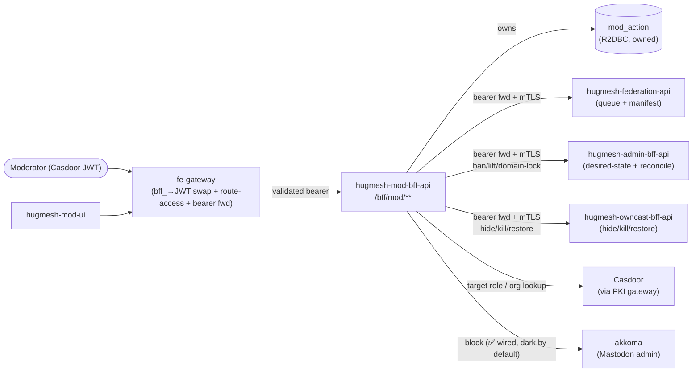
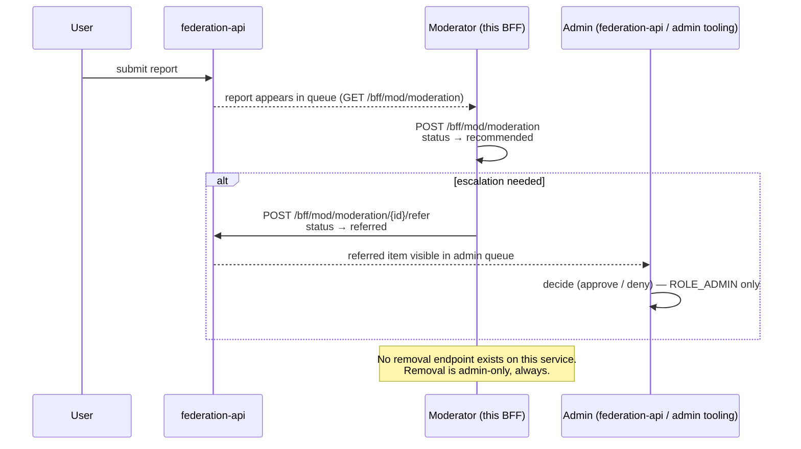

Moderator Backend-For-Frontend (BFF) for the HugMesh platform. It serves the
**MODERATOR-scoped** role (Casdoor `ROLE_MOD` or `ROLE_ADMIN`). It is the backend of
`hugmesh-mod-ui` and the role analog of `hugmesh-admin-bff-api`, with a deliberately
**narrow** surface. A moderator triages reports, records recommendations, escalates to
admins, issues server-wide blocks, writes access-role bans, and domain-locks users
(forcing traffic local-only). This service owns **no infrastructure or server-admin**
surface and **cannot remove a user directly**. A moderator can ask for a removal; only an
admin can grant one.

The service is reactive throughout. It uses Spring WebFlux and the reactive `WebClient`
(Mono/Flux, no `.block()` / `Thread.sleep` on the event loop), and R2DBC for the one
runtime table. JDBC is used **only** for Liquibase migrations. It is a Casdoor JWT OAuth2
resource server with springdoc-openapi (webflux-ui), is Spring Native-ready, and runs on
Java 25 LTS with **Spring Boot 4.0.7 / Spring Cloud 2025.1.2**. It builds on the org's
shared Maven baseline: `hugmesh-parent` metapom 2.8.0, plus `hugmesh-commons` 2.1.0 for
the shared security/tenancy code. Its conventions are copied verbatim from
`hugmesh-admin-bff-api`.

> **Auth-core note.** The platform's `hugmesh-auth-core` artifact (shared account,
> session, MFA and Casdoor-admin infra) is consumed **only** by `user-bff` and
> `admin-bff`. This mod-BFF is post-login. It depends on `hugmesh-commons` (the shared
> security/tenancy converter and multi-issuer wiring) but **not** on `hugmesh-auth-core`,
> and it owns no login, session or account logic. A native-login `bff_` session is
> resolved by calling OUT to admin-bff-api's introspect/exchange endpoints (see
> *Native-login (`bff_` session) support* below), never by a local accounts/session
> database.

## Where it sits

- **Tier:** a per-role **BFF**, the backend the moderator UI talks to. It is NOT a
  domain microservice. It owns exactly one runtime table (its audit log). It is a
  reactive `WebClient` **client** of `hugmesh-federation-api` (the moderation queue and
  federation manifest), `hugmesh-admin-bff-api` (the desired-state writer and reconcile
  loop), the homeservers (tuwunel/akkoma), and Casdoor (target role and org lookups). It
  never touches their datastores.
- **Namespace:** in-cluster `hugmesh-backend`. Its downstreams resolve at
  `*.hugmesh-backend.svc.cluster.local`. The Casdoor role lookup reaches the
  `hugmesh-pki` namespace via the PKI gateway. `spring.application.name` =
  `hugmesh-mod-bff-api`, served on port `8080`.
- **Request path:** the platform **fe-gateway** (hugmesh-fe-gateway) fronts this BFF.
  On the SSO/OIDC path the gateway is a pure Casdoor-JWT OAuth2 resource server. A
  pre-security exchange filter swaps the browser's opaque `bff_`-prefixed session for
  the internal custody JWT. The gateway then applies its data-driven Postgres
  `gateway_route_access` rules (source of truth, via `GatewayRouteAccessFilter`) to
  `/bff/mod/**` and forwards the validated Casdoor bearer, which this resource server
  re-validates. This BFF forwards the bearer verbatim again on every downstream call
  (see *Who calls what*), so each downstream authorises the **original moderator**, not
  a service identity. On this path the browser never holds a Casdoor JWT. login-ui does
  a Casdoor OIDC/PKCE redirect, and `user-bff` performs the server-side code→token
  exchange and holds per-session JWT custody. This BFF only ever sees the
  gateway-validated bearer.

  **On the native-login path** (the platform's default login model) the gateway's
  `BffSessionAuthFilter` authenticates the `bff_` session for its OWN route-access
  decision only. It forwards the request, cookie or header included, to this BFF
  **unswapped**, so this BFF resolves the session itself. See *Native-login (`bff_`
  session) support* below.

The akkoma block leg is ✅ wired but dark: it makes real HTTP calls once enabled. There is
no tuwunel edge. A Matrix user block is a reversible domain-lock written through
admin-bff. A Matrix instance block is a request filed with federation-api. The one-way
Matrix deactivate lives in admin-bff since decision 83b.



### Part of the HugMesh platform

HugMesh is a self-hostable, federated social platform (Matrix chat, ActivityPub-compatible
microblogging via Akkoma, live streaming, a wiki) with Casdoor for identity. This BFF is
its moderation service. These are the repositories it talks to directly, or is a sibling
of:

- [`hugmesh-federation-api`](https://github.com/hugmesh/hugmesh-federation-api) — the
  moderation queue, federation manifest and automated system-finding queue. This BFF reads
  from them and writes recommendations and referrals to them.
- [`hugmesh-admin-bff-api`](https://github.com/hugmesh/hugmesh-admin-bff-api) — the
  admin-scoped BFF that this service mirrors for moderators. It owns the access-role and
  domain-lock desired-state and the reconcile loop that applies them.
- [`hugmesh-owncast-bff-api`](https://github.com/hugmesh/hugmesh-owncast-bff-api) — the
  live-streaming moderation surface (hide/kill/restore) this BFF drives.
- [`hugmesh-wiki-bff-api`](https://github.com/hugmesh/hugmesh-wiki-bff-api) — owns the
  wiki access overlay. Its grant/timeout/ban/restore events show up in this BFF's
  moderation audit trail.
- [`hugmesh-fe-gateway`](https://github.com/hugmesh/hugmesh-fe-gateway) — the platform's
  edge gateway. It fronts this BFF, applies route-access rules, and bridges the
  native-login session. It is an overlay on the shared `hugmesh-gateway` image, which
  holds the filters.
- [`hugmesh-commons`](https://github.com/hugmesh/hugmesh-commons) — the shared
  security/tenancy library (Casdoor JWT converter, domain registry). This service uses it
  instead of reimplementing it.
- [`hugmesh-generator`](https://github.com/hugmesh/hugmesh-generator) — cluster manifests,
  deployment tooling, and the shared pen-test CI stage this repo's pipeline extends.
- [`hugmesh-mod-ui`](https://github.com/hugmesh/hugmesh-mod-ui) — the moderator console
  for this BFF: an Angular native-federation remote that `hugmesh-host-shell` mounts at
  `/mod`. Its typed client is generated from this repo's committed `openapi.json` (see
  *Paired UI*).

## What it does

The whole surface lives under `/bff/mod/**`. Three layers gate it with
`hasAnyRole('MOD','ADMIN')` (defence in depth), and `SUPERADMIN` passes through the role
hierarchy. The layers are the fe-gateway route-access rules, the resource-server filter
chain path rule, and `@PreAuthorize` on every method.

| Endpoint | Method | Purpose | Talks to |
|---|---|---|---|
| `/bff/mod/moderation` | GET | List the federation moderation queue (`?status=`) | **federation-api** |
| `/bff/mod/moderation` | POST | Record a recommendation (user→mod chain middle step) | **federation-api** + audit |
| `/bff/mod/moderation/{id}/refer` | POST | **Refer / escalate** a request UP to an admin | **federation-api** + audit |
| `/bff/mod/block` | POST | Server-wide block a user/instance on Matrix/Mastodon | Matrix user → **REVERSIBLE domain-lock** (decision 51, not the homeserver) · Matrix instance → **REQUEST recorded**, not applied (decision 50), and filed into federation-api's approval trail (decisions 84a-d; `moderationRequestId` in the body) · akkoma ✅ wired, dark — homeserver call | + audit |
| `/bff/mod/ban` | POST | **Ban** a user from a platform-access role (writes desired-state) | **admin-bff** + audit |
| `/bff/mod/ban` | DELETE | **Lift** a previously written ban | **admin-bff** + audit |
| `/bff/mod/domain-lock/{role}/{user}` | POST | **Domain-lock** a user (force local-only / no-federation) | **admin-bff** + audit |
| `/bff/mod/domain-lock/{role}/{user}` | DELETE | **Domain-unlock** a previously locked user | **admin-bff** + audit |
| `/bff/mod/owncast/streams/{owner}/hide` | POST | **Hide** a target owner's owncast stream (force internal) | **owncast-bff** + audit |
| `/bff/mod/owncast/streams/{owner}/kill` | POST | **Kill** a stream (owncast broadcast ban + hide) | **owncast-bff** + audit |
| `/bff/mod/owncast/streams/{owner}/restore` | POST | **Restore** a killed owner (lift the broadcast ban) | **owncast-bff** + audit |
| `/bff/mod/modules` | GET | Deliver the MOD-accessible federation modules manifest | **federation-api** |
| `/bff/mod/findings` | GET | List the automated edge-AI system-finding queue (`?status=held\|dismissed\|actioned`) | **federation-api** |
| `/bff/mod/findings/{id}/resolve` | POST | Resolve a held system finding (`?actioned=true` actions it, `false` dismisses it) | **federation-api** + audit |
| `/bff/mod/audit` | GET | Read the local moderator-action audit trail (`?mine=`, domain-scoped) | **own audit table** |
| `/bff/mod/status` | GET | Caller's own moderator status (roles + domain) — UI polling for role-change detection | own JWT (no downstream) |

**Ban vs. block.** Operator decisions 50/51 (2026-09-18, hugmesh-generator#347) split what
used to be one homeserver-admin call into three, so the effect of `block` depends on
platform and scope:

- **Matrix + user** writes the SAME reversible `domain_lock` desired-state that
  `domain-lock` writes. It never uses the irreversible `!admin users deactivate`
  transport (see *Reversibility* below).
- **Matrix + instance** records a durable REQUEST (`requested:no-tuwunel-verb`) and
  attempts nothing, because tuwunel has no runtime per-server block verb.
- **akkoma (Mastodon), both scopes** still drives the homeserver admin call directly
  (✅ wired but dark: real HTTP once enabled, `ok` on success).

`ban` does NOT touch Casdoor or a homeserver. It writes the `access_suspension`
**desired-state** in `hugmesh-admin-bff-api`, which owns the route-access DB and the
single-writer reconcile loop. The loop converges Casdoor membership and the homeserver
suspend state. Both `ban` and `block` return **`202 {state:'pending-reconcile'}`** for any
non-applied outcome (STUBBED / `degraded` / breaker-open). They **never** return a
synchronous `200 "blocked"` for these, because the effect is asynchronous.

`ModService` guards a ban three ways, all fail-closed with `403`. A MOD may **not** ban
themselves, nor a `ROLE_ADMIN`/`ROLE_MOD` target, nor a target **outside the caller's own
tenant**. The same-tenant guard (`guardSameTenant`) runs before any privileged read or
write. It resolves the target's brand off the caller's per-domain Casdoor org. `SUPERADMIN`
and the single-tenant `default` domain bypass it; see *Multi-tenancy / domain-scoping*.
The matrix/mastodon `block` path also requires the platform role (`ROLE_MATRIX` /
`ROLE_MASTODON`, or `ROLE_ADMIN`). `ModService` enforces that role (`assertPlatformRole`);
the `@PreAuthorize` on `block` checks only the role and step-up. Bans are **idempotent**. A
deterministic `dedup_key` (a unique index plus `INSERT ... ON CONFLICT DO NOTHING`)
absorbs at-least-once redelivery, so a retry neither double-records nor re-issues the
desired-state write.

**Reversibility (decision 51, reverses decision 5).** Before 2026-09-18, a MOD-initiated
Matrix USER block posted `!admin users deactivate`. That was irreversible, because tuwunel
has no `activate` verb, and neither `lift` nor `domain-unlock` touched a homeserver client
(`MatrixBlockIsOneWayTest` pinned exactly that). The operator answered **B** against the
"leave deactivate" recommendation: a MOD block must be reversible end to end. So
`ModService#matrixUserBlock` now writes the SAME `domain_lock` desired-state that the
`domain-lock` endpoint below writes (force local-only). `POST /bff/mod/block
{platform:matrix, scope:user}` now reports `DOMAIN_LOCKED`, never `posted` or `STUBBED`. `DELETE
/bff/mod/domain-lock/ROLE_MATRIX_DOMAINLOCKED/{user}` reverses it. A moderator undoes a
Matrix user block from the **domain-lock** form/endpoint, not from `ban`/`lift`.

The one-way deactivate is no longer in this service. Decision 83b (2026-09-23) moved the
ADMIN-only deactivate to hugmesh-admin-bff-api (`POST
/bff/admin/matrix/deactivations/propose`, then `.../confirm`, hugmesh-admin-bff-api#115).
This repo's former copy (`MatrixAdminClient.blockUser` + `DEACTIVATE_COMMAND`, which posted
`!admin users deactivate @localpart:server`) was deleted
(hugmesh-mod-bff-api#28, closing issue #23). `MatrixAdminClientNoUserDeactivateTest` fails
if it comes back. `MatrixBlockIsOneWayTest` now pins the OPPOSITE of its old property for
the MOD path: block-then-domain-unlock is a genuine round trip.

**Domain-lock (force local-only) — ADD-semantics, NOT a ban.** `domain-lock` forces a
user's traffic **local-only / no-federation**. It is an **ADDITIVE marker** (`role` ∈
`ROLE_MATRIX_DOMAINLOCKED` | `ROLE_MASTODON_DOMAINLOCKED`). The locked user **keeps** their
`ROLE_MATRIX`/`ROLE_MASTODON` access, and the fe-gateway routes are **untouched**. The
marker only tells the homeserver/egress reconcile to force their deliveries local. That is
the *opposite* of the REMOVE-semantics suspension, so it lives in a **separate**
`domain_lock` table in admin-bff and never overloads `access_suspension`. A dedicated
`AdminDomainLockClient` writes it via `POST/DELETE /bff/admin/domain-lock/{role}/{user}`,
with the same mTLS, bearer-forwarding and `@CircuitBreaker` as the suspension client.

The delegation guards match a ban's. A MOD may **not** domain-lock themselves, nor a
`ROLE_ADMIN`/`ROLE_MOD` target, nor a target outside the caller's own tenant (all `403`,
enforced in `ModService` by the same self-ban / privileged-target / same-tenant guards).
The `dedup_key` is idempotent in the same way. The contract is the same `202
{state:'pending-reconcile'}`: the single-writer reconcile loop applies the marker and the
homeserver/egress force-local enforcement asynchronously. That **enforcement** ships
**dark**. It is off by default through `homeserver.domainlock.*` in admin-bff/generator,
and it never hard-fails, until the akkoma MRF image and egress policy land. The table, the
service and the delegation are the deliverable here.

### Who calls what

The diagram below shows how the moderator's bearer token flows through the call chain
**for a real Casdoor JWT caller**. Every downstream service sees the original moderator's
JWT, never a service-to-service token. So the `@PreAuthorize` rules on downstream services
enforce the moderator's own role, not an elevated service identity. A native-login (`bff_`
session) caller reaches the same `BearerForwardingFilter` through a best-effort custody-JWT
exchange instead; see *Native-login (`bff_` session) support* below.


- **federation-api** (`hugmesh-federation-api`) — this BFF is a reactive `WebClient`
  **client** of it. In-cluster default:
  `http://hugmesh-federation-api.hugmesh-backend.svc.cluster.local:8080` (override
  `FEDERATION_API_BASE_URL`). A token-injecting `ExchangeFilterFunction`
  (`BearerForwardingFilter`) forwards the caller's Casdoor JWT verbatim on every call. It
  reads the validated `JwtAuthenticationToken` off the reactive `SecurityContext`. So
  federation-api's own `@PreAuthorize('hasAnyRole MOD,ADMIN')` and manifest
  visibility-filter authorise the **original moderator**, not a service identity.
  Endpoints used (matched field-for-field to the federation-api controllers and DTOs):
  `GET/POST /api/federation/moderation`, `POST /api/federation/moderation/{id}/refer`,
  `GET /api/federation/manifest`, `GET /api/federation/findings[?status=]`, `POST
  /api/federation/findings/{id}/resolve?actioned=`.
- **external Matrix(tuwunel) / Mastodon(akkoma)** — reactive `WebClient` admin clients for
  the server-wide block. Base URLs default to the in-cluster homeserver services named in
  the `hugmesh-generator` manifests:
  `http://tuwunel.hugmesh-backend.svc.cluster.local:8008` (`MATRIX_BASE_URL`) and
  `http://akkoma.hugmesh-backend.svc.cluster.local:4000` (`MASTODON_BASE_URL`).
  **The akkoma client is ✅ wired but dark by default.** It issues real pleroma-admin HTTP
  only when `external.mastodon.enabled=true` AND a Vault/ESO admin token is present.
  **The Matrix client issues no HTTP at all.** Its only verb is the instance block, which
  records a REQUEST (`requested:no-tuwunel-verb`, decision 50). `MATRIX_BASE_URL`,
  `MATRIX_SERVER_NAME` and `MATRIX_ADMIN_ROOM` are still defined in `application.yml`, but
  nothing in this service reads them any more. See *Reversibility* and *Honest deferrals*.
- **admin-bff** (`hugmesh-admin-bff-api`) — the ban/lift surface writes the
  `access_suspension` desired-state via `POST/DELETE /bff/admin/access-roles/{role}/{user}`.
  The domain-lock surface writes the SEPARATE `domain_lock` desired-state via
  `POST/DELETE /bff/admin/domain-lock/{role}/{user}` (the `AdminDomainLockClient`,
  sibling of `AdminSuspensionClient`). In-cluster default:
  `http://hugmesh-admin-bff-api.hugmesh-backend.svc.cluster.local:8080` (override
  `ADMIN_BFF_BASE_URL`). Both clients reuse the federation client's mTLS
  client-presentation (`hugmesh.mtls.client.*`) and caller's-bearer forwarding. Both are
  wrapped in `@CircuitBreaker(name="admin-bff")`, so a degraded admin-bff falls back to a
  `degraded` outcome (→ 202 pending, never 200).
- **owncast-bff** (`hugmesh-owncast-bff-api`) — the owncast moderation surface drives
  owncast-bff's effector endpoints (`POST /bff/owncast/mod/streams/{owner}/hide|ban|restore`,
  via the `OwncastModClient`; in-cluster default
  `http://hugmesh-owncast-bff-api.hugmesh-backend.svc.cluster.local:8080`, override
  `owncast-bff.base-url`). It records `owncast.hide`/`owncast.kill`/`owncast.restore` ledger
  rows. It uses the same mTLS client-presentation and caller's-bearer forwarding as the
  federation and admin-bff clients. owncast-bff re-derives the moderator identity and brand
  from the SAME validated token and re-checks its own gates. UNLIKE the admin-bff
  desired-state writers, the owncast effect is SYNCHRONOUS. An OK is a real `200
  {state:'applied'}`. A degraded owncast-bff (`@CircuitBreaker(name="owncast-bff")`) gives
  `202 {state:'not-applied'}` with an explicit no-reconcile-loop retry note, never a fake
  success. A 404 (no stream in the brand) surfaces as a real 404 with NO ledger row.
- **Casdoor** (read-only, via the hugmesh-pki gateway) — for the target guards only. It
  resolves whether a ban/domain-lock target holds `ROLE_ADMIN`/`ROLE_MOD`, and whether the
  target belongs to the caller's brand org (the `CasdoorRoleClient`, HTTP Basic
  client-credentials against `PKI_GATEWAY_BASE`). It is GATED behind
  `CASDOOR_ADMIN_ENABLED` (default false). A Casdoor-less dev/CI run boots clean: the guard
  then resolves to "not privileged", and the always-on self-ban and method/gateway gates
  still apply.
- **own audit table** — the only runtime datastore this BFF owns: the `mod_action` R2DBC
  table. Liquibase builds it from `db/changelog/`: `001-mod-action.xml` creates it, `003` adds the ban
  columns, `004` the `domain.lock`/`domain.unlock` verbs and the `domain-lock` platform,
  `005` the `domain` column, `006` the `(dedup_key, domain)` uniqueness, `007` the `wiki.*`
  verbs and `wiki` platform, `008` the notification-directive columns, `009` a DB-generated
  UUID PK (pgcrypto plus a `gen_random_uuid()` DEFAULT, so inserts OMIT the id instead of
  minting `UUID.randomUUID()`), `010` the `owncast.*` verbs, the `owncast` platform and
  the `federation.finding-resolve` API↔DB CHECK parity fix, and `011` the `tube.hide` verb
  and the `tube` platform.

  Every action a mod takes is recorded here with the external outcome: `stubbed` / `ok` /
  `degraded:<reason>` for blocks and owncast moderation, and `pending` propagation_state
  for bans and domain-locks. So a stubbed block, a pending ban or a degraded owncast call
  is fully auditable. The action verbs are a fixed set (`ModActionType`):
  `matrix.block-{user,instance}`, `mastodon.block-{user,instance}`,
  `federation.recommend`, `federation.refer`, `federation.finding-resolve`,
  `access.suspend`, `access.restore`, `domain.lock`, `domain.unlock`, the **wiki
  access-overlay** verbs `wiki.grant` / `wiki.timeout` / `wiki.ban` / `wiki.restore` (`wiki`
  platform), and the **owncast live-stream moderation** verbs `owncast.hide` /
  `owncast.kill` / `owncast.restore` (`owncast` platform), and the tube verb `tube.hide`
  (`tube` platform). `tube.hide` has no HTTP endpoint yet: `ModService.tubeHide` requires
  `ROLE_MOD` and `ROLE_TUBE` (or `ROLE_SUPERADMIN`) and refuses to run, writing no row, until a `TubeModClient`
  implementation is registered (`hugmesh-tube-bff-api` has no moderation endpoint yet).

  The SEPARATE `hugmesh-wiki-bff-api` owns the *desired-state* of the wiki
  grant/timeout/ban/restore overlay (its `wiki_access` table). The wiki verbs make those
  events **first-class** in this BFF's moderation audit/queue surface, next to the
  matrix/mastodon/access/domain-lock actions (domain-scoped like the rest). The SEPARATE
  `hugmesh-owncast-bff-api` likewise owns the owncast kill/hide/restore *effect* (its
  `owncast_grant`/`owncast_stream` tables and local `owncast_moderation_audit` journal).
  An action driven through `/bff/mod/owncast/**` lands in BOTH records: the central ledger
  row here and the service-local journal there. A resolved system finding (see *The
  system-finding queue* below) is recorded under the `federation.finding-resolve` verb.

### `@system` notification directive (✅ shipped, ships dark)

> **"Ships dark"** means the code is merged and the database columns exist, but no
> downstream component reads the directive yet. admin-bff's `SuspensionRequest` has no
> notify fields, and `git grep` for `notifyChannels` or `notifyEmailOnly` on admin-bff
> `origin/main` finds nothing, so admin-bff ignores what this BFF sends. Delivery needs a
> code change in admin-bff.

A moderator can attach a **service-scoped notification directive** to a ban, so the
platform would notify the affected user through the per-domain neutral `@system` sender.
The sender never exposes the individual moderator's identity. The `POST /bff/mod/ban` body
accepts `notifyChannels` (a list of at most 8 channels) and `notifyEmailOnly`. The lift
(`DELETE /bff/mod/ban`) and domain-lock calls carry no directive.
`NotifyDirective.resolve(...)` scopes the request against the action's platform before the
directive is stored:

- `in-app` and `email` are always allowed.
- A platform-bound channel (`matrix` / `mastodon`) is honoured **only** when the action's
  own platform matches it. An off-scope channel is silently dropped. A `matrix` ban, for
  example, can never trigger a `mastodon` DM.
- `notifyEmailOnly=true` overrides the channel list and forces the directive to exactly
  `email` + `in-app` (the conservative low-noise option).

Example ban request body with a notification directive:

```json
{
  "platform": "matrix",
  "target": "user@example.com",
  "reason": "repeated harassment",
  "notifyChannels": ["in-app", "matrix"],
  "notifyEmailOnly": false
}
```

The resolved directive is recorded on the `mod_action` row (`notify_channels` CSV +
`notify_email_only`, changelog `008`) and sent to admin-bff in the suspension write
(`notifyChannels` / `notifyEmailOnly`). admin-bff does not read them yet.

**Identity rule (load-bearing):** the directive describes the requested fan-out only. It
carries **no** actor identity. Neither this BFF nor the `@system` outbox-builder ever
copies `mod_action.actor` into the notification, so a notified user can never determine
who moderated them. This matches the posture of the public appeal-contact resolver.
Nothing currently consumes the stored columns beyond the audit row. admin-bff has a
notification outbox and an external-channel reconciler
(`notification/ExternalChannelReconciler`), but no code that reads the directive from the
suspension request; see *Roadmap*.

### The user → mod → admin escalation chain

A user submits a report. The mod records a recommendation and, when warranted, escalates
to an admin. The `decide` (approve/deny) step is `ROLE_ADMIN`-only and lives in
federation-api / admin tooling, not here. This service has no removal endpoint, only the
refer. The structure enforces this; convention is not relied on.



### The system-finding queue (automated edge-AI moderation)

Next to the human-submitted moderation queue above, `/bff/mod/findings` proxies a
**companion, automated** queue. It holds edge-AI avatar/image moderation findings that
`user-bff`'s pre-publish avatar vision check files into federation-api.

- `GET /bff/mod/findings` lists them (`?status=held|dismissed|actioned`). The list is
  domain-scoped from the forwarded JWT issuer, so a per-brand mod sees only their own
  brand's findings. A SUPERADMIN spans all brands.
- `POST /bff/mod/findings/{id}/resolve` lets a moderator mark one `actioned` (the mod took
  action) or dismiss it. federation-api records the reviewer from the forwarded JWT
  subject and 404s a cross-domain id server-side.
- A resolve also writes a domain-stamped local `mod_action` audit row
  (`federation.finding-resolve`), mirroring recommend/refer, so it is first-class in this
  brand's moderation trail.

## Casdoor role model

The JWT→authority converter is the shared `CasdoorAuthorities` from `hugmesh-commons`. It
replaces the per-repo copies that used to live in `hugmesh-gateway`,
`hugmesh-admin-bff-api` and `hugmesh-actions`:

- every authenticated principal gets a `ROLE_USER` floor;
- each `roles` claim entry (string or `{name}`) becomes `ROLE_<UPPER>` (so Casdoor
  `mod` → `ROLE_MOD`, `admin` → `ROLE_ADMIN`);
- each `permissions` entry becomes a verbatim authority, except entries that start with
  the reserved prefixes `ROLE_`, `DOMAIN_` or `MFA_SATISFIED`, which are dropped;
- `isAdmin == true` adds `ROLE_ADMIN`.

The profile split matches admin-bff. Under `dev`/`test` the OpenAPI spec and Swagger UI are
**public**, so `gen:fetch` and the docs pipeline can curl `/v3/api-docs` without a token.
In prod they are gated to **`ROLE_ADMIN`** or `ROLE_SUPERADMIN`. There is no `/login` or
`/register` plumbing here. `user-bff` owns login and session (the server-side Casdoor
code↔token exchange and per-session JWT custody), and account/registration DATA lives in
`admin-bff-db`. This BFF is **post-login** and holds no login, session or account logic. It
bridges a native-login `bff_` session by calling OUT to admin-bff-api (see below); it
stores nothing locally. The `/actuator/health` and `/actuator/info` probes are public, so
k8s/Docker healthchecks need no token.

### Step-up MFA on sensitive write-effects (✅ shipped, ships dark)

> **Status: ✅ enforcement shipped, inert by default.** The upstream Casdoor MFA CHALLENGE
> (WebAuthn/TOTP/recovery, per-role defaults) is **not** this repo's. mod-bff can only
> CONSUME the proof, never mint it.

Five mod endpoints have a platform-wide or user-visible effect that is hard to reverse.
Each carries an extra conjunct on its `@PreAuthorize`, on top of the `MOD`/`ADMIN` role:

| Endpoint | Effect | Step-up |
| --- | --- | --- |
| `POST /bff/mod/block` | server-wide Matrix/Mastodon block | ✅ required |
| `POST /bff/mod/ban` | access-role ban (desired-state write) | ✅ required |
| `DELETE /bff/mod/ban` | lift a ban | ✅ required |
| `POST /bff/mod/domain-lock/{role}/{user}` | force local-only | ✅ required |
| `DELETE /bff/mod/domain-lock/{role}/{user}` | domain-unlock | ✅ required |

Everything else on the mod surface keeps the plain role gate. That covers the queue reads,
`POST /moderation`, `/moderation/{id}/refer`, the findings surface, `/modules` and
`/audit`. The **owncast** `hide`/`kill`/`restore` actions are deliberately **not** in the
first enforced set. They are in-brand stream-visibility effects with a restore path.
Widening the enforced surface to them is a separate call, not a side effect of this change.

The proof consumed is the `MFA_SATISFIED` marker authority, never a raw claim. So **both**
auth carriers land on one rule. A Casdoor JWT gets the marker from `CasdoorAuthorities`'
freshness-validated `mfa_satisfied_at` derivation. An opaque `bff_` session gets it from
admin-bff's introspect `mfaSatisfied` field (see *Native-login (`bff_` session) support*).
The converter's reserved-prefix guard drops a forged `permissions:["MFA_SATISFIED"]`, so
nobody can self-assert the marker. A denied call is a clean 403 raised **before**
`ModService` runs: no external effect, no audit row.

#### What a step-up denial looks like on the wire (#16)

A step-up refusal used to be **indistinguishable** from any other 403. Spring Security's
default handler writes a bare status with no body and no header, so hugmesh-mod-ui's
step-up dialog was correct, tested and **unreachable**. The refusal now carries the
platform signal, the same contract admin-bff's `web/StepUpRequiredException` emits:

| | |
| --- | --- |
| **Status** | `403`, unchanged. Deliberately **not** 428 — every existing client branches on 403. |
| **Header** | `X-Step-Up-Required: X-Mod-StepUp` — the structured leg. |
| **Body** | `{"error":"<verb> requires step-up re-authentication (present X-Mod-StepUp)"}` — the literal phrase `requires step-up` is the legacy leg an older client greps for. |

`X-Mod-StepUp` is a **flavour name, not a request header this service reads**. The gate has
no token leg at all (`ModStepUpGate.satisfied()` is a marker-authority check and nothing
else). So the client's follow-up is *complete a challenge, then retry the same request
unchanged*. The service advertises the name so the flavour is observable and so a future
token leg needs no client change.

**Every other refusal stays byte-identical** — status, every header and the body — and
that is measured, not asserted in prose. `ModStepUpAccessDeniedHandler` passes through to
the handler Spring Security installs on *this* chain, unless all four of these hold: the
gate is armed, the request is one of the five shapes above, the caller passed the **role**
half, and the caller does not satisfy the gate.

That delegate is `BearerTokenServerAccessDeniedHandler`, **not** the bare status handler.
Installing an explicit `accessDeniedHandler` makes `ServerHttpSecurity` discard its
`defaultAccessDeniedHandlers` wholesale. For a chain that configures `oauth2ResourceServer`
(both of ours do), those defaults resolve to the bearer one. A pass-through to
`HttpStatusServerAccessDeniedHandler` would have dropped `WWW-Authenticate: Bearer` from,
and added a `text/plain` `Access Denied` body to, **every** non-step-up 403 this service
emits. That was measured on 2026-09-17. `StepUpAccessDeniedWiringTest` now pins it: it
extracts Spring's own handler from a stock chain at runtime and compares the two responses
field by field. The step-up response itself is the one deliberate exception. It is a new
shape by design and carries no `WWW-Authenticate`, since re-presenting the same bearer is
exactly what will not satisfy it.

The role-half re-check is the load-bearing one. The chain rule already refuses a plain
`ROLE_USER` on these paths. Calling that a step-up requirement would offer an MFA challenge
that could never let them through. These tests pin the behaviour:

- `ModStepUpGateControllerTest`: the signal is present on all five, and absent on a role
  403, on a non-sensitive 403 and on a 401.
- `ModStepUpSignalDarkTest`: nothing signals while the flag is dark.
- `ModStepUpConjunctInventoryTest`: derives the gated mappings from the `@PreAuthorize`
  annotations and from `ModStepUpGate.SENSITIVE_WRITES` reflectively, and fails if the two
  lists ever differ.
- `ModStepUpSignalDevChainTest`: the dev/test profile's chain, which no other slice in
  this repo exercises.
- `StepUpAccessDeniedWiringTest`: both chains carry the handler, and the pass-through is
  byte-identical to Spring's own.

No `@PreAuthorize` expression changed. The conjunct still decides **what** is denied; the
handler only supplies **what the denial says**. The committed `openapi/openapi.json`
documents the header on the 403 of all five operations. **No flag is flipped.** With
`enforce-sensitive-writes` dark (the shipped default), nothing is denied and nothing is
signalled.

Three properties control this (`ModStepUpGate` / `SecurityConfig`). The two flags are
`false` by default; the window is 10 minutes:

| Property | Env | Governs |
| --- | --- | --- |
| `app.mfa.enabled` | `APP_MFA_ENABLED` | **derivation** — whether a JWT's `mfa_satisfied_at` becomes `MFA_SATISFIED` |
| `app.mfa.freshness-window` | `APP_MFA_FRESHNESS_WINDOW_MS` | the `0 <= now - stamp <= window` window (default 10m) |
| `app.mfa.enforce-sensitive-writes` | `APP_MFA_ENFORCE_SENSITIVE_WRITES` | **enforcement** — whether the five endpoints above require the marker |

Enforcement has its own sub-flag, as in the gateway's `app.mfa.enforce-privileged-floor`
split. So turning derivation on can never silently start denying moderators. ⚠ On a
JWT-carrier deployment, flip the two flags **together**. `enforce-sensitive-writes` without
`enabled` means the marker is never derived and every gated call 403s. Once armed, the gate
is fail-closed: a missing or unprovable second factor is a denial, never a pass.

## Native-login (`bff_` session) support

> **Status: ✅ shipped.**

The sections above mostly describe the SSO/OIDC path, where the browser never holds a
Casdoor JWT and the gateway swaps the opaque `bff_` session for the internal custody JWT
before forwarding. The platform's **native-login** model works differently. It is the
platform's default login flow and supersedes the SSO-redirect model. The gateway's own
`BffSessionAuthFilter` authenticates a `bff_` session **for its own route-access decision
only**. It forwards the original request, including the `bff_session` cookie or
`Authorization: Bearer bff_...` header, to this BFF **unchanged**. Without a bridge, a
fully registered `ROLE_MOD` native-login session would get a 401 at this BFF's own security
chain, even though the gateway had already let the request through. The reason:
`SecurityConfig`'s `oauth2ResourceServer().jwt(...)` gate is (correctly) inert to a non-JWT
`bff_` token.

`BffCookieAuthenticationWebFilter` (`auth/`, `@Order(HIGHEST_PRECEDENCE + 10)`, runs before
the resource-server chain) closes that gap:

- It extracts a `bff_` token from either carrier.
- It resolves the token against **admin-bff-api's** `GET /bff/internal/session/introspect`
  through a dedicated `AdminBffSessionIntrospectClient`. The gateway calls the same
  endpoint. This service has no local database access to the accounts/`bff_session` tables.
- It writes a real `Authentication` onto the reactive `SecurityContext`: the `ROLE_USER`
  floor, the mapped roles, and `MFA_SATISFIED` when admin-bff reports it.
- A suspended or banned account gets an explicit `403`. An unreachable, erroring or
  timing-out admin-bff fails **closed** with `503`. A `bff_` token that cannot be validated
  is never treated as authenticated, and is never silently dropped to anonymous either.
- A `skipBffTokenConverter()` guard in `SecurityConfig` stops Spring's stock bearer-token
  converter from also trying (and failing) to JWT-decode the same opaque token when it
  arrives as an `Authorization` header.

A real Casdoor JWT request is completely unaffected.

**Downstream custody exchange (off by default).** A native-login caller's resolved
`Authentication` carries no raw JWT to forward. So `BearerForwardingFilter`, the same
filter that forwards a real JWT verbatim to federation-api / admin-bff / owncast-bff (see
*Who calls what* above), attempts a best-effort custody exchange. `BffRawTokenContextWebFilter`
stashes the raw `bff_` token into the Reactor `Context`. The filter swaps it for the real
custody-held Casdoor JWT via admin-bff-api's `POST /bff/internal/session/exchange`
(`SessionExchangeService`/`SessionExchangeClient`). A positive-only TTL cache mirrors the
gateway's own exchange cache. **The default is `cache-ttl-ms=0` since 2026-09-18, operator
decision 60 on hugmesh-mod-bff-api#15. The cache is OFF, so every exchange call
re-consults admin-bff's suspension gate. This mirrors hugmesh-gateway PR #30's decision-7
posture. The previous default was `5000`.**

The exchange is gated behind `app.bff-exchange.enabled` (default `false`). The cluster
manifest in `hugmesh-generator`, `specs/cluster/manifests/mod-bff-api/deployment.yaml`,
sets `APP_BFF_EXCHANGE_ENABLED=true` and `APP_BFF_EXCHANGE_CACHE_TTL_MS=0`. On ANY failure
the filter falls through to exactly the pre-fix behaviour: no `Authorization` header, and
the request forwarded unmodified. Failures include the feature not being opted in, custody
not configured on admin-bff-api, an unknown or expired session, and a transient outage.
This is a deliberate, safe departure from the gateway's own hard-fail-closed posture for
the analogous swap. Every downstream this filter forwards to already has its own
independent fail-closed JWT/role gate for a headerless request (see
`SessionExchangeService`'s class javadoc for the full reasoning).

```mermaid
sequenceDiagram
    participant Browser as Browser (bff_session cookie)
    participant GW as fe-gateway
    participant BFF as mod-bff-api
    participant AdminBFF as admin-bff-api
    participant Down as federation-api / admin-bff / owncast-bff

    Browser->>GW: request + bff_session cookie
    GW->>GW: BffSessionAuthFilter (route-access decision only)
    GW->>BFF: forward request (bff_ cookie/header UNCHANGED)
    BFF->>BFF: BffCookieAuthenticationWebFilter extracts the bff_ token
    BFF->>AdminBFF: GET /bff/internal/session/introspect (Bearer bff_...)
    AdminBFF-->>BFF: id/roles/registrationComplete/status/mfaSatisfied
    BFF->>BFF: populate SecurityContext (ROLE_* + MFA_SATISFIED)
    Note over BFF: hasAnyRole('MOD','ADMIN','SUPERADMIN') now passes
    opt app.bff-exchange.enabled=true
        BFF->>AdminBFF: POST /bff/internal/session/exchange (raw bff_ token)
        AdminBFF-->>BFF: custody Casdoor JWT (or a routine 503/404/401/403)
        BFF->>Down: Bearer (custody JWT)
    end
    Note over BFF,Down: exchange disabled or failed → forwarded WITHOUT a bearer;<br/>each downstream has its own independent fail-closed gate
```

## Multi-tenancy / domain-scoping

> **Status: ✅ shipped on `main`.** Domain-derived tenant scoping is live: the converter,
> `DomainRegistry`, the optional multi-issuer resource server, the domain-scoped audit
> reads, the `SUPERADMIN` floor, `app.tenancy.issuers` (`application.yml`), and the
> `domain` column with its composite dedup index (changelogs `005`/`006`). The converter,
> `DomainRegistry` and multi-issuer resource server are the **shared `hugmesh-commons`
> 2.1.0** implementations (`net.hugmesh.commons.security.*` / `commons.config.*`), wired in
> through the local `CommonsSecurityConfig` `@Import`. A single-issuer cluster works
> unchanged: every token resolves to `DOMAIN_default`.

The platform is multi-brand and multi-tenant, with one Casdoor per brand. So a token's
**cryptographically-validated `iss`** claim is the trustworthy tenant discriminator, never
a user-settable `owner`/`org`/`aud`. This BFF derives and enforces its tenant scope exactly
as the gateway does, using the same shared commons code:

- **Canonical converter (`CasdoorAuthorities`, see *Casdoor role model*).** One shared
  converter feeds BOTH the single-issuer path (`SecurityConfig`) and the optional
  multi-issuer path (`TenancyResourceServerConfig`), so they emit byte-identical
  authorities. It stamps exactly **one** issuer-derived `DOMAIN_<x>` authority, resolved
  through a `DomainRegistry`. It **strips any `permissions` entry beginning with the
  reserved `ROLE_`/`DOMAIN_` prefixes** (and `MFA_SATISFIED`), so a brand-X token carrying
  `permissions:["DOMAIN_other"]` or `permissions:["ROLE_SUPERADMIN"]` cannot forge a tenant
  scope or super-role.
- **`DomainRegistry` (issuer → domain).** It is seeded from
  `spring.security.oauth2.resourceserver.jwt.issuer-uri` (single-issuer → one
  `{iss → "default"}` entry) and the optional `app.tenancy.issuers` CSV (`iss=domain,...`).
  For back-compat, a single-issuer cluster emits `DOMAIN_default` for every token and
  nothing else changes. In multi-brand mode only listed issuers are trusted. An unknown
  `iss` **fails closed**: the multi-issuer decoder 401s before it emits any authority.
- **Opt-in multi-issuer resource server (`TenancyResourceServerConfig`).** It activates
  ONLY when `app.tenancy.issuers` genuinely carries `issuer=domain` pairs AND the registry
  is multi-issuer. Otherwise the existing single `o.jwt(...)` issuer-uri decoder path is
  unchanged. Each trusted per-brand Casdoor validates its own tokens with the same Casdoor
  converter.
- **Per-query domain predicate (the isolation boundary).** The audit reads are scoped to
  the caller's `DOMAIN_<x>`. `GET /bff/mod/audit` calls `listForDomain` /
  `listByActorForDomain`, so a brand-X moderator can never read brand-Y's rows.
  `Roles.domainOf(...)` reads the domain off the validated authority. It **fails closed** on
  an ambiguous authority set (zero or more than one `DOMAIN_`, the injection signature) and
  returns `null`, which gives an empty result. Writes (`record` / `recordBan`) stamp the row
  with the acting moderator's domain. The ban/lock `dedup_key` hashes the domain in, with a
  composite `(dedup_key, domain)` uniqueness, so two brands' Casdoor minting the same
  subject string can never collide cross-tenant (changelogs `005-mod-action-domain.xml`,
  `006-mod-action-dedup-domain.xml`).
- **SUPERADMIN is unscoped.** The cross-domain infra control plane reads with NO domain
  predicate, so it sees every brand. The `/bff/mod/**` floor is
  `hasAnyRole('MOD','ADMIN','SUPERADMIN')` and the prod spec gate is
  `hasAnyRole('ADMIN','SUPERADMIN')` (`SecurityConfig`).
- **Same-tenant write confinement (A01 BOLA/BFLA).** A MOD's write-effects (ban / lift /
  domain-lock / unlock) are confined to the caller's own issuer-derived tenant.
  `ModService.guardSameTenant` runs **fail-closed (`403`) before** any privileged read,
  dedup, or desired-state write. The target's brand is resolved **authoritatively** from
  the caller's per-domain Casdoor org (`CasdoorRoleClient.belongsToDomain` /
  `orgForDomain`, driven by the `casdoor.org-map` config) and asserted via
  `Roles.domainApplies`. `SUPERADMIN` principals (cross-domain infra) and the
  single-tenant `default` domain bypass this check. A brand-X moderator can never ban or
  lock a brand-Y user.

See [`docs/testing/MULTI-ISSUER-SLICE.md`](docs/testing/MULTI-ISSUER-SLICE.md) for the
offline (no-network) multi-issuer security-slice tests. They assert this fail-closed
behaviour end to end through the real filter chain.

## Paired UI

[`hugmesh-mod-ui`](https://github.com/hugmesh/hugmesh-mod-ui) is the Angular
native-federation remote that consumes this BFF's OpenAPI spec (ng-openapi-gen typed
client; its `npm run gen:spec` copies this repo's committed
`src/main/resources/openapi/openapi.json`). It renders the moderation console, the system-findings
queue, the ban / domain-lock / server-wide-block controls and the audit trail. It is the
moderator analog of admin-ui ↔ admin-bff.

## API-to-API mTLS

Both directions are config-gated and **default OFF**, so local/dev/CI plaintext is
unaffected. The cluster manifest turns the server side on and leaves the client side off
(`HUGMESH_MTLS_CLIENT_ENABLED` unset). Both use the mounted PKCS12 stores:
`/stores/keystore.p12` is this service's Vault-PKI identity, and `/stores/truststore.p12`
is the cluster CA.

- **Server side (inbound).** `SSL_ENABLED=true` + `SSL_CLIENT_AUTH=need` make the TLS
  handshake **require** a client cert chaining to the cluster CA (TLSv1.3 floor). A caller
  not deployed and signed by the Vault/ESO PKI process cannot reach this API.
- **Client side (outbound).** `HUGMESH_MTLS_CLIENT_ENABLED=true` makes
  `FederationHttpClientSsl` build a reactor-netty connector that presents this BFF's PKI
  client identity (and trusts the cluster CA) on its outbound federation-api / admin-bff
  calls. One mounted `/stores` layout serves both directions.

The pod generates the store passwords itself and writes them to
`/stores/application.properties`, which `SPRING_CONFIG_ADDITIONAL_LOCATION` loads. They
never enter git. See [`SECURITY.md`](SECURITY.md) for the full transport-layer
trust-boundary detail (Vault PKI / ESO wiring, the keystore initContainer) and the
generator-owned deployment requirement.

## Honest deferrals

- **Both homeserver admin legs are dark by default, and the Matrix one issues no HTTP at
  all.** The two legs differ:
  - **tuwunel (Matrix) — instance block only. The user deactivate moved to admin-bff
    (decision 83b, 2026-09-23; see *Reversibility*).** tuwunel is a Conduit-family server.
    Per the generator manifest and upstream source, it has **no Synapse-style
    `/_synapse/admin` REST API and no HTTP admin surface at all**. Server-admin verbs are
    `!admin ...` text commands posted into the admin room and answered asynchronously by an
    in-process bot. `MatrixAdminClientNoUserDeactivateTest` fails if a user-deactivate
    method or the `users deactivate` verb text comes back to this service's code.

    What is left of `MatrixAdminClient`: when off (the default) it returns `STUBBED`. When
    on without a token it degrades `no-admin-token`. When on with a token, the instance
    block records a REQUEST. `MATRIX_ADMIN_ENABLED` does not occur in any hugmesh-generator
    manifest (re-measured 2026-10-07 with `git grep` over `specs/`; `MASTODON_ADMIN_ENABLED`
    does not occur either).

    **block-instance (operator decision 50)** has no runtime per-server federation-block
    verb. The leg records a **REQUEST** (`requested:no-tuwunel-verb`, never `degraded`:
    nothing failed, and nothing could synchronously succeed) instead of attempting
    anything. It stays wired as `matrix.blockInstance` and is unaffected by decisions 51 and 83b, since it never routed through the
    deactivate transport. Turning that request into the `forbidden_remote_server_names`
    config edit is a separate admin/GitOps job. Since operator decisions 84a-d
    (2026-09-23), this BFF files the moderation-queue entry itself
    (hugmesh-federation-api#7; see *Matrix instance-block → federation-api approval trail*
    below). The apply job is hugmesh-generator#564. Both are cross-linked from
    hugmesh-mod-bff-api#1. The generator egress NetworkPolicy remains the authoritative
    backstop meanwhile.
  - **akkoma (Mastodon) — ✅ WIRED, dark by default.** The request shapes **are** pinned
    in code: `PATCH /api/v1/pleroma/admin/users/deactivate` with `{"nicknames":[localpart]}`
    for block-user, and `DELETE /api/v1/pleroma/admin/instances/{host}` for block-instance.
    Both are idempotent. The admin **token** **is** wired too (`external.mastodon.admin-token`,
    sourced from Vault `hugmesh/akkoma-admin` property `token` via ESO). When
    `external.mastodon.enabled=true` AND that token is present,
    `MastodonAdminClient.doBlock(...)` issues the **real** pleroma-admin HTTP (not
    `STUBBED`). When the flag is off (the default), it short-circuits to
    `BlockOutcome.STUBBED` and issues no HTTP. When the flag is on but the token is blank,
    it returns `degraded("no-admin-token")` rather than make an unauthenticated call. Live
    verification against a real akkoma instance is still pending.

  Whatever the outcome (`stubbed` / `ok` / `degraded:<reason>`), the action is logged and
  **always** recorded in `mod_action`, so every block is fully auditable. The
  `external.{matrix,mastodon}.enabled` flags default `false`, so a homeserver-less cluster
  stays inert.

  **That "defaults false" is a tested contract, on three axes.**
  `ExternalAdminDefaultsTest` resolves the shipped configuration and asserts the flag is
  `false` (and both clients `STUBBED`):
  1. from the `@Value` fallbacks alone;
  2. from the packaged `application.yml` with **no** profile, which is what a cluster pod
     resolves, since `specs/cluster/manifests/mod-bff-api/deployment.yaml` sets no
     `SPRING_PROFILES_ACTIVE`;
  3. under **every profile the jar can activate**, discovered at runtime from the build
     output: one per packaged `application-<profile>.*`, one per
     `spring.config.activate.on-profile` document inside any packaged file, plus the
     measured deployed names (`casdoor`, which `tests/stack/compose.local.yaml` sets for
     this service, `dev`, `test`).

  Axis 3 exists because a packaged `application-casdoor.yml` containing
  `external.matrix.enabled: true` once left the whole class green while `MatrixAdminClient`
  stopped being stubbed. A text-level or profile-less guard cannot see that.
- **No auto-apply of an approved decision.** An approved moderation request in
  federation-api authorises a kill-switch/removal action. Wiring that auto-application is
  intentionally left as a separate, auditable step. It lives in admin tooling, not the mod
  surface.
- **`POST /bff/mod/findings/test-seed` is code-complete and gated, and now wired live in
  the local/e2e compose stack.** `TestSeedFindingController` ships dark behind
  `app.test-seed.enabled` (default `false`; set via `APP_TEST_SEED_ENABLED`) by design; see
  its javadoc. `hugmesh-generator`'s local/e2e compose stack sets
  `APP_TEST_SEED_ENABLED: "true"` in the `environment:` block of this service and of
  `hugmesh-user-bff-api`, in `tests/stack/compose.local.yaml`. So `mod-ui`'s
  `findings-triage.feature` Confirm/Dismiss round-trip can seed a deterministic HELD
  finding on a fresh `make stack-up` instead of hitting the flag's honest `503`. The flag
  stays `false` (a real `503`, never a silent no-op) everywhere else, including prod.

## Current State

- **✅ On the unified org baseline.** Spring Boot 4.0.7 / Spring Cloud 2025.1.2, Java 25
  LTS, built against `hugmesh-parent` (metapom) 2.8.0 and consuming `hugmesh-commons`
  2.1.0 for the shared security/tenancy code. The per-repo copies of the Casdoor converter,
  `DomainRegistry` and the multi-issuer resource server have been **deleted** and replaced
  by the shared commons types (`net.hugmesh.commons.security.*` / `commons.config.*`),
  wired through the local `CommonsSecurityConfig` `@Import`. Local code that remains:
  `SecurityConfig` (single-issuer chain, profile-split spec gate, SUPERADMIN floor),
  `Roles` (fail-closed tenant helpers), and the mod-specific service, clients and audit.
- **✅ Auth posture aligned with the new platform model.** This BFF is a Casdoor-JWT
  OAuth2 resource server **behind** the fe-gateway. It does **not** own the login flow
  (login-ui → Casdoor PKCE → user-bff custody → opaque `bff_` browser session), and it
  depends on commons, not `hugmesh-auth-core`.
- **✅ Native-login (`bff_` session) auth bridge shipped** (`BffCookieAuthenticationWebFilter`
  + `AdminBffSessionIntrospectClient`, plus the custody-JWT exchange in
  `BearerForwardingFilter`, default off). See *Native-login (`bff_` session) support*.
- **✅ Multi-tenant domain scoping shipped on `main`** (issuer-derived `DOMAIN_<x>`,
  fail-closed isolation on audit reads + write confinement, composite
  `(dedup_key, domain)` uniqueness).
- **✅ Mod surface shipped:** moderation queue/recommend/refer; server-wide block (Matrix
  user block = reversible domain-lock; Matrix instance block = a recorded request filed
  into federation-api; akkoma/Mastodon call ✅ wired, dark by default); access-role
  ban/lift; domain-lock/unlock; owncast hide/kill/restore; modules manifest; domain-scoped
  audit; `/bff/mod/status`; the `@system` notify directive (ships dark); and `wiki.*` audit
  verbs.
- **✅ Hardening:** API↔DB CHECK-constraint parity + jakarta validation; config-gated
  inbound + outbound mTLS (default off); three-layer authz (gateway route-access / filter
  path rule / `@PreAuthorize`); defence-in-depth ban guards (self / privileged target /
  same-tenant, all fail-closed); and step-up MFA on the five sensitive write-effects
  (`app.mfa.enforce-sensitive-writes`, ships dark — see *Step-up MFA on sensitive
  write-effects*).
- **✅ CI: GitLab-primary.** `.gitlab-ci.yml` has `test` / `security` / `build` / `pentest`
  stages. The pen-test SCA + DAST jobs `extend` the centralized hidden jobs included from
  `hugmesh-generator`. This GitHub repository is a pull-mirror of that internal GitLab
  project. It also carries a manually-triggered `.github/workflows/release.yml` for
  publishing images to GHCR (see *Build & test*). A Forgejo deploy descriptor (`deploy/`)
  ships dark for an in-progress GitOps source-flip.

## Roadmap

State convention: ✅ shipped (on `main`) · 🚧 in-flight (open branch/PR) · 🔭 planned
(design only). Everything in *Current State* is ✅ unless noted. The items below are **not
yet in this repo's code**. They are recorded here so the doc never presents unmerged work
as done:

- 🚧 **Notification external-channel adapters.** The mod-bff already records and sends the
  `@system` directive (✅, above), but admin-bff does not read it yet. The **delivery
  adapters** (Matrix DM / Akkoma local feed / phpBB forum / email) belong to admin-bff's
  outbox subsystem. The work in this repo is done; the work that reads the directive is in
  admin-bff.
- ✅ **Matrix(tuwunel) ADMIN-only deactivate path — moved to hugmesh-admin-bff-api
  (decision 83b, 2026-09-23), hugmesh-mod-bff-api#28 (issue #23).** The ADMIN-only
  deactivate is built in admin-bff (`POST /bff/admin/matrix/deactivations/propose` then
  `.../confirm`, `hasRole('ADMIN')`, dark by default, hugmesh-admin-bff-api#115), so it is
  no longer a mod-bff roadmap item. Still open on #23, outside this repo: the admin-ui
  control (a separate, clearly labelled one-way action, never the moderator Block button),
  the generator wiring that arms admin-bff's `MATRIX_ADMIN_DEACTIVATE_*`, and a live check
  against a real tuwunel admin room. The akkoma/Mastodon leg is **already wired** (✅, dark
  by default, unaffected by decision 51). It only awaits live verification against a real
  akkoma instance.
- ✅ **Matrix instance-block → federation-api approval trail (decisions 84a-d,
  hugmesh-federation-api#7).** `POST /bff/mod/block {platform:matrix, scope:instance}`
  durably records the moderator's intent (`requested:no-tuwunel-verb`) FIRST. It then files
  the intent into federation-api's submit→refer→decide trail with the moderator's own
  token. It lists the OPEN (`recommended` + `referred`) `instance-block` rows for the same
  domain (trimmed, case-insensitive, one root dot ignored) and reuses one if it exists: a
  `referred` row as-is, a `recommended` one (e.g. a user's own
  `/recommend-instance-block`) by referring it. Otherwise it submits and refers a new row.
  The reason sent to federation-api is clipped to its 1024-char limit; the mod_action row
  keeps the full text. A 401 or any other federation failure never fails the block. The 202
  body carries `moderationRequestId` (null when no row exists) and a `federation` object
  `{status: filed|referred-existing|existing|unauthorized|error, moderationRequestId,
  requestStatus, httpStatus?}`. Known limits: the look-then-file pair is not atomic (two
  simultaneous blocks can each file), and a SUPERADMIN's list spans brands, so a superadmin
  block can reuse another brand's open row. `MatrixInstanceBlockFederationTest` pins the
  behaviour; the live round trip awaits a running mesh.
- 🔭 **Matrix instance-block → applied config edit (decision 50).** Nothing yet turns an
  APPROVED `instance-block` request into the `forbidden_remote_server_names` config edit,
  GitOps reconcile and homeserver restart that tuwunel needs. That is
  hugmesh-generator#564 (the reconciler Job, mirroring the existing
  `akkoma/domainlock-sync-job.yaml` pattern). The generator egress NetworkPolicy remains
  the backstop meanwhile.
- 🔭 **Casdoor MFA step-up — the CHALLENGE half.** The mod-bff **enforcement** half is ✅
  shipped and documented above (*Step-up MFA on sensitive write-effects*): ban / lift /
  domain-lock / unlock / block require the `MFA_SATISFIED` marker when
  `app.mfa.enforce-sensitive-writes` is armed. What is still 🔭 is upstream and NOT in this
  repo: the platform Casdoor MFA challenge (WebAuthn + TOTP + recovery, per-role defaults)
  that actually stamps `mfa_satisfied_at` / sets the introspect `mfaSatisfied` flag. Until
  that ships, arming the flag would deny every moderator, which is why it ships dark.
- 🔭 **Cross-realm / SSO security e2e.** This BFF is a conforming resource server on both
  auth models it supports (Casdoor-JWT bearer, and the native-login `bff_` session bridge;
  see *Native-login (`bff_` session) support*). It needs no further code change beyond
  verification coverage. The cross-realm security e2e suite itself is a platform-level
  (not per-repo) effort, still in progress.
- ✅ **`hugmesh-mod-ui`.** The paired Angular console that consumes this BFF's OpenAPI spec
  (ng-openapi-gen typed client) exists as `hugmesh/hugmesh-mod-ui` (`@hugmesh/mod`, a
  native-federation remote). Merged PRs there include #17 (the step-up dialog, landed
  inert), #19 (the step-up e2e loop) and #20 (the superadmin / block-request console).
  See *Paired UI*.

## Build & test

```bash
./mvnw test                  # green: converter, role-gating (USER forbidden /
                             # MOD+ADMIN allowed), audit-repo slice over real
                             # Liquibase H2-PG, federation + external clients vs a
                             # mocked ExchangeFunction, bearer-forwarding, context-load
./mvnw package -DskipTests   # boot jar
./mvnw -Pnative native:compile   # GraalVM native image (on a GraalVM host)
```

The project's primary CI/CD runs on its internal, self-hosted GitLab. This GitHub
repository is a pull-mirror of it, and `.gitlab-ci.yml` (below) is the source of truth for
testing, security scanning, and building and pushing the container image.

A manually-triggered `.github/workflows/release.yml` also publishes images to GHCR
(`ghcr.io/hugmesh/hugmesh-mod-bff-api`). It runs on a GitHub-hosted runner and resolves the
private `net.hugmesh` libraries (`hugmesh-build-config`, `hugmesh-parent`,
`hugmesh-commons`) from GitHub Packages. It needs the repository secret
`PACKAGES_READ_TOKEN` (a classic PAT with `read:packages`). Without it, the preflight step
fails by name. The container image (multi-stage Temurin 25 JDK→JRE) carries no baked-in
secrets. Key material is provisioned separately at first boot.

`.gitlab-ci.yml` declares four stages, in order: **`test`**, **`security`**, **`build`**
and **`pentest`**. The `security` stage has no job in this file.

- **`test`** runs `./mvnw verify` in a Temurin 25 container and collects JUnit reports.
- **`build`** builds and pushes the container image to the in-cluster registry on the
  default branch or a tag.
- **`pentest`** satisfies the platform's per-repo pen-test standard (with `security`). Its
  jobs `pentest:sca` (SCA) and `pentest:dast` (the full authenticated-ZAP + custom-probes +
  nuclei DAST harness) `extend` the **centralized hidden jobs** that the file `include`s from
  `hugmesh-generator` (`/tests/pentest/ci/pentest-stage.gitlab-ci.yml`). That is one source
  of truth shared by every onboarded repo. Both jobs are `allow_failure: true` (advisory)
  and run on the default branch and merge-request events. This is the
  **dev/CI-pipeline** pen-test stage, NOT a deployed CronJob or a UI-triggered scan.

## Layout

```
src/main/java/net/hugmesh/modbff
  ModBffApplication.java            entry point
  ModController.java                /bff/mod/** reactive endpoints
  service/ModService.java           ban/lift/domain-lock orchestration + defence-in-depth guards (self-ban, privileged-target, same-tenant)
  security/Roles.java               authority helpers — domainOf / domainApplies (fail-closed tenant scope) + isMfaSatisfied
  security/ModStepUpGate.java       step-up MFA predicate for the sensitive write-effects (@PreAuthorize conjunct, ships dark behind app.mfa.enforce-sensitive-writes) + the five gated request shapes
  security/ModStepUpAccessDeniedHandler.java  makes a step-up 403 recognisable (X-Step-Up-Required + the legacy phrase); pass-through to the Spring default for every other denial
  web/StepUpRequiredException.java  the ONE place a step-up refusal is minted — 403 + flavour + legacy phrase, mirroring admin-bff's platform contract
  config/SecurityConfig.java        Casdoor JWT resource server + profile-split spec gating + SUPERADMIN floor (delegates to commons CasdoorAuthorities)
  config/CommonsSecurityConfig.java @Import of the shared hugmesh-commons security/tenancy wiring (CasdoorAuthorities / DomainRegistry / TenancyResourceServerConfig)
  config/OpenApiConfig.java         springdoc OpenAPI metadata
  config/NativeHintsConfig.java     GraalVM reachability hints (DTOs + swagger-ui webjar)
  status/ModStatusController.java   GET /bff/mod/status — caller role/domain polling endpoint
  model/                            closed-vocabulary enums — PlatformKind (matrix|mastodon|profile) / ScopeKind (user|instance); typed lens over the existing String wire/DB form (byte-identical), replaces scattered string-literal branching
  auth/                             native-login bff_ session bridge — BffCookieAuthenticationWebFilter + AdminBffSessionIntrospectClient/Config (see *Native-login (bff_ session) support*)
  federation/                       federation-api WebClient client + DTOs + bearer-forward filter + outbound mTLS + the native-login custody-exchange (SessionExchangeService/Client/Cache/Config, BffRawTokenContextWebFilter, off by default behind app.bff-exchange.enabled) + TestSeedFindingController (dark behind app.test-seed.enabled)
  admin/                            admin-bff suspension/domain-lock clients + Casdoor role lookup (org-map, belongsToDomain)
  external/                         Matrix(tuwunel) instance-block request client (no HTTP; user deactivate removed, decision 83b) + Mastodon(akkoma) admin client (✅ wired, dark) + config
  owncast/                          owncast-bff moderation client (hide/kill/restore) + config
  tube/TubeModClient.java           tube moderation effector seam (interface only; no implementation or bean yet)
  audit/                            mod_action R2DBC repository + record + action types + dedup key
  notify/NotifyDirective.java       service-scoped @system notification directive (ships dark)
  web/                              request DTOs + JSON exception handling
```

The shared `hugmesh-commons` 2.1.0 artifact (`net.hugmesh.commons.security.*` /
`commons.config.*`) now holds the Casdoor JWT→authority converter (CasdoorAuthorities), the
issuer→domain DomainRegistry, and the opt-in multi-issuer TenancyResourceServerConfig.
CommonsSecurityConfig wires them in. They are no longer per-repo files.

```
src/main/resources
  application.yml                   (src/test/resources/application-test.yml is test-only)
  db/changelog/                     Liquibase (master + 001 mod-action, 002 constraints, 003 ban,
                                    004 domain-lock, 005 domain, 006 dedup-domain, 007 wiki, 008 notify,
                                    009 db-generated-id (pgcrypto / gen_random_uuid() UUID PK DEFAULT),
                                    010 owncast (+ federation.finding-resolve CHECK parity),
                                    011 tube)
```

## Contributing

Issues and pull requests are welcome. Know these points before you open one:

- The service is reactive end to end (Spring WebFlux, `Mono`/`Flux`, R2DBC). New code must
  not introduce `.block()` or blocking I/O on the event loop.
- Run `./mvnw test` before submitting. Security-relevant changes (role gating, tenancy, the
  auth filters) should come with slice-test coverage in the style of
  [`docs/testing/MULTI-ISSUER-SLICE.md`](docs/testing/MULTI-ISSUER-SLICE.md).
- Schema changes are new Liquibase changelog files under
  `src/main/resources/db/changelog/`. Never edit one that has shipped.
- This repo builds against the shared `hugmesh-parent` metapom and `hugmesh-commons`
  library. Platform-wide conventions (Casdoor auth, tenancy, mTLS) live there, not here.
- See [`SECURITY.md`](SECURITY.md) for this service's authentication/mTLS model. It has no
  section on reporting a vulnerability.

## License

MIT — see [`LICENSE`](LICENSE).
