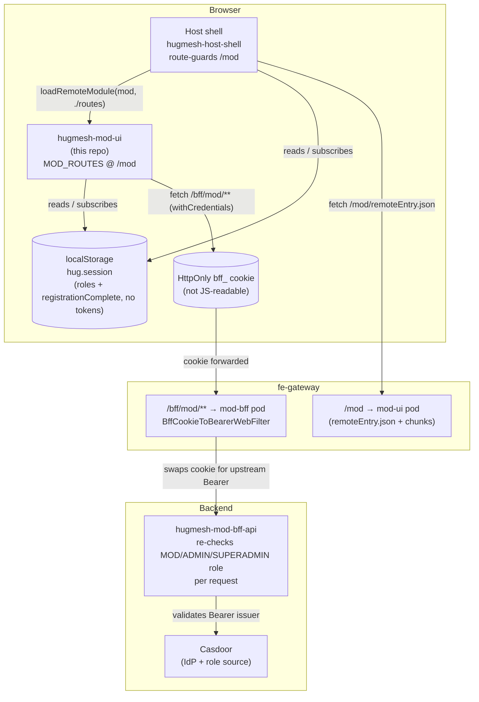
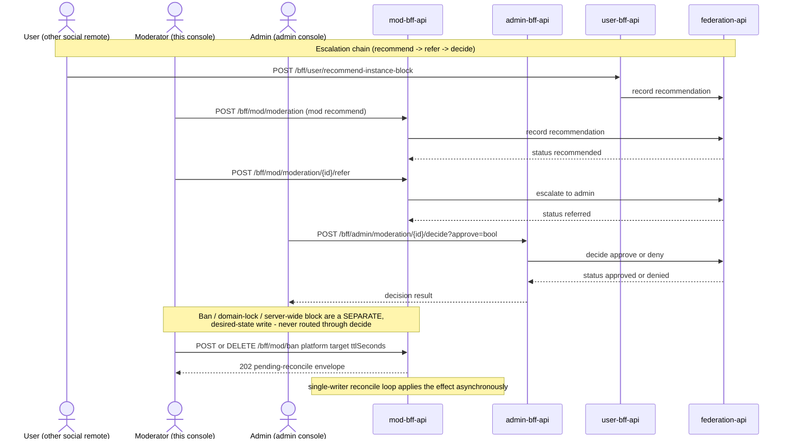

[](./LICENSE)

The moderator console for the [HugMesh](https://github.com/hugmesh) platform. It is an Angular 22
**native-federation remote** with the moderation queue, findings triage, ban / domain-lock /
server-wide-block controls, and the audit trail. It is the moderator counterpart to
[`hugmesh-admin-ui`](https://github.com/hugmesh/hugmesh-admin-ui), and it does less than the admin
console on purpose.

At runtime [`hugmesh-host-shell`](https://github.com/hugmesh/hugmesh-host-shell) federates this
remote's exposed `MOD_ROUTES` and mounts them at **`/mod`**:

| Host path        | View                   | Component                    |
| ----------------- | ---------------------- | ------------------------------ |
| `/mod`           | Moderator home         | `ModHomeComponent`            |
| `/mod/console`   | Moderation console     | `ModerationConsoleComponent`  |
| `/mod/findings`  | System-findings queue  | `FindingsPanelComponent`      |

Access needs the Casdoor **MOD, ADMIN or SUPERADMIN** role (SUPERADMIN since operator decision 100,
2026-09-23). The host guards `/mod` before it loads
this remote. The remote also ships its own `modGuard`, set as `canActivate` on all three
`MOD_ROUTES` entries, so the standalone dev shell gets the same client-side check. It gates on
`SessionService.isMod()`, true for `mod`, `admin` or `superadmin`. That matches the backend chain
rule `hasAnyRole("MOD","ADMIN","SUPERADMIN")` on `/bff/mod/**` (`SecurityConfig.java:114` in
`hugmesh-mod-bff-api`) and the host shell's own `isMod()`.

The backend is [`hugmesh-mod-bff-api`](https://github.com/hugmesh/hugmesh-mod-bff-api), reached
same-origin at `/bff/mod/**` through the platform's front-end gateway. Every request carries the
HttpOnly `bff_` session cookie (`withCredentials`, set by `authInterceptor`). The browser never
holds a bearer token in storage JavaScript can reach (see
[Authentication model](#authentication-model)).

## The moderator surface, deliberately narrow

A moderator can triage, escalate, ban, block server-wide, and review the automated edge-AI
image-moderation findings queue. There is **no** infrastructure or server administration, **no**
direct user removal, and **no** appeal adjudication beyond an admin-only decide control.

The console wires the moderation endpoints a moderator acts through. Anything without a backing
endpoint renders **disabled, with helptext**. The API is the source of truth; the UI mirrors its
gates instead of hiding controls or failing with a 403 on click.

Not wired: `GET /bff/mod/modules` and `GET /bff/mod/status` (the generated client has methods for
them, no view calls them) and the owncast stream actions `hide`, `kill` and `restore` (not in the
committed `openapi.json`, no control here). The endpoint-by-endpoint list is in
[The moderator surface in detail](#the-moderator-surface-in-detail).

## How it fits into HugMesh

This is one of the host shell's per-role, per-service remotes (login, user, mod, admin, matrix,
mastodon, forum, API docs and more). The diagram shows how the browser, host shell, this remote,
the gateway and the backend relate at runtime:



- **Host shell ([`hugmesh-host-shell`](https://github.com/hugmesh/hugmesh-host-shell))** guards
  `/mod` on the MOD/ADMIN/SUPERADMIN role and calls
  `loadRemoteModule({ remoteName: 'mod', exposedModule: './routes' })` to lazy-mount `MOD_ROUTES`.
  Host and remote each hold their **own** `SessionService` over the same `hug.session`
  localStorage key. Each re-reads on a same-page `hug-session-change` broadcast and on cross-tab
  `storage` events.
- **fe-gateway** serves this remote's pod at `/mod` (`remoteEntry.json` and chunks) and proxies
  `/bff/mod/**` same-origin to the mod backend. It turns the `bff_session` cookie into a Bearer
  header (`BffCookieToBearerWebFilter`), then swaps that for the internal custody JWT
  (`BffJwtExchangeWebFilter`). Both filters live in `hugmesh-gateway`,
  `src/main/java/net/hugmesh/gateway/filter/`.
- **Backend ([`hugmesh-mod-bff-api`](https://github.com/hugmesh/hugmesh-mod-bff-api))** is the
  source of truth. It re-checks the MOD/ADMIN/SUPERADMIN role and gates every endpoint
  server-side. The UI mirrors those gates and does not trust itself.
- **Multi-tenancy.** This remote is **tenant-agnostic**: no domain, issuer or brand code. The
  gateway and backends scope data per brand from the issuer in the session/custody token, so one
  built remote serves every brand.

### Authentication model

This remote never talks to Casdoor and never sees a raw JWT. Login is a native form POST handled
by the `login-ui` remote against its own backend. The browser is never redirected to a
Casdoor-hosted page. The user-facing backend does the Casdoor exchange server-side (Casdoor is
internal-only) and holds per-session JWT custody and refresh.

The browser holds only an **HttpOnly `bff_`-prefixed session cookie**, which JavaScript cannot
read. It is not in `hug.session` localStorage either: `SnapSession` carries only `id`, `label`,
`provider`, `roles` and `registrationComplete`. A moderator never sees a Casdoor JWT or a bearer
token their own JavaScript could leak.

The gateway is a pure Casdoor-JWT OAuth2 resource server. The two filters above run before
security, so its JWT validation and role gate run unchanged. Authorization is data-driven by a
`gateway_route_access` table (ADMIN and GAME-MASTER bypass within their own domain, SUPERADMIN
across domains). From this UI that is invisible: `authInterceptor` adds `withCredentials` to every
`HttpClient` request the generated client makes to `/bff/mod/**`, and the platform resolves
identity and role upstream.

## The moderator surface in detail

**Wired** (mod backend endpoints, all through the generated, typed `ModeratorService`):

- **Moderation queue + status filter**: `GET /bff/mod/moderation?status=` (the federation queue).
  The filter shows user-submitted **`self-silence-appeal`** rows next to the
  recommended/referred/approved/denied lifecycle.
- **Refer to admin**: `POST /bff/mod/moderation/{id}/refer`. This is the only removal path a
  moderator has; a moderator never removes a user directly.
- **Recommend**: `POST /bff/mod/moderation` (`{kind: instance-block|user-removal, target,
  reason?}`) records a moderator-to-admin recommendation in the federation queue.
- **Ban / lift**: `POST` / `DELETE /bff/mod/ban` (`{platform: matrix|mastodon|profile, target,
  ttlSeconds?, reason?, idempotencyKey?}`). An empty `ttlSeconds` means **permanent**. The
  endpoint returns `202 {state:'pending-reconcile'}`: a single-writer reconcile loop applies the
  effect later, never as a synchronous success.
- **Domain-lock**: `POST` / `DELETE /bff/mod/domain-lock/{role}/{user}` (role is
  `ROLE_MATRIX_DOMAINLOCKED` or `ROLE_MASTODON_DOMAINLOCKED`; optional `{reason?,
  idempotencyKey?}` body). It forces a user **local-only**: an additive marker that keeps their
  access but scopes it to one domain. Same `202 pending-reconcile` contract.
- **Server-wide block**: `POST /bff/mod/block` (`{platform: matrix|mastodon, scope:
  user|instance, target, reason?}`). Every action is audited locally, and the external result is
  shown as it is. The legs differ (`hugmesh-mod-bff-api` README, "Ban vs. block"):
  - **Matrix user block** is a **reversible domain-lock**, not a homeserver call. The backend
    writes the same desired-state as `domain-lock` and answers `202` with `external:
    domain-locked`. A moderator undoes it from the domain-lock form
    (`DELETE /bff/mod/domain-lock/ROLE_MATRIX_DOMAINLOCKED/{user}`), not from ban/lift.
  - **Matrix instance block** records a **request**, not an effect (`requested:no-tuwunel-verb`),
    because tuwunel has no runtime per-server block verb. The backend also files it in
    `federation-api`'s approval trail and returns `moderationRequestId` plus a `federation` leg
    (`filed`, `referred-existing`, `existing`, `unauthorized`, `error` or `not-configured`). The
    console states the leg in plain words and links the request in the queue. If the block was
    audited but never reached an administrator, it says so.
  - **Mastodon (akkoma) leg** is wired to real `pleroma-admin` verbs but ships **dark** behind
    `external.mastodon.enabled` (unset gives `stubbed` and no HTTP). When enabled, success
    answers `200` (`external: ok`). A breaker trip or non-2xx response degrades to
    `degraded:...` with `202`, never a false `OK`.
- **Audit trail**: `GET /bff/mod/audit` (the local mod-action audit table). An opt-in **`?mine`**
  toggle ("only my own actions") is OFF by default, which shows the full domain-scoped trail:
  every same-tenant moderator's actions.
- **System-findings queue**: `GET /bff/mod/findings?status=` (the automated edge-AI
  avatar/image-moderation queue, scoped server-side to the caller's issuer domain) and
  `POST /bff/mod/findings/{id}/resolve?actioned=<bool>` to confirm (`actioned`) or dismiss a held
  finding. Shown at `/mod/findings` by `FindingsPanelComponent`.

**Admin-only**, wired through `AdminBffService`
([`hugmesh-admin-bff-api`](https://github.com/hugmesh/hugmesh-admin-bff-api), a different service
from the mod backend):

- **Appeals decide (approve/deny)**: `POST /bff/admin/moderation/{id}/decide`. Enabled only when the
  caller holds the `admin` or `superadmin` role (`SessionService.isAdmin()`). A moderator never decides; they escalate through refer and see
  the control disabled with helptext. A failed or degraded decide is shown as such and never
  renders the row as decided.

**Disabled, with helptext** (verified to have **no** mod or admin backend endpoint):

- **General role grant / revoke.** No endpoint anywhere. Roles are assigned at Casdoor through the
  reconcile loop, never as a direct UI grant.
- **External-client grant.** No endpoint. External-client linking is owner-scoped self-service in
  the user backend; neither the mod nor the admin backend grants it.

These controls use `aria-disabled`, not native `disabled`, so they stay keyboard-focusable. A
screen reader reads the `aria-describedby` helptext, which says **why**.

**Target suggestions.** The target fields offer a typeahead (`TargetTypeaheadComponent`,
`ModDirectoryService`) built from what mod-bff already returned to the moderator: the findings
queue, the moderation queue and the audit trail. A moderator cannot search users directly,
because the admin-bff gates all of `/bff/admin/**` on ADMIN/SUPERADMIN.

**Accessibility and messaging.** A queue target shown by name is announced through the shared
`accessibleName()` helper: the ASCII `screenReaderName` when present, else the display name.
`accessible-name.ts` mirrors the backend's `ScreenReaderNames` printable-ASCII rule and is copied
byte-for-byte per remote, because native-federation forbids a shared runtime import. Each form
pairs a `role="alert"` validation region with a `role="status"` outcome region. Write results
appear as honest async `pending reconcile` notes, with a `(degraded: …)` note when the admin
backend's breaker is open.

There is **no** moderator-facing SSE stream here. The mod backend exposes no SSE endpoint. (SSE
exists elsewhere on the platform, such as a user-facing own-notification stream and a couple of
admin job-progress streams, but none is mod-scoped.) The queue and findings list refresh on demand.

All data access goes through `ModBffService`, an RxJS `BehaviorSubject`-backed datastore. The
moderation queue, audit trail and findings queue are cached subjects, so every view observes one
source of truth, and a mutation refreshes the cache. The HTTP transport is the generated, typed
`ModeratorService` ([ng-openapi-gen](https://github.com/cyclosproject/ng-openapi-gen)); the
`bff_` cookie is attached by the `authInterceptor` wired in `bootstrap.ts`
(`withCredentials: true`).

### How a failed write is reported

Reads fail soft: a non-2xx `loadModeration`, `loadAudit` or `loadFindings` resolves to `[]`.

Writes do not. Every write (`refer`, `recommend`, `block`, `ban`, `lift`, `domainLock`,
`domainUnlock`, `resolveFinding`) resolves to a **`ModWriteResult`**, either `{ok: true, value}` or
`{ok: false, error}`, and never throws. The `error` is a `ModWriteError`
(`src/app/mod-write-error.ts`) with:

| field | what it is |
| --- | --- |
| `status` | the HTTP status, or **`0`** when no response reached the browser at all |
| `statusText` | the reason phrase, when there was one |
| `body` | the response body as delivered (parsed object, or raw text) |
| `serverMessage` | the sentence dug out of that body, or `null` |
| `stepUpSignal` | the `X-Step-Up-Required` header value, when present |

`describeWriteFailure()` turns one into the sentence the console announces, under one rule:
**never assert a reason the client cannot know.**

- A 403 with no body is a refusal at that status. The privileged/self-target rule is offered as a
  *possibility*.
- A 5xx or a status-0 drop says the write may or may not have applied, and points at the audit
  trail.
- An HTML body is named as a gateway interstitial, not treated as an API reason. The hint is
  withheld, because it cannot explain a refusal that never reached the moderation service.
- The `X-Step-Up-Required` clause is rendered on **whatever** status carried it, 401 and 428
  Precondition Required included.

> **Do not trust `statusText`.** HTTP/2 and HTTP/3 carry no reason phrase, so `xhr.statusText` is
> `''` for every response. Angular's XHR backend substitutes a literal: `xhr.statusText || 'OK'`
> (`@angular/common/fesm2022/_module-chunk.mjs:1649`), or `'Unknown Error'` on a transport failure
> (`:1717`). Its fetch backend (`:829`) passes the empty string through. `bootstrap.ts` calls
> `provideHttpClient(...)` with no `withFetch()`, and in production the host shell picks the
> backend, so both are live. Trusting it renders the self-contradicting `HTTP 403 OK`. Worse, it
> stops `serverMessage` matching the reason phrase, so Spring's default
> `{timestamp,status,error:"Forbidden",path}` envelope is echoed as if it explained something,
> which suppresses the hint. `mod-write-error.ts` therefore takes the displayed phrase, and the
> phrase it compares a message against, from `REASON_PHRASES[status]`, not from the wire.

This replaced a `.catch(() => null)` on all seven write paths. That made a step-up 403, an expired
session, a gateway 502 and an offline browser indistinguishable, and the console announced all of
them as *"you cannot ban yourself or a moderator/administrator"*. It is also the prerequisite for
the MFA step-up port (see Roadmap, and #14 / #1).

### Moderation action lifecycle

Two write patterns live here. The escalation chain (recommend, refer, decide) is plain
request/response and ends in an admin's explicit approve or deny. The access-control writes
(ban/lift, domain-lock) are always an asynchronous `202-pending-reconcile`, applied later by the
backend's single-writer reconcile loop. The server-wide block is `202` unless the homeserver call
really landed, which only the Mastodon leg can do. This UI claims a synchronous success for none
of them:



A moderator never calls the admin decide endpoint (it renders disabled, with helptext). `refer` is
the only escalation path a moderator has, and only an admin's explicit `decide` applies or
reverses a moderation action.

## Generated API client (ng-openapi-gen)

[`ng-openapi-gen`](https://github.com/cyclosproject/ng-openapi-gen) is configured in
`ng-openapi-gen.json` (`input: openapi.json`, `output: src/app/api`, `skipJsonSuffix`,
`enumStyle: alias`) with two npm scripts:

```bash
npm run gen:spec     # copy mod-bff openapi.json → ./openapi.json, then ng-openapi-gen
npm run gen          # ng-openapi-gen against the existing committed openapi.json
```

`gen:spec` copies the OpenAPI spec from a sibling `../hugmesh-mod-bff-api` checkout
(`src/main/resources/openapi/openapi.json`; set `MOD_BFF_SPEC` if your checkout lives elsewhere)
into `./openapi.json`, then runs `gen`. `gen` regenerates the client from the committed
`openapi.json` alone, with no network.

Both `openapi.json` and the generated `src/app/api` client (`services/moderator.service.ts`,
`models/*`, `fn/moderator/*`) are committed. `ModBffService` **delegates** every call to the
generated `ModeratorService` (`inject(ModeratorService)`); it hand-rolls no `fetch`. The client
calls the same same-origin `/bff/mod/**` paths. `ModBffService` keeps its own public
request/response types and bridges the backend's envelopes at that boundary.

## Module federation

`federation.config.js` exposes `./routes` (mapped to `src/app/mod.routes.ts`, which exports
`MOD_ROUTES`) under the native-federation remote name **`mod`**. The shared-dependency surface and
RxJS skip list live in `federation-base.js`, which mirrors the admin remote's base config. The
build emits `dist/mod/browser/remoteEntry.json`; the host reads that file's `exposes` map to
lazy-load `MOD_ROUTES`.

## Getting started

### Prerequisites

- Node.js `^22.22.3`, `^24.15.0` or `>=26` (the Angular CLI 22 `engines` range; the `Dockerfile`
  and CI use Node 24)
- A reachable `hugmesh-mod-bff-api` for anything beyond the standalone client-side checks (see
  [Develop](#develop))

### Develop

```bash
npm install
npm start            # ng serve mod → http://localhost:4205 (standalone dev shell)
```

The standalone dev shell (`AppComponent`, selector `hug-mod-root`) mounts `MOD_ROUTES` at `/`, so
the remote is browsable without the host shell. In production the host federates `./routes`
directly and never loads this shell.

The dev server expects the mod backend to be reachable. `ModBffService` calls the generated
`ModeratorService`, whose `ApiConfiguration.rootUrl` defaults to same-origin (empty string). That
works only behind the fe-gateway. For standalone dev without the gateway, override `rootUrl` (a DI
provider, or the browser console) before the app bootstraps, or run the full stack with the kind
dev-overlay recipe in [`hugmesh-generator`](https://github.com/hugmesh/hugmesh-generator).

| Dev URL                          | View                   |
| --------------------------------- | ---------------------- |
| `http://localhost:4205/`         | Moderator home         |
| `http://localhost:4205/console`  | Moderation console     |
| `http://localhost:4205/findings` | System-findings queue  |

### Build

```bash
npm run build        # ng build mod
```

The Angular application builder nests output under **`dist/mod/browser/`**, `remoteEntry.json`
included.

### Test

```bash
npm test             # ng test mod --watch=false --browsers=ChromeHeadlessCI
```

Karma/Jasmine cover every component, service, guard and the federation-contract routes. The
`ChromeHeadlessCI` launcher runs with `--no-sandbox --disable-dev-shm-usage` for CI.

A Playwright + BDD (Gherkin) end-to-end harness also ships in `e2e/`. See
[`e2e/README.md`](e2e/README.md) for the scenario catalogue and how to run it offline (no cluster)
or against a live stack.

## Deployment & CI

`Dockerfile` builds the remote with `--base-href=/mod/` and serves `dist/mod/browser` from nginx
on port 80. The flag is required: the remote lives under `/mod/` behind the gateway, and without
it asset URLs resolve against the gateway root and the page renders blank. `nginx.conf` sets:

- `Access-Control-Allow-Origin "*"` on the app location, so a host shell can fetch
  `remoteEntry.json` and chunks cross-origin, plus an SPA fallback to `/index.html`.
- `GET /healthz`, which returns `200` with body `ok`.
- Baseline security headers, on error responses too: `X-Content-Type-Options: nosniff`,
  `X-Frame-Options: DENY`, `Referrer-Policy: strict-origin-when-cross-origin` and
  `Strict-Transport-Security` (`max-age=31536000; includeSubDomains`). The two theme stylesheets
  carry the first three but not HSTS.
- A **nonce-based `Content-Security-Policy`** on the app location. nginx mints a nonce per request
  (`$request_id`) and `sub_filter` writes it into every `<script>` of `index.html`. The full
  value is:
  `default-src 'self'; script-src 'self' 'nonce-…' blob:; style-src 'self' 'unsafe-inline' blob:;
  img-src 'self' data:; font-src 'self'; connect-src 'self' blob:; worker-src 'self';
  media-src 'none'; frame-src 'none'; form-action 'self'; base-uri 'self'; object-src 'none';
  frame-ancestors 'none'`. Scripts get no `unsafe-inline`, only the nonce (`blob:` is there because
  es-module-shims needs it). Styles do get `'unsafe-inline'`, because Angular injects component
  styles at runtime. The policy is there because the
  gateway applies a bare `script-src 'self'` fallback to any response with no CSP of its own, and
  that blanks the page.

COEP/CORP and `Permissions-Policy` are not set. They need per-deployment tuning and are left to
the operator.

Theme: at container start `docker-entrypoint.d/50-hug-theme.sh` writes `HUG_THEME_CSS` (else
`SNAP_THEME_CSS`) verbatim to `/tmp/hug-theme.css`, and to `/tmp/snap-theme.css` for older
documents. nginx serves both with `Cache-Control: no-store`. Unset means an empty stylesheet and
the shipped brand.

The primary pipeline is GitLab CI (`.gitlab-ci.yml`), with four stages:

- **test** runs `npm test` (Karma, headless Chromium) and publishes a JUnit report
  (`test-results/results.xml`, from `karma-junit-reporter`) so single test results show in merge
  request widgets.
- **e2e**: `e2e:bdd` runs the Gherkin harness's codegen and a `--list` compile/discovery check. It
  runs **no scenarios** by default. Every `.feature` file is tagged `@cluster` at feature level,
  and the default Playwright config filters on `tags: 'not @cluster'`, so the runnable set is
  empty until a live cluster exists. The job is `allow_failure: true` and proves only that the
  harness installs, the Gherkin compiles and every scenario is discoverable. See
  [`e2e/README.md`](e2e/README.md) to un-skip a feature.
- **build** builds the container image and pushes it to the project registry, tagged with the
  release tag or git SHA plus a moving branch tag.
- **pentest** is a non-blocking OWASP stage included from the central
  `pentest-stage.gitlab-ci.yml` in [`hugmesh-generator`](https://github.com/hugmesh/hugmesh-generator).
  It runs `pentest:sca` (Dependency-Check SCA) and `pentest:dast` (an authenticated ZAP baseline
  scan plus nuclei). Both are `allow_failure: true` and run on the default branch and merge
  requests, so a finding shows in the MR widget without breaking the pipeline.

The one GitHub Actions workflow, `.github/workflows/release.yml`, publishes
`ghcr.io/hugmesh/hugmesh-mod-ui`. It first runs the same Karma unit tests as the GitLab `test`
job, then:

- On a push to `main`, it pushes the tags `main` and `sha-<first 12 hex of the commit>`.
- On a `v<version>` tag, it pushes `<version>`, `beta` (for beta versions) and `sha-<12 hex>`,
  and creates a GitHub release marked as a prerelease and not latest. The tag must equal `v`
  plus the `version` in `package.json` (and `package-lock.json`), and it must point at a commit
  on `main`. A version tag that is already in the registry is never overwritten.
- A manual run (`workflow_dispatch`) on `main` or on a `v*` tag does the same as the matching
  push. Any other branch or tag is refused.
- It never pushes `latest`, and it has no pull-request trigger.

Its jobs run on the self-hosted runner only when the repository variable `RUNS_ON_PUBLISH` holds
a runner label list (for example `["self-hosted","Linux","X64"]`) and the run is for `main` or a
`v*` tag. Otherwise they run on GitHub's hosted `ubuntu-latest`.

### Versions

The version in `package.json` is the image version. It uses `MAJOR.MINOR.PATCH-beta.N`; the
current version is `0.2.0-beta.1` (built and tested, not yet proven on a live mesh). To publish a
beta, set the new version in `package.json` and `package-lock.json` (for example
`npm version 0.2.0-beta.2 --no-git-tag-version`), merge that to `main`, then push an annotated
tag `v0.2.0-beta.2` on that commit. A fix during a beta raises `N`.

### Local security testing

`Makefile` mirrors the CI pen-test posture:

```bash
make pentest          # SCA (npm audit) + DAST (if DAST_TARGET_URL is set)
make pentest-sca      # npm audit only
make pentest-dast     # DAST against $DAST_TARGET_URL, delegating to the hugmesh-generator harness
```

Tunables: `NPM_AUDIT_LEVEL` (default `high`), `DAST_TARGET_URL` (unset skips DAST),
`PENTEST_HARNESS_DIR` (default `../hugmesh-generator/tests/pentest`), `PENTEST_SCAN` (`baseline`
or `full`, default `baseline`). DAST uses the shared harness in
[`hugmesh-generator`](https://github.com/hugmesh/hugmesh-generator); clone it as a sibling
checkout to use `make pentest-dast` locally.

## Project status

- **Shipped:** the three moderator views (home, console, system-findings queue); the wired
  mod-backend surface (queue + filter, refer, recommend, ban/lift, domain-lock, server-wide
  block, audit, findings list + resolve); the admin-only decide control; the two
  disabled-with-helptext controls; the shared `accessibleName()` and alert+status accessibility
  pattern; full keyboard navigation; Karma unit coverage with JUnit reporting; the four-stage
  test/e2e/build/pentest GitLab pipeline; the baseline nginx security headers and nonce-based CSP;
  and the MFA step-up dialog (detection and re-issue are unit-tested; no human has driven a real
  challenge from this console).
- **`modGuard` is on every route.** All three `MOD_ROUTES` entries (`src/app/mod.routes.ts`) set
  `canActivate: [modGuard]`, so the standalone dev shell gets the same client-side role check as
  the host-federated build, for `/mod`, `/mod/console` and `/mod/findings`. It is
  defense-in-depth only. The mod backend still re-checks the role and stays the authoritative
  gate.
- **Authentication model:** see [Authentication model](#authentication-model). This remote is a
  tenant-agnostic Angular application. Its backend calls are `/bff/mod/**`, the admin-bff decide
  endpoint (`/bff/admin/moderation/{id}/decide`) and, for the step-up dialog, `/bff/mfa/*`.
- **Typed API client (shipped):** `ng-openapi-gen` is configured, `openapi.json` and the generated
  `src/app/api` client are committed, and `ModBffService` delegates every call to the generated
  `ModeratorService`.

## Roadmap

- 🔭 **MFA / step-up: both halves are built; the deployment gate is still dark.**
  Platform-wide MFA has shipped: Casdoor TOTP enroll/challenge, a session-level `MFA_SATISFIED`
  authority, and a step-up dialog already live in `login-ui` and `hugmesh-admin-ui`.
  hugmesh-mod-bff-api guards this console's five sensitive writes (`POST /block`,
  `POST|DELETE /ban`, `POST|DELETE /domain-lock/{role}/{user}`) with `ModStepUpGate`, behind the
  dark-by-default `app.mfa.enforce-sensitive-writes` (`APP_MFA_ENFORCE_SENSITIVE_WRITES:false`,
  `application.yml:270`). On a JWT-carrier deployment, flip it together with `app.mfa.enabled`, or
  every gated call is refused (`application.yml:265`).
  **Server half** (mod-bff since 2026-09-17, `ModStepUpAccessDeniedHandler`): with the gate armed,
  a step-up refusal is a `403` with `X-Step-Up-Required: X-Mod-StepUp` and a body containing
  `requires step-up`. Every other denial keeps its old bare shape.
  **This remote** (#1): `src/app/mfa/` holds a detection predicate over `ModWriteError`
  (`step-up-error.ts`; header or phrase, on 403 or 428), a trimmed `MfaService` for
  `POST /bff/mfa/challenge` and `POST /bff/mfa/assert/webauthn/options`, and
  `MfaStepUpDialogComponent` ported from admin-ui. The console opens the dialog inline under the
  refused form and re-issues the SAME request snapshot once the challenge succeeds. Cancelling
  says plainly that nothing was applied. Closing it because the deployment has MFA switched off
  says to escalate, not retry. The dialog is inline, not modal, so the other forms stay live
  while one write waits. At most one challenge is open at a time; a second gated write is refused
  with a message naming the one to finish first.
  What made this writable was #14/#15: `ModBffService` no longer collapses write failures to
  `null`, so every write resolves to a `ModWriteResult` with the HTTP status, the response body
  and the `X-Step-Up-Required` header.
  The server handler signals only for a caller who passes the MOD or ADMIN role check; a plain
  user still gets a bare 403 when the gate is armed.
  **Still open:** no human has driven a real Casdoor challenge from this console (unit tests and
  mocked e2e rows only; `e2e/features/moderation/mfa-step-up-mocked.feature`). That check stays a
  manual test on a live mesh (#1). The mocked feature is tagged `@cluster`, so it is not in the
  default or CI run (see `e2e/README.md`). The last box on #1, loading login-ui's federated
  `./mfa-step-up` in place of the inline port, is pinned by two `@fixme` e2e rows.
  The header comment in `step-up-error.ts`, other code comments and the unit spec in
  `moderation-console.component.spec.ts` still describe the dialog as INERT against a server that
  sends a bare 403. They predate mod-bff-api PR #18 and are due a refresh.
- 🔭 **Server-wide block, real backend for Mastodon.** The Mastodon (akkoma) leg is wired to
  confirmed `pleroma-admin` verbs but ships dark behind `external.mastodon.enabled`. Turning it on
  is an operations task, not a UI change; this console already shows the honest `external`
  outcome either way. The Matrix (tuwunel) side will not become a direct homeserver call, because
  it has no runtime block verb: a user block stays a reversible domain-lock and an instance block
  stays a recorded request.
- 🔭 **Wire the remaining `@cluster` e2e scenarios into CI.** Promote the live-cluster-only
  Playwright + BDD scenarios into the pipeline once a cluster is available to the runner.
- 🔭 **No shared profile entry point.** `hugmesh-admin-ui` exposes no shared profile remote, so
  there is no pattern to mirror here. This remote exposes only its three moderator views.

## Contributing

Issues and pull requests are welcome. Specific to this repo:

- Run `npm test` before opening a PR. Karma covers every component, service, guard and the
  federation-contract routes.
- If you touch the API surface, regenerate the client with `npm run gen` (or `npm run gen:spec`
  against a sibling `hugmesh-mod-bff-api` checkout). Do not hand-edit `src/app/api`.
- Keep new write controls in the existing pattern: wire what the backend exposes, and render
  anything without a backing endpoint as `aria-disabled` with `aria-describedby` helptext instead
  of hiding it.
- New cross-role or cross-user scenarios belong in the Playwright/BDD suite in `e2e/`. See
  [`e2e/README.md`](e2e/README.md) for the tagging convention that keeps cluster-dependent
  scenarios out of the default run.

For platform-level changes (new backend endpoints, shared federation config, CI templates), see
the related repositories below. Most cross-cutting conventions live in
[`hugmesh-generator`](https://github.com/hugmesh/hugmesh-generator).

## Related HugMesh repositories

| Repository | Role |
| --- | --- |
| [`hugmesh-host-shell`](https://github.com/hugmesh/hugmesh-host-shell) | Host application that federates every per-role/per-service remote, including this one |
| [`hugmesh-admin-ui`](https://github.com/hugmesh/hugmesh-admin-ui) | Admin-role counterpart remote (decide, infra/server administration) |
| [`hugmesh-mod-bff-api`](https://github.com/hugmesh/hugmesh-mod-bff-api) | Backend-for-frontend this console talks to at `/bff/mod/**` |
| [`hugmesh-admin-bff-api`](https://github.com/hugmesh/hugmesh-admin-bff-api) | Backend-for-frontend behind the admin-only decide control |
| [`hugmesh-generator`](https://github.com/hugmesh/hugmesh-generator) | Shared CI templates, pen-test harness, and platform dev-cluster tooling |

See the [hugmesh](https://github.com/hugmesh) organization for the rest of the platform.

## License

[MIT](./LICENSE)
