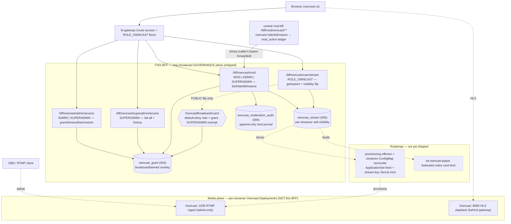
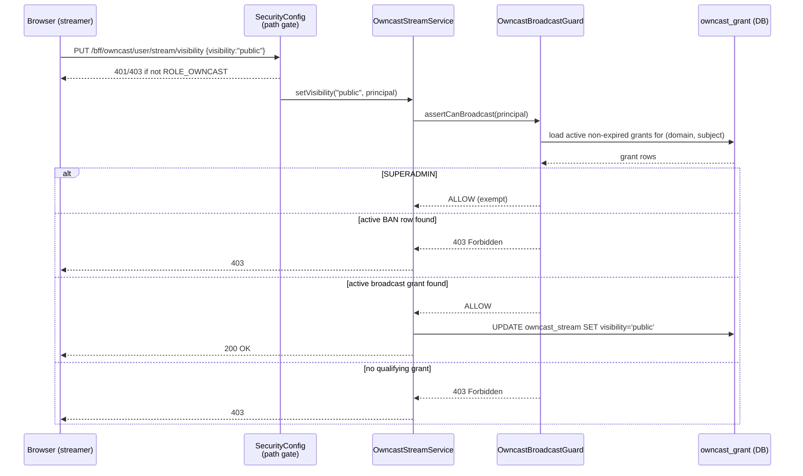

Backend-for-frontend that governs **who is allowed to broadcast** on
[Owncast](https://owncast.online) — the open-source, self-hosted live video
streaming server — as an optional service inside the [HugMesh](https://github.com/hugmesh-net)
platform.

This service is the **may-broadcast governance plane**, not the media plane.
It owns grant/timeout/ban decisions, per-streamer visibility, and moderation —
all the "should this request be allowed" logic that sits in front of a fleet
of per-streamer Owncast media instances. It is a sibling of
[`hugmesh-wiki-bff-api`](https://github.com/hugmesh-net/hugmesh-wiki-bff-api) and
[`hugmesh-forum-bff-api`](https://github.com/hugmesh-net/hugmesh-forum-bff-api),
built on the same stack: Spring Boot 4.0 on Java 25, WebFlux, R2DBC Postgres,
Liquibase, and a Casdoor JWT resource server, under the package
`net.hugmesh.owncastbff`.

Its companion frontend is [`hugmesh-owncast-ui`](https://github.com/hugmesh-net/hugmesh-owncast-ui).

> **Status legend:** ✅ shipped (merged to `main`) · 🚧 in progress (open branch/PR,
> not yet merged) · 🔭 planned (designed, not yet built). See the
> [Roadmap](#roadmap) for everything not yet on `main`.

## Contents

- [Status](#status)
- [What this service owns](#what-this-service-owns)
- [The `owncast_grant` overlay and `OwncastBroadcastGuard`](#the-owncast_grant-overlay-and-owncastbroadcastguard)
- [`owncast_stream` self-visibility](#owncast_stream-self-visibility-bffowncastuserstream)
- [Moderation surface](#moderation-surface-bffowncastmod)
- [Endpoint surface](#endpoint-surface)
- [Role model](#role-model)
- [Build, test and CI](#build-test-and-ci)
- [Roadmap](#roadmap)
- [Contributing](#contributing)
- [License](#license)

## Status

This reflects the current state of `main` — the source layout, the Liquibase
changelogs, and the `@SpringBootTest` / `@DataR2dbcTest` / security-slice suites
under `src/test`:

- ✅ **Shipped and tested**: the `owncast_grant` broadcast grant/timeout/ban overlay
  with `OwncastBroadcastGuard` default-deny enforcement; `owncast_stream`
  owner-controlled self-visibility (get/upsert plus a gated public/internal flip)
  with a dark-by-default `playbackUrl`; the `/bff/owncast/mod` moderation surface
  (list/hide/kill/restore) with its own append-only `owncast_moderation_audit`
  journal; database-generated UUID primary keys on all three tables; hardened
  OWASP/NIST response headers; an opt-in multi-issuer (per-brand Casdoor) resource
  server with fail-closed unknown-issuer handling; Spring Boot 4.0.2 on Java 25
  (see `pom.xml`'s inherited parent and the `eclipse-temurin:25-*` Dockerfile
  stages); a centralized OWASP pen-test CI stage (SCA + DAST, non-blocking).
  Cross-repo: `hugmesh-mod-bff-api`'s central `mod_action` ledger wiring for
  `owncast.hide` / `owncast.kill` / `owncast.restore` is also shipped (its
  changelog `010`) — no code change was needed in this repo for that leg.
- 🔭 **Known gaps** (designed, no code yet): the per-streamer provisioning effector
  and streamer-ConfigMap reconciler that would turn a broadcast grant into an
  actual per-streamer Owncast Deployment; the `sd-owncast-player` federated video
  card kind; a dedicated streamer/instance-lifecycle management UI; the
  generator/devops per-domain service-enable and GPU node-affinity gate. See the
  [Roadmap](#roadmap) for details — the Liquibase changelog comments flag each of
  these as deferred.

## What this service owns

This service is the **may-broadcast governance plane**, not the media plane. The
Owncast media instances are separate per-streamer Kubernetes Deployments — each
with its own `/app/data` volume and stream key — with RTMP ingest on `:1935`
(tailnet-only, never public) and HLS playback on `:8080` (behind the gateway).
Because Owncast is single-broadcaster per instance, the platform runs one
Owncast Deployment per approved streamer, provisioned on grant, default-deny.

The browser-to-governance path, alongside the separate media plane:

RTMP ingest and HLS playback never touch this BFF — they run on the per-streamer
Owncast Deployments, reached over the tailnet / the gateway. The dashed nodes
above are [roadmap](#roadmap) items, not yet on `main`.

## The `owncast_grant` overlay and `OwncastBroadcastGuard`

The broadcast grant/timeout/ban overlay is cloned from the wiki-bff `wiki_access`
(004) overlay, swapping `read` for `broadcast`:

- **`owncast_grant`** (Liquibase `004-owncast-grant.xml`) — the desired-state table:
  `access_type ∈ {broadcast, banned}`, `state ∈ {active, revoked}` (never deleted,
  so history is preserved for audit), `expires_at` (NULL = permanent, a future
  timestamp = a timeout that auto-restores), a partial-unique constraint on active
  `(domain, user_subject, access_type)`, and domain scoping throughout.
- **`OwncastBroadcastGuard.assertCanBroadcast`** — the load-bearing, default-deny
  enforcement point. Decision order:
  1. SUPERADMIN → immediately **allow** (exempt from ban).
  2. Load the principal's active, non-expired `owncast_grant` rows for their brand.
  3. An active ban row → **403**, even if a broadcast grant also exists (ban takes
     precedence over grant).
  4. An active `broadcast` grant → **allow**.
  5. No qualifying grant → **403**.

  Unlike wiki read access (which allows any user holding `ROLE_WIKI`), broadcasting
  is grant-only by design — there is no role-level bypass.
- **`OwncastBroadcastController`** — exposes
  `/bff/owncast/admin/access` for grant/timeout/ban/restore (`ADMIN` | `SUPERADMIN`)
  and `/bff/owncast/superadmin/access` for list/history (`SUPERADMIN`).
- **`ROLE_OWNCAST`** — the base service role, a sibling of `ROLE_WIKI` / `ROLE_FORUM`.

## `owncast_stream` self-visibility (`/bff/owncast/user/stream`)

This is the owner-controlled self-visibility surface — the streamer-facing
counterpart to the admin-controlled `owncast_grant` overlay. A streamer can only
read and write their **own** stream; the owner (`== jwt.sub`) and brand
(`== validated issuer`) are always derived server-side, never taken from request
fields.

- **`owncast_stream`** (Liquibase `005-owncast-stream.xml`) — one row per
  `(domain, user_subject)` (a composite `UNIQUE` constraint — one stream per
  streamer per brand): `title` / `description` plus a `visibility` flag.
  `visibility CHECK IN ('public','internal')` with `DEFAULT 'internal'`
  (fail-closed — a new stream starts brand-internal and is never accidentally
  exposed before the streamer explicitly flips it).
- **`OwncastStreamController`** under `/bff/owncast/user/stream`:
  - `GET` — the calling streamer's own stream (404 if none exists yet). The
    response carries a **gated `playbackUrl`** (the per-instance Owncast HLS
    endpoint, formatted by `OwncastPlaybackUrlResolver` from
    `owncast.playback.url-template`). It is populated only when the same
    broadcast/visibility gate that governs going public allows the caller
    (active grant and not banned, SUPERADMIN exempt) — and is dark by default:
    `null` until an operator configures the template, never leaked to a denied
    caller.
  - `PUT` — create or update the caller's own `title` / `description`; a first
    upsert creates the stream with `visibility=internal` (visibility itself is
    changed only through the dedicated visibility endpoint).
  - `PUT /visibility` — flip the caller's own visibility between `internal` and
    `public`.
- **The load-bearing rule:** a flip to **public** is allowed only while the owner
  holds an active broadcast grant. `OwncastStreamService.setVisibility` calls
  `OwncastBroadcastGuard.assertCanBroadcast` before writing and propagates any
  403 the guard raises (default-deny; an active ban blocks even a grantee;
  SUPERADMIN is exempt). A flip to **internal** is always allowed, unguarded.
  This DB-dependent check lives in the service layer rather than the path
  matcher, because a static SpEL expression can't query the database.

The public-flip decision sequence:

- **Path gate:** `SecurityConfig` restricts `/bff/owncast/user/**` to
  `hasRole('OWNCAST')` — the `ROLE_OWNCAST` floor that lets a domain user reach
  the Owncast user surface at all.

## Moderation surface (`/bff/owncast/mod`)

A moderator (`MOD` | `ADMIN` | `SUPERADMIN`) enumerates their brand's streams and
acts on a target owner's stream — authority comes from the MOD role plus a
domain match, not from ownership. The moderator's brand and identity are derived
server-side from the JWT; every action is scoped to
`(moderatorDomain, ownerSubject)`.

- **`owncast_moderation_audit`** (Liquibase `006-owncast-moderation-audit.xml`) —
  an append-only journal: who (`actor_subject`) did what
  (`action CHECK IN ('kill','hide','restore')`) to whom (`target_subject`), in
  which brand (`domain`), why (`reason`), and when.
- **`OwncastModerationController`** under `/bff/owncast/mod`:
  - `GET /streams` — list the moderator's brand streams (each row carries the
    owner's active broadcast-ban flag).
  - `POST /streams/{ownerSubject}/hide` — force the target's stream
    `visibility=internal`.
  - `POST /streams/{ownerSubject}/ban` — write an active `owncast_grant(banned)`
    row (so the existing `OwncastBroadcastGuard` ban-over-grant precedence blocks
    the owner's public broadcast flip) and force the stream internal. This is
    audit-preserving — it never hard-deletes anything.
  - `POST /streams/{ownerSubject}/restore` — atomically transitions (compare-and-
    swap) the active broadcast ban row from `active` to `revoked` (the row is
    retained for audit); it does not auto-republish the stream.
- **Reuse, not a parallel mechanism:** ban/restore reuse `owncast_grant
  (access_type=banned)` and hide reuses `owncast_stream`; `owncast_moderation_audit`
  is a local traceability layer on top of both. The moderation verbs are
  kill/hide/ban/restore only — a MOD never reaches the admin/superadmin
  governance prefixes (separate controllers under higher path gates) and never
  grants broadcast access.
- **Database-generated UUID primary keys** (Liquibase
  `007-db-generated-uuid-pks.xml`) — all three tables (`owncast_grant` /
  `owncast_stream` / `owncast_moderation_audit`) now have Postgres mint their
  `id` via a `(gen_random_uuid())::text` column default, read back with
  `INSERT ... RETURNING id`, instead of a Java-side `UUID.randomUUID()` (the
  same pattern adopted in `hugmesh-mod-bff-api`). Column and `@Id` types are
  unchanged — only the source of the id moved to the database.
- **Path gate:** `SecurityConfig` restricts `/bff/owncast/mod/**` to
  `hasAnyRole('MOD','ADMIN','SUPERADMIN')`, with a method-level `@PreAuthorize`
  re-check for defense in depth.

## Endpoint surface

The four prefixes, gated in `SecurityConfig`:

| Prefix | Role gate (path matcher) | Owns |
| --- | --- | --- |
| `/bff/owncast/superadmin/**` | `SUPERADMIN` | list-all + history (`OWNCAST_MANAGE`) |
| `/bff/owncast/admin/**` | `ADMIN` \| `SUPERADMIN` | grant/timeout/ban/restore (`OWNCAST_GOVERN`) |
| `/bff/owncast/mod/**` | `MOD` \| `ADMIN` \| `SUPERADMIN` | list/hide/kill/restore |
| `/bff/owncast/user/**` | `OWNCAST` | own stream + self-visibility |
| `/bff/owncast/**` | `.authenticated()` | catch-all floor; the gateway also enforces the `ROLE_OWNCAST` route-access check upstream |

The per-principal broadcast decision (active grant and not an active ban,
SUPERADMIN exempt) and the public-flip gate are enforced in
`OwncastBroadcastGuard` / `OwncastStreamService` — not the path matcher —
because a static SpEL expression can't query the database.

`SecurityConfig` also wires:

- A Casdoor JWT-to-authority converter (with a reserved-prefix injection guard
  and one issuer-derived `DOMAIN_<x>` authority per token).
- An opt-in multi-issuer resource server: one Casdoor instance per brand; an
  unknown `iss` claim yields 401.
- A SUPERADMIN-only role hierarchy.
- OpenAPI spec / Swagger UI exposed publicly under the `dev`/`test` profiles (so
  `ng-openapi-gen` can fetch the spec without credentials) and gated to
  `ADMIN`/`SUPERADMIN` in production.

Every chain also asserts defense-in-depth API security headers (OWASP/NIST): a
no-content `Content-Security-Policy: default-src 'none'; frame-ancestors 'none'`,
`Referrer-Policy: no-referrer`, plus Spring's reactive secure defaults
(`X-Content-Type-Options: nosniff`, `X-Frame-Options: DENY`, `Cache-Control`
no-store). HSTS and Permissions-Policy are deliberately omitted here — they
belong only at the gateway TLS front door, not on a plaintext intra-mesh JSON
hop.

## Role model

- **SUPERADMIN** — `OWNCAST_MANAGE`; enables the service per domain (the
  GPU-node-affinity check is a generator/devops concern — see the
  [Roadmap](#roadmap)); has cross-domain visibility; exempt from the broadcast
  ban.
- **ADMIN (own brand)** — `OWNCAST_GOVERN`: grant/timeout/ban/restore
  may-broadcast access (`/bff/owncast/admin/access`).
- **MOD** — moderation lives here at `/bff/owncast/mod` (list/hide/kill/restore;
  ban/restore reuse `owncast_grant`). The cross-repo `hugmesh-mod-bff-api`
  `ModActionType owncast.*` wiring into the central mod-action ledger is
  shipped: its `/bff/mod/owncast/streams/{owner}/hide|kill|restore` drives
  these effector endpoints (the caller's bearer is forwarded — this service
  re-derives the moderator's identity and brand from the same validated token)
  and records the matching `owncast.hide`/`owncast.kill`/`owncast.restore` row
  in the central `mod_action` ledger (mod-bff changelog `010`). An action driven
  through the central surface lands in both records; an action taken directly
  here still journals into the local `owncast_moderation_audit` only.
- **USER** — may broadcast only if granted (default-deny). May read/upsert their
  own stream (title/description) and flip its visibility between `internal` and
  `public` via `/bff/owncast/user/stream`; a flip to public is allowed only
  while the user holds an active broadcast grant (default-deny; SUPERADMIN
  exempt).

The service ships **off by default** and is GPU-pinned (x86 + GPU dependent) —
see the [Roadmap](#roadmap) for the per-domain enable path.

## Build, test and CI

Build and test: `./mvnw -DskipITs test`. CI runs on GitLab (`.gitlab-ci.yml`):
`test` → `build` → `pentest` stages.

The full-context `@SpringBootTest` integration tests extend the shared
`net.hugmesh.commons.testsupport.PostgresTestSupport` (from the
`hugmesh-commons` test-jar), which boots a real per-class **Testcontainers**
Postgres — so a Docker daemon is required for `./mvnw test` (the `test:unit` CI
job runs a `docker:dind` service). The `@DataR2dbcTest` repository/service
slices run against the inherited in-memory H2-PG-compat store. `OpenApiSpecDumpTest`
re-dumps the committed `src/main/resources/openapi/openapi.json` deterministically
(the server URL is normalized so the random test port never moves the file).

The multi-issuer (per-brand Casdoor) security-slice tests
(`SecurityConfigPathGateSliceTest`, `MultiIssuerSecuritySliceTest`) follow a
documented, reusable no-network pattern — see
[`docs/testing/MULTI-ISSUER-SLICE.md`](docs/testing/MULTI-ISSUER-SLICE.md) for
what the slice asserts and why fail-closed is the property that matters.

- **Pen-test stage** — the centralized OWASP harness is wired in via an
  `include:` of the generator's `pentest-stage.gitlab-ci.yml`: a non-blocking
  (`allow_failure`) `pentest:sca` job (OWASP Dependency-Check SCA) and a
  `pentest:dast` job (authenticated ZAP baseline DAST), run on the default
  branch and merge requests. `make pentest` runs the same SCA (plus optional
  DAST against `$DAST_TARGET_URL`) locally.
- 🔭 Further harness additions (nuclei templates, k6 load testing) are owned by
  the generator template and tracked there; this repo rides the centralized
  include, so they arrive automatically as the generator template grows them.

## Roadmap

Owncast as an optional service is shipped at the platform level (this BFF plus
the paired `hugmesh-owncast-ui` are merged), but the following per-streamer
media-plane and cross-repo pieces are not yet on `main` in this repo:

- 🔭 **Per-streamer provisioning effector and streamer-ConfigMap reconciler** —
  turning an `owncast_grant` broadcast grant into an actual per-streamer Owncast
  Deployment: the ApplicationSet feed and stream-key `Secret` mint. The
  Liquibase changelogs `005-owncast-stream.xml` and
  `006-owncast-moderation-audit.xml` carry comments flagging this as a deferred
  follow-up gated on the generator.
- 🔭 **`sd-owncast-player` federated video card kind** — per-user federated video
  remotes, templated like profile cards, driven by this BFF's `owncast_stream`
  public-visibility data (already built) plus the still-to-come card kind and
  reconciler.
- 🔭 **Management UI** for streamer/instance lifecycle, beyond the existing
  governance/moderation views already in `hugmesh-owncast-ui`.
- 🔭 **Generator/devops** — per-domain SUPERADMIN service-enable that enforces
  the GPU node-affinity / x86-and-GPU-pinned constraint.
- ✅ **Cross-repo `hugmesh-mod-bff-api` `ModActionType owncast.*` wiring** —
  shipped in mod-bff (its changelog `010` and `/bff/mod/owncast/**` surface): a
  moderator driving hide/kill/restore through the central mod surface hits this
  BFF's `/bff/owncast/mod` effector endpoints (the caller's bearer is forwarded)
  and gets an `owncast.hide`/`owncast.kill`/`owncast.restore` row in the central
  `mod_action` ledger — no code change was needed in this repo, since the
  effector surface already existed. Scope note: an action taken directly at
  this BFF's `/bff/owncast/mod` (for example, from `hugmesh-owncast-ui` today)
  still journals into the local `owncast_moderation_audit` only; the central
  row is written only when the action is driven via mod-bff (the moderation UI's
  central surface).

Items move from 🔭 planned → 🚧 in progress (open branch/PR) → ✅ shipped; this
section is trimmed as each lands on `main`.

## Contributing

Issues and pull requests are welcome. If you're proposing a change to the
governance model (grant/ban precedence, visibility gating, moderation scope),
please open an issue first so we can talk through the design — this service's
security posture is intentionally default-deny and changes here ripple into
`hugmesh-owncast-ui` and `hugmesh-mod-bff-api`.

Before opening a PR:

- Run `./mvnw -DskipITs test` locally (a Docker daemon is required for the
  Testcontainers-backed integration tests).
- Keep the OpenAPI spec in sync — `OpenApiSpecDumpTest` will fail the build if
  `src/main/resources/openapi/openapi.json` drifts from the code.
- Follow the existing package layout (`access`, `stream`, `mod`, `config`,
  `security`, `web`) and the security-slice test pattern documented in
  [`docs/testing/MULTI-ISSUER-SLICE.md`](docs/testing/MULTI-ISSUER-SLICE.md) if
  you're touching authentication or authorization.

## License

Released under the [MIT License](LICENSE).
