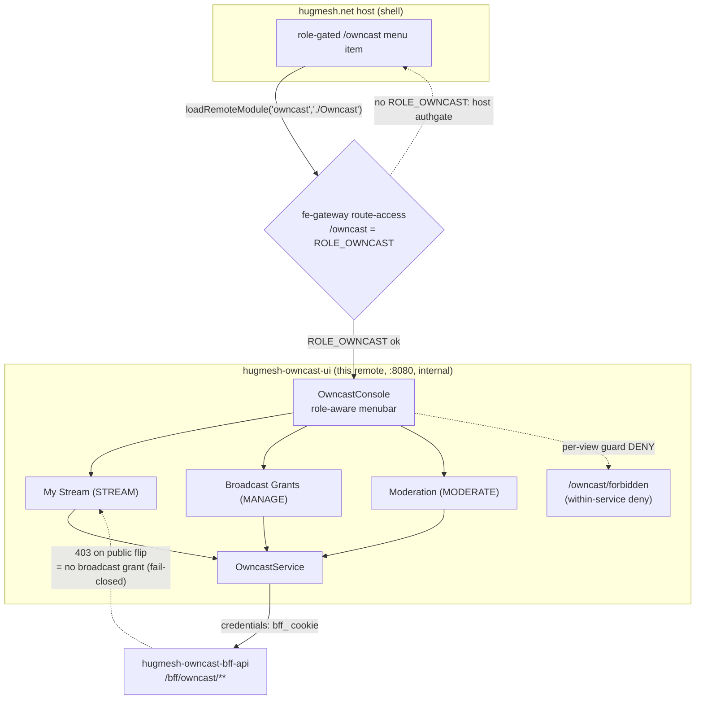
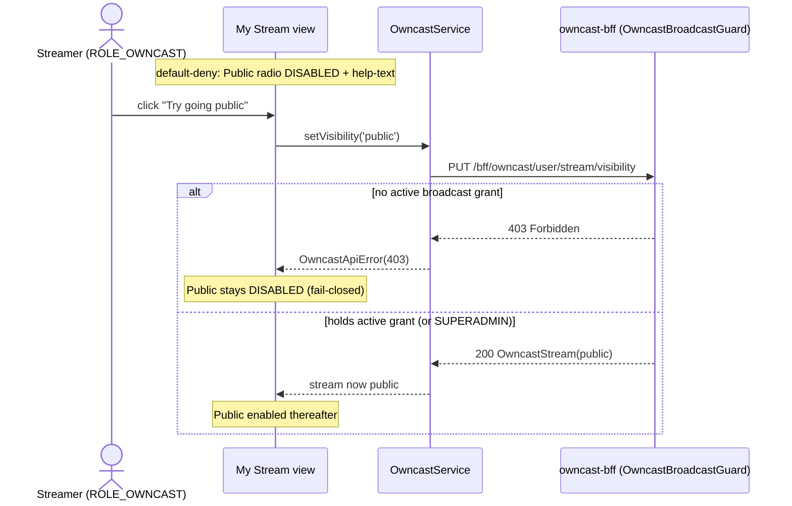

The **Owncast management UI** — an Angular **native-federation remote** that the
`hugmesh.net` host mounts at the apex path **`/owncast`**, role-gated in
the host menu. It is the management console over the
[`hugmesh-owncast-bff-api`](https://github.com/hugmesh-net/hugmesh-owncast-bff-api)
streamer self-service surface and the broadcast grant/timeout/ban governance
overlay for the [Owncast](https://owncast.online/) live-streaming optional
service on the [HugMesh](https://github.com/hugmesh-net) platform. It provides
two things:

1. A **streamer self-service console**, letting users manage their stream title, description, and public visibility.
2. A **broadcast governance overlay** for admins and moderators to grant, timeout, ban, and restore streamers' broadcast rights.

## Versions

| component | version |
| --- | --- |
| Angular | 22.0.x |
| @angular-architects/native-federation | 22.x |
| ng-openapi-gen | 1.0.5 |

## Status

Everything below reflects the code on `main` as of 2026-07-16, and is verified
by the project's own checks rather than aspirational: `npm ci && npm run
build` succeeds and emits `remoteEntry.json`; `npx tsc -p tsconfig.app.json
--noEmit` is clean; `npm test` is 97/97 green on Chrome headless.

**Shipped and working on `main`:**

- The **streamer self-service console** ("My Stream") — load/upsert title +
  description, the fail-closed public-visibility gate, and a real in-platform
  HLS player (hls.js-preferred, native-`<video>` fallback) bound to the bff's
  typed `playbackUrl` (`src/app/owncast-stream.component.ts`).
- The **Broadcast Grants console** — grant/timeout/ban/restore
  (`src/app/owncast-grants.component.ts`), with the active-grants list and
  per-principal history panels gated to SUPERADMIN.
- The **Moderation view** — list streams in the moderator's brand, then
  Hide/Kill/Restore (`src/app/owncast-moderation.component.ts`), wired to the
  `/bff/owncast/mod/**` endpoints.
- **Role-aware routing**: per-view guards (`src/app/owncast.guard.ts`) and the
  in-remote `/owncast/forbidden` screen for a within-service privilege denial
  (never `/forbidden` or `/login`).
- The **typed API client**: `src/app/api/` is generated by `ng-openapi-gen`
  (3 services, 11 models, committed alongside its `openapi.json` input), and
  `OwncastService` delegates every call to it.
- **Cookie-only auth**: the browser holds no bearer/token for this remote — every
  `/bff/owncast/**` call rides the shared HttpOnly `bff_` session cookie
  (`owncast-auth.interceptor.ts`). #14 replaced the `bffToken` bearer this
  remote used to read out of `localStorage` and send as `Authorization` with
  the cookie approach; #15 then dropped the Matrix/Mastodon access-token fields
  that `SnapSession` carried for shape-parity with the other HugMesh UIs but
  that this remote never actually read.
- Baseline nginx security headers (`nosniff`, `X-Frame-Options: DENY`,
  `Referrer-Policy`, HSTS) on the served SPA (`nginx.conf`).
- A Playwright + `playwright-bdd` Gherkin e2e harness (`e2e/`, 30 scenarios
  across 6 feature files) — see `e2e/README.md`. It **ships dark**: every
  scenario is tagged `@cluster` and filtered out by default, so it currently
  proves the suite compiles + is discoverable offline, not that it passes
  against a live stack.

**Known gaps (deferred, not hidden):**

- Stricter response headers (CSP, COEP/CORP, Permissions-Policy) are
  deliberately deferred pending per-UI tuning + a live-cluster browser
  validation pass (see `nginx.conf` and the Federation contract section below).
- The `pentest:dast` CI job (`.gitlab-ci.yml`) extends the centralized OWASP
  harness, but this repo does not yet vendor/fetch the harness at
  `PENTEST_HARNESS_DIR`, so the job fails fast at the harness lookup instead of
  scanning; no pipeline run of the pen-test stage has been verified yet.
- The e2e harness has never been run against a live stack from this repo (it
  needs the host shell + owncast-bff + a Casdoor seed); only the offline
  compile/discovery gate has been exercised.

## Federation contract

The federation-api owncast module row points at this remote:

| field | value |
| --- | --- |
| `remote_entry_url` | `http://hugmesh-owncast-ui:8080/remoteEntry.json` |
| `metadata.mountAt` | `/owncast` |
| `metadata.requiresRole` | `owncast` |
| `kind` | `remote-shell` |
| `visibility` | `internal` |

So this remote:

- exposes **`./Owncast`** (→ `src/app/owncast.routes.ts`, `OWNCAST_ROUTES`) in
  `federation.config.js` — the module key the host's
  `loadRemoteModule('owncast', './Owncast')` consumes;
- is served on **port 8080** (see `Dockerfile` + `nginx.conf`,
  `nginxinc/nginx-unprivileged`) so the emitted `remoteEntry.json` is reachable
  at the registered URL; the static SPA server ships the baseline
  **security-header set** (`X-Content-Type-Options: nosniff`,
  `X-Frame-Options: DENY`, `Referrer-Policy: strict-origin-when-cross-origin`,
  HSTS) — inspection-safe for an Angular SPA + native-federation remotes, and
  re-emitted in the `location /` + `/healthz` blocks because
  nginx drops inherited `add_header`s wherever a location sets its own. Stricter
  policies (CSP, COEP/CORP, Permissions-Policy) are deliberately deferred pending
  per-UI tuning + live-cluster browser validation;
- is **internal** — reachable only behind the gateway's
  `/owncast=ROLE_OWNCAST` route-access gate; it is not a public surface.

`federation-base.js` **mirrors the shared HugMesh `federation-base` helper**
(the single source of truth for the shared-deps surface + the RxJS skip list,
kept in sync across the host + remotes) so this remote can't drift from the host
or the other HugMesh remotes. The in-file header tracks its upstream source
(`hugmesh.games/frontend/federation-base.js`); no check currently enforces
byte-equality across repos, so treat the contents — `STD_SHARED` (singleton +
`strictVersion` + `requiredVersion: 'auto'`) and `STD_SKIP` (the four
unresolvable RxJS subpaths) — as the contract, not the literal file bytes.

## Topology

The load-bearing path: the host mounts this remote, the gateway gates the whole
`/owncast` mount, the per-view child guards enforce the within-service role
boundary, and `OwncastService` calls `/bff/owncast/**` with credentials (the
shared HttpOnly `bff_` session cookie) — with the broadcast **public** flip
fail-closed on a 403.



## Role model

The role model mirrors `hugmesh-owncast-bff-api` (`SecurityConfig` path gates and `OwncastBroadcastController` `@PreAuthorize` annotations). UI-level gating is defence-in-depth: it hides controls the user cannot use, but the BFF `@PreAuthorize` annotations and `OwncastBroadcastGuard` are the authoritative enforcement point. Any UI bug that lets a disallowed call through will still receive a 403, which the UI surfaces gracefully:

| capability | composite | views |
| --- | --- | --- |
| `STREAM` | `ROLE_OWNCAST` | My Stream (visibility toggle ✅, title/description ✅, in-platform HLS video player ✅ — see below) |
| `MANAGE` | `ADMIN \| SUPERADMIN` | Broadcast grants (grant/timeout/ban/restore) ✅; list/history is `SUPERADMIN`-only ✅ |
| `MODERATE` | `MOD \| ADMIN \| SUPERADMIN` | Moderation (list streams + hide/kill/restore) ✅ |

State legend: ✅ shipped (on `main`) · 🚧 in-flight (open branch/PR) · 🔭 planned
(design only, no code).

> **My Stream — in-platform HLS player is ✅ wired.** The "Preview" panel in
> `owncast-stream.component.html` is a **real in-platform HLS player** bound to the
> BFF's typed `Stream.playbackUrl`. It **prefers `hls.js`** when a federation host
> has already loaded it (`window.Hls` + MSE; structural typing + runtime
> feature-detect — **no hard npm dependency is added**) and **falls back to native
> `<video>` HLS** (`canPlayType('application/vnd.apple.mpegurl')`) otherwise. It
> announces **loading** (`role="status"`), **empty** (no `playbackUrl` yet,
> `role="status"`) and **unsupported/error** (`role="alert"`) states, and tears the
> player down idempotently on destroy / source change. The title/description upsert
> and the visibility toggle are ✅ shipped alongside it.

Role visibility is additive: a plain **STREAMER** sees only My Stream; a **MOD** additionally sees Moderation; an **ADMIN** additionally sees the Broadcast grants console; a **SUPERADMIN** additionally sees the full active-grants list and per-principal history. A user who holds none of the owncast roles is redirected to the **in-remote** `/owncast/forbidden` screen.

### Forbidden redirect (critical)

A denied child guard routes to **`router.parseUrl('/owncast/forbidden')`** — the in-remote forbidden screen mounted under this remote's own path prefix. It must **not** route to `'/forbidden'` or `'/login'`. The reason: by the time a child guard runs, the host has already admitted the user through the `/owncast=ROLE_OWNCAST` route-access gate. A denial at this point is a within-service privilege boundary (e.g. a streamer attempting the admin console), not an authentication failure. Routing to the bare `/forbidden` is a mistake another HugMesh remote
([`hugmesh-wiki-ui`](https://github.com/hugmesh-net/hugmesh-wiki-ui)) made; this remote ships the correctly prefixed path.

### The public-visibility gate (canonical disabled+helptext)

Broadcast is **default-deny, grant-only**: a stream may only be made or kept **public** by a streamer who currently holds an active broadcast grant. The BFF `OwncastBroadcastGuard` rejects any public-visibility flip from a streamer without a grant with a 403; SUPERADMINs are exempt.

The BFF exposes no "can I broadcast?" status endpoint, so the UI cannot know the grant status before the user acts. The console is therefore **fail-closed**: the **Public** visibility toggle is rendered **disabled** and paired with the help-text *"You need an active broadcast grant from an admin to go public"*. When the user explicitly triggers a **"Try going public"** action:

- A **403** response confirms no active grant exists; the toggle stays disabled.
- A **200** response confirms the grant is live; the toggle becomes enabled.

The UI never optimistically enables the Public toggle before the BFF has confirmed the grant.

```mermaid
flowchart TB
    A([User clicks "Try going public"]) --> B[PUT /bff/owncast/user/stream/visibility]
    B --> C{Response}
    C -->|200 OK| D[Grant confirmed — enable Public toggle]
    C -->|403 Forbidden| E[No grant — keep Public disabled\nshow help-text]
```



Gating lives in:

- `src/app/session.service.ts` — `canStream` / `canManage` / `canManageAll` /
  `canModerate` computed signals derived from the Casdoor roles in `hug.session`
  (reserved-prefix `ROLE_`/`DOMAIN_` already stripped upstream).
- `src/app/owncast.guard.ts` — `owncastStreamGuard` / `owncastManageGuard` /
  `owncastModGuard` applied per-route in `src/app/owncast.routes.ts`; DENY →
  `/owncast/forbidden`.
- `src/app/owncast-console.component.ts` — the role-aware menubar shows each nav
  item only for the role that can use it.

## BFF endpoints consumed (`/bff/owncast/**`)

`src/app/owncast.service.ts` is the typed datastore wrapper. Every public method maps 1:1 to a `hugmesh-owncast-bff-api` endpoint:

- `GET  /bff/owncast/user/stream` → `OwncastStreamDto.Stream` (404 = no stream yet)
- `PUT  /bff/owncast/user/stream` → upsert title + description
- `PUT  /bff/owncast/user/stream/visibility` → flip `internal`/`public` (403 = no broadcast grant)
- `POST /bff/owncast/admin/access/grant` · `/timeout` · `/ban` → the overlay
- `DELETE /bff/owncast/admin/access/{broadcast|banned}/{userSubject}` → revoke/restore
- `GET  /bff/owncast/superadmin/access` → all active grants (SUPERADMIN)
- `GET  /bff/owncast/superadmin/access/{userSubject}/history` → full history (SUPERADMIN)
- `GET  /bff/owncast/mod/streams` → `OwncastModDto.ModStream[]` — every stream in the moderator's brand
- `POST /bff/owncast/mod/streams/{ownerSubject}/hide` → force `visibility=internal`
- `POST /bff/owncast/mod/streams/{ownerSubject}/ban` → KILL: ban the owner from broadcasting + force internal
- `POST /bff/owncast/mod/streams/{ownerSubject}/restore` → revoke the ban (does not auto-republish)

Auth piggybacks on the shared HttpOnly `bff_` session cookie (sent with
credentials; the fe-gateway turns it into the upstream Bearer server-side). The
browser holds no admin-capable bearer.

The **Moderation view is ✅ shipped and wired** to the `/bff/owncast/mod/**`
endpoints above (`OwncastModController`): it lists every stream in the
moderator's brand and exposes per-row **Hide** (force private; disabled +
help-text *"Already private"* when internal), **Kill** (confirm-gated; bans the
streamer from broadcasting + forces internal; disabled + help-text *"Already
banned"* when banned), and **Restore** (revoke the ban — does not auto-republish).
The role-shown controls + the route guard are defence-in-depth; the bff
`@PreAuthorize` is authoritative, and a 403 surfaces gracefully. The "There are
no streams to review in your brand" message is the normal empty list, **not** a
missing-endpoint placeholder. (The view shipped via PR #2 — *"wire the moderation
view to the owncast-bff `/mod` endpoints"*.)

## Typed API client (ng-openapi-gen)

`ng-openapi-gen.json` is committed, following the convention shared across
HugMesh frontend repos. The typed client under
`src/app/api/` **and** its input `openapi.json` are now **committed** so the build
is deterministic and needs no network / no running BFF. Regenerate from the
owncast-bff's committed spec:

```sh
npm run gen:spec   # copies ../hugmesh-owncast-bff-api/src/main/resources/openapi/openapi.json
                   # -> openapi.json, then runs ng-openapi-gen. Override the source
                   # with OWNCAST_BFF_SPEC=/path/to/openapi.json. The BFF produces
                   # that spec from `./mvnw -Dtest=OpenApiSpecDumpTest test`.
```

(The legacy `gen:fetch` — curl `localhost:8080/v3/api-docs` — is replaced by
`gen:spec`, mirroring the same approach adopted in
[`hugmesh-user-ui`](https://github.com/hugmesh-net/hugmesh-user-ui).)

`owncast.service.ts` is the thin wrapper over the generated, typed client: every
method **delegates** to the generated `OwncastStreamSelfService` /
`OwncastBroadcastAccessService` / `OwncastModerationService` (same same-origin
`/bff/owncast/**` paths, generated `rootUrl` seeded from `OWNCAST_BASE_URL`). It
keeps its OWN public `OwncastStream` / `ModStream` / `OwncastGrant` / … DTO types
and its Promise-returning, `OwncastApiError`-raising signature (the stable
contract the components consume), bridging the generated models at the delegation
boundary and normalising the generated `HttpErrorResponse` back to
`OwncastApiError` (preserving the 403/404 the views key off). The auth the prior
`fetch` path added by hand (an `Authorization: Bearer`) is replaced by the
`owncastAuthInterceptor`, which sets `withCredentials: true` (`/bff/owncast/**`
only) so the browser sends the HttpOnly `bff_` session cookie instead.

## Develop

```sh
npm ci
npm start                          # ng serve owncast (standalone dev shell, :4209)
npm test                           # ng test owncast --watch=false --browsers=ChromeHeadlessCI
npm run build                      # production build → dist/owncast/browser (emits remoteEntry.json)
```

`CHROME_BIN=/opt/google/chrome/chrome` (or chromium) for headless tests in CI.

Primary CI is **GitLab** (`.gitlab-ci.yml`): this GitHub repository is mirrored
into a GitLab pipeline that builds and pushes the image. A manual-only GitHub
Actions workflow (`.github/workflows/release.yml`) is also available for
publishing an image to `ghcr.io/hugmesh-net/hugmesh-owncast-ui`; it only runs
on an explicit `workflow_dispatch`, never on push. Today the GitLab pipeline
has four stages: **`test`** (headless
Karma), **`e2e`** (`e2e:bdd` → Playwright/playwright-bdd offline
compile+discover, `allow_failure: true`), **`build`** (`build:image` →
registry push), and **`pentest`** (jobs defined, first executed run pending).

> **🚧 Continuous-OWASP pen-test stage — jobs defined, first run pending.**
> `.gitlab-ci.yml` `include:`s the centralized
> `hugmesh-generator:/tests/pentest/ci/pentest-stage.gitlab-ci.yml` (from
> [`hugmesh-generator`](https://github.com/hugmesh-net/hugmesh-generator),
> the single source of truth for the pen-test harness) and defines thin
> `pentest:sca` (OWASP Dependency-Check) + `pentest:dast` (authenticated ZAP
> DAST baseline + nuclei boundary templates) jobs. Both are
> `allow_failure: true` (additive, non-blocking) and gated to the default
> branch + merge requests. `pentest:sca` is self-contained (it scans this
> repo's checkout directly); `pentest:dast` executes
> `${PENTEST_HARNESS_DIR}/run-pentest.sh`, which this repo does **not** vendor
> (default `tests/pentest`) — until the shared harness is vendored/fetched
> here, the DAST job fails fast at the harness lookup instead of scanning. No
> executed pipeline run of this stage has been verified yet. The opt-in k6
> load leg (`.pentest-load`) is not wired here.

## Roadmap

State legend: ✅ shipped (on `main`) · 🚧 in-flight (open branch/PR) · 🔭 planned
(design only, no code). Everything below is **not yet shipped on `main`**; the
console renders fully today without it.

- ✅ **In-platform video player.** The "My Stream" *Preview* panel is a real
  in-platform HLS player (hls.js-preferred, native-`<video>` fallback) bound to the
  BFF's typed `playbackUrl` (see **My Stream** above). Owncast remains **x86 +
  GPU-dependent** and **per-domain enable** (a superadmin turns the optional service
  on per brand; the UI greys out when the service is absent) — that platform framing
  stays the runtime context for the player.
- ✅ **ng-openapi-gen typed client.** The generated client (`src/app/api/`, 3
  services + 11 models) and its input `openapi.json` are committed; `gen:spec`
  regenerates from the owncast-bff's committed spec. `owncast.service.ts`
  delegates every call to the generated services while keeping its own public DTO
  types + Promise/`OwncastApiError` signature, so the consuming components are
  unchanged (see **Typed API client**).
- 🚧 **Continuous-OWASP CI stage — jobs defined, first run pending.** The shared
  `.gitlab-ci.yml` pen-test include is in place: non-blocking `pentest:sca` +
  `pentest:dast` jobs extend the centralized generator template. SCA is
  self-contained; the DAST leg (ZAP + nuclei templates) still needs the shared
  harness vendored/fetched at `PENTEST_HARNESS_DIR`, and no pipeline execution
  has been verified yet; the opt-in k6 load leg remains unwired (see
  **Develop**).

Per-domain federated per-user video remotes (templated like profile cards) are a
platform-level Owncast capability tracked outside this remote; this repo is the
management/console surface, not the per-user player remote.

## Part of the HugMesh platform

This remote is one federated piece of the wider HugMesh platform. Repositories
referenced above:

- [`hugmesh-owncast-bff-api`](https://github.com/hugmesh-net/hugmesh-owncast-bff-api) — the backend-for-frontend this UI talks to; owns the role model, the broadcast-grant guard, and the OpenAPI spec this repo's typed client is generated from.
- [`hugmesh-generator`](https://github.com/hugmesh-net/hugmesh-generator) — source of the shared CI/pen-test tooling this repo's pipeline includes.
- [`hugmesh-user-ui`](https://github.com/hugmesh-net/hugmesh-user-ui) — another native-federation remote following the same typed-client generation approach.
- [`hugmesh-wiki-ui`](https://github.com/hugmesh-net/hugmesh-wiki-ui) — another native-federation remote mounted by the same host shell.

See the [HugMesh organization](https://github.com/hugmesh-net) for the rest of
the platform, including the host shell that mounts this remote and the
`fe-gateway` that authenticates and routes to it.

## Contributing

Issues and pull requests are welcome. Before opening a PR:

1. `npm ci` to install dependencies.
2. `npm test` — the Karma/Jasmine unit suite must stay green.
3. `npx tsc -p tsconfig.app.json --noEmit` — no new type errors.
4. `npm run build` — confirm the remote still builds and emits `remoteEntry.json`.

If your change touches `src/app/api/`, regenerate it from the BFF's OpenAPI
spec with `npm run gen:spec` rather than hand-editing the generated files. If
it touches role gating or the broadcast-grant flow, add or update the
corresponding Gherkin scenario under `e2e/features/` (see `e2e/README.md`).

## License

MIT — see [LICENSE](./LICENSE).
