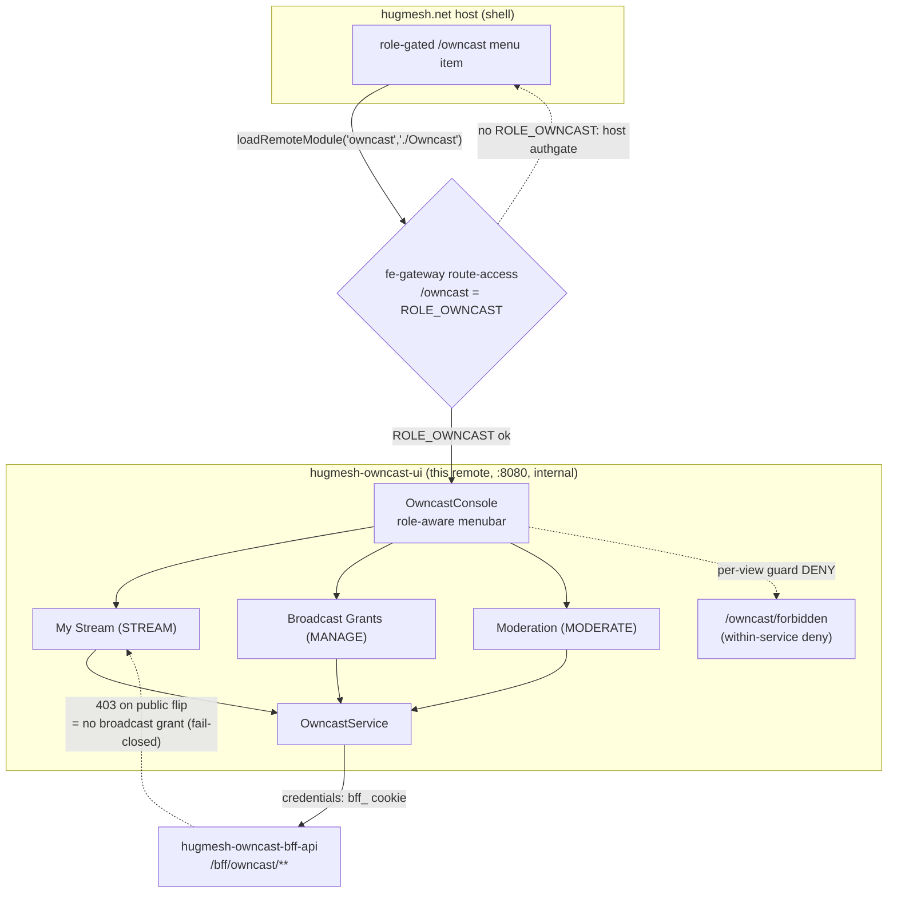
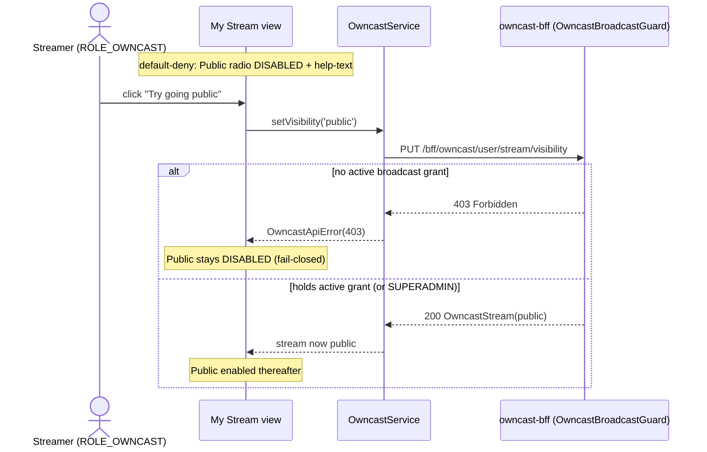

The **Owncast management UI**: an Angular **native-federation remote** that the
`hugmesh.net` host mounts at **`/owncast`** and shows in its menu only to users
with the right role. It is the console over the
[`hugmesh-owncast-bff-api`](https://github.com/hugmesh/hugmesh-owncast-bff-api)
streamer self-service surface and its broadcast grant/timeout/ban overlay, for
the [Owncast](https://owncast.online/) live-streaming optional service on the
[HugMesh](https://github.com/hugmesh) platform. Broadcasting here is a privilege,
not a right. The console says so, and the server agrees.

It does two things:

1. A **streamer self-service console**: manage your stream title, description and public visibility.
2. A **broadcast governance overlay**: admins and moderators grant, timeout, ban and restore a streamer's broadcast rights.

## Versions

| component | version |
| --- | --- |
| this image (`package.json`) | 0.2.0-beta.1 |
| Angular | 22.0.x |
| @angular-architects/native-federation | 22.x |
| ng-openapi-gen | 1.0.5 |

## Status

This reflects the code on `main` as of 2026-10-07 and the project's own checks:
`npm run build` succeeds and emits `remoteEntry.json`; `npx tsc -p
tsconfig.app.json --noEmit` is clean; `npm test` is 120/120 green on Chrome
headless.

**Shipped on `main`:**

- **Streamer self-service console** ("My Stream"): load and upsert title and
  description, the fail-closed public-visibility gate, and an in-platform HLS
  player (hls.js if present, native `<video>` otherwise) bound to the BFF's
  typed `playbackUrl` (`src/app/owncast-stream.component.ts`).
- **Broadcast Grants console**: grant, timeout, ban, restore
  (`src/app/owncast-grants.component.ts`). The active-grants list and the
  per-principal history panels are SUPERADMIN only.
- **Moderation view**: list streams in the moderator's brand, then
  Hide, Kill or Restore (`src/app/owncast-moderation.component.ts`), wired to
  the `/bff/owncast/mod/**` endpoints.
- **Role-aware routing**: per-view guards (`src/app/owncast.guard.ts`) and the
  in-remote `/owncast/forbidden` screen for a denial inside the service (never
  `/forbidden` or `/login`).
- **Typed API client**: `src/app/api/` is generated by `ng-openapi-gen` (3
  services, 11 models) and committed with its `openapi.json` input.
  `OwncastService` delegates every call to it.
- **Cookie-only auth**: the browser holds no bearer token for this remote. Every
  `/bff/owncast/**` call rides the shared HttpOnly `bff_` session cookie
  (`owncast-auth.interceptor.ts`). An earlier version read a `bffToken` bearer
  out of `localStorage` and sent it as `Authorization`; that is gone, and
  `SnapSession` no longer carries the Matrix/Mastodon access-token fields it
  once had for shape-parity with the other HugMesh UIs.
- **Security headers**: `nosniff`, `X-Frame-Options: DENY`, `Referrer-Policy`,
  HSTS and a per-response, nonce-based `Content-Security-Policy` on the served
  SPA (`nginx.conf`).
- **Runtime theming**: `docker-entrypoint.d/50-hug-theme.sh` writes the theme CSS
  from `HUG_THEME_CSS` (legacy `SNAP_THEME_CSS` still read) at container start,
  and `nginx.conf` serves it at `/hug-theme.css` (and the legacy
  `/snap-theme.css`).
- **e2e harness**: Playwright + `playwright-bdd` Gherkin (`e2e/`, 42 scenarios
  across 12 feature files); see `e2e/README.md`. It **ships dark**: every
  scenario is tagged `@cluster` and filtered out by default. It proves the suite
  compiles and is discoverable offline, not that it passes against a live stack.
- **Avatar cam** (`/owncast/avatar-cam`, STREAM role): go live as your own 2D
  avatar, the games avatar you built in the Character Forge. It is drawn in
  three mouth frames by the games avatar API (`image.svg?mouth=`) and swapped by
  how loud your microphone is. See "Avatar cam" below.

**Known gaps (deferred, not hidden):**

- COEP/CORP and Permissions-Policy response headers are deferred pending per-UI
  tuning and a live-cluster browser check (see `nginx.conf` and the Federation
  contract section below). The CSP is shipped.
- `pentest:dast` (`.gitlab-ci.yml`) extends the central OWASP harness, but this
  repo does not vendor or fetch the harness at `PENTEST_HARNESS_DIR`. The job
  fails at the harness lookup instead of scanning. No run of the pen-test stage
  has been verified.
- The e2e harness has never run against a live stack from this repo (it needs
  the host shell, owncast-bff and a Casdoor seed). Only the offline
  compile-and-discover gate has run.

## Avatar cam

`src/app/avatar-cam/` streams **as your own 2D avatar**, mouth following your
voice, like a visual novel's talking sprite. The mouth has three frames (closed,
half, open), with hysteresis and a minimum hold, so a value hovering on a
threshold cannot flicker and the frames read as speech rather than a meter.

How it goes on air: a browser cannot push RTMP, and the BFF exposes no stream
key. Owncast's ingest stays what it is (OBS, then the tailnet, then your Owncast
`:1935`). The page is the **camera**:

1. It lists your saved games avatars (`GET {games}/api/avatars`, with the
   session cookie, `credentials: 'include'`) and picks the **active** one. The
   games backend must list the mesh's origins in its CORS allowlist
   (`spring.web.cors.allowed-origins`).
2. For the chosen avatar and expression it fetches three frames from the games
   avatar API (`image.svg?expression=…&mouth=0|0.45|0.9`) as text and shows them
   as `data:` URLs (no cross-origin ``, no `blob:` CSP entry).
3. **Use my microphone** turns loudness into a frame. The amplitude-to-openness
   math is vendored byte-faithful from hugmesh-matrix-ui `vn/voice`, the same
   copy the character-studio remote carries (native-federation forbids a shared
   cross-remote runtime import). Without a mic, the three frame buttons preview
   by hand.
4. **Pop out the camera** opens `?capture=1&bg=green&avatar=…&expression=…`: the
   avatar and nothing else, sized to the window, on the keyed colour (`bg=` is the
   background picked in the page: green, blue or mesh surface; transparent
   becomes green). In OBS add a *Window Capture* of that window and a *Chroma
   Key* filter, then go live from OBS as usual. Start the microphone in the
   pop-out window too; it has its own button.

The games host comes from the page's own host (`https://games.<host>`, the
generator's `games.<CLUSTER_DOMAIN>` route). The host shell may pin it with
`globalThis.__HUG_GAMES_URL__`, following the `__HUG_OWNCAST_URL__` precedent.
The route is gated by `owncastStreamGuard`, like My Stream, and the nav shows it
to STREAM only.

## Federation contract

The federation-api owncast module row points at this remote:

| field | value |
| --- | --- |
| `remote_entry_url` | `http://hugmesh-owncast-ui:8080/remoteEntry.json` |
| `metadata.mountAt` | `/owncast` |
| `metadata.requiresRole` | `owncast` |
| `kind` | `remote-shell` |
| `visibility` | `internal` |

So this remote:

- exposes **`./Owncast`** (`src/app/owncast.routes.ts`, `OWNCAST_ROUTES`) in
  `federation.config.js`. That is the key the host's
  `loadRemoteModule('owncast', './Owncast')` consumes;
- is served on **port 8080** (see `Dockerfile` and `nginx.conf`,
  `nginxinc/nginx-unprivileged`), so the emitted `remoteEntry.json` is reachable
  at the registered URL. The SPA server sends `X-Content-Type-Options: nosniff`,
  `X-Frame-Options: DENY`, `Referrer-Policy: strict-origin-when-cross-origin` and
  HSTS. These are safe for an Angular SPA and native-federation remotes. nginx
  drops inherited `add_header`s wherever a location sets its own, so each
  `location` block repeats them (`/`, `/healthz`, and the two theme-CSS
  locations, which omit HSTS). `location /` also sends a nonce-based
  `Content-Security-Policy`; `sub_filter` injects the nonce into every
  `<script>` tag of `index.html`. COEP/CORP and Permissions-Policy are deferred
  pending per-UI tuning and live-cluster browser validation;
- is **internal**: reachable only behind the gateway's `/owncast=ROLE_OWNCAST`
  route-access gate. It is not a public surface.

`federation-base.js` **mirrors the shared HugMesh `federation-base` helper**
(the one source for the shared-deps surface and the RxJS skip list, kept in sync
across the host and remotes), so this remote cannot drift from the host or the
other remotes. The file header names its upstream
(`hugmesh.games/frontend/federation-base.js`). No check enforces byte-equality
across repos, so treat the contents as the contract, not the literal bytes:
`STD_SHARED` (singleton, `strictVersion`, `requiredVersion: 'auto'`) and
`STD_SKIP` (the four unresolvable RxJS subpaths).

## Topology

The path that matters: the host mounts this remote, the gateway gates the whole
`/owncast` mount, per-view child guards enforce the role boundary inside the
service, and `OwncastService` calls `/bff/owncast/**` with credentials (the
shared HttpOnly `bff_` session cookie). The broadcast **public** flip is
fail-closed on a 403.



## Role model

The role model mirrors `hugmesh-owncast-bff-api` (`SecurityConfig` path gates and
`OwncastBroadcastController` `@PreAuthorize` annotations). UI gating is
defence-in-depth: it hides controls the user cannot use. The BFF `@PreAuthorize`
annotations and `OwncastBroadcastGuard` are the real enforcement. A UI bug that
lets a disallowed call through still gets a 403, and the UI shows it gracefully:

| capability | composite | views |
| --- | --- | --- |
| `STREAM` | `ROLE_OWNCAST` | My Stream (visibility toggle ✅, title/description ✅, in-platform HLS video player ✅ — see below) |
| `MANAGE` | `ADMIN \| SUPERADMIN` | Broadcast grants (grant/timeout/ban/restore) ✅; list/history is `SUPERADMIN`-only ✅ |
| `MODERATE` | `MOD \| ADMIN \| SUPERADMIN` | Moderation (list streams + hide/kill/restore) ✅ |

✅ means shipped on `main`.

> **My Stream: the in-platform HLS player is wired.** The "Preview" panel in
> `owncast-stream.component.html` plays the BFF's typed `Stream.playbackUrl`. It
> **prefers `hls.js`** when a federation host has already loaded it (`window.Hls`
> plus MSE; structural typing and runtime feature-detect, so **no npm dependency
> is added**) and **falls back to native `<video>` HLS**
> (`canPlayType('application/vnd.apple.mpegurl')`) otherwise. It announces
> **loading** (`role="status"`), **empty** (no `playbackUrl` yet, `role="status"`)
> and **unsupported/error** (`role="alert"`), and tears the player down
> idempotently on destroy or source change.

Role visibility is per capability, not a strict ladder. `STREAM` is the bare
`owncast` role only, so a **STREAMER** sees My Stream and Avatar cam (both are
`STREAM` views). A **MOD** with the `owncast` role also sees Moderation. An
**ADMIN** with it also sees the Broadcast grants console and Moderation. A
**SUPERADMIN** also sees the full active-grants list and per-principal history. A
mod, admin or superadmin without the `owncast` role gets neither My Stream nor
Avatar cam. A user who holds none of the owncast roles is redirected to the
**in-remote** `/owncast/forbidden` screen.

### Forbidden redirect (critical)

A denied child guard routes to **`router.parseUrl('/owncast/forbidden')`**, the
forbidden screen under this remote's own path prefix. It must **not** route to
`'/forbidden'` or `'/login'`. By the time a child guard runs, the host has
already admitted the user through the `/owncast=ROLE_OWNCAST` route-access gate.
A denial at this point is a privilege boundary inside the service (a streamer
trying the admin console), not an authentication failure. Routing to the bare
`/forbidden` is a mistake another HugMesh remote
([`hugmesh-wiki-ui`](https://github.com/hugmesh/hugmesh-wiki-ui)) once made (it
now routes to `/wiki/forbidden`). This remote uses the prefixed path.

### The public-visibility gate (canonical disabled+helptext)

Broadcast is **default-deny, grant-only**. A stream may be made or kept
**public** only by a streamer who holds an active broadcast grant. The BFF
`OwncastBroadcastGuard` rejects a public-visibility flip from a streamer without
a grant with a 403. SUPERADMINs are exempt.

The BFF has no "can I broadcast?" status endpoint, so the UI cannot know the
grant status before the user acts. The console is therefore **fail-closed**: the
**Public** visibility toggle is **disabled** and paired with the help-text *"You
need an active broadcast grant from an admin to go public"*. When the user
triggers **"Try going public"**:

- A **403** means no active grant; the toggle stays disabled.
- A **200** means the grant is live; the toggle becomes enabled.

The UI never enables the Public toggle before the BFF confirms the grant.

```mermaid
flowchart TB
    A([User clicks "Try going public"]) --> B[PUT /bff/owncast/user/stream/visibility]
    B --> C{Response}
    C -->|200 OK| D[Grant confirmed — enable Public toggle]
    C -->|403 Forbidden| E[No grant — keep Public disabled\nshow help-text]
```



Gating lives in:

- `src/app/session.service.ts`: the `canStream`, `canManage`, `canManageAll` and
  `canModerate` computed signals, derived from the Casdoor roles in `hug.session`
  (the reserved `ROLE_`/`DOMAIN_` prefix is already stripped upstream).
- `src/app/owncast.guard.ts`: `owncastStreamGuard`, `owncastManageGuard` and
  `owncastModGuard`, applied per route in `src/app/owncast.routes.ts`. A denial
  goes to `/owncast/forbidden`.
- `src/app/owncast-console.component.ts`: the role-aware menubar shows each nav
  item only to the role that can use it.

## BFF endpoints consumed (`/bff/owncast/**`)

`src/app/owncast.service.ts` is the typed wrapper. Every public method maps 1:1
to a `hugmesh-owncast-bff-api` endpoint:

- `GET  /bff/owncast/user/stream` → `OwncastStreamDto.Stream` (404 = no stream yet)
- `PUT  /bff/owncast/user/stream` → upsert title + description
- `PUT  /bff/owncast/user/stream/visibility` → flip `internal`/`public` (403 = no broadcast grant)
- `POST /bff/owncast/admin/access/grant` · `/timeout` · `/ban` → the overlay
- `DELETE /bff/owncast/admin/access/{broadcast|banned}/{userSubject}` → revoke/restore
- `GET  /bff/owncast/superadmin/access` → all active grants (SUPERADMIN)
- `GET  /bff/owncast/superadmin/access/{userSubject}/history` → full history (SUPERADMIN)
- `GET  /bff/owncast/mod/streams` → `OwncastModDto.ModStream[]` — every stream in the moderator's brand
- `POST /bff/owncast/mod/streams/{ownerSubject}/hide` → force `visibility=internal`
- `POST /bff/owncast/mod/streams/{ownerSubject}/ban` → KILL: ban the owner from broadcasting + force internal
- `POST /bff/owncast/mod/streams/{ownerSubject}/restore` → revoke the ban (does not auto-republish)

Auth uses the shared HttpOnly `bff_` session cookie, sent with credentials. The
fe-gateway turns it into the upstream Bearer server-side. The browser holds no
admin-capable bearer.

The **Moderation view** (`OwncastModerationController` on the BFF) lists every
stream in the moderator's brand and offers three per-row actions:

- **Hide** forces the stream private. It is disabled, with the help-text
  *"Already private"*, when the stream is internal.
- **Kill** is confirm-gated. It bans the streamer from broadcasting and forces
  the stream internal. It is disabled, with the help-text *"Already banned"*,
  when the streamer is banned.
- **Restore** revokes the ban. It does not republish.

The role-shown controls and the route guard are defence-in-depth. The BFF
`@PreAuthorize` is authoritative, and a 403 is shown gracefully. The message
"There are no streams to review in your brand" is the normal empty list, **not**
a missing-endpoint placeholder.

## Typed API client (ng-openapi-gen)

`ng-openapi-gen.json` is committed, as in the other HugMesh frontend repos. The
typed client under `src/app/api/` **and** its input `openapi.json` are committed,
so the build is deterministic and needs no network and no running BFF.
Regenerate from the owncast-bff's committed spec:

```sh
npm run gen:spec   # copies ../hugmesh-owncast-bff-api/src/main/resources/openapi/openapi.json
                   # -> openapi.json, then runs ng-openapi-gen. Override the source
                   # with OWNCAST_BFF_SPEC=/path/to/openapi.json. The BFF produces
                   # that spec from `./mvnw -Dtest=OpenApiSpecDumpTest test`.
```

(`gen:spec` replaced the old `gen:fetch`, which curled
`localhost:8080/v3/api-docs`. It follows the approach
[`hugmesh-user-ui`](https://github.com/hugmesh/hugmesh-user-ui) uses.)

`owncast.service.ts` is a thin wrapper over the generated client. Every method
**delegates** to the generated `OwncastStreamSelfService`,
`OwncastBroadcastAccessService` or `OwncastModerationService` (same-origin
`/bff/owncast/**` paths; the generated `rootUrl` is seeded from
`OWNCAST_BASE_URL`). It keeps its OWN public DTO types (`OwncastStream`,
`ModStream`, `OwncastGrant`, …) and its Promise-returning, `OwncastApiError`-raising
signature, which the components rely on. It bridges the generated models at the
delegation boundary and turns the generated `HttpErrorResponse` back into an
`OwncastApiError`, keeping the 403 and 404 the views key off. The old hand-added
`Authorization: Bearer` is replaced by `owncastAuthInterceptor`, which sets
`withCredentials: true` (for `/bff/owncast/**` only) so the browser sends the
HttpOnly `bff_` session cookie.

## Develop

```sh
npm ci
npm start                          # ng serve owncast (standalone dev shell, :4209)
npm test                           # ng test owncast --watch=false --browsers=ChromeHeadlessCI
npm run build                      # production build → dist/owncast/browser (emits remoteEntry.json)
```

Set `CHROME_BIN=/opt/google/chrome/chrome` (or chromium) for headless tests in CI.

Primary CI is **GitLab** (`.gitlab-ci.yml`): this GitHub repository is mirrored
into a GitLab pipeline that builds and pushes the image. The one GitHub Actions
workflow, `.github/workflows/release.yml`, publishes
`ghcr.io/hugmesh/hugmesh-owncast-ui`. It first runs the same Karma unit tests as
the GitLab `test` job, then:

- On a push to `main`, it pushes the tags `main` and `sha-<first 12 hex of the commit>`.
- On a `v<version>` tag, it pushes `<version>`, `beta` (for beta versions) and
  `sha-<12 hex>`, and creates a GitHub release marked as a prerelease and not
  latest. The tag must equal `v` plus the `version` in `package.json` (and
  `package-lock.json`), and it must point at a commit on `main`. A version tag
  that is already in the registry is never overwritten.
- A manual run (`workflow_dispatch`) on `main` or on a `v*` tag does the same as
  the matching push. Any other branch or tag is refused.
- It never pushes `latest`, and it has no pull-request trigger.

Its jobs run on the self-hosted runner only when the repository variable
`RUNS_ON_PUBLISH` holds a runner label list (for example
`["self-hosted","Linux","X64"]`) and the run is for `main` or a `v*` tag.
Otherwise they run on GitHub's hosted `ubuntu-latest`.

**Image version.** The `version` in `package.json` is the image version. It uses
`MAJOR.MINOR.PATCH-beta.N`; the current version is `0.2.0-beta.1` (built and
tested, not yet proven on a live mesh). To publish a beta, set the new version in
`package.json` and `package-lock.json` (for example
`npm version 0.2.0-beta.2 --no-git-tag-version`), merge that to `main`, then push
an annotated tag `v0.2.0-beta.2` on that commit. A fix during a beta raises `N`.
The `0.1.0` in `openapi.json` is the BFF's API version, not this image's.

The GitLab pipeline has four stages:
**`test`** (headless Karma), **`e2e`** (`e2e:bdd`, Playwright/playwright-bdd
offline compile and discover, `allow_failure: true`), **`build`** (`build:image`,
registry push) and **`pentest`** (jobs defined, first run pending).

> **Continuous-OWASP pen-test stage: jobs defined, first run pending.**
> `.gitlab-ci.yml` `include:`s the central
> `hugmesh-generator:/tests/pentest/ci/pentest-stage.gitlab-ci.yml` (from
> [`hugmesh-generator`](https://github.com/hugmesh/hugmesh-generator), the one
> source for the pen-test harness) and defines two thin jobs: `pentest:sca`
> (OWASP Dependency-Check) and `pentest:dast` (authenticated ZAP DAST baseline +
> nuclei boundary templates). Both are `allow_failure: true` (additive,
> non-blocking) and run on the default branch and merge requests. `pentest:sca`
> is self-contained: it scans this repo's checkout. `pentest:dast` runs
> `${PENTEST_HARNESS_DIR}/run-pentest.sh`, which this repo does **not** vendor
> (default `tests/pentest`), so until the shared harness is vendored or fetched
> the DAST job fails fast at the harness lookup instead of scanning. No run of
> this stage has been verified. The opt-in k6 load leg (`.pentest-load`) is not
> wired here.

## Roadmap

State legend: ✅ shipped (on `main`) · 🚧 in-flight (open branch/PR) · 🔭 planned
(design only, no code). The first two items are shipped; the third is partly
done and nothing is open for it.

- ✅ **In-platform video player.** The "My Stream" *Preview* panel plays the
  BFF's typed `playbackUrl` (see **Role model**). Owncast remains **x86 and
  GPU-dependent** and **per-domain enable** (a superadmin turns the optional
  service on per brand; the UI greys out when the service is absent). That is
  the runtime context for the player.
- ✅ **ng-openapi-gen typed client.** See **Typed API client**.
- **Continuous-OWASP CI stage: jobs defined, first run pending** (no open branch
  or PR; the earlier attempt, PR #14, was closed unmerged). SCA is
  self-contained. The DAST leg (ZAP + nuclei templates) still needs the shared
  harness at `PENTEST_HARNESS_DIR`, and the k6 load leg is unwired (see
  **Develop**).

Per-domain federated per-user video remotes (templated like profile cards) are a
platform-level Owncast capability tracked outside this remote. This repo is the
management console, not the per-user player remote.

## Part of the HugMesh platform

This remote is one federated piece of the HugMesh platform. Repositories
referenced above:

- [`hugmesh-owncast-bff-api`](https://github.com/hugmesh/hugmesh-owncast-bff-api): the backend-for-frontend this UI talks to. It owns the role model, the broadcast-grant guard and the OpenAPI spec this repo's typed client is generated from.
- [`hugmesh-generator`](https://github.com/hugmesh/hugmesh-generator): source of the shared CI and pen-test tooling this repo's pipeline includes.
- [`hugmesh-user-ui`](https://github.com/hugmesh/hugmesh-user-ui): another native-federation remote with the same typed-client generation.
- [`hugmesh-wiki-ui`](https://github.com/hugmesh/hugmesh-wiki-ui): another native-federation remote mounted by the same host shell.

See the [HugMesh organization](https://github.com/hugmesh) for the rest of the
platform, including the host shell that mounts this remote and the `fe-gateway`
that authenticates and routes to it.

## Contributing

Issues and pull requests are welcome. Before opening a PR:

1. `npm ci` to install dependencies.
2. `npm test`: the Karma/Jasmine unit suite must stay green.
3. `npx tsc -p tsconfig.app.json --noEmit`: no new type errors.
4. `npm run build`: confirm the remote still builds and emits `remoteEntry.json`.

If your change touches `src/app/api/`, regenerate it from the BFF's OpenAPI spec
with `npm run gen:spec`; do not hand-edit the generated files. If it touches role
gating or the broadcast-grant flow, add or update the matching Gherkin scenario
under `e2e/features/` (see `e2e/README.md`).

## License

MIT — see [LICENSE](./LICENSE).
