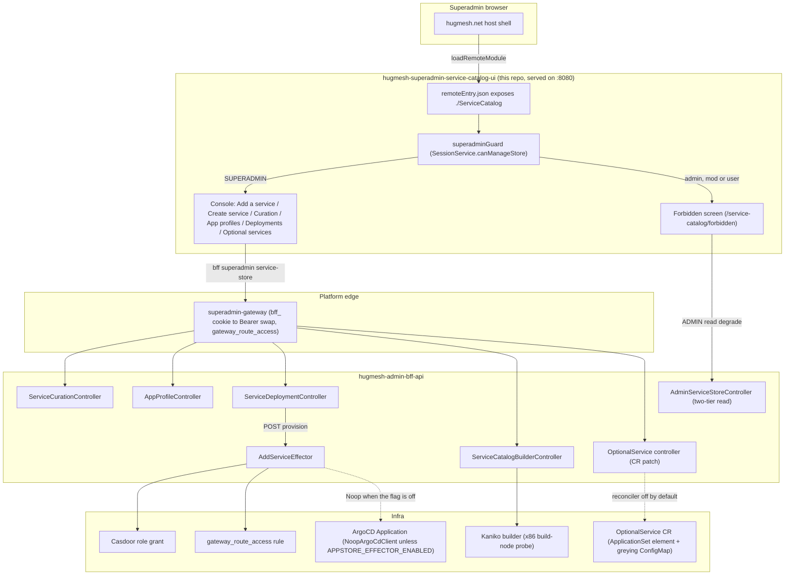

The **Superadmin Service Catalog console** is an Angular **native-federation remote**. The
`hugmesh.net` host mounts it at the apex path **`/service-catalog`**. That is the path this code
assumes; the deployed mount is `/superadmin/service-catalog` (see "Federation contract").

It is the SUPERADMIN console for the `hugmesh-admin-bff-api` Service Catalog **data layer**
(`feat/superadmin-service-catalog-data-layer`). It does six jobs: per-domain service
**curation**, **app-profile** deploy-template CRUD, **service-deployment** lifecycle
**accounting**, a **create-and-federate wizard** (scaffold a new service from a starter
archetype, optionally register its UI in the federation manifest), an **Add a service**
provision flow, and an **optional-services** on/off toggle. Where a button does less than it
looks, the console says so.

## Federation contract

The registration descriptor in `hugmesh-generator`
(`specs/cluster/manifests/federation-api/register-superadmin-service-catalog.descriptor.yaml`)
points the federation manifest at this remote:

| field | value |
| --- | --- |
| `remoteEntry` | `http://hugmesh-superadmin-service-catalog-ui.hugmesh-frontend.svc.cluster.local:8080/remoteEntry.json` |
| `mountAt` | `/superadmin/service-catalog` |
| `requiresRole` | `SUPERADMIN` |
| `kind` | `remote-shell` |
| `visibility` | `internal` |

The descriptor leaves the `federation_modules` INSERT to a `hugmesh-federation-api`
Liquibase changeset, `042-register-superadmin-service-catalog-module.xml`. That changeset is not
on `hugmesh-federation-api` `origin/main` (the changelog stops at `041`), so the row may not exist
on a mesh yet. The comment in `federation.config.js` still carries older values (short host name,
`/service-catalog`, `superadmin`). They differ from the descriptor.

This remote:

- exposes **`./ServiceCatalog`** (→ `src/app/service-catalog.routes.ts`, `SERVICE_CATALOG_ROUTES`)
  in `federation.config.js` under the remote name `service-catalog`. A host passes that key to
  `loadRemoteModule`;
- is served on **port 8080** (see `Dockerfile` + `nginx.conf`, `nginxinc/nginx-unprivileged`), so
  the emitted `remoteEntry.json` is reachable at the registered URL;
- is **internal**. It is the SUPERADMIN infra control plane, reachable only behind the
  `ROLE_SUPERADMIN` route-access row for `/superadmin/service-catalog/**` on
  `hugmesh-superadmin-gateway` (`StripPrefix=2`) and the tailnet-only superadmin surface. It is
  **not** a public UI.

`federation-base.js` carries the same code as the `hugmesh-host-shell` copy. It is the single
source of truth for the shared-deps surface and the RxJS skip list. Only the header comments
differ. This keeps the remote from drifting from the host and the other HugMesh remotes.

## Architecture

How a superadmin's click reaches a cluster mutation: the host mount, the auth edge, the BFF
surface, and the two things that depend on live infra (the effector's ArgoCD apply and the
DOCKERFILE/ZIP builder pre-flight).



The `BuilderCtl`/`Kaniko` leg (`GET /bff/superadmin/service-store/builder`) is the live capability
pre-flight. See "Add a service" below and "BFF contract" for the exact path.

## Role model

This mirrors `hugmesh-admin-bff-api` (the Service Catalog controllers and the `SecurityConfig`
path gates). The UI gate is a convenience. The bff `@PreAuthorize` is authoritative, and every
call handles a 403 gracefully.

| capability | composite | views |
| --- | --- | --- |
| `canManageStore` | `SUPERADMIN` | Add a service, Create service, Curation, App profiles, Deployments, Optional services (the whole console) |
| `canReadOwnCatalog` | `ADMIN \| SUPERADMIN` | the two-tier read-only "my domain's offered catalog" degrade on the forbidden screen |

The **entire console is SUPERADMIN-only**. Every `/bff/superadmin/service-store/**` and
`/bff/superadmin/app-profiles/**` endpoint (and `/bff/superadmin/optional-services/**`) is
`@PreAuthorize("hasRole('SUPERADMIN')")` AND walled at the coarse
`/bff/superadmin/** = hasRole('SUPERADMIN')` gate. An **admin/mod/user** is denied. An **admin**
still gets a read-only landing on the forbidden screen, through the two-tier
`GET /bff/admin/service-store` (`hasAnyRole('ADMIN','SUPERADMIN')`). It shows the offered catalog
of the admin's own issuer-derived domain.

### Forbidden redirect (critical)

A denied child guard routes to **`router.parseUrl('/service-catalog/forbidden')`**. That is the
IN-REMOTE mount-path screen, **NOT** `'/forbidden'` and **NOT** `'/login'`. The host already
authgated the user in (route-access `/superadmin/service-catalog/**`). A denial here is a
**within-service privilege boundary**, not an auth failure. Shipping the bare `/forbidden` was a
real wiki-ui bug; the mount-prefixed path is the correct in-remote target.

## BFF contract (the exact PR #56 surface this console wires)

`src/app/service-catalog.service.ts` calls these EXACT paths (asserted in
`service-catalog.service.spec.ts`):

| method | path | body | role |
| --- | --- | --- | --- |
| `GET` | `/bff/superadmin/service-store/{domain}` | — | SUPERADMIN |
| `POST` | `/bff/superadmin/service-store/{domain}/offer` | `{serviceKey}` (`X-ServiceStore-StepUp` when challenged) | SUPERADMIN |
| `POST` | `/bff/superadmin/service-store/{domain}/withdraw` | `{serviceKey}` (role-only: no step-up gate) | SUPERADMIN |
| `GET` | `/bff/superadmin/app-profiles` | — | SUPERADMIN |
| `GET` | `/bff/superadmin/app-profiles/{name}` | — | SUPERADMIN |
| `POST` | `/bff/superadmin/app-profiles` | `{name, profileJson}` | SUPERADMIN |
| `PUT` | `/bff/superadmin/app-profiles/{name}` | `{name, profileJson}` | SUPERADMIN |
| `DELETE` | `/bff/superadmin/app-profiles/{name}` | — | SUPERADMIN |
| `GET` | `/bff/superadmin/service-store/{domain}/deployments` | — | SUPERADMIN |
| `POST` | `/bff/superadmin/service-store/{domain}/deployments` | `{serviceKey, profileRef?, endingAt?, enforceActions?}` | SUPERADMIN |
| `POST` | `/bff/superadmin/service-store/{domain}/deployments/{id}/end` | — | SUPERADMIN |
| `POST` | `/bff/superadmin/service-store/{domain}/deployments/{id}/provision` | `{sourceKind, repoUrl, path?, targetRevision?}` (`X-ServiceStore-StepUp` when challenged) | SUPERADMIN |
| `GET` | `/bff/admin/service-store` | — | ADMIN \| SUPERADMIN |
| `GET` | `/bff/superadmin/service-store/builder` | — | SUPERADMIN |
| `GET` | `/bff/superadmin/service-store/scaffold/archetypes` | — | SUPERADMIN |
| `POST` | `/bff/superadmin/service-store/{domain}/scaffold` | `{serviceKey, displayName?, archetype, mountAt?, requiresRole?}` (`X-ServiceStore-StepUp`) | SUPERADMIN |
| `GET` | `/bff/superadmin/service-store/{domain}/scaffold/{id}/archive` | — (`application/zip`) | SUPERADMIN |
| `POST` | `/bff/superadmin/service-store/{domain}/deployments/{id}/federate` | `{slug, mountAt, exposedModule, remoteEntryUrl, kind?, visibility?, requiresRole?}` (`X-ServiceStore-StepUp`) | SUPERADMIN |
| `GET` | `/bff/superadmin/service-store/federation` | — | SUPERADMIN |
| `GET` | `/bff/superadmin/optional-services` | — | SUPERADMIN |
| `PUT` | `/bff/superadmin/optional-services/{slug}` | `{enabled, reason?}` | SUPERADMIN |

**Provision.** The `/provision` row is the **Service Catalog effector**
(`feat/superadmin-service-catalog-effector`). It moves an existing `service_deployment` row from
accounting-only to a real provisioned service: per-service Casdoor role, then route-access rule,
then ArgoCD `Application`. `sourceKind` is one of the **four Service Catalog sources**:
`SELECT` / `GIT` / `DOCKERFILE` / `ZIP` (case-insensitive; null or blank means `SELECT`).

- `SELECT` (a catalog tile) and `GIT` (a prebuilt repo) provision today.
- `DOCKERFILE` and `ZIP` need an image **built first** by the in-cluster **Kaniko** builder
  (`KanikoBuildLauncher`).
- The bff answers `{deployment, effectorReal}`. This console ignores the body and re-reads the rows.
- The effector is **dark by default**. `app.appstore.effector.enabled` is `false` in the bff's
  `application.yml` (`APPSTORE_EFFECTOR_ENABLED`). Then the `NoopArgoCdClient` makes no real ArgoCD
  mutation, and the call still returns `200`.
- The `hugmesh-generator` manifest (`manifests/admin-bff-api/deployment.yaml`) sets
  `APPSTORE_EFFECTOR_ENABLED` to `"true"`. On a mesh deployed from it, the real `RestArgoCdClient`
  is the wired bean. The manifest's own note says that client currently fails at the TLS handshake
  against the self-signed `argocd-server` (`hugmesh-admin-bff-api#62`).
- The bff also exposes `GET .../service-store/effector` (`{real}`). This console does not call it.

**Builder pre-flight.** The `/builder` row is the **live Kaniko-builder capability pre-flight**
(`ServiceCatalogBuilderController`). It reports `{enabled, buildNodePresent, warnings}`: the
`app.appstore.builder.enabled` config flag AND a live, fail-safe x86 build-node probe. The
Add-a-service view reads it, together with `requiresBuilder()` (the static per-kind fact), and
un-gates `DOCKERFILE`/`ZIP` the moment a real build is possible. They are no longer disabled
forever. A failed or loading pre-flight fails safe and never fakes a "ready".

**Wizard.** The `scaffold` / `archive` / `federate` / `federation` rows are the
**create-and-federate wizard** surface (`ServiceStoreWizardController`).

- `POST .../scaffold` and `POST .../deployments/{id}/federate` are **step-up-gated**. Each call
  carries a fresh token in the `X-ServiceStore-StepUp` header. A fresh MFA stamp on the session
  also satisfies the gate without a token. A missing or expired token returns a 403 with the
  platform "requires step-up" contract (`ServiceCatalogApiError.isStepUpRequired`), not an
  ordinary superadmin-denial 403.
- `GET .../scaffold/{id}/archive` streams the rendered starter codebase as a zip over the same
  `bff_` cookie (a plain anchor href, no in-JS blob fetch).
- `POST .../federate` returns `{deployment, federationReal, gitopsDescriptorPending}`
  **honestly**. `gitopsDescriptorPending` is always `true` today, because the GitOps descriptor
  automation does not exist. `federationReal` is `false` while the bff wires the
  `NoopFederationModuleClient`. That is the default: `app.appstore.federation.enabled`
  (`APPSTORE_FEDERATION_ENABLED`) is `false` in `application.yml`. The generator manifest sets it
  to `"true"`, which wires the `RestFederationModuleClient`. Per the manifest's note, that client
  fails at the TLS handshake (`hugmesh-admin-bff-api#82`) and has no auth-token source. The wizard
  shows the outcome as an explicit notice and never fakes success.
- `GET .../federation` is the live pre-flight the federation step reads first (`enabled` +
  `warnings`), the same way the builder pre-flight gates DOCKERFILE/ZIP.

**Step-up on offer, withdraw, provision.**

- `offer` and `provision` are step-up-gated in the admin-bff too (`ServiceCurationController.offer`,
  `ServiceDeploymentController.provision`; same gate, same MFA-stamp alternative).
- `withdraw` is role-only on purpose. `ServiceCurationController` records the operator decision
  (hugmesh-generator #347, decision 6).
- The Curation and Add-a-service views speak the **same client contract** (issue #4). They pause on
  a "requires step-up" 403, show the shared `<hug-step-up-challenge>`, and retry the same call with
  the confirmed token. The token travels through an `HttpContext` seam (`step-up-context.ts`) into
  the header, set by `bffAuthInterceptor`.
- The seam is older than the bff gate. The generated `offer` and `provision` clients now declare
  the header parameter and only `withdraw` does not, but the console still routes all three
  through the seam. A token-less call is byte-identical to a call made before the seam existed.

**Domain.** The `{domain}` is always the explicit **path** target, never a body field. The infra
control plane picks the brand. The two-tier admin read takes the domain from the validated JWT
issuer, never from the request.

**Optional services.** The two `optional-services` rows are the **post-deploy service toggle** (the
`Optional services` view below). They are the ONLY calls here that skip the generated
`ng-openapi-gen` client: `listOptionalServices()` and `setOptionalServiceEnabled()` call
`HttpClient` directly.

- The admin-bff handler exists (`OptionalServiceSuperadminController`). The committed
  `openapi.json` lists both paths. A generated `OptionalServiceSuperadminControllerService` exists.
  The service does not use it.
- The calls use the same same-origin `/bff/**` path and the same `bffAuthInterceptor`.
  `service-catalog.service.spec.ts` asserts URL, method, body and credentials, so a switch to the
  generated client changes nothing in the contract.
- **This UI half has not been exercised against a running admin-bff.** See "Known Gaps".
- `GET` returns the envelope `{reconcilerEnabled, services[], note}`. A bare array is also accepted.
- With the reconciler off, `PUT` answers `503` with `dark: true` and writes nothing. An unknown
  slug is `404`. A slug the registry cannot actuate is `422` with the named reason.

The response is deliberately two-valued per service. `enabled` is the **requested**
`spec.enabled`. `installed` is the **confirmed** `status.installed` the controller says it wrote.
Everything the screen claims about a service's state comes from `installed` alone. `toggleable`
(+ `reason`) tells the console whether the server can actuate that slug at all. A row without
`installed` reads as *not confirmed*. A row without `toggleable` is treated as **not** toggleable.
Both fail safe, loudly.

## The console

- **Add a service** is the headline flow. Type or select a domain, load its recorded deployments
  (its app profile), pick one, then choose one of the **four sources**: **Catalog (SELECT)**,
  **Git / GitLab (GIT)**, **Dockerfile (DOCKERFILE)** or **Zip repo (ZIP)**. Then **Provision** it
  (`POST .../deployments/{id}/provision`).
  - SELECT and GIT provision today.
  - DOCKERFILE and ZIP wait on the **live builder pre-flight** (`GET .../service-store/builder`).
    The view fetches it with each domain load and un-gates both sources the moment it confirms a
    real in-cluster build is possible (config flag enabled AND a build node present). No redeploy
    needed.
  - The `hugmesh-generator` admin-bff manifest sets `APPSTORE_BUILDER_ENABLED` to `"false"`
    (`manifests/admin-bff-api/deployment.yaml`). On a mesh deployed from it the pre-flight reports
    "not ready" (UNVERIFIED on a live mesh), so in practice only SELECT and GIT provision. The radio
    options render disabled, with help text that says why (not enabled, or enabled with no build
    node).
  - The submit is guarded as defence in depth. The bff's authoritative `400` is shown verbatim.
  - `repoUrl` is required (the bff `@NotBlank`). `path` and `targetRevision` are optional. The
    `{domain}` and `{id}` are explicit PATH targets.
- **Create service** is a five-step wizard (**Identity → Archetype → Source → Federation → Review &
  apply**). It stands up a new service from scratch and optionally federates its UI, over the
  `ServiceStoreWizardController`.
  - **Identity**: domain, `serviceKey`, display name, optional app-profile reference.
  - **Archetype**: pick a starter codebase from the embedded catalog
    (`GET .../scaffold/archetypes`). Before submit, the view checks the derived slug against the
    per-archetype rule (the spring-bff archetype needs a Java-package-safe `^[a-z0-9]+$` slug).
  - **Source**: the same four SELECT/GIT/DOCKERFILE/ZIP options as Add a service, with the same
    live builder pre-flight gating (`service-source-options.ts`).
  - **Federation**: slug, mountAt, exposedModule, remoteEntryUrl, visibility, requiresRole. The live
    `GET .../federation` pre-flight shows a ships-dark note when registration is not real yet.
  - **Review & apply**: an optional "offer to the domain catalog" toggle, then the apply chain,
    run **sequentially**, each step with its own status: offer? → record deployment → scaffold →
    \[archive download link] → provision → federate? (offer and federate are skipped when not
    chosen).
    - `scaffold` and `federate` are **step-up-gated**. A 403 with the "requires step-up" contract
      pauses the chain and shows a token challenge. Confirming a token **resumes the same chain**
      from the paused step.
    - A bff `400` is shown verbatim.
    - The federate outcome's `federationReal=false` and `gitopsDescriptorPending=true` render as
      explicit pending/dark notices. The wizard never fakes success.
- **Curation**: type or select a domain, load its offered catalog, offer or withdraw a
  `service_key` for it. Shows the offered set per domain.
- **App profiles**: CRUD for the global deploy-template library (a name plus a JSON document of
  resource, role, cert and exposure defaults). Before saving, the editor validates the document
  against the committed schema `schemas/app-profile.schema.json`. `src/app/app-profile-schema.ts`
  interprets that file; nothing is hard-coded. The sections are `resources` / `roles` / `certs` /
  `exposure`. Every object is closed: an unknown field is refused and named. Every refusal is
  listed with its dotted field path.
  - **The server validates it too.** On `hugmesh-admin-bff-api` `origin/main`,
    `AppProfileService.create` and `update` check `profileJson` against a byte-identical copy of
    this schema before the write (`hugmesh-admin-bff-api#55`, closed). A direct API call or a stale
    tab cannot store a body the console would refuse. The values are stored verbatim and not
    resolved yet (a later effector reads them; issue #3).
  - **Operator decision 37 (2026-09-17, hugmesh-generator#347) RATIFIED the three choices this
    schema had to make on its own**: `roles[]` are Casdoor `ROLE_<UPPER>` names (37a, *not* the
    per-service `requiresRole` slug), unknown keys are STRICT (37b, `additionalProperties: false`
    everywhere), and `exposure.mfaRequired` stays (37c).
    `src/app/app-profile-schema.decision37.spec.ts` pins all three, so a later change cannot
    quietly take the branch the operator declined.
  - **The schema file is a two-repo contract.** Ratification un-parked `hugmesh-admin-bff-api#55`.
    It commits a **byte-identical** copy at `src/main/resources/schema/app-profile.schema.json`
    (`cmp` confirms the two files are identical today) and validates saves against it.
    `npm run verify:schema` guards the contract. It runs first inside `npm test`, so CI enforces it.
    It has **two checks, and it matters which does what**:
    - a **local sha256 pin**, so the schema cannot be edited without also moving a literal. On its
      own this proves nothing about the other repo: moving the schema and the literal together in
      ONE repo satisfies it. That was a real hole. Widening `certs.ttl` `maxLength` 32 → 64 here and
      moving only this repo's pin left **both** suites green with the files diverged
      (`cmp` → `differ: char 4898, line 63`).
    - the **mirror check**, which reads the BFF's copy and compares the two files byte for byte.
      This one enforces the contract. It runs whenever `hugmesh-admin-bff-api` is checked out beside
      this repo, and in CI, where `.gitlab-ci.yml` clones it and sets
      `HUGMESH_SCHEMA_MIRROR_REQUIRED=1` so a failed clone fails the job instead of skipping
      silently. Point it elsewhere with
      `ADMIN_BFF_SCHEMA=<bff>/src/main/resources/schema/app-profile.schema.json`.

    So editing the schema on one side turns both suites red **wherever the mirror check runs**:
    always in CI, always on a developer box with both checkouts. When the BFF is not readable, the
    script says `mirror NOT VERIFIED` and means it.
- **Deployments (accounting)**: view the `service_deployment` rows (service, state `active|ended`,
  `created_at`, the `ending_at` expiry clock, `enforce_actions`, `propagation_state`). **Record** a
  deployment (`serviceKey` + optional profile + optional `ending_at` + optional `enforce_actions`),
  or **end** an active one. This view is **catalog, accounting and lifecycle only**. Recording a
  deployment does not provision anything, and ending one tears nothing down (the bff's
  `ServiceDeploymentService.end` has no real teardown yet). Provisioning (the `AddService`
  effector) happens on the **Add a service** tab (SELECT/GIT provision today; DOCKERFILE/ZIP stay
  gated on the live builder pre-flight).
- **Optional services**: the post-deploy on/off control for the optional cluster services
  (`GET`/`PUT /bff/superadmin/optional-services`). An image ships with only the services it was built
  with; a superadmin enables the rest here. The view is built so it cannot overstate what it knows:
  - Enable and Disable are two explicit **actions**, not a switch whose position mirrors state.
    State is a separate read-only badge derived **only** from the controller-reported `installed`,
    so an accepted request can never move it. A `PUT` that returns `2xx` produces a notice worded as
    a *request*, and the row stays *Not confirmed* until the controller reports it.
  - *Not confirmed* is a first-class reading, with the cause named (never observed, or a stale
    `observedGeneration`). It is what a slug the reconciler silently ignores actually looks like.
    The view shows it instead of showing the slug as on.
  - A slug the server reports as **not toggleable**, or does not report on, has both actions
    disabled, with the server's reason beside them and wired through `aria-describedby`. Every
    disabled action on the screen carries a reason. No disabled control is bare.
  - A failed `PUT` shows the server's message **verbatim**, next to the plain-language prefix and
    never instead of it.
  - Unlike every other view here, a `403`/`404` on the load does **not** degrade to an empty state.
    "This domain offers nothing" is a truthful empty reading. "This mesh has no optional services"
    never is. A denied or missing endpoint is explained instead.

Every view has loading, empty and error states. A 403/404 degrades gracefully, with the one
exception noted under "Optional services".

## Typed API client (ng-openapi-gen)

The typed client under `src/app/api/` is **committed**. `ng-openapi-gen` generates it from the
admin-bff-api OpenAPI spec, also committed here as `openapi.json`. The build is deterministic: no
network, no running BFF.

Regenerate with:

```bash
npm run gen:spec   # copies ../hugmesh-admin-bff-api/src/main/resources/openapi/openapi.json
                   # → openapi.json, then runs ng-openapi-gen. Override the source with
                   # ADMIN_BFF_SPEC=/path/to/openapi.json. The BFF dumps that spec from
                   # `./mvnw -Dtest=OpenApiSpecDumpTest test`.
npm run gen        # just run ng-openapi-gen against the already-present openapi.json
```

`service-catalog.service.ts` is a thin **delegating** wrapper over the generated, typed clients
(`ServiceCurationControllerService` / `AppProfileControllerService` /
`ServiceDeploymentControllerService` / `AdminServiceStoreControllerService`, plus the builder and
wizard clients). It keeps its OWN public `ServiceCuration` / `AppProfile` / `ServiceDeployment` /
`ServiceCatalogApiError` types, the stable contract the views use, and bridges the generated models
at the delegation boundary.

The generated clients call the SAME same-origin `/bff/**` paths (`rootUrl` defaults to `''`).
`bffAuthInterceptor` (`src/app/auth.interceptor.ts`) sends every request with
`withCredentials: true`, so the browser's HttpOnly `bff_` cookie goes along. It does **not** attach a
bearer token read from `hug.session`; that browser-held bearer was removed (see "Auth & session
model").

> **ng-openapi-gen 1.0.5 generates `Promise<T>` methods in `src/app/api/services/`** (the `fn/`
> helpers still return `Observable`). The `service-catalog.service.ts` delegation layer is written
> in async/await to match. The public API and types (`ServiceCuration` / `AppProfile` /
> `ServiceDeployment` / `ServiceCatalogApiError`) are unchanged; only the internal delegation is
> async/await.

## Auth & session model

This remote does **no** login of its own. The host shell authgates the superadmin in and owns the
session. Across the platform, **Casdoor** is the SSO IdP. `login-ui` runs the Casdoor OIDC
authorization-code (PKCE) redirect. `user-bff` does the server-side code-to-token exchange and holds
per-session JWT custody and refresh. The browser only ever holds an **opaque `bff_`-prefixed
session**: the `hug.session` entry in `localStorage` that this remote reads for roles, and the
HttpOnly `bff_` cookie. The superadmin never sees their own Casdoor JWT.

At the edge, the **gateway** is a pure Casdoor-JWT OAuth2 resource server. A pre-security exchange
filter swaps the `bff_` session for the internal custody JWT, so the gateway's JWT validation and
role gate run unchanged. Authorization is data-driven by the `gateway_route_access` Postgres table
(source of truth) through `GatewayRouteAccessFilter`. The `/superadmin/service-catalog/**` and
`/bff/superadmin/**` rules (`ROLE_SUPERADMIN`) live there, and SUPERADMIN gets cross-domain reach.
The bff `@PreAuthorize` stays authoritative; this UI's gating is defence in depth.

## Current State

- **Console shipped.** The SUPERADMIN Service Catalog remote (Add a service / Create service /
  Curation / App profiles / Deployments / Optional services) is wired against the committed
  `openapi.json` typed client. Karma tests and the Playwright/BDD e2e harness are merged to `main`.
  The harness has 37 `Scenario` / `Scenario Outline` blocks in 11 `.feature` files. Every file
  carries the `@cluster` tag at Feature level, so all of them **SKIP** unless `E2E_CLUSTER=1` (the
  remote served at a `baseURL`, plus a reachable admin-bff `/bff/superadmin/service-store`). The
  Karma specs prove the offline contract.
- **Create-and-federate wizard shipped.** The apply chain runs for real. `gitopsDescriptorPending`
  is always `true` and `federationReal` is `false` under the default `NoopFederationModuleClient`
  (see "BFF contract").
- **Optional-services toggle screen shipped, UNINTEGRATED.** The sixth view
  (`/service-catalog/optional-services`) is wired to the admin-bff handler that now exists and is
  covered by Karma specs. It has never run against a live admin-bff, and the reconciler behind it is
  off. See "Known Gaps".
- **Effector wired, dark by default.** `/provision` drives the Casdoor role, the
  `gateway_route_access` leg and the ArgoCD apply. The packaged default is the `NoopArgoCdClient`.
  The generator manifest enables the real client, which fails at TLS (see "BFF contract"). `SELECT`
  and `GIT` are the sources that provision.
- **Live builder capability gating shipped.** The Add-a-service view reads the live
  `GET /bff/superadmin/service-store/builder` pre-flight and un-gates `DOCKERFILE`/`ZIP` once a real
  build is possible. The generator manifest sets `app.appstore.builder.enabled` to `"false"`, so on a
  mesh deployed from it only `SELECT`/`GIT` provision in practice. The gate is a live signal, not a
  hardcoded one.
- **Auth baseline current.** The console uses the opaque `bff_` session model with Casdoor SSO at
  the edge. Route-access is data-driven through `gateway_route_access`. No login logic lives here
  (login is `login-ui` + `user-bff`; shared account, session and MFA infra is in
  `hugmesh-auth-core`). Backend baseline: **Java 25**, Spring Boot 4.0.7, Spring Cloud 2025.1.2,
  Spring Cloud Gateway 5.0 (`spring.cloud.gateway.server.webflux.routes`). The admin-bff is built
  against **hugmesh-parent 2.8.0**, which manages **hugmesh-commons 2.1.0**. CI is **GitLab**
  (`.gitlab-ci.yml`: `test`, `headers`, `build:image`). The only GitHub Actions workflow is
  `.github/workflows/release.yml`. It is manual (`workflow_dispatch`), not wired to push or tags,
  and pushes the image to GHCR. **Angular 22** (`@angular/core` 22.0.2, `@angular/cli` 22.0.4,
  native-federation 22.0.1, ng-openapi-gen 1.0.5, per `package-lock.json`).
- **Internal-only surface.** The remote is served on 8080 behind the gateway superadmin gate and the
  tailnet-only superadmin surface. `nginx.conf` ships these headers:
  - Baseline: `X-Content-Type-Options: nosniff`, `X-Frame-Options: DENY`,
    `Referrer-Policy: strict-origin-when-cross-origin`, HSTS. They are emitted `always` and
    repeated per `location`, because nginx drops inherited `add_header`s in a location that has its
    own.
  - A strong **nonce-based Content-Security-Policy**, ported from admin-ui/login-ui: a
    `map $request_id $cspnonce` per-request nonce, a `sub_filter` that rewrites every `<script` in
    the served `index.html` to carry `nonce="$cspnonce"`, and a `Content-Security-Policy` header
    with NO `unsafe-inline` in `script-src` (only `'self' 'nonce-…' blob:`). `style-src` keeps
    `'unsafe-inline'` because Angular inlines component styles.
  - Since issue #5: `Cross-Origin-Embedder-Policy: require-corp`,
    `Cross-Origin-Resource-Policy: same-origin`, and a `Permissions-Policy` that denies 23 features.
    The structure comes from `hugmesh-games/frontend/nginx.conf` (the only nginx front in the org
    that already shipped all three). The values are re-derived for this console.
  - **What the 23 cover.** They are the features this console could plausibly reach, NOT every
    feature the browser knows. `document.featurePolicy.features()` on Chrome 149.0.7827.55 returns
    **82** names. The other 59 (client hints, the Privacy Sandbox set, `clipboard-read` /
    `clipboard-write`, `window-management`, `storage-access`) are left unrestricted. What IS measured
    is the narrower claim the guards pin: every one of the 23 shipped names is in that list, so the
    header logs no `Unrecognized feature` noise (which `verify:page` fails on).
  - **Why `same-origin`**, not games' `same-site`: the superadmin gateway mounts this console at a
    path on its OWN origin (`/superadmin/service-catalog/**`, `StripPrefix=2`), and the host shell
    refuses a cross-origin `remoteEntry` outright. `hugmesh-gateway`'s own `SecurityConfig` already
    defaults every proxied response to CORP `same-origin`. This only makes explicit at the origin
    what the edge already asserted.
  - **Why empty `()` allowlists**, not games' `(self)` grants: this console has no camera,
    microphone, geolocation, fullscreen or WebAuthn code path.
  - **COOP and COEP.** COOP stays the gateway's (`same-origin`, set at the TLS edge). COEP is
    enforced here because the gateway declines it platform-wide (it would break module-federation
    remotes that are not CORP-tagged), and this remote's subresources are all same-origin.
  - **Two guards pin the headers.** `npm run verify:headers` is static, per BLOCK, and also checks
    the `ngCspNonce` marker in `src/index.html` that the conf's sub_filters rewrite; the image build
    runs it too. `npm run verify:page` runs headless Chrome over the real conf; the CI `headers` job
    runs it, and `build:image` needs that job, so a red one blocks the push instead of only
    reddening the pipeline.

## Roadmap

- **Enable the effector for real.** The flag is already `"true"` in the generator manifest. The
  ArgoCD client must still trust the self-signed `argocd-server` certificate
  (`hugmesh-admin-bff-api#62`) and get an auth token (`APPSTORE_ARGOCD_AUTH_TOKEN` has no source in
  the tree). Then validate the provision path live.
- **Deploy a live Kaniko builder.** The UI side of DOCKERFILE/ZIP is done; the live pre-flight in
  "Current State" un-gates them. What is left is infra-side, in the admin-bff and cluster: flip
  `app.appstore.builder.enabled` and land a node labelled `hugmesh.net/build-node=true` where the
  pre-flight can see it. Build-from-source services then provision with no further UI change. The
  generator's own note says the flag flips only after the push-credential ExternalSecret lands.
- **App-profile resolution.** A later effector reads the app-profile JSON (resource, role, cert and
  exposure defaults, in the shape `schemas/app-profile.schema.json` defines) instead of storing it
  opaque. It is issue #3, admin-bff work; the bff's `AppProfileService` says nothing reads the
  values yet. The bff already validates the schema on save. The profiles form shows a bff 400 reason
  verbatim. Both bff error bodies surface: `{error}` (ApiException) and the bean-validation
  `{error:"validation failed", fields:{...}}`. `ServiceCatalogService` folds them into one message,
  so a path-keyed `fields` map (`resources.cpu: …`) renders field by field.
- **MFA step-up.** The bff gate (`ServiceStoreStepUpGate`) now covers `offer`, `provision`,
  `scaffold` and `federate`. `withdraw` stays role-only by operator decision. The UI half is in
  place for all of them (the same pause, challenge and retry the wizard uses). Issue #4 is still
  open. On this side: the generated `offer` and `provision` clients already declare the header, so
  the `HttpContext` seam (`step-up-context.ts`) can go for them.
- **Enable real federation registration.** Fix the TLS handshake (`hugmesh-admin-bff-api#82`), give
  the client an auth token, and build the GitOps descriptor automation. Until then the wizard's
  `federate` step cannot register a new remote's UI.
- **Make the optional-services toggle actuate.** The admin-bff handler is in. Still open: switch the
  reconciler on, and run this view against a live admin-bff. The reconciler flag
  (`APP_OPTIONAL_SERVICES_RECONCILE_ENABLED`) is declared as `"false"` in
  `manifests/admin-bff-api/deployment.yaml`. The generator's decision is that it flips by a reviewed
  commit, and only after the cut-over in `docs/OPTIONAL-SERVICES.md` §10. Until then this view is an
  honest window plus a request button, and a `PUT` is refused with `503`.

## Known Gaps / TODO

Checked against the current source, not against the roadmap alone:

- **The optional-services view has NEVER run against a live admin-bff.** The UI was first written to
  the documented contract (`hugmesh-generator` `docs/OPTIONAL-SERVICES.md` §10 "natural next wave").
  It was then corrected against the body the bff builds (`{reconcilerEnabled, services[], note}`,
  commit `da8b5ce`). Only Angular's `HttpTestingController` has exercised it. Nothing here has
  exchanged a byte with a running server. If the shipped DTO differs, the view fails **safe**:
  an unknown field is dropped; a missing `installed` reads as *not confirmed*; a missing `toggleable`
  disables the row with "the server did not report whether this service can be toggled"; a body that
  is neither an array nor an object with a `services` array raises instead of rendering an empty
  mesh. First integration should diff the real payload against `OptionalServiceView` in
  `src/app/optional-service-state.ts`.
- **The view discards `reconcilerEnabled`.** `listOptionalServices()` returns only the rows.
  `listOptionalServiceCatalogue()` keeps the envelope, but nothing calls it. A superadmin learns the
  reconciler is off only from the `503` on a `PUT`.
- **The gateway route and `ROLE_SUPERADMIN` floor for `/bff/superadmin/optional-services` already
  exist** (the `/bff/superadmin/**` rows in the generator's route-access seed). This view needs no
  new `gateway_route_access` row.
- **The admin-bff reconciler is off, and only a reviewed commit can turn it on.**
  `APP_OPTIONAL_SERVICES_RECONCILE_ENABLED` is declared with value `"false"` in
  `specs/cluster/manifests/admin-bff-api/deployment.yaml`. `specs/cluster/apps/31-admin-bff-api.yaml`
  carries `automated:{prune:true,selfHeal:true}` with no `ignoreDifferences`, on purpose (its header
  explains why). A manual `kubectl set env` is reverted on the next selfHeal pass. **With the flag
  off, the bff refuses a toggle** (`503`, `dark: true`, no write), and the view shows the server's
  message.
- **The three data defects recorded earlier are closed.** The generator's slug-closure guard
  (`tests/scripts/test-optional-service-slug-closure.sh`) closed them.
  - `character-forge` and `meshbridge` are now in the CRD `spec.slug` enum, the seed CRs and the
    admin-bff `OptionalServiceRegistry` (14 entries).
  - `specs/cluster/apps/16-reserved-prefixes-policy.yaml` lists 14 `ignoreDifferences` jsonPointers,
    and both are among them.
  - `headwind` and `attestation-server` are deliberately not toggleable (no 13a element; the
    registry reports `NO_APPLICATIONSET_ELEMENT`), so they read as not toggleable in this view.
- **The `installed-services` ConfigMap is WRITE-ONLY.** No manifest under `specs/cluster/manifests`
  in `hugmesh-generator` mounts it or reads it through `configMapKeyRef` or `envFrom`. The
  user-facing greying reads `federation_modules` in Postgres instead. So half of every reconcile
  pass writes an artefact nobody reads. This is recorded, and deliberately **not** "fixed" by
  inventing a consumer. (The earlier org-wide grep count is not reproduced here.)
- **This repo has no i18n pipeline**, so no extraction was run for the new view. There is no
  `@angular/localize` dependency, no `extract-i18n` architect target in `angular.json`, and no
  `i18n=` or `$localize` anywhere under `src/`. All copy in all six views is inline English. The new
  view matches that. Introducing `$localize` would be a new pattern for one screen.
- **`DOCKERFILE` / `ZIP` provisioning needs a live in-cluster builder that no deployment has yet.**
  `requiresBuilder()` (`src/app/service-catalog.service.ts`) is the static per-kind fact. It is
  combined with the LIVE `builderReady()` signal (same file, fetched by `builderStatus()`) to set
  `opt.builderGated` in `service-catalog-add-service.component.html`. Only `SELECT`/`GIT` provision
  today.
- **The Add-a-service notice ignores the effector flag.** After a successful `/provision`, the view
  always says the ArgoCD apply "lands when the effector is enabled (it ships dark by default)"
  (`service-catalog-add-service.component.ts`, `runProvision`). The bff returns `effectorReal`, and
  the console ignores it. Where the effector is enabled, the notice is wrong.
- **The ArgoCD and federation legs are dark by default and fail at TLS when enabled.** See "BFF
  contract" (`hugmesh-admin-bff-api#62`, `#82`). The wizard's federate step registers nothing yet;
  `federateDeployment()` (`src/app/service-catalog.service.ts`) returns `federationReal=false` and
  `gitopsDescriptorPending=true`, and Review & apply shows both as explicit notices
  (`service-catalog-create-service.component.ts`).
- **App-profile JSON is validated in the browser AND by the bff, but not yet resolved.** The editor
  refuses a document that does not match `schemas/app-profile.schema.json` (unknown field, wrong
  type, value outside its pattern or range) and names every offending field.
  `AppProfileService.create/update` in the bff re-check it before the write. Reads are not
  validated. A profile stored before the schema existed (the flat `{"cpu","memory"}` form) stays
  readable, shows its field errors the moment it opens for edit, and cannot be saved until it moves
  under `resources` (`src/app/service-catalog-profiles.component.ts`). The effector that resolves
  the resource, role, cert and exposure defaults is issue #3 (admin-bff work).
- **Deployment lifecycle is accounting-only.** See "Deployments (accounting)"
  (`service-catalog-deployments.component.ts`).
- **The mount path differs between code and platform.** The routes, the guard and the forbidden
  redirect hard-code `/service-catalog/...`. The generator's descriptor and the superadmin gateway
  mount the console at `/superadmin/service-catalog`. The gateway strips two segments, so the remote
  itself is served from `/`. Whether a host that mounts it at `/superadmin/service-catalog` still
  sends a denied user to `/service-catalog/forbidden` is not tested here.
- **Optional-services calls still skip the generated client.** An open PR in this repo (#24) moves
  them onto it.
- **COOP is the gateway's, not this image's.** CSP, COEP, CORP and Permissions-Policy all ship in
  `nginx.conf` as of issue #5 (see "Current State"). `Cross-Origin-Opener-Policy` comes from
  `hugmesh-gateway` at the TLS edge, so it is absent on a direct in-cluster pod hit. Nothing here
  uses `SharedArrayBuffer`, so the console is not cross-origin ISOLATED and need not be. COEP
  enforces the subresource opt-in on its own.

No `TODO`/`FIXME`/stub markers sit in the hand-written `src/app` source (the API client under
`src/app/api/` is generated and excluded from this audit). The gaps above are the ones the code and
its own doc comments call out as not yet done.

## Develop

```bash
npm ci
npm start          # ng serve service-catalog — standalone dev shell at /service-catalog
npm run build      # ng build service-catalog — dist/service-catalog/browser (remoteEntry.json exposes ./ServiceCatalog)
npm test           # headless karma (ChromeHeadlessCI)
npm run verify:artefact   # assert the BUILT exposed chunk really carries every route
npm run verify:headers    # assert nginx.conf's response-header contract, per BLOCK
npm run verify:page       # load the BUILT page in headless Chrome behind the real
                          # nginx.conf: nothing blocked, console clean, COEP +
                          # Permissions-Policy proven ENFORCED (needs chromium +
                          # openssl; --server=replay when there is no docker)
npm run build:verify      # build, then verify the artefact AND the headers
```

### e2e

`e2e/` is a separate npm package (its own `package.json`): a Playwright + playwright-bdd harness.
`.feature` Gherkin specs live under `e2e/features/`, step definitions under `e2e/features/steps/`.
It ships dark. The `@cluster`-tagged scenarios (see "Current State" above) skip unless
`E2E_CLUSTER=1` points at a live remote and a reachable `/bff/superadmin/service-store`. A plain run
only proves the Gherkin compiles and every step is bound.

```bash
cd e2e
npm install
npm run bdd        # bddgen (generate specs from .feature files) + playwright test
```

The per-user `E2E_<ROLE>_PASSWORD` and shared `E2E_PASSWORD` env vars are optional overrides, not
requirements. `e2e/tests/helpers/roles.ts` (`passwordFor()`) falls back to the run-state
`.e2e-credentials` file written by hugmesh-generator's `make stack-seed`
(`$E2E_CREDENTIALS_FILE`, or a `.e2e-credentials` found by walking up from cwd). There is no
built-in literal password. If nothing resolves, the suite throws and names `make stack-seed`; it
never signs in with a guessable default. Only the `@cluster` scenarios' real host-shell login
(`login()`) resolves a password, at call time. So `playwright test --list` and a plain (skipping)
run need no credentials.

## Accessibility

This is the cross-repo HugMesh UI standard. Every interactive control has a programmatic accessible
name (`accessible-name.ts` + spec). Keyboard navigation works; the console menubar is a
roving-tabindex WAI-ARIA menubar. Controls use `disabled` plus help text where relevant, ARIA roles,
and visible focus rings. Loading, empty and error states are announced through
`role="status"`/`role="alert"`.
