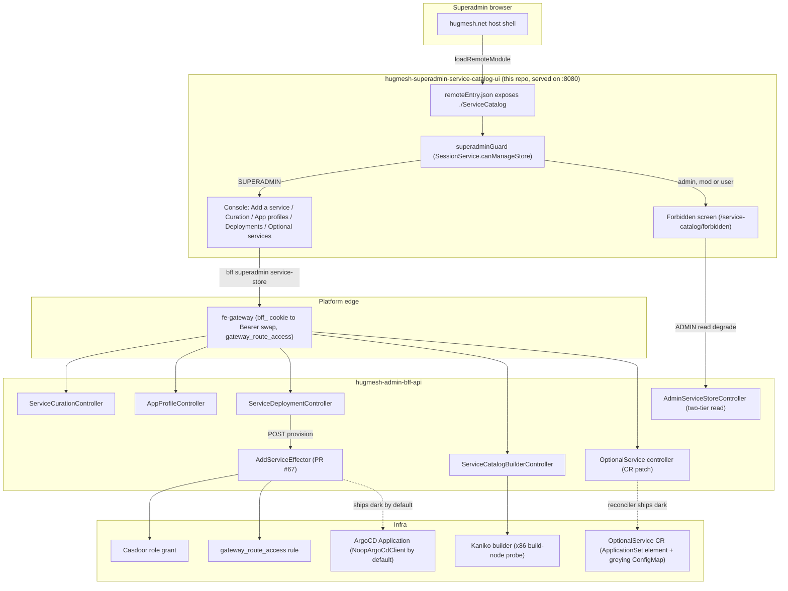

The **Superadmin Service Catalog console** — an Angular **native-federation remote** that
the `hugmesh.net` host mounts at the apex path **`/service-catalog`**. It is the
SUPERADMIN console that makes the `hugmesh-admin-bff-api` Service Catalog **data
layer** (PR #56, `feat/superadmin-service-catalog-data-layer`) usable: per-domain service
**curation**, **app-profile** deploy-template CRUD, **service-deployment**
lifecycle **accounting**, and (PR #24) a **create-and-federate wizard** that scaffolds a
brand-new service from a starter archetype and optionally registers its UI into the
federation manifest.

## Federation contract

The federation-api service-catalog module row points at this remote:

| field | value |
| --- | --- |
| `remote_entry_url` | `http://hugmesh-superadmin-service-catalog-ui:8080/remoteEntry.json` |
| `metadata.mountAt` | `/service-catalog` |
| `metadata.requiresRole` | `superadmin` |
| `kind` | `remote-shell` |
| `visibility` | `internal` |

So this remote:

- exposes **`./ServiceCatalog`** (→ `src/app/service-catalog.routes.ts`, `SERVICE_CATALOG_ROUTES`) in
  `federation.config.js` — the module key the host's
  `loadRemoteModule('service-catalog', './ServiceCatalog')` consumes;
- is served on **port 8080** (see `Dockerfile` + `nginx.conf`,
  `nginxinc/nginx-unprivileged`) so the emitted `remoteEntry.json` is reachable
  at the registered URL;
- is **internal** — the SUPERADMIN infra control plane, reachable only behind the
  gateway's `/service-catalog=superadmin` route-access gate and the Tailscale-VPN-only
  superadmin surface. It is **not** a public UI.

`federation-base.js` is **byte-identical** to the `hugmesh.net` host (the
single source of truth for the shared-deps surface + RxJS skip list) so this
remote can't drift from the host or the other HugMesh remotes.

## Architecture

How a superadmin's click in this remote reaches a real (or ships-dark) cluster
mutation — the host mount, the auth edge, the BFF surface, and the two things
that gate on live infra (the effector's ArgoCD apply and the DOCKERFILE/ZIP
builder pre-flight):



The `BuilderCtl`/`Kaniko` leg (`GET /bff/superadmin/service-store/builder`) is
the live capability pre-flight added in PR #17 — see "Add a service" below and
"BFF contract" for the exact path.

## Role model

Mirrors `hugmesh-admin-bff-api` (the Service Catalog controllers + `SecurityConfig`
path gates). The UI gating is defence-in-depth convenience; the bff
`@PreAuthorize` is authoritative — every call surfaces a 403 gracefully.

| capability | composite | views |
| --- | --- | --- |
| `canManageStore` | `SUPERADMIN` | Curation, App profiles, Deployments (the whole console) |
| `canReadOwnCatalog` | `ADMIN \| SUPERADMIN` | the two-tier read-only "my domain's offered catalog" degrade on the forbidden screen |

The **entire console is SUPERADMIN-only**: every `/bff/superadmin/service-store/**`
and `/bff/superadmin/app-profiles/**` endpoint is
`@PreAuthorize("hasRole('SUPERADMIN')")` AND walled at the coarse
`/bff/superadmin/** = hasRole('SUPERADMIN')` gate. An **admin/mod/user** is denied.
An **admin** still gets a graceful read-only landing on the forbidden screen via
the two-tier `GET /bff/admin/service-store` (`hasAnyRole('ADMIN','SUPERADMIN')`)
read of their own issuer-derived domain's offered catalog.

### Forbidden redirect (critical)

A denied child guard routes to **`router.parseUrl('/service-catalog/forbidden')`** — the
IN-REMOTE mount-path screen, **NOT** `'/forbidden'` and **NOT** `'/login'`. The
host already authgated the user in (route-access `/service-catalog=superadmin`); a denial
here is a **within-service privilege boundary**, not an auth failure. (Shipping the
bare `/forbidden` was a real wiki-ui bug — the mount-prefixed path is the correct
in-remote target.)

## BFF contract (the exact PR #56 surface this console wires)

`src/app/service-catalog.service.ts` calls these EXACT paths (asserted in
`service-catalog.service.spec.ts`):

| method | path | body | role |
| --- | --- | --- | --- |
| `GET` | `/bff/superadmin/service-store/{domain}` | — | SUPERADMIN |
| `POST` | `/bff/superadmin/service-store/{domain}/offer` | `{serviceKey}` | SUPERADMIN |
| `POST` | `/bff/superadmin/service-store/{domain}/withdraw` | `{serviceKey}` | SUPERADMIN |
| `GET` | `/bff/superadmin/app-profiles` | — | SUPERADMIN |
| `GET` | `/bff/superadmin/app-profiles/{name}` | — | SUPERADMIN |
| `POST` | `/bff/superadmin/app-profiles` | `{name, profileJson}` | SUPERADMIN |
| `PUT` | `/bff/superadmin/app-profiles/{name}` | `{name, profileJson}` | SUPERADMIN |
| `DELETE` | `/bff/superadmin/app-profiles/{name}` | — | SUPERADMIN |
| `GET` | `/bff/superadmin/service-store/{domain}/deployments` | — | SUPERADMIN |
| `POST` | `/bff/superadmin/service-store/{domain}/deployments` | `{serviceKey, profileRef?, endingAt?, enforceActions?}` | SUPERADMIN |
| `POST` | `/bff/superadmin/service-store/{domain}/deployments/{id}/end` | — | SUPERADMIN |
| `POST` | `/bff/superadmin/service-store/{domain}/deployments/{id}/provision` | `{sourceKind, repoUrl, path?, targetRevision?}` | SUPERADMIN |
| `GET` | `/bff/admin/service-store` | — | ADMIN \| SUPERADMIN |
| `GET` | `/bff/superadmin/service-store/builder` | — | SUPERADMIN |
| `GET` | `/bff/superadmin/service-store/scaffold/archetypes` | — | SUPERADMIN |
| `POST` | `/bff/superadmin/service-store/{domain}/scaffold` | `{serviceKey, displayName?, archetype, mountAt?, requiresRole?}` (`X-ServiceStore-StepUp`) | SUPERADMIN |
| `GET` | `/bff/superadmin/service-store/{domain}/scaffold/{id}/archive` | — (`application/zip`) | SUPERADMIN |
| `POST` | `/bff/superadmin/service-store/{domain}/deployments/{id}/federate` | `{slug, mountAt, exposedModule, remoteEntryUrl, kind?, visibility?, requiresRole?}` (`X-ServiceStore-StepUp`) | SUPERADMIN |
| `GET` | `/bff/superadmin/service-store/federation` | — | SUPERADMIN |
| `GET` | `/bff/superadmin/optional-services` | — | SUPERADMIN |
| `PUT` | `/bff/superadmin/optional-services/{slug}` | `{enabled, reason?}` | SUPERADMIN |

The `/provision` row is the **Service Catalog effector** (hugmesh-admin-bff-api PR #67,
`feat/superadmin-service-catalog-effector`, merged): it drives an existing
`service_deployment` row from accounting-only into a real provisioned service
(per-service Casdoor role → route-access rule → ArgoCD `Application`). `sourceKind`
is one of the **four Service Catalog sources** — `SELECT` / `GIT` / `DOCKERFILE` / `ZIP`
(case-insensitive; null/blank → `SELECT`). `SELECT` (a catalog tile) and `GIT` (a
prebuilt repo) provision today; `DOCKERFILE` and `ZIP` need an image **built first**
by the in-cluster **Kaniko** builder (`KanikoBuildLauncher`, shipped in admin-bff
PR #152). The effector itself **ships dark** by default (the bff `NoopArgoCdClient`
makes no real ArgoCD mutation) — the call still returns `200`; the role + route-access
leg is wired and the real ArgoCD apply lands when the effector is enabled.

The `/builder` row is the **live Kaniko-builder capability pre-flight**
(`ServiceCatalogBuilderController`, wired in this remote by PR #17): it reports
`{enabled, buildNodePresent, warnings}` — the `app.appstore.builder.enabled` config
flag AND a live, fail-safe x86 build-node probe. The Add-a-service view consults it
(alongside `requiresBuilder()`, the static per-kind fact) to un-gate `DOCKERFILE`/`ZIP`
the moment a real build is actually possible, instead of leaving them statically
disabled forever. A failed/loading pre-flight fails safe (never a faked "ready").

The `scaffold`/`archive`/`federate`/`federation` rows are the **create-and-federate
wizard** surface (`ServiceStoreWizardController`, PR #24). `POST .../scaffold` and
`POST .../deployments/{id}/federate` are **step-up-gated**: each call carries a fresh
token in the `X-ServiceStore-StepUp` header, and a missing/expired one comes back as a
403 with the platform "requires step-up" contract (`ServiceCatalogApiError.isStepUpRequired`)
rather than an ordinary superadmin-denial 403. `GET .../scaffold/{id}/archive` streams the
rendered starter codebase as a zip over the same `bff_` cookie (a plain anchor href, no
in-JS blob fetch). `POST .../federate` returns `{deployment, federationReal,
gitopsDescriptorPending}` **honestly** — both flags are dark/pending by default (the bff's
`NoopFederationModuleClient` makes no real manifest registration yet), and the wizard
renders that as an explicit notice rather than faking success. `GET .../federation` is the
live pre-flight the federation step consults up front (`enabled` + `warnings`), mirroring
how the builder pre-flight gates DOCKERFILE/ZIP.

The `{domain}` is always the explicit **path** target (never a body field) — the
infra control plane picks the brand. The two-tier admin read resolves the domain
from the validated JWT issuer, never the request.

The two `optional-services` rows are the **post-deploy service toggle** (the
`Optional services` view below). They are the ONLY calls in this service that do not go
through the generated `ng-openapi-gen` client: the admin-bff handler landed after this
repo's committed `openapi.json`, so `npm run gen:spec` cannot see it yet and
`listOptionalServices()` / `setOptionalServiceEnabled()` call `HttpClient` directly. They
hit the same same-origin `/bff/**` path through the same `bffAuthInterceptor`, and
`service-catalog.service.spec.ts` asserts URL + method + body + credentials, so swapping
them onto the generated client after the next `npm run gen:spec` is a no-op for the
contract. **This UI half has not been exercised against a running admin-bff** — see
"Known Gaps".

The response shape this console reads is deliberately two-valued per service:
`enabled` is the **requested** `spec.enabled`, and `installed` is the **confirmed**
`status.installed` the controller reports it actually wrote. Everything the screen claims
about a service's state is derived from `installed` alone; `toggleable` (+ `reason`) tells
the console whether the server can actuate that slug at all. A row that omits `installed`
reads as *not confirmed*, and a row that omits `toggleable` is treated as **not**
toggleable — both fail safe, loudly.

## The console

- **Add a service** — the headline flow: type/select a domain, load its recorded
  deployments (its app profile), pick one, then choose one of the **four sources** —
  **Catalog (SELECT)**, **Git / GitLab (GIT)**, **Dockerfile (DOCKERFILE)** or **Zip
  repo (ZIP)** — and **Provision** it (`POST .../deployments/{id}/provision`). SELECT
  and GIT provision today. DOCKERFILE and ZIP are gated on the **live builder
  pre-flight** (`GET .../service-store/builder`, PR #17): the view fetches it
  alongside each domain load and un-gates those two sources automatically the
  moment it confirms a real in-cluster build is possible (the config flag enabled
  AND a build node actually present) — it does not wait for a redeploy. Today that
  pre-flight reports "not ready" everywhere (no live Kaniko builder deployment
  yet), so in practice SELECT/GIT are the only sources that provision; the radio
  options render disabled with help text explaining *why* (not enabled vs.
  enabled-but-no-build-node). The submit is guarded defence-in-depth, and the
  bff's authoritative `400` is surfaced verbatim. `repoUrl` is required (the bff
  `@NotBlank`); `path`/`targetRevision` are optional. The `{domain}` and `{id}`
  are the explicit PATH targets.
- **Create service** (PR #24) — a five-step wizard (**Identity → Archetype → Source →
  Federation → Review & apply**) that stands up a brand-new service from scratch and
  optionally federates its UI, over the `ServiceStoreWizardController`:
  - **Identity** — domain, `serviceKey`, display name, optional app-profile reference.
  - **Archetype** — pick a starter codebase from the embedded catalog
    (`GET .../scaffold/archetypes`); the view validates the derived slug against the
    per-archetype rule (e.g. the spring-bff archetype needs a Java-package-safe
    `^[a-z0-9]+$` slug) before submit.
  - **Source** — the same four SELECT/GIT/DOCKERFILE/ZIP options as Add a service,
    sharing the exact same live builder pre-flight gating (`service-source-options.ts`).
  - **Federation** — slug/mountAt/exposedModule/remoteEntryUrl/visibility/requiresRole,
    with the live `GET .../federation` pre-flight shown as a ships-dark note when
    registration isn't real yet.
  - **Review & apply** — an optional "offer to the domain catalog" toggle, then runs the
    apply chain **sequentially**, each step surfaced with its own status: offer? → record
    deployment → scaffold → \[archive download link] → provision → federate. `scaffold`
    and `federate` are **step-up-gated**: a 403 with the "requires step-up" contract pauses
    the chain and shows a token challenge; confirming a token **resumes the same chain**
    from the paused step. A bff `400` is surfaced verbatim, and the federate outcome's
    `federationReal=false` / `gitopsDescriptorPending=true` are rendered as explicit
    pending/dark notices — the wizard never fakes success.
- **Curation** — type/select a domain, load its offered catalog, and offer or
  withdraw a `service_key` for it. Shows the current offered set per domain.
- **App profiles** — CRUD the global deploy-template library (a name + a JSON
  document of resource/role/cert/exposure defaults). The editor validates the
  JSON before saving; the values are not parsed yet (a later effector resolves
  them).
- **Deployments (accounting)** — view the `service_deployment` rows (service,
  state `active|ended`, `created_at`, `ending_at` expiry clock, `enforce_actions`,
  `propagation_state`) and **record** a deployment (`serviceKey` + optional
  profile + optional `ending_at` + optional `enforce_actions`). This view is
  **catalog + accounting + lifecycle only** — recording a deployment here does
  not itself provision or tear down anything; the actual provision/teardown (the
  `AddService` effector) happens from the **Add a service** tab above (SELECT/GIT
  provision today; DOCKERFILE/ZIP stay gated on the live builder pre-flight).

- **Optional services** — the post-deploy on/off control for the optional cluster
  services (`GET`/`PUT /bff/superadmin/optional-services`). An image ships with only
  the services it was built with; this view is where a superadmin enables the rest.
  It is built to be unable to overstate what it knows:
  - The controls are two explicit **actions** (Enable / Disable), not a switch whose
    position mirrors state. State is a separate read-only badge derived **only** from
    the controller-reported `installed` — so an accepted request can never move it.
    A `PUT` returning `2xx` produces a notice worded as a *request*, and the row stays
    *Not confirmed* until the controller reports it.
  - *Not confirmed* is a first-class reading, with the cause named (never observed vs.
    a stale `observedGeneration`). This is what a slug the reconciler silently ignores
    actually looks like, and the view makes it visible instead of showing it as on.
  - A slug the server reports as **not toggleable** — or does not report on — has both
    actions disabled with the server's reason rendered beside them and wired via
    `aria-describedby`. Every disabled action on the screen carries a reason; there is
    no bare disabled control.
  - A failed `PUT` renders the server's message **verbatim** alongside the
    plain-language prefix, never instead of it.
  - Unlike every other view here, a `403`/`404` on the load does **not** degrade to an
    empty state: "this domain offers nothing" is a truthful empty reading, "this mesh has
    no optional services" never is. A denied or missing endpoint is explained instead.

Every view has loading / empty / error states; a 403/404 degrades gracefully (with the
one deliberate exception noted under "Optional services").

## Typed API client (ng-openapi-gen)

The typed client under `src/app/api/` is **committed** (generated by `ng-openapi-gen`
from the admin-bff-api OpenAPI spec, also committed here as `openapi.json`), so the
build is deterministic — no network, no running BFF.

Regenerate with:

```bash
npm run gen:spec   # copies ../hugmesh-admin-bff-api/src/main/resources/openapi/openapi.json
                   # → openapi.json, then runs ng-openapi-gen. Override the source with
                   # ADMIN_BFF_SPEC=/path/to/openapi.json. The BFF dumps that spec from
                   # `./mvnw -Dtest=OpenApiSpecDumpTest test`.
npm run gen        # just run ng-openapi-gen against the already-present openapi.json
```

`service-catalog.service.ts` is the thin **delegating** wrapper over the generated,
typed clients (`ServiceCurationControllerService` / `AppProfileControllerService` /
`ServiceDeploymentControllerService` / `AdminServiceStoreControllerService`). It keeps
its OWN public `ServiceCuration` / `AppProfile` / `ServiceDeployment` /
`ServiceCatalogApiError` types — the stable contract the views consume — and bridges
the generated models at the delegation boundary. The generated clients call the SAME
same-origin `/bff/**` paths (`rootUrl` defaults to `''`); `bffAuthInterceptor`
(`src/app/auth.interceptor.ts`) authenticates every request with `withCredentials: true`
so the browser's HttpOnly `bff_` cookie rides along — it does **not** attach a
bearer token read from `hug.session` (that browser-held bearer was removed in
PR #14; see "Auth & session model").

> **ng-openapi-gen 1.0.5 generates `Promise<T>` methods (not `Observable<T>`)**; the
> `service-catalog.service.ts` delegation layer was rewritten to async/await in PR #10
> to match. The public API/types surface (`ServiceCuration` / `AppProfile` /
> `ServiceDeployment` / `ServiceCatalogApiError`) is unchanged — only the internal
> delegation is async/await.

## Auth & session model

This remote does **no** login of its own — the host shell authgates the superadmin
in and owns the session. Across the platform, **Casdoor** is the SSO IdP: `login-ui`
runs the Casdoor OIDC authorization-code (PKCE) redirect and `user-bff` does the
server-side code→token exchange and holds per-session JWT custody/refresh. The
browser only ever holds an **opaque `bff_`-prefixed session** (the `hug.session`
this remote reads) — the superadmin never sees their own Casdoor JWT.

At the edge the **gateway** is a pure Casdoor-JWT OAuth2 resource server: a
pre-security exchange filter swaps the `bff_` session for the internal custody JWT
so the gateway's JWT validation + role gate run unchanged. Authorization is
data-driven by the `gateway_route_access` Postgres table (source of truth) via
`GatewayRouteAccessFilter`; the `/service-catalog=superadmin` and
`/bff/superadmin/** = SUPERADMIN` rules live there, with SUPERADMIN granted
cross-domain reach. The bff `@PreAuthorize` remains authoritative; this UI's gating
is defence-in-depth.

## Current State

- **Console shipped** — the SUPERADMIN Service Catalog remote (Add a service /
  Create service / Curation / App profiles / Deployments) is wired against the
  committed PR #56 data-layer surface and the committed `openapi.json` typed client;
  karma tests + the Playwright/BDD e2e harness (wave 2b) are merged to `main`. All 29 e2e
  scenarios are tagged `@cluster` and **SKIP** unless `E2E_CLUSTER=1` (the remote
  served at a `baseURL` + a reachable admin-bff `/bff/superadmin/service-store`).
  The offline contract is proven by the Karma specs.
- **Create-and-federate wizard shipped, scaffold + federate ship dark** (PR #24) —
  the five-step wizard's apply chain runs for real (offer/record/provision are the
  same live calls as "Add a service"), but `scaffold` and `federate` are step-up-gated
  and their outcomes are honestly reported as dark: the archive is a real rendered
  zip, but `federateDeployment()`'s result always carries `gitopsDescriptorPending`
  until the GitOps descriptor automation exists, and `federationReal` stays `false`
  until the admin-bff's `NoopFederationModuleClient` is swapped for the real one.
- **Optional-services toggle screen shipped, UNINTEGRATED** — the sixth console view
  (`/service-catalog/optional-services`) is wired against the documented
  `GET`/`PUT /bff/superadmin/optional-services` contract and covered by karma specs, but
  it has never been run against a live admin-bff and the reconciler behind it ships dark.
  See "Known Gaps" for exactly what is and is not proven.
- **Effector wired, ships dark** — `/provision` drives the Casdoor role +
  `gateway_route_access` leg; the real ArgoCD apply is behind a `NoopArgoCdClient`
  until the effector is enabled. `SELECT` and `GIT` provision today.
- **Live builder capability gating shipped** (PR #17) — the in-cluster **Kaniko**
  builder (`KanikoBuildLauncher`, admin-bff PR #152) is available in the admin-bff,
  and `DOCKERFILE`/`ZIP` are no longer a static always-disabled pair: the
  Add-a-service view consults the live `GET /bff/superadmin/service-store/builder`
  pre-flight (the `app.appstore.builder.enabled` config flag + a fail-safe x86
  build-node probe, `ServiceCatalogBuilderController`) and un-gates them
  automatically once a real build is confirmed possible. No deployment has that
  config flag + a build node both live yet, so today the pre-flight still reports
  "not ready" and only `SELECT`/`GIT` provision in practice — but that is now a
  live signal, not a hardcoded gate.
- **Auth baseline current** — consumes the opaque `bff_` session model with Casdoor
  SSO at the edge; route-access is data-driven via `gateway_route_access`. No login
  logic lives here (login is `login-ui` + `user-bff`; account/session/MFA shared
  infra is in `hugmesh-auth-core`). Aligned with the **Java 25** / Spring Boot 4.0.7 /
  Spring Cloud 2025.1.2 / Spring Cloud Gateway 5.0 (`spring.cloud.gateway.server.webflux.routes`)
  backend baseline. Backend BFF built against **hugmesh-parent 2.7.0** /
  **hugmesh-commons 2.7.0** shared library. CI is **GitLab** (no GitHub Actions).
  **Angular 22** (22.0.2 patch, native-federation 22.x, ng-openapi-gen 1.0.5) — see
  dependency-scan PR #8 (2026-06-24).
- **Internal-only surface** — served on 8080 as a native-federation remote behind
  the gateway superadmin gate and the Tailscale-VPN-only superadmin surface. The
  `nginx.conf` ships baseline HTTP security headers (`X-Content-Type-Options: nosniff`,
  `X-Frame-Options: DENY`, `Referrer-Policy: strict-origin-when-cross-origin`, HSTS),
  emitted `always` and repeated per `location` (nginx drops inherited `add_header`s
  in a location with its own), plus the shared **strong nonce-based
  Content-Security-Policy** (ported from admin-ui/login-ui): a `map $request_id
  $cspnonce` per-request nonce, a `sub_filter` that rewrites every `<script` in
  the served `index.html` to carry `nonce="$cspnonce"`, and a
  `Content-Security-Policy` header with NO `unsafe-inline` in `script-src`
  (only `'self' 'nonce-…' blob:`; `style-src` keeps `'unsafe-inline'` because
  Angular inlines component styles). COEP/CORP and Permissions-Policy remain
  deferred pending per-UI tuning + live-cluster browser validation.

## Roadmap

- **Enable the effector** — flip `NoopArgoCdClient` to real ArgoCD `Application`
  apply once the provision path is live-validated.
- **Deploy a live Kaniko builder** — the UI side of DOCKERFILE/ZIP is done (the
  live pre-flight in "Current State" un-gates them automatically); what's left is
  infra-side, on the admin-bff/cluster: flip `app.appstore.builder.enabled` and
  land a labelled x86 build node somewhere the pre-flight can see, then
  build-from-source services provision with no further UI change.
- **App-profile resolution** — a later effector that parses the app-profile JSON
  (resource/role/cert/exposure defaults) instead of storing it opaque.
- **MFA step-up** — superadmin Service Catalog mutations (offer/withdraw/provision)
  are candidate step-up actions under the platform MFA rollout (WebAuthn+TOTP).
- **Enable real federation registration** — swap the admin-bff's
  `NoopFederationModuleClient` for a real one (and land the GitOps descriptor
  automation) so the create-and-federate wizard's `federate` step actually
  registers a new remote's UI instead of recording dark intent.
- **Make the optional-services toggle actuate** — three things, none of them in this
  repo: land the admin-bff `/bff/superadmin/optional-services` handler, give the
  reconciler a supported way to be switched on (an `ignoreDifferences` entry on
  `apps/31-admin-bff-api.yaml`, or the flag set in a manifest rather than only as a
  `:false` default), and close the registry/enum/`ignoreDifferences` gaps listed under
  "Known Gaps". Until then this view is an honest read-only window plus a request button.

## Known Gaps / TODO

Verified directly against the current source (not from the roadmap narrative alone):

- **The optional-services view has NEVER been run against a live admin-bff.** The
  endpoint pair (`GET`/`PUT /bff/superadmin/optional-services`) was built in parallel
  with this UI; the UI was written to the documented contract
  (`hugmesh-generator` `docs/OPTIONAL-SERVICES.md` §10 "natural next wave") and is
  proven only against Angular's `HttpTestingController`. Nothing here has exchanged a
  byte with a running server. If the shipped DTO differs, the view fails **safe**, not
  silently: an unknown field is dropped, a missing `installed` reads as *not confirmed*,
  a missing `toggleable` disables the row with "the server did not report whether this
  service can be toggled", and a non-array body raises rather than rendering an empty
  mesh. First integration should diff the real payload against
  `OptionalServiceView` in `src/app/optional-service-state.ts`.
- **The gateway route + `ROLE_SUPERADMIN` floor for `/bff/superadmin/optional-services`
  already exist**, so no new `gateway_route_access` row is needed for this view. A
  superadmin hitting the path before the handler lands gets a `404` from admin-bff — which
  is exactly what this view renders and explains, rather than showing an empty list.
- **The admin-bff reconciler ships dark and there is no supported way to switch it on.**
  `APP_OPTIONAL_SERVICES_RECONCILE_ENABLED` appears exactly once in the platform — as the
  `:false` default in admin-bff's `application.yml` — and `specs/cluster/apps/31-admin-bff-api.yaml`
  carries `automated:{prune:true,selfHeal:true}` with no `ignoreDifferences`, so a manual
  `kubectl set env` is reverted on the next selfHeal pass. **With the flag off, a toggle
  that this view reports as accepted actuates nothing** — and the view will keep reporting
  it as *not confirmed*, which is the correct reading, not a UI bug.
- **Three data defects upstream of this view (recorded here, not fixed here — they are
  not this repo's files):**
  - `character-forge` is accepted by the CRD `spec.slug` enum and has a seed CR, a 13a
    ApplicationSet element and a ConfigMap key, but is **absent from the admin-bff
    `OptionalServiceRegistry`** (12 entries). The API accepts the write, the reconciler
    logs "unknown slug — ignoring", writes neither target, and **skips the CR's `/status`
    entirely** — leaving no observable trace. This view is designed so that shape reads as
    *Not confirmed* with the cause named, instead of as on.
  - `specs/cluster/apps/16-reserved-prefixes-policy.yaml` lists 12 `ignoreDifferences`
    jsonPointers and is missing `/data/character-forge`, `/data/headwind`,
    `/data/attestation-server` and `/data/meshbridge` — a superadmin toggle of those four
    would be selfHealed back to git even with a working reconciler.
  - `meshbridge` has a 13a element and a ConfigMap key but is absent from the CRD
    `spec.slug` enum, the seed CRs and the Java registry, so the API server rejects it
    outright. That one at least fails loud; this view renders the rejection verbatim.
- **The `installed-services` ConfigMap is WRITE-ONLY.** A grep for the literal
  `installed-services` across every `.java`/`.ts`/`.py`/`.go` in the org returns exactly
  one distinct line — `CONFIGMAP_NAME` in the writer itself. No Deployment mounts it and no
  `configMapKeyRef` references it; the user-facing greying reads `federation_modules` in
  Postgres instead. Half of every reconcile pass therefore writes an artefact with no
  consumer. Recorded, deliberately **not** "fixed" by inventing a consumer.
- **This repo has no i18n pipeline**, so no extraction was run for the new view. There is
  no `@angular/localize` dependency, no `extract-i18n` architect target in `angular.json`,
  and no `i18n=`/`$localize` usage anywhere under `src/` — all copy in all six views is
  inline English. The new view matches that; introducing `$localize` here would be a new
  pattern for one screen.

- **`DOCKERFILE` / `ZIP` provisioning sources need a live in-cluster builder that
  doesn't exist on any deployment yet** — `requiresBuilder()` is the static
  per-kind fact (`src/app/service-catalog.service.ts:128-130`), but since PR #17
  it is combined with the LIVE `BuilderStatus`/`builderReady()` signal
  (`src/app/service-catalog.service.ts:132-158`, fetched by the
  `builderStatus()` method at `:567-577`) to decide `opt.builderGated`;
  the add-service form renders the gated options disabled with a help text that
  explains why (`src/app/service-catalog-add-service.component.html:103-141`).
  Only `SELECT`/`GIT` provision today, but the gate itself is now live/automatic,
  not hardcoded — see "Current State".
- **Effector ships dark — no real ArgoCD mutation yet** — the provision call is wired
  end-to-end (role + route-access) but the bff's `NoopArgoCdClient` makes no real
  ArgoCD `Application` apply; the UI states this explicitly rather than promising a
  live deploy (`src/app/service-catalog-add-service.component.ts:47-60`,
  `src/app/service-catalog.service.ts:411`).
- **Create-service wizard's federate step ships dark — no real manifest registration
  yet** — `federateDeployment()` (`src/app/service-catalog.service.ts:638-661`) always
  returns `federationReal=false` while the bff's `NoopFederationModuleClient` is wired,
  and `gitopsDescriptorPending=true` until the GitOps descriptor automation exists; the
  wizard's Review & apply step renders both as explicit dark/pending notices rather than
  a completed federation (`src/app/service-catalog-create-service.component.ts:482`).
- **App-profile JSON is stored opaque, not yet parsed/validated for content** — the
  editor validates only that the value is well-formed JSON; a later effector is
  needed to resolve the resource/role/cert/exposure defaults it encodes
  (`src/app/service-catalog-profiles.component.html:54`).
- **Deployment lifecycle is accounting-only** — recording/ending a `service_deployment`
  row does not itself provision or tear down a real service; that is the separate
  `AddService`/provision effector path (`src/app/service-catalog-deployments.component.ts:16`).
- **CSP / COEP / CORP / Permissions-Policy are deliberately deferred** — only the
  baseline header set (`nosniff`, `X-Frame-Options`, `Referrer-Policy`, HSTS) is
  shipped in `nginx.conf`; stricter policies await per-UI tuning and live-cluster
  validation (see "Current State" above).

No `TODO`/`FIXME`/stub markers were found in the hand-written `src/app` source
(the API client under `src/app/api/` is generated and excluded from this audit);
the gaps above are the ones the code and its own doc comments explicitly call out
as not-yet-done.

## Develop

```bash
npm ci
npm start          # ng serve service-catalog — standalone dev shell at /service-catalog
npm run build      # ng build service-catalog — dist/service-catalog/browser (remoteEntry.json exposes ./ServiceCatalog)
npm test           # headless karma (ChromeHeadlessCI)
npm run verify:artefact   # assert the BUILT exposed chunk really carries every route
npm run build:verify      # build, then verify the artefact (use this, not a bare build)
```

### e2e

`e2e/` is a separate npm workspace: a Playwright + playwright-bdd harness
(`.feature` Gherkin specs under `e2e/features/`, step defs under
`e2e/features/steps/`). Ships dark — the `@cluster`-tagged scenarios (see
"Current State" above) skip unless `E2E_CLUSTER=1` points at a live remote +
reachable `/bff/superadmin/service-store`; a plain run only proves the Gherkin
compiles and every step is bound.

```bash
cd e2e
npm install
npm run bdd        # bddgen (generate specs from .feature files) + playwright test
```

## Accessibility

Cross-repo HugMesh UI standard: every interactive control has a programmatic
accessible name (`accessible-name.ts` + spec), keyboard nav (the console menubar
is a roving-tabindex WAI-ARIA menubar), `disabled` + help text where relevant,
ARIA roles, visible focus rings, and loading/empty/error states announced via
`role="status"`/`role="alert"`.
