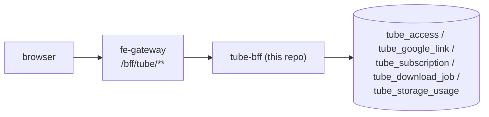
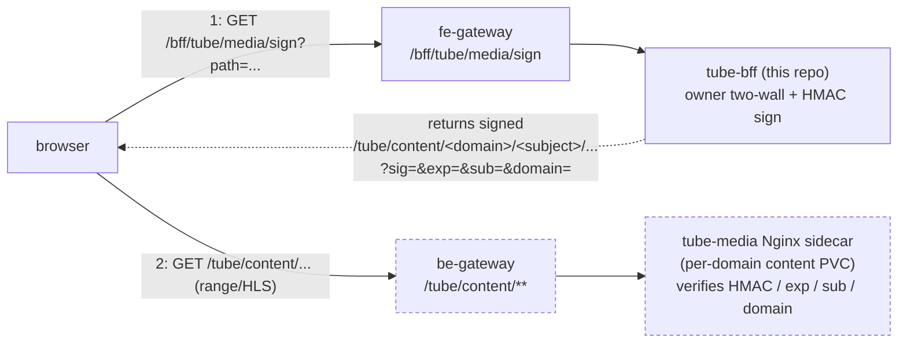

Tube BFF — the access-governance + control plane for the **LocalTube** video OPTIONAL
SERVICE (self-hosted personal YouTube archival: a user connects Google, their subscribed
channels sync to a DB, and yt-dlp downloads new videos on a schedule for owner-private
in-platform viewing). Twin of `hugmesh-owncast-bff-api` / `hugmesh-wiki-bff-api`
(Java 25 WebFlux + R2DBC Postgres + Liquibase + Casdoor JWT resource server, package
`net.hugmesh.tubebff`, artifact `tube-bff` 0.2.0, Spring Boot 4.0.7).

> **State convention:** ✅ shipped (on `main`) · 🚧 in-flight (open branch/PR) ·
> 🔭 planned (design only, no code in this repo). See the
> [Roadmap / not yet in this repo](#roadmap--not-yet-in-this-repo) section.

## Current State

As of 2026-06-24 this BFF sits on the unified HugMesh ecosystem baseline:

- **Spring Boot 4.0.7 / Spring Cloud 2025.1.2, Java 25 LTS, WebFlux reactive.** The build is
  a child of the org metapom **`hugmesh-parent` 2.8.0** (which itself rides Boot 4), so
  the reactive-BFF dependency + plugin baseline is inherited, not duplicated here.
- **Shared security/tenancy via `hugmesh-commons` 2.1.0** (`net.hugmesh.commons.*`).
  This BFF's former local copies of `security.{Roles,CasdoorAuthorities,DomainRegistry,DomainScope}`,
  `config.TenancyResourceServerConfig` and `web.ApiException` were deleted and now come
  from commons — version pinned via `hugmesh-parent`'s `${hugmesh-commons.version}`
  property (2.1.0), which is independent of the parent's own 2.8.0 version number. This
  BFF does **not** depend on
  `hugmesh-auth-core` — that artifact carries account/session/MFA/Casdoor-admin infra
  and is consumed only by `user-bff` + `admin-bff`; tube-bff owns no login/session/account
  surface (it only connects Google for `youtube.readonly` on behalf of an
  already-authenticated principal).
- **Place in the auth model.** tube-bff is a pure **downstream Casdoor-JWT OAuth2 resource
  server** reached only through the gateway. The browser holds an OPAQUE `bff_`-prefixed
  session and never its Casdoor JWT; the gateway's pre-security exchange filter swaps
  `bff_` → the internal custody JWT before proxying, so this BFF always receives a normal
  validated Casdoor JWT and its authorities/issuer→domain logic runs unchanged. The
  platform's login/session relocation (admin-bff → user-bff) and the auth-core extraction
  do **not** touch this repo. Authorization upstream is data-driven by the gateway's
  `gateway_route_access` table; the base `ROLE_TUBE` row is the route-access floor before
  any handler here runs.
- **Data access** is Spring Data R2DBC reactive repositories (Liquibase migrates over a
  JDBC datasource; runtime is R2DBC) — no raw SQL strings / inline `@Query`.
- **CI is GitLab** (`.gitlab-ci.yml`); there are **no** GitHub Actions. The GitHub repo is
  pull-mirrored into in-cluster GitLab.
- **API↔API mTLS (server side) is already wired.** `server.ssl.*` is disabled by default
  (`SSL_ENABLED=false`, `SSL_CLIENT_AUTH=none`) so local/dev/CI run plaintext. In-cluster,
  the deployment mounts a PKCS12 keystore (this service's Vault-PKI-issued identity) +
  truststore (cluster CA) and sets `SSL_ENABLED=true` / `SSL_CLIENT_AUTH=need` with a
  TLSv1.3 floor, so the listener requires a client cert chaining to the cluster CA. (This
  is the listener side of the story; `ROLE_TUBE_WORKER` below is the future yt-dlp
  caller's own mTLS-principal identity — complementary wiring, not the same thing.)
- **GraalVM native-image build is wired.** The `native` Maven profile +
  `org.graalvm.buildtools:native-maven-plugin` are configured
  (`./mvnw -Pnative native:compile`), and `config.NativeHintsConfig` registers
  reflection/resource AOT hints for the DTOs, the JPA/R2DBC entities, and the springdoc
  Swagger UI webjar assets — mirrors `owncast-bff` / `wiki-bff` / `forum-bff` / `user-bff`
  / `federation-api`.

Functionally, everything in [Capabilities](#capabilities-what-is-on-main) (the access
overlay, Google OAuth connect, download queue, signed media URLs + the GitLab pentest stage)
is ✅ shipped on `main`; the byte plane (tube-media sidecar), the yt-dlp runner, the
tube-ui remote and the wider admin quota/retention surface remain 🔭 external / planned
(see below).

## What this BFF owns

This service is the **control plane** for the tube service: it owns the access-governance
overlay and all user-facing connect, list, queue, and signing surfaces. It does NOT serve
media bytes and does NOT run yt-dlp. Concretely, on `main` today this BFF owns:

- ✅ the `tube_access` **governance overlay** — the per-principal may-use grant/timeout/ban
  table an ADMIN curates on top of the base `ROLE_TUBE` role;
- ✅ the **Google OAuth link** (`youtube.readonly`) + the **subscription mirror** — the
  refresh token is stored only as an AES-256-GCM ciphertext (no plaintext column);
- ✅ the **download work-queue** + **per-user storage budgets** — the
  queued→claimed→downloading→done/failed/skipped state machine, dedup, and
  claim/report endpoints;
- ✅ the **media-URL signing** surface — short-TTL HMAC-signed URLs that authorise a
  byte fetch. The owner two-wall (the check that the path's `sub` and domain match the
  caller's JWT claims) is enforced here before any URL is issued.

The media **bytes** are served by a separate per-domain tube-media Nginx sidecar
(🔭 not in this repo) behind a `be-gateway /tube/content/**` route. The yt-dlp runner
image and the polling CronJob that drain the work-queue are also external (🔭 not in this
repo) — see [Roadmap](#roadmap--not-yet-in-this-repo). What lives HERE are the queue,
claim/report, and signed-URL **control** surfaces — not the byte plane or the downloader.

### Request flows

The browser-to-governance/control path (all routes under `/bff/tube/**` are handled by this
BFF, reached through the `fe-gateway`):

The media **byte** path is a two-step signed flow — the signing hop is a call to THIS
BFF first, then the byte fetch goes to the separate sidecar:

> Nodes drawn with a dashed border (`be-gateway /tube/content` route + the tube-media
> sidecar) are 🔭 **planned** — not in this repo. The signing hop (`/bff/tube/media/sign`)
> is ✅ shipped here.

## Capabilities (what is on `main`)

| Area | Status | Package | Notes |
|------|--------|---------|-------|
| `tube_access` overlay + `TubeAccessGuard` (default-deny) | ✅ shipped | `access` | grant/timeout/ban/restore; ban > grant; SUPERADMIN ban-exempt |
| Google OAuth connect + subscriptions sync | ✅ shipped | `google` | `youtube.readonly`; refresh token AES-256-GCM at rest via `TokenCipher` |
| Signed short-TTL HMAC media URLs + owner two-wall | ✅ shipped | `media` | signs `/tube/content/...` URLs; the public `/bff/tube/media/verify` `auth_request` endpoint for the sidecar is ✅ shipped |
| Download work-queue + storage budgets | ✅ shipped | `download` | claim/report state machine; per-user budget cap |
| GitLab CI: test → build:image → pentest | ✅ shipped | — | SCA + ZAP DAST baseline (incl. nuclei) via the shared harness; `make pentest` mirrors it |

## API surface (route groups)

All routes are mounted under `/bff/tube` and are only reachable through the `fe-gateway`.
The gateway enforces `ROLE_TUBE` route-access as a floor check before any handler in this
BFF runs.

**Access governance** — `access/TubeAccessController`
- `POST /bff/tube/admin/access/grant` · `.../timeout` · `.../ban` (ADMIN | SUPERADMIN, own-brand)
- `DELETE /bff/tube/admin/access/{accessType}/{userSubject}` — restore (ADMIN | SUPERADMIN)
- `GET /bff/tube/superadmin/access` — list (SUPERADMIN)
- `GET /bff/tube/superadmin/access/{userSubject}/history` (SUPERADMIN)

**Google connect + subscriptions** — `google/GoogleConnectController`, `google/TubeSubscriptionsController`
- `GET /bff/tube/google-connect/{status,authorize,callback}` · `POST /bff/tube/google-connect/disconnect`
- `GET /bff/tube/subscriptions` · `POST /bff/tube/subscriptions/sync`
  (authenticated + a live `use` grant; SUPERADMIN exempt)

**Media signing** — `media/TubeMediaController`
- `GET /bff/tube/media/sign` — authenticated; owner two-wall (path `sub` must equal the
  caller's JWT subject and brand) → returns a signed `/tube/content/<domain>/<subject>/...`
  URL + `expiresAt`
- `GET /bff/tube/media/verify` — **PUBLIC** (`permitAll`), the tube-media nginx sidecar's
  `auth_request` target; carries NO JWT (the HMAC signature minted by `/sign` is the sole
  credential). Fail-closed + non-leaking: `200` only for a valid, unexpired signature over
  the exact `(sub, domain, path, exp)` tuple, `403` (empty body) for every other case

**Downloads + budgets** — `download/TubeDownloadController`, `download/TubeDownloadWorkerController`, `download/TubeStorageBudgetController`
- `GET /bff/tube/downloads` · `POST /bff/tube/downloads` — authenticated (owner-scoped enqueue/list)
- `POST /bff/tube/internal/download-jobs/{claim,report}` — **`ROLE_TUBE_WORKER` only**.
  This role belongs to a service/mTLS principal (the future yt-dlp CronJob). It is
  deliberately outside the human role hierarchy: no USER, MOD, ADMIN, or SUPERADMIN can
  reach these endpoints.
- `POST /bff/tube/admin/storage-budget` — set a user's storage budget cap (ADMIN | SUPERADMIN, own-brand)

## The `tube_access` overlay + `TubeAccessGuard`

The use grant/timeout/ban overlay was cloned directly from the owncast-bff `owncast_grant`
(004) overlay (which itself cloned the wiki-bff `wiki_access`), with `broadcast` renamed
to `use`:

- **`tube_access`** (Liquibase `004-tube-access.xml`) — the desired-state table.
  Key invariants: `access_type ∈ {use, banned}`; `state ∈ {active, revoked}` (rows are
  never hard-deleted — audit trail preserved); `expires_at` is NULL for permanent grants
  or a future timestamp for timeout-auto-restore; a partial unique index enforces at most
  one active row per `(domain, user_subject, access_type)`.
- **`TubeAccessGuard.assertCanUse`** — the load-bearing **default-deny** enforcement gate.
  See the decision diagram below for the full precedence chain. `ROLE_TUBE` alone (the
  gateway route-access floor) does NOT confer the right to use the service; an admin's
  explicit `use` grant is the only thing that lifts a user above the default-deny floor.
- **`ROLE_TUBE`** — the base service role (sibling of `ROLE_OWNCAST` / `ROLE_WIKI` /
  `ROLE_FORUM`).

## Role model

- **SUPERADMIN** — `TUBE_MANAGE`; service enable per-domain (+GPU-node check);
  cross-domain; exempt from ban.
- **ADMIN (own brand)** — `TUBE_GOVERN`: grant/timeout/ban/restore may-use + set storage
  budgets (✅). The wider quota / retention / allow-deny-users / cadence admin surface is
  🔭 planned (see [Roadmap](#roadmap--not-yet-in-this-repo)) — only the storage-budget `POST` is shipped today.
- **MOD** — 🔭 moderation lives in mod-bff (`tube.*` ModActionType, later PR) via the
  derived `ROLE_TUBE_MOD` (MOD ∩ TUBE); not in this repo.
- **USER** — `ROLE_TUBE` + a `use` grant (default-deny): connect Google + sync
  subscriptions + enqueue/list owner-scoped downloads + obtain owner-scoped signed media
  URLs (✅).
- **`ROLE_TUBE_WORKER`** — a non-human service/mTLS principal (the future yt-dlp CronJob)
  that may claim/report download jobs ONLY; deliberately outside the human role hierarchy.

## Schema (Liquibase changelogs on `main`)

Liquibase runs over a JDBC datasource (Liquibase has no R2DBC runner); all runtime data
access uses R2DBC. Changelog numbering starts at 004 because this service is cloned from
the `owncast_grant` / `wiki_access` overlay, which also starts at 004. Changelogs 001–003
exist in wiki-bff for the wiki content store; tube has no equivalent content store — its
schema is grant-and-queue-only. The list below mirrors the comment block in
`db.changelog-master.xml`:

- **004 `tube-access`** — the use grant/timeout/ban overlay.
- **005a `tube-google-link`** — `tube_google_link`: per-(brand,user) Google OAuth
  `youtube.readonly` connection; refresh token stored only as AES-256-GCM ciphertext
  (`refresh_token_ciphertext = base64(iv||ct||tag)`), partial-UNIQUE on the live row,
  soft-revoke=audit.
- **005b `tube-download-queue`** — `tube_download_job` (the queued→claimed→downloading→
  done/failed/skipped work-queue + dedup + claim/report) + `tube_storage_usage`
  (per-user budget accounting).
- **006 `tube-subscription`** — `tube_subscription`: per-(brand,user) mirror of subscribed
  YouTube channels, `UNIQUE(domain, user_subject, channel_id)`.
- **007 `tube-subscription-download-fields`** — adds `latest_video_id`,
  `latest_video_title`, `created_at`, `updated_at` so the work-queue can use
  `tube_subscription` as its enqueue source.
- **008 `db-generated-uuid-pks`** — moves the `varchar(64)` UUID primary keys of
  `tube_access` / `tube_download_job` / `tube_google_link` / `tube_subscription` from
  app-minted (`UUID.randomUUID().toString()`) to DB-generated column DEFAULTs
  (`(gen_random_uuid())::text`, with `pgcrypto` installed defensively); inserts omit `id`
  and read it back via `RETURNING id` (adopts the mod-bff #36 / admin-bff #133 pattern, PR #23).

## CI

CI = GitLab (`.gitlab-ci.yml`). The GitHub repo is pull-mirrored into the in-cluster GitLab
(`mirror_trigger_builds=true`), so the pipeline runs on push and mirror-sync. Stages:

- **`test:unit`** — runs `./mvnw -B -DskipITs test` (unit and slice tests). A failure here
  blocks image build, preventing a broken overlay or guard from shipping.
- **`build:image`** — builds and pushes the container image on the privileged x86 runner.
  Each image gets an immutable SHA tag and a moving branch tag. Images carry no embedded
  keys.
- **`pentest`** — ✅ the continuous-OWASP stage per the platform pen-test standard.
  Contains two jobs: `pentest:sca` (OWASP Dependency-Check SCA) and `pentest:dast`
  (authenticated ZAP DAST baseline including nuclei probes). Both jobs extend the
  centralised `.pentest-*` hidden jobs from
  `hugmesh-generator/tests/pentest/ci/pentest-stage.gitlab-ci.yml`. Currently
  `allow_failure: true` (report-and-fix posture, not a hard gate). Run `make pentest` to
  run the same SCA and DAST scan locally.

> k6 load testing is part of the platform pen-test standard but is not wired into THIS
> repo's pipeline yet (SCA + DAST baseline are).

Build + test locally: `./mvnw -DskipITs test`. A `native` Maven profile is also wired
(`./mvnw -Pnative native:compile` — GraalVM binary, needs a GraalVM host); AOT
reachability hints live in `config.NativeHintsConfig`.

## Roadmap

This repo tracks the platform's tube-service slice of the wider HugMesh roadmap. The
immediate, repo-local follow-ups are enumerated under
[Roadmap / not yet in this repo](#roadmap--not-yet-in-this-repo) below. Platform-wide
initiatives this BFF will plug into as they land: SSO-end-to-end-live (the gateway
`bff_`-session exchange this BFF already sits behind), MFA / step-up for privileged tube
governance ops (the `SecurityConfig` MFA-authority-converter parity —
`app.mfa.enabled` / `mfa.freshness-window` → `CasdoorAuthorities.MfaConfig` — already
ships here from the platform-wide `d6d8` fan-out, dark/OFF by default; no route in this
repo gates on the resulting `MFA_SATISFIED` authority yet), encrypted versioned backups
of the tube data + content PVC, per-node attached storage for the GPU host that runs the
byte plane, and the multi-tenancy superadmin (per-domain enable of the tube optional
service). A/V-adjacent media remains LAN-only until the platform TURN/SFU work lands;
tube serves owner-private archived bytes, not live A/V.

## Roadmap / not yet in this repo

The tube service ships dark by default and is GPU-pinned (requires an x86 node with a
GPU). The items below are 🔭 planned or 🚧 in-flight and are not shipped in this repo.
This BFF owns the control surfaces they plug into, but the components themselves live
elsewhere:

- 🔭 **yt-dlp downloader runner image + generator-gated polling CronJob** — drains the
  `tube_download_job` work-queue via the `ROLE_TUBE_WORKER` claim/report endpoints. The
  queue + claim/report + storage budgets are ✅ shipped here; the runner/CronJob are a
  deferred follow-up.
- 🔭 **tube-media Nginx serving sidecar + `be-gateway /tube/content/**` route** that
  verifies the HMAC-signed URLs this BFF issues (via a `auth_request` to
  `/bff/tube/media/verify`). The signing AND the public `/verify` `auth_request` endpoint
  are ✅ shipped here; the byte-serving sidecar that calls `/verify` is an external component.
- 🔭 **`hugmesh-tube-ui` native-federation remote** (DB-hosted federated Angular
  module) consuming these BFF endpoints.
- 🔭 **Generator devops for the tube optional service** — the deployment story:
  DEFAULT-OFF / ships-dark, GPU-pinned (x86 + GPU) per-domain enable gated on a
  superadmin `TUBE_MANAGE` + a GPU-node check.
- 🔭 **mod-bff tube moderation surface** — `tube.*` ModActionType + the derived
  `ROLE_TUBE_MOD` (MOD ∩ TUBE); lands in mod-bff, not here.
- 🔭 **Wider admin surface** — quota / retention / allow-deny-users / cadence
  governance. Only the storage-budget `POST` is shipped today.
- 🚧 **Notifications EXTERNAL channels** (platform-wide, in-flight) — Matrix DM / Akkoma
  feed / phpBB / email adapters on top of the in-app notifications MVP; the tube service
  would emit account/infra events through that subsystem.

## Known Gaps / TODO

No `TODO`/`FIXME`/`@Deprecated`/stub markers exist anywhere in `src/main/java` — every
surface documented above as ✅ shipped is fully implemented in this repo. The gaps below
are verified against the current code (not invented) and are consumers/producers this BFF
is wired for but that live in a separate, not-yet-written component:

- **No yt-dlp worker actually calls the claim/report seam yet.** `TubeDownloadWorkerController`
  (`src/main/java/net/hugmesh/tubebff/download/TubeDownloadWorkerController.java:36-104`)
  and the `ROLE_TUBE_WORKER`-only path gate (`src/main/java/net/hugmesh/tubebff/config/SecurityConfig.java:168`)
  are fully implemented and gated, but the queue only drains when an external worker
  polls `POST /bff/tube/internal/download-jobs/{claim,report}` — that CronJob/image does
  not exist in this repo (tracked above under "yt-dlp downloader runner image").
- **No consumer of the signed media URL exists in this repo.** `TubeMediaController.sign`/
  `verify` (`src/main/java/net/hugmesh/tubebff/media/TubeMediaController.java:127-214`)
  fully implements signing + verification, but the tube-media Nginx sidecar that would call
  `GET /bff/tube/media/verify` as its `auth_request` target, and serve the actual bytes at
  `be-gateway /tube/content/**`, is external (tracked above).
- **Admin governance surface is grant/timeout/ban/restore + storage-budget only.**
  `TubeStorageBudgetController` (`src/main/java/net/hugmesh/tubebff/download/TubeStorageBudgetController.java:39-80`)
  exposes only a `POST` to set a user's budget — there is no `GET` to read current
  per-user budgets/usage in bulk, and no quota/retention/cadence admin endpoints exist
  anywhere under `download/` or `access/` (the PR8 wider admin surface referenced above).
- **`DownloadJob.contentPath`** (`src/main/java/net/hugmesh/tubebff/download/DownloadJob.java:65`)
  is stamped by the worker's `report` call and stored, but nothing in this repo resolves
  or serves that path — it is consumed only by the (external) tube-media sidecar.
- **`tube_google_link.google_sub` / `google_email` are always persisted as `NULL` in
  production.** `DefaultGoogleApiClient.toTokenResponse`
  (`src/main/java/net/hugmesh/tubebff/google/DefaultGoogleApiClient.java:158-173`)
  never decodes the token endpoint's `id_token` and never calls the Google `userinfo`
  endpoint, and no other class in this repo does either — only the `refresh_token` /
  `access_token` / `scope` fields of the OAuth token response are real. No test catches
  this because **no test asserts on `googleSub`/`googleEmail` off the persistence path at
  all**: `GoogleConnectServiceTest` drives the connect flow but never inspects either
  field, and `GoogleConnectControllerTest`'s `$.googleEmail` assertion is a `@WebFluxTest`
  that mocks `GoogleConnectService`/`TubeGoogleLinkRepository` and hand-builds the
  `TubeGoogleLink` it asserts against — so it exercises the `ConnectStatus` DTO projection
  in isolation and never reaches `DefaultGoogleApiClient`. (`FakeGoogleApiClient` does
  fabricate a sub/email that production cannot produce, but it is not in that controller
  test's object graph and no test reads those fields, so it masks nothing today — it is a
  latent trap that would spuriously green a future test rather than the cause of the
  current gap.) Impact is limited: `google_sub` is **write-only** — nothing in this repo
  reads it — and `google_email` is read only by `TubeGoogleDto.ConnectStatus` for display.
  Neither is a lookup/authz/dedup key (see `005-tube-google-link.xml`).

  **Closing this gap is NOT just "decode the id_token" — that alone cannot work.**
  `GoogleConnectService.buildAuthorizeUrl` requests exactly one scope
  (`SCOPE = https://www.googleapis.com/auth/youtube.readonly`, deliberately "the minimum
  scope"), and Google only issues an `id_token` when the authorization request carries the
  `openid` scope — "[t]he scope parameter must begin with the `openid` value"
  ([Google OIDC docs](https://developers.google.com/identity/protocols/oauth2/openid-connect)).
  So no `id_token` is ever present in our token response to decode, and `userinfo` is
  equally unavailable (it needs `openid`/`email`/`profile`). Populating `google_email`
  therefore REQUIRES adding `openid email` to `SCOPE` — a **consent-surface expansion**:
  every user would be asked to share their identity and email address on the Google
  consent screen, contradicting the stated minimum-scope design, in exchange for a
  display-only field that `tube-ui` already renders with a `|| 'your Google account'`
  fallback. Existing links would stay `NULL` regardless (their grants predate the scope).
  That is a product/privacy decision, not a mechanical fix — hence still open.
