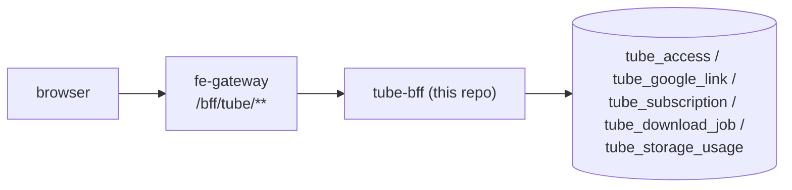
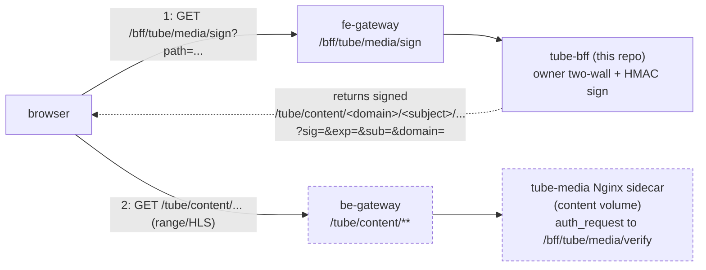
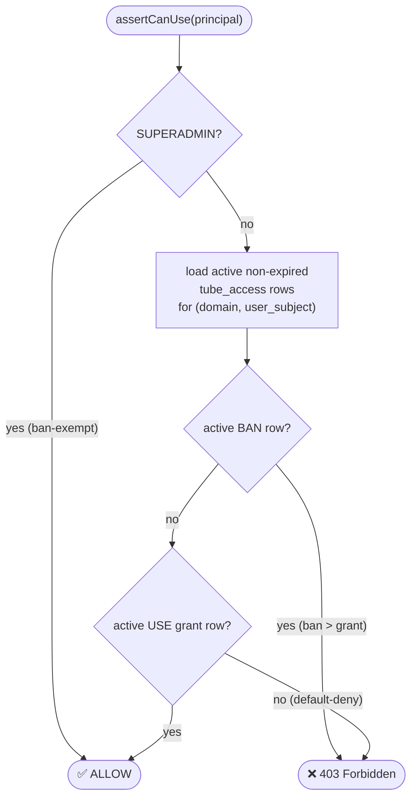

Tube BFF is the access-governance and control plane for **LocalTube**, an OPTIONAL
SERVICE for self-hosted personal YouTube archival. A user connects Google, their
subscribed channels sync to a database, and yt-dlp downloads new videos on a schedule for
owner-private viewing inside the platform. This BFF decides who may use the archive. It
never touches a video byte. It is a twin of `hugmesh-owncast-bff-api` /
`hugmesh-wiki-bff-api` (Java 25 WebFlux + R2DBC Postgres + Liquibase + Casdoor JWT
resource server, package `net.hugmesh.tubebff`, artifact `tube-bff` 0.2.0-beta.1, Spring Boot
4.0.7).

> **State convention:** ✅ shipped (on `main`) · 🚧 in-flight (open branch/PR) ·
> 🔭 planned (design only, no code in this repo). See the
> [Roadmap / not yet in this repo](#roadmap--not-yet-in-this-repo) section.

## Current State

As of 2026-10-15 this BFF sits on the unified HugMesh ecosystem baseline:

- **Spring Boot 4.0.7 / Spring Cloud 2025.1.2, Java 25 LTS, WebFlux reactive.** The build is
  a child of the org metapom **`hugmesh-parent` 2.9.0-beta.1** (which itself rides Boot 4). The
  reactive-BFF dependency and plugin baseline is inherited, not repeated here.
- **Shared security/tenancy via `hugmesh-commons` 2.2.0-beta.1** (`net.hugmesh.commons.*`).
  The local copies of `security.{Roles,CasdoorAuthorities,DomainRegistry,DomainScope}`,
  `config.TenancyResourceServerConfig` and `web.ApiException` were deleted and now come
  from commons. `hugmesh-parent` pins the version through `${hugmesh-commons.version}`
  (2.2.0-beta.1), which is independent of the parent's own 2.9.0-beta.1. This BFF does **not** depend on
  `hugmesh-auth-core`: that artifact carries account/session/MFA/Casdoor-admin infra and
  is consumed only by `user-bff` + `admin-bff`. tube-bff owns no login, session or account
  surface. It only connects Google for `youtube.readonly` on behalf of an
  already-authenticated principal.
- **Place in the auth model.** tube-bff is a pure **downstream Casdoor-JWT OAuth2 resource
  server**, reached only through the gateway. The browser holds an OPAQUE `bff_`-prefixed
  session and never its Casdoor JWT. The gateway's pre-security exchange filter swaps
  `bff_` for the internal custody JWT before proxying, so this BFF always receives a
  normal validated Casdoor JWT and its authorities and issuer→domain logic run unchanged.
  The platform's login/session relocation (admin-bff → user-bff) and the auth-core
  extraction do **not** touch this repo. The gateway's `gateway_route_access` table drives
  authorization upstream; the base `ROLE_TUBE` row is the route-access floor before any
  handler here runs.
- **Data access** is Spring Data R2DBC reactive repositories. Liquibase migrates over a
  JDBC datasource; runtime is R2DBC. The repositories use derived finders, plus
  constant-string `@Query` methods for the guarded compare-and-set updates and the
  `RETURNING id` inserts (`TubeAccessR2dbcRepository`, `DownloadJobR2dbcRepository`).
  There is no `DatabaseClient` raw SQL.
- **CI is GitLab** (`.gitlab-ci.yml`). The GitHub repo is pull-mirrored into in-cluster
  GitLab. The only GitHub Actions workflow is `.github/workflows/release.yml`, the beta
  image release (push to `main`, `v*` tags, manual dispatch); it runs no tests. The
  `Dockerfile` can also resolve the `net.hugmesh` dependencies from GitHub Packages; see
  [CI](#ci) and [Releases (beta)](#releases-beta).
- **API↔API mTLS (server side) is wired.** `server.ssl.*` is off by default
  (`SSL_ENABLED=false`, `SSL_CLIENT_AUTH=none`), so local, dev and CI run plaintext. A
  deployment turns it on by mounting a PKCS12 keystore (this service's Vault-PKI-issued
  identity) and truststore (cluster CA) and setting `SSL_ENABLED=true` /
  `SSL_CLIENT_AUTH=need` (TLSv1.3 floor by default). The listener then requires a client
  cert that chains to the cluster CA. The tube Deployment in `hugmesh-generator`
  (`specs/cluster/manifests/tube/deployment.yaml`) sets none of these variables and mounts
  no stores, so in-cluster tube-bff listens in plaintext today. The media sidecar calls it
  on `127.0.0.1:8080`. This is the listener side only. `ROLE_TUBE_WORKER` below is the
  future yt-dlp caller's own mTLS-principal identity, which is separate wiring.
- **GraalVM native-image build is wired.** The `native` Maven profile and
  `org.graalvm.buildtools:native-maven-plugin` are configured
  (`./mvnw -Pnative native:compile`). `config.NativeHintsConfig` registers
  reflection/resource AOT hints for the DTOs, the R2DBC entities and the springdoc
  Swagger UI webjar assets, as in `owncast-bff` / `wiki-bff` / `forum-bff` / `user-bff`
  / `federation-api`.

Everything in [Capabilities](#capabilities-what-is-on-main) (the access overlay, Google
OAuth connect, download queue, signed media URLs and the GitLab pentest stage) is ✅
shipped on `main`. The tube-media sidecar and the `be-gateway` route are defined in
`hugmesh-generator`, and the tube-ui remote is in
[`hugmesh-tube-ui`](https://github.com/hugmesh/hugmesh-tube-ui) (see
[Roadmap / not yet in this repo](#roadmap--not-yet-in-this-repo)). The yt-dlp worker
script and its image Dockerfile are in [`downloader/`](downloader/). The CronJob that runs
the worker and the wider admin quota/retention surface are 🔭 not built.

## What this BFF owns

This service is the **control plane** for the tube service. It owns the access-governance
overlay and every user-facing connect, list, queue and signing surface. It does NOT serve
media bytes and does NOT run yt-dlp. On `main` today it owns:

- ✅ the `tube_access` **governance overlay**: the per-principal may-use grant/timeout/ban
  table an ADMIN curates on top of the base `ROLE_TUBE` role;
- ✅ the **Google OAuth link** (`youtube.readonly`) and the **subscription mirror**. The
  refresh token is stored only as an AES-256-GCM ciphertext (no plaintext column);
- ✅ the **download work-queue** and **per-user storage budgets**: the
  queued→claimed→downloading→done/failed/skipped state machine, dedup, and the
  claim/report endpoints;
- ✅ the **media-URL signing** surface: short-TTL HMAC-signed URLs that authorise a byte
  fetch. The owner two-wall (the check that the path's `sub` and domain match the caller's
  JWT claims) runs here before any URL is issued.

The media **bytes** come from a separate tube-media Nginx sidecar behind a
`be-gateway /tube/content/**` route. Both are defined in `hugmesh-generator`, not in this
repo. The sidecar is a container in the tube pod, on an `emptyDir` content volume. The
yt-dlp worker script and runner image Dockerfile are in [`downloader/`](downloader/). The
polling CronJob that would run it against the work-queue and the published image do not
exist yet (🔭); see [Roadmap](#roadmap--not-yet-in-this-repo). What lives HERE are the
**control** surfaces: queue, claim/report and signed URLs.

### Request flows

The browser-to-governance/control path. This BFF handles every route under `/bff/tube/**`,
reached through the `fe-gateway`:

The media **byte** path is a two-step signed flow. The browser calls THIS BFF to sign,
then fetches the bytes from the separate sidecar:

> Dashed nodes (the `be-gateway /tube/content` route and the tube-media sidecar) are
> **external**. They are defined in `hugmesh-generator`
> (`specs/cluster/manifests/tube/deployment.yaml`; the route-access row is in
> `specs/cluster/manifests/route-access/initdb/20-schema.sql`), not in this repo. The
> signing hop (`/bff/tube/media/sign`) and the `/verify` endpoint the sidecar calls are
> ✅ shipped here.

## Capabilities (what is on `main`)

| Area | Status | Package | Notes |
|------|--------|---------|-------|
| `tube_access` overlay + `TubeAccessGuard` (default-deny) | ✅ shipped | `access` | grant/timeout/ban/restore; ban > grant; SUPERADMIN ban-exempt |
| Google OAuth connect + subscriptions sync | ✅ shipped | `google` | `youtube.readonly`; refresh token AES-256-GCM at rest via `TokenCipher` |
| Signed short-TTL HMAC media URLs + owner two-wall | ✅ shipped | `media` | signs `/tube/content/...` URLs; the public `/bff/tube/media/verify` `auth_request` endpoint for the sidecar is ✅ shipped |
| Download work-queue + storage budgets | ✅ shipped | `download` | claim/report state machine; per-user budget cap |
| GitLab CI: test → build:image → pentest | ✅ shipped | — | SCA + ZAP DAST baseline (incl. nuclei) via the shared harness; `make pentest` mirrors it |

## API surface (route groups)

All routes are mounted under `/bff/tube`. Browsers reach them through the `fe-gateway`,
which enforces `ROLE_TUBE` route-access (row `/bff/tube/**`) as a floor check before any
handler in this BFF runs. The one exception in practice is `/media/verify`, which the
sidecar calls inside the pod.

**Access governance** — `access/TubeAccessController`
- `POST /bff/tube/admin/access/grant` · `.../timeout` · `.../ban` (ADMIN | SUPERADMIN, own-brand)
- `DELETE /bff/tube/admin/access/{accessType}/{userSubject}` — restore (ADMIN | SUPERADMIN)
- `GET /bff/tube/superadmin/access` — list (SUPERADMIN)
- `GET /bff/tube/superadmin/access/{userSubject}/history` (SUPERADMIN)

**Google connect + subscriptions** — `google/GoogleConnectController`, `google/TubeSubscriptionsController`
- `GET /bff/tube/google-connect/{status,authorize,callback}` · `POST /bff/tube/google-connect/disconnect`
- `GET /bff/tube/subscriptions` · `POST /bff/tube/subscriptions/sync`
  (`ROLE_TUBE` path gate + a live `use` grant; SUPERADMIN exempt from the grant check)

**Media signing** — `media/TubeMediaController`
- `GET /bff/tube/media/sign` — authenticated + a live `use` grant (checked first). Owner
  two-wall: the path `sub` must equal the caller's JWT subject and brand. Returns a signed
  `/tube/content/<domain>/<subject>/...` URL + `expiresAt` (TTL 5 minutes). `400` for a
  malformed path, `403` for no grant or a path that is not the caller's
- `GET /bff/tube/media/verify` — **PUBLIC** (`permitAll`), the tube-media nginx sidecar's
  `auth_request` target. It carries NO JWT; the HMAC signature minted by `/sign` is the
  sole credential. Fail-closed and non-leaking: `200` only for a valid, unexpired
  signature over the exact `(sub, domain, path, exp)` tuple, `403` (empty body) for every
  other case

**Downloads + budgets** — `download/TubeDownloadController`, `download/TubeDownloadWorkerController`, `download/TubeStorageBudgetController`
- `GET /bff/tube/downloads` · `POST /bff/tube/downloads` — authenticated + a live `use`
  grant (owner-scoped enqueue/list)
- `POST /bff/tube/internal/download-jobs/{claim,report}` — **`ROLE_TUBE_WORKER` only**.
  This role belongs to a service/mTLS principal (the future yt-dlp CronJob). It sits
  outside the human role hierarchy: no USER, MOD, ADMIN or SUPERADMIN can reach these
  endpoints.
- `POST /bff/tube/admin/storage-budget` — set a user's storage budget cap (ADMIN | SUPERADMIN,
  own-brand; a SUPERADMIN is pinned to the default domain on this endpoint)

## The `tube_access` overlay + `TubeAccessGuard`

The use grant/timeout/ban overlay was cloned from the owncast-bff `owncast_grant` (004)
overlay, which itself cloned the wiki-bff `wiki_access`. `broadcast` became `use`:

- **`tube_access`** (Liquibase `004-tube-access.xml`) — the desired-state table.
  Key invariants: `access_type ∈ {use, banned}`; `state ∈ {active, revoked}` (rows are
  never hard-deleted, so the audit trail stays); `expires_at` is NULL for permanent grants
  or a future timestamp for timeout-auto-restore; a partial unique index enforces at most
  one active row per `(domain, user_subject, access_type)`.
- **`TubeAccessGuard.assertCanUse`** — the load-bearing **default-deny** gate. The decision
  diagram below shows the precedence chain. `ROLE_TUBE` alone (the gateway route-access
  floor) does NOT confer the right to use the service. An admin's explicit `use` grant is
  the only thing that lifts a user above the default-deny floor.
- **`ROLE_TUBE`** — the base service role (sibling of `ROLE_OWNCAST` / `ROLE_WIKI` /
  `ROLE_FORUM`).

## Role model

- **SUPERADMIN** — `TUBE_MANAGE` (list all access rows + history); cross-domain; exempt
  from ban. 🔭 Per-domain service enable with a GPU-node check is not built. Tube is a
  build-time optional service, default off (`hugmesh-generator`
  `specs/cluster/optional-services.yaml`, `gate: build-time`).
- **ADMIN (own brand)** — `TUBE_GOVERN`: grant/timeout/ban/restore may-use and set storage
  budgets (✅). The wider quota / retention / allow-deny-users / cadence admin surface is
  🔭 planned (see [Roadmap](#roadmap--not-yet-in-this-repo)). Only the storage-budget
  `POST` is shipped today.
- **MOD** — 🔭 moderation lives in mod-bff (`tube.*` ModActionType, later PR) via the
  derived `ROLE_TUBE_MOD` (MOD ∩ TUBE). Not in this repo.
- **USER** — `ROLE_TUBE` + a `use` grant (default-deny): connect Google, sync
  subscriptions, enqueue and list owner-scoped downloads, and obtain owner-scoped signed
  media URLs (✅).
- **`ROLE_TUBE_WORKER`** — a non-human service/mTLS principal (the future yt-dlp CronJob)
  that may claim and report download jobs ONLY. It sits outside the human role hierarchy.

## Schema (Liquibase changelogs on `main`)

Liquibase runs over a JDBC datasource (it has no R2DBC runner). All runtime data access
uses R2DBC. Changelog numbering starts at 004 because this service is cloned from the
`owncast_grant` / `wiki_access` overlay, which also starts at 004. Changelogs 001–003
exist in wiki-bff for the wiki content store. Tube has no content store; its schema is
grant-and-queue-only. The list below mirrors the comment block in
`db.changelog-master.xml`:

- **004 `tube-access`** — the use grant/timeout/ban overlay.
- **005a `tube-google-link`** — `tube_google_link`: per-(brand,user) Google OAuth
  `youtube.readonly` connection. The refresh token is stored only as AES-256-GCM
  ciphertext (`refresh_token_ciphertext = base64(iv||ct||tag)`). Partial-UNIQUE on the
  live row; soft-revoke = audit.
- **005b `tube-download-queue`** — `tube_download_job` (the queued→claimed→downloading→
  done/failed/skipped work-queue, with dedup and claim/report) + `tube_storage_usage`
  (per-user budget accounting).
- **006 `tube-subscription`** — `tube_subscription`: per-(brand,user) mirror of subscribed
  YouTube channels, `UNIQUE(domain, user_subject, channel_id)`.
- **007 `tube-subscription-download-fields`** — adds `latest_video_id`,
  `latest_video_title`, `created_at`, `updated_at`, so the work-queue can use
  `tube_subscription` as its enqueue source.
- **008 `db-generated-uuid-pks`** — moves the `varchar(64)` UUID primary keys of
  `tube_access` / `tube_download_job` / `tube_google_link` / `tube_subscription` from
  app-minted (`UUID.randomUUID().toString()`) to DB-generated column DEFAULTs
  (`(gen_random_uuid())::text`, with `pgcrypto` installed defensively). Inserts omit `id`
  and read it back via `RETURNING id` (adopts the mod-bff #36 / admin-bff #133 pattern;
  commit `3cb3c68`).

## CI

CI = GitLab (`.gitlab-ci.yml`). The GitHub repo is pull-mirrored into the in-cluster
GitLab (`mirror_trigger_builds=true`), so the pipeline runs on push and mirror-sync.
Stages:

- **`test:unit`** — runs `./mvnw -B -s settings.xml -DskipITs test` (unit and slice tests,
  with a `docker:27-dind` service because the full-context tests start Postgres through
  Testcontainers), then `git diff --exit-code`. The job fails if a test rewrote a
  committed file such as `src/main/resources/openapi/openapi.json`. A failure here
  blocks the image build, so a broken overlay or guard does not ship.
- **`build:image`** — runs on the default branch and on tags only. It builds and pushes
  the container image on the privileged x86 runner. Each image gets an immutable tag (the
  release tag, else the short SHA) and a moving branch tag. Images carry no embedded
  keys. The `Dockerfile` has two registry paths. With the BuildKit secret `ci_job_token`
  it resolves `hugmesh-commons` from the GitLab group registry (`settings.xml`). With the
  secret `packages_read_token` it uses GitHub Packages (`.github/maven-ci-settings.xml`).
  `ReleaseImageGuardTest` pins both.
- **`pentest`** — ✅ the continuous-OWASP stage per the platform pen-test standard, with
  two jobs: `pentest:sca` (OWASP Dependency-Check SCA) and `pentest:dast` (authenticated
  ZAP DAST baseline including nuclei probes). Both extend the centralised `.pentest-*`
  hidden jobs from `hugmesh-generator/tests/pentest/ci/pentest-stage.gitlab-ci.yml`.
  Both run with `allow_failure: true` (report-and-fix posture, not a hard gate).
  `make pentest` mirrors them locally: SCA with a looser CVSS gate (9, override with
  `PENTEST_SCA_CVSS`; CI uses 7), and DAST only when `DAST_TARGET_URL` is set (it skips
  otherwise).

> k6 load testing is part of the platform pen-test standard but is not wired into THIS
> repo's pipeline yet (SCA + DAST baseline are).

Build and test locally: `./mvnw -DskipITs test`. A `native` Maven profile is also wired
(`./mvnw -Pnative native:compile` — GraalVM binary, needs a GraalVM host). AOT
reachability hints live in `config.NativeHintsConfig`.

## Releases (beta)

The version is the project `<version>` in `pom.xml`, currently `0.2.0-beta.1`
(`MAJOR.MINOR.PATCH-beta.N`, the org beta scheme). `.github/workflows/release.yml`
publishes `ghcr.io/hugmesh/hugmesh-tube-bff-api`:

- a push to `main` pushes `:main` and `:sha-<12 hex>`;
- pushing the tag `v<version>` (for example `v0.2.0-beta.1`) pushes `:<version>`,
  `:beta` and `:sha-<12 hex>`, and creates a GitHub Release marked prerelease and
  not latest. The tag must equal `v` + the pom version, and an existing `:<version>`
  is never overwritten: a fix raises N (`-beta.2`);
- a manual dispatch on a `v*` tag re-runs that release; on `main` it is a main build.
  A dispatch re-run only helps when the image was never pushed: once
  `:<version>` exists the run stops at the overwrite check. If only the
  GitHub Release step failed, use "Re-run failed jobs" on the original run.

`:latest` is never pushed for a beta. The image build needs the `net.hugmesh`
libraries (build-config `0.6.0-beta.1`, parent `2.9.0-beta.1`, commons
`2.2.0-beta.1`) to be readable from GitHub Packages first, and the
`PACKAGES_READ_TOKEN` secret. Jobs run on the runner named by the
`RUNS_ON_PUBLISH` variable (a JSON array) for `main`, `v*` tags and their
dispatches, and on hosted `ubuntu-latest` otherwise or when the variable is unset.
The `downloader/` image has no publisher.

## Roadmap

This repo tracks the tube-service slice of the wider HugMesh roadmap. The repo-local
follow-ups are under
[Roadmap / not yet in this repo](#roadmap--not-yet-in-this-repo) below. Platform-wide
initiatives this BFF will plug into as they land:

- MFA / step-up for privileged tube governance ops. The `SecurityConfig`
  MFA-authority-converter parity (`app.mfa.enabled` / `app.mfa.freshness-window` →
  `CasdoorAuthorities.MfaConfig`) already ships here from the platform-wide `d6d8`
  fan-out, dark/OFF by default. No route in this repo gates on the resulting
  `MFA_SATISFIED` authority yet.
- Encrypted versioned backups of the tube data and content PVC.
- Per-node attached storage for the GPU host that runs the byte plane.
- The multi-tenancy superadmin (per-domain enable of the tube optional service).

A/V-adjacent media remains LAN-only until the platform TURN/SFU work lands. Tube serves
owner-private archived bytes, not live A/V.

## Roadmap / not yet in this repo

The tube service ships dark by default and is GPU-pinned (an x86 node with a GPU;
`nodeSelector: hugmesh.net/compute: gpu`). Items marked 🔭 or 🚧 are not shipped. Items
marked ✅ elsewhere are shipped in another repo and are listed because this BFF owns the
control surfaces they plug into:

- 🔭 **yt-dlp downloader runner image + generator-gated polling CronJob** — drains the
  `tube_download_job` work-queue through the `ROLE_TUBE_WORKER` claim/report endpoints.
  The queue, claim/report and storage budgets are ✅ shipped here. 🚧 The worker script,
  its tests and the runner image Dockerfile are in [`downloader/`](downloader/). The
  CronJob manifest in `hugmesh-generator` and publishing the image are still to do.
- ✅ elsewhere: **tube-media Nginx serving sidecar + `be-gateway /tube/content/**` route**
  that verifies the HMAC-signed URLs this BFF issues, through an `auth_request` to
  `/bff/tube/media/verify`. The sidecar is a container in the tube pod
  (`hugmesh-generator` `specs/cluster/manifests/tube/deployment.yaml`); the route has a
  `ROLE_TUBE` route-access row (`specs/cluster/manifests/route-access/initdb/20-schema.sql`);
  the gate test is `tests/stack/test-tube-media-signed-gate.sh`. The signing AND the
  public `/verify` endpoint are ✅ shipped here. The content volume is an `emptyDir`
  ("dev default; replace with a node-pinned PVC"), and nothing writes to it until the
  downloader CronJob is deployed.
- ✅ elsewhere: **`hugmesh-tube-ui` native-federation remote** (Angular, in
  [`hugmesh-tube-ui`](https://github.com/hugmesh/hugmesh-tube-ui); `federation.config.js`
  exposes `./Tube`; registered by `hugmesh-federation-api` changeset
  `033-register-tube-module.xml`; mounted at `/tube` through the `hugmesh-fe-gateway`
  `/tube/**` route-access row), consuming these BFF endpoints.
- 🚧 **Generator devops for the tube optional service** — `apps/53-tube.yaml` and
  `manifests/tube` exist: DEFAULT-OFF, build-time gate, GPU-pinned x86. Not built: the
  per-domain superadmin enable with a GPU-node check. The deployment also does not yet
  pass this BFF's `TUBE_GOOGLE_*` settings (see Known Gaps).
- 🔭 **mod-bff tube moderation surface** — `tube.*` ModActionType + the derived
  `ROLE_TUBE_MOD` (MOD ∩ TUBE). It lands in mod-bff, not here. mod-bff `main` has no tube
  code today.
- 🔭 **Wider admin surface** — quota / retention / allow-deny-users / cadence governance.
  Only the storage-budget `POST` is shipped today.
- 🚧 **Notifications EXTERNAL channels** (platform-wide, in-flight) — Matrix DM / Akkoma
  feed / phpBB / email adapters on top of the in-app notifications MVP. The tube service
  would emit account/infra events through that subsystem.

## Known Gaps / TODO

No `TODO`/`FIXME`/`@Deprecated` markers exist anywhere in `src/main/java`; every surface
documented above as ✅ shipped is fully implemented in this repo. The gaps below are
verified against the current code. Each is a consumer or producer this BFF is wired for
but that lives in a separate component:

- **No yt-dlp worker calls the claim/report seam yet.** `TubeDownloadWorkerController`
  (`src/main/java/net/hugmesh/tubebff/download/TubeDownloadWorkerController.java:36-104`)
  and the `ROLE_TUBE_WORKER`-only path gate (`src/main/java/net/hugmesh/tubebff/config/SecurityConfig.java:168`)
  are fully implemented and gated. The queue drains only when an external worker polls
  `POST /bff/tube/internal/download-jobs/{claim,report}`. The worker script is in
  [`downloader/`](downloader/), but the CronJob that runs it and the published image do
  not exist yet (tracked above under "yt-dlp downloader runner image").
- **No consumer of the signed media URL exists in this repo.** `TubeMediaController.sign`/
  `verify` (`src/main/java/net/hugmesh/tubebff/media/TubeMediaController.java:109-214`)
  fully implements signing + verification. The tube-media Nginx sidecar that calls
  `GET /bff/tube/media/verify` as its `auth_request` target, and serves the bytes at
  `be-gateway /tube/content/**`, is defined in `hugmesh-generator` (tracked above).
- **The generator's tube Deployment does not pass the settings this BFF reads.**
  `specs/cluster/manifests/tube/deployment.yaml` sets `TUBE_MEDIA_KEY` (which matches),
  but also `TUBE_TOKEN_DEK`, `GOOGLE_OAUTH_CLIENT_ID` and `GOOGLE_OAUTH_CLIENT_SECRET`.
  `application.yml` reads `TUBE_GOOGLE_CLIENT_ID`, `TUBE_GOOGLE_CLIENT_SECRET`,
  `TUBE_GOOGLE_REDIRECT_URI`, `TUBE_GOOGLE_DEK` and `TUBE_GOOGLE_STATE_HMAC_KEY`, and no code
  reads the generator's names. The blank defaults fail closed, so in a cluster built from
  that manifest the Google connect endpoints error until the manifest is fixed.
- **Admin governance is grant/timeout/ban/restore + storage-budget only.**
  `TubeStorageBudgetController` (`src/main/java/net/hugmesh/tubebff/download/TubeStorageBudgetController.java:39-80`)
  exposes only a `POST` to set a user's budget. There is no `GET` to read per-user
  budgets or usage in bulk, and no quota/retention/cadence admin endpoint exists anywhere
  under `download/` or `access/` (the wider admin surface referenced above).
- **`DownloadJob.contentPath`** (`src/main/java/net/hugmesh/tubebff/download/DownloadJob.java:65`)
  is stamped by the worker's `report` call and stored. Nothing in this repo resolves or
  serves that path; only the (external) tube-media sidecar consumes it.
- **`tube_google_link.google_sub` / `google_email` are always persisted as `NULL` in
  production.** `DefaultGoogleApiClient.toTokenResponse`
  (`src/main/java/net/hugmesh/tubebff/google/DefaultGoogleApiClient.java:158-173`)
  never decodes the token endpoint's `id_token` and never calls the Google `userinfo`
  endpoint, and no other class in this repo does either. Only the `refresh_token` /
  `access_token` / `scope` fields of the OAuth token response are real. No test catches
  this, because **no test asserts on `googleSub`/`googleEmail` off the persistence path**:
  `GoogleConnectServiceTest` drives the connect flow but never inspects either field, and
  `GoogleConnectControllerTest`'s `$.googleEmail` assertion is a `@WebFluxTest` that mocks
  `GoogleConnectService`/`TubeGoogleLinkRepository` and hand-builds the `TubeGoogleLink`
  it asserts against. It exercises the `ConnectStatus` DTO projection in isolation and
  never reaches `DefaultGoogleApiClient`. (`FakeGoogleApiClient` does fabricate a
  sub/email that production cannot produce, but it is not in that controller test's
  object graph and no test reads those fields. It masks nothing today; it is a latent trap
  that could spuriously green a future test.) Impact is limited: `google_sub` is
  **write-only** (nothing in this repo reads it) and `google_email` is read only by
  `TubeGoogleDto.ConnectStatus` for display. Neither is a lookup, authz or dedup key (see
  `005-tube-google-link.xml`).

  **Closing this gap takes more than decoding the id_token.** That alone cannot work.
  `GoogleConnectService.buildAuthorizeUrl` requests exactly one scope
  (`SCOPE = https://www.googleapis.com/auth/youtube.readonly`, deliberately "the minimum
  scope"). Google issues an `id_token` only when the authorization request carries the
  `openid` scope: "[t]he scope parameter must begin with the `openid` value"
  ([Google OIDC docs](https://developers.google.com/identity/protocols/oauth2/openid-connect)).
  So no `id_token` is ever in our token response, and `userinfo` is equally unavailable
  (it needs `openid`/`email`/`profile`). Populating `google_email` therefore REQUIRES
  adding `openid email` to `SCOPE`. That expands the consent surface: every user would be
  asked to share their identity and email address on the Google consent screen, against
  the stated minimum-scope design, for a display-only field that `tube-ui` already
  renders with a `|| 'your Google account'` fallback. Existing links would stay `NULL`
  regardless, because their grants predate the scope. This is a product and privacy
  decision, not a mechanical fix, so it stays open.
