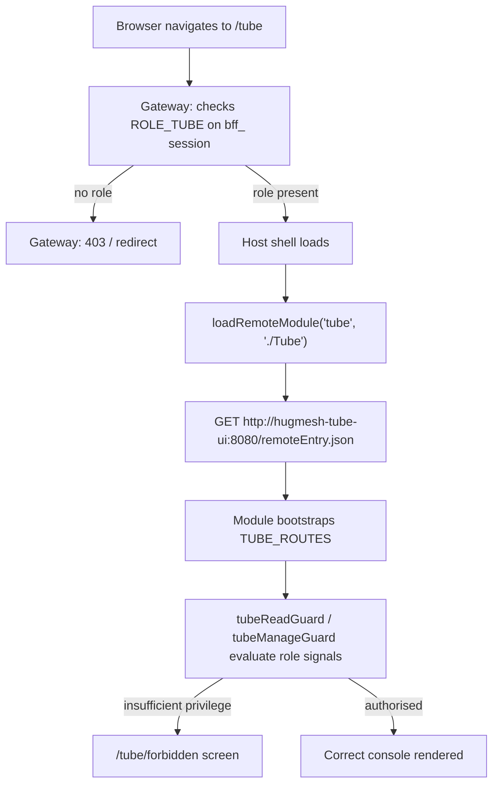
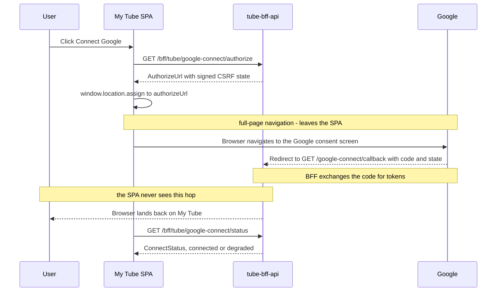

The **Tube (LocalTube) management UI** is an Angular **native-federation remote**
that the [`hugmesh-host-shell`](https://github.com/hugmesh/hugmesh-host-shell) host
shell mounts at **`/tube`**. It is the human-facing console for the Tube optional
service, which lets users subscribe to YouTube channels and schedule local
downloads for in-platform viewing. The UI sits on top of
[`hugmesh-tube-bff-api`](https://github.com/hugmesh/hugmesh-tube-bff-api) and
surfaces three functional areas: the per-user download work-queue,
storage-budget management, and the use-access overlay (grant/timeout/ban
controls for admins).

## Part of the HugMesh platform

HugMesh is a modular, self-hostable platform made up of many small services and
UI "remotes" that are mounted into one host shell at runtime via
[Native Federation](https://www.npmjs.com/package/@angular-architects/native-federation).
This repo is one of those remotes. Related repositories you'll likely want
alongside it:

| repo | role |
| --- | --- |
| [`hugmesh-host-shell`](https://github.com/hugmesh/hugmesh-host-shell) | host shell that mounts this and every other remote |
| [`hugmesh-tube-bff-api`](https://github.com/hugmesh/hugmesh-tube-bff-api) | the backend-for-frontend this UI talks to (`/bff/tube/**`) |
| [`hugmesh-auth-core`](https://github.com/hugmesh/hugmesh-auth-core) | shared account/session/MFA/Casdoor-admin infrastructure |
| [`login-ui`](https://github.com/hugmesh/login-ui) | native login form used platform-wide |
| [`user-bff`](https://github.com/hugmesh/user-bff) | owns login/session/token-custody logic |
| [`hugmesh-ui-standard`](https://github.com/hugmesh/hugmesh-ui-standard) | the org's baseline UI-remote template |
| [`hugmesh-generator`](https://github.com/hugmesh/hugmesh-generator) | scaffolding + shared CI building blocks (including the pen-test harness this repo consumes) |

## Versions

| component | version |
| --- | --- |
| Angular | 22.0.x |
| @angular-architects/native-federation | 22.x |
| ng-openapi-gen | 1.0.5 |

> **Angular version:** This repo is on Angular 22.x + native-federation 22.x,
> which is the direction all HugMesh UI remotes are moving toward. Some sibling
> remotes — including the [`hugmesh-ui-standard`](https://github.com/hugmesh/hugmesh-ui-standard)
> baseline template — are still on 19.x and expected to catch up over time.

## Federation contract

The federation-api tube module row points at this remote:

| field | value |
| --- | --- |
| `remote_entry_url` | `http://hugmesh-tube-ui:8080/remoteEntry.json` |
| `metadata.mountAt` | `/tube` |
| `metadata.requiresRole` | `tube` |
| `kind` | `remote-shell` |
| `visibility` | `internal` |

The request path from browser to this remote looks like this:



Concretely, this remote:

- Exposes **`./Tube`** (→ `src/app/tube.routes.ts`, `TUBE_ROUTES`) in
  `federation.config.js`. This is the module key the host's
  `loadRemoteModule('tube', './Tube')` call resolves at runtime.
- Is served on **port 8080** (see `Dockerfile` + `nginx.conf`,
  `nginxinc/nginx-unprivileged`), so the emitted `remoteEntry.json` is reachable
  at the registered URL from inside the cluster.
- Is **internal** — reachable only behind the gateway's `/tube=ROLE_TUBE`
  route-access gate. It is not a public surface; the gateway enforces the role
  check before the host shell ever fetches the remote entry.

`federation-base.js` is **byte-identical** to the `hugmesh.net` host — it
is the single source of truth for the shared-deps surface and the RxJS skip list.
Keeping it identical prevents this remote from drifting out of sync with the host
or with other HugMesh remotes, which would break module sharing at runtime.

## Role model

The UI gating mirrors `hugmesh-tube-bff-api`'s `SecurityConfig` path gates and
the controllers' `@PreAuthorize` annotations. The UI checks are a convenience
layer (defence-in-depth); the BFF gates and the `TubeAccessGuard` default-deny
decision are the authoritative enforcement point, and every call surfaces a 403
gracefully if the UI check ever diverges.

| capability | composite | views |
| --- | --- | --- |
| `TUBE_USE` | `ROLE_TUBE` (admin/superadmin self-serve too) | My Tube (subscriptions, queue, usage, enqueue, viewing) |
| `TUBE_MANAGE` | `ADMIN \| SUPERADMIN` | Tube Access (grant/timeout/ban/restore), Storage Budgets |

A **granted `ROLE_TUBE` user** sees only **My Tube** — their mirrored subscribed
channels (`GET /bff/tube/subscriptions`), download queue, storage usage, an
enqueue action, and **in-platform viewing**: each `done` job gets a `<video>`
card that requests a short-TTL signed URL (`GET /bff/tube/media/sign`) for its
own `contentPath` on demand. An **ADMIN/SUPERADMIN** additionally sees the
**Tube Access** and **Storage Budgets** consoles; a **SUPERADMIN** additionally
sees the list-all + history panel inside Tube Access. A user with none of the
tube roles is sent to the in-remote **`/tube/forbidden`** screen (the federated
mount path — not `/forbidden`, not `/login`; the host has already
authenticated the user, so a denial here is a within-tube privilege boundary).

**Default-deny use.** `ROLE_TUBE` is only the route-access floor — it allows the
user to reach the remote, but not necessarily to enqueue or view downloads.
The BFF's `TubeAccessGuard` enforces the may-use decision at request time: the
user must hold an active `tube_access` grant and must not be actively banned
(`SUPERADMIN` is exempt from the ban check). When access has not yet been
granted, My Tube renders an explanatory "access not yet granted" panel rather
than a generic error.

**Storage-budget-full gate.** This is the canonical disabled+helptext case in
the HugMesh UI standard. When a user's storage budget is exhausted, the BFF
marks newly enqueued work as `skipped` rather than queued. When the queue
contains any `skipped` jobs, the **"Enqueue from subscriptions"** button is
**disabled** and displays the help text *"Your storage budget is full — an
admin can raise it"* adjacent to it. The UI never presents the enqueue action
as available when the budget is full.

Gating is implemented in three files:

- `src/app/session.service.ts` — `canUse` / `canManage` / `canManageAll`
  computed signals derived from the Casdoor roles in `hug.session`.
- `src/app/tube.guard.ts` — `tubeReadGuard` / `tubeManageGuard` applied
  per-route in `src/app/tube.routes.ts`.
- `src/app/tube-console.component.ts` — the role-aware menu bar shows each nav
  item only to the role that has access to it.

## Platform auth / session model

This remote does not own any login, token-exchange, or session logic — it rides
the HugMesh SSO model end to end:

- **Casdoor** is the SSO identity provider, but it is **internal-only** and
  never redirects the browser. [`login-ui`](https://github.com/hugmesh/login-ui)
  renders a native login form that POSTs credentials directly to
  [`user-bff`](https://github.com/hugmesh/user-bff)'s own `/bff/login`-style
  endpoint; `user-bff` performs the server-side Casdoor exchange and holds
  per-session JWT custody/refresh. (Login/session/account logic lives in
  `user-bff`, with shared account/session/MFA/Casdoor-admin infrastructure in
  [`hugmesh-auth-core`](https://github.com/hugmesh/hugmesh-auth-core);
  account/session data lives in `admin-bff-db`, reached by `user-bff` over
  mTLS.)
- The browser only ever holds an **opaque `bff_`-prefixed session** — a user
  never sees their own Casdoor JWT. The **gateway** is a pure Casdoor-JWT OAuth2
  resource server; a pre-security exchange filter swaps the opaque `bff_`
  session for the internal custody JWT so the gateway's JWT validation + role
  gate run unchanged.
- Authorization is data-driven by the `gateway_route_access` table
  (`GatewayRouteAccessFilter`); the `/tube=ROLE_TUBE` row is the route-access
  floor that fronts this remote and its BFF.

Within this UI, auth rides the **HttpOnly `bff_` cookie**: the shared
`authInterceptor` sets `withCredentials: true` on every generated request, and
the gateway's `BffCookieToBearerWebFilter` mints the Bearer server-side from
the cookie. The browser holds **no** JS-readable bearer token (see the
security note further down).

Two platform-wide efforts that will touch this console but aren't wired here
yet — Casdoor MFA step-up for the privileged Tube Access/Storage Budgets
actions, and outbound notifications on access/budget admin actions — are
tracked in [Roadmap](#roadmap) below.

## BFF endpoints consumed (`/bff/tube/**`)

`src/app/tube.service.ts` is the typed datastore wrapper. Every method maps 1:1
to a `hugmesh-tube-bff-api` endpoint. The endpoints are partitioned by the
minimum role required to call them:

- `GET  /bff/tube/downloads` → `TubeDownloadDto.JobList` (my download queue)
- `POST /bff/tube/downloads` → enqueue from my subscriptions → `JobList`
- `GET  /bff/tube/subscriptions` → `TubeGoogleDto.SubscriptionList` (my mirrored
  subscribed channels — the source of truth for My Tube's channel list, no
  longer derived from distinct job `channelId`s)
- `GET  /bff/tube/media/sign?path=<contentPath>` → `TubeMediaDto.SignedUrl` (a
  short-TTL HMAC-signed URL for **in-platform viewing** of my own `done`
  `contentPath`; the player only ever signs a path read off a row from my own
  owner-scoped queue, and the BFF re-checks the `/<domain>/<subject>/` prefix)
- `POST /bff/tube/admin/storage-budget` → set a user's budget → `Usage`
- `POST /bff/tube/admin/access/grant` · `/timeout` · `/ban` → the use overlay
- `DELETE /bff/tube/admin/access/{use|banned}/{userSubject}` → revoke/restore
- `GET  /bff/tube/superadmin/access` → all active overrides
- `GET  /bff/tube/superadmin/access/{userSubject}/history` → full history

The **internal worker seam** (`/bff/tube/internal/**` — claim/report,
`ROLE_TUBE_WORKER`) is a machine-only channel outside the human role hierarchy.
It is deliberately not called from this UI; it exists for the download-worker
sidecar to report job progress back to the BFF.

The **Google-connect / subscription-sync** family is wired into `TubeService`
and surfaced on My Tube's **Google account** panel:

- `GET  /bff/tube/google-connect/status` → `TubeGoogleDto.ConnectStatus` (my
  display-safe connection state — the refresh token never crosses the boundary)
- `GET  /bff/tube/google-connect/authorize` → `TubeGoogleDto.AuthorizeUrl` (the
  Google consent URL, `access_type=offline&prompt=consent`, carrying a signed
  CSRF state that binds this principal)
- `POST /bff/tube/google-connect/disconnect` → best-effort revoke at Google +
  soft-revoke (audit-retained) → the post-disconnect `ConnectStatus`
- `POST /bff/tube/subscriptions/sync` → `TubeGoogleDto.SyncResult` (mirror my
  YouTube subscriptions; a failed Google token refresh marks `reauth_required`
  server-side and **stops** the sync)

**The OAuth hop:** "Connect Google" fetches the consent URL from `/authorize`
and **full-page-navigates** to it; Google then redirects the browser to the
BFF's own `GET /bff/tube/google-connect/callback?code&state` (the signed state —
not a bearer — authenticates that hop). The UI **never calls the callback
itself** (its generated client method exists but is deliberately unused), and
back on My Tube the panel re-reads `/status`.



This is a distinct data flow from the request-path diagram above: it is a
**browser-navigation** hop (not an XHR), which is why the SPA's generated
`googleConnectCallback` client method exists but is deliberately never called
— the callback is Google's redirect target, reached only by the browser
leaving and re-entering the app.

**Honest disclosure:** if the `/status` read fails, the Google panel goes
**degraded** — it surfaces the real failure (role/HTTP status) and disables
connect/sync rather than guessing "not connected"; if `/authorize` answers
without a consent URL (an unconfigured/stubbed connect backend), the click
surfaces exactly that and does **not** navigate; `reauthRequired` disables sync
with visible help text (the disabled+helptext idiom) and offers a re-connect —
the UI never claims a sync can succeed on a known-bad credential.

Auth rides the HttpOnly `bff_` session cookie: `/bff/*` calls are sent with
`withCredentials: true` and the gateway mints the Bearer server-side.

> **Note (security).** An earlier version of this UI stored a JS-readable
> bearer token in `localStorage` alongside Matrix/Akkoma access tokens. Both
> have since been removed from `HugSession`. The browser now holds only the
> **HttpOnly `bff_` cookie**, which the gateway's `BffCookieToBearerWebFilter`
> exchanges for the custody Bearer server-side. The non-secret `hug.session`
> (identity/roles used for UI gating only) remains in `localStorage`;
> server-side route gates stay authoritative regardless of what the client
> holds.

## Typed API client (ng-openapi-gen)

`ng-openapi-gen.json`, the input `openapi.json`, and the generated client under
`src/app/api/` are all **committed** (the org convention), so the build is
deterministic and needs no network access and no running BFF. The spec is the
tube-bff's own **committed** `src/main/resources/openapi/openapi.json` (which
the BFF emits from `./mvnw -Dtest=OpenApiSpecDumpTest test`).

Regenerate after the BFF spec changes:

```sh
npm run gen:spec   # copies the sibling BFF's committed openapi.json then runs ng-openapi-gen
                   #   default source: ../hugmesh-tube-bff-api/src/main/resources/openapi/openapi.json
                   #   override with TUBE_BFF_SPEC=/path/to/openapi.json
```

`TubeService` (the `/bff/tube/**` feature, end to end) **delegates** every call
to the generated, typed clients (`TubeDownloadsService` / `TubeSubscriptionsService`
/ `TubeGoogleConnectService` / `TubeMediaSigningService` /
`TubeStorageBudgetAdminService` / `TubeUseAccessService`)
instead of hand-rolling `fetch` URLs. The generated clients call the same
same-origin `/bff/tube/**` paths (their `rootUrl` defaults to `''`, bound to
`TUBE_BASE_URL`), so the wire calls — and the `HttpTestingController` URL/method/body
assertions in `tube.service.spec.ts` — are unchanged. `TubeService` keeps its
own public DTO types + Promise method signatures + the `TubeApiError` 403/404
translation, so the consuming components (`tube-my`, `tube-access`,
`tube-budgets`) need **zero** change; the generated models are bridged at the
delegation boundary. The shared `authInterceptor` sets `withCredentials: true`
on every generated request so the HttpOnly `bff_` cookie rides along (the same
credential the old inline `fetch` sent), so auth behaviour is identical.

The internal worker seam (`/bff/tube/internal/**`, `ROLE_TUBE_WORKER`) has a
generated client too but is **never injected** — it is a machine-only operation
outside the human role hierarchy. The `TubeGoogleConnectService` (the
`/bff/tube/google-connect/**` family) and the `syncSubscriptions` operation on
`TubeSubscriptionsService` **are delegated to** by `TubeService`
(status/authorize/disconnect + sync — see the Google-connect section above);
the one exception is the generated `googleConnectCallback`, which is
**deliberately never called** by the SPA — the callback is Google's
browser-redirect target and its signed `state` (not a bearer) authenticates
that hop.

## Known gaps / TODO

- **`pentest:dast` cannot execute yet.** It runs
  `${PENTEST_HARNESS_DIR}/run-pentest.sh` from the centralized
  `pentest-stage.gitlab-ci.yml`, which expects the shared harness at
  `tests/pentest` — a path this repo does not vendor. Until the harness is
  vendored/fetched here, the job fails fast at the harness lookup instead of
  scanning, and no executed pipeline run of this stage has been verified yet.
  See the CI section below.

## Develop

**Prerequisites:** Node 24+, Angular CLI 22.x (installed via `npm ci`).

```sh
npm ci
npm start                          # ng serve tube (native-federation serve wraps the dev shell)
npm test                           # ng test tube --watch=false --browsers=ChromeHeadlessCI
npm run build                      # production build → dist/tube/browser (emits remoteEntry.json)
```

`npm start` (`ng serve tube`) is the native-federation `serve` target, which uses
`port: 0` and wraps the underlying Angular dev-server (`serve-original`, port
**`4209`** in `angular.json`).

For local headless test runs, point `CHROME_BIN` at your machine's Chrome/Chromium
binary (e.g. `CHROME_BIN=/opt/google/chrome/chrome`) — Karma's `ChromeHeadlessCI`
launcher needs it to find the browser. CI does not require this to be set
manually: `.gitlab-ci.yml` installs Chromium into the `node:24-alpine` test
container and exports `CHROME_BIN=/usr/bin/chromium` itself before running
`npm test`.

## CI/CD

CI runs on **GitLab** (`.gitlab-ci.yml`) rather than GitHub Actions for this
repo — the pipeline builds and pushes the container image to the deployment
registry. The pipeline stages are:

- **`test`** — headless Karma, `node:24-alpine`.
- **`e2e`** — `e2e:bdd`, an offline compile/discover proof; non-blocking.
- **`build:image`** — builds and pushes the container image.
- **`pentest`** — the centralized OWASP pen-test stage, `include:`d from
  [`hugmesh-generator`](https://github.com/hugmesh/hugmesh-generator)'s
  `tests/pentest/ci/pentest-stage.gitlab-ci.yml`, with a thin `pentest:sca`
  (OWASP Dependency-Check, self-contained over this repo's checkout) and
  `pentest:dast` (authenticated ZAP DAST baseline + nuclei boundary templates).
  Both jobs are `allow_failure: true` (additive, non-blocking) and gated to the
  default branch plus merge requests.

**Caveat:** `pentest:dast` executes `${PENTEST_HARNESS_DIR}/run-pentest.sh`,
which this repo does not vendor (default `tests/pentest`) — until the shared
harness is vendored/fetched here, the DAST job fails fast at the harness
lookup instead of scanning, and no executed pipeline run of this stage has
been verified yet.

The Node version in CI is `node:24-alpine`; the minor version is not pinned
(it tracks the latest 24.x from the upstream Docker image).

There is also a manual-only `.github/workflows/release.yml` GitHub Actions
workflow (`workflow_dispatch` only) that builds and pushes a multi-arch image
to GHCR — it stays fully inert until someone triggers it by hand.

## Current state

Shipped and on `main` today:

- **Native-federation remote** mounted at `/tube` by the `hugmesh.net`
  host, `federation-base.js` byte-identical to the host's shared-deps surface.
- **Role-aware console:** My Tube (Google connect/sync panel, subscriptions,
  queue, usage, enqueue, in-platform `<video>` viewing via sign-on-demand) for
  `ROLE_TUBE`; Tube Access + Storage Budgets for `ADMIN`/`SUPERADMIN`;
  `SUPERADMIN` list-all + history; the in-remote `/tube/forbidden`
  within-tube denial screen.
- **Default-deny + disabled+helptext UX:** a graceful 403 "access not yet
  granted" panel, and the storage-budget-full disabled enqueue button.
- **Typed client:** `TubeService` delegates to the **committed**
  ng-openapi-gen clients against same-origin `/bff/tube/**` — a deterministic
  build with no network access and no running BFF required.
- **e2e harness:** a Playwright + BDD (Gherkin) harness lives in-tree but is
  not yet wired into CI as a required gate.
- **Full nginx response-header set** (`nginx.conf`), emitted with `always` (so
  they also cover error responses) and re-declared in **every** `location` —
  nginx's `add_header` does not merge, so a block that declares one header of
  its own drops all the inherited ones:
  - Baseline: `X-Content-Type-Options: nosniff`, `X-Frame-Options: DENY`,
    `Referrer-Policy: strict-origin-when-cross-origin`, HSTS.
  - **CSP**, nonce-based (`map $request_id $cspnonce` + a `sub_filter` that
    stamps the nonce onto every `<script>` of index.html). No `unsafe-inline`
    in `script-src`; `blob:` is REQUIRED in script/style/connect-src because
    es-module-shims runs the federation bundle from `blob:` URLs.
  - **`Cross-Origin-Opener-Policy: same-origin`** — safe because the
    Google-connect hop is a top-level `window.location.assign`, never a popup.
  - **`Cross-Origin-Embedder-Policy: credentialless`**, deliberately **not**
    `require-corp`: the subscriptions panel loads channel avatars straight from
    Google's CDN as no-cors ``, and `require-corp` blocks every one of them
    (measured:
    `net::ERR_BLOCKED_BY_RESPONSE.NotSameOriginAfterDefaultedToSameOriginByCoep`).
    `credentialless` keeps them and still yields `crossOriginIsolated === true`.
  - **`Cross-Origin-Resource-Policy: cross-origin`**, deliberately permissive:
    this container's job is to be loaded by another document, and this header is
    the "CORP-tagging" that `hugmesh-gateway`'s SecurityConfig names as the
    precondition for ever enabling COEP at the front door. Framing is refused
    independently (`X-Frame-Options` + `frame-ancestors 'none'`).
  - **`Permissions-Policy`** denying every powerful feature Tube has no surface
    for, while keeping `autoplay=(self)`, `fullscreen=(self)` and
    `picture-in-picture=(self)` — the `<video>` player sets `autoplay` and the
    browser's own `controls` chrome exposes the other two, so `()` on any of the
    three breaks the watch page.
  - **`/healthz` declares its media type with `default_type`, not
    `add_header Content-Type`.** `add_header` APPENDS, so the endpoint was
    answering with the field twice — `application/octet-stream` (nginx's
    default, already set when the header filter runs) *then* `text/plain` — and
    `X-Content-Type-Options: nosniff` on the same response pins the browser to
    the **first**, i.e. a download prompt for a three-byte `ok`. Found by
    curling the running container rather than by reading the file; guarded both
    ways (no `add_header Content-Type` anywhere, and `/healthz` must still
    declare `default_type text/plain`).
  - Guarded by `npm run test:headers`
    (`tests/security-headers.test.mjs`, zero dependencies): it walks every
    `server` block and every `location` — **including nested ones**, because
    `add_header`'s non-merging rule applies at every level — asserts each
    header and value, pins the CSP **verbatim** (a widening such as `img-src *`
    or a host-source next to the nonce is silent in production and is the
    failure this catches), pins the `$cspnonce` map's `default $request_id`
    body, and fails on the "obviously stricter" mutations above. Blocking in
    CI as `test:headers`, and `build:image` depends on it.
    - What it does **not** cover: anything only a running server can show —
      that a header is honoured, that the nonce reaches the browser, that a
      cross-origin avatar still loads. Those are verified by running the image
      (`nginx -t` plus a curl of every path, and a headless-Chromium load),
      recorded in the PR for issue #3, not by this suite.
- **CI on GitLab:** `test` + `test:headers` + `e2e` + `build:image` + the centralized OWASP
  `pentest` stage (SCA + ZAP DAST baseline, non-blocking; see CI/CD above for
  the current state of that first pipeline run).

This remote owns **no** auth/login/session logic — it rides the platform's
native-login model (`login-ui` native form POST → `user-bff` internal Casdoor
exchange + token custody → opaque `bff_` browser session → gateway JWT-swap +
`gateway_route_access` gate; Casdoor is internal-only and never redirects the
browser). See *Platform auth / session model* above.

## Roadmap

Platform-wide efforts that will touch this console; none is wired here today:

- **SSO end-to-end live + e2e.** The native-login form-POST → `user-bff`
  custody → opaque `bff_` session → gateway swap flow is being hardened and
  covered by e2e testing platform-wide. This UI consumes it as-is; no UI
  changes are expected.
- **Casdoor MFA step-up.** WebAuthn + TOTP + recovery, with per-role defaults.
  The Tube Access + Storage Budgets privileged actions are candidates for
  `gateway_route_access.mfa_required` + `mfa_satisfied` step-up gating once
  this lands platform-wide; the BFF route gates remain authoritative either
  way.
- **Notifications — external channels.** Tube access/budget admin actions
  (grant/timeout/ban, budget changes) are account-status/infra events that
  could emit `@system` notifications (Matrix DM, Akkoma feed, phpBB, email)
  once the notification adapters ship and the tube-bff emits them
  (`TubeAccessService` currently has no notification call — only an unrelated
  `"@system"` fallback-actor-name string). The platform's `SseNotificationBus`
  (per-user multicast in `user-bff`) and the SSE notification toast
  (`NotificationToastService`, `hugmesh.net` host shell) are already
  shipped, so tube-ui already inherits notification display through the host
  shell with no UI changes needed here — the remaining gap is purely on the
  tube-bff emission side.
- **Bearer-storage migration** — ✅ done here: `/bff/*` auth now rides the
  HttpOnly `bff_` cookie (`withCredentials`), and the old JS-readable bearer
  token plus the Matrix/Akkoma access tokens were removed from `HugSession`.
  The same migration continues in the remaining HugMesh UIs.
- **OWASP pen-test CI** — 🚧 jobs defined, first run pending: `.gitlab-ci.yml`
  includes the centralized `hugmesh-generator` pen-test stage and adds
  non-blocking `pentest:sca` + `pentest:dast` jobs. SCA is self-contained; the
  DAST leg (ZAP + the committed `nuclei` boundary templates) still needs the
  shared harness vendored/fetched at `PENTEST_HARNESS_DIR`, and no pipeline
  execution has been verified yet. The opt-in `k6` load leg (`.pentest-load`)
  is not wired here yet — it's a CI-pipeline stage, not a deployed CronJob or
  admin-UI trigger.

## Contributing

Issues and pull requests are welcome. Since this repo doesn't yet have a
dedicated `CONTRIBUTING.md`, the short version:

1. Open an issue describing the bug or proposal before large changes, so the
   approach can be discussed up front.
2. Keep the typed API client generated (`npm run gen:spec`) rather than
   hand-edited — regenerate it after any change to the BFF's OpenAPI spec.
3. Run `npm test` locally before opening a PR; CI runs the same Karma suite
   headless plus the `e2e:bdd` compile/discover check.
4. Match the existing role-gating pattern (guard + service signal + menu
   visibility) when adding new views — see *Role model* above.

## License

MIT — see [`LICENSE`](./LICENSE).
