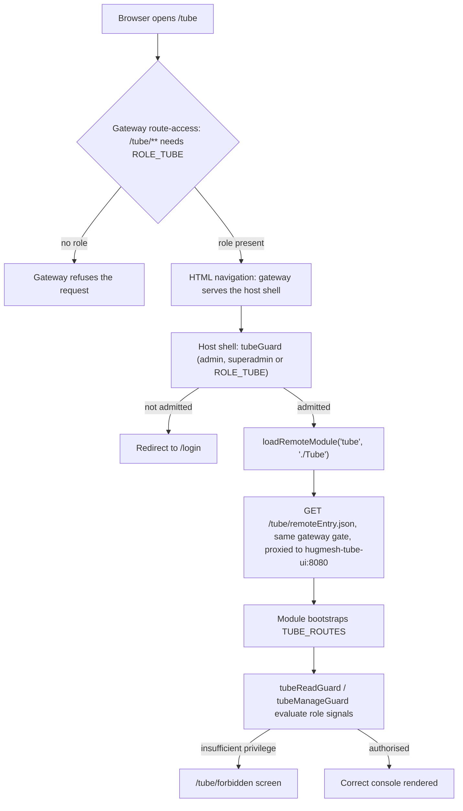
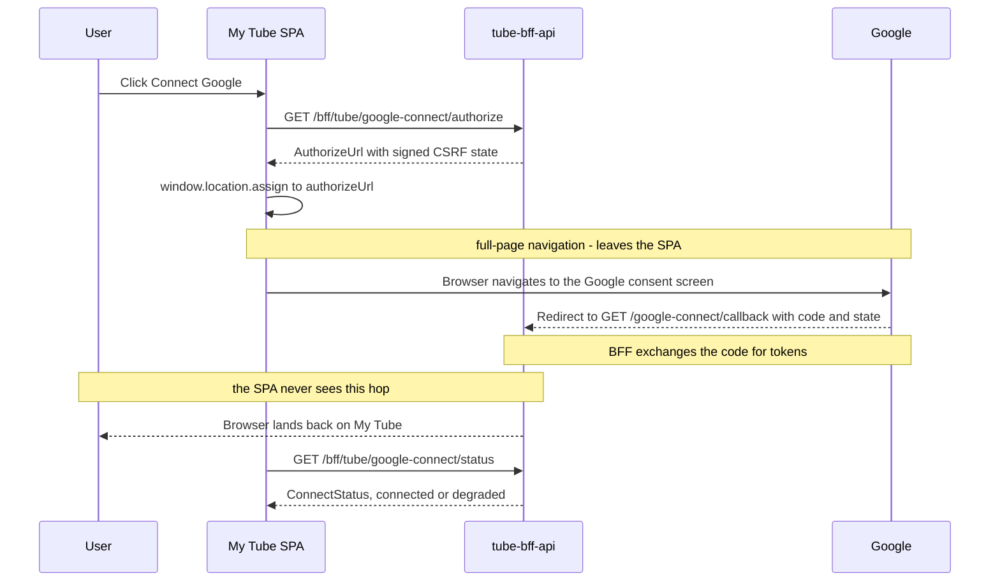

The **Tube (LocalTube) management UI** is an Angular **native-federation remote**.
The [`hugmesh-host-shell`](https://github.com/hugmesh/hugmesh-host-shell) host
shell mounts it at **`/tube`**. It is the console for the Tube optional service,
which lets users subscribe to YouTube channels and schedule local downloads to
watch inside the platform. The UI sits on
[`hugmesh-tube-bff-api`](https://github.com/hugmesh/hugmesh-tube-bff-api) and
has three areas: the per-user download queue, storage-budget management, and the
use-access overlay (grant, timeout and ban controls for admins).

## Part of the HugMesh platform

HugMesh is a self-hostable platform made of many small services and UI "remotes".
A host shell mounts the remotes at runtime through
[Native Federation](https://www.npmjs.com/package/@angular-architects/native-federation).
This repo is one remote. Related repositories:

| repo | role |
| --- | --- |
| [`hugmesh-host-shell`](https://github.com/hugmesh/hugmesh-host-shell) | host shell that mounts this and every other remote |
| [`hugmesh-tube-bff-api`](https://github.com/hugmesh/hugmesh-tube-bff-api) | the backend-for-frontend this UI talks to (`/bff/tube/**`) |
| [`hugmesh-auth-core`](https://github.com/hugmesh/hugmesh-auth-core) | shared account/session/MFA/Casdoor-admin infrastructure |
| [`hugmesh-login-ui`](https://github.com/hugmesh/hugmesh-login-ui) | native login form used platform-wide |
| [`hugmesh-user-bff-api`](https://github.com/hugmesh/hugmesh-user-bff-api) | owns login/session/token-custody logic |
| [`hugmesh-generator`](https://github.com/hugmesh/hugmesh-generator) | scaffolding + shared CI building blocks (including the pen-test harness this repo consumes) |

## Versions

| component | version |
| --- | --- |
| Angular | 22.0.x |
| @angular-architects/native-federation | 22.x |
| ng-openapi-gen | 1.0.5 |

> **Angular version:** This repo is on Angular 22.x + native-federation 22.x. So
> are the host shell and the other UI repos checked (the other 12 `hugmesh-*-ui`
> repos and `hugmesh-api-docs`): `@angular/core` in each `package.json` on `origin/main` is
> `^22`.

## Federation contract

The federation-api tube module row points at this remote:

| field | value |
| --- | --- |
| `remote_entry_url` | `http://hugmesh-tube-ui:8080/remoteEntry.json` |
| `metadata.mountAt` | `/tube` |
| `metadata.requiresRole` | `tube` |
| `kind` | `remote-shell` |
| `visibility` | `internal` |

A request from browser to this remote runs like this:



Inside the running app, navigation starts at the host shell step; the first two
steps happened on the page load.

The `remote_entry_url` in the table is the in-mesh address. A browser cannot
resolve it, so the host shell fetches the relative `/tube/remoteEntry.json`
(`src/assets/federation.manifest.prod.json` in `hugmesh-host-shell`). In
`hugmesh-generator`'s test stack
(`tests/stack/gateway-routes/fe/application-routes.yml`) the gateway sends
`/tube/**` requests with `Accept: text/html` to the host shell (route
`remote-deeplink-to-host-shell`) and every other `/tube/**` request to this
container, with the `/tube` prefix stripped (`StripPrefix=1`).

This remote:

- Exposes **`./Tube`** (→ `src/app/tube.routes.ts`, `TUBE_ROUTES`) in
  `federation.config.js`. The host's `loadRemoteModule('tube', './Tube')` resolves
  that key at runtime.
- Is served on **port 8080** (see `Dockerfile` + `nginx.conf`,
  `nginxinc/nginx-unprivileged`), so the emitted `remoteEntry.json` is reachable
  at the registered URL from inside the cluster.
- Is **internal**. It sits behind the gateway's `/tube/**` route-access row, which
  requires `ROLE_TUBE`. It is not a public surface; the gateway checks the role on
  the remote-entry fetch itself.

`federation-base.js` is **byte-identical** to the one in `hugmesh-host-shell`. It
is the single source of truth for the shared-deps surface and the RxJS skip list.
If it drifts from the host or from other remotes, module sharing breaks at runtime.

## Role model

The UI gating mirrors `hugmesh-tube-bff-api`'s `SecurityConfig` path gates and
the controllers' `@PreAuthorize` annotations. The UI checks are a convenience
layer (defence-in-depth). The BFF gates and the `TubeAccessGuard` default-deny
decision are the authority, and every call surfaces a 403 gracefully if the UI
check ever diverges.

| capability | composite | views |
| --- | --- | --- |
| `TUBE_USE` | `ROLE_TUBE` (admin/superadmin self-serve too) | My Tube (subscriptions, queue, usage, enqueue, viewing) |
| `TUBE_MANAGE` | `ADMIN \| SUPERADMIN` | Tube Access (grant/timeout/ban/restore), Storage Budgets |

A **granted `ROLE_TUBE` user** sees only **My Tube**: their mirrored subscribed
channels (`GET /bff/tube/subscriptions`), download queue, storage usage, an
enqueue action, and **in-platform viewing**. Each `done` job gets a `<video>`
card that asks, on demand, for a short-TTL (5 minute) signed URL
(`GET /bff/tube/media/sign`) for its own `contentPath`. An **ADMIN/SUPERADMIN**
also sees the **Tube Access** and **Storage Budgets** consoles. A **SUPERADMIN**
also sees the list-all + history panel inside Tube Access. A user with none of
the tube roles goes to the in-remote **`/tube/forbidden`** screen (the federated
mount path, not `/forbidden`, not `/login`). The host has already authenticated
the user, so a denial here is a privilege boundary inside tube.

**Default-deny use.** `ROLE_TUBE` is only the route-access floor. It gets the
user to the remote, not necessarily to enqueue or view downloads. The BFF's
`TubeAccessGuard` decides at request time: the user must hold an active
`tube_access` grant and must not be actively banned (`SUPERADMIN` is exempt from
the ban check). Without a grant, My Tube shows an "access not yet granted" panel,
not a generic error.

**Storage-budget-full gate.** This is the canonical disabled+helptext case in
the HugMesh UI standard. When a user's storage budget is full, the BFF marks
newly enqueued work `skipped` instead of queued. While the queue holds any
`skipped` job, the **"Enqueue from subscriptions"** button is **disabled**, with
the help text *"Your storage budget is full — an admin can raise it"* beside it.
The UI never offers enqueue when the budget is full.

Gating lives in three files:

- `src/app/session.service.ts` — `canUse` / `canManage` / `canManageAll`
  computed signals derived from the Casdoor roles in `hug.session`.
- `src/app/tube.guard.ts` — `tubeReadGuard` / `tubeManageGuard` applied
  per-route in `src/app/tube.routes.ts`.
- `src/app/tube-console.component.ts` — the role-aware menu bar shows each nav
  item only to the role that may use it.

## Platform auth / session model

This remote owns no login, token-exchange or session logic. It uses the HugMesh
SSO model as is:

- **Casdoor** is the SSO identity provider. It is **internal-only** and never
  redirects the browser. [`hugmesh-login-ui`](https://github.com/hugmesh/hugmesh-login-ui)
  renders a native login form that POSTs credentials straight to
  [`hugmesh-user-bff-api`](https://github.com/hugmesh/hugmesh-user-bff-api)'s own
  `/bff/login`-style endpoint. `hugmesh-user-bff-api` does the server-side Casdoor
  exchange and holds per-session JWT custody and refresh. (Login, session and
  account logic lives in `hugmesh-user-bff-api`, with shared
  account/session/MFA/Casdoor-admin infrastructure in
  [`hugmesh-auth-core`](https://github.com/hugmesh/hugmesh-auth-core). Account and
  session data lives in `admin-bff-db`, which `hugmesh-user-bff-api` reaches over
  mTLS.)
- The browser holds only an **opaque `bff_`-prefixed session**. A user never sees
  their own Casdoor JWT. The **gateway** is a pure Casdoor-JWT OAuth2 resource
  server. A pre-security exchange filter swaps the opaque `bff_` session for the
  internal custody JWT, so the gateway's JWT validation and role gate run
  unchanged.
- Authorization is data-driven by the `gateway_route_access` table
  (`GatewayRouteAccessFilter`). The `/tube/**` row requiring `ROLE_TUBE` is the
  floor in front of this remote, and `/bff/tube/**` has a row of its own.

Inside this UI, auth rides the **HttpOnly `bff_session` cookie**. The shared
`authInterceptor` sets `withCredentials: true` on every generated request, and the
gateway's `BffCookieToBearerWebFilter` mints the Bearer server-side from the
cookie. The browser holds **no** JS-readable bearer token (see the security note
below).

Two platform-wide efforts will touch this console but are not wired here yet:
Casdoor MFA step-up for the privileged Tube Access and Storage Budgets actions,
and outbound notifications for access and budget admin actions. See
[Roadmap](#roadmap).

## BFF endpoints consumed (`/bff/tube/**`)

`src/app/tube.service.ts` is the typed datastore wrapper. Every method maps 1:1
to a `hugmesh-tube-bff-api` endpoint. The endpoints are grouped by the minimum
role needed to call them:

- `GET  /bff/tube/downloads` → `TubeDownloadDto.JobList` (my download queue)
- `POST /bff/tube/downloads` → enqueue from my subscriptions → `JobList`
- `GET  /bff/tube/subscriptions` → `TubeGoogleDto.SubscriptionList` (my mirrored
  subscribed channels; the source of truth for My Tube's channel list, no
  longer derived from distinct job `channelId`s)
- `GET  /bff/tube/media/sign?path=<contentPath>` → `TubeMediaDto.SignedUrl` (a
  short-TTL HMAC-signed URL for **in-platform viewing** of my own `done`
  `contentPath`; the player signs only a path read off a row of my own
  owner-scoped queue, and the BFF re-checks the `/<domain>/<subject>/` prefix)
- `POST /bff/tube/admin/storage-budget` → set a user's budget → `Usage`
- `POST /bff/tube/admin/access/grant` · `/timeout` · `/ban` → the use overlay
- `DELETE /bff/tube/admin/access/{use|banned}/{userSubject}` → revoke/restore
- `GET  /bff/tube/superadmin/access` → all active overrides
- `GET  /bff/tube/superadmin/access/{userSubject}/history` → full history

The **internal worker seam** (`/bff/tube/internal/**`, claim/report,
`ROLE_TUBE_WORKER`) is a machine-only channel outside the human role hierarchy.
This UI does not call it. The download-worker sidecar uses it to report job
progress to the BFF.

The **Google-connect / subscription-sync** family is wired into `TubeService`
and shown on My Tube's **Google account** panel:

- `GET  /bff/tube/google-connect/status` → `TubeGoogleDto.ConnectStatus` (my
  display-safe connection state; the refresh token never crosses the boundary)
- `GET  /bff/tube/google-connect/authorize` → `TubeGoogleDto.AuthorizeUrl` (the
  Google consent URL, `access_type=offline&prompt=consent`, with a signed
  CSRF state that binds this principal)
- `POST /bff/tube/google-connect/disconnect` → best-effort revoke at Google +
  soft-revoke (audit-retained) → the post-disconnect `ConnectStatus`
- `POST /bff/tube/subscriptions/sync` → `TubeGoogleDto.SyncResult` (mirror my
  YouTube subscriptions; a failed Google token refresh marks `reauth_required`
  server-side and **stops** the sync)

**The OAuth hop.** "Connect Google" fetches the consent URL from `/authorize` and
**navigates the whole page** to it. Google then redirects the browser to the
BFF's own `GET /bff/tube/google-connect/callback?code&state`. The signed state,
not a bearer, authenticates that hop. The UI **never calls the callback itself**
(its generated client method exists and is deliberately unused). Back on My Tube,
the panel re-reads `/status`.



This is a **browser navigation**, not an XHR. The callback is Google's redirect
target, reached only when the browser leaves the app and comes back.

**Honest disclosure.** The panel reports what it knows and nothing more:

- If the `/status` read fails, the panel goes **degraded**. It shows the real
  failure (role/HTTP status) and disables connect and sync. It does not guess
  "not connected".
- If `/authorize` answers without a consent URL (an unconfigured or stubbed
  connect backend), the click shows exactly that and does **not** navigate.
- If `reauthRequired` is set, sync is disabled with visible help text (the
  disabled+helptext idiom) and the panel offers a re-connect. The UI never claims
  a sync can succeed on a known-bad credential.

> **Note (security).** An earlier version of this UI kept a JS-readable bearer
> token in `localStorage`, next to Matrix/Akkoma access tokens. Both have been
> removed from `HugSession`. The browser now holds only the **HttpOnly
> `bff_session` cookie**, which the gateway's `BffCookieToBearerWebFilter`
> exchanges for the custody Bearer server-side. The non-secret `hug.session`
> (identity and roles, used for UI gating only) stays in `localStorage`.
> Server-side route gates stay authoritative whatever the client holds.

## Typed API client (ng-openapi-gen)

`ng-openapi-gen.json`, the input `openapi.json` and the generated client under
`src/app/api/` are all **committed** (the org convention). The build is
deterministic and needs no network and no running BFF. The spec is the tube-bff's
own **committed** `src/main/resources/openapi/openapi.json`, which the BFF emits
from `./mvnw -Dtest=OpenApiSpecDumpTest test`.

Regenerate after the BFF spec changes:

```sh
npm run gen:spec   # copies the sibling BFF's committed openapi.json then runs ng-openapi-gen
                   #   default source: ../hugmesh-tube-bff-api/src/main/resources/openapi/openapi.json
                   #   override with TUBE_BFF_SPEC=/path/to/openapi.json
```

`TubeService` **delegates** every call to the generated, typed clients
(`TubeDownloadsService` / `TubeSubscriptionsService` / `TubeGoogleConnectService` /
`TubeMediaSigningService` / `TubeStorageBudgetAdminService` /
`TubeUseAccessService`) instead of hand-rolling `fetch` URLs. The generated
clients call the same same-origin `/bff/tube/**` paths (their `rootUrl` defaults
to `''`, bound to `TUBE_BASE_URL`). The wire calls, and the
`HttpTestingController` URL/method/body assertions in `tube.service.spec.ts`, are
unchanged. `TubeService` keeps its own public DTO types, its Promise method
signatures and the `TubeApiError` 403/404 translation, so the components
(`tube-my`, `tube-access`, `tube-budgets`) needed **no** change. The generated
models are bridged at the delegation boundary. The shared `authInterceptor` sets
`withCredentials: true` on every generated request, so the HttpOnly `bff_session`
cookie rides along, as it did with the old inline `fetch`. Auth behaves the same.

The internal worker seam (`/bff/tube/internal/**`, `ROLE_TUBE_WORKER`) has a
generated client too, but it is **never injected**. `TubeService` does delegate to
`TubeGoogleConnectService` (status/authorize/disconnect) and to `syncSubscriptions`
on `TubeSubscriptionsService`. The generated `googleConnectCallback` is the one
client method the SPA never calls (see *The OAuth hop* above).

## Known gaps / TODO

- **`pentest:dast` first pipeline run is unverified.** The job fetches the shared
  harness from `hugmesh-generator` at CI time (`.pentest-harness/`) and splices
  the base `before_script` back in, so it can scan; `tests/ci-wiring.test.mjs`
  pins that. Two things are still needed on the GitLab side and cannot be checked
  from this repo: `hugmesh-generator` must allowlist this project for
  `CI_JOB_TOKEN`, and the runner needs a GitHub credential for the harness's
  `make stack-up`. Watch the first pipeline. The job is `allow_failure: true`.

## Develop

**Prerequisites:** a Node version that `@angular/cli` 22.0.4 accepts: `^22.22.3 || ^24.15.0 || >=26.0.0` (its `engines` field in `package-lock.json`; the Dockerfile and CI use Node 24), and Angular CLI 22.x (installed via `npm ci`).

```sh
npm ci
npm start                          # ng serve tube (native-federation serve wraps the dev shell)
npm test                           # ng test tube --watch=false --browsers=ChromeHeadlessCI
npm run build                      # production build → dist/tube/browser (emits remoteEntry.json)
```

`npm start` (`ng serve tube`) is the native-federation `serve` target. It uses
`port: 0` and wraps the Angular dev-server (`serve-original`, port **`4209`** in
`angular.json`).

For local headless test runs, point `CHROME_BIN` at your Chrome/Chromium binary
(for example `CHROME_BIN=/opt/google/chrome/chrome`). Karma's `ChromeHeadlessCI`
launcher needs it to find the browser. CI sets it for you: `.gitlab-ci.yml`
installs Chromium into the `node:24-alpine` test container and exports
`CHROME_BIN=/usr/bin/chromium` before `npm test`.

## CI/CD

CI runs on **GitLab** (`.gitlab-ci.yml`), not GitHub Actions. The pipeline builds
the container image and pushes it to the deployment registry. Its stages:

- **`test`** — two jobs. `test` runs headless Karma in `node:24-alpine`.
  `test:headers` runs the nginx header guards (`node tests/run-guards.mjs`). It
  blocks, and `build:image` needs it.
- **`e2e`** — two non-blocking jobs. `e2e:bdd` is an offline compile/discover
  proof. `e2e:mock` runs the `@mock` features against the dev shell (see
  `e2e/README.md`).
- **`build:image`** — stage `build`. Builds and pushes the container image. Runs
  on the default branch and tags only.
- **`pentest`** — the central OWASP pen-test stage, `include:`d from
  [`hugmesh-generator`](https://github.com/hugmesh/hugmesh-generator)'s
  `tests/pentest/ci/pentest-stage.gitlab-ci.yml`. Two thin jobs sit on it:
  `pentest:sca` (OWASP Dependency-Check, self-contained over this repo's checkout)
  and `pentest:dast` (authenticated ZAP DAST baseline + nuclei boundary
  templates). Both are `allow_failure: true` (additive, non-blocking) and gated to
  the default branch plus merge requests.

**Note:** `pentest:dast` fetches the shared harness from `hugmesh-generator`
(`git clone` into `.pentest-harness/`, URL derived from `CI_REPOSITORY_URL`) and
points `PENTEST_HARNESS_DIR` at it. `tests/ci-wiring.test.mjs` (part of
`test:headers`) fails if that wiring regresses. The job scans the platform built
from `main`, not the pipeline's own commit.

The CI Node image is `node:24-alpine`. The minor version is not pinned; it tracks
the latest 24.x of the upstream Docker image.

## Releases

The package version lives in `package.json` (and `package-lock.json`, which must
match). It is currently `0.2.0-beta.1`: built and tested, not yet proven live
(the org's beta scheme: `MAJOR.MINOR.PATCH-beta.N`, N raised for each new beta of
the same base).

`.github/workflows/release.yml` builds and pushes `ghcr.io/hugmesh/hugmesh-tube-ui`:

| trigger | image tags | GitHub Release |
| --- | --- | --- |
| push to `main` | `:main`, `:sha-<12>` | none |
| push of tag `v<version>` | `:<version>`, `:beta`, `:sha-<12>` | prerelease, never "latest" |
| `workflow_dispatch` on `main` or a `v*` tag | same as the push it re-runs | created only if missing |
| any other ref | refused | none |

- The tag must be exactly `v` + the `package.json` version, or the run fails.
- A version tag that already exists on GHCR is never overwritten (a tag push
  fails; a re-run dispatch skips the build).
- `:latest` is never pushed.
- Before any image is pushed, the run passes both GitLab gates: the unit suite
  (`npm test`) and `node tests/run-guards.mjs` (`test:headers`).
- The image is for the runner's architecture only (no `platforms`).
- Runner: jobs use the runner named by the repo variable `RUNS_ON_PUBLISH` (a
  JSON array) only for `main` and `v*` tags; otherwise, or while the variable is
  unset, they use hosted `ubuntu-latest`. The workflow has no pull-request
  trigger.

To publish a beta, after the version bump is on `main`:

```
git tag -a v0.2.0-beta.1 <commit on main> -m 'tube-ui 0.2.0-beta.1'
git push origin v0.2.0-beta.1
```

To re-run a release by hand: `gh workflow run release.yml -R hugmesh/hugmesh-tube-ui --ref v0.2.0-beta.1`.

## Current state

Shipped and on `main` today:

- **Native-federation remote** mounted at `/tube` by the host shell,
  `federation-base.js` byte-identical to the host's shared-deps surface.
- **Role-aware console:** My Tube (Google connect/sync panel, subscriptions,
  queue, usage, enqueue, in-platform `<video>` viewing signed on demand) for
  `ROLE_TUBE`; Tube Access + Storage Budgets for `ADMIN`/`SUPERADMIN`;
  `SUPERADMIN` list-all + history; the in-remote `/tube/forbidden` denial screen.
- **Default-deny + disabled+helptext UX:** a graceful 403 "access not yet
  granted" panel, and the disabled enqueue button when the storage budget is full.
- **Typed client:** `TubeService` delegates to the **committed** ng-openapi-gen
  clients against same-origin `/bff/tube/**`. The build is deterministic, with no
  network and no running BFF.
- **e2e harness:** a Playwright + BDD (Gherkin) harness in `e2e/`. CI runs it as
  `e2e:bdd` (compile and discover) and `e2e:mock` (the `@mock` features). Both are
  `allow_failure`, so neither is a required gate yet. The `@cluster` scenarios
  need a live stack and do not run in CI.
- **Full nginx response-header set** (`nginx.conf`). Every header is sent with
  `always` (so error responses carry them) and declared at **server scope and in
  every `location`**, because nginx's `add_header` does not merge: a block that
  declares one header of its own drops all the inherited ones.
  - Baseline: `X-Content-Type-Options: nosniff`, `X-Frame-Options: DENY`,
    `Referrer-Policy: strict-origin-when-cross-origin`, HSTS.
  - **CSP**, nonce-based (`map $request_id $cspnonce` + a `sub_filter` that
    stamps the nonce onto every `<script>` of index.html). No `unsafe-inline`
    in `script-src`. `blob:` is REQUIRED in script/style/connect-src because
    es-module-shims runs the federation bundle from `blob:` URLs.
  - **`Cross-Origin-Opener-Policy: same-origin`**. Safe because the
    Google-connect hop is a top-level `window.location.assign`, never a popup.
  - **`Cross-Origin-Embedder-Policy: credentialless`**, deliberately **not**
    `require-corp`. The subscriptions panel loads channel avatars from Google's
    CDN as no-cors ``, and `require-corp` blocks every one of them
    (measured:
    `net::ERR_BLOCKED_BY_RESPONSE.NotSameOriginAfterDefaultedToSameOriginByCoep`).
    `credentialless` keeps them and still gives `crossOriginIsolated === true`.
  - **`Cross-Origin-Resource-Policy: cross-origin`**, deliberately permissive.
    This container exists to be loaded by another document. The header is the
    "CORP-tagging" that `hugmesh-gateway`'s SecurityConfig names as the
    precondition for ever enabling COEP at the front door. Framing is refused
    separately (`X-Frame-Options` + `frame-ancestors 'none'`).
  - **`Permissions-Policy`** denies every powerful feature Tube has no use for.
    It keeps `autoplay=(self)`, `fullscreen=(self)` and
    `picture-in-picture=(self)`: the `<video>` player sets `autoplay`, and the
    browser's own `controls` expose the other two, so `()` on any of them breaks
    the watch page.
  - **Runtime theme stylesheets.** `location = /hug-theme.css` and the legacy
    `location = /snap-theme.css` alias `/tmp/hug-theme.css` and `/tmp/snap-theme.css`,
    written at container start by `docker-entrypoint.d/50-hug-theme.sh`. They are
    `Cache-Control: no-store` and carry the same eight security headers.
  - **`/healthz` declares its media type with `default_type`, not
    `add_header Content-Type`.** `add_header` APPENDS, so the endpoint sent the
    field twice: `application/octet-stream` (nginx's default) then `text/plain`.
    Curling the running container found it; reading the file did not. Two guards
    cover it: no `add_header Content-Type` anywhere, and `/healthz` must still
    declare `default_type text/plain`.

    **Correction.** An earlier revision of this section, of the `nginx.conf`
    comment and of the guard test said the duplicate plus `nosniff` pinned the
    browser to the **first** type and gave the user a download prompt for a
    three-byte `ok`. **That is false.** A four-way experiment on
    `nginxinc/nginx-unprivileged:1.27-alpine` (headless Chromium 149, plus `curl`)
    shows it:

    | variant | `Content-Type` on the wire | `document.contentType` | download? |
    | --- | --- | --- | --- |
    | pre-fix as shipped (`add_header`, nosniff on) | `application/octet-stream`, `text/plain` | `text/plain` | **no** |
    | post-fix (`default_type`) | `text/plain` | `text/plain` | no |
    | pre-fix with **nosniff removed** | `application/octet-stream`, `text/plain` | `text/plain` | **no** |
    | CONTROL: no type declared at all | `application/octet-stream` | — | **YES** (`page.goto` fails `Download is starting`, `suggestedFilename: "healthz"`) |

    Browsers use the **last** `Content-Type`. Fetch's "extract a MIME type"
    overwrites its result for every field value, Chromium does the same, and
    `curl -w '%{content_type}'` agrees. `nosniff` plays no part. So the duplicate
    was spec hygiene, not a visible break, and the fix is still right. The
    download is real only in the CONTROL row. That is why the second guard
    (`default_type text/plain` must stay) is the one that matters: deleting the
    type declaration to satisfy "no `add_header Content-Type`" is the mutation that
    really breaks the endpoint.
  - Guarded by `npm run test:headers` (`tests/security-headers.test.mjs`, zero
    dependencies). It walks every `server` block, every `location` **and every
    `if`**, nested ones too, because `add_header` does not merge at any level. It
    asserts each header and value. It pins the CSP **verbatim**, since a widening
    such as `img-src *` or a host-source next to the nonce is silent in
    production. It pins the `$cspnonce` map's `default $request_id` body. It fails
    on the "obviously stricter" mutations above. It blocks in CI as
    `test:headers`, and `build:image` depends on it.
    - **`if` blocks are walked because they were an evasion.**
      `if ($arg_dl) { add_header X-Frame-Options "SAMEORIGIN" always; }` inside
      `location = /healthz` once passed the whole suite *and* `nginx -t`.
      Measured on the real image: `GET /healthz` keeps all eight security headers;
      `GET /healthz?dl=1` returns **one**, `X-Frame-Options: SAMEORIGIN`. An `if`
      that declares no `add_header` inherits the enclosing set and is exempt (`if
      ($request_method = POST) { return 405; }` is a fine shape). One that
      declares any must re-declare them all.
    - **The job cannot pass by not running.** `test:headers` used to be
      `node --test "tests/**/*.test.mjs"`, which **exits 0 when the glob matches
      nothing**. Measured: delete `tests/security-headers.test.mjs`, run the exact
      CI job, and it reports `# fail 0` and goes green while `build:image` builds
      behind a gate that asserted nothing. Now `tests/run-guards.mjs` finds the
      guard files itself, stops when there are none, and checks the runner's own
      counts against a floor (`MIN_TESTS`). Measured after the fix: guard file
      deleted → exit 1; `tests/` empty → exit 1; suite cut to one test → exit 1;
      the runner itself deleted → exit 1 (node cannot start a missing entry point).
    - **A duplicate `add_header` is a defect, and the guard used to miss it.** The
      lookup was `headers.find(...)`, first match only. A *second* directive
      passed unnoticed, and it is not a no-op: both fields ship and the browser
      combines them. Measured in headless Chromium 149, added inside `location /`:
      a second `Cross-Origin-Embedder-Policy: require-corp` beside `credentialless`
      flips `crossOriginIsolated` **true → false**. A second, narrower
      `Content-Security-Policy: default-src 'self'; script-src 'self'` wins
      outright, because CSP is enforced **conjunctively**: blank page at HTTP 200
      with *"Executing inline script violates … 'script-src 'self''"*. The lookup
      now fails on any duplicate of a single-valued header, and a separate guard
      names every duplicate in a block.
    - **The CSP and the CORS grant are asserted per BLOCK, not on one named
      block.** They used to be checked with
      `BLOCKS.find((b) => b.label.endsWith('location /'))`, so a *nested* location
      that re-declared the eight baseline headers and dropped these two passed.
      Measured: `location = /index.html { <the eight> }` inside `location /` makes
      nginx's `index index.html` internal redirect serve `GET /` from that block,
      so the app document ships with **zero** CSP. Behind a proxy that mimics
      `hugmesh-gateway`'s `SecurityConfig` (it supplies `script-src 'self'` only
      when the upstream sent none), the page is **blank at HTTP 200**. And
      `location ~* \.(?:js|mjs)$` with the eight and the CSP but no
      `Access-Control-Allow-Origin` silently strips the grant the host shell needs.
      Every block that can serve an app document or a federation asset must carry
      both. A block is exempt only if it can serve one fixed non-HTML resource: it
      pins a non-`text/html` `default_type` **and** answers from a `return` or
      single-file `alias` **and** has no `try_files` fall-through. The two theme
      stylesheets and `/healthz` qualify. "Add a `default_type`" is not an escape
      hatch.
    - **Server scope declares them too, and it is reachable.** nginx answers some
      requests *before* it picks a location. Measured with one malformed request
      (`Content-Length: abc`): the old config returned `400 Bad Request` with the
      eight baseline headers and **no** CSP and **no** CORS grant. With the
      server-scope declaration it carries both. This also lets the suite assert the
      contract at every level that can emit a response, with no "except the server
      block" carve-out. The nonce `sub_filter` moved up with the CSP. Unlike
      `add_header`, `sub_filter` *does* inherit, but only while the inner level
      declares none of its own, so a block that declares one must declare the whole
      injection (guarded).
    - **No `include` inside the server block.** The suite reads `nginx.conf` as
      text and does not follow includes, so an `include` in the response path
      would hide from every guard. There is none today and the suite pins that.
      Adding one means teaching the parser to follow it in the same commit.
    - Not covered: anything only a running server can show, such as whether a
      header is honoured, whether the nonce reaches the browser, or whether a
      cross-origin avatar loads. Those are checked by running the image (`nginx -t`,
      a curl of every path, a headless-Chromium load), recorded in the PR for
      issue #3.
- **CI on GitLab:** `test` + `test:headers` + `e2e:bdd` + `e2e:mock` + `build:image` + the central OWASP
  `pentest` stage (SCA + ZAP DAST baseline, non-blocking; see CI/CD above for
  the state of that first pipeline run).

This remote owns **no** auth/login/session logic. It rides the platform's
native-login model: `hugmesh-login-ui` native form POST → `hugmesh-user-bff-api`
internal Casdoor exchange + token custody → opaque `bff_` browser session →
gateway JWT-swap + `gateway_route_access` gate. Casdoor is internal-only and
never redirects the browser. See *Platform auth / session model* above.

## Roadmap

Platform-wide efforts that will touch this console. None is wired here today:

- **SSO end-to-end live + e2e.** The native-login form-POST → `hugmesh-user-bff-api`
  custody → opaque `bff_` session → gateway swap flow is being hardened and
  covered by e2e tests platform-wide. This UI uses it as is; no UI changes are
  expected.
- **Casdoor MFA step-up.** WebAuthn + TOTP + recovery, with per-role defaults.
  The Tube Access and Storage Budgets privileged actions are candidates for
  `gateway_route_access.mfa_required` + `mfa_satisfied` step-up gating once
  this lands platform-wide. The BFF route gates stay authoritative either way.
- **Notifications — external channels.** Tube access and budget admin actions
  (grant/timeout/ban, budget changes) are account-status/infra events that
  could emit `@system` notifications (Matrix DM, Akkoma feed, phpBB, email)
  once the notification adapters ship and the tube-bff emits them.
  (`TubeAccessService` has no notification call today, only an unrelated
  `"@system"` fallback-actor-name string.) The platform's `SseNotificationBus`
  (per-user multicast in `hugmesh-user-bff-api`) and the SSE notification toast
  (`NotificationToastService`, `hugmesh-host-shell`) are already shipped. So
  tube-ui already shows notifications through the host shell with no UI change
  here. The gap is on the tube-bff emission side only.
- **OWASP pen-test CI** — 🚧 jobs defined, first run pending. `.gitlab-ci.yml`
  includes the central `hugmesh-generator` pen-test stage and adds non-blocking
  `pentest:sca` + `pentest:dast` jobs. SCA is self-contained. The DAST leg (ZAP +
  the committed `nuclei` boundary templates) fetches the shared harness at CI
  time. No pipeline run has been verified yet; it needs the generator's
  CI_JOB_TOKEN allowlist and a runner GitHub credential. The opt-in `k6` load leg
  (`.pentest-load`) is not wired here. It is a CI-pipeline stage, not a deployed
  CronJob or admin-UI trigger.

Done (no longer roadmap): the **bearer-storage migration**. `/bff/*` auth
rides the HttpOnly `bff_session` cookie: `src/app/auth.interceptor.ts` sets
`withCredentials: true` on every request, `src/app/tube.service.spec.ts`
asserts `withCredentials` and no `Authorization` header on the requests it
checks, and `HugSession` (`src/app/session.service.ts`) carries no token field.
The same migration continues in the remaining HugMesh UIs.

## Contributing

Issues and pull requests are welcome. This repo has no `CONTRIBUTING.md` yet, so
the short version:

1. Open an issue for a bug or proposal before large changes, so the approach can
   be settled first.
2. Keep the typed API client generated (`npm run gen:spec`), not hand-edited.
   Regenerate it after any change to the BFF's OpenAPI spec.
3. Run `npm test` and `npm run test:headers` locally before opening a PR. CI runs
   the same Karma suite headless, the header guards, and the `e2e:bdd` and
   `e2e:mock` jobs.
4. Match the existing role-gating pattern (guard + service signal + menu
   visibility) when adding views. See *Role model* above.

## License

MIT — see [`LICENSE`](./LICENSE).
