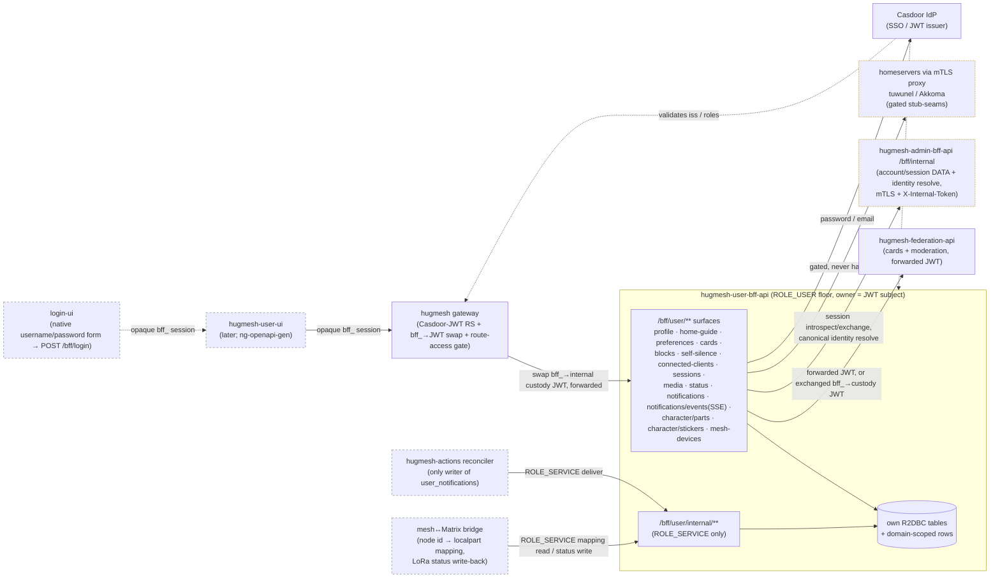

Spring **user BFF** — the `ROLE_USER`-floor backend-for-frontend paired with the
(later) `hugmesh-user-ui`. Reactive WebFlux + R2DBC + Liquibase + Casdoor JWT
resource-server + springdoc + Spring Native, scaffolded from the
`hugmesh-admin-bff-api` template (same stack, same conventions). Java 25 LTS,
Spring Boot 4.0.7 / Spring Cloud 2025.1.2.

## Where it sits

A **backend-namespace BFF** — deployed into `hugmesh-backend`, reached only
*behind the gateway*, never public. It is the per-role backend-for-frontend for
ordinary users, the `ROLE_USER` peer of `hugmesh-admin-bff-api` (admin) and the
mod BFF. It talks to:

- **Casdoor** (the IdP) as an OAuth2 resource server — validates the JWT, and is
  the destination for the self-service password/email change. Casdoor is the SSO
  IdP for the whole platform but is **never browser-exposed**: `login-ui` shows a
  native username/password form that POSTs to `/bff/login`, and this BFF runs the
  PKCE flow against the internal Casdoor **server-side** (code→token exchange) and
  holds per-session JWT custody/refresh (see *Auth model / SSO relocation*).
- **hugmesh-federation-api** — for the caller's federation **cards** (bundles)
  and the instance-block **recommendation** chain (caller JWT forwarded per request).
- **hugmesh-admin-bff-api** `/bff/internal` (over mTLS + `X-Internal-Token`) — the
  account/session **data** for the relocated login/session/account surfaces stays in
  `admin-bff-db`; this BFF reaches it server-to-server (see *Auth model*).
- the **homeservers** (tuwunel / Matrix, Akkoma / Mastodon) **through the gateway
  mTLS proxies** — for the external block push, self-silence visibility hides,
  connected-client list/revoke, and the AI-cloak media upload. These legs are
  **gated stub-seams** that never hard-fail (see *Honest deferrals*).



In the diagram: solid nodes/edges are ✅ shipped on `main`; dashed grey nodes are 🔭
planned or built/landing elsewhere (`login-ui`, `hugmesh-user-ui`, the
`hugmesh-actions` reconciler, and the mesh↔Matrix bridge — the `mesh-devices` internal
mapping/status-writeback receiver is ✅ shipped here, but no bridge exists yet to call
it); the amber-dashed nodes are ✅-shipped-but-**gated**
stub-seams — the homeserver leg (off by default) and the admin-bff `/bff/internal`
leg (the client + `BffSessionAuthenticationWebFilter` + `CanonicalIdentityResolver` are
all real, always-registered code, but every call fail-closed-stubs unless
`app.bff.oidc.enabled=true`).

## Auth model / SSO relocation 🚧

The platform's auth is being consolidated this cycle, and this BFF is the new home
for the user-facing slice of it. Ground truth as of 2026-06-25:

- **Casdoor is the SSO IdP, and it is NEVER browser-exposed.** Native login is the
  **sole** browser login entry, terminating server-side in this BFF so the user's
  browser only ever holds an
  **opaque `bff_`-prefixed** httpOnly session — never a Casdoor JWT, refresh token, id
  token, PKCE verifier, `state`, or even a Casdoor URL:
  - **Native login (`POST /bff/login`) — the headline model.** The browser posts only
    `{username, password}`. This BFF generates a PKCE pair + `state` **server-side**,
    verifies the credentials by POSTing to the **internal** Casdoor `/api/login`
    (`CasdoorLoginClient`, pointed at `app.bff.oidc.login-base`, e.g.
    `http://casdoor:8000` — the in-cluster base, never the browser-facing issuer), and
    on success redeems the returned one-time authorization `code` for tokens. No Casdoor
    redirect ever reaches the browser.

  > Historical: an earlier model had `login-ui` perform a browser-visible Casdoor OIDC
  > authorization-code (PKCE) redirect and hand the `code` back to a browser-PKCE callback
  > endpoint for the server-side exchange. That browser-exposed-Casdoor model — and its
  > callback controller — have been **retired**; native `POST /bff/login` is now the SOLE
  > browser login entry.

  Native login converges on **one** shared completion path — `OidcLoginCompletionService`
  (exchange `code`→tokens via auth-core `OidcExchangeClient` → provision account + mint
  session via admin-bff → AES-256-GCM custody-stamp the tokens via `BffCustodyCipher` →
  mint the `bff_` cookie) — so the security-critical crypto/session logic lives in
  exactly one place, never copy-pasted between controllers.

  **Native-login request / response contract:**
  ```
  POST /bff/login   (permitAll at the BFF; reached via be-gateway)
  → { "username": string, "password": string,
      "mfaPasscode"?: string, "mfaType"?: string }

  200 (success)      { "registrationComplete": bool, "status": "active",
                       "mfaRequired": false }        + Set-Cookie: bff_… (httpOnly)
  200 (MFA needed)   { "mfaRequired": true, "mfaType": [ … ] }   (NO cookie, NO session)
  401 (bad creds)    { "error": "invalid_credentials", "message": <casdoor msg> }
  ```
  The success body carries **only** non-secret routing hints — the opaque session token
  appears solely in the `Set-Cookie` header, never in the body.
- **The gateway stays a pure Casdoor-JWT OAuth2 resource server.** A pre-security
  exchange filter swaps the `bff_` session → the internal custody JWT, so the
  gateway's JWT validation + role gate run unchanged.
- **Authorization is data-driven.** The `gateway_route_access` Postgres table is the
  source of truth, enforced by the gateway's `GatewayRouteAccessFilter`:
  ADMIN / GAME-MASTER bypass within their own domain, SUPERADMIN cross-domain.
- **Login / session / account logic is RELOCATING from admin-bff to this user-bff;**
  the shared core is extracted to **`hugmesh-auth-core`** (account / session / MFA /
  Casdoor-admin infra). The account/session **DATA stays in `admin-bff-db`** — this
  BFF reaches it via admin-bff `/bff/internal` over **mTLS + `X-Internal-Token`**.
- **Cloudflare** fronts prod.

> ✅ Already on `main` here: the JWT-only `/bff/user/**` surfaces, the Casdoor
> resource-server config, the canonical `CasdoorAuthorities` converter, and
> issuer-keyed domain-scoping. ✅ Also on `main` but **shipped DARK** (default-off
> flags, fail-closed-stubbed, byte-identical runtime when off): the **native login**
> server-side credential check (`CasdoorLoginClient` → internal Casdoor `/api/login`),
> the server-side code→token exchange (PKCE), the one shared
> completion path (`OidcLoginCompletionService`) native login uses, the `bff_` session
> custody (`BffCustodyCipher`), the `/bff/login,/register,/session,/me` SSO surface, the
> admin-bff `/bff/internal` account/session client (`AdminBffInternalClient`), and
> the `hugmesh-auth-core` adoption. 🚧 What genuinely remains is the **live
> flag-flip** (gating off `app.bff.oidc.enabled` / `app.bff.custody-key` /
> `app.internal.token`, wiring `app.bff.oidc.login-base` to the in-cluster Casdoor,
> pinning the admin-bff #112 contract + the cross-repo egress NetworkPolicy) and
> **SSO e2e**. Until that flip, login stays operationally owned by admin-bff: the
> `/bff/login` (native) + `/bff/register` routes exist but 503 / are inert while the
> flags are off.

### Native-login session bridge — `BffSessionAuthenticationWebFilter` ✅ shipped

Even with `app.bff.oidc.enabled=false` (the default), this filter is always registered
and runs on every request: it is what lets an opaque `bff_` session (cookie or
`Authorization: Bearer bff_…` header) authenticate against **this service's own**
`hasRole()`/`.authenticated()` gates, not just the gateway's route-access decision. It
introspects the token via `AdminBffInternalClient#resolveSession` (admin-bff `GET
/bff/internal/session/introspect`), then builds a **synthetic, server-only** `Jwt`
principal (never decoded from client input, never forwarded) carrying `sub` = the
admin-bff account id, mapped `ROLE_*` authorities, `MFA_SATISFIED` when the session's
step-up is satisfied, and — for the identity-resolution fixes below — the account's
persisted `localpart`/`mastodon_localpart` claims. A suspended/banned session is an
explicit `403`; an unknown/expired session passes through unauthenticated (clean 401
downstream); any other admin-bff failure (timeout, 5xx, unreachable) fails **closed**
with `503` rather than silently demoting every native-login caller to logged-out. When
`AdminBffInternalClient` itself is the disabled fail-closed stub (the default), the
filter treats that as permanent pass-through, not a 503.

The raw session token is also stashed in the Reactor context (never the principal) so
`FederationApiClient`/the media clients can swap it for a **real, forwardable** custody
JWT via `AdminBffInternalClient#exchangeSession` (admin-bff `POST
/bff/internal/session/exchange`) before calling federation-api or a homeserver proxy —
otherwise a native-login caller's synthetic principal would reach those services
credential-less and get rejected.

### Canonical homeserver-identity resolution — `CanonicalIdentityResolver` ✅ shipped

Every call site that needs the caller's Matrix/Mastodon **localpart** (the D6 proxy
mints, the media-custody mint, self-silence hide, connected-clients read/revoke, active
session listing) resolves it through one shared bean, `auth.CanonicalIdentityResolver`,
rather than a per-controller copy: **claim-first** (the `localpart`/`mastodon_localpart`
claims the filter above stamps for a native-login session), else the caller's **own**
`casdoor:<subject>` account (subject = first non-blank of `email`/`preferred_username`/
`sub`, mirroring admin-bff's own account-key derivation), else **fail closed** — never a
raw derived/guessed candidate. This closes a real cross-user account-takeover class
found by a dedicated adversarial security audit of the merged native-login surface: a
real (non-`bff_`) Casdoor JWT with no `email` claim used to fall through to `preferred
_username -> discord:<preferred_username>`, which could resolve **another user's**
admin-invite account and mint/hide/revoke against their homeserver identity. Mint sites
fail closed (`401`/`409`, no mint); self-silence degrades to a blank leg (best-effort,
already gated off by default); `SessionsService` uses the same resolver so
`/bff/user/sessions` lists/revokes only the caller's own rows regardless of how they
authenticated.

## The core invariant: owner-enforcement

**Every endpoint operates ONLY on the caller's OWN data.** The owner is ALWAYS the
Casdoor **JWT subject** (`jwt.getSubject()`) — never a path or request-body field. A
user can never read/write another user's profile, preferences, cards, blocks,
self-silence, or connected clients. There is deliberately no `/profile/{userId}`
style route; the only data a caller can address is their own, identified by the
token. The request body's `userId` is ignored on writes (always overwritten with the
JWT subject) so it cannot redirect a write to another user. This is enforced in
EVERY service method and tested at both the service layer (spoofed body, owner+id
scoped delete) and the repository/SQL layer (owner isolation).

## API surface (all under `/bff/user/**`, `ROLE_USER` floor, owner-enforced)

### Profile — `ProfileController` (`/bff/user/profile`)
Own R2DBC `user_profile` table (one row per user; `user_id` = JWT subject = PK).
Fields: `gender, pronouns, timezone, displayName, visibility {public|internal}
(default internal), vanitySubdomainEnabled, vanityUsername, screenReaderName,
avatarUrl`.

- `GET /bff/user/profile` — my profile (an empty default if none yet).
- `PUT /bff/user/profile` — create/update my profile (body `userId` ignored; the
  vanity username is derived from the **token** — `preferred_username`, then `name`,
  then subject — NOT the body, so the reserved-name guard can't be bypassed).
- `DELETE /bff/user/profile` — delete my profile.
- `POST /bff/user/profile/avatar` — upload my profile picture (multipart `file`,
  `image/*` only, 5 MB cap). The bytes go to the tuwunel media repository via
  `MatrixMediaClient` and the resulting `mxc://` URL is persisted onto
  `user_profile.avatar_url`; the column is server-derived and a profile save never
  clears it. STUB-GATED by `avatar.matrix.enabled` (default false — a deterministic
  `mxc://stub.invalid/<id>` is returned so avatar storage works + ships dark).
- `POST /bff/user/profile/password` — change my **Casdoor** password.
- `POST /bff/user/profile/email` — change my **Casdoor** email.

Password + email are owned by the **Casdoor IdP**, not this BFF — they go through
a reactive `CasdoorUserClient` (the BFF never stores credentials). See deferrals.

**`displayName` + vanity-username guard** — charset/confusable-checked on every save
(zero-width / bidi / Cyrillic look-alike / reserved-confusable rejected with 400;
`@SafeDisplayName` + the ICU4J `UsernameSkeleton` + `ReservedNames` engine). The
skeleton is a recomputable defence-in-depth cache, never a DB identity — the exact
UNIQUE + the 004 `vanity_username` CHECK remain the DB backstop.

**Vanity PUBLISH sync (cross-service, `FederationApiClient`)** — ✅ SHIPPED. Every
username-threaded `ProfileService.save` now calls hugmesh-federation-api's
owner-scoped `PUT`/`DELETE /api/federation/vanity/{username}` (see that repo's
README) to keep the `federation_modules` fragment in lockstep with the local
`visibility`/`vanitySubdomainEnabled` flags:
- `vanitySubdomainEnabled && visibility=='public'` → self-publish. This is the
  user's ACTIVE, explicit intent, so a federation-api FAILURE (most commonly: no
  `PUT /bff/user/cards/{slug}` bundle uploaded yet for `profile-<username>`) FAILS
  the whole profile save — never a silently-degraded "saved" while the fragment was
  never actually published upstream.
- otherwise → self-unpublish, deliberately BEST-EFFORT (logged, swallowed): this
  leg fires on every non-public save, including edits that never touched vanity at
  all, so a federation-api outage must never block an unrelated pronoun/timezone
  edit. The local row is already correctly private the moment the save returns; a
  lagging federation unpublish converges on the next successful sync.

See `FederationApiClient#publishVanity`/`#unpublishVanity` (the honest-propagation
status mapping) and `ProfileServiceFederationSyncTest` / `FederationApiClientTest`.

**`screenReaderName` (a11y)** — the ASCII-only aria-label / spoken name a screen
reader announces (`@SafeScreenReaderName` + the `ScreenReaderNames` engine; 008
`screen_reader_name` column). When `displayName` is pure **ASCII** the screen-reader
name **defaults** to it (no prompt); when `displayName` is **non-ASCII** an ASCII
screen-reader name is **required** — a save without one is a **422** the
registration/profile-save flow uses to prompt. A present non-ASCII screen-reader name
is a 400. (The aria-label UI consumption is a later UI-wave task — this carries the
field + validation + default/prompt logic.)

### Home-guide preference — `HomeGuideController` (`/bff/user/home-guide`)
Per-user "getting-started guide dismissed" flag, keyed per guide, stored in the
own R2DBC `user_preference` table as `home-guide-dismissed:<guide>` = `true`. The
role home views read this to show the welcome/getting-started guide only on first
visit.

- `GET  /bff/user/home-guide?guide=<g>` — `{guide, dismissed}` (default guide `home`).
- `POST /bff/user/home-guide/dismiss?guide=<g>` (and `PUT` alias) — dismiss.
- `DELETE /bff/user/home-guide/dismiss?guide=<g>` — re-show (un-dismiss).

### Durable user preferences — `UserPreferencesController` (`/bff/user/preferences`)
DURABLE per-user UI preferences in the own R2DBC `user_preferences_store` table,
keyed by the JWT subject **and** the brand (domain is part of the composite PK
`(user_id, pref_key, domain)`), so a multi-brand owner keeps a separate,
owner-isolated value per brand. The compose surfaces (the mastodon/matrix AI-poison
toggle) and other UI-wave toggles read/persist here so a choice survives a reload /
device change instead of living only in the browser. Owner = JWT subject;
domain-scoped (SUPERADMIN unscoped); `@PreAuthorize("hasRole('USER')")`. `GET`
returns the resolved view (every stored value **plus** the server default merged in
for any unset known preference), `PUT` upserts one preference (key + value
validated).

- `GET /bff/user/preferences` — `{ "<key>": "<value>", ... }`. Carries
  `media.poison.default` — the per-user durable AI-poison default whose fallback
  **mirrors** the server `MediaPoisoningProperties.defaultMode`.
- `PUT /bff/user/preferences` — body `{ "key": ..., "value": ... }`; upserts and
  returns the resolved view. The AI-poison default must be a valid cloak mode
  (`glaze|nightshade|light|none`).

The read-only `GET /bff/user/media/capability` `defaultMode` (the *server* policy
default) is unchanged — this endpoint layers the per-*user* durable override on top.

### Cards — `CardsController` (`/bff/user/cards`)
CRUD over the caller's OWN federation bundles (`user_modules` in
`hugmesh-federation-api`), via the reactive `FederationApiClient`. The caller's
JWT is **forwarded per request** so federation-api scopes `/bundles/mine` (and
records bundle ownership on PUT) to the same subject — owner-enforcement holds
end-to-end with no broader service credential.

- `GET /bff/user/cards` → federation `GET /api/federation/bundles/mine`.
- `GET /bff/user/cards/{slug}` → federation `GET /api/federation/bundles/slug/{slug}`.
- `PUT /bff/user/cards/{slug}` (octet-stream) → federation `PUT /api/federation/bundles/{slug}`.

### Self-block + recommend-instance-block — `BlockController` (`/bff/user`)
Own R2DBC `user_block` table (`user_id, target, platform {matrix|mastodon|internal},
ts`).

- `GET /bff/user/blocks` — my self-blocks.
- `POST /bff/user/blocks` — record a durable block row (under me) **then**
  best-effort push the external mute/block to Matrix/Mastodon (STUBBED — see
  deferrals). The row is the source of truth even if the push is stubbed/fails.
  **PLATFORM-ROLE GATED:** a `matrix` block requires `ROLE_MATRIX`, a `mastodon`
  block requires `ROLE_MASTODON` (an `internal` block needs only the `ROLE_USER`
  floor) — a principal that does not hold the platform's access role cannot push an
  external mute to a homeserver it has no access to.
- `DELETE /bff/user/blocks/{id}` — remove one of my blocks (scoped by owner AND id).
- `POST /bff/user/recommend-instance-block` — start the **USER → MOD → ADMIN**
  instance-block chain via federation `POST /api/federation/moderation`
  (`kind=instance-block`; federation sets `status=recommended` server-side). This
  is a *recommendation*, not a self-block, and requires a homeserver platform role
  (`ROLE_MATRIX` OR `ROLE_MASTODON`).

The platform-role gate is **two-leg defence-in-depth**: a method-level
`@PreAuthorize` (SpEL on the validated request-body `platform`) is the API leg;
`BlockService` re-checks the SAME platform role against the caller's authorities
(service leg) so the rule holds even if a caller reaches the service by another path.
`ROLE_MATRIX`/`ROLE_MASTODON` map automatically via the Casdoor authorities
converter — no converter change.

### Self-silence — `SelfSilenceController` (`/bff/user/self-silence`)
Self-service **visibility hide** — a user makes THEMSELVES invisible to others for a
bounded window while keeping their own full session/access. It is **NOT a ban**: this
surface is structurally incapable of writing a Casdoor role, an `access_suspension`
row, or a revocation key — login/home stays normal for the silenced user. Own R2DBC
`self_silence` table (006; `expires_at` authoritative; a `@Scheduled`
`SelfSilenceExpiryAction` auto-clears at expiry). `activate()` is atomic/idempotent
(INSERT-or-UPDATE upsert, closing the 23505 race).

- `POST /bff/user/self-silence/activate` — hide me until `expiresAt` (REQUIRED,
  must be in the FUTURE; `reason` optional). I keep my session + full access.
- `GET  /bff/user/self-silence/status` — my current silence (active or cleared).
- `POST /bff/user/self-silence/cancel` — un-silence myself now (un-hide + clear).
- `POST /bff/user/self-silence/email-mod` — ask a mod/admin to reactivate me sooner
  (writes a self-silence-appeal moderation request; NOT SMTP).

The homeserver localpart used for the visibility-hide seams is resolved via the shared
`CanonicalIdentityResolver` (claim-first from a native-login session, else the caller's
own persisted account — see *Canonical homeserver-identity resolution* above), never a
raw JWT claim guess, and degrades to a blank leg (skipped, not failed) rather than
blocking activate/cancel when it cannot be resolved. All three hide legs are **gated
stub-seams that never hard-fail**: the federation user-scope hide-profile apply/clear leg
(`self-silence.federation.enabled`) and the homeserver directory/discovery hides
(`external.matrix.enabled` / `external.mastodon.enabled` — tuwunel
exclude-from-directory, akkoma `discoverable=false`) are all OFF by default; the
durable `self_silence` row stands regardless.

### Connected apps & devices — `ConnectedClientsController` (`/bff/user/connected-clients`)
The caller's native OAuth apps (Element / Tusky / Ivory) + device sessions registered
against the homeservers (akkoma / Matrix) **through the gateway passthrough**. Own
R2DBC `connected_client_audit` table (`owner, platform {matrix|mastodon}, client_kind
{oauth-app|device}, external_ref, label, created_at, revoked_at`; 009). The live
homeserver sessions are listed/revoked via the homeserver client API **through the
mTLS proxy** (a GATED stub-seam, never hard-fail); the audit row is the BFF-owned
durable record.

**EXTERNAL-CLIENT-ROLE GATE** — this surface requires an external-client role
(`ROLE_MATRIX_EXTERNAL_CLIENT` / `ROLE_MASTODON_EXTERNAL_CLIENT`), which is **separate**
from the base `ROLE_MATRIX` / `ROLE_MASTODON` our-UI access: the external-client role
gates whether a user may register/use a **native** client. Class-level `@PreAuthorize`
(API leg, at least one external-client role to reach the surface at all) + a
per-platform service re-check (service leg) so a matrix-only caller cannot revoke a
mastodon client and vice-versa. The roles map automatically via the Casdoor
authorities converter — no converter change.

- `GET /bff/user/connected-clients` — my connected apps + device sessions.
- `DELETE /bff/user/connected-clients/{id}` — revoke one of mine: write the
  **per-credential** gateway revocation key `hs:<platform>:<localpart>:<appId|deviceId>`
  first (`RevocationWriter`), best-effort homeserver delete, then stamp `revoked_at`.

Both the live homeserver read and the revocation-key write resolve `<localpart>`
**per platform** via `CanonicalIdentityResolver` (claim-first, else the caller's own
persisted account, never a raw `preferred_username`/subject guess) — the read degrades
to "skip that platform's live merge" on a resolution miss, the revoke fails **closed**
(`401`/`409`) since the localpart keys the durable enforcement mechanism.

Removing the external-client role → `ConnectedClientsService.reconcilePersonalClient
Revocation` writes `external-client:<localpart>:<platform>` (the gateway filter checks
it only for `kind=personal` tokens, so base our-UI access is unaffected).

### Active login sessions — `SessionsController` (`/bff/user/sessions`)
Self-service **active session management** — list / revoke the caller's OWN opaque
`bff_` login sessions. The owner is ALWAYS derived server-side from the validated JWT
principal; there is deliberately no `/sessions?account=` or `/sessions/{account}`
route, and the revoke handle (`id`) is an opaque fingerprint that only resolves
against the caller's own live tokens — cross-user isolation is structural, not a
check. `ROLE_USER` floor + `@PreAuthorize("hasRole('USER')")`. admin-bff owns the
`bff_session` table; every read/write here is delegated over its internal API via
`SessionsService` (user-bff has no session DB of its own).

- `GET /bff/user/sessions` — my active login sessions (ids are opaque fingerprints,
  never the raw session token).
- `DELETE /bff/user/sessions/{id}` — revoke one of mine by its opaque id; a
  foreign/unknown id is a generic **404** (anti-enumeration). Revoking my own current
  session is allowed.

### AI-cloak media proxy — `MediaPoisonController` (`/bff/user/media`)
The **poison-before-ingest** seam. The UIs route uploads through this BFF endpoint
**instead of POSTing media directly to the homeserver**, so the AI-cloak
(Glaze-style cloak / Nightshade-style poison) happens *before* any homeserver sees
the bytes, owns **every served size**, and the decision is recorded **server-side**
(`media_poison_decision` = audit + badge + repost source of truth). The prior
direct-to-homeserver path could do none of those — async-after-ingest is placebo
(re-encode strips perturbation, server thumbnails regenerate clean, federation wins
the race).

- `POST /bff/user/media/upload` — multipart (`file` + `platform {matrix|mastodon}` +
  `mode {glaze|nightshade|light|none}` + `roomId`/`description`). **Flow:** sniff the
  bytes (magic-byte, never the client `Content-Type`) → for an image with `mode!=none`
  and a **present** worker, call the poisoner **sync within a latency budget** to cloak
  the **original + every pinned served size** (akkoma `small`; Matrix `240x240`) → do
  the **real homeserver upload of the POISONED bytes** via the mTLS proxy → run the
  **round-trip survival gate** → return the homeserver `media_id`/`mxc` **exactly as
  the homeserver would** (UI compose logic untouched) plus a `cloak` block
  (`status/mode/backend/mediaRef`). Non-image / `mode=none` / feature-off → forwarded
  **through unchanged** (`status=none`).
- `GET /bff/user/media/capability` — worker backend (`cuda|rocm|cpu|none`) + offered
  modes + ETA, so the composer renders an **honest** shield state up front (incl.
  `Unavailable` when the heavy tier is absent).
- `GET /bff/user/media/status/{ref}` — my decision for a media ref (badge polling),
  owner-scoped.

**Round-trip survival gate (the badge never lies):** after the upload the service
re-fetches the served original + thumbnails and runs a perturbation-presence check;
it persists `protected` **only if it survived**, else `degraded`. **Honest copy:**
*"AI-cloak applied"*, never *"protected"* unless the gate passes — best-effort
training-set hygiene (removable by re-encode/downscale), not a guarantee.
**Uncloseable (stated honestly):** already-federated copies + native-client
(Element/Tusky) uploads that skip this BFF entirely.

**Lean fallback (k8s protocol-probe, no heavy tier):** the worker is the **optional**
x86/GPU `hugmesh-media-poisoner`. On a Pi5-only cluster its pod stays `Pending`,
its Service has no Ready endpoints, the `/health` probe reports `backend=none`, and
`app.media.poisoning.fallback-mode` decides: `skip` (default — forward **uncloaked**
with `status=skipped` + a documented signal so the UI warns *"not cloaked"*), `light`
(reduced-strength CPU if offered), or `queue` (placeholder-then-replace). Posting is
never *forced* to block. Ships **dark** by default (`app.media.poisoning.enabled
=false` ⇒ the controller is mounted but every upload forwards through `status=none`)
until the survival gate is verified on a real GPU cluster.

### Character studio — VN-character drawn parts & expression stickers (`character` package)
Two owner-scoped, moderation-queued surfaces backing the VN/character-studio feature, plus
the internal receiver that resolves a queued item once a moderator acts. Own R2DBC tables
`vn_character_part` (016) and `vn_sticker_pack` (017); 018 adds the `finding_id` back-link
column to both.

**Drawn parts — `CharacterPartController` (`/bff/user/character/parts`)** — a user-drawn SVG
part (e.g. a hairstyle/outfit layer). `ROLE_USER` floor.
- `POST /bff/user/character/parts` — the dirty client SVG is SANITIZED
  (`SvgSanitizerService`, fails closed to a 422 on malformed/non-svg input) before storage;
  the row is stored `status=PENDING` and a held `@system` federation moderation finding is
  filed (`surface=character-part`, best-effort — a federation outage never fails the save).
- `GET /bff/user/character/parts` — list MY parts (newest first).
- `GET /bff/user/character/parts/{id}/svg` — serve MY stored sanitized SVG as a hardened
  image (`image/svg+xml`, a locked-down `default-src 'none'; sandbox` CSP, `nosniff`,
  `Content-Disposition: inline`); a foreign id is a 404, never a 403 (no cross-owner
  existence leak).

**Expression stickers — `StickerController` (`/bff/user/character/stickers`)** — a rendered
PNG snapshot of the character rig at a canonical expression (Phase B1; mirrors the avatar
upload path). `ROLE_USER` floor.
- `POST /bff/user/character/stickers` — multipart `file` (PNG) + `expression`. The client
  `Content-Type` is never trusted: bytes are magic-byte-sniffed (`ImageSniffer`, which
  deliberately rejects SVG — the stored-XSS gap), capped at 1 MB, edge-AI moderated (a
  blocked sticker is a 422), uploaded to the homeserver media repo, then stored
  `status=PENDING` + a moderation finding filed. There is deliberately **no BFF serve
  endpoint** — a sticker's pixels live on the homeserver (`mxc://`) and are fetched
  direct-to-homeserver by the Matrix client, never proxied through this BFF.
- `GET /bff/user/character/stickers` — list MY stickers (newest first).

**MSC2545 sticker-pack registration — `StickerPackRegistrationService`** (no HTTP
surface of its own) — the SERVER half of getting a user's ACTIVE stickers into their
Matrix client's sticker picker: on every ACTIVE flip (`CharacterModerationService
#resolveSticker`), a `ROLE_SERVICE`-context, no-JWT job read-modify-writes the owner's
`im.ponies.user_emotes` Matrix account-data (the MSC2545 convention), merging the
owner's active stickers in as `images` entries **without clobbering** any pre-existing
non-VN emotes, de-duplicated by expression (newest wins). The **send** side
(`m.sticker` into a room) stays entirely client-side — this BFF has no `roomId` source,
so there is deliberately no send endpoint here. DARK BY DEFAULT
(`sticker.matrix.register.enabled=false`): the check short-circuits before any
cipher/custody/Matrix work, so dev/CI run as if the feature does not exist. Fail-soft
throughout — a homeserver outage or missing custody token never fails the moderator's
activation, it just skips registration; the Matrix localpart/token it needs is resolved
via the shared `CanonicalIdentityResolver` (never a raw derivation from the owner
subject — the same account-takeover-by-collision fix the D6 proxy mints apply).

**Internal moderation receiver — `InternalCharacterModerationController`
(`/bff/user/internal/character/{parts,stickers}/{id}/moderation`)** — **SERVICE-PRINCIPAL
ONLY** (same `/bff/user/internal/**` gate as the notifications deliver endpoint: `ROLE_SERVICE`
exclusively, not even SUPERADMIN). The ONLY production flipper of a row's `status` from
`PENDING` to `ACTIVE`/`REJECTED`, called by the admin-bff moderation reconciler (a later PR)
when a moderator resolves the filed finding. The flip is PENDING-guarded and idempotent — a
second resolve, or a resolve of an unknown/already-resolved id, flips zero rows and is a 404;
an invalid `status` (not `ACTIVE`/`REJECTED`) is a 400.

### Homeserver proxy (D6) — `MatrixProxyController` / `MastodonProxyController` (`/bff/user/{matrix,mastodon}/**`) ✅ live by default
Owner-scoped reverse-proxy passthrough to the Matrix (tuwunel) / Mastodon (Akkoma)
homeserver client APIs **through the per-pod mTLS proxy sidecars**, so the user-ui
never holds homeserver credentials: the BFF injects a server-held homeserver-native
token brokered by `ServiceTokenBroker` (the reactive port of admin-bff's broker —
register-then-login for Matrix, password-grant for Mastodon; the minted token is
AES-encrypted into the `hs_service_token` custody store and its SHA-256 hash written
to the gateway revocation filter). The homeserver service-account password
(`app.hs-token.svc-password` / `APP_HS_TOKEN_SVC_PASSWORD`) has an **empty default** —
`ServiceTokenBroker` still wires at boot either way, but a blank password refuses every
mint with a `503` (fail-closed at request time, not a context-start crash; see
`ServiceTokenBroker`'s own doc for why the boot-crash shape was deliberately dropped).

- `GET|PUT|POST|DELETE|PATCH /bff/user/matrix/**` → tuwunel client API via the
  `tuwunel-proxy` sidecar.
- `GET|PUT|POST|DELETE|PATCH /bff/user/mastodon/**` → Akkoma client API via the
  `akkoma-proxy` sidecar.

**LIVE BY DEFAULT** (`app.hs-token.enabled=true`, `APP_HS_TOKEN_ENABLED`): every method
still 503s until the custody cipher key (`app.hs-token.key`) AND the homeserver
service-account password (`app.hs-token.svc-password`) are provisioned (fail-closed, no
baked default) and the `tuwunel-proxy`/`akkoma-proxy` mTLS sidecars exist — so an
unconfigured deploy degrades to a clean 503 rather than serving a broken proxy. Set
`APP_HS_TOKEN_ENABLED=false` to fully dark the surface instead. The JSON response decode
runs off the WebFlux codec path (read-as-String + Jackson-2 `readTree`) because Boot 4's
reactive codec is Jackson 3 and cannot decode the Jackson-2 `JsonNode` type directly.

A first-use (no custody row yet) re-mint resolves the caller's canonical localpart via
`CanonicalIdentityResolver` (claim-first, else the caller's own persisted account, never
a raw derivation) — see *Canonical homeserver-identity resolution* above; the Mastodon
leg mints against Akkoma's real app-credential + password-grant/register OAuth contract
(the bare grant never actually worked). A body-bearing write (POST/PUT/PATCH/DELETE)
that hits a 401 mid-flight re-mints and retries without re-subscribing the once-only
request-body stream (the earlier shape 500'd on every body-bearing write after token
expiry — GET-only tests had missed it).

### Account status — `AccountStatusController` (`/bff/user/status`) ✅ shipped
A `ROLE_USER`-floor, owner-scoped, **read-only polling** endpoint. There is no write
path, so it is entirely safe to cache or poll at whatever interval the UI prefers.

- `GET /bff/user/status` → `{ sub, domain, roles, silenced, silenceExpiresAt }`.

Everything is derived from the already-validated JWT authorities (the active `ROLE_*`
list, stripped of the `ROLE_` prefix) + the caller's OWN `self_silence` row (owner =
JWT subject, no BOLA). UIs poll it to detect account-status changes: a suspension
removes roles at Casdoor so the NEXT token refresh reflects the change (the gateway's
revocation filter covers in-flight JWTs), and a self-silence state flip shows up here
without a token refresh. `domain` falls back to `default` for single-issuer clusters.

### Notifications — in-app floor ✅ shipped
The **in-app notification channel** — the always-on channel a user can never silence.
All three surfaces are owner-enforced (owner = JWT subject) and domain-scoped
(SUPERADMIN unscoped); see the [Notifications roadmap](#notifications-roadmap) for the
external channels that build on top.

**Inbox — `UserNotificationController` (`/bff/user/notifications`)** (`ROLE_USER` floor)
- `GET /bff/user/notifications?limit=<n>` — my OWN in-app notifications, newest first,
  server-capped (`limit` bounded to `UserNotificationRepository.MAX_PAGE` = 100,
  default 50).
- `POST /bff/user/notifications/{id}/read` — mark ONE of my own notifications read; an
  id that is not my own owner+domain row is a **404** (no cross-user mark).
- `GET /bff/user/notifications/events` — real-time SSE stream of new in-app notifications for the caller (`text/event-stream`). Backed by `SseNotificationBus` (per-user `Sinks.Many` registry); the `InternalNotificationDeliveryService` emits into the bus on every successful `POST /bff/user/internal/notifications` write. Client should reconnect on close; the server closes the stream after a 4-minute idle window (`SSE_TIMEOUT`). Owner-enforced (JWT subject). ✅ shipped.

**Per-category preferences — `NotificationPreferenceController`
(`/bff/user/notification-preferences`)** (`ROLE_USER` floor) — MIRRORS the durable
`UserPreferencesController` shape.
- `GET` — my resolved per-category preferences (every known category defaults
  **enabled**, my explicit choices merged in).
- `PUT` — body `{ "category": ..., "enabled": ... }`; upsert ONE category, returns the
  resolved view. `account-restriction` is **forced-on / un-silenceable**: an
  `enabled=false` for it is COERCED to enabled (API-coerced + a DB CHECK backstop), so
  the durable row and the view always show it on.

**Internal deliver — `InternalNotificationController`
(`/bff/user/internal/notifications`)** — **SERVICE-PRINCIPAL ONLY.**
- `POST /bff/user/internal/notifications` — the ONLY production writer of
  `user_notifications`; the `hugmesh-actions` reconciler calls it.
- The target `(domain, userSubject)` comes from the **request body** (the service acts
  on behalf of the SYSTEM for a named user — NOT owner==caller), which is exactly why
  it must be unreachable by any human JWT. `SecurityConfig` gates the
  `/bff/user/internal/**` prefix to `ROLE_SERVICE` **exclusively** — declared BEFORE
  the `/bff/user/**` authenticated rule, and deliberately NOT `hasAnyRole(SERVICE,
  ADMIN, SUPERADMIN)`, so even SUPERADMIN is DENIED here — plus a method-level
  `@PreAuthorize("hasRole('SERVICE')")`. `ROLE_SERVICE` is the platform service-account
  role (a Casdoor client-credentials token carries it; no human login does — the same
  mechanism federation-api uses for its internal username oracle).
- Honours the per-category preference (`account-restriction` forced-on) and is
  **idempotent**: the row id is a deterministic hash of the source event
  (`sourceTable`+`sourceId`), so a retry is INSERT-IF-ABSENT (a duplicate returns
  `delivered=true, deduped=true`, never a second row).

**Test/seed self-notify — `TestSeedNotificationController`
(`/bff/user/notifications/test-seed`)** (`ROLE_USER` floor) — gated by
`app.test-seed.enabled` (default `false`).
- `POST /bff/user/notifications/test-seed` — lets an e2e test authenticated as an
  ordinary human persona get a REAL `user_notifications` row created for **itself**,
  without needing the `ROLE_SERVICE` client-credentials token that gates the
  internal-deliver endpoint above. Body is `{ category, title?, body?, sourceId? }`;
  there is deliberately **no target field** — the target is always the caller's own
  `(JWT-issuer domain, JWT subject)`, so no cross-user write capability is
  introduced (the internal-deliver endpoint is `ROLE_SERVICE`-only precisely
  because ITS target comes from the request body).
- Not a parallel write path: it calls the exact same
  `InternalNotificationDeliveryService` the production deliver path uses, so
  category-preference suppression, the account-restriction forced-on rule, the
  SSE push, and insert-if-absent idempotency all behave identically to
  production.
- **SHIPS DARK by default** (`APP_TEST_SEED_ENABLED`): when off, the route still
  exists and returns a **503** (not a 404) so a misconfigured e2e run fails loudly
  rather than silently seeding nothing. Set `APP_TEST_SEED_ENABLED=true` only in the
  e2e/dev profile — it must stay off in production.

> **SHIPS DARK (in-app floor MVP):** the read/mark-read inbox + per-category prefs + the SERVICE-only deliver endpoint + the SSE real-time push stream (`GET /bff/user/notifications/events`, `SseNotificationBus`) are all on `main` and wired, but the deliver path is still dark in normal operation — nothing writes `user_notifications` yet outside tests, so the SSE stream emits only when the `hugmesh-actions` reconciler (separate repo, later PR) starts calling the internal deliver endpoint. The SSE wiring itself is ✅ shipped.

### Real-time SSE stream ✅ shipped
`GET /bff/user/notifications/events` — a **server-sent event stream** (`text/event-stream`)
for real-time in-app notification push. `ROLE_USER` floor, owner-enforced (owner = JWT
subject). Merged in #72; ships DARK in the sense that nothing writes `user_notifications`
in normal operation yet (see the in-app-floor MVP note above), but the SSE wiring itself is
live on `main`.

- **Wire protocol:** events carry `{id, category, title, body}` as JSON. The connection
  has a **4-minute server-side timeout**; the client is expected to reconnect
  automatically (the standard SSE reconnect loop handles this).
- **`SseNotificationBus`** — a per-user `Sinks.Many` multicast (`onBackpressureBuffer(16,
  false)`), one sink per connected subscriber. The SSE endpoint subscribes to the
  caller's sink; when the sink completes or errors the SSE stream closes cleanly.
- **`InternalNotificationDeliveryService`** — after writing the `user_notifications` DB
  row, publishes the notification event onto the caller's `SseNotificationBus` sink so
  all active SSE connections for that user receive it immediately.
- **Host-shell consumption:** the `hugmesh-user-ui` host shell consumes this stream
  via **bearer-fetch SSE** (native `fetch()` + `ReadableStream` line-by-line parsing),
  **NOT** the browser's native `EventSource` API — `EventSource` cannot send an
  `Authorization` header, so it cannot carry the `bff_` session token. The bearer-fetch
  pattern (`fetch(url, { headers: { Authorization: ... } })` + a `ReadableStream`
  reader) is the required approach for any authenticated SSE endpoint.

### Mesh devices — `MeshDeviceController` (`/bff/user/mesh-devices`) ✅ shipped
Owner-scoped Meshtastic **LoRa radio claims** — a user registers a radio's node id under
their own identity so the platform's **mesh↔Matrix bridge** can attribute that radio's
messages to them. Own R2DBC `mesh_device` table (019; `node_id` canonical `!`+lowercase-hex,
globally UNIQUE — one owner per radio, across every user and brand, active or revoked).
`ROLE_USER` floor + `@PreAuthorize("hasRole('USER')")`; domain-scoped.

- `GET /bff/user/mesh-devices` — my claimed devices (newest first), including revoked rows
  (with state + reason) and the bridge-reported LoRa status fields.
- `POST /bff/user/mesh-devices` — claim a node id (accepts `a1b2c3d4` / `!A1B2C3D4`,
  normalized to canonical `!`+lowercase before storage; optional `label`). A node id already
  registered by anyone, any domain, active or revoked, is a **409**.
- `PUT /bff/user/mesh-devices/{id}/visibility` — who may see the device's LoRa status
  (`private|friends|channels`); frozen (**409**) on a revoked row.
- `DELETE /bff/user/mesh-devices/{id}` — release my claim (a foreign/unknown id is a
  **404**, never a 403 — no cross-owner existence leak); releasing a revoked row is allowed
  and frees the node id.

**Internal bridge + moderation receiver — `InternalMeshDeviceController`
(`/bff/user/internal/mesh-devices`)** — **SERVICE-PRINCIPAL ONLY** (same `ROLE_SERVICE`-
exclusive `/bff/user/internal/**` gate as the notifications/character-moderation
receivers; note that even `ROLE_MOD`/`ROLE_SUPERADMIN` are denied — the role hierarchy has
no edge to `ROLE_SERVICE`). `GET /bff/user/internal/mesh-devices` returns the full ACTIVE
node-id → Matrix-localpart mapping across every owner/domain (localpart resolved per-owner
via `AdminBffInternalClient#getAccount`, fail-soft — an owner with no persisted localpart
yet is omitted, never a fabricated candidate); `POST /bff/user/internal/mesh-devices/status`
is the batch LoRa telemetry write-back (`{updated, ignored}`, fail-soft per element —
unknown/revoked node ids are counted `ignored`, never an error).

The same controller carries the **moderation** surface that `hugmesh-mod-bff-api` drives
(`/bff/mod/mesh-devices/**` → here). It is the ONLY writer of the `state` /
`revoked_by` / `revoked_at` / `revoke_reason` columns 019 shipped:

| Endpoint | Contract |
| --- | --- |
| `GET /bff/user/internal/mesh-devices/moderation` | Moderator console list ACROSS every owner, newest claim first. `?state=active\|revoked` (omit = both; an unknown value is a **400**, never a silently-empty page), `?domain=` brand scope (omit ONLY for a cross-domain SUPERADMIN view), `?limit=` **server-clamped** — default **100**, hard cap **500**. Rows carry the two fields the user-facing shape withholds — `ownerSubject` (+ `ownerLocalpart`, resolved through the SAME deduped/fail-soft admin-bff path as the bridge mapping) and `revokedBy` — plus `domain`/`state`/`visibility`/`revokeReason`/`revokedAt`/`createdAt`/`lastSeenAt`. Unlike the bridge mapping an **unresolvable owner keeps its row** with a `null` `ownerLocalpart`: a moderator who cannot see an un-attributable radio cannot revoke it. |
| `POST /bff/user/internal/mesh-devices/{id}/revoke` | Body `{reason, moderator, domain?}`. CAS `active`→`revoked` at the SQL layer, stamping `revoked_by`/`revoked_at` (server `now()`)/`revoke_reason`. Already-revoked is a **409**, unknown or out-of-brand id a **404** (no cross-brand existence leak); a missing/blank/over-255 `reason` or `moderator` is a **400**. |
| `POST /bff/user/internal/mesh-devices/{id}/restore` | Body `{moderator, domain?}`. CAS `revoked`→`active`, **clearing** the whole `revoked_by`/`revoked_at`/`revoke_reason` trio so the owner stops seeing a stale reason (mod-bff's `mod_action` ledger keeps the durable record). Not-revoked is a **409**, unknown/out-of-brand a **404**. |

Both writes are compare-and-set — the source state is a `WHERE` predicate, so two
concurrent moderators cannot interleave — and a zero-row result is then *diagnosed* by a
brand-scoped read to pick 404 vs 409, the same discipline `PUT
/mesh-devices/{id}/visibility` uses. The `moderator` identity travels in the **body**
because the caller IS the trusted service principal (there is no human token on this hop);
mod-bff derives it from the validated moderator JWT and never from its own caller's
payload. Revoking does not free the radio: the row keeps occupying the globally-unique
`node_id`, so the device cannot be re-registered while it exists.

## Where data lives (the routing rule)

| Concern | Destination |
| --- | --- |
| Profile fields (incl. screenReaderName), home-guide prefs, durable user preferences, self-block rows, self-silence rows, media-poison decisions, connected-client audit, in-app notifications + per-category prefs, VN-character parts + expression stickers | **own R2DBC tables** (`user_profile`, `user_preference`, `user_preferences_store`, `user_block`, `self_silence`, `media_poison_decision`, `connected_client_audit`, `user_notifications`, `notification_preference`, `vn_character_part`, `vn_sticker_pack`) |
| Mesh-device claims (Meshtastic LoRa node id → owner, + status visibility, bridge-reported LoRa status, moderation state) | **own R2DBC table** (`mesh_device`, 019 — `node_id` globally UNIQUE, one owner per radio). Exported to the mesh↔Matrix bridge (active rows only, node id → Matrix localpart via the admin-bff account read), status-updated by it, and moderated (revoke/restore CAS) by hugmesh-mod-bff-api — all three through the SERVICE-only `/bff/user/internal/mesh-devices` surface |
| Account / session data for the relocated login/session surfaces | **`hugmesh-admin-bff-api` `/bff/internal`** (mTLS + `X-Internal-Token`; data stays in `admin-bff-db`) |
| Password / email change | **Casdoor IdP** (`CasdoorUserClient`) — never stored here |
| Cards (federation bundles) + instance-block recommendation + (later) self-silence federation hide | **hugmesh-federation-api** (reactive `FederationApiClient`, forwarded JWT) |
| External mute/block push, self-silence directory hide, connected-client list/revoke, media upload | **Matrix (tuwunel)** / **Mastodon (Akkoma)** clients via the gateway mTLS proxy (STUBBED/gated) |
| Homeserver-token revocation keys | **gateway revocation list** (`RevocationWriter`, gated stub-seam until the gateway write endpoint ships) |

## Clients

- `FederationApiClient` — reactive WebClient of federation-api. Base URL
  `FEDERATION_API_BASE_URL` (default
  `http://hugmesh-federation-api.hugmesh-backend.svc.cluster.local:8080`).
  A token-injecting `ExchangeFilterFunction` re-injects the caller's JWT from the
  reactive security context as `Authorization: Bearer <jwt>` on every outbound
  call (`FederationWebClientConfig`).
- `CasdoorUserClient` — reactive WebClient for self-service password/email
  (`POST /api/set-password` — urlencoded form ONLY, and
  `POST /api/update-user?id=<org>/<name>&columns=email` — partial `{owner,name,
  email}` body; both shapes ✅ live-confirmed against a running Casdoor, see
  *Honest deferrals*). Gated by `casdoor.account.enabled`.
- `MatrixBlockClient` / `MastodonBlockClient` (behind the `ExternalBlockClient` /
  `ExternalBlockConfig` abstraction seam) — reactive WebClients for the
  external self-block push. Base URLs grounded in the hugmesh-generator
  manifests: tuwunel `:8008` (`MATRIX_URL`), Akkoma `:4000` (`MASTODON_URL`).
  Gated by `block.matrix.enabled` / `block.mastodon.enabled`.
- `MatrixMediaClient` (wired by `MatrixMediaConfig`) — reactive WebClient that
  uploads a user's PROFILE PICTURE bytes to the tuwunel media repository
  (`POST /_matrix/media/v1/upload`) and returns the resulting `mxc://` URL, which
  `AvatarService` persists onto `user_profile.avatar_url`. STUB-GATED by
  `avatar.matrix.enabled` (default false): when disabled a deterministic
  `mxc://stub.invalid/<id>` is returned (never an error) so avatar storage works +
  ships dark; flip the flag once the per-user Matrix media-token brokering is
  validated. The image bytes are never logged. Base URL `MATRIX_URL` / tuwunel
  `:8008`. The avatar endpoint is `POST /bff/user/profile/avatar` (multipart
  `file`, image/* only, 5 MB cap); the column is server-derived and a profile save
  never clears it.
- `MatrixHideClient` / `MastodonHideClient` (behind the `HomeserverHideClient` /
  `HomeserverHideConfig` abstraction seam) — reactive WebClients for the
  self-silence directory/discovery hide seams. Gated by `external.{matrix,mastodon}
  .enabled`.
- `MatrixClientsClient` / `MastodonClientsClient` (behind the `HomeserverClientsClient`
  seam) — reactive WebClients for the
  connected-clients list/revoke against the homeserver client API (through the mTLS
  proxy). `RevocationWriter` writes the gateway per-credential revocation keys.
- `PoisonWorkerClient` / `HomeserverMediaClient` — the media-proxy worker call +
  the real homeserver upload/re-fetch through the akkoma-proxy / tuwunel-proxy mTLS
  proxies (`app.media.proxy.{matrix,mastodon}.*`).
- `MatrixClientApiClient` (wired by `MatrixClientApiConfig`) — reactive WebClient for
  Matrix account-data GET/PUT, used only by `StickerPackRegistrationService` to
  read-modify-write the owner's MSC2545 `im.ponies.user_emotes` sticker pack. Gated by
  `sticker.matrix.register.enabled` (default false).
- `AdminBffInternalClient` — the service-to-service client to admin-bff's `/bff/internal`
  surface (account/session ensure/get/create/delete, session introspect/exchange,
  custody-stamp, allowlist check). Wired unconditionally but fail-closed-stubbed
  (`enabled()==false`, every call errors) unless `app.bff.oidc.enabled=true`; consumed by
  `BffSessionAuthenticationWebFilter` and — as of the identity-resolution hardening pass
  — by `CanonicalIdentityResolver` for every homeserver-identity call site. See *Native-login
  session bridge* and *Canonical homeserver-identity resolution* above.

## Security — defence in depth

`SecurityConfig` is a Casdoor OAuth2 resource server (`issuer-uri` from
`CASDOOR_ISSUER_URI`). The JWT→authority converter is the **verbatim** Casdoor
converter shared with `hugmesh-admin-bff-api` / the gateway: `ROLE_USER` floor on
every authenticated principal; `roles` (string or `{name}`) → `ROLE_<UPPER>`;
`permissions` verbatim; `isAdmin` → `ROLE_ADMIN`. `@EnableReactiveMethodSecurity`
+ `@PreAuthorize` on the controllers re-checks at the method (the `ROLE_USER` floor,
plus the per-surface platform / external-client role gates above).
Profile/spec gating is profile-split: under `dev`/`test` the OpenAPI spec + Swagger
UI are public (so `gen:fetch` can curl `/v3/api-docs` tokenless); in prod they need
`ROLE_ADMIN`. Actuator health/info are public for probes.

This BFF is the per-session JWT custodian behind the gateway's `bff_`-opaque-session
model (see *Auth model / SSO relocation*): the browser holds only the opaque `bff_`
session, the gateway swaps it to the internal custody JWT before its own validation,
and authorization at the edge is data-driven by `gateway_route_access` /
`GatewayRouteAccessFilter` in the gateway. Inside this BFF the post-validation JWT is
the only authority source.

### Shared org artifacts (`hugmesh-parent` + `hugmesh-commons` + `hugmesh-auth-core`)

This service adopts the org's shared Maven artifacts. Three de-duplication moves:

1. **Parent POM →** `net.hugmesh:hugmesh-parent:2.8.0` (itself a child of
   `spring-boot-starter-parent:4.0.7`, so the whole Spring Boot dependency/plugin
   management is inherited transitively). The parent consolidates the reactive-BFF
   `<dependencies>` (webflux/actuator/security/oauth2-resource-server/validation,
   R2DBC + Liquibase + JDBC, springdoc, the full test stack) and the
   `dependencyManagement` for `hugmesh-commons` + springdoc + the surefire/native
   plugin config. Only the **repo-specific** deps stay in this POM: `icu4j` and
   `commons-text` (the Unicode confusable / typo-squat guard).

2. **Shared security/tenancy/web →** `net.hugmesh:hugmesh-commons:2.1.0` (test-jar
   classifier pin; the main classifier is inherited from `hugmesh-parent`'s
   `dependencyManagement`).
   The local copies of `security.{Roles,DomainRegistry,CasdoorAuthorities,DomainScope}`,
   `config.TenancyResourceServerConfig` and `web.ApiException` were **deleted** and
   replaced by:
   - `commons.security.Roles` — its `Set<String>`/names overloads are
     `isSuperadminNames(...)` / `domainOfNames(...)`; the `isSuperadmin` / `domainOf`
     names take `Collection<? extends GrantedAuthority>` (the form this BFF uses
     directly).
   - `commons.security.DomainRegistry` (same `domainOf`/`isTrusted`/`trustedIssuers`/
     `isMultiIssuer` API).
   - `commons.security.CasdoorAuthorities` (now `public`, methods `public static`;
     `MfaConfig` is a `public record`).
   - `commons.config.TenancyResourceServerConfig` (the config-gated multi-issuer
     wiring).
   - `commons.tenancy.DomainScope` — the static-utility `isUnscoped(String)` / `PARAM`
     the owner-keyed repositories call.
   - `commons.web.ApiException` (the `{"error": msg}` carrier).

   **Stays per-repo:** this repo's `config.SecurityConfig` (route matchers +
   CSRF/cookie/header policy), `web.ApiExceptionHandler`, the test
   `config.SecuritySliceSupport`, and — crucially — **`security.PrincipalDomain`**.
   That class is a `@Component` with this BFF's own `forScope(Jwt)` contract (the
   fail-closed `__deny__` sentinel for a non-SUPERADMIN whose issuer is unresolved),
   which the commons value-type `PrincipalDomain` does NOT provide; it is KEPT and
   its imports were rewired to the commons `Roles`/`DomainRegistry`.

   **Two consumer-wiring steps** (the canonical recipe for the fan-out):
   - `config.CommonsSecurityConfig` `@Import`s the commons `DomainRegistry` +
     `TenancyResourceServerConfig` beans, because the `@SpringBootApplication`
     component-scan over `net.hugmesh.userbff` does **not** cover the
     `net.hugmesh.commons.*` packages. (`@Import` preserves
     `TenancyResourceServerConfig`'s `@ConditionalOnExpression` gate.)
   - the multi-issuer security-slice tests reach the package-private
     `TenancyResourceServerConfig.tenantAuthManagerResolver()` through a same-package
     test accessor at `src/test/java/net/hugmesh/commons/config/TenancyResolvers.java`.

3. **Shared account/session/MFA/Casdoor-admin infra →** `net.hugmesh:hugmesh-auth-core:2.4.2`
   🚧. As the login/session/account logic relocates from admin-bff into this user-bff,
   the cross-cutting core (account-state, session-custody, MFA, Casdoor-admin client
   infra) is extracted to `hugmesh-auth-core` (depends on `hugmesh-commons`,
   consumed by **user-bff + admin-bff only**) rather than copied. This adoption is
   in-flight alongside the SSO relocation above. The pin was bumped to 2.4.0 as part
   of the HugMesh rename (the published `hugmesh-auth-core` coordinate under the
   renamed groupId/artifactId), carrying forward the same `ReservedNames`
   canonical-revision sync that `ProfileService`/`UsernameSkeleton` consume directly;
   it has since moved to 2.4.2 (auth-core #39/#40/#41 — ceremony-test coverage, a
   WARN-by-default MFA precondition boot guard, and a 32-byte CSPRNG WebAuthn
   challenge) to keep this BFF and admin-bff pinned in lockstep on the same
   released auth-core line, even though this BFF does not wire the MFA subsystem
   itself — see `pom.xml` for the full version history.

   The committed [`openapi.json`](src/main/resources/openapi/openapi.json) is
   **byte-identical** after the commons refactor (internal-only change).

#### Resolving the private org artifacts

`hugmesh-parent` / `hugmesh-commons` / `hugmesh-auth-core` are **not** on
Maven Central — they live in the org GitLab Maven Package Registry. Two resolution
paths, **no secrets in git**:

- **Local dev:** the shared artifacts are `mvn install`ed into `~/.m2`, so a plain
  `./mvnw test` resolves them locally and never touches the remote (this is how the
  build was verified green).
- **CI / Docker:** the committed [`settings.xml`](settings.xml) declares the
  `gitlab-maven` group registry, authenticated by the GitLab `CI_JOB_TOKEN`
  (`${env.CI_JOB_TOKEN}` — injected by GitLab, never committed). The
  [`Dockerfile`](Dockerfile) multi-stage build runs `./mvnw -s settings.xml package`
  with the token mounted as a **BuildKit secret** (`--mount=type=secret`, so it never
  lands in an image layer); `.gitlab-ci.yml` passes
  `--secret id=ci_job_token,env=CI_JOB_TOKEN` plus the `CI_API_V4_URL` /
  `GITLAB_GROUP_ID` build-args, and the `test:` job passes the same env into the
  build container.

### API-to-API mTLS (PKI identity, both directions)
In-cluster the deployment mounts a PKCS12 keystore (this service's Vault-PKI
identity) + truststore (the cluster CA) and flips on **server-side** client-auth
(`server.ssl.enabled=true`, `client-auth=need`, TLSv1.3 floor): a caller that was
not deployed+signed by our Vault/ESO PKI process holds no chaining cert and its TLS
handshake is rejected before it can read or call the API at all. The **client-side**
half (`hugmesh.mtls.client.enabled`, `FederationHttpClientSsl`) presents this
BFF's client identity on its OUTBOUND federation-api calls (and is the same mechanism
used for the admin-bff `/bff/internal` account/session leg — mTLS + `X-Internal-Token`)
when the upstream flips its server-side client-auth to `need`. Both reuse one mounted
`/stores` layout. Defaults keep local/dev/CI plaintext (`SSL_ENABLED=false`,
client-auth `none`).

### Multi-tenancy / domain-scoping ✅ shipped
The platform is multi-brand: one Casdoor per brand, so a token's
cryptographically-validated `iss` claim is the trustworthy tenant discriminator.
Issuer-keyed domain-scoping is **shipped and active on `main`** — it threads through this
BFF to match the gateway, and is the in-data defence-in-depth layer **beneath** the
authoritative cross-domain boundary (per-domain namespace + mTLS isolation; 1
admin-bff instance ↔ 1 Casdoor org). It is enforced live:

- The JWT→authority mapping uses a shared `CasdoorAuthorities` converter (logic
  shared with the gateway via `hugmesh-commons`) so the BFF and gateway emit
  **byte-identical** authorities. It stamps exactly one issuer-derived `DOMAIN_<x>`
  authority (resolved through a `DomainRegistry` issuer→domain map; unknown issuer →
  `default`), and **strips any `permissions` entry carrying a reserved `ROLE_`/
  `DOMAIN_` prefix** — those authorities come ONLY from controlled logic (roles claim
  / validated issuer), so a brand-X token cannot inject `permissions:["DOMAIN_brandy"]`
  (forged tenant) or `permissions:["ROLE_SUPERADMIN"]` (forged super-role) to escalate
  cross-domain.
- A single-issuer cluster (today's default) resolves `DOMAIN_default` for every
  token and nothing else changes (back-compat). When `app.tenancy.issuers`
  (`${APP_TENANCY_ISSUERS:}`) carries `issuerUri=domain` pairs, the
  config-gated multi-issuer decoder (`TenancyResourceServerConfig`) activates and
  401s an unknown `iss` before authorities are emitted (fail-closed). The
  `.contains('=')` guard means the empty default does NOT spuriously activate it; the
  resolver is only swapped on when `DomainRegistry.isMultiIssuer()`.
- `PrincipalDomain` turns the validated JWT into the effective scope: **SUPERADMIN**
  (the cross-domain infra super-role) → `null` = unscoped (sees/mutates every
  brand's rows); any other principal → its concrete issuer-derived domain (a
  non-SUPERADMIN with an unresolvable issuer fails closed to a non-matchable
  `__deny__` sentinel). `AccountStatusController` and the notification surfaces call
  `PrincipalDomain.forScope` at runtime.
- The data layer adds a per-query `domain` predicate (`DomainScope`: `AND domain =
  :domain`, or NO predicate for the SUPERADMIN bypass) **alongside** — never
  replacing — the existing `owner = :uid` predicate. The 010 changelog adds a
  back-compat `domain varchar(64) default 'default'` column (+ owner+domain indexes)
  to every owner-keyed table. A non-SUPERADMIN principal must satisfy BOTH owner AND
  domain. The domain is never read from a request field — only from the issuer — so a
  caller cannot forge a cross-tenant scope.

> 🔭 **Roadmap (provisioning, not in this repo):** turning `domain_registry` rows into
> a per-brand ArgoCD `ApplicationSet` (namespaces / CA / Casdoor org / gateway / BFF /
> UI) is a later hugmesh-generator PR; multi-issuer **live** wiring beyond
> single-issuer `DOMAIN_default` clusters lands with that provisioning. The code in this
> BFF is ready for it today.

## Stack

Reactive WebFlux everywhere (Mono/Flux, reactive WebClient; no `.block()` /
`Thread.sleep` on the event loop). R2DBC for all runtime data; JDBC only for the
Liquibase migrations (`db/changelog`, **001–019**). 010 = domain-scoping (the
`domain` column on every owner-keyed table); 011 = `user_preferences_store` (the
durable per-user/per-brand preferences table backing `/bff/user/preferences`,
domain-first composite PK `(user_id, pref_key, domain)`); 012 = the notifications
floor (`user_notifications` + `notification_preference`, both owner-keyed +
domain-scoped, `account-restriction` forced-on with a DB CHECK backstop); 013 =
`hs_service_token` (the homeserver service-account token broker cache); 014 =
`user_profile.avatar_url` (the profile picture as a Matrix `mxc://` URL); 015 =
DB-generated UUID primary keys (`(gen_random_uuid())::text` column DEFAULT,
byte-identical to the prior `UUID.randomUUID().toString()`; adopts admin-bff #133 /
mod-bff #36); 016 = `vn_character_part` (user-drawn character-studio SVG parts,
`status` PENDING/ACTIVE/REJECTED-checked); 017 = `vn_sticker_pack` (VN-character
expression stickers, same status lifecycle + an `expression` CHECK); 018 = adds the
`finding_id` federation-moderation back-link column to both 016/017 tables; 019 =
`mesh_device` (claimed Meshtastic LoRa node ids for the mesh↔Matrix bridge —
`node_id` stored canonical `!`+lowercase-hex and globally UNIQUE, one owner per
radio; owner-managed status `visibility` private/friends/channels, bridge-written
LoRa status columns, and the moderation `state` active/revoked trio whose mod-bff
writer lands in a later wave; visibility/state/battery CHECK parity + a
Postgres-gated canonical-shape regex CHECK). Spring
Native: `native` profile + native-maven-plugin, surefire `argLine
-Dnet.bytebuddy.experimental=true`, `NativeHintsConfig` with reflection hints for the
JSON-bound DTOs + swagger-ui webjar resource hints. `R2dbcConvertersConfig` maps
Postgres/H2 timestamp types → `Instant` deterministically (JVM + native).
Data-access standard: Spring Data R2DBC reactive repositories (no raw SQL strings /
inline `@Query`).

## Build / test

- `./mvnw test` — green. Coverage: the Casdoor authorities converter; ROLE_USER +
  spec role-gating (`@WebFluxTest`); repository slices over H2-PG-compat with the
  REAL Liquibase changelog (`TestDatabaseConfig`); **owner-enforcement**
  (`ProfileService` ignores a spoofed body userId; `BlockService` unblock is
  owner+id-scoped; repo slices assert owner isolation at the SQL layer); the
  platform-role / external-client-role gates; the username/displayName confusable +
  reserved-name + screen-reader-name guards; the self-silence distinctness
  (no role/suspension/revocation) + round-trip + the atomic/idempotent activate
  upsert; the media-proxy sniff/poison/survival flow; the home-guide dismiss
  round-trip; the federation / Casdoor / Matrix / Mastodon clients + the
  JWT-forwarding filter against a mocked `ExchangeFunction`; the **domain-scoping**
  layer (the `CasdoorAuthorities` reserved-prefix injection guard, `PrincipalDomain`
  scope resolution, `DomainRegistry` issuer→domain mapping, the multi-issuer
  unknown-iss 401 fail-closed security-slice, and a per-table repository
  domain-isolation slice for every owner-keyed table); the wave-2 controller/filter
  HTTP authz (cross-domain DENY + owner==subject + role matrix); the
  **account-status** polling endpoint; the **notifications** floor (inbox + per-category
  prefs + the SERVICE-only idempotent deliver + the `account-restriction` forced-on
  coercion + per-table domain isolation); and a full-context load test.
- `./mvnw package -DskipTests` — builds the runnable jar.
- `./mvnw -Pnative native:compile` — GraalVM native binary (needs a GraalVM host).

CI is **GitLab only** (`.gitlab-ci.yml`); the GitHub repo is pull-mirrored into
in-cluster GitLab. There are deliberately **no `.github/workflows`** (GitHub
Actions is billing-blocked). The pipeline runs **`test`** (`mvn verify` on
`maven:3.9-eclipse-temurin-25`) → **`security`** (OWASP Dependency-Check SCA,
fail-on-CVSS≥9) → **`dast`** (a ZAP API scan against the OpenAPI spec when
`DAST_TARGET_URL` is set, advisory otherwise) → **`build`** (the container image) →
**`pentest`**. The `pentest` stage `include:`s the centralized OWASP harness from
`hugmesh-generator` (`/tests/pentest/ci/pentest-stage.gitlab-ci.yml`), so the
`pentest:sca` / `pentest:dast` jobs `extends:` the shared `.pentest-*` jobs that run
the full harness (Dependency-Check SCA + authenticated ZAP baseline + custom probes +
**nuclei**) from one source of truth. The legacy inline `dependency-check` /
`zap-api-scan` jobs are kept additively alongside it (their migration onto the shared
harness is a follow-up). All security/DAST/pentest jobs are `allow_failure: true`
(advisory, not a hard gate) and scoped to the default branch + merge requests.

> 🚧 **k6 load job defined, first run pending:** the opt-in `pentest:load` job extends
> the shared `.pentest-load` (k6 realistic-mixed + stress via `run-pentest.sh --load`),
> gated on `PENTEST_LOAD == "1"` (GitLab Schedule or manual trigger — never a plain
> MR). Caveat: `.pentest-load` (like the shared `.pentest-dast-*` jobs) executes
> `${PENTEST_HARNESS_DIR}/run-pentest.sh`, which this repo does **not** vendor
> (default `tests/pentest`) — until the shared harness is vendored/fetched here, the
> load/DAST legs fail fast at the harness lookup (non-blocking, `allow_failure: true`)
> instead of running k6/nuclei, and no executed pipeline run has been verified yet.
> With that caveat, the job set now matches the platform pen-test standard
> (SCA + DAST + nuclei + k6) on paper.

## Honest deferrals

- **SSO code→token exchange + `bff_` session custody are on `main` but ship DARK.**
  The JWT-only `/bff/user/**` resource-server surfaces are live; the server-side
  authorization-code exchange, the per-session JWT custody/refresh, the `bff_`
  opaque-session, and the admin-bff `/bff/internal` account/session data calls are
  **merged and inert** behind default-off flags (`app.bff.oidc.enabled`,
  `app.bff.custody-key`, `app.internal.token`) — fail-closed-stubbed, with a
  byte-identical runtime when off. What remains is the **live flag-flip** (pin the
  admin-bff #112 contract + the cross-repo egress NetworkPolicy) and **SSO e2e**, not
  a code merge. Until the flip, registration/login stay operationally owned by
  admin-bff.
- **External Matrix / Mastodon block push is STUBBED.** The clients implement the
  documented shapes (Matrix `PUT .../account_data/m.ignored_user_list`; Mastodon
  `GET /api/v1/accounts/lookup` then `POST /api/v1/accounts/{id}/block`) and the
  reactive flow is fully wired, but the live call is gated OFF by default
  (`block.{matrix,mastodon}.enabled=false`) because it needs the **owning user's**
  per-platform access token (broker via the admin-bff `ServiceTokenBroker`), which
  is out of scope here. When disabled the durable `user_block` row still stands
  and the response carries `external: "stubbed"`. Validate the payloads + token
  brokering against the deployed tuwunel/Akkoma before flipping the flag.
- **Self-silence hide seams are STUBBED.** The durable `self_silence` row + the
  `@Scheduled` auto-clear at `expires_at` are real and authoritative; the federation
  user-scope hide-profile leg and the homeserver directory/discovery hides are gated
  OFF (`self-silence.federation.enabled`, `external.{matrix,mastodon}.enabled`) and
  the real admin verbs are pinned against the deployed servers later.
- **Connected-clients homeserver list/revoke is a gated stub-seam.** The BFF-owned
  `connected_client_audit` row + the gateway per-credential revocation key
  (`RevocationWriter`) are the real enforcement; the live homeserver delete is
  best-effort and the gateway revocation-write endpoint ships later.
- **Casdoor password/email change is STUBBED by default** (`casdoor.account.enabled
  =false`). The reactive `CasdoorUserClient` flow runs end-to-end (controller →
  service → client) and acks `casdoor: "stubbed"`. **✅ The Casdoor payload shape is
  now CONFIRMED** (live-verified 2026-07 against the local compose stack's Casdoor
  with a throwaway user; the earlier "unconfirmed" caveat is resolved):
  `POST /api/set-password` accepts **only** an urlencoded form
  (`userOwner`/`userName`/`oldPassword`/`newPassword` — a JSON body of the same
  fields is rejected with `The user: / doesn't exist`, which the pre-fix client
  would have hit) and verifies `oldPassword` even for admin-credential callers;
  email goes through `POST /api/update-user?id=<org>/<name>&columns=email` with a
  partial `{owner,name,email}` body (**`columns=email` is required** — without it
  Casdoor full-object-validates and rejects `Display name cannot be empty`; with it
  all other user fields are preserved). Auth: both the service client-credential
  Basic auth and the caller's own bearer work for the caller's own user; a user
  bearer against another user gets `Unauthorized operation`. Still deferred before
  flipping the flag in-cluster: the `send-verification-code`/`verify-code` email
  hardening flow and the production credential wiring.
- **AI-cloak media-proxy ships DARK** (`app.media.poisoning.enabled=false`) until
  the round-trip survival gate is verified on a real GPU cluster. The heavy-tier
  worker is optional; the lean fallback never *forces* posting to block.
- **Domain-scoping is ✅ shipped and active.** A single-issuer cluster resolves
  `DOMAIN_default` and behaviour is unchanged (back-compat); the multi-issuer decoder
  + per-query domain predicate are live (see *Multi-tenancy / domain-scoping* above).
  Only the per-brand provisioning (ApplicationSet) and multi-issuer *live wiring* are
  roadmap (in `hugmesh-generator`), not this BFF's code.
- **Character-studio moderation resolve is a receiver waiting for its caller.** The
  save/list/serve (parts) and save/list (stickers) endpoints are fully live; the
  `InternalCharacterModerationController` SERVICE-only resolve receiver is wired and
  idempotent, but the admin-bff moderation reconciler that is meant to call it when a
  human moderator resolves the filed finding has not landed yet (a later PR) — until
  then a saved part/sticker stays `PENDING` indefinitely.
- **Notifications floor ships DARK.** The read/mark-read inbox + per-category prefs +
  the SERVICE-only deliver endpoint are wired and tested, but nothing writes
  `user_notifications` in normal operation yet — the `hugmesh-actions` reconciler
  (separate repo, later PR) is the only writer. EXTERNAL channels (Matrix DM / Akkoma
  feed / phpBB / email) are roadmap (see below).
- **Mesh-device claims have no bridge to call them yet.** `MeshDeviceController`
  (claim/list/visibility/release) and the SERVICE-only `InternalMeshDeviceController`
  (mapping read + status write-back) are fully live and tested, but the mesh↔Matrix
  bridge that would actually consume the mapping and report LoRa status is a separate,
  not-yet-built component — until it exists, a claimed device just sits in the
  `mesh_device` table with no live status.
- **Owner-enforcement coverage.** Enforced in EVERY service method (owner = JWT
  subject; body userId ignored) and tested at both the service layer
  (spoofed-body, owner+id-scoped delete) and the repository/SQL layer (owner
  isolation). The federation cards path relies on **federation-api** honoring the
  forwarded JWT for its own `/mine` scoping — the BFF guarantees the correct token
  is forwarded (covered by `FederationWebClientConfigTest`); the upstream scoping
  itself is federation-api's contract, exercised here against a mock, not a live
  federation-api.
- **Native image** is best-effort hint-wise; an authoritative `-Pnative
  native:compile` on a GraalVM host is the real check (not run in this CI).
- **Paired `hugmesh-user-ui`** is built later, NOT here; this BFF's
  `/v3/api-docs` spec is the contract its ng-openapi-gen typed client will consume.

## Status

State convention: ✅ shipped (on `main`) · 🚧 in-flight (open branch/PR or landing) ·
🔭 planned (design-complete, no code here). Every claim below is grounded in code/tests
actually present in this worktree as of the commit this section was last refreshed
against (`f63e30f`, #130) — see `git log --oneline -40` for the full recent history.

- ✅ **Reactive user BFF on the unified baseline:** Spring Boot 4.0.7 / Spring Cloud
  2025.1.2, Java 25 LTS, WebFlux + R2DBC + Liquibase (001–019, incl. DB-generated UUID
  primary keys + the mesh-device registry), Spring Native hints, springdoc OpenAPI.
- ✅ **Casdoor JWT resource server + owner-enforcement** across every `/bff/user/**`
  surface; the canonical `CasdoorAuthorities` converter; `ROLE_SERVICE`-exclusive
  `/bff/user/internal/**`.
- ✅ **Issuer-keyed multi-tenancy / domain-scoping** (per-query `domain` predicate,
  fail-closed unknown-issuer 401, SUPERADMIN cross-domain unscoped).
- ✅ **Shipped feature surfaces:** profile (+confusable/reserved/screen-reader guards,
  avatar upload (dark)), home-guide, durable preferences, cards proxy, self-block +
  instance-block recommendation, self-silence (atomic activate), connected-clients
  audit, active login-session management, AI-cloak media proxy (dark), account-status
  polling, in-app notifications floor (dark — nothing writes user_notifications in normal ops yet) + ✅ SSE real-time push stream (`GET /bff/user/notifications/events`, `SseNotificationBus` per-user multicast, shipped dark), the VN character-studio drawn-parts + expression-sticker surfaces (sanitized-SVG / magic-byte-sniffed PNG, both moderation-queued with a SERVICE-only internal resolve receiver), and mesh-device claims (owner-scoped Meshtastic LoRa node registry + a SERVICE-only internal mapping/status-writeback receiver for the not-yet-built mesh↔Matrix bridge).
- ✅ **Homeserver proxy (D6) live by default** (`app.hs-token.enabled=true`); still
  fail-closed (503) until the custody key + service-account password are provisioned.
- ✅ **Native-login session bridge + canonical identity resolution — on `main`, ALWAYS
  active** (unlike the OIDC-login surface below, `BffSessionAuthenticationWebFilter` is
  not behind `app.bff.oidc.enabled`): bridges an opaque `bff_` session into this
  service's own Spring Security context (`MFA_SATISFIED` + suspended/banned 403 +
  fail-closed 503 on introspection failure), and the shared `CanonicalIdentityResolver`
  bean is the single policy for every homeserver-identity call site (D6 proxy mints,
  media-custody mint, self-silence hide, connected-clients, active-session management).
  This closed a real cross-user account-takeover class (a stale per-controller
  `preferred_username -> discord:<handle>` guess could resolve another user's account) —
  see *Native-login session bridge* and *Canonical homeserver-identity resolution* above,
  and PRs #115/#116/#117/#118/#120/#123/#124.
- ✅ **Org artifact adoption:** `hugmesh-parent:2.8.0` + `hugmesh-commons` (shared
  security/tenancy/web) + `hugmesh-auth-core:2.4.2`; GitLab-only CI with the shared
  OWASP pentest harness.
- ✅ **mTLS both directions** (server-side client-auth + client-cert presentation on
  outbound calls), config-gated, plaintext in local/dev/CI. Enforcement is already
  turned on in the cluster deployment manifest — both the GitOps-pilot copy in this
  repo ([`deploy/deployment.yaml`](deploy/deployment.yaml), see
  [`hugmesh-deploy.yaml`](hugmesh-deploy.yaml)) and the canonical
  `hugmesh-generator` manifest; see [SECURITY.md](SECURITY.md) for the wiring.
- ✅ **SSO relocation — on `main`, ships DARK** (the headline of an earlier cycle, now
  followed by a cross-cutting identity-resolution hardening pass, see above): server-side
  OIDC code→token exchange, per-session JWT custody/refresh, the browser-side opaque
  `bff_` session, the `/bff/login,/register,/session,/me` surface, and the admin-bff
  `/bff/internal` account/session client — merged and inert behind default-off flags
  (`app.bff.oidc.enabled` / `app.bff.custody-key` / `app.internal.token`),
  fail-closed-stubbed, byte-identical runtime when off. The **live flag-flip + SSO
  e2e** is the only remaining work (🚧, see Roadmap) — the code itself is merged.
- 🚧 **Edge authz alignment:** the gateway is a pure Casdoor-JWT RS that swaps
  `bff_` → the internal custody JWT (pre-security filter) and gates routes from the
  `gateway_route_access` Postgres table via `GatewayRouteAccessFilter`; SCG-5 moved
  route config to `spring.cloud.gateway.server.webflux.routes` (gateway/generator
  templates corrected). This BFF participates as the JWT custodian behind that edge.

### Known gaps

- **`hs_token` claim never populated for native-login sessions.** The synthetic Jwt
  `BffSessionAuthenticationWebFilter` builds carries no homeserver-native-token claim
  (admin-bff's session-introspect contract has no such field), so
  `ConnectedClientsController`'s live homeserver read/revoke has no bearer to forward
  for a native-login caller — the durable gateway revocation key is the real
  enforcement there, and this is a documented, not silently broken, gap.
- ~~**Multi-issuer `bff_` sessions resolve no `DOMAIN_` scope.**~~ **CLOSED by #128**
  (consumes `hugmesh-admin-bff-api`#230, the producer half). `AccountView`
  now carries a nullable `issuer` (folded in on `resolveSession`), and
  `BffSessionAuthenticationWebFilter` prefers the account's own issuer when THIS
  deployment also trusts it, so a `bff_`-session caller on a genuinely multi-issuer
  cluster resolves its real brand instead of `DOMAIN_default`/`__deny__`. Every
  unverifiable case (blank/untrusted issuer, empty registry) still degrades to the
  exact pre-#128 fallback — no scope is ever widened, only correctly recovered where it
  used to fail closed. Live multi-brand smoke (a real two-Casdoor cluster) is still
  unverified per #128's own PR notes.
- **Residual uncertainty flagged by PR #124 itself** (not yet independently verified
  against a live Casdoor deployment): whether a real Casdoor **access** token carries
  the same `email`/`preferred_username` claims the **id_token** carried when admin-bff
  created the account. If it does not, `CanonicalIdentityResolver`'s own-account lookup
  could miss for an existing account and fail closed (an availability regression, not a
  security one — see the `CanonicalIdentityResolver` TODO in code).

## Roadmap

Everything in the sections above is ✅ shipped on `main` unless explicitly marked
otherwise; the items below are NOT yet shipped here.

### SSO end-to-end + e2e 🚧 in-flight
The relocation **code** is merged on `main` but ships DARK (see *Auth model* +
*Status*). The active work is now the **live flag-flip + e2e**, not a code
merge: pin the admin-bff #112 internal contract, add the cross-repo egress
NetworkPolicy peer, flip the default-off flags (`app.bff.oidc.enabled` /
`app.bff.custody-key` / `app.internal.token`), and prove SSO login end-to-end
(including a browser e2e through `login-ui` → gateway → this BFF), with Cloudflare
fronting prod.

<a id="notifications-roadmap"></a>
### Notifications — external channels 🚧 in-flight
On top of the shipped in-app floor, the platform design adds **external** notification
adapters — Matrix DM + Akkoma local feed + phpBB forum + email — each user-silenceable
via the per-category preferences this BFF already owns (`account-restriction` stays
forced-on). The per-category prefs + minimal prefs tables here are the user-facing
control surface; the actual external delivery is reconciler-driven (the
`hugmesh-actions` reconciler / `mod-bff` `notify_channels` directive in other repos).
User-facing notification silencing/preferences that land in THIS BFF will be documented
as shipped only once merged to `main`.

### Casdoor MFA / step-up 🚧 in-flight
Platform MFA (WebAuthn + TOTP + recovery) is design-complete (a 9-PR plan): per-role
defaults (superadmin/admin required, mod relaxable, user optional) enforced via
`amr`/`acr` → `MFA_SATISFIED` + `gateway_route_access.mfa_required` (fail-closed) +
generalized step-up. The **JWT-authority-derivation half already ships here, dark**:
`SecurityConfig` wires `app.mfa.enabled` (`APP_MFA_ENABLED`, default `false`) and
`app.mfa.freshness-window` (default 600000ms/10m) into
`CasdoorAuthorities.MfaConfig`, which is exactly the `amr`/`acr` → `MFA_SATISFIED`
converter this section used to describe as not-yet-existing — with the flag off
(the default everywhere today) the converter never derives `MFA_SATISFIED` and
behaviour is unchanged. What genuinely remains: with the auth relocation, the MFA
challenge/step-up stamping into the opaque `bff_` session lands in THIS BFF (the
shared infra in `hugmesh-auth-core`), while the gateway keeps enforcing
`amr`→`MFA_SATISFIED` for the JWT world — that stamping, the gateway route
enforcement (`gateway_route_access.mfa_required`), and turning `app.mfa.enabled` on
are not done; surfaces will be marked ✅ as they land.

### Generator supply-chain hardening 🚧 in-flight + CI pen-test jobs 🚧 defined here
Stage3 GPG/sha + headscale/tailscale checksum verification + de-defaulted baked creds
are in-flight in `hugmesh-generator`. For this repo the pen-test standard's job set
is defined in `.gitlab-ci.yml`: **k6 load testing** as the opt-in `pentest:load` job
(extends the shared `.pentest-load`, `PENTEST_LOAD == "1"` schedule/manual gate), with
nuclei via the shared `.pentest-*` jobs — but the shared harness
(`${PENTEST_HARNESS_DIR}/run-pentest.sh`) is not vendored in this repo yet, so the
DAST/load legs fail fast at the harness lookup until it is vendored/fetched; no
executed pipeline run has been verified (see the CI note above).

### Platform roadmap (other repos, context) 🔭 planned
Encrypted versioned backups (Velero + kopia/restic), egress VPN (.conf drop-in),
per-node attached storage, desktop app governance (SSO sudo + curated Plasma Discover),
workload console (pod mgmt + live logs), device-license registry, per-brand
superadmin multi-tenancy provisioning (ArgoCD ApplicationSet), games app-store, and
A/V via coturn/TURN (currently LAN-only). This BFF participates only where a
`/bff/user/**` surface is implied; the heavy lifting lives in the named repos.
