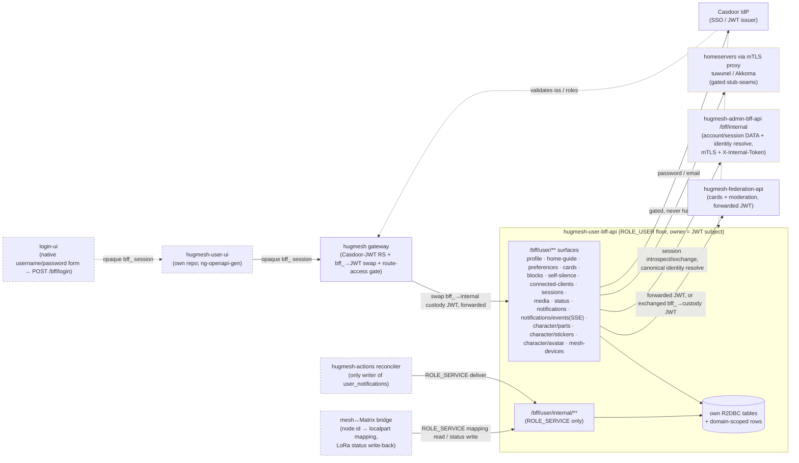

Spring **user BFF**: the `ROLE_USER`-floor backend-for-frontend paired with
`hugmesh-user-ui` (its own repo). It is reactive WebFlux + R2DBC + Liquibase + a Casdoor
JWT resource server + springdoc + Spring Native, scaffolded from the
`hugmesh-admin-bff-api` template (same stack, same conventions). Java 25 LTS,
Spring Boot 4.0.7 / Spring Cloud 2025.1.2.

## Where it sits

A **backend-namespace BFF**. It runs in `hugmesh-backend` and sits
*behind the gateway*, never public. It serves ordinary users: the `ROLE_USER` peer of
`hugmesh-admin-bff-api` (admin) and the mod BFF. It talks to:

- **Casdoor** (the IdP) as an OAuth2 resource server. Casdoor validates the JWT and
  takes the self-service password/email change. Casdoor is the SSO IdP for the whole
  platform but is **never browser-exposed**: `login-ui` shows a native
  username/password form that POSTs to `/bff/login`. This BFF runs the PKCE flow
  against the internal Casdoor **server-side** (code→token exchange) and holds
  per-session JWT custody/refresh (see *Auth model / SSO relocation*).
- **hugmesh-federation-api**, for the caller's federation **cards** (bundles)
  and the instance-block **recommendation** chain (the caller's JWT goes along on every request).
- **hugmesh-admin-bff-api** `/bff/internal` (over mTLS + `X-Internal-Token`). The
  account/session **data** for the relocated login/session/account surfaces stays in
  `admin-bff-db`; this BFF reaches it server-to-server (see *Auth model*).
- the **homeservers** (tuwunel / Matrix, Akkoma / Mastodon) **through the gateway
  mTLS proxies**, for the external block push, self-silence visibility hides,
  connected-client list/revoke, and the AI-cloak media upload. These legs are
  **gated stub-seams** that never hard-fail (see *Honest deferrals*).



In the diagram, solid nodes and edges are ✅ shipped on `main`. Dashed grey nodes are
built in other repos: `login-ui`, `hugmesh-user-ui`, the `hugmesh-actions` reconciler,
and the mesh↔Matrix bridge under `hugmesh-generator` `specs/cluster/manifests/meshbridge`.
The `mesh-devices` internal mapping/status-writeback receiver is ✅ shipped here, and the
bridge manifest points at it (`MESHBRIDGE_USERBFF_MESH_DEVICES_URL`). Amber-dashed nodes
are ✅ shipped but **gated** stub-seams. One is the homeserver leg (off by default). The
other is the admin-bff `/bff/internal` leg: the client, `BffSessionAuthenticationWebFilter`
and `CanonicalIdentityResolver` are real, always-registered code, but every call
fail-closed-stubs unless `app.bff.oidc.enabled=true` (the `hugmesh-generator` cluster
manifest sets it to `true`).

## Auth model / SSO relocation 🚧

The platform's auth is being consolidated this cycle, and this BFF is the new home
for the user-facing slice. The body of this section was checked against `main` on
2026-10-07, and the SSO flag-flip paragraph below re-checked on 2026-10-15. The
in-cluster values below come from the `hugmesh-generator` manifest
`specs/cluster/manifests/user-bff-api/deployment.yaml`, not from a live cluster.

- **Casdoor is the SSO IdP, and it is NEVER browser-exposed.** Native login is the
  **sole** browser login entry. It ends server-side in this BFF, so the browser only
  ever holds an **opaque `bff_`-prefixed** httpOnly session. It never holds a Casdoor
  JWT, refresh token, id token, PKCE verifier, `state`, or even a Casdoor URL.
  - **Native login (`POST /bff/login`), the headline model.** The browser posts only
    `{username, password}`. This BFF generates a PKCE pair + `state` **server-side**
    and verifies the credentials with a POST to the **internal** Casdoor `/api/login`
    (`CasdoorLoginClient`, pointed at `app.bff.oidc.login-base`, default
    `http://casdoor.hugmesh-pki.svc.cluster.local:8000` — the in-cluster base, never
    the browser-facing issuer). On success it redeems the returned one-time
    authorization `code` for tokens. No Casdoor redirect ever reaches the browser.

  > Historical: an earlier model had `login-ui` perform a browser-visible Casdoor OIDC
  > authorization-code (PKCE) redirect and hand the `code` back to a browser-PKCE callback
  > endpoint for the server-side exchange. That browser-exposed-Casdoor model — and its
  > callback controller — have been **retired**; native `POST /bff/login` is now the SOLE
  > browser login entry.

  Native login ends in **one** shared completion path, `OidcLoginCompletionService`:
  exchange `code`→tokens via auth-core `OidcExchangeClient` → provision account + mint
  session via admin-bff → AES-256-GCM custody-stamp the tokens via `BffCustodyCipher` →
  mint the `bff_` cookie. The security-critical crypto and session logic lives in
  exactly one place, never copy-pasted between controllers.

  **Native-login request / response contract:**
  ```
  POST /bff/login   (permitAll at the BFF; reached via be-gateway)
  → { "username": string, "password": string,
      "mfaPasscode"?: string, "mfaType"?: string }

  200 (success)      { "registrationComplete": bool, "status": "active",
                       "mfaRequired": false }        + Set-Cookie: bff_… (httpOnly)
  200 (MFA needed)   { "mfaRequired": true, "mfaType": [ … ] }   (NO cookie, NO session)
  401 (bad creds)    { "error": "invalid_credentials", "message": <casdoor msg> }
  ```
  The success body carries **only** non-secret routing hints. The opaque session token
  appears solely in the `Set-Cookie` header, never in the body.
- **The gateway stays a pure Casdoor-JWT OAuth2 resource server.** A pre-security
  exchange filter swaps the `bff_` session for the internal custody JWT, so the
  gateway's JWT validation and role gate run unchanged.
- **Authorization is data-driven.** The `gateway_route_access` Postgres table is the
  source of truth, and the gateway's `GatewayRouteAccessFilter` enforces it.
  ADMIN / GAME-MASTER bypass within their own domain; SUPERADMIN bypasses across domains.
- **Login / session / account logic is RELOCATING from admin-bff to this user-bff.**
  The shared core moves to **`hugmesh-auth-core`** (account / session / MFA /
  Casdoor-admin infra). The account/session **DATA stays in `admin-bff-db`**; this
  BFF reaches it via admin-bff `/bff/internal` over **mTLS + `X-Internal-Token`**.
- **Cloudflare** fronts prod.

> ✅ Already on `main` here: the JWT-only `/bff/user/**` surfaces, the Casdoor
> resource-server config, the canonical `CasdoorAuthorities` converter, and
> issuer-keyed domain-scoping. ✅ Also on `main`, **default-off in this repo** (flags
> fail-closed-stubbed, byte-identical runtime when off; see the cluster-manifest note below): the **native login**
> server-side credential check (`CasdoorLoginClient` → internal Casdoor `/api/login`),
> the server-side code→token exchange (PKCE), the one shared
> completion path (`OidcLoginCompletionService`) native login uses, the `bff_` session
> custody (`BffCustodyCipher`), the `/bff/login,/register,/session,/me` SSO surface, the
> admin-bff `/bff/internal` account/session client (`AdminBffInternalClient`), and
> the `hugmesh-auth-core` adoption. ✅ **The flags are flipped in the cluster
> manifest:** the canonical `hugmesh-generator`
> `specs/cluster/manifests/user-bff-api/deployment.yaml` sets
> `APP_BFF_OIDC_ENABLED=true`, `APP_BFF_OIDC_LOGIN_BASE` (the in-cluster Casdoor),
> `APP_BFF_CUSTODY_KEY` (from the `user-bff-custody-key` Secret) and `INTERNAL_TOKEN`
> (from `bff-internal-token`). Setting those flags does not prove the two Secrets exist:
> both are `secretKeyRef` with `optional: true` and the manifest says to populate them
> before enabling, so the one recorded evidence that it works is the kind spec 27 PASS
> (2026-08-06). The GitOps-pilot copy in this repo,
> [`deploy/deployment.yaml`](deploy/deployment.yaml), still carries
> `APP_BFF_OIDC_ENABLED=false`, and the default for a bare checkout is still off, so
> the `/bff/login` (native) + `/bff/register` routes 503 / are inert wherever the flag
> is off. 🚧 What remains is the live e2e residue, see the Roadmap.

### Native-login session bridge — `BffSessionAuthenticationWebFilter` ✅ shipped

This filter is always registered and runs on every request, even with
`app.bff.oidc.enabled=false` (the default). It lets an opaque `bff_` session (cookie or
`Authorization: Bearer bff_…` header) pass **this service's own**
`hasRole()`/`.authenticated()` gates, not just the gateway's route-access decision.

It introspects the token via `AdminBffInternalClient#resolveSession` (admin-bff `GET
/bff/internal/session/introspect`). Then it builds a **synthetic, server-only** `Jwt`
principal, never decoded from client input and never forwarded. The principal carries:

- `sub` = the admin-bff account id,
- mapped `ROLE_*` authorities,
- `MFA_SATISFIED` when the session's step-up is satisfied,
- the account's persisted `localpart`/`mastodon_localpart` claims, for the
  identity-resolution fixes below.

A suspended/banned session is an explicit `403`. An unknown/expired session passes
through unauthenticated (a clean 401 downstream). Any other admin-bff failure (timeout,
5xx, unreachable) fails **closed** with `503`, so a native-login caller is never silently
demoted to logged-out. When `AdminBffInternalClient` is the disabled fail-closed stub (the
default), the filter passes everything through, with no 503.

The filter also keeps the raw session token in the Reactor context (never the principal).
`FederationApiClient` and the media clients swap it for a **real, forwardable** custody
JWT via `AdminBffInternalClient#exchangeSession` (admin-bff `POST
/bff/internal/session/exchange`) before they call federation-api or a homeserver proxy.
Without the swap, a native-login caller's synthetic principal would reach those services
credential-less and get rejected.

### Canonical homeserver-identity resolution — `CanonicalIdentityResolver` ✅ shipped

Five call sites need the caller's Matrix/Mastodon **localpart**: the D6 proxy mints, the
media-custody mint, self-silence hide, connected-clients read/revoke, and active session
listing. All of them resolve it through one shared bean, `auth.CanonicalIdentityResolver`,
not a per-controller copy. The order is:

1. **claim-first**: the `localpart`/`mastodon_localpart` claims the filter above stamps
   for a native-login session;
2. else the caller's **own** `casdoor:<subject>` account (subject = first non-blank of
   `email`/`preferred_username`/`sub`, mirroring admin-bff's own account-key derivation);
3. else **fail closed**. It never uses a raw derived or guessed candidate.

This closes a real cross-user account-takeover class, found by a dedicated adversarial
security audit of the merged native-login surface. A real (non-`bff_`) Casdoor JWT with no
`email` claim used to fall through to `preferred_username -> discord:<preferred_username>`.
That could resolve **another user's** admin-invite account and mint, hide or revoke
against their homeserver identity. Mint sites now fail closed (`401`/`409`, no mint).
Self-silence degrades to a blank leg (best-effort, already gated off by default).
`SessionsService` uses the same resolver, so `/bff/user/sessions` lists and revokes only
the caller's own rows however they authenticated.

### Other public and parity routes ✅ shipped

Four more groups of routes live next to `/bff/login`.

- **Session end:** `DELETE /bff/session` revokes the session. `POST /bff/sessionOut` is the
  same operation (public, so a second sign-out reaches the controller instead of a 401).
  `GET /bff/me` returns the caller's account view (authenticated); `GET /bff/session`
  returns the same view (public, cookie-authenticated).
- **Password reset (`PasswordResetController`):** `POST /bff/password-reset/request` takes
  `{username}`. For a well-formed request it always answers 202 with a fixed body,
  whether or not the account exists. `POST /bff/password-reset/confirm` takes
  `{username, code, newPassword}`. 200 means Casdoor wrote the credential; a refused
  code or password is one 400 that names neither. Both routes answer 503 while
  `casdoor.password-reset.enabled=false` (the default; the cluster manifest sets
  `CASDOOR_PASSWORD_RESET_ENABLED=false` too). Both are public by exact path.
- **Invite-gated registration (`LegacyPathParityController`):** `POST /bff/register/google`
  and `POST /bff/register/discord` (public by exact path; 403 when not invited, 409 on a
  localpart collision or an already-complete account).
- **Parity with admin-bff's `AuthController`, because the cluster gateway routes these
  paths here:** `GET /bff/me/namespaces`, and `POST /bff/provision/matrix` and
  `POST /bff/provision/mastodon` (`ROLE_MATRIX` / `ROLE_MASTODON`). The homeserver token
  stays in custody, and the body carries no `access_token`. Errors: 403 before
  registration completes, 502 on a mint failure, 503 when brokering is not configured.

## The core invariant: owner-enforcement

**Every endpoint operates ONLY on the caller's OWN data.** The owner is ALWAYS the
Casdoor **JWT subject** (`jwt.getSubject()`), never a path or request-body field. A
user can never read or write another user's profile, preferences, cards, blocks,
self-silence, or connected clients. There is deliberately no `/profile/{userId}`
style route; the only data a caller can address is their own, identified by the
token. A body `userId` is ignored on writes (always overwritten with the JWT
subject), so it cannot redirect a write to another user. Every service method
enforces this. Tests cover both the service layer (spoofed body, owner+id scoped
delete) and the repository/SQL layer (owner isolation).

## API surface (all under `/bff/user/**`, `ROLE_USER` floor, owner-enforced)

### Profile — `ProfileController` (`/bff/user/profile`)
Own R2DBC `user_profile` table (one row per user; `user_id` = JWT subject = PK).
Fields: `gender, pronouns, timezone, displayName, visibility {public|internal}
(default internal), vanitySubdomainEnabled, vanityUsername, screenReaderName,
avatarUrl`.

- `GET /bff/user/profile` — my profile (an empty default if none yet).
- `PUT /bff/user/profile` — create/update my profile. A body `userId` is ignored. The
  vanity username comes from the **token**, never the body, so the reserved-name guard
  can't be bypassed. The order is the `bff_` session's Casdoor login-name claim, then
  `preferred_username`, then `name`, then the subject. Any candidate that holds `:` or `@`
  is skipped. A vanity save, a password change or an email change is a 400 when none
  qualifies.
- `DELETE /bff/user/profile` — delete my profile.
- `POST /bff/user/profile/avatar` — upload my profile picture (multipart `file`,
  `image/*` only, 5 MB cap). The bytes are magic-byte-sniffed, then edge-AI moderated
  when `app.vision.moderation.enabled` is on (default off). A blocked image is a 422,
  and a held `profile-avatar` finding is filed. Then the bytes go to the tuwunel media
  repository via `MatrixMediaClient`, and the resulting `mxc://` URL is persisted onto
  `user_profile.avatar_url`. The moderated bytes and their sniffed type are stored too
  (`avatar_body` / `avatar_content_type`, changelog 022). The column is server-derived,
  and a profile save never clears it. STUB-GATED by `avatar.matrix.enabled` (default
  false): a deterministic `mxc://stub.invalid/<id>` comes back, so avatar storage works
  and ships dark.
- `GET /bff/user/profile/avatar/body` — serve MY stored profile picture (the sniffed
  content type, `no-store`); 404 when I have none.
- `POST /bff/user/profile/password` — change my **Casdoor** password.
- `POST /bff/user/profile/email` — change my **Casdoor** email.

The **Casdoor IdP** owns password and email, not this BFF. Both go through a reactive
`CasdoorUserClient`, and the BFF never stores credentials. See deferrals.

**`displayName` + vanity-username guard.** Every save is charset- and confusable-checked.
Zero-width, bidi, Cyrillic look-alike and reserved-confusable input is rejected with 400
(`@SafeDisplayName` + the ICU4J `UsernameSkeleton` + `ReservedNames` engine). The
skeleton is a recomputable defence-in-depth cache, never a DB identity. The exact
UNIQUE + the 004 `vanity_username` CHECK remain the DB backstop.

**Vanity PUBLISH sync (cross-service, `FederationApiClient`)** — ✅ SHIPPED. Every
username-threaded `ProfileService.save` calls hugmesh-federation-api's
owner-scoped `PUT`/`DELETE /api/federation/vanity/{username}` (see that repo's
README). That keeps the `federation_modules` fragment in step with the local
`visibility`/`vanitySubdomainEnabled` flags:
- `vanitySubdomainEnabled && visibility=='public'` → self-publish. This is the
  user's ACTIVE, explicit intent. A federation-api FAILURE FAILS the whole profile
  save, most often because no `PUT /bff/user/cards/{slug}` bundle exists yet for
  `profile-<username>`. A save never reads "saved" while the fragment stayed unpublished.
- otherwise → self-unpublish, deliberately BEST-EFFORT (logged, swallowed). This leg
  fires on every non-public save, including edits that never touched vanity, so a
  federation-api outage must never block an unrelated pronoun/timezone edit. The local
  row is already private when the save returns; a lagging federation unpublish
  converges on the next successful sync.

See `FederationApiClient#publishVanity`/`#unpublishVanity` (the honest-propagation
status mapping) and `ProfileServiceFederationSyncTest` / `FederationApiClientTest`.

**`screenReaderName` (a11y)** — the ASCII-only aria-label / spoken name a screen
reader announces (`@SafeScreenReaderName` + the `ScreenReaderNames` engine; 008
`screen_reader_name` column). When `displayName` is pure **ASCII**, the screen-reader
name **defaults** to it (no prompt). When `displayName` is **non-ASCII**, an ASCII
screen-reader name is **required**; a save without one is a **422**, which the
registration/profile-save flow uses to prompt. A present non-ASCII screen-reader name
is a 400. (The aria-label UI consumption is a later UI-wave task; this carries the
field, the validation and the default/prompt logic.)

### Home-guide preference — `HomeGuideController` (`/bff/user/home-guide`)
A per-user "getting-started guide dismissed" flag, keyed per guide. It lives in the
own R2DBC `user_preference` table as `home-guide-dismissed:<guide>` = `true`. The
role home views read it to show the welcome guide on first visit only.

- `GET  /bff/user/home-guide?guide=<g>` — `{guide, dismissed}` (default guide `home`).
- `POST /bff/user/home-guide/dismiss?guide=<g>` (and `PUT` alias) — dismiss.
- `DELETE /bff/user/home-guide/dismiss?guide=<g>` — re-show (un-dismiss).

### Durable user preferences — `UserPreferencesController` (`/bff/user/preferences`)
DURABLE per-user UI preferences in the own R2DBC `user_preferences_store` table. The key
is the JWT subject **and** the brand (domain is part of the composite PK
`(user_id, pref_key, domain)`), so a multi-brand owner keeps a separate,
owner-isolated value per brand. The compose surfaces (the mastodon/matrix AI-poison
toggle) and other UI-wave toggles read and persist here, so a choice survives a reload
or a device change instead of living only in the browser. Owner = JWT subject;
domain-scoped (SUPERADMIN unscoped); `@PreAuthorize("hasRole('USER')")`. `GET`
returns the resolved view (every stored value **plus** the server default for any
unset known preference). `PUT` upserts one preference (key and value validated).

- `GET /bff/user/preferences` — `{ "<key>": "<value>", ... }`. It carries
  `media.poison.default`, the per-user durable AI-poison default whose fallback
  **mirrors** the server `MediaPoisoningProperties.defaultMode`.
- `PUT /bff/user/preferences` — body `{ "key": ..., "value": ... }`; upserts and
  returns the resolved view. The AI-poison default must be a valid cloak mode
  (`glaze|nightshade|light|none`).

The read-only `GET /bff/user/media/capability` `defaultMode` (the *server* policy
default) is unchanged. This endpoint layers the per-*user* durable override on top.

### Cards — `CardsController` (`/bff/user/cards`)
CRUD over the caller's OWN federation bundles (`user_modules` in
`hugmesh-federation-api`), via the reactive `FederationApiClient`. The caller's
JWT is **forwarded on every request**, so federation-api scopes `/bundles/mine` (and
records bundle ownership on PUT) to the same subject. Owner-enforcement holds
end to end with no broader service credential.

- `GET /bff/user/cards` → federation `GET /api/federation/bundles/mine`.
- `GET /bff/user/cards/{slug}` → federation `GET /api/federation/bundles/slug/{slug}`.
- `GET /bff/user/cards/{slug}/body` — the card's current entry-file bytes
  (octet-stream), for editor pre-fill; federation-api enforces the owner.
- `PUT /bff/user/cards/{slug}` (octet-stream) → federation `PUT /api/federation/bundles/{slug}`.
- `DELETE /bff/user/cards/{slug}` — delete my current bundle for the slug (204);
  federation-api enforces the owner (a non-owner gets 404).

### Self-block + recommend-instance-block — `BlockController` (`/bff/user`)
Own R2DBC `user_block` table (`user_id, target, platform {matrix|mastodon|internal},
ts`).

- `GET /bff/user/blocks` — my self-blocks.
- `POST /bff/user/blocks` — record a durable block row (under me), **then**
  push the external mute/block to Matrix/Mastodon on a best-effort basis (STUBBED —
  see deferrals). The row is the source of truth even if the push is stubbed or fails.
  **PLATFORM-ROLE GATED:** a `matrix` block requires `ROLE_MATRIX`, and a `mastodon`
  block requires `ROLE_MASTODON`. An `internal` block needs only the `ROLE_USER`
  floor. A principal without the platform's access role cannot push an external mute
  to a homeserver it has no access to.
- `DELETE /bff/user/blocks/{id}` — remove one of my blocks (scoped by owner AND id).
- `POST /bff/user/recommend-instance-block` — start the **USER → MOD → ADMIN**
  instance-block chain via federation `POST /api/federation/moderation`
  (`kind=instance-block`; federation sets `status=recommended` server-side). This
  is a *recommendation*, not a self-block, and it requires a homeserver platform role
  (`ROLE_MATRIX` OR `ROLE_MASTODON`).

The platform-role gate has **two legs**. A method-level `@PreAuthorize` (SpEL on the
validated request-body `platform`) is the API leg. `BlockService` re-checks the SAME
platform role against the caller's authorities (the service leg), so the rule holds
even if a caller reaches the service by another path. `ROLE_MATRIX`/`ROLE_MASTODON` map
automatically via the Casdoor authorities converter; no converter change.

### Self-silence — `SelfSilenceController` (`/bff/user/self-silence`)
Self-service **visibility hide**. A user makes THEMSELVES invisible to others for a
bounded window and keeps their own full session and access. It is **NOT a ban**: this
surface cannot write a Casdoor role, an `access_suspension` row, or a revocation key,
so login and home stay normal for the silenced user. It uses the own R2DBC
`self_silence` table (006; `expires_at` is authoritative; a `@Scheduled`
`SelfSilenceExpiryAction` auto-clears at expiry). `activate()` is atomic and
idempotent (an INSERT-or-UPDATE upsert that closes the 23505 race).

- `POST /bff/user/self-silence/activate` — hide me until `expiresAt` (REQUIRED,
  must be in the FUTURE; `reason` optional). I keep my session + full access.
- `GET  /bff/user/self-silence/status` — my current silence (active or cleared).
- `POST /bff/user/self-silence/cancel` — un-silence myself now (un-hide + clear).
- `POST /bff/user/self-silence/email-mod` — ask a mod/admin to reactivate me sooner
  (writes a self-silence-appeal moderation request; NOT SMTP).

The shared `CanonicalIdentityResolver` resolves the homeserver localpart for the
visibility-hide seams (claim-first from a native-login session, else the caller's
own persisted account; see *Canonical homeserver-identity resolution* above). It never
guesses from a raw JWT claim. If it cannot resolve, that leg is skipped, not failed,
so activate and cancel never block. All three hide legs are **gated stub-seams that
never hard-fail**, and all three are OFF by default:

- the federation user-scope hide-profile apply/clear leg (`self-silence.federation.enabled`),
- the tuwunel exclude-from-directory hide (`external.matrix.enabled`),
- the akkoma `discoverable=false` hide (`external.mastodon.enabled`).

The durable `self_silence` row stands regardless.

### Connected apps & devices — `ConnectedClientsController` (`/bff/user/connected-clients`)
The caller's native OAuth apps (Element / Tusky / Ivory) and device sessions registered
against the homeservers (akkoma / Matrix) **through the gateway passthrough**. It uses
the own R2DBC `connected_client_audit` table (`owner, platform {matrix|mastodon},
client_kind {oauth-app|device}, external_ref, label, created_at, revoked_at`; 009). The
live homeserver sessions are listed and revoked via the homeserver client API **through
the mTLS proxy** (a GATED stub-seam, never hard-fail). The audit row is the BFF-owned
durable record.

**EXTERNAL-CLIENT-ROLE GATE.** This surface requires an external-client role
(`ROLE_MATRIX_EXTERNAL_CLIENT` / `ROLE_MASTODON_EXTERNAL_CLIENT`). That role is
**separate** from the base `ROLE_MATRIX` / `ROLE_MASTODON` our-UI access: it gates
whether a user may register or use a **native** client. A class-level `@PreAuthorize`
(API leg) needs at least one external-client role to reach the surface at all. A
per-platform service re-check (service leg) stops a matrix-only caller from revoking a
mastodon client, and vice versa. The roles map automatically via the Casdoor
authorities converter; no converter change.

- `GET /bff/user/connected-clients` — my connected apps + device sessions.
- `DELETE /bff/user/connected-clients/{id}` — revoke one of mine. First write the
  **per-credential** gateway revocation key `hs:<platform>:<localpart>:<appId|deviceId>`
  (`RevocationWriter`; its `POST /api/gateway/revocations` call is off until
  `gateway.revocation.enabled=true`). Then delete on the homeserver, best-effort, and
  stamp `revoked_at`.

Both the live homeserver read and the revocation-key write resolve `<localpart>`
**per platform** via `CanonicalIdentityResolver` (claim-first, else the caller's own
persisted account, never a raw `preferred_username`/subject guess). On a resolution
miss the read skips that platform's live merge. The revoke fails **closed**
(`401`/`409`), because the localpart keys the durable enforcement mechanism.

Removing the external-client role → `ConnectedClientsService.reconcilePersonalClient
Revocation` writes `external-client:<localpart>:<platform>`. The gateway filter checks
that key only for `kind=personal` tokens, so base our-UI access is unaffected.

### Active login sessions — `SessionsController` (`/bff/user/sessions`)
Self-service **active session management**: list and revoke the caller's OWN opaque
`bff_` login sessions. The owner is ALWAYS derived server-side from the validated JWT
principal. There is deliberately no `/sessions?account=` or `/sessions/{account}`
route, and the revoke handle (`id`) is an opaque fingerprint that resolves only
against the caller's own live tokens, so cross-user isolation is structural, not a
check. `ROLE_USER` floor + `@PreAuthorize("hasRole('USER')")`. admin-bff owns the
`bff_session` table, and `SessionsService` delegates every read and write over its
internal API (user-bff has no session DB of its own).

- `GET /bff/user/sessions` — my active login sessions (ids are opaque fingerprints,
  never the raw session token).
- `DELETE /bff/user/sessions/{id}` — revoke one of mine by its opaque id. A
  foreign or unknown id is a generic **404** (anti-enumeration). Revoking my own current
  session is allowed.

### AI-cloak media proxy — `MediaPoisonController` (`/bff/user/media`)
The **poison-before-ingest** seam. The UIs send uploads to this BFF endpoint
**instead of POSTing media directly to the homeserver**. That way the AI-cloak
(Glaze-style cloak / Nightshade-style poison) runs *before* any homeserver sees the
bytes, covers **every served size**, and the decision is recorded **server-side**
(`media_poison_decision` = audit + badge + repost source of truth). The old
direct-to-homeserver path could do none of that. Cloaking after ingest is placebo:
re-encoding strips the perturbation, server thumbnails regenerate clean, and federation
wins the race.

- `POST /bff/user/media/upload` — multipart (`file` + `platform {matrix|mastodon}` +
  `mode {glaze|nightshade|light|none}` + `roomId`/`description`). **Flow:**
  1. Sniff the bytes (magic-byte, never the client `Content-Type`).
  2. For an image with `mode!=none` and a **present** worker, call the poisoner **sync
     within a latency budget**. It cloaks the **original + every pinned served size**
     (akkoma `small`; Matrix `240x240`).
  3. Do the **real homeserver upload of the POISONED bytes** via the mTLS proxy.
  4. Run the **round-trip survival gate**.
  5. Return the homeserver `media_id`/`mxc` **exactly as the homeserver would** (UI
     compose logic untouched) plus a `cloak` block (`status/mode/backend/mediaRef`).

  A non-image, `mode=none`, or a feature that is off is forwarded **through unchanged**
  (`status=none`).
- `GET /bff/user/media/capability` — worker backend (`cuda|rocm|cpu|none`), offered
  modes and ETA, so the composer shows an **honest** shield state up front (including
  `Unavailable` when the heavy tier is absent).
- `GET /bff/user/media/status/{ref}` — my decision for a media ref (badge polling),
  owner-scoped.

**Round-trip survival gate (the badge never lies).** After the upload, the service
re-fetches the served original and thumbnails and checks that the perturbation is
still present. It persists `protected` **only if it survived**, else `degraded`.
**Honest copy:** *"AI-cloak applied"*, never *"protected"* unless the gate passes. This
is best-effort training-set hygiene (re-encode or downscale removes it), not a
guarantee. **Uncloseable (stated honestly):** already-federated copies, and
native-client (Element/Tusky) uploads that skip this BFF entirely.

**Lean fallback (k8s protocol-probe, no heavy tier).** The worker is the **optional**
x86/GPU `hugmesh-media-poisoner`. On a Pi5-only cluster its pod stays `Pending` and
its Service has no Ready endpoints. The `/health` probe then reports `backend=none`, and
`app.media.poisoning.fallback-mode` decides:

- `skip` (default): forward **uncloaked** with `status=skipped` and a documented signal,
  so the UI warns *"not cloaked"*.
- `light`: reduced-strength CPU, if the worker offers it.
- `queue`: reserved for placeholder-then-replace. It behaves as `skip` until the
  worker queue lands. Any other value also behaves as `skip`.

Posting is never *forced* to block. The proxy ships **dark** by default
(`app.media.poisoning.enabled=false`): the controller is mounted, but every upload
forwards through `status=none`. It stays dark until the survival gate is verified on a
real GPU cluster.

### Character studio — VN-character drawn parts & expression stickers (`character` package)
Two owner-scoped, moderation-queued surfaces back the VN/character-studio feature. An
internal receiver resolves a queued item once a moderator acts. Own R2DBC tables:
`vn_character_part` (016) and `vn_sticker_pack` (017). 018 adds the `finding_id`
back-link column to both; 020 adds `body` / `content_type` to `vn_sticker_pack`.

**Drawn parts — `CharacterPartController` (`/bff/user/character/parts`)** — a user-drawn SVG
part (for example a hairstyle or outfit layer). `ROLE_USER` floor.
- `POST /bff/user/character/parts` — the dirty client SVG is SANITIZED before storage
  (`SvgSanitizerService`, which fails closed to a 422 on malformed or non-svg input). The
  row is stored `status=PENDING`, and a held `@system` federation moderation finding is
  filed (`surface=character-part`, best-effort: a federation outage never fails the save).
- `GET /bff/user/character/parts` — list MY parts (newest first).
- `GET /bff/user/character/parts/{id}/svg` — serve MY stored sanitized SVG as a hardened
  image (`image/svg+xml`, a locked-down `default-src 'none'; sandbox` CSP, `nosniff`,
  `Content-Disposition: inline`). A foreign id is a 404, never a 403, so there is no
  cross-owner existence leak.

**Expression stickers — `StickerController` (`/bff/user/character/stickers`)** — a rendered
PNG snapshot of the character rig at a canonical expression (Phase B1; it mirrors the
avatar upload path). `ROLE_USER` floor.
- `POST /bff/user/character/stickers` — multipart `file` (PNG) + `expression`. The client
  `Content-Type` is never trusted. The bytes are magic-byte-sniffed (`ImageSniffer`, which
  deliberately rejects SVG, the stored-XSS gap), capped at 1 MB, and edge-AI moderated
  when `app.vision.moderation.enabled` is on (a blocked sticker is a 422). Then they are
  uploaded to the homeserver media repo and stored `status=PENDING` (with the pixels,
  changelog 020), and a moderation finding is filed. The Matrix client fetches the pixels
  direct-to-homeserver (`mxc://`).
- `GET /bff/user/character/stickers` — list MY stickers (newest first).
- `GET /bff/user/character/stickers/{slug}/body` — serve a sticker's stored pixels
  (`slug` = the row id the list returns). **Not owner-scoped**, on purpose: an `ACTIVE`
  sticker has to render in other users' posts. A `PENDING` sticker serves to its owner
  only, a `REJECTED` one never serves, and every miss is a uniform 404. Headers:
  `Cache-Control: no-store`, `nosniff`, `default-src 'none'`.

**VN character avatar — `CharacterAvatarController` (`/bff/user/character/avatar`)** — the
profile picture as a forum-post sprite, served to the READERS of a post. `ROLE_USER` floor.
- `GET /bff/user/character/avatar` — MY stable serve **handle** (023
  `user_profile.avatar_ref`, a random UUID minted lazily on first use and never rotated)
  plus the assembled `/bff/user/character/avatar/{ref}/body` URL. `404` when I have no
  stored picture; `hugmesh-forum-ui` feature-detects that to hide the "use my avatar"
  option. The forum VN profile stores this value as its `characterImgRef`.
- `GET /bff/user/character/avatar/{ref}/body` — the raster pixels behind a handle.
  **Not owner-scoped**, on purpose: the owner always, plus any caller in the SAME brand
  (or an unscoped SUPERADMIN caller). It mirrors the ACTIVE branch of the sticker serve,
  because the job is the same: media that has to render inside other users' posts. There
  is no PENDING ladder to mirror, because `AvatarService.uploadAndStore` runs the edge-AI
  gate before it persists (the gate allows everything while `app.vision.moderation.enabled`
  is off). The response uses the sniffed MIME recorded at upload, restricted to
  `ImageSniffer`'s raster set, so the SVG rejection holds on the READ side too. Headers:
  `nosniff`, `default-src 'none'`, `Content-Disposition: inline`, and
  `Cache-Control: no-store` (the handle is stable across re-uploads, so a URL-keyed cache
  could not tell that the pixels changed). Every miss (malformed handle, unknown handle,
  cross-brand caller, no stored pixels) is one uniform `404`.

  *Why a handle instead of a path like `/bff/user/character/avatar`.* The owner-scoped
  serve `GET /bff/user/profile/avatar/body` resolves the owner from the JWT, so the same
  URL in a reader's `` returns the READER's avatar, not the author's. The owner
  cannot travel in the URL either, because a Casdoor subject is routinely a
  `provider:handle` composite carrying an e-mail. `hugmesh-forum-ui` used to store the
  literal `/bff/user/character/avatar`, which had no route behind it, so every
  avatar-mode VN profile rendered a broken image (hugmesh-forum-bff-api issue #3).

**MSC2545 sticker-pack registration — `StickerPackRegistrationService`** (no HTTP
surface of its own). This is the SERVER half of getting a user's ACTIVE stickers into
their Matrix client's sticker picker. On every ACTIVE flip (`CharacterModerationService
#resolveSticker`), a `ROLE_SERVICE`-context, no-JWT job read-modify-writes the owner's
`im.ponies.user_emotes` Matrix account-data (the MSC2545 convention). It merges the
owner's active stickers in as `images` entries **without clobbering** any pre-existing
non-VN emotes, de-duplicated by expression (newest wins). The **send** side
(`m.sticker` into a room) stays entirely client-side. This BFF has no `roomId` source, so
there is deliberately no send endpoint here. DARK BY DEFAULT
(`sticker.matrix.register.enabled=false`): the check short-circuits before any
cipher/custody/Matrix work, so dev/CI run as if the feature does not exist. It is
fail-soft throughout: a homeserver outage or a missing custody token never fails the
moderator's activation, it only skips registration. The shared
`CanonicalIdentityResolver` resolves the Matrix localpart and token it needs, never a raw
derivation from the owner subject (the same account-takeover-by-collision fix the D6
proxy mints apply).

**Internal moderation receiver — `InternalCharacterModerationController`
(`/bff/user/internal/character/{parts,stickers}/{id}/moderation`)** — **SERVICE-PRINCIPAL
ONLY** (the same `/bff/user/internal/**` gate as the notifications deliver endpoint:
`ROLE_SERVICE` exclusively, not even SUPERADMIN). It is the ONLY production flipper of a
row's `status` from `PENDING` to `ACTIVE`/`REJECTED`. The admin-bff moderation reconciler
calls it when a moderator resolves the filed finding (`UserBffCharacterModerationClient`
in `hugmesh-admin-bff-api`, which stays off until `character-moderation.reconciler.enabled`
is set). The flip is PENDING-guarded and idempotent. A second resolve, or a resolve of an
unknown or already-resolved id, flips zero rows and is a 404. An invalid `status` (not
`ACTIVE`/`REJECTED`) is a 400.

### Homeserver proxy (D6) — `MatrixProxyController` / `MastodonProxyController` (`/bff/user/{matrix,mastodon}/**`) ✅ live by default
An owner-scoped reverse-proxy passthrough to the Matrix (tuwunel) / Mastodon (Akkoma)
homeserver client APIs **through the per-pod mTLS proxy sidecars**. The user-ui never
holds homeserver credentials. The BFF injects a server-held, homeserver-native token
brokered by `ServiceTokenBroker`: the reactive port of admin-bff's broker, with
register-then-login for Matrix and password-grant for Mastodon. The minted token is
AES-encrypted into the `hs_service_token` custody store. Its SHA-256 hash goes to the
gateway `hs_tokens` registry only when `app.hs-token.registry.enabled` is on (default off).
The homeserver service-account password (`app.hs-token.svc-password` /
`APP_HS_TOKEN_SVC_PASSWORD`) has an **empty default**. `ServiceTokenBroker` wires at
boot either way, but a blank password refuses every mint with a `503`. That is
fail-closed at request time, not a context-start crash (see `ServiceTokenBroker`'s own
doc for why the boot-crash shape was dropped).

- `GET|PUT|POST|DELETE|PATCH /bff/user/matrix/**` → tuwunel client API via the
  `tuwunel-proxy` sidecar.
- `GET|PUT|POST|DELETE|PATCH /bff/user/mastodon/**` → Akkoma client API via the
  `akkoma-proxy` sidecar.

**LIVE BY DEFAULT** (`app.hs-token.enabled=true`, `APP_HS_TOKEN_ENABLED`). Every method
still 503s until two things are provisioned: the custody cipher key (`app.hs-token.key`)
AND the homeserver service-account password (`app.hs-token.svc-password`). There is no
baked default. The `tuwunel-proxy`/`akkoma-proxy` mTLS sidecars must exist too. So an
unconfigured deploy degrades to a clean 503 instead of serving a broken proxy. Set
`APP_HS_TOKEN_ENABLED=false` to dark the surface fully. The JSON response decode
runs off the WebFlux codec path (read-as-String + Jackson-2 `readTree`), because Boot 4's
reactive codec is Jackson 3 and cannot decode the Jackson-2 `JsonNode` type directly.

A first-use re-mint (no custody row yet) resolves the caller's canonical localpart via
`CanonicalIdentityResolver` (claim-first, else the caller's own persisted account, never
a raw derivation); see *Canonical homeserver-identity resolution* above. The Mastodon
leg mints against Akkoma's real app-credential + password-grant/register OAuth contract
(the bare grant never worked). A body-bearing write (POST/PUT/PATCH/DELETE)
that hits a 401 mid-flight re-mints and retries without re-subscribing the once-only
request-body stream. The earlier shape 500'd on every body-bearing write after token
expiry, and GET-only tests had missed it.

### Account status — `AccountStatusController` (`/bff/user/status`) ✅ shipped
A `ROLE_USER`-floor, owner-scoped, **read-only polling** endpoint. It has no write
path, so it is safe to cache or poll at whatever interval the UI prefers.

- `GET /bff/user/status` → `{ sub, domain, roles, silenced, silenceExpiresAt }`.

It derives everything from the already-validated JWT authorities (the active `ROLE_*`
list, stripped of the `ROLE_` prefix) plus the caller's OWN `self_silence` row (owner =
JWT subject, no BOLA). UIs poll it to detect account-status changes. A suspension
removes roles at Casdoor, so the NEXT token refresh reflects the change (the gateway's
revocation filter covers in-flight JWTs). A self-silence state flip shows up here
without a token refresh. `domain` falls back to `default` for single-issuer clusters.

### Notifications — in-app floor ✅ shipped
The **in-app notification channel** is the always-on channel a user can never silence.
All three surfaces are owner-enforced (owner = JWT subject) and domain-scoped
(SUPERADMIN unscoped). See the [Notifications roadmap](#notifications-roadmap) for the
external channels that build on top.

**Inbox — `UserNotificationController` (`/bff/user/notifications`)** (`ROLE_USER` floor)
- `GET /bff/user/notifications?limit=<n>` — my OWN in-app notifications, newest first,
  server-capped (`limit` bounded to `UserNotificationRepository.MAX_PAGE` = 100,
  default 50).
- `POST /bff/user/notifications/{id}/read` — mark ONE of my own notifications read. An
  id that is not my own owner+domain row is a **404** (no cross-user mark).
- `GET /bff/user/notifications/events` — real-time SSE stream of new in-app
  notifications for the caller (`text/event-stream`). `SseNotificationBus` (a per-user
  `Sinks.Many` registry) backs it. `InternalNotificationDeliveryService` emits into the
  bus on every successful `POST /bff/user/internal/notifications` write. The client should
  reconnect on close; the server closes the stream after a 4-minute timeout
  (`SSE_TIMEOUT`). Owner-enforced (JWT subject). ✅ shipped.

**Per-category preferences — `NotificationPreferenceController`
(`/bff/user/notification-preferences`)** (`ROLE_USER` floor). It MIRRORS the shape of the
durable `UserPreferencesController`.
- `GET` — my resolved per-category preferences (every known category defaults
  **enabled**, my explicit choices merged in).
- `PUT` — body `{ "category": ..., "enabled": ... }`. It upserts ONE category and returns
  the resolved view. `account-restriction` is **forced-on / un-silenceable**: an
  `enabled=false` for it is COERCED to enabled (API-coerced + a DB CHECK backstop), so
  the durable row and the view always show it on.

**Internal deliver — `InternalNotificationController`
(`/bff/user/internal/notifications`)** — **SERVICE-PRINCIPAL ONLY.**
- `POST /bff/user/internal/notifications` — the ONLY production writer of
  `user_notifications`; the `hugmesh-actions` reconciler calls it.
- The target `(domain, userSubject)` comes from the **request body**. The service acts on
  behalf of the SYSTEM for a named user, NOT owner==caller, which is exactly why no
  human JWT may reach it. `SecurityConfig` gates the `/bff/user/internal/**` prefix to
  `ROLE_SERVICE` **exclusively**. The rule is declared BEFORE the `/bff/user/**`
  authenticated rule, and it is deliberately NOT `hasAnyRole(SERVICE, ADMIN, SUPERADMIN)`,
  so even SUPERADMIN is DENIED here. A method-level `@PreAuthorize("hasRole('SERVICE')")`
  backs it up. `ROLE_SERVICE` is the platform service-account role: a Casdoor
  client-credentials token carries it, and no human login does. federation-api uses the
  same mechanism for its internal username oracle.
- It honours the per-category preference (`account-restriction` forced-on) and is
  **idempotent**. The row id is a deterministic hash of the source event
  (`sourceTable`+`sourceId`), so a retry is INSERT-IF-ABSENT (a duplicate returns
  `delivered=true, deduped=true`, never a second row).

**Internal preference read — `InternalNotificationPreferenceController`
(`/bff/user/internal/notification-preferences/{owner}?domain=...`)** —
**SERVICE-PRINCIPAL ONLY** (same `ROLE_SERVICE` gate as the deliver endpoint above).
- `GET` returns one owner's effective per-category map in one domain, so a channel
  adapter outside this BFF (admin-bff's external-channel reconciler) can honour the
  owner's silence choices. It is the same defaults-merged view the owner gets from
  `GET /bff/user/notification-preferences`: an owner with no rows reads as all-enabled
  (200, not 404) and `account-restriction` is reported enabled regardless of any row.
- `domain` is required (a missing, blank or malformed value is a 400): the service
  treats a `null` domain as the cross-domain SUPERADMIN bypass, so this endpoint never
  forwards one.

**Test/seed self-notify — `TestSeedNotificationController`
(`/bff/user/notifications/test-seed`)** (`ROLE_USER` floor) — gated by
`app.test-seed.enabled` (default `false`).
- `POST /bff/user/notifications/test-seed` — lets an e2e test authenticated as an
  ordinary human persona get a REAL `user_notifications` row for **itself**, without the
  `ROLE_SERVICE` client-credentials token that gates the internal-deliver endpoint above.
  The body is `{ category, title?, body?, sourceId? }`. There is deliberately **no target
  field**. The target is always the caller's own `(JWT-issuer domain, JWT subject)`, so
  this adds no cross-user write capability (the internal-deliver endpoint is
  `ROLE_SERVICE`-only precisely because ITS target comes from the request body).
- It is not a parallel write path. It calls the same `InternalNotificationDeliveryService`
  the production deliver path uses, so category-preference suppression, the
  account-restriction forced-on rule, the SSE push, and insert-if-absent idempotency
  all behave as in production.
- **SHIPS DARK by default** (`APP_TEST_SEED_ENABLED`). When off, the route still
  exists and returns a **503** (not a 404), so a misconfigured e2e run fails loudly
  instead of silently seeding nothing. Set `APP_TEST_SEED_ENABLED=true` only in the
  e2e/dev profile; it must stay off in production.

> **SHIPS DARK (in-app floor MVP):** the read/mark-read inbox, the per-category prefs, the
> SERVICE-only deliver endpoint and the SSE real-time push stream (`GET
> /bff/user/notifications/events`, `SseNotificationBus`) are all on `main` and wired. The
> deliver path stays dark unless a caller is switched on. The caller exists:
> `hugmesh-actions` has `UserNotificationClient` (`net.hugmesh.actions.notify`), created
> only when `app.actions.notify.enabled=true`, and that repo's `application.yml` does not
> set it, and the `hugmesh-generator` cluster manifests set no notify, reconciler,
> capability-gate or gateway-revocation flag either. The SSE wiring itself is ✅ shipped.

### Real-time SSE stream ✅ shipped
`GET /bff/user/notifications/events` is a **server-sent event stream** (`text/event-stream`)
for real-time in-app notification push. `ROLE_USER` floor, owner-enforced (owner = JWT
subject). Merged in #72. It ships DARK because its only writer (`hugmesh-actions`, behind
`app.actions.notify.enabled`) is off by default (see the in-app-floor MVP note above), but the
SSE wiring itself is live on `main`.

- **Wire protocol:** events carry `{id, category, title, body}` as JSON. The connection
  has a **4-minute server-side timeout**; the client is expected to reconnect
  automatically (the standard SSE reconnect loop handles this).
- **`SseNotificationBus`** — a per-user `Sinks.Many` multicast (`onBackpressureBuffer(16,
  false)`), one sink per connected subscriber. The SSE endpoint subscribes to the
  caller's sink. When the sink completes or errors, the SSE stream closes cleanly.
- **`InternalNotificationDeliveryService`** — after it writes the `user_notifications` DB
  row, it publishes the notification event onto the caller's `SseNotificationBus` sink, so
  all active SSE connections for that user receive it at once.
- **UI consumption:** `hugmesh-user-ui` (`src/app/notifications.service.ts`) consumes this
  stream with `fetch(..., { credentials: 'include' })` and a `ReadableStream` line parser,
  **NOT** the browser's native `EventSource` API. The stream authenticates with the
  HttpOnly `bff_` session cookie; the browser holds no bearer token to attach. It
  reconnects after a fixed backoff when the server closes the stream.

### Mesh devices — `MeshDeviceController` (`/bff/user/mesh-devices`) ✅ shipped
Owner-scoped Meshtastic **LoRa radio claims**. A user registers a radio's node id under
their own identity, so the platform's **mesh↔Matrix bridge** can attribute that radio's
messages to them. It uses the own R2DBC `mesh_device` table (019). `node_id` is stored as
canonical `!`+lowercase-hex and is globally UNIQUE: one owner per radio, across every
user and brand, active or revoked. `ROLE_USER` floor + `@PreAuthorize("hasRole('USER')")`;
domain-scoped.

- `GET /bff/user/mesh-devices` — my claimed devices (newest first), including revoked rows
  (with state + reason) and the bridge-reported LoRa status fields.
- `POST /bff/user/mesh-devices` — claim a node id (accepts `a1b2c3d4` / `!A1B2C3D4`,
  normalized to canonical `!`+lowercase before storage; optional `label`). A node id
  already registered by anyone, in any domain, active or revoked, is a **409**. When
  `app.mesh-device.capability-gate.enabled=true` (default `false`), a claim also needs
  admin-bff to report the `user-mesh-devices` capability as granted and enabled for the
  caller's domain. Otherwise the claim is a **403**, and an unreachable admin-bff denies
  too. An unscoped SUPERADMIN bypasses the gate, and existing rows are never affected.
- `PUT /bff/user/mesh-devices/{id}/visibility` — who may see the device's LoRa status
  (`private|friends|channels`); frozen (**409**) on a revoked row.
- `DELETE /bff/user/mesh-devices/{id}` — release my claim. A foreign or unknown id is a
  **404**, never a 403, so there is no cross-owner existence leak. Releasing a revoked
  row is allowed and frees the node id.

**Internal bridge + moderation receiver — `InternalMeshDeviceController`
(`/bff/user/internal/mesh-devices`)** — **SERVICE-PRINCIPAL ONLY**. It uses the same
`ROLE_SERVICE`-exclusive `/bff/user/internal/**` gate as the notifications and
character-moderation receivers. Even `ROLE_MOD` and `ROLE_SUPERADMIN` are denied,
because the role hierarchy has no edge to `ROLE_SERVICE`.

- `GET /bff/user/internal/mesh-devices` returns the full ACTIVE node-id → Matrix-localpart
  mapping across every owner and domain. It resolves each localpart per owner via
  `AdminBffInternalClient#getAccount`, fail-soft: an owner with no persisted localpart
  yet is omitted, never given a fabricated candidate.
- `POST /bff/user/internal/mesh-devices/status` is the batch LoRa telemetry write-back
  (`{updated, ignored}`, fail-soft per element). Unknown or revoked node ids count as
  `ignored`, never as an error.

The same controller carries the **moderation** surface meant for `hugmesh-mod-bff-api`
(`/bff/mod/mesh-devices/**` → here). `origin/main` of mod-bff holds no mesh-device code, so
no caller is known yet. This surface is the ONLY writer of the `state` / `revoked_by` /
`revoked_at` / `revoke_reason` columns that 019 shipped:

| Endpoint | Contract |
| --- | --- |
| `GET /bff/user/internal/mesh-devices/moderation` | Moderator console list ACROSS every owner, newest claim first. `?state=active\|revoked` (omit = both; an unknown value is a **400**, never a silently-empty page), `?domain=` brand scope (omit ONLY for a cross-domain SUPERADMIN view), `?limit=` **server-clamped** — default **100**, hard cap **500**. Rows carry the two fields the user-facing shape withholds — `ownerSubject` (+ `ownerLocalpart`, resolved through the SAME deduped/fail-soft admin-bff path as the bridge mapping) and `revokedBy` — plus `domain`/`state`/`visibility`/`revokeReason`/`revokedAt`/`createdAt`/`lastSeenAt`. Unlike the bridge mapping an **unresolvable owner keeps its row** with a `null` `ownerLocalpart`: a moderator who cannot see an un-attributable radio cannot revoke it. |
| `POST /bff/user/internal/mesh-devices/{id}/revoke` | Body `{reason, moderator, domain?}`. CAS `active`→`revoked` at the SQL layer, stamping `revoked_by`/`revoked_at` (server `now()`)/`revoke_reason`. Already-revoked is a **409**, unknown or out-of-brand id a **404** (no cross-brand existence leak); a missing/blank/over-255 `reason` or `moderator` is a **400**. |
| `POST /bff/user/internal/mesh-devices/{id}/restore` | Body `{moderator, domain?}`. CAS `revoked`→`active`, **clearing** the whole `revoked_by`/`revoked_at`/`revoke_reason` trio so the owner stops seeing a stale reason (mod-bff's `mod_action` ledger keeps the durable record). Not-revoked is a **409**, unknown/out-of-brand a **404**. |

Both writes are compare-and-set. The source state is a `WHERE` predicate, so two
concurrent moderators cannot interleave. A zero-row result is then *diagnosed* by a
brand-scoped read to pick 404 vs 409, the same discipline `PUT
/mesh-devices/{id}/visibility` uses. The `moderator` identity travels in the **body**
because the caller IS the trusted service principal (there is no human token on this
hop); mod-bff derives it from the validated moderator JWT and never from its own
caller's payload. Revoking does not free the radio: the row keeps occupying the
globally-unique `node_id`, so the device cannot be re-registered while it exists.

## Where data lives (the routing rule)

| Concern | Destination |
| --- | --- |
| Profile fields (incl. screenReaderName), home-guide prefs, durable user preferences, self-block rows, self-silence rows, media-poison decisions, connected-client audit, in-app notifications + per-category prefs, VN-character parts + expression stickers | **own R2DBC tables** (`user_profile`, `user_preference`, `user_preferences_store`, `user_block`, `self_silence`, `media_poison_decision`, `connected_client_audit`, `user_notifications`, `notification_preference`, `vn_character_part`, `vn_sticker_pack`) |
| Mesh-device claims (Meshtastic LoRa node id → owner, + status visibility, bridge-reported LoRa status, moderation state) | **own R2DBC table** (`mesh_device`, 019 — `node_id` globally UNIQUE, one owner per radio). Exported to the mesh↔Matrix bridge (active rows only, node id → Matrix localpart via the admin-bff account read), status-updated by it, and moderated (revoke/restore CAS) through the SERVICE-only `/bff/user/internal/mesh-devices` surface. The bridge (`hugmesh-generator` `specs/cluster/manifests/meshbridge`) polls the mapping; no mod-bff caller found |
| Account / session data for the relocated login/session surfaces | **`hugmesh-admin-bff-api` `/bff/internal`** (mTLS + `X-Internal-Token`; data stays in `admin-bff-db`) |
| Password / email change | **Casdoor IdP** (`CasdoorUserClient`) — never stored here |
| Cards (federation bundles) + instance-block recommendation + (gated) self-silence federation hide | **hugmesh-federation-api** (reactive `FederationApiClient`, forwarded JWT) |
| External mute/block push, self-silence directory hide, connected-client list/revoke, media upload | **Matrix (tuwunel)** / **Mastodon (Akkoma)** clients via the gateway mTLS proxy (STUBBED/gated) |
| Homeserver-token revocation keys | **gateway revocation list** (`RevocationWriter`; `POST /api/gateway/revocations` exists in `hugmesh-gateway` `GatewayRevocationController`, but the writer stays a gated stub until `gateway.revocation.enabled=true`) |

## Clients

- `FederationApiClient` — reactive WebClient of federation-api. Base URL
  `FEDERATION_API_BASE_URL` (default
  `http://hugmesh-federation-api.hugmesh-backend.svc.cluster.local:8080`).
  A token-injecting `ExchangeFilterFunction` re-injects the caller's JWT from the
  reactive security context as `Authorization: Bearer <jwt>` on every outbound
  call (`FederationWebClientConfig`).
- `CasdoorUserClient` — reactive WebClient for self-service password/email
  (`POST /api/set-password` — urlencoded form ONLY, and
  `POST /api/update-user?id=<org>/<name>&columns=email` — partial `{owner,name,
  email}` body). Both shapes are ✅ live-confirmed against a running Casdoor (see
  *Honest deferrals*). Gated by `casdoor.account.enabled`.
- `MatrixBlockClient` / `MastodonBlockClient` (behind the `ExternalBlockClient` /
  `ExternalBlockConfig` abstraction seam) — reactive WebClients for the
  external self-block push. Base URLs come from the hugmesh-generator
  manifests: tuwunel `:8008` (`MATRIX_URL`), Akkoma `:4000` (`MASTODON_URL`).
  Gated by `block.matrix.enabled` / `block.mastodon.enabled`.
- `MatrixMediaClient` (wired by `MatrixMediaConfig`) — reactive WebClient that
  uploads a user's PROFILE PICTURE bytes to the tuwunel media repository
  (`POST /_matrix/media/v1/upload`) and returns the resulting `mxc://` URL, which
  `AvatarService` persists onto `user_profile.avatar_url`. STUB-GATED by
  `avatar.matrix.enabled` (default false): when disabled, a deterministic
  `mxc://stub.invalid/<id>` comes back (never an error), so avatar storage works and
  ships dark. Flip the flag once the per-user Matrix media-token brokering is
  validated. The image bytes are never logged. Base URL `MATRIX_URL` / tuwunel
  `:8008`. The avatar endpoint is `POST /bff/user/profile/avatar` (multipart
  `file`, image/* only, 5 MB cap). The column is server-derived, and a profile save
  never clears it.
- `MatrixHideClient` / `MastodonHideClient` (behind the `HomeserverHideClient` /
  `HomeserverHideConfig` abstraction seam) — reactive WebClients for the
  self-silence directory/discovery hide seams. Gated by `external.{matrix,mastodon}
  .enabled`.
- `MatrixClientsClient` / `MastodonClientsClient` (behind the `HomeserverClientsClient`
  seam) — reactive WebClients for the connected-clients list/revoke against the
  homeserver client API (through the mTLS proxy). `RevocationWriter` writes the gateway
  per-credential revocation keys.
- `PoisonWorkerClient` / `HomeserverMediaClient` — the media-proxy worker call, and
  the real homeserver upload/re-fetch through the akkoma-proxy / tuwunel-proxy mTLS
  proxies (`app.media.proxy.{matrix,mastodon}.*`).
- `MatrixClientApiClient` (wired by `MatrixClientApiConfig`) — reactive WebClient for
  Matrix account-data GET/PUT, used only by `StickerPackRegistrationService` to
  read-modify-write the owner's MSC2545 `im.ponies.user_emotes` sticker pack. Gated by
  `sticker.matrix.register.enabled` (default false).
- `CasdoorLoginClient` (native login credential check against the internal Casdoor
  `/api/login`), `CasdoorPasswordResetClient` (the two reset legs), `SessionsInternalClient`
  (list/revoke of `bff_` sessions at admin-bff, gated by `app.sessions.management.enabled`,
  default `true`) and `EdgeAiAnalysisClient` (image moderation for the avatar and sticker
  paths, gated by `app.vision.moderation.enabled`, default `false`).
- `AdminBffInternalClient` — the service-to-service client to admin-bff's `/bff/internal`
  surface (account/session ensure/get/create/delete, session introspect/exchange,
  custody-stamp, allowlist check). It is wired unconditionally but fail-closed-stubbed
  (`enabled()==false`, every call errors) unless `app.bff.oidc.enabled=true`.
  `BffSessionAuthenticationWebFilter` uses it, and so does `CanonicalIdentityResolver`
  for every homeserver-identity call site. See *Native-login session bridge* and
  *Canonical homeserver-identity resolution* above.

## Security — defence in depth

`SecurityConfig` is a Casdoor OAuth2 resource server (`issuer-uri` from
`CASDOOR_ISSUER_URI`). The JWT→authority converter is the **verbatim** Casdoor
converter shared with `hugmesh-admin-bff-api` and the gateway: `ROLE_USER` floor on
every authenticated principal; `roles` (string or `{name}`) → `ROLE_<UPPER>`;
`permissions` verbatim; `isAdmin` → `ROLE_ADMIN`. `@EnableReactiveMethodSecurity`
+ `@PreAuthorize` on the controllers re-checks at the method (the `ROLE_USER` floor,
plus the per-surface platform and external-client role gates above).
Spec gating is split by profile. Under `dev`/`test` the OpenAPI spec and Swagger
UI are public (so `gen:fetch` can curl `/v3/api-docs` tokenless). In prod they need
`ROLE_ADMIN` or `ROLE_SUPERADMIN`. Actuator health/info are public for probes, every other
`/actuator/**` path needs `ROLE_ADMIN` or `ROLE_SUPERADMIN`, and the public set also covers the
login, register, session and password-reset routes listed in [SECURITY.md](SECURITY.md).

This BFF is the per-session JWT custodian behind the gateway's `bff_`-opaque-session
model (see *Auth model / SSO relocation*). The browser holds only the opaque `bff_`
session, and the gateway swaps it for the internal custody JWT before its own validation.
Authorization at the edge is data-driven by `gateway_route_access` /
`GatewayRouteAccessFilter` in the gateway. Inside this BFF, the post-validation JWT is
the only authority source.

### Shared org artifacts (`hugmesh-parent` + `hugmesh-commons` + `hugmesh-auth-core`)

This service adopts the org's shared Maven artifacts. Three moves remove duplication:

1. **Parent POM →** `net.hugmesh:hugmesh-parent:2.8.0` (itself a child of
   `spring-boot-starter-parent:4.0.7`, so the whole Spring Boot dependency/plugin
   management comes along). The parent consolidates the reactive-BFF
   `<dependencies>` (webflux/actuator/security/oauth2-resource-server/validation,
   R2DBC + Liquibase + JDBC, springdoc, the full test stack) and the
   `dependencyManagement` for `hugmesh-commons` + springdoc + the surefire/native
   plugin config. Only the **repo-specific** deps stay in this POM: `icu4j` and
   `commons-text` (the Unicode confusable / typo-squat guard).

2. **Shared security/tenancy/web →** `net.hugmesh:hugmesh-commons:2.1.0` (a test-jar
   classifier pin; the main classifier comes from `hugmesh-parent`'s
   `dependencyManagement`).
   The local copies of `security.{Roles,DomainRegistry,CasdoorAuthorities,DomainScope}`,
   `config.TenancyResourceServerConfig` and `web.ApiException` were **deleted** and
   replaced by:
   - `commons.security.Roles` — its `Set<String>`/names overloads are
     `isSuperadminNames(...)` / `domainOfNames(...)`; the `isSuperadmin` / `domainOf`
     names take `Collection<? extends GrantedAuthority>` (the form this BFF uses
     directly).
   - `commons.security.DomainRegistry` (same `domainOf`/`isTrusted`/`trustedIssuers`/
     `isMultiIssuer` API).
   - `commons.security.CasdoorAuthorities` (now `public`, methods `public static`;
     `MfaConfig` is a `public record`).
   - `commons.config.TenancyResourceServerConfig` (the config-gated multi-issuer
     wiring).
   - `commons.tenancy.DomainScope` — the static-utility `isUnscoped(String)` / `PARAM`
     the owner-keyed repositories call.
   - `commons.web.ApiException` (the `{"error": msg}` carrier).

   **Stays per-repo:** this repo's `config.SecurityConfig` (route matchers +
   CSRF/cookie/header policy), `web.ApiExceptionHandler`, the test
   `config.SecuritySliceSupport`, and — crucially — **`security.PrincipalDomain`**.
   That class is a `@Component` with this BFF's own `forScope(Jwt)` contract: the
   fail-closed `__deny__` sentinel for a non-SUPERADMIN whose issuer is unresolved.
   The commons value-type `PrincipalDomain` does NOT provide that. This BFF KEPT its
   class and rewired its imports to the commons `Roles`/`DomainRegistry`.

   **Two consumer-wiring steps** (the canonical recipe for the fan-out):
   - `config.CommonsSecurityConfig` `@Import`s the commons `DomainRegistry` +
     `TenancyResourceServerConfig` beans, because the `@SpringBootApplication`
     component-scan over `net.hugmesh.userbff` does **not** cover the
     `net.hugmesh.commons.*` packages. (`@Import` preserves
     `TenancyResourceServerConfig`'s `@ConditionalOnExpression` gate.)
   - The multi-issuer security-slice tests reach the package-private
     `TenancyResourceServerConfig.tenantAuthManagerResolver()` through a same-package
     test accessor at `src/test/java/net/hugmesh/commons/config/TenancyResolvers.java`.

3. **Shared account/session/MFA/Casdoor-admin infra →** `net.hugmesh:hugmesh-auth-core:2.5.1`
   🚧. The login/session/account logic is relocating from admin-bff into this user-bff.
   Its cross-cutting core (account-state, session-custody, MFA, Casdoor-admin client
   infra) is extracted to `hugmesh-auth-core` (depends on `hugmesh-commons`, consumed by
   **user-bff + admin-bff only**) instead of copied. The adoption is in flight alongside
   the SSO relocation above. The pin went to 2.4.0 with the HugMesh rename (the published
   `hugmesh-auth-core` coordinate under the renamed groupId/artifactId), which carried
   forward the same `ReservedNames` canonical-revision sync that
   `ProfileService`/`UsernameSkeleton` consume directly. It has since moved to 2.4.2
   (auth-core #39/#40/#41: ceremony-test coverage, a WARN-by-default MFA precondition boot
   guard, and a 32-byte CSPRNG WebAuthn challenge). That keeps this BFF and admin-bff
   pinned in lockstep on the same released auth-core line, even though this BFF does not
   wire the MFA subsystem itself. It then moved to 2.5.1, the only auth-core coordinate
   the org release chain publishes to GitHub Packages (source- and binary-compatible
   with 2.4.2). See `pom.xml` for the full version history.

   `OpenApiSpecDumpTest` asserts the committed
   [`openapi.json`](src/main/resources/openapi/openapi.json) (see *Build / test* to
   regenerate it).

#### Resolving the private org artifacts

`hugmesh-parent` / `hugmesh-commons` / `hugmesh-auth-core` are **not** on
Maven Central. They live in the org GitLab Maven Package Registry and, for the GitHub
release workflow, in GitHub Packages. There are three resolution paths, and **no secrets
sit in git**:

- **Local dev:** `mvn install` the shared artifacts into `~/.m2`. A plain
  `./mvnw test` then resolves them locally and never touches the remote (this is how the
  build was verified green).
- **CI / Docker:** the committed [`settings.xml`](settings.xml) declares the
  `gitlab-maven` group registry, authenticated by the GitLab `CI_JOB_TOKEN`
  (`${env.CI_JOB_TOKEN}`, injected by GitLab, never committed). The
  [`Dockerfile`](Dockerfile) multi-stage build runs `./mvnw -s settings.xml package`
  with the token mounted as a **BuildKit secret** (`--mount=type=secret`, so it never
  lands in an image layer). `.gitlab-ci.yml` passes
  `--secret id=ci_job_token,env=CI_JOB_TOKEN` plus the `CI_API_V4_URL` /
  `GITLAB_GROUP_ID` build-args, and the `test:` job passes `-s settings.xml` to `./mvnw`.
- **GitHub release workflow:** [`.github/workflows/release.yml`](.github/workflows/release.yml)
  (manual `workflow_dispatch` only) builds the image and pushes it to
  `ghcr.io/hugmesh/hugmesh-user-bff-api`. When the `packages_read_token` BuildKit secret is
  mounted, the `Dockerfile` builds with `-s .github/maven-ci-settings.xml` (GitHub
  Packages) instead of `settings.xml`. A preflight step fails by name unless the repository
  secret `PACKAGES_READ_TOKEN` is set and `hugmesh-build-config`, `hugmesh-parent`,
  `hugmesh-commons` and `hugmesh-auth-core` answer.

### API-to-API mTLS (PKI identity, both directions)
In-cluster, the deployment mounts a PKCS12 keystore (this service's Vault-PKI
identity) and truststore (the cluster CA), and flips on **server-side** client-auth
(`server.ssl.enabled=true`, `client-auth=need`, TLSv1.3 floor). A caller not
deployed and signed by our Vault/ESO PKI process holds no chaining cert, and its TLS
handshake is rejected before it can read or call the API at all. The **client-side**
half (`hugmesh.mtls.client.enabled`, `FederationHttpClientSsl`) presents this
BFF's client identity on its OUTBOUND federation-api calls, when the upstream flips its
server-side client-auth to `need`. The same mechanism serves the admin-bff
`/bff/internal` account/session leg (mTLS + `X-Internal-Token`). Both halves reuse one
mounted `/stores` layout. Defaults keep local/dev/CI plaintext (`SSL_ENABLED=false`,
client-auth `none`). The outbound half is off by default (`HUGMESH_MTLS_CLIENT_ENABLED=false`);
only the `hugmesh-generator` manifest turns it on.

### Multi-tenancy / domain-scoping ✅ shipped
The platform is multi-brand: one Casdoor per brand, so a token's
cryptographically-validated `iss` claim is the trustworthy tenant discriminator.
Issuer-keyed domain-scoping is **shipped and active on `main`**. It threads through this
BFF to match the gateway, and it is the in-data defence-in-depth layer **beneath** the
authoritative cross-domain boundary (per-domain namespace + mTLS isolation; 1
admin-bff instance ↔ 1 Casdoor org). It is enforced live:

- The JWT→authority mapping uses a shared `CasdoorAuthorities` converter (logic
  shared with the gateway via `hugmesh-commons`), so the BFF and gateway emit
  **byte-identical** authorities. It stamps exactly one issuer-derived `DOMAIN_<x>`
  authority (resolved through a `DomainRegistry` issuer→domain map; unknown issuer →
  `default`). It **strips any `permissions` entry carrying a reserved `ROLE_`/
  `DOMAIN_` prefix**. Those authorities come ONLY from controlled logic (roles claim
  / validated issuer), so a brand-X token cannot inject `permissions:["DOMAIN_brandy"]`
  (forged tenant) or `permissions:["ROLE_SUPERADMIN"]` (forged super-role) to escalate
  across domains.
- A single-issuer cluster (today's default) resolves `DOMAIN_default` for every
  token, and nothing else changes (back-compat). When `app.tenancy.issuers`
  (`${APP_TENANCY_ISSUERS:}`) carries `issuerUri=domain` pairs, the
  config-gated multi-issuer decoder (`TenancyResourceServerConfig`) activates and
  401s an unknown `iss` before it emits authorities (fail-closed). The
  `.contains('=')` guard keeps the empty default from activating it by accident; the
  resolver is swapped on only when `DomainRegistry.isMultiIssuer()`.
- `PrincipalDomain` turns the validated JWT into the effective scope. **SUPERADMIN**
  (the cross-domain infra super-role) → `null` = unscoped (sees and mutates every
  brand's rows). Any other principal → its concrete issuer-derived domain (a
  non-SUPERADMIN with an unresolvable issuer fails closed to a non-matchable
  `__deny__` sentinel). `AccountStatusController` and the notification surfaces call
  `PrincipalDomain.forScope` at runtime.
- The data layer adds a per-query `domain` predicate (`DomainScope`: `AND domain =
  :domain`, or NO predicate for the SUPERADMIN bypass) **alongside**, never
  replacing, the existing `owner = :uid` predicate. The 010 changelog adds a
  back-compat `domain varchar(64) default 'default'` column (+ owner+domain indexes)
  to every owner-keyed table. A non-SUPERADMIN principal must satisfy BOTH owner AND
  domain. The domain is never read from a request field, only from the issuer, so a
  caller cannot forge a cross-tenant scope.

> 🔭 **Roadmap (provisioning, not in this repo):** turning `domain_registry` rows into
> a per-brand ArgoCD `ApplicationSet` (namespaces / CA / Casdoor org / gateway / BFF /
> UI) is a later hugmesh-generator PR. Multi-issuer **live** wiring beyond
> single-issuer `DOMAIN_default` clusters lands with that provisioning. The code in this
> BFF is ready for it today.

## Stack

Reactive WebFlux everywhere (Mono/Flux, reactive WebClient; no `.block()` or
`Thread.sleep` on the event loop). R2DBC carries all runtime data; JDBC serves only the
Liquibase migrations (`db/changelog`, **001–023**). The migrations:

- 010: domain-scoping (the `domain` column on every owner-keyed table).
- 011: `user_preferences_store` (the durable per-user/per-brand preferences table behind
  `/bff/user/preferences`, domain-first composite PK `(user_id, pref_key, domain)`).
- 012: the notifications floor (`user_notifications` + `notification_preference`, both
  owner-keyed and domain-scoped, `account-restriction` forced-on with a DB CHECK backstop).
- 013: `hs_service_token` (the homeserver service-account token broker cache).
- 014: `user_profile.avatar_url` (the profile picture as a Matrix `mxc://` URL).
- 015: DB-generated UUID primary keys (`(gen_random_uuid())::text` column DEFAULT,
  byte-identical to the prior `UUID.randomUUID().toString()`; adopts admin-bff #133 /
  mod-bff #36).
- 016: `vn_character_part` (user-drawn character-studio SVG parts, `status`
  PENDING/ACTIVE/REJECTED-checked).
- 017: `vn_sticker_pack` (VN-character expression stickers, same status lifecycle + an
  `expression` CHECK).
- 018: the `finding_id` federation-moderation back-link column on both 016/017 tables.
- 019: `mesh_device` (claimed Meshtastic LoRa node ids for the mesh↔Matrix bridge).
  `node_id` is stored canonical `!`+lowercase-hex and is globally UNIQUE, one owner per
  radio. It adds owner-managed status `visibility` private/friends/channels,
  bridge-written LoRa status columns, and the moderation `state` active/revoked trio,
  whose only writer is the SERVICE-only moderation endpoints (see *Mesh devices*). Also
  visibility/state/battery CHECK parity and a Postgres-gated canonical-shape regex CHECK.
- 020: `body` / `content_type` on `vn_sticker_pack` (the sticker pixels).
- 021: syncs the 004 `vanity_username` reserved-name CHECK to the canonical
  reserved-prefix set (revision 9, 82 labels, per the changeset comment).
- 022: `avatar_body` / `avatar_content_type` on `user_profile`.
- 023: `user_profile.avatar_ref` (varchar(36) with a unique index, the serve handle).

Spring Native: `native` profile + native-maven-plugin, surefire `argLine
-Dnet.bytebuddy.experimental=true`, and `NativeHintsConfig` with reflection hints for the
JSON-bound DTOs plus swagger-ui webjar resource hints. `R2dbcConvertersConfig` maps
Postgres/H2 timestamp types → `Instant` deterministically (JVM + native).
Data access: Spring Data R2DBC reactive repositories (`*R2dbcRepository`). Derived queries
cover the plain cases. A static `@Query` SQL constant (18 files under `src/main/java`) is
used where a statement needs a server-side value (`now()`, a generated id) or an explicit
owner and domain predicate, such as `ConnectedClientAuditR2dbcRepository#revokeScoped`.

## Build / test

- `./mvnw test` (and `./mvnw verify`) — **needs a reachable Docker daemon**: 20 test
  classes run against a real Postgres started by Testcontainers
  (`net.hugmesh.commons.testsupport.PostgresTestSupport`, with
  `support/PostgresSliceTestConfig` re-adding Liquibase for the `@DataR2dbcTest`
  slices). Those are the repository slices of the DB-generated-UUID-PK tables
  (changelog 015's `pgcrypto` + `(gen_random_uuid())::text` DEFAULT and
  `INSERT ... RETURNING id` cannot run on H2) plus the full-context boot tests. The
  other 21 classes (profile, preferences, self-silence, notification-preference
  slices) still run over H2 in PostgreSQL mode with the REAL Liquibase changelog
  (`TestDatabaseConfig`) and need no Docker. For a dind runner or a local daemon with
  quirks, see the variables in `.gitlab-ci.yml`'s `test:` job:
  `TESTCONTAINERS_HOST_OVERRIDE`, `TESTCONTAINERS_RYUK_DISABLED` and
  `MAVEN_OPTS=-Dapi.version=...`.
  Coverage:
  - the Casdoor authorities converter;
  - ROLE_USER + spec role-gating (`@WebFluxTest`);
  - repository slices over both stores (above);
  - **owner-enforcement**: `ProfileService` ignores a spoofed body userId, `BlockService`
    unblock is owner+id-scoped, and repo slices assert owner isolation at the SQL layer;
  - the platform-role and external-client-role gates;
  - the username/displayName confusable, reserved-name and screen-reader-name guards;
  - self-silence distinctness (no role/suspension/revocation), the round trip, and the
    atomic/idempotent activate upsert;
  - the media-proxy sniff/poison/survival flow;
  - the home-guide dismiss round trip;
  - the federation / Casdoor / Matrix / Mastodon clients, and the JWT-forwarding filter
    against a mocked `ExchangeFunction`;
  - the **domain-scoping** layer: the `CasdoorAuthorities` reserved-prefix injection guard,
    `PrincipalDomain` scope resolution, `DomainRegistry` issuer→domain mapping, the
    multi-issuer unknown-iss 401 fail-closed security slice, and a per-table repository
    domain-isolation slice for every owner-keyed table;
  - the wave-2 controller/filter HTTP authz (cross-domain DENY + owner==subject + role
    matrix);
  - the **account-status** polling endpoint;
  - the **notifications** floor: inbox, per-category prefs, the SERVICE-only idempotent
    deliver, the `account-restriction` forced-on coercion, and per-table domain isolation;
  - a full-context load test.
- `./mvnw package -DskipTests` — builds the runnable jar.
- `./mvnw -Dtest=OpenApiSpecDumpTest -Dopenapi.spec.write=true test` — regenerate the
  committed `src/main/resources/openapi/openapi.json`. Without the flag the test asserts
  the file, and CI fails if the build rewrites any committed file.
- `make pentest` (or `make pentest-sca` / `make pentest-dast`) — the local SCA self-scan
  and, with `DAST_TARGET_URL` set and the harness at `PENTEST_HARNESS_DIR` (default
  `../hugmesh-generator/tests/pentest`), the DAST run. It never hard-fails.
- `./mvnw -Pnative native:compile` — GraalVM native binary (needs a GraalVM host).

CI is **GitLab** (`.gitlab-ci.yml`); the GitHub repo is pull-mirrored into
in-cluster GitLab. GitHub has one workflow,
[`.github/workflows/release.yml`](.github/workflows/release.yml), which runs on manual
dispatch only and pushes the image to GHCR (see *Resolving the private org artifacts*).
GitHub Actions is billing-blocked. The GitLab pipeline has five stages:

1. **`test`**: `./mvnw -B -s settings.xml verify` on `maven:3.9-eclipse-temurin-25` with a
   `docker:27-dind` service. A clean-tree check then fails the job if the build rewrote a
   committed file. A second job in the stage, `config-contract`, runs
   `ConfigDefaultsContractTest` and `CasdoorRegistrationContractTest` on their own.
2. **`security`**: OWASP Dependency-Check SCA, fail-on-CVSS≥9.
3. **`dast`**: a ZAP API scan against the OpenAPI spec when `DAST_TARGET_URL` is set,
   advisory otherwise.
4. **`build`**: the container image.
5. **`pentest`**: the stage `include:`s the centralized OWASP harness from
   `hugmesh-generator` (`/tests/pentest/ci/pentest-stage.gitlab-ci.yml`). The
   `pentest:sca` / `pentest:dast` jobs `extends:` the shared `.pentest-*` jobs, which run
   the full harness (Dependency-Check SCA + authenticated ZAP baseline + custom probes +
   **nuclei**) from one source of truth.

The legacy inline `dependency-check` / `zap-api-scan` jobs stay alongside it; moving them
onto the shared harness is a follow-up. All security/DAST/pentest jobs are
`allow_failure: true` (advisory, not a hard gate) and run on the default branch and
merge requests.

> 🚧 **k6 load job defined, first run pending:** the opt-in `pentest:load` job extends
> the shared `.pentest-load` (k6 realistic-mixed + stress via `run-pentest.sh --load`).
> It is gated on `PENTEST_LOAD == "1"` (GitLab Schedule or manual trigger, never a plain
> MR). Caveat: `.pentest-load` (like the shared `.pentest-dast-*` jobs) executes
> `${PENTEST_HARNESS_DIR}/run-pentest.sh`, which this repo does **not** vendor
> (default `tests/pentest`). Until the shared harness is vendored or fetched here, the
> load and DAST legs fail fast at the harness lookup (non-blocking, `allow_failure: true`)
> instead of running k6/nuclei, and no executed pipeline run has been verified yet.
> With that caveat, the job set matches the platform pen-test standard
> (SCA + DAST + nuclei + k6) on paper.

## Honest deferrals

- **SSO code→token exchange + `bff_` session custody are default-off in this repo, lit in the cluster manifest.**
  The server-side authorization-code exchange, the per-session JWT custody/refresh,
  the `bff_` opaque-session, and the admin-bff `/bff/internal` account/session data
  calls sit behind default-off flags (`app.bff.oidc.enabled`, `app.bff.custody-key`,
  `app.internal.token`) — fail-closed-stubbed, with a byte-identical runtime when off.
  The canonical `hugmesh-generator` user-bff-api manifest sets them (see *Auth model*);
  this repo's own `deploy/deployment.yaml` copy still has `APP_BFF_OIDC_ENABLED=false`.
  What remains is the **live e2e residue** (see Roadmap), plus at least one open handler
  issue (`/bff/register/google` and `/bff/register/discord`, `hugmesh-user-bff-api#19`).
- **External Matrix / Mastodon block push is STUBBED.** The clients implement the
  documented shapes (Matrix `PUT .../account_data/m.ignored_user_list`; Mastodon
  `GET /api/v1/accounts/lookup` then `POST /api/v1/accounts/{id}/block`), and the
  reactive flow is fully wired. The live call is gated OFF by default
  (`block.{matrix,mastodon}.enabled=false`), because it needs the **owning user's**
  per-platform access token (broker via the admin-bff `ServiceTokenBroker`), which
  is out of scope here. When disabled, the durable `user_block` row still stands
  and the response carries `external: "stubbed"`. Validate the payloads and the token
  brokering against the deployed tuwunel/Akkoma before flipping the flag.
- **Self-silence hide seams are STUBBED.** The durable `self_silence` row and the
  `@Scheduled` auto-clear at `expires_at` are real and authoritative. The federation
  user-scope hide-profile leg and the homeserver directory/discovery hides are gated
  OFF (`self-silence.federation.enabled`, `external.{matrix,mastodon}.enabled`), and
  the real admin verbs get pinned against the deployed servers later.
- **Connected-clients homeserver list/revoke is a gated stub-seam.** The BFF-owned
  `connected_client_audit` row and the gateway per-credential revocation key
  (`RevocationWriter`) are the real enforcement. The live homeserver delete is
  best-effort. The gateway now has the write endpoint (`POST /api/gateway/revocations`),
  but `gateway.revocation.enabled` defaults to `false` and the cluster manifest does not
  set it, so the key is only logged until someone turns it on.
- **Casdoor password/email change is STUBBED by default** (`casdoor.account.enabled
  =false`; the cluster manifest sets `CASDOOR_ACCOUNT_ENABLED=true`). The reactive
  `CasdoorUserClient` flow runs end to end (controller → service → client) and acks
  `casdoor: "stubbed"`. **✅ The Casdoor payload shape is now CONFIRMED** (live-verified
  2026-07 against the local compose stack's Casdoor with a throwaway user; the earlier
  "unconfirmed" caveat is resolved):
  - `POST /api/set-password` accepts **only** an urlencoded form
    (`userOwner`/`userName`/`oldPassword`/`newPassword`). A JSON body of the same fields is
    rejected with `The user: / doesn't exist`, which the pre-fix client would have hit. It
    verifies `oldPassword` even for admin-credential callers.
  - Email goes through `POST /api/update-user?id=<org>/<name>&columns=email` with a
    partial `{owner,name,email}` body. **`columns=email` is required**: without it
    Casdoor full-object-validates and rejects `Display name cannot be empty`; with it
    all other user fields are preserved.
  - Auth: both the service client-credential Basic auth and the caller's own bearer work
    for the caller's own user. A user bearer against another user gets
    `Unauthorized operation`.

  Still deferred: the `send-verification-code`/`verify-code` email hardening flow. The
  cluster manifest already wires the credentials (`CASDOOR_ACCOUNT_CLIENT_ID=app-user-bff`
  and an optional `user-bff-oidc` Secret key for the client secret).
- **AI-cloak media-proxy ships DARK** (`app.media.poisoning.enabled=false`) until
  the round-trip survival gate is verified on a real GPU cluster. The heavy-tier
  worker is optional, and the lean fallback never *forces* posting to block.
- **Domain-scoping is ✅ shipped and active.** A single-issuer cluster resolves
  `DOMAIN_default` and behaviour is unchanged (back-compat). The multi-issuer decoder
  and the per-query domain predicate are live (see *Multi-tenancy / domain-scoping*
  above). Only the per-brand provisioning (ApplicationSet) and the multi-issuer *live
  wiring* are roadmap (in `hugmesh-generator`), not this BFF's code.
- **Character-studio moderation resolve depends on a gated caller.** The
  save/list/serve (parts) and save/list/serve (stickers) endpoints are fully live. The
  `InternalCharacterModerationController` SERVICE-only resolve receiver is wired and
  idempotent. Its caller is `UserBffCharacterModerationClient` in `hugmesh-admin-bff-api`,
  which does nothing until `character-moderation.reconciler.enabled` is set (default
  `false`). Until then, a saved part/sticker stays `PENDING` indefinitely.
- **Notifications floor ships DARK.** The read/mark-read inbox, the per-category prefs
  and the SERVICE-only deliver endpoint are wired and tested. The only writer, the
  `hugmesh-actions` reconciler (`UserNotificationClient`), is created only when
  `app.actions.notify.enabled=true`, and that repo does not set it. EXTERNAL channels
  (Matrix DM / Akkoma feed / phpBB / email) are roadmap (see below).
- **Mesh-device claims depend on the bridge being deployed.** `MeshDeviceController`
  (claim/list/visibility/release) and the SERVICE-only `InternalMeshDeviceController`
  (mapping read, status write-back, moderation) are fully live and tested. The
  mesh↔Matrix bridge lives in `hugmesh-generator` `specs/cluster/manifests/meshbridge`
  and polls the mapping every `MESHBRIDGE_REG_POLL_SECONDS` (60). Whether it runs on a
  given mesh is not verified. Without it, a claimed device just sits in the `mesh_device`
  table with no live status. The moderation endpoints have no known caller.
- **Owner-enforcement coverage.** Every service method enforces it (owner = JWT
  subject; body userId ignored), and tests cover both the service layer
  (spoofed-body, owner+id-scoped delete) and the repository/SQL layer (owner
  isolation). The federation cards path relies on **federation-api** honoring the
  forwarded JWT for its own `/mine` scoping. The BFF guarantees the correct token
  is forwarded (covered by `FederationWebClientConfigTest`). The upstream scoping
  itself is federation-api's contract, and the tests here exercise it against a mock,
  not a live federation-api.
- **Native image** is best-effort on hints. An authoritative `-Pnative
  native:compile` on a GraalVM host is the real check (not run in this CI).
- **Paired `hugmesh-user-ui`** is its own repo, NOT here. This BFF's `/v3/api-docs` spec
  is the contract its ng-openapi-gen typed client consumes (its `package.json` has the
  `gen` script).

## Status

State convention: ✅ shipped (on `main`) · 🚧 in-flight (open branch/PR or landing) ·
🔭 planned (design-complete, no code here). The section was last refreshed against
`f63e30f` (#130). On 2026-10-07 the file paths, routes, flags, versions and counts below
were rechecked against `origin/main` at `247e3fb`; the PR and issue numbers were not.
See `git log --oneline -40` for the full recent history.

- ✅ **Reactive user BFF on the unified baseline:** Spring Boot 4.0.7 / Spring Cloud
  2025.1.2, Java 25 LTS, WebFlux + R2DBC + Liquibase (001–023, incl. DB-generated UUID
  primary keys, the mesh-device registry, and the stored sticker and avatar pixels),
  Spring Native hints, springdoc OpenAPI.
- ✅ **Casdoor JWT resource server + owner-enforcement** across every `/bff/user/**`
  surface; the canonical `CasdoorAuthorities` converter; `ROLE_SERVICE`-exclusive
  `/bff/user/internal/**`.
- ✅ **Issuer-keyed multi-tenancy / domain-scoping** (per-query `domain` predicate,
  fail-closed unknown-issuer 401, SUPERADMIN cross-domain unscoped).
- ✅ **Shipped feature surfaces:**
  - profile (+confusable/reserved/screen-reader guards, avatar upload (dark));
  - home-guide, durable preferences, cards proxy;
  - self-block + instance-block recommendation;
  - self-silence (atomic activate);
  - connected-clients audit, active login-session management;
  - AI-cloak media proxy (dark);
  - account-status polling;
  - the in-app notifications floor (dark: the only writer, `hugmesh-actions`, is off unless
    `app.actions.notify.enabled=true`), plus the ✅ SSE real-time push stream (`GET
    /bff/user/notifications/events`, `SseNotificationBus` per-user multicast, shipped
    dark);
  - the VN character-studio drawn-parts and expression-sticker surfaces (sanitized-SVG /
    magic-byte-sniffed PNG, both moderation-queued, with a SERVICE-only internal resolve
    receiver);
  - mesh-device claims (an owner-scoped Meshtastic LoRa node registry, plus a
    SERVICE-only internal mapping/status-writeback receiver that the mesh↔Matrix bridge
    in `hugmesh-generator` polls).
- ✅ **Homeserver proxy (D6) live by default** (`app.hs-token.enabled=true`); still
  fail-closed (503) until the custody key and the service-account password are
  provisioned.
- ✅ **Native-login session bridge + canonical identity resolution — on `main`, ALWAYS
  active.** `BffSessionAuthenticationWebFilter` is not behind `app.bff.oidc.enabled`. It
  bridges an opaque `bff_` session into this service's own Spring Security context
  (`MFA_SATISFIED`, a 403 for suspended/banned, a fail-closed 503 on introspection
  failure). `CanonicalIdentityResolver` is the single policy for every homeserver-identity
  call site. Together they closed a cross-user account-takeover class. See *Native-login
  session bridge* and *Canonical homeserver-identity resolution* above, and PRs
  #115/#116/#117/#118/#120/#123/#124.
- ✅ **Org artifact adoption:** `hugmesh-parent:2.8.0` + `hugmesh-commons` (shared
  security/tenancy/web) + `hugmesh-auth-core:2.5.1`; GitLab CI with the shared
  OWASP pentest harness, plus a manual GitHub release workflow to GHCR.
- ✅ **mTLS both directions** (server-side client-auth + client-cert presentation on
  outbound calls), config-gated, plaintext in local/dev/CI. Server-side enforcement is
  on in the canonical `hugmesh-generator` manifest and in the GitOps-pilot copy in
  this repo ([`deploy/deployment.yaml`](deploy/deployment.yaml), see
  [`hugmesh-deploy.yaml`](hugmesh-deploy.yaml)). Only the generator manifest sets the
  outbound half (`HUGMESH_MTLS_CLIENT_ENABLED=true`). See [SECURITY.md](SECURITY.md) for
  the wiring.
- ✅ **SSO relocation — on `main`, flags flipped in the cluster manifest** (the headline
  of an earlier cycle, now followed by a cross-cutting identity-resolution hardening
  pass, see above): server-side OIDC code→token exchange, per-session JWT
  custody/refresh, the browser-side opaque `bff_` session, the
  `/bff/login,/register,/session,/me` surface, and the admin-bff `/bff/internal`
  account/session client. In this repo the flags (`app.bff.oidc.enabled` /
  `app.bff.custody-key` / `app.internal.token`) default off (fail-closed-stubbed,
  byte-identical runtime when off); the `hugmesh-generator` user-bff-api manifest turns
  them on, and its kind e2e records `27-native-login` PASS (2026-08-06). The remaining
  e2e residue is the only open work (🚧, see Roadmap).
- 🚧 **Edge authz alignment:** the gateway is a pure Casdoor-JWT RS that swaps
  `bff_` for the internal custody JWT (pre-security filter) and gates routes from the
  `gateway_route_access` Postgres table via `GatewayRouteAccessFilter`. SCG-5 moved
  route config to `spring.cloud.gateway.server.webflux.routes` (gateway/generator
  templates corrected). This BFF takes part as the JWT custodian behind that edge.

### Known gaps

- **`hs_token` claim never populated for native-login sessions.** The synthetic Jwt
  `BffSessionAuthenticationWebFilter` builds carries no homeserver-native-token claim
  (admin-bff's session-introspect contract has no such field). So
  `ConnectedClientsController`'s live homeserver read/revoke has no bearer to forward
  for a native-login caller. The durable gateway revocation key is the real
  enforcement there. This is a documented gap, not a silent break.
- ~~**Multi-issuer `bff_` sessions resolve no `DOMAIN_` scope.**~~ **CLOSED by #128**
  (consumes `hugmesh-admin-bff-api`#230, the producer half). `AccountView`
  now carries a nullable `issuer` (folded in on `resolveSession`), and
  `BffSessionAuthenticationWebFilter` prefers the account's own issuer when THIS
  deployment also trusts it. A `bff_`-session caller on a genuinely multi-issuer
  cluster therefore resolves its real brand instead of `DOMAIN_default`/`__deny__`. Every
  unverifiable case (blank/untrusted issuer, empty registry) still degrades to the
  exact pre-#128 fallback. No scope is ever widened; it is only recovered where it
  used to fail closed. A live multi-brand smoke test (a real two-Casdoor cluster) is still
  unverified per #128's own PR notes.
- **Residual uncertainty flagged by PR #124 itself** (not yet verified against a live
  Casdoor deployment): whether a real Casdoor **access** token carries the same
  `email`/`preferred_username` claims the **id_token** carried when admin-bff
  created the account. If it does not, `CanonicalIdentityResolver`'s own-account lookup
  could miss for an existing account and fail closed. That is an availability
  regression, not a security one (see the `CanonicalIdentityResolver` TODO in code).

## Roadmap

Everything in the sections above is ✅ shipped on `main` unless marked otherwise.
The items below are NOT yet shipped here.

### SSO end-to-end + e2e 🚧 mostly shipped, residue open
The relocation **code** is merged on `main` (see *Auth model* + *Status*), and the
flag-flip is **shipped in the cluster manifest**: `hugmesh-generator`
`specs/cluster/manifests/user-bff-api/deployment.yaml` sets `APP_BFF_OIDC_ENABLED=true`,
`APP_BFF_CUSTODY_KEY` and `INTERNAL_TOKEN`. admin-bff serves the matching internal
contract (`/bff/internal/**`, including `/custody/stamp` and `/session/exchange`, in its
`InternalAccountController`). No extra egress NetworkPolicy peer is needed for this leg:
tier egress default-deny is a dark, manual-sync overlay
(`specs/cluster/manifests/networkpolicy/tier-egress.yaml`), and its `hugmesh-backend`
block already allows the whole backend namespace, where user-bff, admin-bff and the
gateway all live. The kind
e2e (`hugmesh-generator` `docs/KIND-SSO-E2E-FINDINGS.md`) records `27-native-login` PASS
on 2026-08-06.

Still open, tracked elsewhere:
- finishing the cutover, `hugmesh-admin-bff-api#2`;
- the gateway image rebuild for the SSO e2e, `hugmesh-generator#505`;
- kind e2e findings 20, 25 and 26, `hugmesh-generator#507`; the findings document also
  lists `GET /bff/session` answering 500 on kind (finding 27, `hugmesh-generator#693`).
  That issue is closed, its source fix merged (`hugmesh-generator#709`, `#736`), but no
  kind re-run is recorded here, so the spec 27 PASS still proves less than "login works"
  until one is;
- `/bff/register/google` and `/bff/register/discord`, `hugmesh-user-bff-api#19`, listed
  as a child of the cutover in `hugmesh-admin-bff-api#2`;
- the browser e2e through `login-ui` → gateway → this BFF, with Cloudflare fronting prod;
- this repo's own `deploy/deployment.yaml` still sets `APP_BFF_OIDC_ENABLED=false`.

<a id="notifications-roadmap"></a>
### Notifications — external channels 🚧 in-flight
The platform design adds **external** notification adapters on top of the shipped in-app
floor: Matrix DM + Akkoma local feed + phpBB forum + email. Each is user-silenceable
via the per-category preferences this BFF already owns (`account-restriction` stays
forced-on). The per-category prefs and minimal prefs tables here are the user-facing
control surface. The actual external delivery is reconciler-driven (the
`hugmesh-actions` reconciler / `mod-bff` `notify_channels` directive in other repos).
User-facing notification silencing/preferences that land in THIS BFF will be documented
as shipped only once merged to `main`.

### Casdoor MFA / step-up 🚧 in-flight
Platform MFA (WebAuthn + TOTP + recovery) is design-complete (a 9-PR plan). Per-role
defaults (superadmin/admin required, mod relaxable, user optional) are enforced via
`amr`/`acr` → `MFA_SATISFIED` + `gateway_route_access.mfa_required` (fail-closed) +
generalized step-up.

The **JWT-authority-derivation half already ships here, dark.** `SecurityConfig` wires
`app.mfa.enabled` (`APP_MFA_ENABLED`, default `false`) and `app.mfa.freshness-window`
(default 600000ms/10m) into `CasdoorAuthorities.MfaConfig`, the `amr`/`acr` →
`MFA_SATISFIED` converter. With the flag off (the default everywhere today) the converter
never derives `MFA_SATISFIED` and behaviour is unchanged.

Part of the `bff_` half exists too. `POST /bff/login` accepts `mfaPasscode` / `mfaType`
and answers `mfaRequired`, and `BffSessionAuthenticationWebFilter` grants
`MFA_SATISFIED` from the introspected session (`mfaSatisfied`). No controller in this BFF
gates on that authority yet.

What genuinely remains: the MFA challenge/step-up stamping into the opaque `bff_` session
lands in THIS BFF (the shared infra in `hugmesh-auth-core`), while the gateway keeps
enforcing `amr`→`MFA_SATISFIED` for the JWT world. That stamping, the gateway route
enforcement (`gateway_route_access.mfa_required`), and turning `app.mfa.enabled` on are
not done. Surfaces will be marked ✅ as they land.

### Generator supply-chain hardening 🚧 in-flight + CI pen-test jobs 🚧 defined here
Stage3 GPG/sha + headscale/tailscale checksum verification + de-defaulted baked creds
are in flight in `hugmesh-generator`. For this repo, `.gitlab-ci.yml` defines the
pen-test standard's job set: **k6 load testing** as the opt-in `pentest:load` job
(extends the shared `.pentest-load`, `PENTEST_LOAD == "1"` schedule/manual gate), with
nuclei via the shared `.pentest-*` jobs. The shared harness
(`${PENTEST_HARNESS_DIR}/run-pentest.sh`) is not vendored in this repo yet, so the
DAST/load legs fail fast at the harness lookup until it is vendored or fetched. No
executed pipeline run has been verified (see the CI note above).

### Platform roadmap (other repos, context) 🔭 planned
Encrypted versioned backups (Velero + kopia/restic), egress VPN (.conf drop-in),
per-node attached storage, desktop app governance (SSO sudo + curated Plasma Discover),
workload console (pod mgmt + live logs), device-license registry, per-brand
superadmin multi-tenancy provisioning (ArgoCD ApplicationSet), games app-store, and
A/V via coturn/TURN (currently LAN-only). This BFF takes part only where a
`/bff/user/**` surface is implied; the heavy lifting lives in the named repos.
