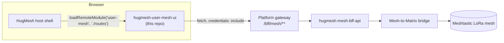

The **Mesh dashboard** for [HugMesh](https://github.com/hugmesh-net) — an Angular
[native-federation](https://github.com/angular-architects/module-federation-plugin)
micro-frontend that gives every HugMesh user a view onto their
[Meshtastic](https://meshtastic.org/)-compatible LoRa radio mesh: which nodes are
reachable, which radios they've claimed, and which chat rooms are bridged onto the
mesh.

It ships as an independently built, independently deployed **remote** module that
the platform's host shell loads at runtime — it is not a standalone product and is
not meant to be run in production on its own.

## What it does

HugMesh bridges Meshtastic LoRa mesh networks into the platform's Matrix-based
chat, so a community can keep talking over LoRa radios when the internet is down,
and see that traffic show up in the same rooms they already use. This repository
is the browser-side piece of that story: a small dashboard, embedded into the main
HugMesh web app, that shows

- **who else is on the mesh** — every node the mesh↔Matrix bridge has heard,
  with signal quality, battery, hop count and last-seen time;
- **your own radios** — the LoRa devices you've claimed, so you can manage
  visibility and see their live status; and
- **which chat rooms are mesh-enabled** — and which LoRa channel each one
  bridges.

## Status

This repository currently contains the federation scaffold, the backend client,
and the presentation/validation logic — the view components that render them are
the next milestone.

- [x] Native-federation remote wiring (build / serve / test targets, shared-deps
      and skip-list contract in `federation-base.js` / `federation.config.js`)
- [x] `MeshBffService` — typed, fail-soft client for the mesh backend-for-frontend
- [x] `mesh-format.ts` — pure formatting, bucketing and input-validation helpers
- [x] Route table, role guard (`meshGuard`) and cross-remote session integration
      (`SessionService`)
- [ ] `NodesComponent` — the node directory view
- [ ] `MyDevicesComponent` — the claimed-devices view
- [ ] `ChannelsComponent` — the mesh-enabled channels view
- [ ] Unit test suite (the Karma/Jasmine harness is wired up; specs are not yet
      written)

The three routes below are declared and guarded already; until their components
land, a production build of this remote will fail to resolve them.

## How it fits into HugMesh

This remote is loaded by the platform's host shell over
[`@angular-architects/native-federation`](https://www.npmjs.com/package/@angular-architects/native-federation),
not bundled into it at build time. The host fetches this remote's manifest and
`remoteEntry.json` at runtime and mounts its single exposed module at
`/user-mesh`.



Key points of that contract:

- The federation remote name is **`user-mesh`**; the exposed module is
  **`./routes`**, resolving to `USER_MESH_ROUTES`. Both are load-bearing — the
  host looks them up by these exact strings.
- Shared dependencies (Angular, RxJS, etc.) and the RxJS-subpath skip list live
  in `federation-base.js`, shared with every other HugMesh remote so a
  dependency-sharing mismatch (a classic "shared is not a function" runtime
  failure) is caught in one place instead of per repo.
- The browser never holds a bearer token. Every request goes through
  `fetch(url, { credentials: 'include' })`, which rides the `HttpOnly` session
  cookie the login flow sets; the gateway exchanges that cookie for an upstream
  bearer token server-side.
- Access is gated in three independent layers: the gateway's route-access rule
  for `/user-mesh/**`, the mesh BFF's own role check on every endpoint, and this
  remote's client-side `meshGuard` (a UX nicety, not a security boundary — see
  [Access control](#access-control)).

Related HugMesh repositories:

| Repository | Role |
|---|---|
| [`hugmesh-mesh-bff-api`](https://github.com/hugmesh-net/hugmesh-mesh-bff-api) | Backend-for-frontend this remote talks to (`/bff/mesh/**`) |
| [`hugmesh-user-bff-api`](https://github.com/hugmesh-net/hugmesh-user-bff-api) | Owns device claiming/registration and the node-id validation this remote mirrors client-side |
| [`hugmesh-admin-ui`](https://github.com/hugmesh-net/hugmesh-admin-ui) | Sibling remote; source of the `__SNAP_BFF_URL__` runtime-override convention this repo follows |
| [`hugmesh-matrix-ui`](https://github.com/hugmesh-net/hugmesh-matrix-ui) | Sibling remote with its own mesh-devices settings section; re-derives the same node-id/format rules independently (native federation doesn't allow sharing runtime code across remotes) |
| [`hugmesh-mod-ui`](https://github.com/hugmesh-net/hugmesh-mod-ui) | Sibling remote using the same `federation-base.js` pattern |

## Routes

| Path | Component | Purpose |
|---|---|---|
| `/user-mesh` | `NodesComponent` *(planned)* | The full mesh node directory — every LoRa radio the bridge has heard |
| `/user-mesh/devices` | `MyDevicesComponent` *(planned)* | The caller's own claimed radios: claim, release, per-device visibility, live status |
| `/user-mesh/channels` | `ChannelsComponent` *(planned)* | Mesh-enabled chat rooms and the LoRa channel index each one bridges |

All three are declared behind `meshGuard` in `src/app/user-mesh.routes.ts`.

## Access control

Viewing the mesh dashboard requires the `mesh` Casdoor role (or the superset
`admin` / `superadmin`). This is enforced in three places, in order of
authority:

1. The gateway's route-access rule for `/user-mesh/**`.
2. `hugmesh-mesh-bff-api`'s own `@PreAuthorize` check on every `/bff/mesh/**`
   endpoint.
3. This remote's `meshGuard` (`src/app/mesh.guard.ts`), which reads the shared
   `SessionService` and redirects an unauthorized caller to `/login` before the
   mesh UI bundle is even mounted.

The guard exists purely so an unauthorized user isn't shown a bundle they can't
use — the first two layers are the actual security boundary.

## Data model

`MeshBffService` (`src/app/mesh-bff.service.ts`) is a `BehaviorSubject`-backed
client for the mesh backend-for-frontend. It never throws: a failed read leaves
the last-known-good list in place and publishes a human-readable degradation
note on a companion observable, so a page can distinguish "the mesh is empty"
from "the mesh backend is unreachable."

| Method | Endpoint | Returns |
|---|---|---|
| `loadNodes()` | `GET /bff/mesh/nodes` | The full node directory |
| `loadRooms()` | `GET /bff/mesh/rooms` | Mesh-enabled chat rooms |
| `refreshNode(nodeId)` | `GET /bff/mesh/status/{nodeId}` | One node's live status, spliced into the cached directory |

`MeshNode` mirrors the backend's `MeshNodeView` field-for-field:

| Field | Type | Notes |
|---|---|---|
| `nodeId` | `string` | Canonical `!` + 8 lowercase hex digits; always present |
| `longName` / `shortName` | `string \| null` | Radio-reported, best-effort |
| `lastSeenAt` | `string \| null` | ISO-8601; drives the "last heard" and online-state display |
| `batteryPct` | `number \| null` | 0–100, or 101 meaning "externally powered" (Meshtastic convention) |
| `snr` | `number \| null` | Signal-to-noise ratio in dB |
| `hopsAway` | `number \| null` | Hop count back to the bridge |
| `viaDevice` | `string \| null` | The relaying bridge device, when known |
| `online` | `boolean` | Server-derived; re-derived locally as a fallback |
| `registeredTo` | `string \| null` | Owner's localpart, only when the owner's visibility settings permit it |

Every field except `nodeId` is treated as **untrusted radio telemetry** relayed
by the bridge — it is best-effort and not cryptographically authenticated.
`mesh-format.ts` is the pure, dependency-free module that parses, clamps and
formats these fields (avatar-badge colour derived from the node number,
battery/signal quality buckets, relative "last heard" time, node-id
normalization) and is designed to be unit-tested without a `TestBed`. Its
presentation conventions (node-number → RGB avatar, the 101 = "powered" battery
marker, the SNR-to-quality mapping) deliberately match the official Meshtastic
web client's, so a Meshtastic user recognizes their own mesh here.

`MeshRoom` is smaller — `roomId`, the bridging `device`, and the LoRa
`meshChannel` index it carries (channel `0` is always Meshtastic's
`Primary/Broadcast` channel).

## Getting started

### Prerequisites

- Node.js **24.15** or later (Angular CLI 22's minimum)
- npm

### Install

```bash
npm ci
```

### Run standalone

```bash
npm start
```

This serves a minimal dev shell (not the production host) at
`http://localhost:4210`, with `USER_MESH_ROUTES` mounted at the root so the
dashboard is fully browsable without the HugMesh host shell.

### Build

```bash
npm run build
```

Produces the native-federation remote bundle in `dist/user-mesh/browser`,
including `remoteEntry.json` and the federation manifest the host consumes.

### Test

```bash
npm test          # single run, headless Chrome
npm run test:watch # interactive watch mode
```

Karma/Jasmine is configured (`karma.conf.js`); see [Status](#status) for what's
covered so far.

## Configuration

This remote reads one optional runtime global, `__SNAP_BFF_URL__`, which the
host shell may inject before federation initializes to point a given deployment
at a non-default backend (see `src/app/runtime-config.d.ts`). Left unset, all
BFF calls are same-origin — the platform gateway is expected to proxy
`/bff/mesh/**` to `hugmesh-mesh-bff-api`.

## Project structure

```
src/
  app/
    mesh-bff.service.ts     # HTTP client for /bff/mesh/**, fail-soft & cached
    mesh-format.ts          # pure formatting/validation helpers (unit-testable)
    mesh.guard.ts           # client-side ROLE_MESH route guard
    session.service.ts      # cross-remote session state (localStorage-backed)
    user-mesh.routes.ts     # USER_MESH_ROUTES — the federated exposed module
    app.component.*         # standalone dev-shell only, not used once federated
    app.routes.ts           # dev-shell routing
  bootstrap.ts              # dev-shell bootstrap
  main.ts                   # federation entry point
  styles.scss, styles/      # shared HugMesh accessibility baseline + design tokens
federation.config.js        # this remote's native-federation config
federation-base.js          # shared federation helpers (shared deps, skip list)
Dockerfile                  # multi-stage build -> nginx runtime image
nginx.conf                  # CORS + security headers for the built remote
```

## Accessibility

The UI baseline in `src/styles.scss` targets WCAG 2.1 AA/AAA: a skip link, a
visible two-layer focus ring, underlined links (never colour-only), 44px
minimum touch targets, `prefers-reduced-motion` and `prefers-contrast` support,
and paired text descriptions everywhere a status is otherwise conveyed by
colour alone (battery level, signal quality). This mirrors the baseline shared
across HugMesh's other frontends so the experience is consistent whether a
surface is reached standalone or through the host shell.

## Deployment

The `Dockerfile` is a two-stage build: `npm ci && npm run build` on
`node:24-alpine`, then the static output is served from `nginx:1.27-alpine`.
`nginx.conf` adds the CORS header the host shell needs to fetch this remote's
`remoteEntry.json` and chunks cross-origin, a baseline set of security headers
(`X-Content-Type-Options`, `X-Frame-Options`, `Referrer-Policy`, HSTS), and a
`/healthz` endpoint for readiness checks.

A manual-dispatch GitHub Actions workflow (`.github/workflows/release.yml`)
builds and pushes the image to `ghcr.io/hugmesh-net/hugmesh-user-mesh-ui`; it
has no automatic trigger and is run by hand when a maintainer is ready to cut a
release.

## Contributing

Contributions are welcome. The general flow:

1. Fork the repository and create a feature branch.
2. Make your change, keeping new logic in pure, unit-testable modules where
   possible (see `mesh-format.ts` for the house style).
3. Run `npm test` and make sure the build (`npm run build`) still succeeds.
4. Open a pull request describing what changed and why.

If you're touching the federation contract (remote name, exposed module path,
shared-deps list), please call that out explicitly in the PR description — a
mismatch with the host shell's expectations breaks the mesh dashboard for every
user.

## License

MIT — see [LICENSE](LICENSE).
