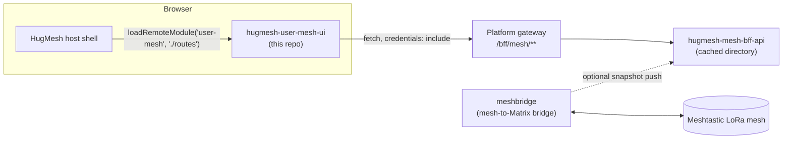

The **Mesh dashboard** for [HugMesh](https://github.com/hugmesh). It is an Angular
[native-federation](https://github.com/angular-architects/module-federation-plugin)
micro-frontend. It gives each HugMesh user a view of their
[Meshtastic](https://meshtastic.org/)-compatible LoRa radio mesh: which nodes
are reachable, which radios they have claimed, and which chat rooms are bridged
onto the mesh.

It is a **remote** module, built and deployed on its own, that the platform's
host shell is meant to load at runtime. It is not a standalone product and does
not run alone in production. The host shell does not mount it yet (see
[Status](#status)).

## What it does

HugMesh bridges Meshtastic LoRa mesh networks into the platform's Matrix-based
chat. A community can keep talking over LoRa radios when the internet is down,
and that traffic shows up in the rooms they already use. This repository is the
browser side of that: a small dashboard, embedded in the main HugMesh web app,
that shows

- **who else is on the mesh** — every node the mesh↔Matrix bridge has heard,
  with signal quality, battery, hop count and last-seen time;
- **your own radios** — the LoRa devices you have claimed, so you can manage
  visibility and see their live status; and
- **which chat rooms are mesh-enabled** — and which LoRa channel each one
  bridges.

## Status

This repository holds the federation scaffold, the backend client, and the
formatting and validation logic. The view components that render them are the
next milestone.

- [x] Native-federation remote wiring (build / serve / test targets, shared-deps
      and skip-list contract in `federation-base.js` / `federation.config.js`)
- [x] `MeshBffService` — typed, fail-soft client for the mesh backend-for-frontend
- [x] `mesh-format.ts` — pure formatting, bucketing and input-validation helpers
- [x] Route table, role guard (`meshGuard`) and cross-remote session integration
      (`SessionService`)
- [ ] `NodesComponent` — the node directory view
- [ ] `MyDevicesComponent` — the claimed-devices view
- [ ] `ChannelsComponent` — the mesh-enabled channels view
- [ ] Unit test suite (the Karma/Jasmine harness is wired up; specs are not yet
      written)

The three routes below are declared and guarded. But `src/app/user-mesh.routes.ts`
imports `nodes.component`, `my-devices.component` and `channels.component`, and
none of those files exist. Until they land, every build of this remote fails,
and so does the Docker image build.

The remote is also not wired into the platform. On the sibling repos'
`origin/main` as of 2026-10-15:

- `hugmesh-host-shell` has no `user-mesh` entry.
- The fe-gateway has no `/user-mesh` route.
- The cluster route-access seed
  (`hugmesh-generator` `specs/cluster/manifests/route-access/initdb/20-schema.sql`)
  has no `/user-mesh/**` row. It has `/bff/mesh/**`, which needs `ROLE_MESH`.

`hugmesh-generator` carries a test that asserts this absence
(`tests/e2e/features/mined-identity/mesh-remote-unmounted.feature`). The PR that
adds the three components must delete that test and add the route and the row.

## How it fits into HugMesh

The platform's host shell is meant to load this remote over
[`@angular-architects/native-federation`](https://www.npmjs.com/package/@angular-architects/native-federation),
not bundle it at build time. The intended contract: the host fetches this
remote's manifest and `remoteEntry.json` at runtime and mounts its single exposed
module at `/user-mesh`. That mount does not exist yet (see [Status](#status)).



The contract, point by point:

- The federation remote name is **`user-mesh`**. The exposed module is
  **`./routes`**, which resolves to `USER_MESH_ROUTES`. The host looks them up by
  these exact strings. Rename either and the mount breaks.
- Shared dependencies (Angular, RxJS, etc.) and the RxJS-subpath skip list live
  in `federation-base.js`. Each HugMesh remote carries its own copy of the same
  pattern (`hugmesh-mod-ui` has one). A dependency-sharing mismatch (the classic
  "shared is not a function" runtime failure) is then fixed in one file per repo,
  not inline in each config.
- The browser never holds a bearer token. Every request goes through
  `fetch(url, { credentials: 'include' })`, which sends the `HttpOnly` session
  cookie the login flow sets. The gateway exchanges that cookie for an upstream
  bearer token server-side.
- Access is gated in three independent layers: the gateway's route-access rule
  for `/bff/mesh/**` (`ROLE_MESH`), the mesh BFF's own role check on every
  endpoint, and this remote's client-side `meshGuard`. The guard is a UX nicety,
  not a security boundary (see [Access control](#access-control)). A route-access
  rule for the `/user-mesh/**` page path is planned and does not exist yet.

Related HugMesh repositories:

| Repository | Role |
|---|---|
| [`hugmesh-mesh-bff-api`](https://github.com/hugmesh/hugmesh-mesh-bff-api) | Backend-for-frontend this remote talks to (`/bff/mesh/**`) |
| [`hugmesh-user-bff-api`](https://github.com/hugmesh/hugmesh-user-bff-api) | Owns device claiming/registration and the node-id validation this remote mirrors client-side |
| [`hugmesh-admin-ui`](https://github.com/hugmesh/hugmesh-admin-ui) | Sibling remote; source of the `__SNAP_BFF_URL__` runtime-override convention this repo follows |
| [`hugmesh-matrix-ui`](https://github.com/hugmesh/hugmesh-matrix-ui) | Sibling remote with its own mesh-devices settings section; re-derives the same node-id/format rules independently (native federation doesn't allow sharing runtime code across remotes) |
| [`hugmesh-mod-ui`](https://github.com/hugmesh/hugmesh-mod-ui) | Sibling remote using the same `federation-base.js` pattern |

## Routes

| Path | Component | Purpose |
|---|---|---|
| `/user-mesh` | `NodesComponent` *(planned)* | The full mesh node directory — every LoRa radio the bridge has heard |
| `/user-mesh/devices` | `MyDevicesComponent` *(planned)* | The caller's own claimed radios: claim, release, per-device visibility, live status |
| `/user-mesh/channels` | `ChannelsComponent` *(planned)* | Mesh-enabled chat rooms and the LoRa channel index each one bridges |

All three are declared behind `meshGuard` in `src/app/user-mesh.routes.ts`.

## Access control

Viewing the mesh dashboard requires the `mesh` Casdoor role, or the superset
`admin` / `superadmin`. Three places enforce this, in order of authority:

1. The gateway's route-access rule for `/bff/mesh/**` (`ROLE_MESH`). A matching
   rule for the `/user-mesh/**` page path is planned; the seed has none today.
2. `hugmesh-mesh-bff-api`'s own `@PreAuthorize("hasAnyRole('MESH','ADMIN','SUPERADMIN')")`
   check on every `/bff/mesh/**` endpoint this remote calls. (The
   `/bff/mesh/internal/**` bridge-sync ingest is `SERVICE`-only instead.)
3. This remote's `meshGuard` (`src/app/mesh.guard.ts`). It reads the shared
   `SessionService` and redirects an unauthorized caller to `/login` before any
   mesh view renders.

The guard only spares an unauthorized user a view they cannot use. The first two
layers are the security boundary.

## Data model

`MeshBffService` (`src/app/mesh-bff.service.ts`) is a `BehaviorSubject`-backed
client for the mesh backend-for-frontend. It never throws. A failed read leaves
the last good list in place and publishes a readable note on a companion
observable. A page can then tell "the mesh is empty" from "the mesh backend is
unreachable."

| Method | Endpoint | Returns |
|---|---|---|
| `loadNodes()` | `GET /bff/mesh/nodes` | The full node directory |
| `loadRooms()` | `GET /bff/mesh/rooms` | Mesh-enabled chat rooms |
| `refreshNode(nodeId)` | `GET /bff/mesh/status/{nodeId}` | One node's live status, spliced into the cached directory |

`MeshNode` mirrors the backend's `MeshNodeView` field-for-field:

| Field | Type | Notes |
|---|---|---|
| `nodeId` | `string` | Canonical `!` + 8 lowercase hex digits; always present |
| `longName` / `shortName` | `string \| null` | Radio-reported, best-effort |
| `lastSeenAt` | `string \| null` | ISO-8601; drives the "last heard" and online-state display |
| `batteryPct` | `number \| null` | 0–100, or 101 meaning "externally powered" (Meshtastic convention) |
| `snr` | `number \| null` | Signal-to-noise ratio in dB |
| `hopsAway` | `number \| null` | Hop count back to the bridge |
| `viaDevice` | `string \| null` | The relaying bridge device, when known |
| `online` | `boolean` | Server-derived; re-derived locally as a fallback |
| `registeredTo` | `string \| null` | Owner's localpart, only when the owner's visibility settings permit it |

Treat every field except `nodeId` as **untrusted radio telemetry**. The bridge
relays it. It is best-effort and not cryptographically authenticated.
`mesh-format.ts` is the pure, dependency-free module that parses, clamps and
formats these fields: avatar-badge colour from the node number, battery and
signal quality buckets, relative "last heard" time, node-id normalization. You
can unit-test it without a `TestBed`. Its presentation conventions (node-number
→ RGB avatar, the 101 = "powered" battery marker, the SNR-to-quality mapping)
deliberately match the official Meshtastic web client's, so a Meshtastic user
recognizes their own mesh here.

`MeshRoom` is smaller: `roomId`, the bridging `device`, and the LoRa
`meshChannel` index it carries. `meshChannelLabel()` shows index `0` as
`Primary/Broadcast`, any other non-negative integer as `Channel N`, and anything
else as `Unknown channel`.

## Getting started

### Prerequisites

- Node.js `^22.22.3`, `^24.15.0` or `>=26.0.0` (the `engines` range of Angular CLI 22; the Dockerfile uses Node 24)
- npm

### Install

```bash
npm ci
```

### Run standalone

```bash
npm start
```

This serves a minimal dev shell (not the production host) at
`http://localhost:4210`, with `USER_MESH_ROUTES` mounted at the root. You can
browse the dashboard without the HugMesh host shell. Until the three view
components exist, it does not compile (see [Status](#status)).

### Build

```bash
npm run build
```

Produces the native-federation remote bundle in `dist/user-mesh/browser`,
including `remoteEntry.json` and the federation manifest the host consumes.

### Test

```bash
npm test          # single run, headless Chrome
npm run test:watch # interactive watch mode
```

Karma/Jasmine is configured (`karma.conf.js`). No spec files exist yet (see
[Status](#status)).

## Configuration

This remote reads one optional runtime global, `__SNAP_BFF_URL__`. The host shell
may inject it before federation initializes, to point a deployment at a
non-default backend (see `src/app/runtime-config.d.ts`). Left unset, all BFF
calls are same-origin. The platform gateway is expected to proxy `/bff/mesh/**`
to `hugmesh-mesh-bff-api`.

## Project structure

```
src/
  app/
    mesh-bff.service.ts     # HTTP client for /bff/mesh/**, fail-soft & cached
    mesh-format.ts          # pure formatting/validation helpers (unit-testable)
    mesh.guard.ts           # client-side mesh-role route guard
    session.service.ts      # cross-remote session state (localStorage-backed)
    user-mesh.routes.ts     # USER_MESH_ROUTES — the federated exposed module
    app.component.*         # standalone dev-shell only, not used once federated
    app.routes.ts           # dev-shell routing
  bootstrap.ts              # dev-shell bootstrap
  main.ts                   # federation entry point
  styles.scss, styles/      # shared HugMesh accessibility baseline + design tokens
federation.config.js        # this remote's native-federation config
federation-base.js          # shared federation helpers (shared deps, skip list)
Dockerfile                  # multi-stage build -> nginx runtime image
nginx.conf                  # CORS + security headers for the built remote
```

## Accessibility

The UI baseline in `src/styles.scss` targets WCAG 2.1 AA/AAA. It has a skip link,
a visible two-layer focus ring, underlined links (never colour alone), 44px
minimum touch targets on coarse pointers (touch screens), and
`prefers-reduced-motion` and `prefers-contrast` support. `mesh-format.ts`
supplies the text descriptions for statuses otherwise shown by colour alone
(battery level, signal quality). The views that show them are not built yet. The
styles copy the baseline of HugMesh's other frontends, so a surface looks and
behaves the same standalone or through the host shell.

## Deployment

The `Dockerfile` is a two-stage build. The first stage runs
`npm ci && npm run build:user-mesh` on `node:24-alpine`. The second serves the
static output from `nginx:1.27-alpine`. `nginx.conf` adds the CORS header the
host shell needs to fetch this remote's `remoteEntry.json` and chunks
cross-origin. It also sets a baseline of security headers
(`X-Content-Type-Options`, `X-Frame-Options`, `Referrer-Policy`, HSTS) and a
`/healthz` endpoint for readiness checks.

### Versions and releases

The version lives in `package.json` (and must match `package-lock.json`). It
follows `MAJOR.MINOR.PATCH-beta.N`. Today it is `0.1.0-beta.1`: 0.1 means a
scaffold whose image has not yet been built successfully, because of the
missing view components described under [Status](#status).

The GitHub Actions workflow `.github/workflows/release.yml` builds the image and
pushes it to `ghcr.io/hugmesh/hugmesh-user-mesh-ui`:

| Trigger | Image tags | GitHub release |
|---|---|---|
| push to `main` | `main`, `sha-<12 hex>` | none |
| push of tag `v<version>` | `<version>`, `beta` (beta versions only), `sha-<12 hex>` | prerelease, never marked latest |
| manual run on `main` | same as a push to `main` | none |
| manual run on a `v*` tag | re-runs that release; an image or release that already exists is left alone | |

Any other branch or tag is refused. A tag must equal `v` plus the
`package.json` version and point at a commit on `main`. A published version tag
is never overwritten, and `latest` is never pushed. If the app does not build,
nothing is pushed.

To cut a beta, a maintainer pushes an annotated tag on a commit on `main`, for
example `git tag -a v0.1.0-beta.1 -m v0.1.0-beta.1 && git push origin
v0.1.0-beta.1`. The next beta of the same base raises `N`.

The workflow has no pull-request trigger. Its jobs use the self-hosted runner
only when the repository variable `RUNS_ON_PUBLISH` is set and the run is for
`main` or a `v*` tag; otherwise they use GitHub-hosted `ubuntu-latest`.

## Contributing

Contributions are welcome. The usual flow:

1. Fork the repository and create a feature branch.
2. Make your change. Keep new logic in pure, unit-testable modules where
   possible (see `mesh-format.ts` for the house style).
3. Run `npm test` and make sure the build (`npm run build`) still succeeds.
4. Open a pull request describing what changed and why.

If you touch the federation contract (remote name, exposed module path,
shared-deps list), say so in the PR description. A mismatch with the host
shell's expectations breaks the mesh dashboard for every user.

## License

MIT — see [LICENSE](LICENSE).
