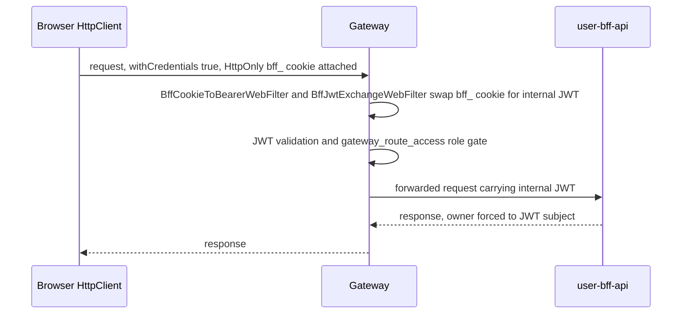

The self-service **user console** for [HugMesh](https://github.com/hugmesh), a
federated community platform with Matrix/Mastodon interoperability. A signed-in
member uses it to manage their profile and avatar, publish "cards" (sandboxed
rich mini-pages), control their block list and visibility, manage connected
external clients, and read notifications. It works on their own account and no
one else's.

It ships as an **Angular 22 native-federation remote**, paired with the
[`hugmesh-user-bff-api`](https://github.com/hugmesh/hugmesh-user-bff-api)
backend-for-frontend. The [`hugmesh-host-shell`](https://github.com/hugmesh/hugmesh-host-shell)
host federates this remote's exposed `USER_ROUTES` at runtime and mounts them
at the user role-home, so they resolve to:

| Host path                   | View                              | Component                          |
| --------------------------- | --------------------------------- | ---------------------------------- |
| `` (role-home)              | Welcome / getting-started guide   | `HomeComponent`                    |
| `profile`                   | Profile editor                    | `ProfileComponent`                 |
| `cards`                     | Federation card manager           | `CardsComponent`                   |
| `blocks`                    | Self-block list                   | `SelfBlockComponent`               |
| `recommend-instance-block`  | Instance-block recommendation     | `RecommendInstanceBlockComponent`  |
| `self-silence`              | Self-service visibility hide      | `SelfSilenceComponent`             |
| `connected-apps`            | Connected apps + device sessions  | `ConnectedAppsComponent`           |
| `sessions`                  | Active login sessions (list + revoke own) | `SessionsComponent`        |
| `preferences`               | Durable per-user preferences (e.g. `media.poison.default` toggle) | `PreferencesComponent` |
| `notifications`             | In-app notification inbox         | `NotificationsComponent`           |
| `notification-preferences`  | Per-category notification opt-in toggles | `NotificationPreferencesComponent` |

> **Status legend** — this README uses: ✅ **shipped** (merged to `main`) ·
> 🚧 **in-flight** (code on an open branch/PR, not yet merged) ·
> 🔭 **planned** (design-complete, no code). All eleven routes above are
> ✅ shipped (`src/app/user.routes.ts`). Roadmap items are collected under
> [Roadmap](#roadmap).

The host route-guards the user role-home on the Casdoor **ROLE_USER** floor.
Data is ALWAYS the caller's OWN: the paired BFF forces owner = authenticated
subject, so a user can only read or write their own profile (incl. avatar),
cards, blocks, self-silence, preferences, clients, stream status, login
sessions, and notifications.

The **connected-apps** view also mirrors the BFF's external-client-role gate. A
caller WITHOUT a Matrix/Mastodon external-client role sees that surface
**disabled with helptext**. This is defence-in-depth: the API stays the source
of truth, and the UI explains the missing capability instead of showing a 403.

## Federation

`federation.config.js` (built on `federation-base.js`, which is byte-identical
across every HugMesh remote) exposes two modules under the remote name
**`user`**:

- `./routes` → `src/app/user.routes.ts` (`USER_ROUTES`) — the role-home surface.
- `./profile` → `src/app/profile.component.ts` (`ProfileComponent`) — exposed
  standalone so the host can mount the profile editor as a **modal**. The host
  does: `profile-modal.component.ts` in `hugmesh-host-shell` loads it with
  `loadRemoteModule('user', './profile')`.

The build emits `dist/user/browser/remoteEntry.json`. The host reads its
`exposes` entries to lazy-load the routes and the profile modal.

> 🔭 **Platform roadmap.** Today the host's federation map is static. The UI
> standard's target is **dynamic DB-hosted federation**: remote URLs served from
> the database and wired through ArgoCD and the gateway's route-access, so this
> remote's `federation.config.js` / `federation-base.js` take part in
> runtime-managed federation. See [Roadmap](#roadmap).

## Datastore services

All data access goes through RxJS `BehaviorSubject`-backed datastore services.
They wrap `HttpClient` calls to the same-origin `/bff/user/**` surface (the
gateway fronts hugmesh-user-bff-api):

| Service              | user-bff-api endpoints                                                                    |
| -------------------- | ---------------------------------------------------------------------------------------- |
| `UserProfileService`     | `GET/PUT /bff/user/profile` (carries `screenReaderName` + `avatarUrl`), `POST /bff/user/profile/{password,email}`, `POST /bff/user/profile/avatar` (multipart avatar upload), `GET /bff/user/home-guide`, `POST/DELETE /bff/user/home-guide/dismiss` (query `?guide=`) |
| `CardsService`           | `GET /bff/user/cards`, `GET /bff/user/cards/{slug}` (versions), `GET /bff/user/cards/{slug}/body` (current source, for Edit pre-fill), `PUT /bff/user/cards/{slug}` (octet-stream), `DELETE /bff/user/cards/{slug}` |
| `BlockService`           | `GET/POST /bff/user/blocks`, `DELETE /bff/user/blocks/{id}`, `POST /bff/user/recommend-instance-block` |
| `SelfSilenceService`     | `GET /bff/user/self-silence/status`, `POST /bff/user/self-silence/{activate,cancel,email-mod}` |
| `ConnectedClientsService` | `GET /bff/user/connected-clients`, `DELETE /bff/user/connected-clients/{id}` (external-client role) |
| `PreferencesService`     | `GET /bff/user/preferences` (resolved map, server defaults merged in), `PUT /bff/user/preferences` `{key, value}` upsert → updated map. Owner is always the authenticated subject; known key `media.poison.default` (values `off`/`low`/`medium`/`high`). |
| `OwncastService`         | `GET /bff/owncast/user/my-stream` → `{ streamUrl, visibility }` for the caller's OWN broadcast grant (200 with grant, 404/empty when none). Backs the `sd-owncast-player` card publish-gate. |
| `SessionsService`        | `GET /bff/user/sessions` (caller's own active login sessions), `DELETE /bff/user/sessions/{id}` (revoke one own session; the BFF validates ownership server-side before deleting the `bff_session` row). |
| `NotificationsService`   | `GET /bff/user/notifications` (caller's in-app feed, newest-first, optional `?limit`), `POST /bff/user/notifications/{id}/read` (idempotent mark-read), `GET /bff/user/notifications/events` (real-time SSE push via `startLive()`/`stopLive()`). Exposes `unreadCount$` for a host-shell bell badge and `liveStatus$` (`idle`/`connecting`/`live`/`degraded`) so a consumer can say honestly when the feed isn't live. |
| `NotificationPreferencesService` | `GET /bff/user/notification-preferences` (all four category prefs), `PUT /bff/user/notification-preferences` `{category, enabled}` upsert. The `account-restriction` category is forced-on (the BFF ignores `enabled:false` for it). |

> The endpoint owner is ALWAYS the authenticated subject (server-enforced).

### Request authentication (HttpOnly cookie, no browser-held bearer)

✅ Every outgoing `HttpClient` request passes through `authInterceptor`
(`src/app/auth.interceptor.ts`). It clones the request with
`withCredentials: true`, so the browser's HttpOnly `bff_` session cookie rides
along. The interceptor does **not** read or attach anything from
`SessionService`; the browser holds no bearer token at all. Requests sent while
the cookie is absent (not logged in) still go out, and the BFF rejects them with
`401`.

> ⚠️ **What actually authenticates the request.** Under the SSO model, login-ui
> posts the username and password to `POST /bff/login`. **hugmesh-user-bff-api**
> checks them against the internal Casdoor with a server-side PKCE flow, does
> the code→token exchange and holds per-session JWT custody/refresh. The
> browser is never redirected to Casdoor and **never sees the Casdoor JWT**. It
> holds the opaque `bff_` session token only as an HttpOnly cookie
> (`bff_session`). At the edge, the gateway is a pure Casdoor-JWT OAuth2
> resource server. Two pre-security filters swap the cookie for the internal
> custody JWT (`BffCookieToBearerWebFilter` turns the cookie into a bearer,
> `BffJwtExchangeWebFilter` asks admin-bff for the JWT). Then unchanged JWT
> validation and the data-driven `gateway_route_access` role gate run. So this
> remote only has to send the cookie. The gateway, not the browser, presents the
> JWT downstream.
>
> Both halves default to off in code. user-bff's login path stays off until
> `app.bff.oidc.enabled` is true (default `false`). The gateway's exchange stays
> off until `hugmesh.gateway.bff-exchange.enabled` is true (default `false`).
> The local compose stack turns both on (`tests/stack/compose.local.yaml` in
> hugmesh-generator: `HUGMESH_GATEWAY_BFF_EXCHANGE_ENABLED` for the fe-gateway,
> `APP_BFF_OIDC_ENABLED` for user-bff-api).



The rest of the session state (`id`, `label`, `provider`, `roles`,
`registrationComplete` — **no token field**) lives in **`localStorage`** under
the shared **`hug.session`** key. Instances reconcile over the
**`hug-session-change`** broadcast (`src/app/session.service.ts`), the same
key and broadcast every HugMesh UI uses. The legacy `snap-session-change` name
is still listened to and dispatched, so a mixed-version rollout stays in sync.
This state only drives menu and route gating (see
[`SnapSession`](#cross-cutting-a11y-utilities-copied-per-remote)). It holds
nothing an attacker could replay against the BFF, so the earlier plan to move a
bearer token out of `localStorage` no longer applies here. See
[Roadmap](#roadmap).

### Cross-cutting a11y utilities (copied per remote)

native-federation forbids a shared runtime import across remotes, so this remote
ships its own byte-identical copies:

- `accessible-name.ts` — `accessibleName(displayName, screenReaderName)` +
  `isPrintableAscii` + `defaultScreenReaderName`. It mirrors the server's
  `ScreenReaderNames` rule: printable ASCII **U+0020..U+007E**. The naive
  `/^[\x00-\x7F]*$/` is wrong; it accepts NUL, tab, newline and DEL, which the
  server rejects with 422. The profile editor uses it for the screen-reader-name
  validator and live preview.
- `session.service.ts` — the canonical `hug.session` signal store + role
  computeds, including `hasExternalClientRole` (drives the connected-apps gate).
- `.field-help` / `.hint` (`styles.scss`) — the disabled-control +
  `aria-describedby` helptext convention, used wherever the UI mirrors an API gate.

## Develop

```bash
npm install
npm start            # ng serve user → http://localhost:4206 (standalone dev shell)
```

The standalone dev shell (`AppComponent`, selector `hug-user-root`) mounts
`USER_ROUTES` at `/`, so the remote can be browsed on its own. In production the
host loads `./routes` directly and this shell is not used.

### Typed BFF client (ng-openapi-gen)

✅ A typed client for the user-bff-api surface is generated with
[`ng-openapi-gen`](https://www.npmjs.com/package/ng-openapi-gen), the platform
UI standard's client generator. The generated client (`src/app/api`) AND its
input spec (`openapi.json`) are **committed**, so the build is deterministic and
needs no network or running BFF.

```bash
npm run gen          # generate from the committed ./openapi.json into src/app/api
npm run gen:spec     # refresh ./openapi.json from the BFF's COMMITTED spec, then npm run gen
```

**Deterministic spec source (no running server).** `hugmesh-user-bff-api` keeps
`src/main/resources/openapi/openapi.json` as a committed contract. Its
`OpenApiSpecDumpTest` boots the context under the `test` profile, GETs
`/v3/api-docs`, and normalises it to a key-sorted, byte-stable spec. By default
the test only asserts that the committed file matches the live API. It writes
the file only with `-Dopenapi.spec.write=true`.

`gen:spec` copies that committed spec from next door (default
`../hugmesh-user-bff-api/...`, override with `USER_BFF_SPEC=/path/to/openapi.json`)
and regenerates. To refresh after a BFF API change: run
`./mvnw -Dtest=OpenApiSpecDumpTest -Dopenapi.spec.write=true test` in the BFF,
commit the BFF spec, then run `npm run gen:spec` here and commit the regenerated
client.

`ng-openapi-gen.json` reads `openapi.json` and writes typed models and services
to `src/app/api` (`skipJsonSuffix`, `enumStyle: alias`). The hand-written
`*.service.ts` datastore services delegate to these generated services. All
nine are migrated (`UserProfileService`, `CardsService`, `BlockService`,
`SelfSilenceService`, `ConnectedClientsService`, `PreferencesService`,
`SessionsService`, `NotificationsService`, `NotificationPreferencesService`).
Three calls stay hand-rolled because the generator cannot cover them: the
multipart avatar upload, the octet-stream card-body read, and the SSE
notification stream. `OwncastService` is hand-rolled too. See
[Deferrals](#deferrals).

## Build

```bash
npm run build        # ng build user → dist/user/browser/ (incl. remoteEntry.json)
```

## Test

```bash
npm test             # ng test user --watch=false --browsers=ChromeHeadlessCI
```

✅ `karma.conf.js` adds the JUnit reporter (`karma-junit-reporter`), so a CI run
writes a JUnit report to **`test-results/results.xml`** (reporters
`progress`/`kjhtml`/`junit`). The `ChromeHeadlessCI` launcher runs
`--no-sandbox --disable-dev-shm-usage`.

✅ An end-to-end **Playwright + BDD (Gherkin)** harness is merged beside the
unit specs (`e2e/`, 20 features). 18 features need a live stack and are tagged
`@cluster`; the default config filters those out (see
[`e2e/README.md`](e2e/README.md)). Two client-side features run with no backend.
The harness exercises the user-console surfaces against the federated host and
is growing toward the platform's full-stack SSO/security e2e coverage (see
[Roadmap](#roadmap)).

## Deploy

`Dockerfile` builds the remote (`--base-href=/user/`) and serves
`dist/user/browser` through nginx. nginx sets `Access-Control-Allow-Origin "*"`
(so the host can fetch `remoteEntry.json` and chunks cross-origin) and falls back
to `/index.html` for the SPA. `GET /healthz` returns `200`.

✅ nginx also emits baseline HTTP **security headers** (`always`) on the app and
on `/healthz`: `X-Content-Type-Options: nosniff`, `X-Frame-Options: DENY`,
`Referrer-Policy: strict-origin-when-cross-origin`, and
`Strict-Transport-Security` (HSTS, one year + `includeSubDomains`). App
responses also carry a **nonce-based `Content-Security-Policy`**. nginx writes a
fresh nonce into every `<script>` tag of `index.html`, and `script-src` has no
`'unsafe-inline'`. Without its own CSP, the gateway's fallback policy blocks the
inline federation bootstrap and the page renders blank. The remaining stricter
policies (COEP/CORP, Permissions-Policy) are deliberately deferred to the
live-cluster pass (per-UI tuning + browser validation).

At start the image runs `docker-entrypoint.d/50-hug-theme.sh`. It writes
`$HUG_THEME_CSS` (else `$SNAP_THEME_CSS`) to `/tmp/hug-theme.css`, which nginx
serves at `/hug-theme.css` (and, for older documents, at `/snap-theme.css`).

The remote runs as its own pod in the hugmesh-frontend namespace, fronted by the
fe-gateway at `/user`. CI is **GitLab** (`.gitlab-ci.yml`); the GitHub repo is
pull-mirrored into in-cluster GitLab. The only GitHub workflow is
`.github/workflows/release.yml`. It is manual (`workflow_dispatch`) and pushes
the image to GHCR. No CI runs on GitHub.

✅ The GitLab pipeline runs `stages: [test, e2e, build, pentest]`:

- **`test`** — runs `npm test` in a `node:24-alpine` + chromium container with
  `ChromeHeadlessCI`, and uploads the JUnit report at `test-results/results.xml`
  as a `junit` artifact. This stage **gates** `build:image` (`needs: [test]`).
- **`e2e:bdd`** — runs `bddgen` + `playwright test --list` (offline, no live
  stack) to prove the Gherkin features compile and all scenarios are
  discoverable. `allow_failure: true`, `needs: []` (does not gate `build:image`).
- **`build:image`** — builds and pushes the container image (immutable
  `tag`/SHA + moving branch tag) to the in-cluster GitLab registry.
- **`pentest`** — thin `pentest:sca` / `pentest:dast` jobs that `extends:` the
  centralized OWASP pen-test stage `include:`d from `hugmesh-generator`
  (`allow_failure: true`, default-branch + MR rules). It is one source of truth
  for all onboarded repos; see the platform pen-test standard. `make pentest`
  runs the same SCA (`npm audit` + OWASP dependency-check via Docker) and DAST
  (delegates to the generator's `run-pentest.sh` against `DAST_TARGET_URL`)
  locally, so a dev can self-scan before pushing. It degrades to a note, and does
  not fail, when Docker or a target URL is absent.

## Sandboxed, draggable section card builder

The cards manager (`CardsComponent`) embeds a sandboxed, **section-based** card
builder (`CardEditorComponent`). A card is an **ordered list of sections**. The
author can add, remove, and **reorder by drag-and-drop** (Angular CDK;
keyboard-accessible: a real drag-handle button plus explicit *Move up* / *Move
down* controls). Each section has a title, a body, and an **orientation**
(alignment left/center/right + a 1–4 **columns** toggle). The author writes
section content as HTML using a curated set of **provided `sd-*` tags**, may
embed **MathTeX**, and sees a **live preview** while typing. On publish, the
section document is serialised (a v2 body: one-line section JSON + the existing
fenced CSS block) and sent as the entry-file octet-stream body through the
unchanged `CardsService.put` → `PUT /bff/user/cards/{slug}` contract. Re-opening
a card restores the exact section structure, and ownership stays server-side
(the BFF forces owner = authenticated subject). Legacy markdown bodies decode to
a single section, so older cards keep working.

✅ **Drag-preview styling.** While a section is dragged, CDK deep-clones the
dragged `<li>` and appends the clone to `document.body` (top layer, via the
popover API), outside this component's DOM subtree. Angular's emulated view
encapsulation is ATTRIBUTE-based, so the clone carries the same `_ngcontent-*`
attribute and the component's `.section-card` / `.cdk-drag-preview` rules keep
matching it. The `--hug-*` theme tokens reach it by inheritance from `:root`
(from `src/styles.scss` served standalone, from the host shell once federated).
This is a CDK implementation detail, so `card-editor.component.spec.ts` pins it:
the specs drive a real pointer drag and assert that the preview keeps the
attribute and computes the same background, border, radius and padding as the
in-list card, plus its drop shadow. A CDK bump that changed the preview would
fail those specs instead of silently dropping the styling.

✅ **Edit pre-fill + Delete.** *Edit* seeds the slug and visibility AND pre-fills
the editor with the card's CURRENT content. `CardsComponent.edit()` reads the raw
stored entry-file body (`CardsService.readBody` → `GET /bff/user/cards/{slug}/body`,
owner-scoped upstream), and `decodeDocument` round-trips the full section
structure back into the editor. The author edits the real prior sections instead
of writing them again (publishing still creates a new version; a failed body
read falls back to an empty editor with an explanatory status). Each card also
has a **Delete** control (`CardsComponent.remove()` → `CardsService.delete` →
`DELETE /bff/user/cards/{slug}`, owner-scoped). It drops the caller's own card
and refreshes the list. The generated typed client carries
`src/app/api/fn/cards/body.ts` and `delete-1.ts` for these.

### Provided Angular tags (the sanctioned vocabulary)

`src/app/card-tags.ts` defines the ONLY custom tags an author may use. The
editor's tag palette inserts a starter snippet for each:

| Tag | Renders to | Key attributes |
| --- | --- | --- |
| `<sd-card-section>` | a titled `<div>` block | `title`, `align` (left/center/right) |
| `<sd-columns>` | a CSS-grid column layout | `count` (1–4) |
| `<sd-callout>` | a coloured note box (`role="note"`) | `tone` (info/success/warning/danger) |
| `<sd-badge>` | an inline pill/label | `tone` (info/success/warning/danger) |
| `<sd-divider>` | a horizontal rule (`<hr>`) | — |
| `<sd-math>` | KaTeX-rendered LaTeX | `display` (block/inline) |
| `<sd-owncast-player>` | a live-stream player region for the author's OWN Owncast broadcast (requires a broadcast grant) | — (attributes are ignored; the HLS URL is **platform-supplied**, never author-injectable) |

Each provided tag is **lowered to plain allow-listed markup** (`<div>`/`<span>`/
`<hr>` with a fixed `class`) *before* sanitisation, and out-of-list attribute
values are clamped to a safe default. After lowering no custom elements remain.
Anything not on this list (and any `<script>/<iframe>/on*=/style=`) is still
stripped by the allow-list walk.

### MathTeX (KaTeX, pre-rendered, script-free)

Write math as `<sd-math>…</sd-math>` or with `$$…$$` (display) / `\(…\)`
(inline) delimiters. **KaTeX** renders it (`card-math.ts`) to **static HTML +
accessible MathML at preview/build time**, never as a runtime script in the
sandbox. KaTeX's output needs inline positioning `style`, which the allow-list
strips. So each rendered fragment is swapped for an **unguessable placeholder
token** before sanitisation and put back after. User text can neither forge a
placeholder nor smuggle markup through this channel. KaTeX runs with
`trust:false` (refuses `\href`/`\url`), so its output has no `<script>` and no
live URLs, only MathML for assistive tech. Its **structural CSS is inlined and
scoped to `.card-root`** (`katex-css.ts`, generated by `scripts/gen-katex-css.mjs`).
Relative font URLs can't resolve in a null-origin `srcdoc`, so **all 20**
upstream `@font-face`s are **base64 data-URI-inlined** into the CSS. The full
KaTeX glyph set renders offline, air-gapped, with no network round-trip:
plain-text math, the default Math-Italic variable style, the AMS
(blackboard-bold), Caligraphic, Fraktur, Script, SansSerif and Typewriter symbol
sets, and the Size1-4 stretchy delimiters. KaTeX ships those faces as ~254 KB of
woff2 (~346 KB base64), and they land in the lazily-loaded cards chunk. An
earlier revision inlined only a 7-font subset, so every other symbol set fell
back to the system serif/sans and drew the wrong glyphs for anything past simple
arithmetic (the MathML layer was unaffected).

### Owncast live-stream player (platform-supplied HLS, never author-injectable)

✅ `<sd-owncast-player>` lets an author embed a player for **their own** Owncast
broadcast on a card. The HLS URL is **never read from the author's markup**. The
platform supplies it:

- On lowering (`lowerProvidedTags`, `card-tags.ts`), `<sd-owncast-player>` becomes
  a plain allow-listed `<div>`. Any attributes on the source element are
  silently ignored. When a platform `streamUrl` is available, the `<div>` carries
  `class="sd-owncast-player"`, `role="region"`, an `aria-label`, and a single
  **`data-hls-src`** attribute (the only place `data-hls-src` is allowed on
  `div` in the sanitiser allow-list, `card-sanitize.ts`). With no stream URL it
  lowers to an accessible **placeholder** note instead.
- `renderSafeCardHtml(rawHtml, streamUrl?)` threads the platform-supplied
  `streamUrl` through lowering, so the HLS source can only come from the
  platform.
- The **live** card renderer (outside the sandbox) wires up **HLS.js** from
  `data-hls-src`. The preview's null-origin sandbox has no `allow-scripts`, so
  the preview only shows the notice text.

**Publish-gate (`CardsComponent`).** When the card content contains
`<sd-owncast-player>`, publish first calls `OwncastService.myStream()`
(`GET /bff/owncast/user/my-stream`) and tracks an `owncastGrantState` signal
(`unchecked` → `checking` → `granted`/`denied`). With no active broadcast grant,
**Publish is blocked** with helptext ("You need a broadcast grant from an admin
to publish a live stream card."). The platform stream URL is resolved server-side
only once a grant is confirmed. This mirrors the BFF's grant as the source of
truth (defence-in-depth: the UI explains the missing capability instead of
relying on the client).

### Sandboxing model (defence in depth)

User content can **never** script or restyle the host shell. Two independent
walls (`src/app/card-sanitize.ts` builds the preview document):

1. **Sanitise + scope (content wall).** Math is extracted to placeholders, the
   provided `sd-*` tags are lowered to safe markup, then the result goes through
   `sanitizeHtml`, a `DOMParser`-based tag/attribute **allow-list**. It removes
   `<script>/<iframe>/<style>/<svg>/…` subtrees, strips every `on*=` handler and
   inline `style=`, and restricts `href`/`src` to safe schemes (drops
   `javascript:`, `data:text/html`, …; keeps inert `data:image/*`). Trusted
   KaTeX HTML goes back in only after this walk. The user CSS goes through
   `scopeCss`, which prefixes **every** selector with `.card-root` (and
   collapses `html`/`body`/`:root` to `.card-root`) and strips `</style>`
   breakout, `@import`, `expression(`, `javascript:` and `-moz-binding`. The CSS
   can only style the card, never the page around it.
2. **Sandboxed iframe (origin wall).** The sanitised, scoped document loads into
   an `<iframe sandbox srcdoc>` whose sandbox token list is **empty**: no
   `allow-scripts`, no `allow-same-origin`. The frame is a unique, **opaque
   origin with scripting disabled**. Even if the content wall ever missed
   something, the framed document cannot run JS or reach the host DOM, cookies
   or storage.

The dangerous-input logic lives in framework-free modules with direct unit tests
(`card-sanitize.spec.ts`, `card-tags.spec.ts`, `card-math.spec.ts`,
`card-sections.spec.ts`). They assert that `<script>`, `onerror=`, host-escaping
CSS (`body{display:none}`), `javascript:` URLs and `<style>` breakout are
stripped or scoped, even when mixed with provided tags and math, and that a
section reorder shows up in the serialised body. `card-editor.component.spec.ts`
asserts that the iframe carries no `allow-scripts`/`allow-same-origin`, that the
drag handle, move controls and tag palette work from the keyboard (real buttons,
`aria-pressed` toggles), and that `<sd-math>` renders KaTeX while a `<script>`
stays stripped.

## Status

Everything above, except the items marked 🚧 or 🔭, is merged to `main` and
ships in the production image. The marked items are still promises. The user
console covers all
eleven role-home routes (profile incl. avatar upload, cards, blocks,
recommend-instance-block, self-silence, connected-apps, sessions, preferences,
notifications, notification-preferences) plus the sandboxed section card
builder, the Owncast player tag, real-time SSE-backed notifications, and the
full KaTeX font set inlined for the sandboxed card preview. It also has the
HttpOnly-cookie auth model (no browser-held bearer, see
[Request authentication](#request-authentication-httponly-cookie-no-browser-held-bearer)),
a typed ng-openapi-gen client (all nine datastore services migrated; the
remaining gaps are under [Deferrals](#deferrals)), baseline nginx security
headers, a GitLab `test → e2e → build → pentest` pipeline, and a growing
Playwright + BDD e2e harness (see [`e2e/README.md`](e2e/README.md)).

This remote sits inside the wider HugMesh platform's shared ecosystem baseline
and SSO model:

- **SSO via Casdoor (the auth model).** Sign-in is done by
  [`hugmesh-login-ui`](https://github.com/hugmesh/hugmesh-login-ui) and
  **hugmesh-user-bff-api**, as described under
  [Request authentication](#request-authentication-httponly-cookie-no-browser-held-bearer);
  the account and session rows live in admin-bff. The data-driven
  `gateway_route_access` role gate is `GatewayRouteAccessFilter`. ADMIN/GAME-MASTER
  bypass within their own domain; SUPERADMIN is cross-domain. Cloudflare fronts production. **End-to-end
  SSO (incl. e2e) is in progress** platform-wide (see [Roadmap](#roadmap)).
- **Login/session relocation.** Login, session, and account logic is being
  **relocated from admin-bff into user-bff**. The shared
  account/session/MFA/Casdoor-admin infra is extracted to the new
  **hugmesh-auth-core** artifact (consumed by user-bff + admin-bff). Account and
  session **data** still lives in admin-bff-db. user-bff reaches it through
  admin-bff `/bff/internal` with an `X-Internal-Token` header (and a client cert
  when `hugmesh.mtls.client.enabled` is true). None of this changes this UI's
  contract: it talks `/bff/user/**` and carries the `bff_` session cookie.
- **Backend baseline (for the paired BFF).** Spring Boot 4.0.7 / Spring Cloud
  2025.1.2, on the shared `hugmesh-parent` (2.8.0) metapom + `hugmesh-commons` +
  `hugmesh-auth-core`. Spring Cloud Gateway 5.0 route config lives under
  `spring.cloud.gateway.server.webflux.routes`; the legacy
  `spring.cloud.gateway.routes` prefix silently binds nothing. These are server
  facts. This remote is unaffected in code, but its `/bff/user/**` traffic flows
  through that corrected gateway.

## Roadmap

Mostly platform-level work that touches this remote but is **not shipped here**,
marked per the status legend. A few items ARE shipped here (✅): they became real
only once the platform-wide dependency landed, so they are called out in place
instead of in a separate list.

- 🚧 **End-to-end SSO + e2e** — login-ui → user-bff native login (server-side
  Casdoor PKCE) → custody → opaque `bff_` session, with the gateway
  `bff_`→JWT exchange filter, is being driven live end-to-end (incl. the
  user-console e2e harness above). The interceptor and `SessionService` are this
  remote's client-side touchpoints.
- ✅ **Bearer token removed from the browser (shipped here).** This remote is cut
  over to the HttpOnly `bff_` cookie model described in
  [Request authentication](#request-authentication-httponly-cookie-no-browser-held-bearer).
  `authInterceptor` sends `withCredentials: true` and no longer reads or attaches
  a bearer. `SnapSession` has no token field at all; only
  `id`/`label`/`provider`/`roles`/`registrationComplete` remain in
  `localStorage`. This supersedes an earlier plan to move the bearer out of
  `localStorage` for this remote: no bearer is left in the browser to move.
- 🔭 **Dynamic DB-hosted federation** — DB-served remote URLs wired through
  ArgoCD + the gateway route-access (see [Federation](#federation)). This
  remote's `federation.config.js` / `federation-base.js` are the integration
  points.
- ✅ **Notifications — SSE stream (shipped here).** `GET /bff/user/notifications/events`
  is on user-bff-api's `main` branch, and this remote consumes it.
  `NotificationsService.startLive()`/`stopLive()` (called from
  `NotificationsComponent`'s `ngOnInit`/`ngOnDestroy`) subscribe through
  cookie-auth `fetch()` + `ReadableStream` line parsing, NOT the native
  `EventSource` API. The browser holds no bearer to attach, only the HttpOnly
  `bff_` cookie, which `fetch(..., { credentials: 'include' })` sends. New events
  prepend into the same `notifications$` `BehaviorSubject` that `list()` and
  `markRead()` feed, so the inbox updates in real time without a reload. A
  dropped connection (idle-timeout close, network error, non-2xx) retries after a
  fixed 5 s backoff. While the feed is NOT live, `liveStatus$` reports
  `degraded`, and the component shows a `role="status"` banner instead of a
  quietly stale list. **Wire-format note:** Spring WebFlux's
  `ServerSentEventHttpMessageWriter` (checked by disassembling the exact
  `spring-web-7.0.8.jar` this platform ships) emits `data:` fields with **no**
  space before the JSON payload. The client's line parser follows the SSE spec
  (splits on the first colon, strips at most one leading space).
- ✅ **Notification toast (host-shell) — shipped in
  [`hugmesh-host-shell`](https://github.com/hugmesh/hugmesh-host-shell).**
  `NotificationToastService` subscribes to the same SSE stream and shows a toast
  when a real-time notification arrives, independently of this remote (a
  separate module-federation bundle). This remote's `unreadCount$` signal stays
  the badge integration point.
- 🚧 **Notifications — external channels** — ✅ the in-app notification **inbox**
  (`/notifications`) and per-category **opt-in toggles** (`/notification-preferences`,
  with `account-restriction` forced-on) ship in the user console (see the route
  table and datastore services). Still in flight platform-wide: the
  external-channel adapters (Matrix DM / Akkoma feed / phpBB / email) that the
  in-app preferences will eventually fan out to.
- 🔭 **Casdoor MFA / step-up** — design-complete WebAuthn + TOTP + recovery with
  per-role defaults, `gateway_route_access.mfa_required` (fail-closed) and
  BFF-driven challenge stamping `mfa_satisfied` into the opaque BFF session. If
  MFA enrollment / step-up surfaces in the user console, it belongs here. It is
  **not** in this repo's code today.
- 🔭 **Encrypted versioned backups, egress VPN, per-node attached storage,
  desktop app governance, workload console, device-license registry, games
  app-store, A/V via coturn/TURN** — platform initiatives that may surface
  user-facing controls later. None is in this repo today.

## Deferrals

- **Typed client migration is nine-of-nine, with three method-level gaps.** The
  generated `ng-openapi-gen` client (`src/app/api`) is wired into every datastore
  service, including `NotificationPreferencesService`. That one was unblocked
  when user-bff-api named its two `PreferenceUpsert` records
  `NotificationPreferenceUpsert` / `UserPreferenceUpsert`. The service maps the
  BFF's `Map<String, Boolean>` view onto `NotificationPreference[]` rows. Still
  hand-rolled, and why:
  - **Do not blindly `npm run gen:spec`.** The BFF's committed spec currently
    declares its JSON responses as `*/*`, which makes ng-openapi-gen request
    `responseType: 'blob'`. A wholesale refresh breaks every generated call, so
    the notification schema change was applied to `openapi.json` surgically.
  - **`UserProfileService.uploadAvatar`.** ng-openapi-gen does not model
    `multipart/form-data` file posts cleanly.
  - **`CardsService.readBody`.** The BFF declares that response as
    `application/octet-stream` / `format: byte`, so the generated
    `fn/cards/body.ts` requests `responseType: 'blob'` while typing the result
    `string`. The Edit pre-fill would get a `Blob` where it expects text.
  - **`NotificationsService.startLive`.** The `text/event-stream` endpoint has no
    generated counterpart, and the cookie-authenticated stream needs
    `fetch()` + `ReadableStream` anyway.

## Related HugMesh repositories

This remote is one piece of the larger [HugMesh](https://github.com/hugmesh)
platform. Repositories referenced in this document:

| Repository | Role |
| --- | --- |
| [`hugmesh-host-shell`](https://github.com/hugmesh/hugmesh-host-shell) | The shell application that federates and mounts this and every other remote at runtime |
| [`hugmesh-user-bff-api`](https://github.com/hugmesh/hugmesh-user-bff-api) | This remote's paired backend-for-frontend — the `/bff/user/**` surface |
| [`hugmesh-login-ui`](https://github.com/hugmesh/hugmesh-login-ui) | Signs users in on behalf of every remote (username and password to the BFF) |
| [`hugmesh-auth-core`](https://github.com/hugmesh/hugmesh-auth-core) | Shared account/session/MFA/Casdoor-admin library consumed by the user and admin BFFs |
| [`hugmesh-generator`](https://github.com/hugmesh/hugmesh-generator) | Platform code generator and shared CI templates, including the centralized pen-test stage this repo's pipeline extends |

## Contributing

Issues and pull requests are welcome. Before opening a PR:

1. Run `npm test`. If you touched the e2e harness, also run
   `npx bddgen && npx playwright test --list` from `e2e/` (see
   [`e2e/README.md`](e2e/README.md)) to confirm the suites still compile.
2. Keep the sandboxing model in mind for any change to card rendering (see
   [Sandboxing model](#sandboxing-model-defence-in-depth)), and add or update the
   matching unit tests in `card-sanitize.spec.ts` / `card-tags.spec.ts` /
   `card-math.spec.ts`.
3. Describe the change and, where relevant, which route(s) or datastore
   service(s) it affects.

## License

MIT — see [`LICENSE`](LICENSE).
