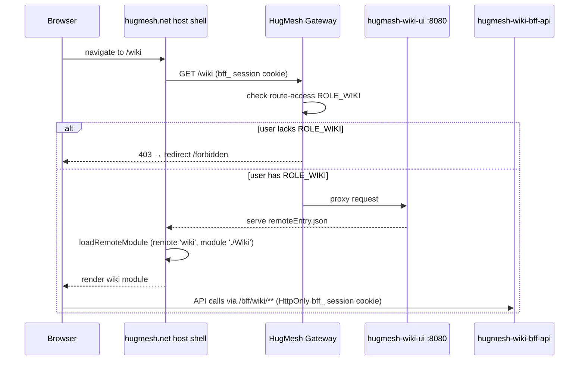
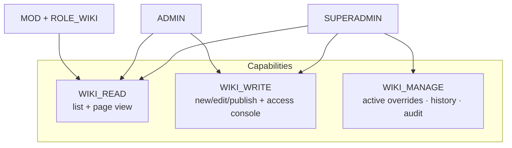

The **wiki management UI** for the [HugMesh](https://github.com/hugmesh)
platform. A wiki with no access rules is a rumor with an edit button; this
console supplies the rules. It is an Angular **native-federation remote**. The
`hugmesh.net` host shell mounts it at **`/wiki`** and lists it in its
navigation menu, for users who hold the `wiki` role. It is the front end for
[`hugmesh-wiki-bff-api`](https://github.com/hugmesh/hugmesh-wiki-bff-api). It
covers content authoring and the grant/timeout/ban access-override layer that
keeps wiki content scoped per brand/domain.

## Federation contract

The host shell's federation registry has an entry for the wiki module that
points at this remote. The host reads the entry at startup and loads the
remote when a user enters `/wiki`:

| field | value |
| --- | --- |
| `remote_entry_url` | `http://hugmesh-wiki-ui:8080/remoteEntry.json` |
| `metadata.mountAt` | `/wiki` |
| `metadata.requiresRole` | `wiki` |
| `kind` | `remote-shell` |
| `visibility` | `internal` |

This remote therefore:

- exposes the module key **`./Wiki`** in `federation.config.js`, which maps to
  `src/app/wiki.routes.ts` (`WIKI_ROUTES`). The host shell route
  (`{ path: 'wiki', remoteName: 'wiki', exposed: './Wiki', routesConst: 'WIKI_ROUTES' }`
  in its `app.routes.ts`) loads this key through `loadRemoteModule`.
- is served on **port 8080** (see `Dockerfile` and `nginx.conf`, built on
  `nginxinc/nginx-unprivileged`), so the emitted `remoteEntry.json` is
  reachable at the URL in the registry.
- is **internal**. It sits behind the gateway's `/wiki/**` → `ROLE_WIKI`
  route-access row and is never a public surface.

`federation-base.js` is **byte-identical** to the `hugmesh.net` host shell's
copy. It is the single source of truth for the shared-dependency surface and
the RxJS skip list. Keeping it identical stops this remote from drifting away
from the host and from the other HugMesh remotes.



## Role model

The UI role checks mirror what `WikiController` in `hugmesh-wiki-bff-api`
enforces. UI gating is defence in depth, for the user's convenience. The BFF's
`@PreAuthorize` annotations and `WikiAccessGuard` decide. Every unauthorised
API call returns a 403, and the UI shows it without breaking.

The host shell has its own `wikiGuard` (`src/app/guards/wiki.guard.ts` in
`hugmesh-host-shell`). It admits ADMIN, SUPERADMIN, or MOD with `WIKI`, and
sends everyone else to `/login`. The gateway's route-access rows are
`/bff/wiki/**` → `ROLE_WIKI`, `/bff/wiki/admin/**` → `ROLE_ADMIN` and
`/bff/wiki/superadmin/**` → `ROLE_SUPERADMIN`.

The three capabilities and the role expressions that grant them:

| capability | composite | views |
| --- | --- | --- |
| `WIKI_READ` | `ADMIN \| SUPERADMIN \| (MOD AND WIKI)` | Content (list + page view) |
| `WIKI_WRITE` | `ADMIN \| SUPERADMIN` | New/Edit page + publish, Access console |
| `WIKI_MANAGE` | `SUPERADMIN` | Manage: active overrides, history, audit |

In practice:

- A **MOD who also holds `ROLE_WIKI`** can read content. They cannot author or
  manage it.
- An **ADMIN** can read and author content (create, edit, publish pages) and
  run the access console (grant, timeout, ban).
- A **SUPERADMIN** also has the manage/history/audit view.
- A user with none of these wiki capabilities goes to the in-remote
  `/wiki/forbidden` screen.



The UI gating lives in three places:

- `src/app/session.service.ts` — exposes `canRead`, `canWrite`, and `canManage`
  as computed signals, derived from the Casdoor roles in `hug.session`.
- `src/app/wiki.guard.ts` — `wikiReadGuard`, `wikiWriteGuard`, and
  `wikiManageGuard`. `src/app/wiki.routes.ts` applies them per route, so the
  router blocks navigation.
- `src/app/wiki-console.component.ts` — the role-aware menubar shows a nav item
  only when the session holds the matching capability.

### Access console: the cross-brand target (SUPERADMIN)

Every `wiki_access` override row carries a brand. The read-side
`WikiAccessGuard` honours only a row stamped with the victim's brand. The BFF
picks that brand differently per role, and the console follows it exactly:

- An **ADMIN** is scoped. The BFF derives their brand server-side from the
  validated JWT issuer and **ignores** any `targetDomain` in the body. They
  cannot write outside their own brand, so the console does not show the field.
- A **SUPERADMIN** is cross-domain and has no brand of their own to stamp. On a
  **multi-brand (multi-issuer)** deployment the BFF **requires** a known
  `targetDomain` and **fails closed with a 400** without one. A stamp of
  `default` would land the row where the guard never looks, and the grant or
  ban would silently do nothing. With **exactly one** configured issuer pair
  the BFF stamps that brand, and a `targetDomain` naming any other brand is a
  400. With no `app.tenancy.issuers` configured, every principal is `default`
  and the field is ignored (`WikiAccessService#writeDomain`). The console shows
  a **Target brand** control to a SUPERADMIN for this reason: without it,
  grant/timeout/ban is unusable on a multi-brand cluster. What the BFF's brand
  catalogue says decides which control appears, or whether one appears at all.
  See below.

The console sends the field only when it is filled. Left blank, the request
body is unchanged. That is correct where no issuers are configured, because
every principal is `default` and the BFF ignores the field. The BFF checks the
brand against its trusted `DomainRegistry`. An unknown value returns a 400, and
the console shows its message verbatim (it names the field to fix). The applied
result echoes the brand the row landed in, so a cross-brand write can be
confirmed instead of assumed.

**The field is a real picker.** The BFF serves the list it validates against:
`GET /bff/wiki/superadmin/brands` (hugmesh-wiki-bff-api#12) returns
`DomainRegistry.knownDomains()`, filtered through the same predicate
`WikiAccessService.writeDomain` applies to a submitted brand. Every option is
therefore one the server accepts **by construction**. One rule sits behind
everything below: **never offer a brand the server will not honour.** A picker
whose choice is silently discarded is worse than no picker. The operator
believes they targeted brand X, and the row lands somewhere else.

What the catalogue says decides which of five modes the control takes
(`WikiAccessComponent`'s `BrandMode`):

| catalogue | control | why |
| --- | --- | --- |
| still loading | a **disabled** `<select>`, with the same label the picker gets, plus an announced "Loading the brands this server accepts…" | **operator decision 33b**, so the form stops changing shape under the operator. Disabled rather than typeable, so the original hazard (a free-text box that turns into a closed select under a half-typed value) stays avoided. **Bounded** — see below |
| `targetDomainHonoured: true`, `brands` non-empty | a closed `<select>` over `brands` | the list is the server's own and complete |
| `targetDomainHonoured: true`, `brands` empty | the same `<select>`, holding only its placeholder, plus a line saying no change can be applied here | reachable: two issuers both mapped to `default` are two entries but zero offerable brands. The server would reject every brand there, so submit stays blocked. An empty control that never submits, with no explanation, would be worse |
| `targetDomainHonoured: false`, `brands` empty | none, one line of explanation | no issuers configured: every principal is `default`, so a SUPERADMIN write stamped `default` is *correct* and there is nothing to choose |
| `targetDomainHonoured: false`, `brands` non-empty | none, a **warning** naming the brand | the old hazard below. **Unreachable against `hugmesh-wiki-bff-api` main today**; the mode stays in the UI code (`BrandMode` `inert-mismatch`) as a guard |
| the read failed **or did not answer in time** | the previous combobox over observed brands | losing the control would leave a SUPERADMIN unable to act |

**"Loading" renders a DISABLED control — operator decision 33b, 2026-09-17**
(hugmesh-generator#347), taken *against* the recommendation. The first version
rendered no control at all. The operator overruled that, because a field that
appears at an unpredictable moment pushes the rest of the form down. The
loading control is the same label and `<select>` the `picker` mode draws,
disabled and `aria-busy`. It is filled in place, not created.

This choice has four costs. Each is recorded, and each is pinned by a spec:

1. A disabled control is **not focusable**. Keyboard and screen-reader
   traversal skip it. So the loading state has to be *announced*
   (`role="status"` + `aria-live="polite"` on the help text, tied to the
   control by `aria-describedby`), not just drawn.
2. It steadies the shape only on the path that ends in `picker`. On the degrade
   path below, the control still changes **type**, from a `<select>` to a
   typeable `<input list>`.
3. Where no issuers are configured, the read resolves to the inert shape,
   which has no control. The disabled select **disappears** instead of filling
   in.
4. **It gets only two thirds of the way.** It stops the *control* moving, not
   the field. Measured in the real component with the real stylesheet at 640px:
   the `<select>` is 37.00px before and after, but the surrounding
   `.wiki-field` still grows 110.97px → 143.97px, **+33.00px**. The declined
   render-nothing shape grew +99.19px. All 33px is the help paragraph growing
   from one line to the picker's multi-sentence help, which carries the brand
   count and the default hint. It **cannot simply be pre-sized**: that help has
   variable height by design (49.00 / 48.00 / 32.00px for three honest
   catalogues, a 17px spread), so a fixed placeholder would have to know the
   catalogue this mode is still waiting for. Closing the gap needs a visual
   decision nobody has made: reserve a fixed help height, or move the count and
   default hint out of the help paragraph. The spec that pins the numbers
   prints them, so you can re-derive them from a test run.

**"Loading" is bounded, on purpose.** The mode renders a control nobody can
use, and the read it waits on decides whether the operator can act at all. So
it cannot wait forever. A read that has not answered within
`WikiAccessComponent#catalogueDeadlineMs` (8s) degrades to the observed
combobox, exactly as a *rejected* read does. A catalogue that answers after the
deadline is ignored, not swapped in under a half-typed value. The component
fires the read from an **effect** on `session.canManage`, not from a snapshot
in `ngOnInit`. The session can gain SUPERADMIN after the component starts: the
host shell and each remote hold their own `SessionService` over one
`localStorage` key and re-read on a broadcast or a cross-tab `storage` event.
A one-shot guard left that operator looking at "Loading…" forever.

The picker is **preselected to the domain the wiki is launched on**
(`launchDomain`, the same derivation the BFF's 007 re-stamp target uses, with
`hugmesh` as the fallback), but only when that value is one of the offered
brands. On a 2+-brand deployment there is no single launch domain and the BFF
reports its fallback. Preselecting that blindly would preselect a guaranteed
400. An operator's own pick always outranks the default. When the picker is
live it is also **required**, so the console catches the BFF's fail-closed 400
before the round trip.

**Operator decision 33, 2026-09-17** (hugmesh-generator#347). The implementer
chose three of the behaviours above, not the "yes" that approved the picker, so
they went to the operator: **(33a) required, blocking submit inline** —
ratified as built; **(33b) what renders while the catalogue read is in
flight** — *overruled*, now a disabled control (above); **(33c) the 8-second
degrade deadline** — ratified as built. Specs that name the decision pin 33a
and 33c, so they cannot drift off the answer silently.

**The warning case was a real defect on the server, and the server has fixed
it.** The BFF used to read `targetDomain` only when
`DomainRegistry.isMultiIssuer()`, which means *two or more* configured issuer
pairs. With **exactly one** (`app.tenancy.issuers=https://id=hugmesh`) its
users resolved `hugmesh` while a SUPERADMIN's grant or ban was stamped
`default`. `WikiAccessGuard` reads back `activeFor(subject, "hugmesh")`, so it
never matched, and the ban silently did nothing. That was
**hugmesh-wiki-bff-api#21**. The operator **answered it on 2026-09-16** —
*"Fix: stamp the configured brand. Exactly one configured issuer pair counts as
a real brand; SUPERADMIN writes stamp it; a mismatched targetDomain becomes a
400 instead of a silent no-op."* The issue is closed. On BFF main,
`WikiBrandCatalog` reports `targetDomainHonoured` as `isMultiIssuer() ||
soleConfiguredBrand() != null`. At exactly one pair the catalogue is honoured,
and the console draws the live picker with no code change. The `inert-mismatch`
mode and its warning are therefore unreachable against current BFF main; the
code is still in `WikiAccessComponent`. Against an older BFF the console still
refuses to render a control there and says why. `WikiAccessComponent#submit`
sends no `targetDomain` in either inert mode. A body carrying a brand the
server discards would make an audit log read as a targeted write.

**The fallback keeps the old behaviour.** If the catalogue read is denied or
fails, the field degrades to what it was before that endpoint existed: a
datalist combobox whose suggestions come from observation. The console already
makes two SUPERADMIN cross-domain reads, `GET /bff/wiki/superadmin/access` and
`GET /bff/wiki/superadmin/audit`. Each row carries a server-stamped `domain`,
and `WikiService#observedBrands` unions them. That union is a **subset** of the
registry: a brand with neither an override nor a recent edit is invisible to
it. So the input stays typeable there, and the BFF's 400 remains the authority.
The union is also **filtered**. Rows can legitimately carry the BFF's `default`
back-compat sentinel (its `WikiAuditLogRepository#record` stamps a SUPERADMIN's
own null scope as `default`, so every page a SUPERADMIN creates writes one;
update, publish and delete stamp the brand the page lives in) or the
fail-closed `__deny__` scope. `DomainRegistry#isKnownDomain` rejects both, so a
write targeting either always 400s. Suggesting them would hand the operator a
pick that is guaranteed to fail, from a list meant to prevent exactly that.
`WikiService#DOMAIN_SENTINELS` drops them. A cluster whose only observed brand
is `default` correctly shows *no* suggestions. The same filter runs on the
catalogue's own `brands`. That is defence in depth, not duplication: the server
already filters, but a server regression that started emitting `default` must
not reach the picker. `observedBrands` never rejects (fewer suggestions, never
an error the operator cannot act on). `brandCatalog` **does** reject, because
"the server denied the catalogue" and "the server says there are no brands" are
different facts, and the console renders them differently.

In that fallback the suggestions also **learn from what is applied**.
Observation has a blind spot: a brand cannot be observed until it *has* a row,
so the first write into a brand must be typed. Every applied row comes back
with its **server-stamped** `domain`. For a SUPERADMIN cross-brand write the
BFF reaches the insert only after validating that brand against its registry,
so the returned brand is known-good. `WikiAccessComponent#learnBrand` folds it
into the datalist for the rest of **this visit to the console**. The learning
lives on the component instance and is not persisted, so navigating away and
back re-derives the list. It learns what the server **stamped**, never what was
typed. Where no issuers are configured, the BFF ignores the field and stamps
`default`, and that must not become a suggestion, so the same
`suggestableBrand` filter applies here. A write that FAILS teaches nothing: a
400 is the server saying the brand does not exist. The observation read
**folds** into the options instead of replacing them, because `ngOnInit` does
not await it. A write applied while that read is in flight would otherwise have
its learnt brand clobbered when the read landed. Learning stops once the
catalogue has *answered*, because folding into a complete list could only add
something the server left out on purpose. It does not stop while the read is
still in flight, because refusing then would make the answer depend on
microtask ordering.

## BFF endpoints consumed (`/bff/wiki/**`)

`src/app/wiki.service.ts` is the typed data-access wrapper. Each public method
maps one-to-one onto a `hugmesh-wiki-bff-api` endpoint, over the generated
ng-openapi-gen clients (see **Typed API client** below). Auth rides on the
**HttpOnly `bff_` session cookie**. The UI reads no bearer token from
`hug.session` (see **Session** below).

- `GET  /bff/wiki/pages` → `WikiDto.PageList` (list)
- `GET  /bff/wiki/pages/{slug}` → `WikiDto.Page` (markdown + rendered HTML)
- `POST /bff/wiki/admin/pages` → create page (`WikiDto.CreatePage`; 409 on duplicate slug)
- `PUT  /bff/wiki/admin/pages/{slug}` → update page (`WikiDto.UpdatePage` with
  `expectedVersion` for optimistic-lock; 409 on stale edit)
- `POST /bff/wiki/admin/pages/{slug}/publish` → publish
- `DELETE /bff/wiki/admin/pages/{slug}` → delete page (204; cascades to the
  page's attachments and is audited server-side; WIKI_WRITE). On BFF main the
  `204` means exactly one page row was removed. The BFF deletes the row it
  resolved, by id, and answers 404 when none was removed
  (hugmesh-wiki-bff-api issue #15, closed; `WikiService#delete`). Older BFF
  builds answered `204` even when the DELETE matched no row. So **both**
  delete surfaces still confirm the removal with a re-read instead of trusting
  the status: the content list re-reads `GET /bff/wiki/pages`, the page view
  re-reads `GET /bff/wiki/pages/{slug}`.
- `GET  /bff/wiki/pages/{slug}/attachments` → `AttachmentList` (list, read tier)
- `GET  /bff/wiki/pages/{slug}/attachments/{filename}` → download the raw bytes (read tier)
- `POST /bff/wiki/admin/pages/{slug}/attachments` → upload (multipart `file` part; WIKI_WRITE)
- `DELETE /bff/wiki/admin/pages/{slug}/attachments/{filename}` → delete (WIKI_WRITE)
- `POST /bff/wiki/admin/access/grant` · `/timeout` · `/ban` → the overlay
- `DELETE /bff/wiki/admin/access/{read|banned}/{userSubject}` → revoke/restore
- `GET  /bff/wiki/superadmin/access` → all active overrides
- `GET  /bff/wiki/superadmin/access/{userSubject}/history` → full history
- `GET  /bff/wiki/superadmin/audit[?limit=N]` → content audit trail (newest
  first; `limit` bounded to `[1, 1000]`, default 200)
- `GET  /bff/wiki/superadmin/brands` → the target-brand catalogue: the brands the BFF
  accepts as a `targetDomain`, the domain this wiki is launched on, and whether it reads
  `targetDomain` at all (see **the cross-brand target** above)

Every `/bff/*` call goes out with credentials (`withCredentials: true`, set by
`auth.interceptor.ts`). The gateway's `BffCookieToBearerWebFilter` mints the
Bearer server-side (see **Session** below). The browser never holds one.

## Session

The `SnapSession` (identity, roles, registration state — no bearer token) lives
in **browser `localStorage`** under the key **`hug.session`**
(`src/app/session.service.ts`). The host shell and each federated remote hold
their own `SessionService` instance over that key. Two signals keep them in
sync:

- a **same-document** custom `window` event (`hug-session-change`, dispatched
  by whichever instance wrote), so host and remotes re-read in one tab;
- the cross-tab `storage` event on the `hug.session` key.

> **Security note:** `SnapSession` holds no bearer token on purpose.
> `bffToken` and the per-service access tokens (Matrix, Mastodon) are not part
> of the session descriptor. `/bff/*` calls authenticate with the **HttpOnly
> `bff_` cookie**, and the gateway swaps that cookie for the internal custody
> JWT server-side. `localStorage` holds only a non-secret session descriptor,
> used for UI role gating. The server-side route gates and the BFF's
> `@PreAuthorize` annotations make the real checks.

## Markdown rendering & sanitization

Wiki content is Markdown with a server-rendered HTML twin. The UI sanitizes it
again at the browser boundary with [DOMPurify](https://github.com/cure53/DOMPurify)
(`dompurify` is a runtime dependency). Both helpers live in `src/app/markdown.ts`:

- **Page view** (`wiki-page-view.component.ts`) binds the wiki-bff's
  `contentHtml` only after `sanitizeContentHtml()` has cleaned it again. A
  compromised or stale server payload still cannot inject script at the client.
- **Editor live-preview** (`wiki-editor.component.ts`) renders a safe Markdown
  subset (headings / bold / italic / code / links / lists / blockquote) with
  `renderMarkdown()`. DOMPurify sanitizes that output too.

## Serving & security headers

The production image serves the built SPA and the emitted `remoteEntry.json`
from `nginxinc/nginx-unprivileged` on **port 8080** (`Dockerfile` +
`nginx.conf`). `nginx.conf` sends a baseline set of **defence-in-depth HTTP
security headers** (with `always`, so they also cover errors and the `/healthz`
endpoint). The two theme-stylesheet locations (`/hug-theme.css`,
`/snap-theme.css`) re-declare the first three and leave out
`Strict-Transport-Security`:

- `X-Content-Type-Options: nosniff` — stop MIME-type sniffing;
- `X-Frame-Options: DENY` — clickjacking protection. The SPA is never framed;
  native-federation loads remotes via `<script>`, not iframes, so this is safe;
- `Referrer-Policy: strict-origin-when-cross-origin` — do not leak full URLs
  cross-origin;
- `Strict-Transport-Security: max-age=31536000; includeSubDomains` — pin HTTPS.

The `location /` and `/healthz` blocks declare these again next to the
federation `Access-Control-Allow-Origin: *` header, because nginx drops
server-scope `add_header` directives in any location that declares its own.
A nonce-based **Content-Security-Policy** ships in `nginx.conf`. The
`map $request_id $cspnonce` block mints one nonce per request, a `sub_filter`
stamps it onto every `<script`, and the header repeats it:
`script-src 'self' 'nonce-$cspnonce' blob:`, with `object-src 'none'` and
`frame-ancestors 'none'`. The nonce is per request, not static, because the
gateway's fallback CSP blanks the SPA otherwise.

COEP/CORP and Permissions-Policy stay deferred. They need per-UI tuning
(federation remotes, BFF `connect-src`) and a check against a real deployment
before they are safe to turn on.

## Runtime configuration

Every knob below is **optional**, and every default is what a plain
`docker run` of this image already gets. Nothing is required, and no startup
validation can fail. [`.env.example`](.env.example) lists the same knobs in
copy-paste form.

### Browser globals (host-injected)

The SPA is a static build served by nginx, so it has **no process
environment**. A browser-side knob can arrive only as a global set on
`globalThis` *before* the federation bootstrap reads it.

| global | type | default | meaning |
| --- | --- | --- | --- |
| `__HUG_WIKI_URL__` | `string` | `''` (same origin) | Base URL of the wiki BFF, behind the `WIKI_BASE_URL` injection token |

That is the whole list: **one** global. `src/` declares no other
`__HUG_*__`/`__SNAP_*__` and reads no `process.env`/`import.meta.env`.

`WIKI_BASE_URL` (`src/app/wiki.service.ts`) defaults to the empty string,
because the fe-gateway proxies same-origin `/bff/wiki/**` to
`hugmesh-wiki-bff-api`. The service constructor pushes the resolved value into
the `rootUrl` of all three generated clients, so an override applies to
content, access and attachments alike. Set it only to point this remote at a
BFF on another origin, which the CSP already allows (`connect-src 'self' blob:
https:`, see **Serving & security headers**). The name mirrors the other
remotes' globals (`__HUG_BFF_URL__`, `__HUG_FORUM_URL__`, `__HUG_TUBE_URL__`,
`__HUG_OWNCAST_URL__`, …).

**Nothing injects it today.** `hugmesh-host-shell` assigns no `__HUG_*__`
global anywhere under its `src/`, and this image ships no config-injection
entrypoint hook. login-ui's `docker-entrypoint.d/40-snap-config.sh` writes a
`snap-config.js` that its `index.html` loads before bootstrap; wiki-ui has no
equivalent (see **Known gaps / TODO**). The override is *available and unset*,
so every current deployment takes the same-origin default. To use it, the host
page must set the global before it loads this remote:

```html
<script>globalThis.__HUG_WIKI_URL__ = 'https://wiki-bff.example.test';</script>
```

### Container environment

`docker-entrypoint.d/` reads these once at container start, before nginx
forks. A change is an env edit plus a restart, never an image rebuild.

| variable | default | meaning |
| --- | --- | --- |
| `HUG_THEME_CSS` | unset | Theme token text, written verbatim to the served stylesheet |
| `HUG_THEME_OUT` | `/tmp/hug-theme.css` (set in the `Dockerfile`) | Where the hook writes it |
| `SNAP_THEME_CSS` | unset | Legacy spelling of `HUG_THEME_CSS`, read only when that is unset |
| `SNAP_THEME_OUT` | unset | Legacy spelling of `HUG_THEME_OUT`, same precedence |

`docker-entrypoint.d/50-hug-theme.sh` writes `$HUG_THEME_CSS` **verbatim**. It
does no colour maths in shell, on purpose: `hugmesh-generator` already derives
the token text in one place (`studio/hugmesh_studio/core/theme.py`), and a
second implementation would drift. Unset means an empty stylesheet. The `<link>`
in `src/index.html` then resolves as a zero-byte 200, and the compiled `:root`
literals render the shipped brand byte for byte. The hook writes the same bytes
under both `hug-theme.css` and the legacy `snap-theme.css`. `nginx.conf` serves
both from `/tmp` through exact-match aliases, so the SPA catch-all can never
shadow them.

The `SNAP_*` spellings stay only until the fleet-wide `SNAP_* → HUG_*` rename
finishes. That contract crosses a process boundary: something outside the image
sets the env, and this container reads it. So the two halves cannot flip in one
commit. Prefer the `HUG_` names; the new name wins when both are set.

`HUG_THEME_OUT` is set in the `Dockerfile` and is not really an operator knob.
`nginx.conf` aliases `/hug-theme.css` and `/snap-theme.css` to those literal
`/tmp/…` paths. Repoint the hook and nginx serves nothing from the old
location, so the page goes unthemed with no error. The variable exists because
`/tmp`, not the docroot, is the one writable path for uid 101 on the
unprivileged nginx image.

### Build, test and tooling

For developers and CI only. None of these reach a deployed container.

| variable | default | meaning |
| --- | --- | --- |
| `WIKI_BFF_SPEC` | `../hugmesh-wiki-bff-api/src/main/resources/openapi/openapi.json` | Spec `npm run gen:spec` copies to `openapi.json` before regenerating `src/app/api/` |
| `CHROME_BIN` | resolved by `karma-chrome-launcher` | Headless browser for `npm test` |
| `DAST_TARGET_URL` | unset | `make pentest` DAST baseline target; unset skips DAST cleanly |
| `GENERATOR_DIR` | `../hugmesh-generator` | Where `make pentest` looks for the shared DAST harness |
| `E2E_BASE_URL` | `https://host.docker.internal:8443` | Origin the Playwright/BDD harness drives |
| `E2E_PASSWORD` | — | Shared seed-user password override |
| `E2E_*_PASSWORD` | — | Per-role seed-user overrides |
| `E2E_CREDENTIALS_FILE` | nearest `.e2e-credentials` walking up from cwd | Run-state credentials file `make stack-seed` (hugmesh-generator) writes |

The per-role e2e overrides are `E2E_SUPERADMIN_PASSWORD`,
`E2E_ADMIN_A_PASSWORD`, `E2E_ADMIN_B_PASSWORD`, `E2E_MOD_WIKI_PASSWORD`,
`E2E_MOD_PASSWORD`, `E2E_USER_PASSWORD` and `E2E_READER_B_PASSWORD` (see
`e2e/tests/helpers/roles.ts` and [`e2e/README.md`](e2e/README.md)). They are
credentials. Export them in the shell or the CI secret store, never in a
committed file. None is required. `passwordFor()` tries the per-role override,
then `E2E_PASSWORD`, then the run-state `.e2e-credentials` file that
hugmesh-generator's `make stack-seed` generates. If nothing resolves, it throws
and names that target. There is no built-in literal password. GitLab's own
`CI_*` variables, and the `HOST_UID`/`HOST_GID` the `test` job computes from
`id -u`/`id -g`, come from the pipeline and are not knobs.

## Typed API client (ng-openapi-gen)

`ng-openapi-gen.json` and the generated client under **`src/app/api/`** are
**committed**: 12 models + 3 services (`WikiService` content,
`WikiAccessService`, `WikiAttachmentsService`). The input spec (`openapi.json`)
is the wiki-bff's own committed `src/main/resources/openapi/openapi.json`,
copied in by `gen:spec`. The build is deterministic and needs **no network and
no running BFF**. Regenerate the typed client:

```sh
npm run gen:spec   # cp ${WIKI_BFF_SPEC:-../hugmesh-wiki-bff-api/.../openapi.json} openapi.json && npm run gen
```

`wiki.service.ts` **delegates fully to the generated clients**. The content
feature (`listPages`/`getPage`/`createPage`/`updatePage`/`publishPage`/`deletePage`/`auditTrail`),
the access overlay (`grant`/`timeout`/`ban`/`revoke`/`listActiveAccess`/`accessHistory`)
and the per-page attachments panel (`listAttachments`/`uploadAttachment`/
`deleteAttachment`/`downloadAttachment`) all use the typed clients over Angular
`HttpClient`. `auth.interceptor.ts` attaches the HttpOnly `bff_` cookie
(`withCredentials`, no bearer — see **Session** above). The public method
signatures and the `WikiApiError` (400/403/404/409) contract stay stable across
regenerations.

`auditTrail()` is typed all the way down. The wiki-bff declares a real
`AuditList`/`AuditEntry` response schema, so the wrapper re-exports the
generated model as `AuditTrail`/`WikiAuditEntry` and does **no** cast. The
manage view's audit table shows a fixed, labelled column set
(`When`/`Actor`/`Action`/`Target`/`Brand`/`Detail`) keyed on
`keyof WikiAuditEntry`, instead of discovering columns from `Object.keys(row)`.
A rename in the bff is now a build failure here, not a silently missing column.
(It used to return `{ actions: Array<Record<string, unknown>> }`, because the
endpoint returned an untyped `Map<String,Object>` that springdoc rendered as an
open object.)

Two fields on the wiki-bff spec are worth knowing:

- an optional `limit` query param on `GET .../superadmin/audit` (bounded to
  `[1, 1000]`, default 200, so the audit read is never an unbounded table
  scan). The manage view shows it as the audit trail's "Rows to load" picker
  (`auditTrail(limit?)`; an omitted limit sends no query param and takes the
  bff's default). The picker validates before it fetches. A value outside
  `[1, 1000]` is clamped to the nearest end, with an inline message. A
  non-integer is refused outright, and no request goes out. Re-picking the
  loaded size does nothing. The bff re-clamps regardless, so this only saves a
  round trip and is never the real bound;
- an optional `targetDomain` field on the `grant`/`ban`/`timeout` request
  bodies, which lets a SUPERADMIN name the victim's brand on a cross-brand
  write. It is wired through to the access console (see **Access console: the
  cross-brand target** above).

Re-running `npm run gen:spec` against the wiki-bff's committed `openapi.json`
regenerates `src/app/api/` deterministically. That command is the only
supported way to update `src/app/api/`. Never hand-edit it; every generated
file carries a `DO NOT EDIT` banner. `npm run verify:spec`
(`scripts/assert-spec-sync.mjs`) compares the committed `openapi.json` with the
BFF's and fails on drift; it never writes the file. The wrapper types in
`wiki.service.ts` are hand-written and are **not** regenerated, so a new bff
field needs a matching hand-written addition there before a component can pass
it.

## Develop

```sh
npm ci
npm start                          # ng serve wiki (standalone dev shell, :4208)
npm test                           # ng test wiki --watch=false --browsers=ChromeHeadlessCI
npm run build                      # production build → dist/wiki/browser (emits remoteEntry.json)
```

Set `CHROME_BIN=/opt/google/chrome/chrome` for headless tests locally. CI runs
the same suite in a `node:24-alpine` + `chromium` container with
`CHROME_BIN=/usr/bin/chromium`.

[`e2e/README.md`](e2e/README.md) covers the Playwright + Gherkin/BDD end-to-end
harness (role-matrix, multi-user, cross-tenant, and accessibility coverage).

## CI

The primary pipeline is **GitLab CI** (`.gitlab-ci.yml`). An in-cluster GitLab
pull-mirrors the GitHub repo, runs the pipeline on every push, and builds and
pushes the image to the cluster's own registry. Images ship with no embedded
keys. Key material is provisioned separately at deploy or first-boot time.

The pipeline has four stages (`stages: [test, e2e, build, pentest]`):

1. **`test`** — holds two jobs. `verify:spec` (`needs: []`) clones the BFF
   repo's `main`, runs `scripts/assert-spec-sync.mjs`, and fails when the
   committed `openapi.json` no longer matches the BFF's. The `test` job runs
   `npm test` (`ng test` in headless Chromium) and **gates the build**
   (`build:image` declares `needs: [test]`). It emits a JUnit report at
   `test-results/results.xml` (through the `karma-junit-reporter` wired in
   `karma.conf.js`) plus `coverage/` artifacts, shown in the GitLab merge
   request widget. The report is generated fresh on each run. `test-results/`
   and `coverage/` are git-ignored and wiped before every run, so a failed job
   can never publish a stale passing report.
2. **`e2e:bdd`** — installs the [`e2e/`](e2e/README.md) Playwright +
   playwright-bdd harness, runs `bddgen` and `playwright test --list`, and so
   proves that every `.feature` file compiles and every scenario is
   discoverable. It sets `allow_failure: true` and `needs: []`, so it does not
   gate the build. Scenarios that need a live stack are tagged `@cluster` and
   filtered out by default, so this job never launches a browser against a real
   deployment. [`e2e/README.md`](e2e/README.md) has the full harness design.
3. **`build`** — `build:image` builds and pushes the container image, tagged
   with the release tag or git SHA plus a moving branch tag.
4. **`pentest`** — a central OWASP pen-test stage, included from
   [`hugmesh-generator`](https://github.com/hugmesh/hugmesh-generator)'s
   shared `pentest-stage.gitlab-ci.yml`. This repo runs `pentest:sca`
   (Dependency-Check SCA) and `pentest:dast` (authenticated ZAP DAST
   baseline). Both are `allow_failure: true`, so a finding shows in the
   security widget without breaking the pipeline. This is CI tooling only. It
   is not a deployed job and has no in-app trigger.

The one GitHub Actions workflow,
[`.github/workflows/release.yml`](.github/workflows/release.yml), builds the
same Dockerfile and publishes it to `ghcr.io/hugmesh/hugmesh-wiki-ui`, for
consumers who pull the public image instead of building from the GitLab
pipeline's internal registry. It first runs the same Karma unit tests as the
GitLab `test` job, then:

- On a push to `main`, it pushes the tags `main` and
  `sha-<first 12 hex of the commit>`.
- On a `v<version>` tag, it pushes `<version>`, `beta` (for beta versions) and
  `sha-<12 hex>`, and creates a GitHub release marked as a prerelease and not
  latest. The tag must equal `v` plus the `version` in `package.json` (and
  `package-lock.json`), and it must point at a commit on `main`. A version tag
  that is already in the registry is never overwritten.
- A manual run (`workflow_dispatch`) on `main` or on a `v*` tag does the same
  as the matching push. Any other branch or tag is refused.
- It never pushes `latest`, and it has no pull-request trigger.

Its jobs run on the self-hosted runner only when the repository variable
`RUNS_ON_PUBLISH` holds a runner label list (for example
`["self-hosted","Linux","X64"]`) and the run is for `main` or a `v*` tag.
Otherwise they run on GitHub's hosted `ubuntu-latest`.

### Versions

The version in `package.json` is the image version. It uses
`MAJOR.MINOR.PATCH-beta.N`; the current version is `0.2.0-beta.1` (built and
tested, not yet proven on a live mesh). To publish a beta, set the new version
in `package.json` and `package-lock.json` (for example
`npm version 0.2.0-beta.2 --no-git-tag-version`), merge that to `main`, then
push an annotated tag `v0.2.0-beta.2` on that commit. A fix during a beta
raises `N`.

## Platform context

**Auth model:** [Casdoor](https://casdoor.org/) is the platform's SSO identity
provider. `login-ui` does a Casdoor OIDC authorization-code (PKCE) redirect,
and `user-bff` does the server-side code→token exchange and holds the
per-session JWT custody and refresh. The browser holds only an opaque
`bff_`-prefixed session cookie, never a Casdoor JWT. The gateway is a Casdoor
OAuth2 resource server. A pre-security exchange filter swaps the `bff_` cookie
for the internal custody JWT, so the gateway's normal JWT validation and role
gating run unchanged. A `gateway_route_access` table drives authorization:
ADMIN/GAME-MASTER bypass within their own domain, and SUPERADMIN works across
domains. The `/wiki = ROLE_WIKI` gate this remote sits behind is one such
route. Shared account/session/MFA/Casdoor-admin infrastructure lives in
[`hugmesh-auth-core`](https://github.com/hugmesh/hugmesh-auth-core), which
`user-bff` and `admin-bff` consume.

**What that means for this repo:** the BFF/gateway auth model above is entirely
server-side (`user-bff`/`admin-bff`/`gateway`/`auth-core`). It does not touch
this Angular remote's source. **Session** above describes how this remote fits
the cookie model: `/bff/*` calls authenticate with the HttpOnly `bff_` cookie,
and no bearer token is ever read from `localStorage`.

**Runtime baseline:** the Java services this UI talks to, including
`hugmesh-wiki-bff-api`, run on the platform's shared Java / Spring Boot /
Spring Cloud baseline, through the shared `hugmesh-parent` and
`hugmesh-commons` artifacts. This Angular remote has no Java dependency on that
baseline. It consumes the wiki-bff over HTTP and follows the shared HugMesh UI
federation and style conventions.

## Roadmap

State key: shipped (on `main`) · in-flight (open branch/PR) · planned (design
only).

- **Shipped — Typed API client (ng-openapi-gen):** the generated client under
  `src/app/api/` is committed (12 models + 3 services). `gen:spec` regenerates
  it from the wiki-bff's committed `openapi.json`; no running BFF is needed.
  `wiki.service.ts` delegates fully to it: content, the access/audit overlay,
  and the per-page attachments panel all use the generated typed clients.
  Public method signatures and the `WikiApiError` contract stay stable. (See
  **Typed API client** above.)
- **Shipped — Per-page attachments (upload/list/download/delete):**
  `hug-wiki-attachments`, embedded below the rendered page body, backed by
  `WikiAttachmentController`/`WikiAttachmentsService`. List and download are at
  the read tier; upload and delete are at `WIKI_WRITE`. Non-writers get the
  platform's disabled-control-plus-helptext convention. (See **BFF endpoints
  consumed** above.)
- **Shipped — Page delete (`DELETE /bff/wiki/admin/pages/{slug}`):**
  `wiki.service.ts#deletePage` plus a `WIKI_WRITE`-gated Delete control on
  **both** the page view and each row of the content list. The action is
  destructive and cascading (the bff removes the page's attachments too), so
  the control has two steps in both places. It arms an inline confirmation that
  names the cascade, and only that confirmation's own button calls the bff.
  There is no browser modal. In the list only one row can be armed at a time,
  and a failed delete leaves the row in place instead of faking it away. The
  list keys its armed and in-flight state on the row **id**, never the slug.
  `slug` is unique only *within* a brand (`UNIQUE(domain, slug)`) and a
  SUPERADMIN's list is cross-brand, so two rows may share a slug, and a slug
  key would arm and drop all of them at once. A confirming **re-read** decides
  the outcome, not the status code. (Older BFF builds answered `204` even when
  their DELETE matched no row. On BFF main a `204` means one row was removed;
  `hugmesh-wiki-bff-api` issue #15, closed.) If the page is still listed
  afterwards, the operator is told so instead of seeing a success.
  **The page view applies the same rule**, and can decide by *identity* instead
  of by slug. It re-reads `GET /bff/wiki/pages/{slug}`, which resolves through
  the *same* server-side lookup the delete used, and compares the row **`id`**:
  - a `404` is a confirmed removal;
  - the same id coming back is a page the DELETE left behind. The console warns,
    names the brand it still lives in, and leaves the page rendered;
  - a *different* id is another brand's page that legally shares the slug, so
    the delete still completed;
  - a re-read that fails at all is reported as **unconfirmed**, not as either
    outcome. It is announced as a warning and never opens with "Deleted". A
    `403` (a permission boundary) is worded differently from a transient
    failure worth retrying.

  The content list applies the same rule to its own unconfirmed ack. Identity
  decides only when **both** rows carry an `id`. Every generated model
  property is optional, so an absent id is a re-read that proves nothing; the
  console reports it as undecidable and does not compare it (`undefined ===
  undefined` would announce a completed delete as a survivor). The survivor
  path also re-reads the embedded attachments panel, so files an older BFF had
  already deleted do not stay listed. Identity is not unconditional. The
  SUPERADMIN resolution is `findFirstBySlugOrderByIdAsc` over DB-generated
  UUIDs, so id order is arbitrary. A same-slug page created in another brand
  with a lower id *between* the load and the confirm would answer the re-read
  and read as a completed delete. The window is narrow, and the console cannot
  close it: the BFF exposes no get-page-by-id. (See **BFF endpoints consumed**
  above.)
- **Shipped — Opaque `bff_` session (no bearer in `localStorage`):**
  `bffToken` and the per-service access tokens are not part of `SnapSession`.
  `/bff/*` calls use the HttpOnly `bff_` cookie, and the gateway swaps it for
  the internal custody JWT. The browser never holds a JWT (see **Session**
  above). This model is rolling out across the other HugMesh front ends.
- **Partly shipped — Casdoor MFA / step-up:** platform-wide MFA enforcement
  (WebAuthn + TOTP + recovery codes, gateway `mfa_required` fail-closed +
  `amr`/`acr` -> `MFA_SATISFIED`, with step-up for sensitive operations) is
  designed at the platform level. The wiki BFF gates `/bff/wiki/admin/**` and
  `/bff/wiki/superadmin/**` with `stepUp(...)` (`SecurityConfig`), which adds
  `MFA_SATISFIED` to the role check only while `app.mfa.enabled=true`; the flag
  is off by default. When the role granted and the stamp is missing, the BFF
  answers 403 with `X-Step-Up-Required: X-Wiki-StepUp` and a body containing
  `requires step-up` (`hugmesh-wiki-bff-api#35`, merged). A role refusal carries
  neither.
  - **Consumer, manage view only:** `src/app/step-up.ts` recognises that refusal
    (the header, or the phrase when a hop drops it; 403 only), and
    `WikiApiError.stepUp` carries it. A refused read in the manage view
    (active overrides, history, audit trail) opens `hug-wiki-step-up`, which
    loads login-ui's federated dialog on demand (`src/app/mfa-step-up.ts`).
    `satisfied` re-reads exactly the refused sections, `dismissed` retries
    nothing, and `unavailable` or a failed load shows the
    `/login/mfa/challenge?returnTo=` link.
  - **Decision 35:** the remote entry is the one exported constant
    `LOGIN_REMOTE_ENTRY` (`/login/remoteEntry.json`), pinned by a spec. It is a
    second copy of the `login` row in hugmesh-host-shell's
    `federation.manifest.prod.json`. A federation-api `federation_modules` row
    outranks that file at runtime, and `ng serve` uses a different `login` URL;
    in either case this remote falls back to the link.
  - **Not covered yet:** the `/bff/wiki/admin/**` calls (page writes, the access
    console) still show their plain error on a step-up refusal. The live round
    trip (the dialog against a mesh with `app.mfa.enabled=true`) and the header
    reaching the browser through the gateway have not been observed. The
    remote's tracking issue is `hugmesh-wiki-ui#4`.

## Known gaps / TODO

- **No config-injection entrypoint hook**: only the host page can set
  `__HUG_WIKI_URL__` (see **Runtime configuration**). This image ships no
  `docker-entrypoint.d/40-snap-config.sh` equivalent to turn an env var into a
  pre-bootstrap global the way login-ui does, and `hugmesh-host-shell` sets no
  `__HUG_*__` global either. The override is documented, available and unset
  everywhere; the same-origin default is what runs. If a deployment ever needs
  the wiki BFF on another origin, the follow-up is to wire the hook or a
  host-side assignment.
- ~~**The brand picker's list is OBSERVED, not authoritative**~~ — **CLOSED.**
  hugmesh-wiki-bff-api#12 landed (`GET /bff/wiki/superadmin/brands`), so the
  control is a closed `<select>` over the server's own `DomainRegistry`, and an
  offered brand is accepted by construction. See **Access console: the
  cross-brand target**. What remains is the *fallback*, and it is deliberate,
  not a gap. When that read is denied, fails or does not answer within the
  deadline, the field degrades to the previous combobox over OBSERVED brands.
  That list is a strict subset (a brand with no access override and no entry in
  the bounded audit page is not suggested), which is why the fallback stays
  typeable and the bff's 400 on an unknown brand remains the real gate there.
  The observed set also drops the never-targetable `default` and `__deny__`
  sentinels, so a cluster whose only observed brand is `default` shows no
  suggestions instead of one that always 400s.
- ~~**A SUPERADMIN change is still stamped `default` at exactly one configured
  issuer pair**~~ — **CLOSED on the BFF.** hugmesh-wiki-bff-api#21 is closed. At
  one pair the BFF stamps the configured brand, and a mismatched `targetDomain`
  is a 400. The console's `inert-mismatch` mode is now unreachable against BFF
  main and stays in the code as a guard. See **Access console: the cross-brand
  target**.
- ~~**A page delete cannot be confirmed from the status code**~~ — **CLOSED on
  the BFF.** hugmesh-wiki-bff-api#15 is closed. The delete removes the resolved
  row by id and answers 404 when it removed nothing. The console keeps its
  confirming re-read in both delete surfaces. One limit remains: the page
  view's re-read resolves a SUPERADMIN's slug with
  `findFirstBySlugOrderByIdAsc`, and the BFF has no get-page-by-id, so the
  console cannot tell two same-slug pages apart in the narrow window described
  under **Roadmap**.
- **No cursor paging on the audit trail**: the manage view's "Rows to load"
  picker covers the bff's whole `[1, 1000]` `?limit` range, but the endpoint
  has no cursor or offset, so 1000 newest-first rows is the deepest this
  console can reach. Paging further back needs a cursor parameter on
  `hugmesh-wiki-bff-api` first.

## Related HugMesh repositories

- [`hugmesh-wiki-bff-api`](https://github.com/hugmesh/hugmesh-wiki-bff-api) — the backend-for-frontend this UI talks to over `/bff/wiki/**`.
- [`hugmesh-auth-core`](https://github.com/hugmesh/hugmesh-auth-core) — shared account/session/MFA/Casdoor-admin infrastructure used by the platform's BFFs.
- [`hugmesh-generator`](https://github.com/hugmesh/hugmesh-generator) — templates and shared CI includes (e.g. the pentest stage this repo's pipeline pulls in).

## Contributing

Issues and pull requests are welcome. Before you open a PR, run:

```sh
npm ci
npm test    # ng test wiki --watch=false --browsers=ChromeHeadlessCI
npm run build
```

Change `src/app/api/` only by regenerating it with `npm run gen:spec`. The
directory is generated, and hand edits are lost on the next regen. For
end-to-end changes, [`e2e/README.md`](e2e/README.md) explains how to add or run
Gherkin scenarios offline (no live cluster needed).

## License

[MIT](LICENSE)
