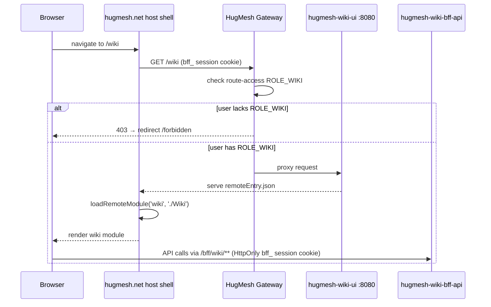
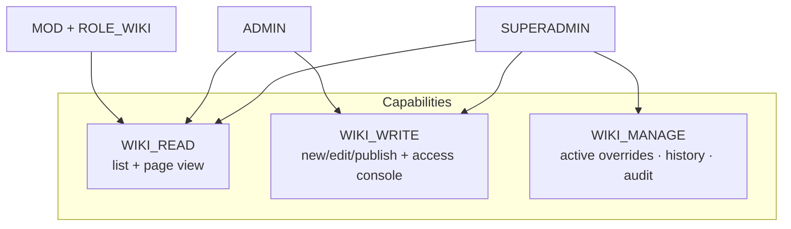

The **wiki management UI** for the [HugMesh](https://github.com/hugmesh)
platform — an Angular **native-federation remote** that the `hugmesh.net`
host shell mounts at **`/wiki`** and exposes via its navigation menu, gated to
users who hold the `wiki` role. It is the front-end console for
[`hugmesh-wiki-bff-api`](https://github.com/hugmesh/hugmesh-wiki-bff-api),
covering content authoring and the grant/timeout/ban access-override layer
that keeps wiki content scoped per brand/domain.

## Federation contract

The host shell's federation registry carries an entry for the wiki module
that points at this remote. When the host shell loads it at startup, it reads:

| field | value |
| --- | --- |
| `remote_entry_url` | `http://hugmesh-wiki-ui:8080/remoteEntry.json` |
| `metadata.mountAt` | `/wiki` |
| `metadata.requiresRole` | `wiki` |
| `kind` | `remote-shell` |
| `visibility` | `internal` |

This remote therefore:

- exposes the module key **`./Wiki`** in `federation.config.js`, which maps to
  `src/app/wiki.routes.ts` (`WIKI_ROUTES`). The host shell consumes this key via
  `loadRemoteModule('wiki', './Wiki')`.
- is served on **port 8080** (see `Dockerfile` and `nginx.conf`, built on
  `nginxinc/nginx-unprivileged`), so the emitted `remoteEntry.json` is
  reachable at the URL recorded in the registry.
- is **internal** — it sits behind the gateway's `/wiki → ROLE_WIKI` route-access
  guard and is never reachable as a public surface.

`federation-base.js` is kept **byte-identical** to the `hugmesh.net` host
shell's copy. This file is the single source of truth for the shared-dependency
surface and the RxJS skip list; keeping it identical prevents this remote from
drifting out of sync with the host or with the other HugMesh remotes.



## Role model

The UI role checks mirror the capabilities enforced by `WikiController` in
`hugmesh-wiki-bff-api`. UI gating is defence-in-depth for user experience
only; the BFF's `@PreAuthorize` annotations and `WikiAccessGuard` are
authoritative. Every unauthorised API call returns a 403 that the UI surfaces
gracefully.

The three capabilities and the role expressions that grant them:

| capability | composite | views |
| --- | --- | --- |
| `WIKI_READ` | `ADMIN \| SUPERADMIN \| (MOD AND WIKI)` | Content (list + page view) |
| `WIKI_WRITE` | `ADMIN \| SUPERADMIN` | New/Edit page + publish, Access console |
| `WIKI_MANAGE` | `SUPERADMIN` | Manage: active overrides, history, audit |

In practice:

- A **MOD who also holds `ROLE_WIKI`** can read content but cannot author or
  manage it.
- An **ADMIN** can read and author content (create, edit, publish pages) and
  operate the access console (grant, timeout, ban).
- A **SUPERADMIN** additionally has the manage/history/audit view.
- A user who holds none of these wiki capabilities is redirected to the
  in-remote `/forbidden` screen.



The UI gating is implemented in three places:

- `src/app/session.service.ts` — exposes `canRead`, `canWrite`, and `canManage`
  as computed signals, derived from the Casdoor roles present in `hug.session`.
- `src/app/wiki.guard.ts` — `wikiReadGuard`, `wikiWriteGuard`, and
  `wikiManageGuard` are applied per-route in `src/app/wiki.routes.ts` to block
  navigation at the router level.
- `src/app/wiki-console.component.ts` — the role-aware menubar renders each nav
  item only when the active session holds the corresponding capability.

### Access console: the cross-brand target (SUPERADMIN)

Every `wiki_access` override row is stamped with a brand, and the read-side
`WikiAccessGuard` only honours a row stamped with the victim's brand. How the
BFF picks that brand differs by role, and the console follows it exactly:

- An **ADMIN** is scoped: the BFF derives their brand server-side from the
  validated JWT issuer and **ignores** any `targetDomain` in the body. They can
  never write outside their own brand, so the console does not show the field.
- A **SUPERADMIN** is cross-domain and has no brand of their own to stamp. On a
  **multi-brand (multi-issuer)** deployment the BFF therefore **requires** a
  known `targetDomain` and **fails closed with a 400** without one — a stamp of
  `default` would otherwise land the row somewhere the guard can never match
  it, producing a grant/ban that silently has no effect. The console shows a
  **Target brand** field to a SUPERADMIN for this reason: without it,
  grant/timeout/ban is unusable for them on a multi-brand cluster.

The field is sent only when filled. Left blank, the request body is unchanged
from before — correct on a single-issuer cluster, where every principal is
`default` and the BFF ignores the field. The brand is validated by the BFF
against its trusted `DomainRegistry`; an unknown value returns a 400 whose
message is surfaced verbatim (it names the field to fix). The applied result
echoes the brand the row actually landed in, so a cross-brand write can be
confirmed rather than assumed.

**The field is a combobox, not free text — and not a `<select>` either.** The
BFF serves no known-brands endpoint, so the console cannot enumerate the
registry. What it *can* do is observe: the two SUPERADMIN cross-domain reads it
already makes (`GET /bff/wiki/superadmin/access` and
`GET /bff/wiki/superadmin/audit`) each carry the row's server-stamped `domain`.
`WikiService#observedBrands` unions those into the datalist behind the field, so
a brand that has any access override or any recent content edit is one click
away instead of one typo away. That union is a **subset** of the registry — a
brand with neither is invisible to it — so the input stays typeable and the
BFF's 400 remains the authority. The union is also **filtered**: rows can
legitimately carry the BFF's `default` back-compat sentinel (its
`WikiAuditLogRepository#record` stamps a SUPERADMIN's own null scope as
`default`, so every page a SUPERADMIN edits — or deletes from the list — writes
one) or the fail-closed `__deny__` scope, and `DomainRegistry#isKnownDomain`
rejects both outright, so a write targeting either always 400s. Suggesting them
would hand the operator a guaranteed-rejected pick from a list whose whole
purpose is the opposite, so `WikiService#DOMAIN_SENTINELS` drops them; a cluster
whose only observed brand is `default` correctly shows *no* suggestions. `observedBrands` deliberately never rejects:
if either read is denied or fails, the operator simply gets fewer suggestions
(or none) rather than an error they cannot act on.

The suggestions also **learn from what is applied**. Observation has an
unavoidable blind spot: a brand cannot be observed until it *has* a row, so the
first write into a brand must always be typed. Every applied row comes back
carrying its **server-stamped** `domain`, and for a SUPERADMIN cross-brand write
the BFF only reaches the insert after validating that brand against its registry
— so the returned brand is known-good, and `WikiAccessComponent#learnBrand`
folds it into the datalist for the rest of **this visit to the console** — the
learning lives on the component instance and is deliberately not persisted, so
navigating away and back re-derives the list from observation alone. It learns
what the server **stamped**, never what was typed: on a single-issuer cluster
the BFF ignores the field and stamps `default`, and that must not become a
suggestion, so the same `suggestableBrand` filter the observed union uses is
applied here too. A write that FAILS teaches nothing — a 400 is precisely the
server saying that brand does not exist. The observation read **folds** into the
options rather than replacing them, because `ngOnInit` does not await it: a write
applied while that read is still in flight would otherwise have its learnt brand
clobbered when the read landed.

An authoritative list still needs the BFF-side endpoint
(hugmesh-wiki-bff-api issue #12); everything above is a subset by construction.

## BFF endpoints consumed (`/bff/wiki/**`)

`src/app/wiki.service.ts` is the typed data-access wrapper. Each public method
maps one-to-one onto a `hugmesh-wiki-bff-api` endpoint, over the generated
ng-openapi-gen clients (see **Typed API client** below). Auth rides the
**HttpOnly `bff_` session cookie** — no bearer token is read from
`hug.session` (see **Session** below).

- `GET  /bff/wiki/pages` → `WikiDto.PageList` (list)
- `GET  /bff/wiki/pages/{slug}` → `WikiDto.Page` (markdown + rendered HTML)
- `POST /bff/wiki/admin/pages` → create page (`WikiDto.CreatePage`; 409 on duplicate slug)
- `PUT  /bff/wiki/admin/pages/{slug}` → update page (`WikiDto.UpdatePage` with
  `expectedVersion` for optimistic-lock; 409 on stale edit)
- `POST /bff/wiki/admin/pages/{slug}/publish` → publish
- `DELETE /bff/wiki/admin/pages/{slug}` → delete page (204; cascades to the
  page's attachments and is audited server-side; WIKI_WRITE). The `204` is
  **unconditional** — the BFF returns it even when the DELETE matched no page
  row — so **both** delete surfaces confirm the removal with a re-read rather
  than trusting the status: the content list re-reads `GET /bff/wiki/pages`, the
  page view re-reads `GET /bff/wiki/pages/{slug}` (tracked upstream as
  hugmesh-wiki-bff-api issue #15).
- `GET  /bff/wiki/pages/{slug}/attachments` → `AttachmentList` (list, read tier)
- `GET  /bff/wiki/pages/{slug}/attachments/{filename}` → download the raw bytes (read tier)
- `POST /bff/wiki/admin/pages/{slug}/attachments` → upload (multipart `file` part; WIKI_WRITE)
- `DELETE /bff/wiki/admin/pages/{slug}/attachments/{filename}` → delete (WIKI_WRITE)
- `POST /bff/wiki/admin/access/grant` · `/timeout` · `/ban` → the overlay
- `DELETE /bff/wiki/admin/access/{read|banned}/{userSubject}` → revoke/restore
- `GET  /bff/wiki/superadmin/access` → all active overrides
- `GET  /bff/wiki/superadmin/access/{userSubject}/history` → full history
- `GET  /bff/wiki/superadmin/audit[?limit=N]` → content audit trail (newest
  first; `limit` bounded to `[1, 1000]`, default 200)

Every `/bff/*` call is sent with credentials (`withCredentials: true`, set by
`auth.interceptor.ts`) and the gateway's `BffCookieToBearerWebFilter` mints the
Bearer server-side (see **Session** below) — the browser itself never holds
one.

## Session

The `SnapSession` (identity, roles, registration state — no bearer token) is
read from **browser `localStorage`** under the key **`hug.session`**
(`src/app/session.service.ts`). The host shell and each federated remote hold
their own `SessionService` instance over the same key, kept in sync two ways:

- a **same-document** custom `window` event (`snap-session-change`,
  dispatched by whichever instance wrote) so host + remotes re-read in one tab;
- the cross-tab `storage` event on the `hug.session` key.

> **Security note:** `SnapSession` intentionally holds no bearer token —
> `bffToken` and the per-service access tokens (Matrix, Mastodon) are not part
> of the session descriptor. `/bff/*` calls authenticate via the **HttpOnly
> `bff_` cookie**, and the gateway exchanges that cookie for the internal
> custody JWT server-side. What lives in `localStorage` is a non-secret
> session descriptor used only for UI role gating; the authoritative checks
> are the server-side route gates and the BFF's `@PreAuthorize` annotations.

## Markdown rendering & sanitization

Wiki content is Markdown with a server-rendered HTML twin, and the UI applies
**defence-in-depth sanitization at the browser boundary** via
[DOMPurify](https://github.com/cure53/DOMPurify) (`dompurify` is a runtime
dependency). Both helpers live in `src/app/markdown.ts`:

- **Page view** (`wiki-page-view.component.ts`) binds the authoritative
  wiki-bff `contentHtml` only after re-sanitizing it through
  `sanitizeContentHtml()` — so a compromised/stale server payload still can't
  inject script at the client.
- **Editor live-preview** (`wiki-editor.component.ts`) renders a safe Markdown
  subset (headings / bold / italic / code / links / lists / blockquote) via
  `renderMarkdown()`, whose output is also DOMPurify-sanitized.

## Serving & security headers

The production image serves the built SPA + emitted `remoteEntry.json` from
`nginxinc/nginx-unprivileged` on **port 8080** (`Dockerfile` + `nginx.conf`).
`nginx.conf` emits a baseline set of **defence-in-depth HTTP security headers**
on every response (with `always`, so they also cover errors and the `/healthz`
endpoint):

- `X-Content-Type-Options: nosniff` — stop MIME-type sniffing;
- `X-Frame-Options: DENY` — clickjacking protection (the SPA is never framed;
  native-federation loads remotes via `<script>`, not iframes, so this is safe);
- `Referrer-Policy: strict-origin-when-cross-origin` — don't leak full URLs
  cross-origin;
- `Strict-Transport-Security: max-age=31536000; includeSubDomains` — pin HTTPS.

These are re-declared inside the `location /` and `/healthz` blocks alongside
the federation `Access-Control-Allow-Origin: *` header, because nginx drops
server-scope `add_header` directives in any location that declares its own.
A nonce-based **Content-Security-Policy** now ships in `nginx.conf`: the
`map $request_id $cspnonce` block mints one nonce per request, a `sub_filter`
stamps it onto every `<script`, and the header re-declares it —
`script-src 'self' 'nonce-$cspnonce' blob:`, with `object-src 'none'` and
`frame-ancestors 'none'`. It is per-request nonced rather than static because
the gateway's fallback CSP blanks the SPA otherwise.

COEP/CORP and Permissions-Policy are still deliberately deferred — they need
per-UI tuning (federation remotes, BFF `connect-src`) plus validation against a
real deployment before they can be turned on safely.

## Runtime configuration

Every knob below is **optional**, and every default is exactly what a plain
`docker run` of this image already gets — there is no required configuration
and no startup validation to fail. [`.env.example`](.env.example) carries the
same list in copy-paste form.

### Browser globals (host-injected)

The SPA is a static build served by nginx, so it has **no process environment**
of its own: a browser-side knob can only arrive as a global set on
`globalThis` *before* the federation bootstrap reads it.

| global | type | default | meaning |
| --- | --- | --- | --- |
| `__HUG_WIKI_URL__` | `string` | `''` (same origin) | Base URL of the wiki BFF, behind the `WIKI_BASE_URL` injection token |

That is the complete list — **one** global. `src/` declares no other
`__HUG_*__`/`__SNAP_*__` and reads no `process.env`/`import.meta.env`.

`WIKI_BASE_URL` (`src/app/wiki.service.ts`) defaults to the empty string
because the fe-gateway proxies same-origin `/bff/wiki/**` to
`hugmesh-wiki-bff-api`; the service constructor pushes the resolved value into
all three generated clients' `rootUrl`, so an override applies uniformly to
content, access and attachments. Set it only to point this remote at a BFF on
another origin — which the CSP already allows for (`connect-src 'self' blob:
https:`, see **Serving & security headers**). The name mirrors the other
remotes' globals (`__HUG_BFF_URL__`, `__HUG_FORUM_URL__`, `__HUG_TUBE_URL__`,
`__HUG_OWNCAST_URL__`, …).

**Nothing injects it today.** `hugmesh-host-shell` assigns no `__HUG_*__`
global anywhere under its `src/`, and this image ships no config-injection
entrypoint hook — login-ui's `docker-entrypoint.d/40-snap-config.sh` writes a
`snap-config.js` that its `index.html` loads before bootstrap, and wiki-ui has
no equivalent (see **Known gaps / TODO**). The override is therefore
*available and unset*: every current deployment takes the same-origin default.
To use it, the host page must set it before this remote is loaded:

```html
<script>globalThis.__HUG_WIKI_URL__ = 'https://wiki-bff.example.test';</script>
```

### Container environment

Read once at container start by `docker-entrypoint.d/`, before nginx forks, so
a change is an env edit plus a restart — never an image rebuild.

| variable | default | meaning |
| --- | --- | --- |
| `HUG_THEME_CSS` | unset | Theme token text, written verbatim to the served stylesheet |
| `HUG_THEME_OUT` | `/tmp/hug-theme.css` (set in the `Dockerfile`) | Where the hook writes it |
| `SNAP_THEME_CSS` | unset | Legacy spelling of `HUG_THEME_CSS`, read only when that is unset |
| `SNAP_THEME_OUT` | unset | Legacy spelling of `HUG_THEME_OUT`, same precedence |

`docker-entrypoint.d/50-hug-theme.sh` writes `$HUG_THEME_CSS` **verbatim** —
zero colour maths happens in shell, deliberately: the token text is already
derived by the single implementation in `hugmesh-generator`
(`studio/hugmesh_studio/core/theme.py`), and a second implementation would
drift. Unset ⇒ an empty stylesheet: the `<link>` in `src/index.html` resolves
as a zero-byte 200 and the compiled `:root` literals render the shipped brand
byte-identically. The hook writes the same bytes under both `hug-theme.css`
and the legacy `snap-theme.css`, and `nginx.conf` serves both from `/tmp` via
exact-match aliases, so the SPA catch-all can never shadow them.

The `SNAP_*` spellings are accepted only until the fleet-wide `SNAP_* → HUG_*`
rename finishes: that contract crosses a process boundary — something outside
the image sets the env, this container reads it — so the two halves cannot
flip in one commit. Prefer the `HUG_` names; the new name wins when both are
set.

`HUG_THEME_OUT` is set in the `Dockerfile` and is not really an operator knob:
`nginx.conf` aliases `/hug-theme.css` and `/snap-theme.css` to those literal
`/tmp/…` paths, so repointing the hook leaves nginx serving nothing from the
old location — a silently unthemed page. It exists because `/tmp`, not the
docroot, is the one writable path for uid 101 on the unprivileged nginx image.

### Build, test and tooling

Developer/CI only — none of these reach a deployed container.

| variable | default | meaning |
| --- | --- | --- |
| `WIKI_BFF_SPEC` | `../hugmesh-wiki-bff-api/src/main/resources/openapi/openapi.json` | Spec `npm run gen:spec` copies to `openapi.json` before regenerating `src/app/api/` |
| `CHROME_BIN` | resolved by `karma-chrome-launcher` | Headless browser for `npm test` |
| `DAST_TARGET_URL` | unset | `make pentest` DAST baseline target; unset skips DAST cleanly |
| `GENERATOR_DIR` | `../hugmesh-generator` | Where `make pentest` looks for the shared DAST harness |
| `E2E_BASE_URL` | `https://host.docker.internal:8443` | Origin the Playwright/BDD harness drives |
| `E2E_PASSWORD` | — | Shared seed-user password override |
| `E2E_*_PASSWORD` | — | Per-role seed-user overrides |
| `E2E_CREDENTIALS_FILE` | nearest `.e2e-credentials` walking up from cwd | Run-state credentials file `make stack-seed` (hugmesh-generator) writes |

The per-role e2e overrides are `E2E_SUPERADMIN_PASSWORD`,
`E2E_ADMIN_A_PASSWORD`, `E2E_ADMIN_B_PASSWORD`, `E2E_MOD_WIKI_PASSWORD`,
`E2E_MOD_PASSWORD`, `E2E_USER_PASSWORD` and `E2E_READER_B_PASSWORD` (see
`e2e/tests/helpers/roles.ts` and [`e2e/README.md`](e2e/README.md)). They are
credentials: export them in the shell or the CI secret store, never in a
committed file. None of them is required: `passwordFor()` resolves the per-role
override, then `E2E_PASSWORD`, then the run-state `.e2e-credentials` file that
hugmesh-generator's `make stack-seed` generates — and throws, naming that
target, when nothing resolves. There is no built-in literal password. GitLab's
own `CI_*` variables, and the `HOST_UID`/`HOST_GID`
the `test` job computes from `id -u`/`id -g`, are set by the pipeline itself
and are not knobs.

## Typed API client (ng-openapi-gen)

`ng-openapi-gen.json` and the generated client under **`src/app/api/`** are
**committed** to the repository — 9 models + 3 services (`WikiService`
content, `WikiAccessService`, `WikiAttachmentsService`). The input spec
(`openapi.json`) is the wiki-bff's own committed
`src/main/resources/openapi/openapi.json`, copied in by `gen:spec`, so the
build is deterministic and needs **no network and no running BFF**.
Regenerate the typed client:

```sh
npm run gen:spec   # cp ${WIKI_BFF_SPEC:-../hugmesh-wiki-bff-api/.../openapi.json} openapi.json && npm run gen
```

`wiki.service.ts` **fully delegates to the generated clients** — the content
feature (`listPages`/`getPage`/`createPage`/`updatePage`/`publishPage`/`deletePage`/`auditTrail`),
the access overlay (`grant`/`timeout`/`ban`/`revoke`/`listActiveAccess`/`accessHistory`)
and the per-page attachments panel (`listAttachments`/`uploadAttachment`/
`deleteAttachment`/`downloadAttachment`) all ride the generated, typed clients
over Angular `HttpClient`, with the HttpOnly `bff_` cookie attached by
`auth.interceptor.ts` (`withCredentials`, no bearer — see **Session** above).
The public method signatures and the `WikiApiError` (409/403/404) contract
stay stable across regenerations.

`auditTrail()` is typed the whole way down: the wiki-bff declares a real
`AuditList`/`AuditEntry` response schema, so the generated model is
re-exported here as `AuditTrail`/`WikiAuditEntry` and the wrapper does **no**
cast at all. The manage view's audit table therefore renders a fixed, labelled
column set (`When`/`Actor`/`Action`/`Target`/`Brand`/`Detail`) keyed on
`keyof WikiAuditEntry`, instead of discovering columns from
`Object.keys(row)` — a bff-side rename is now a build failure here rather than
a silently missing column. (It previously returned
`{ actions: Array<Record<string, unknown>> }`, because the endpoint returned
an untyped `Map<String,Object>` that springdoc rendered as an open object.)

Two fields worth knowing about on the wiki-bff spec:

- an optional `limit` query param on `GET .../superadmin/audit` (bounded to
  `[1, 1000]`, defaults to 200, so the audit read is never an unbounded table
  scan) — surfaced in the manage view as the audit trail's "Rows to load"
  picker (`auditTrail(limit?)`; an omitted limit sends no query param and so
  takes the bff's own default). The picker validates before it fetches: a
  value outside `[1, 1000]` is clamped to the nearest end with an inline
  message, a non-integer is refused outright (no request at all), and
  re-picking the loaded size is a no-op — the bff re-clamps regardless, so
  this only saves a round-trip, it is never the real bound;
- an optional `targetDomain` field on the `grant`/`ban`/`timeout` request
  bodies, letting a SUPERADMIN name the victim's brand on a cross-brand write
  — wired through to the access console (see **Access console: the
  cross-brand target** above).

Re-running `npm run gen:spec` against the wiki-bff's committed `openapi.json`
regenerates `src/app/api/` deterministically. That command is the only
supported way to update `src/app/api/` — never hand-edit it; every generated
file carries a `DO NOT EDIT` banner. The wrapper types in `wiki.service.ts`
are hand-written and are **not** regenerated, so a new bff field needs a
matching hand-written addition there before a component can pass it.

## Develop

```sh
npm ci
npm start                          # ng serve wiki (standalone dev shell, :4208)
npm test                           # ng test wiki --watch=false --browsers=ChromeHeadlessCI
npm run build                      # production build → dist/wiki/browser (emits remoteEntry.json)
```

`CHROME_BIN=/opt/google/chrome/chrome` for headless tests locally; CI runs the
same suite in a `node:24-alpine` + `chromium` container with
`CHROME_BIN=/usr/bin/chromium`.

See [`e2e/README.md`](e2e/README.md) for the Playwright + Gherkin/BDD
end-to-end harness (role-matrix, multi-user, cross-tenant, and accessibility
coverage).

## CI

The primary pipeline is **GitLab CI** (`.gitlab-ci.yml`): the GitHub repo is
pull-mirrored into an in-cluster GitLab, which runs the pipeline on every push
and builds + pushes the image to the cluster's own registry. Images ship with
no embedded keys — key material is provisioned separately at deploy/first-boot
time.

The pipeline has four stages (`stages: [test, e2e, build, pentest]`):

1. **`test`** — runs `npm test` (`ng test` in headless Chromium) and **gates
   the build** (`build:image` declares `needs: [test]`). It emits a JUnit
   report at `test-results/results.xml` (via the `karma-junit-reporter` wired
   in `karma.conf.js`) plus `coverage/` artifacts, surfaced in the GitLab merge
   request widget. The report is generated fresh on each run — `test-results/`
   and `coverage/` are git-ignored and wiped before every run, so a failed job
   can never publish a stale passing report.
2. **`e2e:bdd`** — installs the [`e2e/`](e2e/README.md) Playwright +
   playwright-bdd harness, runs `bddgen` and `playwright test --list` to prove
   every `.feature` file compiles and every scenario is discoverable.
   `allow_failure: true` and `needs: []` (does not gate the build): scenarios
   that need a live stack are tagged `@cluster` and filtered out by default,
   so this job never launches a browser against a real deployment — see
   [`e2e/README.md`](e2e/README.md) for the full harness design.
3. **`build`** — `build:image` builds and pushes the container image, tagged
   with the release tag / git SHA plus a moving branch tag.
4. **`pentest`** — a centralized OWASP pen-test stage, included from
   [`hugmesh-generator`](https://github.com/hugmesh/hugmesh-generator)'s
   shared `pentest-stage.gitlab-ci.yml`. This repo runs `pentest:sca`
   (Dependency-Check SCA) and `pentest:dast` (authenticated ZAP DAST
   baseline); both are `allow_failure: true` so a finding surfaces in the
   security widget without breaking the pipeline. This is CI-pipeline
   tooling only — it is not a deployed job and has no in-app trigger.

A separate, manually-triggered [`.github/workflows/release.yml`](.github/workflows/release.yml)
(`workflow_dispatch` only) builds this same Dockerfile and publishes it to
`ghcr.io/hugmesh/hugmesh-wiki-ui` for consumers who pull the public image
rather than build from the GitLab pipeline's internal registry.

## Platform context

**Auth model:** [Casdoor](https://casdoor.org/) is the platform's SSO
identity provider. `login-ui` performs a Casdoor OIDC authorization-code
(PKCE) redirect and `user-bff` does the server-side code→token exchange,
holding per-session JWT custody/refresh — the browser holds only an opaque
`bff_`-prefixed session cookie, never a Casdoor JWT. The gateway is a Casdoor
OAuth2 resource server; a pre-security exchange filter swaps the `bff_`
cookie for the internal custody JWT so the gateway's normal JWT validation
and role gating run unchanged. Authorization is data-driven by a
`gateway_route_access` table (ADMIN/GAME-MASTER bypass within their own
domain, SUPERADMIN cross-domain); the `/wiki = ROLE_WIKI` gate this remote
sits behind is one such route. Shared account/session/MFA/Casdoor-admin
infrastructure lives in
[`hugmesh-auth-core`](https://github.com/hugmesh/hugmesh-auth-core),
consumed by `user-bff` and `admin-bff`.

**What that means for this repo:** the BFF/gateway auth model above is
entirely server-side (`user-bff`/`admin-bff`/`gateway`/`auth-core`) and does
not touch this Angular remote's source. This remote's own alignment to the
cookie model is described in **Session** above: `/bff/*` calls authenticate
via the HttpOnly `bff_` cookie, and no bearer token is ever read from
`localStorage`.

**Runtime baseline:** the Java services this UI talks to (including
`hugmesh-wiki-bff-api`) run on the platform's shared Java / Spring Boot /
Spring Cloud baseline via the shared `hugmesh-parent` and `hugmesh-commons`
artifacts. This Angular remote has no Java dependency on that baseline — it
consumes the wiki-bff over HTTP and follows the shared HugMesh UI
federation/style conventions.

## Roadmap

State key: shipped (on `main`) · in-flight (open branch/PR) · planned
(design only).

- **Shipped — Typed API client (ng-openapi-gen):** the generated client
  under `src/app/api/` is committed (9 models + 3 services), regenerated by
  `gen:spec` from the wiki-bff's committed `openapi.json` (no running BFF
  required). `wiki.service.ts` fully delegates to it — content, the
  access/audit overlay, and the per-page attachments panel are all on the
  generated typed clients. Public method signatures and the `WikiApiError`
  contract stay stable. (See **Typed API client** above.)
- **Shipped — Per-page attachments (upload/list/download/delete):**
  `hug-wiki-attachments`, embedded below the rendered page body, backed by
  `WikiAttachmentController`/`WikiAttachmentsService`. List/download at the
  read tier, upload/delete at `WIKI_WRITE`, with the platform's
  disabled+helptext convention for non-writers. (See **BFF endpoints
  consumed** above.)
- **Shipped — Page delete (`DELETE /bff/wiki/admin/pages/{slug}`):**
  `wiki.service.ts#deletePage` plus a `WIKI_WRITE`-gated Delete control on
  **both** the page view and each row of the content list. Destructive and
  cascading (the bff removes the page's attachments too), so the control is
  two-step in both places: it arms an inline confirmation that names the
  cascade, and only that confirmation's own button calls the bff. There is no
  browser modal. In the list only one row can be armed at a time, and a failed
  delete leaves the row in place rather than faking it away. The list's armed
  and in-flight state is keyed on the row **id**, never the slug: `slug` is
  unique only *within* a brand (`UNIQUE(domain, slug)`) and a SUPERADMIN's list
  is cross-brand, so two rows may share a slug and a slug key would arm — and
  drop — all of them at once. The outcome is decided by a confirming **re-read**
  rather than by the status code, because the endpoint answers `204` even when
  its DELETE matched no row; if the page is still listed afterwards the operator
  is told so instead of being shown a success. **The page view applies the same
  rule**, and can decide it by *identity* rather than by the slug: it re-reads
  `GET /bff/wiki/pages/{slug}`, which resolves through the *same* server-side
  lookup the delete itself used, and compares the row **`id`** — so a `404` is a
  confirmed removal; the same id
  coming back is a page the DELETE left behind (announced as a warning naming
  the brand it still lives in, with the page left rendered); a *different* id is
  another brand's page that legally shares the slug, and therefore still a
  completed delete; and a re-read that fails at all is reported as
  **unconfirmed** rather than as either outcome — announced, but styled as a
  warning and never opening with "Deleted", and a `403` (a permission boundary)
  is worded differently from a transient failure worth retrying. The content
  list applies the identical rule to its own unconfirmed ack. Identity only
  decides when **both** rows actually carry an `id`: every generated model
  property is optional, so an absent id is a re-read that proves nothing and is
  reported as undecidable rather than compared (`undefined === undefined` would
  otherwise announce a completed delete as a survivor). Because the BFF runs the
  attachment cascade *before* the page delete, a page that survives has already
  lost its attachments, so that path also re-reads the embedded attachments
  panel instead of leaving destroyed files listed. Identity is the strongest
  signal this endpoint offers, but it is not unconditional: the SUPERADMIN
  resolution is `findFirstBySlugOrderByIdAsc` over DB-generated UUIDs, so id
  order is arbitrary, and a same-slug page created in another brand with a lower
  id *between* the load and the confirm would answer the re-read and read as a
  completed delete. The window is narrow, the console cannot close it (the BFF
  exposes no get-page-by-id), and the fix is upstream — see
  `hugmesh-wiki-bff-api` issue #15 below. (See **BFF endpoints consumed** above.)
- **Shipped — Opaque `bff_` session (no bearer in `localStorage`):**
  `bffToken` and the per-service access tokens are not part of `SnapSession`;
  `/bff/*` calls ride the HttpOnly `bff_` cookie and the gateway exchanges it
  for the internal custody JWT (the browser never holds a JWT — see
  **Session** above). This model is rolling out across the other HugMesh
  front-ends.
- **Planned — Casdoor MFA / step-up:** platform-wide MFA enforcement
  (WebAuthn + TOTP + recovery codes, gateway `mfa_required` fail-closed +
  `amr`/`acr` → `MFA_SATISFIED`, with step-up for sensitive operations) is
  designed at the platform level but does not touch this remote yet. If MFA
  gating reaches the `/wiki` route or its write/manage actions, the
  session/guard model here will need a follow-up. No MFA awareness exists in
  this repo today.

## Known gaps / TODO

- **No config-injection entrypoint hook**: `__HUG_WIKI_URL__` (see **Runtime
  configuration**) can only be set by the host page, because this image ships
  no `docker-entrypoint.d/40-snap-config.sh` equivalent to turn an env var into
  a pre-bootstrap global the way login-ui does — and `hugmesh-host-shell` sets
  no `__HUG_*__` global either. The override is therefore documented,
  available and unset everywhere; the same-origin default is what actually
  runs. Wiring the hook (or a host-side assignment) is the follow-up if a
  deployment ever needs the wiki BFF on another origin.
- **The brand picker's list is OBSERVED, not authoritative**: the target-brand
  control is now a combobox with suggestions (see **Access console: the
  cross-brand target**), but the wiki-bff still exposes no "known brands"
  endpoint, so the suggestions are derived from the brands this console can
  see — a strict subset of the bff's `DomainRegistry`. A brand with no access
  override and no entry in the bounded audit page is therefore not suggested,
  which is exactly why the field stays typeable rather than becoming a closed
  `<select>`, and why the bff's 400 on an unknown brand remains the real gate.
  The observed set is additionally filtered of the never-targetable `default`
  and `__deny__` sentinels (see **Access console: the cross-brand target**), so
  a single-issuer-migrated cluster shows no suggestions rather than one that
  always 400s.
  Closing this needs a brand-list endpoint on `hugmesh-wiki-bff-api` (the
  authoritative set is its server-side `DomainRegistry`, which already has
  `knownDomains()`); it cannot be closed from this repo. Tracked in
  hugmesh-wiki-bff-api issue #12.
- **A page delete cannot be confirmed from the status code**: the bff's
  `DELETE /bff/wiki/admin/pages/{slug}` answers `204` even when it removed no
  page row — its SUPERADMIN path resolves the page cross-brand but scopes the
  DELETE to `default` (`WikiService#delete` → `WikiPageRepository
  #deleteBySlugAndDomain`), and the deleted-row count is discarded. This console
  works around it in BOTH delete surfaces — the list re-reads the page list, the
  page view re-reads the page itself and decides on the row id — and warns when
  the page is still there, but the workaround **cannot recover the page's
  attachments**, which that path deletes unscoped first; it can only stop them
  being listed as though they survived. The real fix is server-side, on
  hugmesh-wiki-bff-api (issue #15).
- **No cursor paging on the audit trail**: the manage view's "Rows to load"
  picker covers the bff's whole `[1, 1000]` `?limit` range, but the endpoint
  offers no cursor/offset, so 1000 newest-first rows is the deepest this
  console can reach. Paging further back needs a cursor parameter on
  `hugmesh-wiki-bff-api` first.

## Related HugMesh repositories

- [`hugmesh-wiki-bff-api`](https://github.com/hugmesh/hugmesh-wiki-bff-api) — the backend-for-frontend this UI talks to over `/bff/wiki/**`.
- [`hugmesh-auth-core`](https://github.com/hugmesh/hugmesh-auth-core) — shared account/session/MFA/Casdoor-admin infrastructure used by the platform's BFFs.
- [`hugmesh-generator`](https://github.com/hugmesh/hugmesh-generator) — templates and shared CI includes (e.g. the pentest stage this repo's pipeline pulls in).

## Contributing

Issues and pull requests are welcome. Before opening a PR:

```sh
npm ci
npm test    # ng test wiki --watch=false --browsers=ChromeHeadlessCI
npm run build
```

Please keep changes to `src/app/api/` limited to regenerating via
`npm run gen:spec` — that directory is generated and hand-edits will be lost
on the next regen. For end-to-end changes, see [`e2e/README.md`](e2e/README.md)
for how to add or run Gherkin scenarios offline (no live cluster required).

## License

[MIT](LICENSE)
