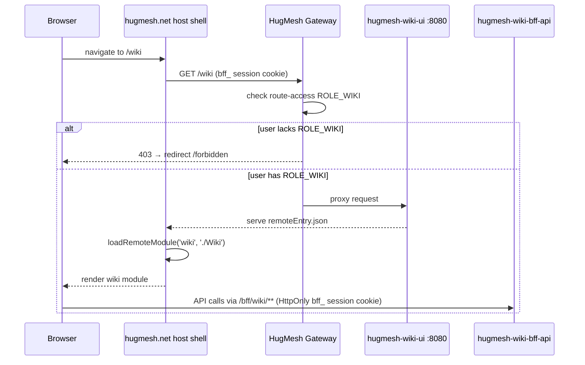
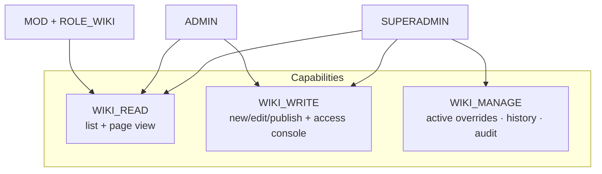

The **wiki management UI** for the [HugMesh](https://github.com/hugmesh-net)
platform — an Angular **native-federation remote** that the `hugmesh.net`
host shell mounts at **`/wiki`** and exposes via its navigation menu, gated to
users who hold the `wiki` role. It is the front-end console for
[`hugmesh-wiki-bff-api`](https://github.com/hugmesh-net/hugmesh-wiki-bff-api),
covering content authoring and the grant/timeout/ban access-override layer
that keeps wiki content scoped per brand/domain.

## Federation contract

The host shell's federation registry carries an entry for the wiki module
that points at this remote. When the host shell loads it at startup, it reads:

| field | value |
| --- | --- |
| `remote_entry_url` | `http://hugmesh-wiki-ui:8080/remoteEntry.json` |
| `metadata.mountAt` | `/wiki` |
| `metadata.requiresRole` | `wiki` |
| `kind` | `remote-shell` |
| `visibility` | `internal` |

This remote therefore:

- exposes the module key **`./Wiki`** in `federation.config.js`, which maps to
  `src/app/wiki.routes.ts` (`WIKI_ROUTES`). The host shell consumes this key via
  `loadRemoteModule('wiki', './Wiki')`.
- is served on **port 8080** (see `Dockerfile` and `nginx.conf`, built on
  `nginxinc/nginx-unprivileged`), so the emitted `remoteEntry.json` is
  reachable at the URL recorded in the registry.
- is **internal** — it sits behind the gateway's `/wiki → ROLE_WIKI` route-access
  guard and is never reachable as a public surface.

`federation-base.js` is kept **byte-identical** to the `hugmesh.net` host
shell's copy. This file is the single source of truth for the shared-dependency
surface and the RxJS skip list; keeping it identical prevents this remote from
drifting out of sync with the host or with the other HugMesh remotes.



## Role model

The UI role checks mirror the capabilities enforced by `WikiController` in
`hugmesh-wiki-bff-api`. UI gating is defence-in-depth for user experience
only; the BFF's `@PreAuthorize` annotations and `WikiAccessGuard` are
authoritative. Every unauthorised API call returns a 403 that the UI surfaces
gracefully.

The three capabilities and the role expressions that grant them:

| capability | composite | views |
| --- | --- | --- |
| `WIKI_READ` | `ADMIN \| SUPERADMIN \| (MOD AND WIKI)` | Content (list + page view) |
| `WIKI_WRITE` | `ADMIN \| SUPERADMIN` | New/Edit page + publish, Access console |
| `WIKI_MANAGE` | `SUPERADMIN` | Manage: active overrides, history, audit |

In practice:

- A **MOD who also holds `ROLE_WIKI`** can read content but cannot author or
  manage it.
- An **ADMIN** can read and author content (create, edit, publish pages) and
  operate the access console (grant, timeout, ban).
- A **SUPERADMIN** additionally has the manage/history/audit view.
- A user who holds none of these wiki capabilities is redirected to the
  in-remote `/forbidden` screen.



The UI gating is implemented in three places:

- `src/app/session.service.ts` — exposes `canRead`, `canWrite`, and `canManage`
  as computed signals, derived from the Casdoor roles present in `hug.session`.
- `src/app/wiki.guard.ts` — `wikiReadGuard`, `wikiWriteGuard`, and
  `wikiManageGuard` are applied per-route in `src/app/wiki.routes.ts` to block
  navigation at the router level.
- `src/app/wiki-console.component.ts` — the role-aware menubar renders each nav
  item only when the active session holds the corresponding capability.

### Access console: the cross-brand target (SUPERADMIN)

Every `wiki_access` override row is stamped with a brand, and the read-side
`WikiAccessGuard` only honours a row stamped with the victim's brand. How the
BFF picks that brand differs by role, and the console follows it exactly:

- An **ADMIN** is scoped: the BFF derives their brand server-side from the
  validated JWT issuer and **ignores** any `targetDomain` in the body. They can
  never write outside their own brand, so the console does not show the field.
- A **SUPERADMIN** is cross-domain and has no brand of their own to stamp. On a
  **multi-brand (multi-issuer)** deployment the BFF therefore **requires** a
  known `targetDomain` and **fails closed with a 400** without one — a stamp of
  `default` would otherwise land the row somewhere the guard can never match
  it, producing a grant/ban that silently has no effect. The console shows a
  **Target brand** field to a SUPERADMIN for this reason: without it,
  grant/timeout/ban is unusable for them on a multi-brand cluster.

The field is sent only when filled. Left blank, the request body is unchanged
from before — correct on a single-issuer cluster, where every principal is
`default` and the BFF ignores the field. The brand is validated by the BFF
against its trusted `DomainRegistry`; an unknown value returns a 400 whose
message is surfaced verbatim (it names the field to fix). The applied result
echoes the brand the row actually landed in, so a cross-brand write can be
confirmed rather than assumed.

## BFF endpoints consumed (`/bff/wiki/**`)

`src/app/wiki.service.ts` is the typed data-access wrapper. Each public method
maps one-to-one onto a `hugmesh-wiki-bff-api` endpoint, over the generated
ng-openapi-gen clients (see **Typed API client** below). Auth rides the
**HttpOnly `bff_` session cookie** — no bearer token is read from
`hug.session` (see **Session** below).

- `GET  /bff/wiki/pages` → `WikiDto.PageList` (list)
- `GET  /bff/wiki/pages/{slug}` → `WikiDto.Page` (markdown + rendered HTML)
- `POST /bff/wiki/admin/pages` → create page (`WikiDto.CreatePage`; 409 on duplicate slug)
- `PUT  /bff/wiki/admin/pages/{slug}` → update page (`WikiDto.UpdatePage` with
  `expectedVersion` for optimistic-lock; 409 on stale edit)
- `POST /bff/wiki/admin/pages/{slug}/publish` → publish
- `GET  /bff/wiki/pages/{slug}/attachments` → `AttachmentList` (list, read tier)
- `GET  /bff/wiki/pages/{slug}/attachments/{filename}` → download the raw bytes (read tier)
- `POST /bff/wiki/admin/pages/{slug}/attachments` → upload (multipart `file` part; WIKI_WRITE)
- `DELETE /bff/wiki/admin/pages/{slug}/attachments/{filename}` → delete (WIKI_WRITE)
- `POST /bff/wiki/admin/access/grant` · `/timeout` · `/ban` → the overlay
- `DELETE /bff/wiki/admin/access/{read|banned}/{userSubject}` → revoke/restore
- `GET  /bff/wiki/superadmin/access` → all active overrides
- `GET  /bff/wiki/superadmin/access/{userSubject}/history` → full history
- `GET  /bff/wiki/superadmin/audit` → content audit trail

Every `/bff/*` call is sent with credentials (`withCredentials: true`, set by
`auth.interceptor.ts`) and the gateway's `BffCookieToBearerWebFilter` mints the
Bearer server-side (see **Session** below) — the browser itself never holds
one.

## Session

The `SnapSession` (identity, roles, registration state — no bearer token) is
read from **browser `localStorage`** under the key **`hug.session`**
(`src/app/session.service.ts`). The host shell and each federated remote hold
their own `SessionService` instance over the same key, kept in sync two ways:

- a **same-document** custom `window` event (`snap-session-change`,
  dispatched by whichever instance wrote) so host + remotes re-read in one tab;
- the cross-tab `storage` event on the `hug.session` key.

> **Security note:** `SnapSession` intentionally holds no bearer token —
> `bffToken` and the per-service access tokens (Matrix, Mastodon) are not part
> of the session descriptor. `/bff/*` calls authenticate via the **HttpOnly
> `bff_` cookie**, and the gateway exchanges that cookie for the internal
> custody JWT server-side. What lives in `localStorage` is a non-secret
> session descriptor used only for UI role gating; the authoritative checks
> are the server-side route gates and the BFF's `@PreAuthorize` annotations.

## Markdown rendering & sanitization

Wiki content is Markdown with a server-rendered HTML twin, and the UI applies
**defence-in-depth sanitization at the browser boundary** via
[DOMPurify](https://github.com/cure53/DOMPurify) (`dompurify` is a runtime
dependency). Both helpers live in `src/app/markdown.ts`:

- **Page view** (`wiki-page-view.component.ts`) binds the authoritative
  wiki-bff `contentHtml` only after re-sanitizing it through
  `sanitizeContentHtml()` — so a compromised/stale server payload still can't
  inject script at the client.
- **Editor live-preview** (`wiki-editor.component.ts`) renders a safe Markdown
  subset (headings / bold / italic / code / links / lists / blockquote) via
  `renderMarkdown()`, whose output is also DOMPurify-sanitized.

## Serving & security headers

The production image serves the built SPA + emitted `remoteEntry.json` from
`nginxinc/nginx-unprivileged` on **port 8080** (`Dockerfile` + `nginx.conf`).
`nginx.conf` emits a baseline set of **defence-in-depth HTTP security headers**
on every response (with `always`, so they also cover errors and the `/healthz`
endpoint):

- `X-Content-Type-Options: nosniff` — stop MIME-type sniffing;
- `X-Frame-Options: DENY` — clickjacking protection (the SPA is never framed;
  native-federation loads remotes via `<script>`, not iframes, so this is safe);
- `Referrer-Policy: strict-origin-when-cross-origin` — don't leak full URLs
  cross-origin;
- `Strict-Transport-Security: max-age=31536000; includeSubDomains` — pin HTTPS.

These are re-declared inside the `location /` and `/healthz` blocks alongside
the federation `Access-Control-Allow-Origin: *` header, because nginx drops
server-scope `add_header` directives in any location that declares its own.
Stricter policies (CSP, COEP/CORP, Permissions-Policy) are deliberately
deferred for now — they need per-UI tuning (federation remotes, BFF
`connect-src`) plus validation against a real deployment before they can be
turned on safely.

## Typed API client (ng-openapi-gen)

`ng-openapi-gen.json` and the generated client under **`src/app/api/`** are
**committed** to the repository — 9 models + 3 services (`WikiService`
content, `WikiAccessService`, `WikiAttachmentsService`). The input spec
(`openapi.json`) is the wiki-bff's own committed
`src/main/resources/openapi/openapi.json`, copied in by `gen:spec`, so the
build is deterministic and needs **no network and no running BFF**.
Regenerate the typed client:

```sh
npm run gen:spec   # cp ${WIKI_BFF_SPEC:-../hugmesh-wiki-bff-api/.../openapi.json} openapi.json && npm run gen
```

`wiki.service.ts` **fully delegates to the generated clients** — the content
feature (`listPages`/`getPage`/`createPage`/`updatePage`/`publishPage`/`auditTrail`),
the access overlay (`grant`/`timeout`/`ban`/`revoke`/`listActiveAccess`/`accessHistory`)
and the per-page attachments panel (`listAttachments`/`uploadAttachment`/
`deleteAttachment`/`downloadAttachment`) all ride the generated, typed clients
over Angular `HttpClient`, with the HttpOnly `bff_` cookie attached by
`auth.interceptor.ts` (`withCredentials`, no bearer — see **Session** above).
The public method signatures and the `WikiApiError` (409/403/404) contract
stay stable across regenerations.

Two fields worth knowing about on the wiki-bff spec:

- an optional `limit` query param on `GET .../superadmin/audit` (bounded to
  `[1, 1000]`, defaults to 200, so the audit read is never an unbounded table
  scan) — not yet surfaced in the UI, see **Known Gaps / TODO**;
- an optional `targetDomain` field on the `grant`/`ban`/`timeout` request
  bodies, letting a SUPERADMIN name the victim's brand on a cross-brand write
  — wired through to the access console (see **Access console: the
  cross-brand target** above).

Re-running `npm run gen:spec` against the wiki-bff's committed `openapi.json`
regenerates `src/app/api/` deterministically. That command is the only
supported way to update `src/app/api/` — never hand-edit it; every generated
file carries a `DO NOT EDIT` banner. The wrapper types in `wiki.service.ts`
are hand-written and are **not** regenerated, so a new bff field needs a
matching hand-written addition there before a component can pass it.

## Develop

```sh
npm ci
npm start                          # ng serve wiki (standalone dev shell, :4208)
npm test                           # ng test wiki --watch=false --browsers=ChromeHeadlessCI
npm run build                      # production build → dist/wiki/browser (emits remoteEntry.json)
```

`CHROME_BIN=/opt/google/chrome/chrome` for headless tests locally; CI runs the
same suite in a `node:24-alpine` + `chromium` container with
`CHROME_BIN=/usr/bin/chromium`.

See [`e2e/README.md`](e2e/README.md) for the Playwright + Gherkin/BDD
end-to-end harness (role-matrix, multi-user, cross-tenant, and accessibility
coverage).

## CI

The primary pipeline is **GitLab CI** (`.gitlab-ci.yml`): the GitHub repo is
pull-mirrored into an in-cluster GitLab, which runs the pipeline on every push
and builds + pushes the image to the cluster's own registry. Images ship with
no embedded keys — key material is provisioned separately at deploy/first-boot
time.

The pipeline has four stages (`stages: [test, e2e, build, pentest]`):

1. **`test`** — runs `npm test` (`ng test` in headless Chromium) and **gates
   the build** (`build:image` declares `needs: [test]`). It emits a JUnit
   report at `test-results/results.xml` (via the `karma-junit-reporter` wired
   in `karma.conf.js`) plus `coverage/` artifacts, surfaced in the GitLab merge
   request widget. The report is generated fresh on each run — `test-results/`
   and `coverage/` are git-ignored and wiped before every run, so a failed job
   can never publish a stale passing report.
2. **`e2e:bdd`** — installs the [`e2e/`](e2e/README.md) Playwright +
   playwright-bdd harness, runs `bddgen` and `playwright test --list` to prove
   every `.feature` file compiles and every scenario is discoverable.
   `allow_failure: true` and `needs: []` (does not gate the build): scenarios
   that need a live stack are tagged `@cluster` and filtered out by default,
   so this job never launches a browser against a real deployment — see
   [`e2e/README.md`](e2e/README.md) for the full harness design.
3. **`build`** — `build:image` builds and pushes the container image, tagged
   with the release tag / git SHA plus a moving branch tag.
4. **`pentest`** — a centralized OWASP pen-test stage, included from
   [`hugmesh-generator`](https://github.com/hugmesh-net/hugmesh-generator)'s
   shared `pentest-stage.gitlab-ci.yml`. This repo runs `pentest:sca`
   (Dependency-Check SCA) and `pentest:dast` (authenticated ZAP DAST
   baseline); both are `allow_failure: true` so a finding surfaces in the
   security widget without breaking the pipeline. This is CI-pipeline
   tooling only — it is not a deployed job and has no in-app trigger.

A separate, manually-triggered [`.github/workflows/release.yml`](.github/workflows/release.yml)
(`workflow_dispatch` only) builds this same Dockerfile and publishes it to
`ghcr.io/hugmesh-net/hugmesh-wiki-ui` for consumers who pull the public image
rather than build from the GitLab pipeline's internal registry.

## Platform context

**Auth model:** [Casdoor](https://casdoor.org/) is the platform's SSO
identity provider. `login-ui` performs a Casdoor OIDC authorization-code
(PKCE) redirect and `user-bff` does the server-side code→token exchange,
holding per-session JWT custody/refresh — the browser holds only an opaque
`bff_`-prefixed session cookie, never a Casdoor JWT. The gateway is a Casdoor
OAuth2 resource server; a pre-security exchange filter swaps the `bff_`
cookie for the internal custody JWT so the gateway's normal JWT validation
and role gating run unchanged. Authorization is data-driven by a
`gateway_route_access` table (ADMIN/GAME-MASTER bypass within their own
domain, SUPERADMIN cross-domain); the `/wiki = ROLE_WIKI` gate this remote
sits behind is one such route. Shared account/session/MFA/Casdoor-admin
infrastructure lives in
[`hugmesh-auth-core`](https://github.com/hugmesh-net/hugmesh-auth-core),
consumed by `user-bff` and `admin-bff`.

**What that means for this repo:** the BFF/gateway auth model above is
entirely server-side (`user-bff`/`admin-bff`/`gateway`/`auth-core`) and does
not touch this Angular remote's source. This remote's own alignment to the
cookie model is described in **Session** above: `/bff/*` calls authenticate
via the HttpOnly `bff_` cookie, and no bearer token is ever read from
`localStorage`.

**Runtime baseline:** the Java services this UI talks to (including
`hugmesh-wiki-bff-api`) run on the platform's shared Java / Spring Boot /
Spring Cloud baseline via the shared `hugmesh-parent` and `hugmesh-commons`
artifacts. This Angular remote has no Java dependency on that baseline — it
consumes the wiki-bff over HTTP and follows the shared HugMesh UI
federation/style conventions.

## Roadmap

State key: shipped (on `main`) · in-flight (open branch/PR) · planned
(design only).

- **Shipped — Typed API client (ng-openapi-gen):** the generated client
  under `src/app/api/` is committed (9 models + 3 services), regenerated by
  `gen:spec` from the wiki-bff's committed `openapi.json` (no running BFF
  required). `wiki.service.ts` fully delegates to it — content, the
  access/audit overlay, and the per-page attachments panel are all on the
  generated typed clients. Public method signatures and the `WikiApiError`
  contract stay stable. (See **Typed API client** above.)
- **Shipped — Per-page attachments (upload/list/download/delete):**
  `hug-wiki-attachments`, embedded below the rendered page body, backed by
  `WikiAttachmentController`/`WikiAttachmentsService`. List/download at the
  read tier, upload/delete at `WIKI_WRITE`, with the platform's
  disabled+helptext convention for non-writers. (See **BFF endpoints
  consumed** above.)
- **Shipped — Opaque `bff_` session (no bearer in `localStorage`):**
  `bffToken` and the per-service access tokens are not part of `SnapSession`;
  `/bff/*` calls ride the HttpOnly `bff_` cookie and the gateway exchanges it
  for the internal custody JWT (the browser never holds a JWT — see
  **Session** above). This model is rolling out across the other HugMesh
  front-ends.
- **Planned — Casdoor MFA / step-up:** platform-wide MFA enforcement
  (WebAuthn + TOTP + recovery codes, gateway `mfa_required` fail-closed +
  `amr`/`acr` → `MFA_SATISFIED`, with step-up for sensitive operations) is
  designed at the platform level but does not touch this remote yet. If MFA
  gating reaches the `/wiki` route or its write/manage actions, the
  session/guard model here will need a follow-up. No MFA awareness exists in
  this repo today.

## Known gaps / TODO

- No `.env.example` or documented list of runtime globals beyond
  `__HUG_WIKI_URL__` (`src/app/wiki.service.ts:11`) — the host-injection
  contract for that override is described only in code comments, not here.
- `src/app/wiki.service.ts` (`auditTrail`) returns an untyped
  `{ actions: Array<Record<string, unknown>> }`: `GET /bff/wiki/superadmin/audit`
  **is** in the committed `openapi.json` and already delegates to the
  generated client, but its response schema is a generic open object
  (`{[key: string]: {}}` in the generated types) rather than a real
  `AuditDto` — a proper schema needs to land on `hugmesh-wiki-bff-api` first,
  then a regen here picks up the type.
- **No page-delete UI or client wrapper**: `hugmesh-wiki-bff-api` exposes
  `DELETE /bff/wiki/admin/pages/{slug}` (ADMIN/SUPERADMIN, cascades to
  attachments, audited — see `openapi.json`) and the generated
  `WikiService.wikiDeletePage()` client method exists, but `wiki.service.ts`
  never wraps it and no component (e.g. the Content list / page view) exposes
  a delete action. Either wire it up or record the product decision that
  pages are intentionally undeletable from this console.
- **No brand picker for the SUPERADMIN cross-brand target**: the target
  brand is a free-text field (see **Access console: the cross-brand
  target**). The wiki-bff exposes no "known brands" endpoint, and the brand
  list is not derivable client-side, so the value is validated server-side
  against the bff's trusted `DomainRegistry` and an unknown brand comes back
  as a 400 (surfaced verbatim). A typo is therefore caught, but only after a
  round-trip. Wiring a brand-list endpoint would let the console offer a
  select instead.
- **No UI for the audit trail's `limit` query param**: `auditTrail()` always
  calls the bff with no `limit`, so it gets the server default (200, newest
  first) — fine for now, but there is no way to page further back from this
  console if the SUPERADMIN audit view ever needs more than 200 rows.

## Related HugMesh repositories

- [`hugmesh-wiki-bff-api`](https://github.com/hugmesh-net/hugmesh-wiki-bff-api) — the backend-for-frontend this UI talks to over `/bff/wiki/**`.
- [`hugmesh-auth-core`](https://github.com/hugmesh-net/hugmesh-auth-core) — shared account/session/MFA/Casdoor-admin infrastructure used by the platform's BFFs.
- [`hugmesh-generator`](https://github.com/hugmesh-net/hugmesh-generator) — templates and shared CI includes (e.g. the pentest stage this repo's pipeline pulls in).

## Contributing

Issues and pull requests are welcome. Before opening a PR:

```sh
npm ci
npm test    # ng test wiki --watch=false --browsers=ChromeHeadlessCI
npm run build
```

Please keep changes to `src/app/api/` limited to regenerating via
`npm run gen:spec` — that directory is generated and hand-edits will be lost
on the next regen. For end-to-end changes, see [`e2e/README.md`](e2e/README.md)
for how to add or run Gherkin scenarios offline (no live cluster required).

## License

[MIT](LICENSE)
